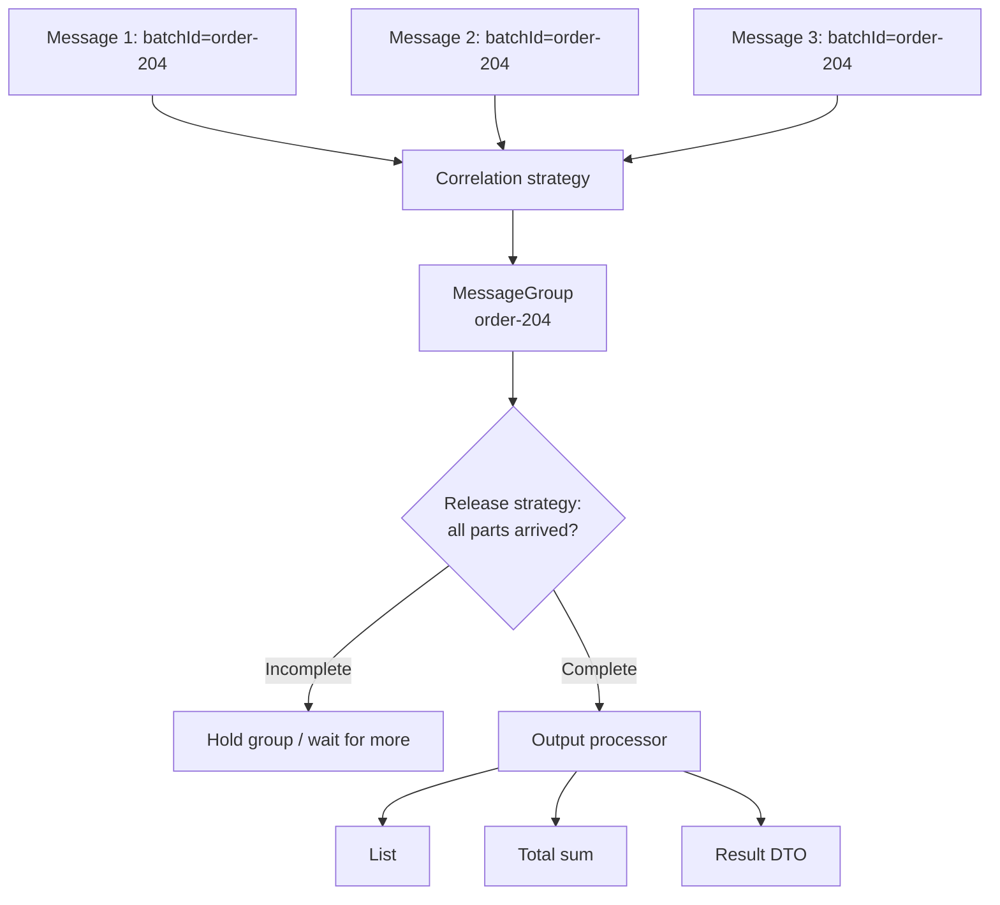
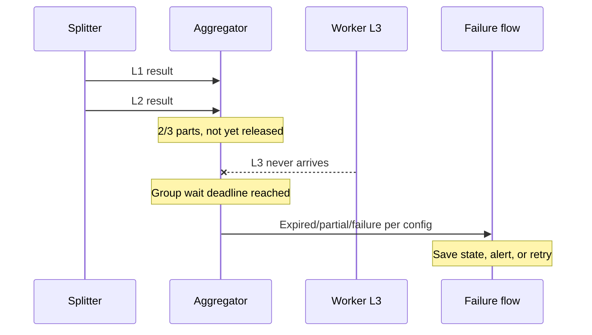
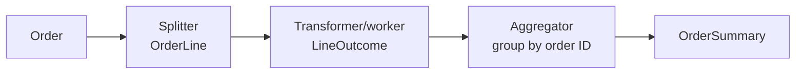
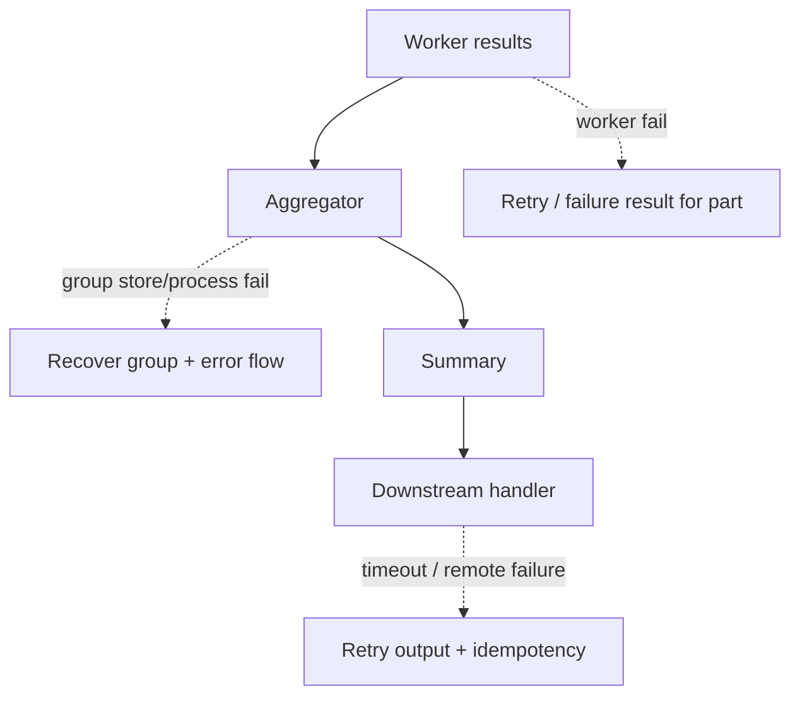
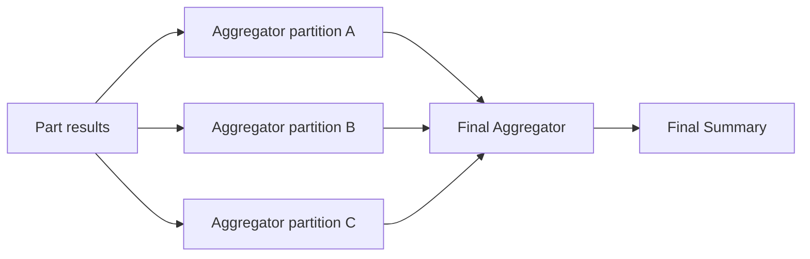

# Aggregating Payloads as a List, Sum, or Business Result

## 1. The Problem: Three Child Messages, One Aggregated Result

An order with three lines is split by a **Splitter** into three child messages. Each line undergoes inventory checking and pricing independently before being sent to an **Aggregator**:

```text
Batch: order-204
  Line L1: 100.00  SUCCESS
  Line L2:  35.50  SUCCESS
  Line L3:  10.00  FAILED
```

Given the same three input messages, business logic may demand three different output shapes:

1. **List:** retain all three `LineOutcome` objects so a downstream step reconciles details itself.
2. **Sum:** compute the total value of successful lines, which in this example is `135.50`.
3. **Business result:** build an `OrderSummary` containing the total, list of outcomes, failed lines, and overall status.

All three use **Aggregator**, differing in **how a `MessageGroup` is processed into an output payload**. At the same time, Aggregator must emit output only when the group satisfies the **release strategy**. If line L3 is missing or L2 is delivered twice, output can be wrong without careful design.

The lesson **"Aggregating Payloads as a List, Sum, or Business Result"** belongs to the **Aggregator** chapter of the **SPRING_INTEGRATION_PATTERN** module. This module teaches how to implement Enterprise Integration Patterns with Spring Integration to build loosely coupled, extensible message flows; practicing Router, Filter, Transformer, Splitter, Aggregator, Gateway, retry, error channel, and correlation, while testing and observing processing branches.

After this lesson, you will be able to:

- Clearly distinguish **correlation strategy**, **release strategy**, and **output/`MessageGroupProcessor`**.
- Use Java DSL to aggregate messages into a **Collection/List payload**, a **`BigDecimal` sum**, or a **business result DTO**.
- Design group keys, expected part counts, and ordering independent of message arrival order.
- Explain missing data, duplicates, late arrivals, timeouts, and already-released groups.
- Choose a `MessageGroupStore`, group retention/removal policies, and appropriate recovery strategies.
- Write unit tests and integration tests covering fan-in, not just the happy path.
- Avoid equating "three messages arrived" with "three valid results arrived" or "exactly once".

## 2. Aggregator Involves Three Distinct Decisions



A complete Aggregator answers three questions, in order:

| Component | Question | Example |
| --- | --- | --- |
| **Correlation strategy** | Which group does this message belong to? | Extract `batchId=order-204` |
| **Release strategy** | When is the group allowed to emit a result? | When all three expected lines are present |
| **Output processor / `MessageGroupProcessor`** | Upon release, what payload is the group transformed into? | List, BigDecimal, OrderSummary |

There is also **`MessageGroupStore`**: where messages waiting for one another are held. An Aggregator must maintain state across multiple message arrivals; it is not a stateless Transformer.

**Common conceptual mistake:** putting summation logic into the release strategy. The release strategy should only decide **whether release conditions are met**; computing values belongs to the output processor.

### What Does Sending a Message to Aggregator Mean?

- A message entering Aggregator may simply be stored with no output emitted yet.
- Once release conditions are met, Aggregator invokes the processor to build one result.
- The result is sent to the downstream channel.
- Aggregator emitting `OrderSummary` **does not prove** a downstream HTTP API or database succeeded.

Therefore, distinguish: **message received**, **message stored in group**, **group released**, **output dispatched**, **downstream business side effect committed**.

## 3. `MessageGroup` and Important Metadata

In Spring Integration, Aggregator typically groups `Message<?>` items by a **correlation key**. When messages come from a Splitter with suitable sequence headers enabled, they usually carry:

| Header | Meaning | Risk If Wrong |
| --- | --- | --- |
| `correlationId` | Group ID linking child messages | Two orders get mixed together |
| `sequenceNumber` | Position of the message in the sequence | Hard to identify duplicates/missing parts |
| `sequenceSize` | Expected total number of parts | Aggregator waits forever or releases early |
| `requestId` | Traces the overall request | Not necessarily equal to `correlationId` |
| `tenantId` | Security and data isolation scope | Mixing data across tenants |
| `eventId` / `lineId` | Stable business ID for deduplication | Duplicates get counted as new parts |

**Do not assume every message has sequence headers.** When messages are produced by multiple independent services, define an explicit input schema—such as `batchId`, `lineId`, `expectedCount`—rather than expecting Aggregator to guess how many parts a group has.

A good correlation key must be **stable**, not dependent on a framework-generated Message ID that can change when messages are transformed or redelivered.

### Correlation Scope Must Include Tenant When Needed

If two tenants both have `orderId=204`, using `orderId` alone can mix the two orders:

```text
Unsafe: correlationKey = "204"
Safer:  correlationKey = "tenant-A:order-204"
```

In production, use a typed key or safe encoding and authenticate the tenant at ingress. Never trust a client-declared `tenantId` header to make access-control decisions.

## 4. List-Shaped Output

### When to Choose a List?

Use a **payload list** when:

- Downstream needs **all detailed information** from every message.
- Summation rules live in a separate stage, or multiple distinct calculations are needed.
- You want to store individual task results for audit/reconciliation.
- You need to display every line's status, including failed lines.
- A downstream business task processes the entire list once all parts arrive.

Example:

```json
[
  {"lineId": "L1", "amount": 100.00, "success": true},
  {"lineId": "L2", "amount": 35.50, "success": true},
  {"lineId": "L3", "amount": 10.00, "success": false}
]
```

At the Java DSL level, a standard Aggregator's default output processor can produce a **collection payload** from the group's messages when no custom processor is configured.

```java
@Bean
IntegrationFlow aggregateAsList() {
    return IntegrationFlow.from("aggregate.list.in")
        .aggregate(spec -> spec
            .correlationStrategy(
                message -> batchKey(message))
            .releaseStrategy(group -> group.size() == 3))
        .channel("aggregate.list.out")
        .get();
}
```

This snippet is **part of the complete configuration in Section 8**, using the `batchKey(...)` helper and channels declared there.

**Important:** never assume output element order always matches L1, L2, L3. Messages can arrive out of order; if output depends on order, **sort by `sequenceNumber`/`lineId`** in a custom output processor and test ordering.

### Payload List Differs from Message List

In Aggregator, you might want:

- `List<LineOutcome>`: only business data needed.
- `List<Message<LineOutcome>>`: per-part headers also needed, e.g., correlation/trace.
- `OrderSummary`: typed result with explicit fields needed.

These shapes are not equivalent. Default output typically collects **payloads**, which does not mean it preserves every message's individual headers as a message list. When per-part metadata is needed, write a processor that builds a DTO containing the necessary facts or preserves messages per contract.

**Do not pick an arbitrary message's `requestId` to represent the whole group if parts can come from different requests/attempts.** Define group-level metadata explicitly.

## 5. Sum-Shaped Output

### When Is Only a Sum Needed?

Use **sum aggregation** when downstream only cares about a single reduced value:

- Total monetary amount of valid lines.
- Total item quantity.
- Total reward points across transactions in a group.
- Total duration or metric count within a window.

Example with three lines where L3 fails and is excluded:

\[
\text{successfulTotal} = 100.00 + 35.50 = 135.50
\]

A custom output processor can reduce the payload list:

```java
@Bean
IntegrationFlow aggregateAsSum() {
    return IntegrationFlow.from("aggregate.sum.in")
        .aggregate(spec -> spec
            .correlationStrategy(
                message -> batchKey(message))
            .releaseStrategy(group -> group.size() == 3)
            .outputProcessor(group -> group.getMessages()
                .stream()
                .map(message -> (LineOutcome) message.getPayload())
                .filter(LineOutcome::success)
                .map(LineOutcome::amount)
                .reduce(BigDecimal.ZERO, BigDecimal::add)))
        .channel("aggregate.sum.out")
        .get();
}
```

**Note:** this example sums **only successful lines**, not all inputs. Changing the filter changes the business meaning of the sum; name the result clearly such as `successfulTotal`, not a vague `total` if that could mislead.

### `BigDecimal` Instead of `double`

For money, use:

```java
BigDecimal total = amounts.stream()
    .reduce(BigDecimal.ZERO, BigDecimal::add);
```

Avoid:

```java
double total = values.stream()
    .mapToDouble(BigDecimal::doubleValue)
    .sum();
```

Converting to `double` introduces binary floating-point rounding errors. A `BigDecimal` result also requires specifying **unit, currency, and precision**. For instance, if a group contains both USD and VND, **they must not be added directly** merely because both use `BigDecimal`.

### What If Multiple Calculations Are Needed?

A `BigDecimal` output retains only the sum and loses the count of succeeded parts, the list of failed parts, or calculation version. If downstream also needs those details, return a **business result DTO** instead of running Aggregator twice or stuffing extra data into arbitrary headers.

## 6. Business-Result-Shaped Output

### Why Use a DTO Instead of List/`BigDecimal`?

An `OrderSummary` can answer several questions in one output:

```text
OrderSummary(
  batchId         = "order-204",
  successfulTotal = 135.50,
  receivedCount   = 3,
  successCount    = 2,
  failedLineIds   = ["L3"],
  lines           = [L1, L2, L3],
  status          = PARTIAL_FAILURE
)
```

Fields:

- `batchId`: correlation/business group ID.
- `successfulTotal`: explicitly defined total.
- `receivedCount`: how many parts Aggregator saw upon release.
- `successCount`: number of parts with success status.
- `failedLineIds`: parts that returned business failures.
- `lines`: deterministically sorted details.
- `status`: group-level status, such as `SUCCESS` or `PARTIAL_FAILURE`.

This is a **domain summary**, not proof that the group was saved to a database or a payment settled. Defining `SUCCESS`/`PARTIAL_FAILURE` must derive from each line's contract, not from `group.size()`.

### Output Selection Table

| Need | Suggested Output | Pros | Limitations |
| --- | --- | --- | --- |
| Inspect each part | `List<LineOutcome>` | Preserves details, flexible | Downstream must compute and validate |
| Compute a single metric | `BigDecimal` / `long` | Simple, lightweight | Loses details, provenance, part statuses |
| Make a business decision | `OrderSummary` | Clear contract, carries metrics and status | Must design schema/versioning |
| Aggregate results across services | `CompositeResult` | Captures success/failure per source | Needs expected set/timeout/dedup |
| Audit or investigation | DTO with group ID + parts + needed metadata | Traceable and reproducible | Must control sensitive data |

The first question is not "how do I call `aggregate()`?", but **"what result is downstream actually authorized to trust?"**

## 7. End-to-End Example: Data Model and Principles

We write three illustrative flows using the **same input type**, receiving on **three separate channels** to compare the three output shapes. Do not send the same message to three flows in real production if the goal is merely choosing one output format.

Model:

```java
import java.math.BigDecimal;
import java.util.List;

record LineOutcome(
        String batchId,
        String lineId,
        BigDecimal amount,
        boolean success) {}

enum BatchStatus {
    SUCCESS,
    PARTIAL_FAILURE
}

record OrderSummary(
        String batchId,
        BigDecimal successfulTotal,
        int receivedCount,
        int successCount,
        List<String> failedLineIds,
        List<LineOutcome> lines,
        BatchStatus status) {}
```

Business definitions:

- Each example group has **exactly three distinct lines**: L1, L2, L3.
- Each line carries the same `batchId` and a distinct `lineId`.
- `amount` must be non-null and non-negative.
- `successfulTotal` sums only amounts of lines with `success=true`.
- If any line fails, `BatchStatus=PARTIAL_FAILURE`.
- Output `lines` are **sorted by `lineId`** so tests and consumers do not depend on arrival order.
- Every `LineOutcome` in the group must belong to the same batch.
- `batchId` values must be tenant-scoped in production, not relying blindly on client-supplied order names.

**Important:** `group.size() == 3` in the demo only proves **three messages entered the group**, not that three `lineId`s are unique. With duplicates or varying counts, a stronger release strategy is required—covered in Sections 11–13.

## 8. Complete Java DSL: Three Aggregation Shapes

The following configuration registers three input `DirectChannel`s and three output `QueueChannel`s. Each flow uses similar correlation and release strategies so learners can observe differences in the **output processor**.

```java
import java.math.BigDecimal;
import java.util.Comparator;
import java.util.HashSet;
import java.util.List;
import java.util.Set;

import org.springframework.context.annotation.Bean;
import org.springframework.context.annotation.Configuration;
import org.springframework.integration.channel.DirectChannel;
import org.springframework.integration.channel.QueueChannel;
import org.springframework.integration.config.EnableIntegration;
import org.springframework.integration.dsl.IntegrationFlow;
import org.springframework.integration.store.MessageGroup;
import org.springframework.messaging.Message;

@Configuration
@EnableIntegration
public class AggregationByShapeConfig {

    @Bean("aggregate.list.in")
    DirectChannel listInput() {
        return new DirectChannel();
    }

    @Bean("aggregate.sum.in")
    DirectChannel sumInput() {
        return new DirectChannel();
    }

    @Bean("aggregate.result.in")
    DirectChannel resultInput() {
        return new DirectChannel();
    }

    @Bean("aggregate.list.out")
    QueueChannel listOutput() {
        return new QueueChannel();
    }

    @Bean("aggregate.sum.out")
    QueueChannel sumOutput() {
        return new QueueChannel();
    }

    @Bean("aggregate.result.out")
    QueueChannel resultOutput() {
        return new QueueChannel();
    }

    // Correlation by payload in demo; do not trust client batchId
    // without a validation / normalization step.
    static String batchKey(Message<?> message) {
        if (!(message.getPayload() instanceof LineOutcome line)
                || line.batchId() == null
                || line.batchId().isBlank()) {
            throw new IllegalArgumentException(
                "LineOutcome with batchId is required");
        }
        return line.batchId();
    }

    @Bean
    IntegrationFlow aggregateAsList() {
        return IntegrationFlow.from("aggregate.list.in")
            .aggregate(spec -> spec
                .correlationStrategy(
                    AggregationByShapeConfig::batchKey)
                .releaseStrategy(group -> group.size() == 3))
            .channel("aggregate.list.out")
            .get();
    }

    @Bean
    IntegrationFlow aggregateAsSum() {
        return IntegrationFlow.from("aggregate.sum.in")
            .aggregate(spec -> spec
                .correlationStrategy(
                    AggregationByShapeConfig::batchKey)
                .releaseStrategy(group -> group.size() == 3)
                .outputProcessor(group -> group.getMessages()
                    .stream()
                    .map(m -> (LineOutcome) m.getPayload())
                    .filter(LineOutcome::success)
                    .map(LineOutcome::amount)
                    .reduce(BigDecimal.ZERO, BigDecimal::add)))
            .channel("aggregate.sum.out")
            .get();
    }

    @Bean
    IntegrationFlow aggregateAsResult() {
        return IntegrationFlow.from("aggregate.result.in")
            .aggregate(spec -> spec
                .correlationStrategy(
                    AggregationByShapeConfig::batchKey)
                .releaseStrategy(group -> group.size() == 3)
                .outputProcessor(
                    AggregationByShapeConfig::toSummary))
            .channel("aggregate.result.out")
            .get();
    }

    static OrderSummary toSummary(MessageGroup group) {
        List<LineOutcome> lines = group.getMessages()
            .stream()
            .map(m -> (LineOutcome) m.getPayload())
            .sorted(Comparator.comparing(LineOutcome::lineId))
            .toList();

        if (lines.size() != 3) {
            throw new IllegalStateException(
                "Demo expects exactly three lines");
        }

        String batchId = String.valueOf(group.getGroupId());
        Set<String> distinctLineIds = new HashSet<>();

        for (LineOutcome line : lines) {
            if (line.lineId() == null || line.lineId().isBlank()
                    || !batchId.equals(line.batchId())
                    || line.amount() == null
                    || line.amount().signum() < 0
                    || !distinctLineIds.add(line.lineId())) {
                throw new IllegalArgumentException(
                    "Invalid/duplicate line in group");
            }
        }

        BigDecimal successfulTotal = lines.stream()
            .filter(LineOutcome::success)
            .map(LineOutcome::amount)
            .reduce(BigDecimal.ZERO, BigDecimal::add);

        List<String> failed = lines.stream()
            .filter(line -> !line.success())
            .map(LineOutcome::lineId)
            .toList();

        int successCount = lines.size() - failed.size();

        return new OrderSummary(
            batchId,
            successfulTotal,
            lines.size(),
            successCount,
            failed,
            lines,
            failed.isEmpty()
                ? BatchStatus.SUCCESS
                : BatchStatus.PARTIAL_FAILURE);
    }
}
```

### Reading the Three Flows

**List flow:** no custom `outputProcessor` is declared, so Aggregator collects payloads by default in this configuration. Collection output suits detailed inspection.

**Sum flow:** provides a custom `outputProcessor` using `BigDecimal::add` and summing only successful lines. Output is a single numeric value.

**Result flow:** custom processor returns an `OrderSummary`, sorts by `lineId`, checks for duplicates and matching group IDs, and computes total/status. Output can be consumed immediately by downstream business logic.

All three flows currently use a **fixed group size of 3**. That is a simple choice for learning semantics, **not** a production recommendation for every system. Note that class/helper names and APIs should be checked against your project's Spring Integration version.

### Why Three Separate Input Channels?

If three flows subscribe to one `DirectChannel`, they **do not automatically** all receive the same message. `DirectChannel` is a point-to-point channel via its dispatcher, not broadcast. In this lesson, three independent channels let us test three aggregation shapes without creating competing subscribers or accidentally emitting multiple parallel outputs when only one is wanted.

If the real goal is sending the same event to multiple consumers, consider `PublishSubscribeChannel` or Recipient List and evaluate fan-out risks separately.

## 9. Testing Aggregator by Output Shape

Use JUnit 5, Spring Test, and AssertJ. Each test uses a distinct batch ID to avoid leftover groups from other tests in the same `ApplicationContext`.

### 9.1. Shared Fixture

```java
import static org.assertj.core.api.Assertions.assertThat;

import java.math.BigDecimal;

import org.springframework.beans.factory.annotation.Autowired;
import org.springframework.beans.factory.annotation.Qualifier;
import org.springframework.integration.channel.QueueChannel;
import org.springframework.messaging.Message;
import org.springframework.messaging.MessageChannel;
import org.springframework.messaging.support.MessageBuilder;
import org.springframework.test.context.junit.jupiter.SpringJUnitConfig;
import org.junit.jupiter.api.Test;

@SpringJUnitConfig(AggregationByShapeConfig.class)
class AggregationByShapeTest {

    @Autowired @Qualifier("aggregate.list.in")
    MessageChannel listIn;

    @Autowired @Qualifier("aggregate.sum.in")
    MessageChannel sumIn;

    @Autowired @Qualifier("aggregate.result.in")
    MessageChannel resultIn;

    @Autowired @Qualifier("aggregate.list.out")
    QueueChannel listOut;

    @Autowired @Qualifier("aggregate.sum.out")
    QueueChannel sumOut;

    @Autowired @Qualifier("aggregate.result.out")
    QueueChannel resultOut;

    private void send(
            MessageChannel input,
            String batch,
            String line,
            String amount,
            boolean success) {
        LineOutcome outcome = new LineOutcome(
            batch, line, new BigDecimal(amount), success);

        assertThat(input.send(
            MessageBuilder.withPayload(outcome)
                .setHeader("requestId", "req-" + batch)
                .build())).isTrue();
    }

    @Test
    void listOutputWaitsThenContainsThreePayloads() {
        send(listIn, "batch-list", "L2", "35.50", true);
        send(listIn, "batch-list", "L1", "100.00", true);

        assertThat(listOut.receive(0)).isNull();

        send(listIn, "batch-list", "L3", "10.00", false);

        Message<?> output = listOut.receive(1_000);
        assertThat(output).isNotNull();

        assertThat((java.util.Collection<?>) output.getPayload())
            .containsExactlyInAnyOrder(
                new LineOutcome("batch-list", "L1",
                    new BigDecimal("100.00"), true),
                new LineOutcome("batch-list", "L2",
                    new BigDecimal("35.50"), true),
                new LineOutcome("batch-list", "L3",
                    new BigDecimal("10.00"), false));

        assertThat(listOut.receive(0)).isNull();
    }

    @Test
    void sumOutputAddsOnlySuccessfulAmounts() {
        send(sumIn, "batch-sum", "L1", "100.00", true);
        send(sumIn, "batch-sum", "L2", "35.50", true);

        assertThat(sumOut.receive(0)).isNull();

        send(sumIn, "batch-sum", "L3", "10.00", false);

        Message<?> output = sumOut.receive(1_000);
        assertThat(output).isNotNull();
        assertThat((BigDecimal) output.getPayload())
            .isEqualByComparingTo(new BigDecimal("135.50"));
    }

    @Test
    void domainResultReportsPartialFailureAndStableOrder() {
        send(resultIn, "batch-result", "L3", "10.00", false);
        send(resultIn, "batch-result", "L1", "100.00", true);
        send(resultIn, "batch-result", "L2", "35.50", true);

        Message<?> output = resultOut.receive(1_000);
        assertThat(output).isNotNull();

        OrderSummary summary = (OrderSummary) output.getPayload();

        assertThat(summary.batchId()).isEqualTo("batch-result");
        assertThat(summary.successfulTotal())
            .isEqualByComparingTo(new BigDecimal("135.50"));
        assertThat(summary.receivedCount()).isEqualTo(3);
        assertThat(summary.successCount()).isEqualTo(2);
        assertThat(summary.status())
            .isEqualTo(BatchStatus.PARTIAL_FAILURE);
        assertThat(summary.failedLineIds())
            .containsExactly("L3");
        assertThat(summary.lines().stream()
            .map(LineOutcome::lineId).toList())
            .containsExactly("L1", "L2", "L3");
    }
}
```

The three tests verify different contracts:

- **List:** waits for all three parts; does not assume arrival order is business order.
- **Sum:** adds only successful parts; uses `BigDecimal`.
- **Result:** returns total, part counts, failed IDs, and stable ordering.

This is a Spring Integration test inside a **single application context**, not a broker or persistent `MessageGroupStore` test. If replacing `DirectChannel` with an executor/poller, wait with a bounded timeout and verify async results; never use `Thread.sleep()` to assume output appeared.

## 10. Do Not Confuse Group Size with Valid Result Set

Scenario:

```text
batch-204:
  message 1: lineId=L1, success=true
  message 2: lineId=L1, success=true  ← duplicate delivery
  message 3: lineId=L2, success=true
  message 4: lineId=L3, success=true  ← arrives later
```

If the release strategy only uses `group.size() == 3`, the group may release right at the third message, even though there are only **two unique line IDs**. Both the list and sum outputs will be wrong; L3 arriving later may hit an already-completed group state.

If the duplicate retains the exact **Message ID**, some stores may detect it and not add it like a brand-new message; however, **at-least-once redelivery can generate a different Message ID**. Never rely on Message ID to detect business duplicates.

### How to Solve It

- Attach a stable `lineId` or `businessPartId` to each part.
- Deduplicate using a key like `(batchId, lineId, processingVersion)`.
- If parts come from a Splitter, understand and preserve `sequenceNumber`/`sequenceSize`.
- Release only when the **required set of parts** is satisfied, not merely when the group reaches a size.
- Have separate policies for **duplicates after completion** and **duplicates while in progress**.
- Test out-of-order arrivals, duplicates before release, and duplicates after release.

A more robust approach when three line IDs are known upfront:

```java
// Idea for ReleaseStrategy, assuming inputs are already
// validated and the group has an exact expected set:
// do not use group.size() alone as the completion condition.
boolean complete(MessageGroup group) {
    Set<String> actualIds = group.getMessages().stream()
        .map(m -> (LineOutcome) m.getPayload())
        .map(LineOutcome::lineId)
        .collect(java.util.stream.Collectors.toSet());

    return actualIds.containsAll(
        Set.of("L1", "L2", "L3"));
}
```

**Snippet limitation:** if a group contains line IDs outside the expected set, `containsAll` still returns true. Production must additionally validate **no parts outside the expected set**, check tenant, group identity, and version policy, while ensuring duplicates do not cause memory blowups.

A dynamic expected set must come from an **authoritative source** (Splitter snapshot, persisted plan, or trusted metadata) and never be silently altered while the group is waiting.

## 11. `SequenceSizeReleaseStrategy` and Custom `ReleaseStrategy`

Spring Integration supports **`ReleaseStrategy`** for Aggregator. In flows using Splitter, child messages usually carry `correlationId`, `sequenceNumber`, and `sequenceSize` so Aggregator can determine when all expected parts are present.

A concise configuration can rely on proper sequence headers instead of hardcoding 3:

```java
@Bean
IntegrationFlow aggregateSplitResults() {
    return IntegrationFlow.from("split.results.in")
        .aggregate()
        .channel("split.results.out")
        .get();
}
```

This relies on Aggregator's **default correlation/release/output processing** according to the framework version and Splitter-generated data. **Ensure sequence headers are actually preserved**; if stripped by a Transformer or adapter, Aggregator may fail to group or release as expected.

### When Should You Write a Custom Release Strategy?

- Groups have variable part counts based on a persisted business plan.
- Results from **mandatory** sources are required, while optional sources have separate deadlines.
- A part may report `SKIPPED` or `FAILED` yet still counts as "responded".
- You must verify all business IDs, not just message count.
- A completion marker event exists independent of part count.
- You need to release when all mandatory parts arrive or a business condition is met.

If the release rule depends on slow HTTP/DB calls, consider attaching that data to group context beforehand rather than making `ReleaseStrategy` perform heavy I/O on every arriving message.

### Watch Out for `group.size() >= expectedCount`

A `>=` check reduces the risk of a group never releasing if extra messages arrive, yet **does not fix duplicates**. If a group holds two copies of L1 and one L2, it still reaches `expectedCount=3` while L3 has not arrived.

## 12. "Sum" Must Have Defined Business Rules

Addition is simple, but the meaning of the result is not:

| Question | Example | Must Specify |
| --- | --- | --- |
| Which lines are summed? | One line FAILED | Sum of succeeded lines, all lines, or confirmed lines? |
| Are currencies the same? | USD + VND | Is conversion at a locked rate needed? |
| Can numbers be negative? | Refund or adjustment | Allowed, and under what rules? |
| What precision? | Taxes/fractional fees | `BigDecimal` scale, rounding, effective rate |
| What about duplicates? | L1 redelivery | Deduplicate before reducing |
| What about missing parts? | L3 timeout | Return partial total, fail, or wait? |
| What about data versions? | L2 price changed | Which price and version does the result use? |
| Must the sum be explainable? | Financial audit | Store line IDs, amounts, and calculation version |

For instance, `successfulTotal=135.50` in this lesson does not necessarily equal the **order's collectible total**. It is merely the sum of `LineOutcome`s reporting success in the received group. When a line has `FAILED`, downstream must never blindly use that value as a final payment total if business rules require all lines to succeed.

### Associativity and Parallel Reduction

Exact `BigDecimal` arithmetic addition is associative if no rounding is interleaved between steps. However, with per-line currency conversion and rounding, "convert then sum" can differ from "sum then convert." Define explicitly where rounding happens—do not assume from the name Aggregator that both are equivalent.

## 13. Handling Success/Failure/Timeout Results

Aggregator inputs do not have to be only successful data. When three services reply, they may return:

```text
Shipping: SUCCESS(amount=15)
Tax:      SUCCESS(amount=5)
Discount: FAILED(reason=UPSTREAM_UNAVAILABLE)
```

If the requirement is "produce an aggregated result even when one service fails," the failing service should usually emit a **failed-status result envelope** to the group rather than returning no reply without a policy.

Example types:

```java
enum TaskResultStatus {
    SUCCESS,
    FAILED,
    SKIPPED
}

record TaskOutcome(
    String requestId,
    String sourceId,
    TaskResultStatus status,
    BigDecimal amount,
    String errorCode) {}
```

Once Aggregator receives all three response envelopes, it can release a DTO like `CompositeResult` containing both successes and failures.

Conversely, if a service **returns no reply**, the group can wait forever when using only a size condition. Handle timeouts/durable state rather than assuming a failing service automatically produces a `FAILED` message.

### Three Possible Policies

| Policy | Behavior | When Appropriate |
| --- | --- | --- |
| **All-or-nothing** | If any part fails, emit group failure; commit no final side effects | Workflows requiring all steps to succeed |
| **Partial result** | Return DTO with successes/failures and mark incomplete | Dashboards or processes allowing partial handling |
| **Timeout with recovery** | On expiry, keep group state, emit error/partial per contract, allow fix/replay | Unstable remote services where waiting forever is impossible |

An Aggregator does not implement all those policies automatically. Configure release, group timeout/expiration, and output processor appropriately alongside recovery flows.

## 14. Timeouts and Groups That Never Reach Full Count

An example:



If you only write `releaseStrategy(group -> group.size() == 3)` with no incomplete-group rule, groups can stay in `MessageGroupStore` too long, growing memory/disk and degrading the system.

Spring Integration supports options for **group timeout, expiration, partial-result release, and discard channels** depending on endpoint/version. These options have distinct semantics; never assume setting a Gateway timeout automatically deletes groups from `MessageGroupStore`.

### What If the Group Has All Parts Yet Output Processing Fails?

A `MessageGroupProcessor` can throw an exception when mapping wrong payload types, detecting duplicates, or finding missing required data. Understand that this exception happens at **release time**, not when the first message arrives.

Decide:

- Should the group be kept for fixing and replay?
- Has the group already been locked/marked complete?
- Can another output be generated after fixing data?
- If output was already emitted yet downstream failed, can delivery be retried without recomputing the group?

Exact behavior depends on `MessageGroupStore`, transactions, and endpoint configuration. Never use `try/catch → return BigDecimal.ZERO` to swallow errors when `0` could be mistaken for a valid total.

## 15. `MessageGroupStore` and Aggregation Durability

Aggregator is **stateful**. It may receive L1 at 09:00, L2 at 09:01, and L3 at 09:03. Group state must survive between those three arrivals.

| Store | Capability | Limitations |
| --- | --- | --- |
| In-memory `MessageGroupStore` | Simple, fast, easy to demo | Loses state on process restart; not shared across instances |
| JDBC/persistent `MessageGroupStore` | Can retain groups across restarts per config | Needs schema, transactions, cleanup, and concurrency |
| Appropriate distributed store | Allows multiple instances to coordinate by key | Must test locking, network, group consistency |
| External event/workflow state | Actively manages parts and completion in DB | More complex, yet flexible for SLAs/audits |

If multiple instances receive messages for the same `batchId` while each uses its own in-memory store, each node may see only a subset and **never release**. You must either:

1. Keep messages of the same group on the same consumer/partition, **or**
2. Use a group store/locking designed for multiple instances, **or**
3. Route parts to an Aggregator service with clear group ownership.

**A persistent store does not mean exactly-once.** Brokers can redeliver after commit, and `MessageGroupStore` needs proper idempotency/transactions to avoid emitting duplicate outputs or double-counting processed parts.

### Where Does the Group Go After Release?

Policies exist to retain, delete, or mark completed groups. If a group is deleted completely, a late message can start a **new group with the same correlation key**; if completed state is retained, it can be rejected or routed to a discard flow per configuration.

A design must specify:

- Are **late arrivals** allowed after completion?
- Can a group release multiple times, e.g., sliding windows/partial results?
- How long are completed groups retained to recognize duplicates?
- What cleans up groups and records expirations?
- Does replaying the same request reuse the old group ID or create a controlled revision?

Never assume "once released, it's over" when upstream uses at-least-once delivery.

## 16. Late Arrivals and Duplicates After Output Is Emitted

Suppose all three results released, then L3 is redelivered because a consumer lost its ack:

```text
09:00  L1 received
09:01  L2 received
09:02  L3 received -> OrderSummary released
09:03  duplicate L3 arrives
```

If group lifecycle and duplicate detection are unclear, the system may:

- Discard the duplicate properly.
- Accept an unexpected extra part.
- Create a new group with the same batch ID.
- Emit a second summary.

Hence **idempotency is required at both levels**:

1. **Part level:** a key like `(tenantId, batchId, lineId, resultVersion)` so one part is never counted twice.
2. **Output level:** a key like `(tenantId, batchId, summaryRevision)` so downstream never writes duplicate `OrderSummary` records when Aggregator or the broker redelivers.

If output calls a payment/inventory API, apply idempotency per that API's contract. Releasing once inside Aggregator's memory **does not guarantee** downstream side effects happen only once.

## 17. Aggregator with Splitter, Router, and Recipient List

### Splitter → Transformer → Aggregator

This is a very common topology:



When Splitter creates child messages, it usually attaches `correlationId` and sequence metadata. Intermediate Transformers must **preserve required headers**; building a brand-new `Message` that drops correlation can cause Aggregator to misgroup or never release.

### Recipient List → Multiple Services → Aggregator

If a request goes to Shipping, Tax, and Discount, Aggregator must know the **selected service set**. A Recipient List might choose only two of the three depending on conditions. If Aggregator always waits for all three, the group stalls.

The solution is saving the expected recipient set at fan-out time (e.g., Shipping + Tax), or emitting a meaningful `SKIPPED` result for unselected sources. Never infer `expectedCount` from the total number of deployed adapters.

### Router Before Aggregator

If a Router splits data into branches with different contracts, ensure every branch returns a compatible message to Aggregator. A branch where a Filter drops a message without emitting a signal can leave the group missing an expected part.

In particular, a **Filter** between Splitter and Aggregator can prevent the default sequence-size release strategy from ever succeeding; redesign the completion policy/partial-result handling or emit markers.

## 18. Correlation and Common Grouping Bugs

| Mistake | Outcome | Prevention |
| --- | --- | --- |
| Using `MessageHeaders.ID` as group key | Every part forms its own new group | Use a stable business correlation ID |
| Same ID across multiple tenants | Cross-tenant data mixing | Include verified tenant in key |
| Sequence headers lost | Group fails to release as expected | Test headers across Transformers/adapters |
| Same line sent twice | Group size met before all lines arrive | Deduplicate by business part ID |
| Client sets `expectedCount` arbitrarily | Can release early or hang forever | Take expected set from an authoritative source |
| L1 from old revision mixed with L2 from new revision | Inconsistent total | Include processing revision/version in correlation |
| Multiple currencies in one group | Meaningless total | Validate currency / convert at fixed versioned rate |
| Worker sends result to wrong group | Corrupted output | Validate batch/tenant/source at Aggregator |
| Re-reading current prices during replay | Total differs from original processing time | Store snapshots/versions of used facts |

### Must the Correlation Key Always Be a Header?

No. `CorrelationStrategy` can compute the key from payload, headers, or trusted context per configuration. In Section 8's demo, `batchKey(...)` reads from `LineOutcome.batchId`. With standard Splitters, many flows use the framework-generated correlation header.

What matters is not a fixed header slot, but a **stable contract across steps** that cannot be tampered with by untrusted input.

## 19. Observing Aggregator by Group

An Aggregator may emit no output for seconds or minutes; there is no obvious error, yet a backlog is accumulating. Observability must therefore include **the state of waiting groups**.

Suggested metrics:

| Application Metric | Meaning |
| --- | --- |
| `aggregator.messages.received.total` | Total incoming messages |
| `aggregator.groups.open` | Number of unreleased groups |
| `aggregator.group.size.distribution` | Part count per group |
| `aggregator.groups.released.total` | Number of groups that emitted output |
| `aggregator.groups.expired.total` | Number of expired groups |
| `aggregator.output.failed.total` | Output processing/dispatch errors |
| `aggregator.duplicates.total` | Duplicate parts detected |
| `aggregator.group.wait.duration` | Time from first part to release |
| `aggregator.late.arrivals.total` | Messages arriving after group completion |
| `aggregator.partial.results.total` | Outputs missing some successful parts |

These are **metric names an application can design**, not a claim that Spring Integration emits all of them verbatim by default. Never place raw `orderId`/`batchId` values as metric labels, as cardinality can grow unbounded.

Suggested structured log:

```text
event=aggregation_group_released
batchId=order-204
tenantScope=tenant-A
expectedParts=3
receivedParts=3
uniqueBusinessParts=3
aggregationShape=ORDER_SUMMARY
successfulTotal=135.50
failedPartCount=1
releaseReason=ALL_EXPECTED_RESULTS
processingRevision=1
```

When logging monetary amounts or sensitive facts, apply the application's privacy/audit policies. Some environments only allow logging counts or hashed/anonymized summaries.

### Do Not Confuse "Aggregator Released" with "Downstream Committed"

Once `OrderSummary` is sent to `QueueChannel`, output may not yet have been processed by its consumer. If downstream writes to the database and loses its ack, output can be redelivered. Monitoring therefore needs status/acks from the **post-Aggregator consumer** if business rules require end-to-end confirmation.

## 20. Errors and Retries: Which Part Should Be Retried?

Distinguish three failure layers:

1. **Failure in worker producing part result:** L3 fails calculation or times out calling a service. Retry **worker L3** with proper idempotency; or emit `LineOutcome(success=false)` if policy accepts failed outcomes.
2. **Failure inside Aggregator:** bad correlation, invalid payload, `MessageGroupStore` error, output processor throws exception. Retries/recovery must preserve the group and respect store transactions/lifecycles.
3. **Failure downstream after Aggregator:** sending `OrderSummary` to payment/DB fails. Retry **output delivery**, avoiding recomputing the group unnecessarily.



**Never** wrap the entire `Splitter → workers → Aggregator → outbound` pipeline in a blanket retry if workers or outbound adapters have side effects. That can duplicate partial results or already committed business actions.

### Error Channel

With synchronous channels, exceptions during Aggregator processing can propagate to the caller. With polling consumers/executors/brokers, errors may occur on worker threads and route to an error flow per configuration.

Do not assume every exception automatically flows to a global `errorChannel` or that failed messages remain in the store. Test actual behavior when `MessageGroupProcessor` throws, when a group has already released, and when transactions roll back.

## 21. Computing Sums by Stream, Window, or Incremental State

List aggregation and sum aggregation differ significantly in memory footprint.

**Collect-all then calculate:** retains all payloads then builds output. Easy to debug and audit per part, yet requires memory proportional to group size.

**Incremental aggregation:** updates totals/counters as each part arrives. Saves memory by keeping small state, yet requires idempotency and an anti-duplicate state model so the same part is never added twice. A naive running sum cannot self-correct when a part arrives late or replays without knowing whether that part was already counted.

Illustrative example:

```text
State(group):
  seenPartKeys = {L1, L2}
  total = 135.50
  successCount = 2
  expectedPartKeys = {L1, L2, L3}
```

When L2 arrives again, checking `seenPartKeys` must occur **atomically** with updating the total. Otherwise, two parallel workers could both increment `total`. When part counts are small, storing the full message group in `MessageGroupStore` and using a custom output processor is usually easier to verify.

**Note:** the incremental algorithm above is not the default of Spring Integration Aggregator in the DSL demo. It is a specialized design option when throughput, payload sizes, or memory usage demand it.

## 22. Performance, Backpressure, and Group Limits

An Aggregator always carries the risk of growing state when final results go missing. Design at minimum:

- **Maximum open groups** or per-tenant quotas.
- **Maximum messages per group** and validation against event spam.
- **Group timeout** and expired/partial result policies.
- **Retention/cleanup** for completed groups.
- **Backpressure** toward input channels, brokers, or workers.
- **Concurrency**: two messages for the same group can arrive simultaneously.
- **Message store throughput** and lock contention.
- **Payload limits** when collecting full Lists.
- **Retry storm protection** when many workers time out together.
- **Group lifetime** surviving deployments/restarts if SLAs require it.

If each request has 100,000 parts carrying 100 KB each, collect-all in memory may be infeasible. Switch to snapshots in external stores, batch/stream processing, or hierarchical aggregation. Re-evaluate release, late-arrival, and idempotency semantics accordingly.

### Hierarchical Aggregators

A problem with 1 million parts can aggregate per region/partition first, then aggregate higher-level results:



With hierarchical aggregation, lower-level and upper-level correlation keys differ; clarify **partition revisions, expected partitions, retry/idempotency**, and how to handle a partition re-emitting its summary.

## 23. Testing Edge Cases

For a reliable Aggregator, a happy path of three in-order messages is insufficient. Below is a required test matrix:

| Case | Expectation |
| --- | --- |
| L1, L2, L3 arrive in order | Correct output |
| L3 arrives before L1 | Still correct output, List/DTO ordered per contract |
| Only L1, L2 received | Does not release if 3 parts required |
| L1 repeated twice, L3 missing | **Does not** treat duplicate as a valid new part |
| Same `lineId` in different batches | Placed in two separate groups |
| Same batch ID in different tenants | Never mixed |
| One part has null amount or wrong currency | Classified error raised, no fake total emitted |
| One part FAILED | Summary reflects partial failure; total follows policy |
| Group complete, output processor throws | Appropriate error/recovery path executes |
| L3 arrives after timeout | Follows late-arrival policy, never silently creates new output |
| Output emitted, consumer redelivers | Idempotency at output consumer |
| Restart before group completes | If durability required, state recovers |
| Two workers send simultaneously | Group store/locking/dedup stay consistent |
| Filter drops a part | Release/timeout does not hang indefinitely |
| Wrong `sequenceSize` | Validation/recovery instead of keeping broken group |
| One source emits `SKIPPED` | Expected set/release handles skip semantics properly |

### Testing Processor Business Logic Without Spring

`toSummary(MessageGroup group)` is separated from the DSL so it can be unit tested with a fake/test group or an appropriate `MessageGroup` implementation. Beyond the happy path, test:

- Duplicate `lineId` → exception.
- `batchId` mismatching group ID → exception.
- Null or negative `amount` → exception.
- L1/L2/L3 arriving in any permutation → same total and output order.
- A `FAILED` line → `PARTIAL_FAILURE` and accurate error list.
- Version/currency mismatch → rejected per extended contract.

**Do not put all validation solely inside the output processor.** If a group already released early due to duplicates, the processor catching the error is necessary yet cannot fix the missing part arriving late. Coordinate validation/dedup/release upfront.

## 24. Troubleshooting: Symptoms and Causes

| Symptom | Possible Cause | What to Check |
| --- | --- | --- |
| No output despite many messages | Wrong correlation key or `sequenceSize` unmet | Log group ID, expected count, size, and release reason |
| Two batches merged together | Key lacks tenant/version or gets overwritten | Inspect correlation contract |
| Output list missing/duplicating parts | Duplicates, Filter drops, store/lifecycle | Deduplicate by business part ID and inspect stored group |
| Wrong total amount | Added duplicates, mixed currencies, used `double` | `BigDecimal`, currency validation, idempotency |
| Premature result | Count-based release counted duplicates | Release by expected unique part set |
| Groups never cleaned up | Missing expiration/reaper/cleanup config | Monitor open groups, timeouts, store retention |
| Late message produces second summary | Group was deleted completely | Design completed-group/tombstone, late-arrival policy |
| Fails only after restart | In-memory store | Use persistent group state and test restarts |
| Some instances never complete groups | Distributed state unshared | Co-locate/partition by group or use proper shared store |
| Aggregator throws yet misses `errorChannel` | Synchronous failure or unconfigured error flow | Inspect thread/poller/executor/adapter details |
| Gateway times out waiting for summary | Missing part or wrong release policy | Configure group timeout and separate end-to-end deadline |
| Output processed twice | Retry/consumer redelivery after release | Output idempotency by batch/revision |
| Memory grows after every batch | Groups never expire or oversized payloads | Store metrics, cleanup, and incremental design |

## 25. Hands-On Exercises

### Exercise 1 — Payload List

Use `aggregateAsList()` from Section 8. Send three `LineOutcome`s in order L3, L1, L2 with the same batch ID. Verify output is a collection of all three payloads. Write assertions independent of arrival order. Try omitting L2 and prove it does not release.

### Exercise 2 — `BigDecimal` Sum

Use `aggregateAsSum()`. Two succeeded lines have amounts 19.95 and 35.50; one failed line has 10.00. Expected total is 55.45. Add test cases for negative amounts, mixed currencies, and duplicates to see why a bare reduce is insufficient.

### Exercise 3 — Output DTO

Extend `OrderSummary` with `processingRevision` and `currencyCode`. Write an output processor and unit tests for three succeeded parts, one failed part, and a multi-currency group. Require rejecting currency conflicts instead of silently adding USD + VND.

### Exercise 4 — Count Met Yet Line IDs Incomplete

Send L1, L1, L2 for a batch expecting L1, L2, L3. First observe the demo `group.size()==3` behavior. Then write a dedup gate and an expected-set release strategy. Expected result: no release before L3 arrives.

### Exercise 5 — Splitter and Sequence Headers

Create an `Order` with four lines, Splitter splits into four messages, Transformer converts to `LineOutcome`. Verify `correlationId`, `sequenceNumber`, and `sequenceSize` survive the Transformer. Use Aggregator to combine into a list and deliberately drop one sequence header to observe the failure.

### Exercise 6 — Partial Result with Timeout

Three services—Shipping, Tax, Discount—return results, yet Discount goes silent for 10 seconds. Design `groupTimeout` and a policy returning partial results or failure per requirements. Specify what the application must do when Discount replies late; never silently emit a second result without a revision.

### Exercise 7 — Multi-Instance and Persistent Store

Run two workers handling the same group ID. Compare per-instance in-memory `MessageGroupStore` with a unified store/partitioning design. Simulate a restart after L1 and L2; require L3 arriving post-restart to complete the group when durability is needed.

### Exercise 8 — Retries and the Exactly-Once Illusion

Aggregator emitted `OrderSummary`, downstream wrote to the database, and the process crashed before ack. Broker redelivers the output. Design idempotency by `(tenantId, batchId, summaryRevision)` and prove side effects do not double.

### Exercise 9 — Hierarchical Aggregators

Group 1000 lines into 10 partitions, each emitting a partial sum. Design correlation keys at both levels, final `expectedCount`, partition-result deduplication, and handling a non-responding partition. Explain why summing partial sums must also use `BigDecimal` and preserve currency.

### Exercise 10 — Observability

Define dashboards/alerts for open groups, oldest group age, expired groups, duplicates, partial summaries, and `MessageGroupStore` errors. Add a runbook distinguishing: worker not emitting messages, wrong correlation, wrong release strategy, and non-durable group store.

**Completion criteria:** learners must state the **required output type**, **which group each message belongs to**, **when release occurs**, **how a part is counted on redelivery**, **how missing/late arrivals are handled**, and **how results are safely consumed downstream**.

## 26. Pre-Production Deployment Checklist

- [ ] Stable correlation key, including tenant/revision when needed.
- [ ] Input messages carry business part IDs for deduplication.
- [ ] Expected count/set comes from a trusted source.
- [ ] Release strategy never mistakes duplicates for new parts.
- [ ] Output shape (List, BigDecimal, DTO) has an explicit contract.
- [ ] Totals define success/failure/currency/precision rules.
- [ ] Output processor does not depend on arrival order unless required by contract.
- [ ] Incomplete groups have timeout/expiration/recovery policies.
- [ ] Late arrivals after release have an explicit policy.
- [ ] `MessageGroupStore` is persistent or in-memory aligned with SLAs.
- [ ] Multi-instance setups have consistent partitioning/group locking.
- [ ] Retention/cleanup exists for completed/expired groups.
- [ ] Error flows distinguish worker errors, aggregator errors, and downstream errors.
- [ ] Retries never duplicate side effects; output consumers are idempotent.
- [ ] Splitter/Transformer preserve correlation and sequence headers per contract.
- [ ] Aggregator never mixes messages across tenants/data versions.
- [ ] Metrics cover open groups, group age, expirations, duplicates, and output failures.
- [ ] Tests cover success, partial, duplicates, missing, late arrivals, concurrency, and restarts.
- [ ] Sensitive payloads/PII/tokens are not logged, nor are group IDs used as high-cardinality metric labels.
- [ ] Plan exists for schema/expected-set changes and replays during new-version deployments.

## 27. Summary

In Spring Integration, Aggregator is a stateful component for **combining multiple correlated messages into one result**, while how that result is shaped is a separate business decision:

- **List:** retains payloads for downstream inspection or detailed processing.
- **Sum:** reduces payloads into a single value like `BigDecimal` per approved calculation rules.
- **Business result:** builds a DTO such as `OrderSummary` containing totals, part lists, success/failure statuses, and required metadata.

**Correlation strategy selects the group**, **`ReleaseStrategy` decides when the group is eligible**, and **`MessageGroupProcessor` decides the output**. Missing any one of these three contracts can cause Aggregator to emit bad results, wait forever, or mix data.

In production, quality also depends on duplicate detection, expected sets, timeouts, `MessageGroupStore`, group lifecycle, and downstream idempotency. **An emitted output does not automatically mean the final business action committed exactly once.**

## References

- [Spring Integration Reference — Aggregator](https://docs.spring.io/spring-integration/reference/aggregator.html)
- [Spring Integration Reference — Correlation and Release Strategies](https://docs.spring.io/spring-integration/reference/aggregator.html)
- [Spring Integration Reference — Message Group Store](https://docs.spring.io/spring-integration/reference/message-store.html)
- [Spring Integration Reference — Splitter](https://docs.spring.io/spring-integration/reference/splitter.html)
- [Spring Integration Reference — Java DSL](https://docs.spring.io/spring-integration/reference/dsl.html)
- [Spring Integration Reference — Error Handling](https://docs.spring.io/spring-integration/reference/error-handling.html)
- [Enterprise Integration Patterns — Aggregator](https://www.enterpriseintegrationpatterns.com/patterns/messaging/Aggregator.html)
- [Enterprise Integration Patterns — Correlation Identifier](https://www.enterpriseintegrationpatterns.com/patterns/messaging/CorrelationIdentifier.html)
- [Enterprise Integration Patterns — Message Sequence](https://www.enterpriseintegrationpatterns.com/patterns/messaging/MessageSequence.html)

These examples use Java 17+, Spring Integration Java DSL, and JUnit 5 to demonstrate the three Aggregator output shapes. When applying them in real projects, verify APIs for your framework version, `MessageGroupStore` configuration, group expiration/release semantics, and transport transaction/ack mechanics. This lesson belongs to STEP 4 NEW; compilation and specialized Content QA happen in a separate phase.
