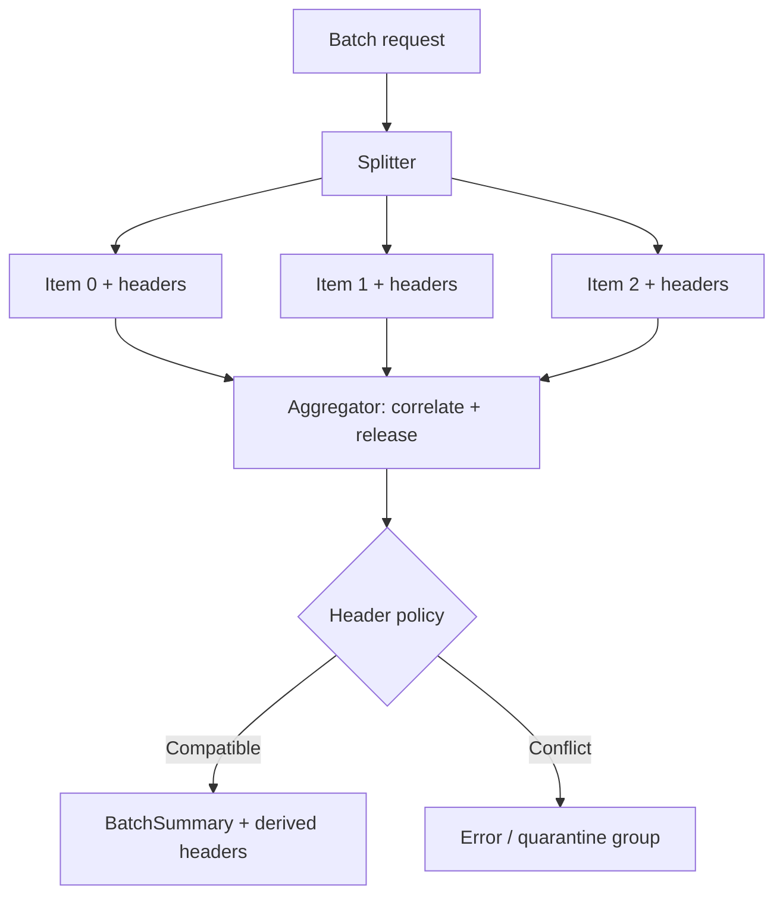
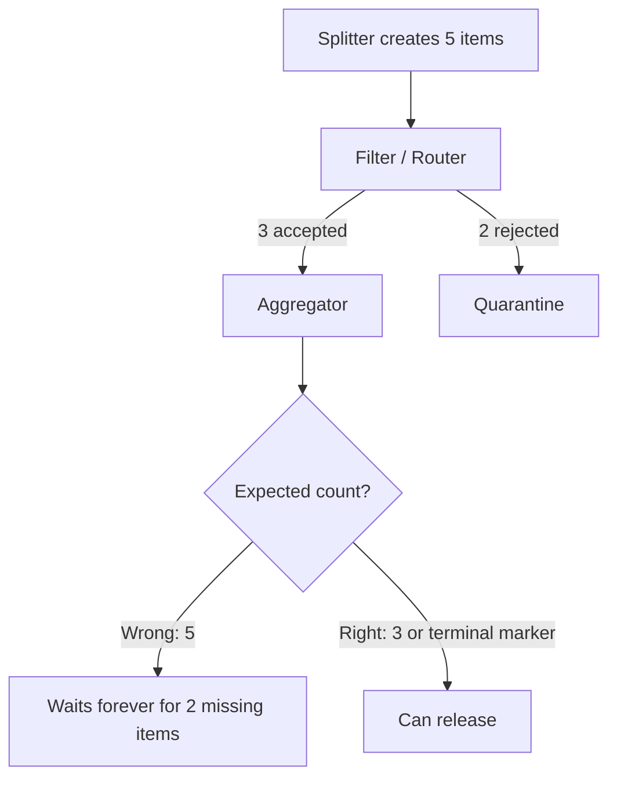

# Aggregating Headers and Conflict Rules

## 1. The Problem: When Payloads Aggregate Cleanly Yet Headers Disagree

An order with three lines is split by a Splitter into three messages. Processing branches validate and price each line, then an Aggregator sums the amounts and returns the order's result. Looking only at payloads, adding `30,000 + 50,000 + 20,000 = 100,000` looks simple. However, messages also carry `tenantId`, `currency`, `eventId`, `traceId`, `policyVersion`, `sequenceNumber`, and `correlationId`. Which values should be kept when they differ?

| Item | Amount | `tenantId` | `currency` | `eventId` | `policyVersion` |
| --- | ---: | --- | --- | --- | --- |
| 0 | 30,000 | `tenant-hcm` | `VND` | `evt-0` | `price-v3` |
| 1 | 50,000 | `tenant-hcm` | `VND` | `evt-1` | `price-v3` |
| 2 | 20,000 | `tenant-hcm` | `USD` | `evt-2` | `price-v4` |

If Aggregator takes `currency` and `policyVersion` from the first item, the output may look valid yet **no longer be interpretable at the business level**: you cannot add VND and USD as the same currency, nor blindly combine results calculated under different policy versions. Conversely, having different `eventId`s is **normal**, because each child is a separate event.

In the **Aggregator** chapter of the **SPRING_INTEGRATION_PATTERN** module, we implement Enterprise Integration Patterns with Spring Integration to build loosely coupled, extensible message flows. This topic ties directly into Splitter, Router, Filter, Transformer, Gateway, retry, error channel, correlation, testing, and branch monitoring.

**Aggregating headers** is the intentional decision about which metadata will be retained, recomputed, merged, or dropped from the result message. **Conflict rules** determine what happens when multiple messages in the same group carry inconsistent values.



**Principle:** Never copy all headers from one child onto the aggregated message and treat all of that metadata as belonging to the whole group.

## 2. Understanding Metadata Layers Properly

A Spring Messaging `Message<T>` holds a payload and `MessageHeaders`. Each message after a Splitter can carry batch, ordering, and context data:

```text
Message A:
  payload: LineCompleted(batchId=B-105, sourceIndex=0, lineTotalVnd=30000)
  headers:
    aggregationKey: tenant-hcm|B-105
    tenantId: tenant-hcm
    currency: VND
    policyVersion: price-v3
    eventId: evt-0
    traceId: trace-105
    sequenceNumber: 1
    sequenceSize: 3

Message B:
  payload: LineCompleted(batchId=B-105, sourceIndex=1, lineTotalVnd=50000)
  headers:
    aggregationKey: tenant-hcm|B-105
    tenantId: tenant-hcm
    currency: VND
    policyVersion: price-v3
    eventId: evt-1
    traceId: trace-105
    sequenceNumber: 2
    sequenceSize: 3
```

`aggregationKey` is an **application-created header** illustrating tenant-safe grouping. It **is not** a standard framework header named `correlationId`. In real flows, Spring Integration's Splitter can generate `CORRELATION_ID` and sequence headers; your grouping strategy must match the topology and ensure cross-tenant data is never mixed.

### 2.1. Classifying Headers by Semantic Scope

| Category | Examples | Output Rule |
| --- | --- | --- |
| Group identity | `aggregationKey`, `batchId` | Items must belong to one valid group |
| Mandatory group context | `tenantId`, `currency`, `policyVersion` | Must exist and match; otherwise fail |
| Child identity | `eventId`, `sourceIndex` | Never pick one child to represent the whole group |
| Sequence/coordination | `sequenceNumber`, `sequenceSize` | Do not copy to summary as if it were a child |
| Tracing | `traceId`, `spanId` | Follow tracing policy; never arbitrarily pick one span |
| Reply/transport | `replyChannel`, `errorChannel`, delivery tag | Do not copy without an explicit contract |
| Framework-managed | `MessageHeaders.ID`, `TIMESTAMP` | Let framework manage new message ID/timestamp |
| Aggregatable | `warningCodes`, `receivedAt` | Union/min/max per explicit rule |
| Derived output | `aggregateEventId`, `aggregateItemCount` | Compute newly from group identity and result |

The order messages reach Aggregator can differ from original order due to executors, brokers, pollers, or slow branches. Therefore, if a rule says "take first value," define **first by which criterion**: lowest `sourceIndex`, event timestamp, or arrival order? Randomly picking whichever message arrived first breaks determinism.

### 2.2. Correlation, Sequence, and Business IDs Differ

- `correlationId` / group key answers: **which messages are grouped together?**
- `sequenceNumber` answers: **which position is this element in an endpoint-generated sequence?**
- `sequenceSize` answers: **how many elements does that sequence have (if known)?**
- `batchId` answers: **which business batch?**
- `eventId` answers: **which specific event is being processed or replayed?**
- `aggregateEventId` answers: **what is the resulting event of aggregation?**

Never use `MessageHeaders.ID` as a business idempotency key because creating a new envelope or replaying can change the message ID. One batch can have many children with different `eventId`s yet the same `batchId`.

## 3. Header Merge Policies

| Policy | Principle | Good Fit | Pitfall |
| --- | --- | --- | --- |
| **Required-equal** | All items have header with identical value | Tenant, currency, policy version | Missing must also fail |
| **Optional-equal** | Retain only when present on all and equal | Optional annotation attributes | "Missing" differs from "conflict" |
| **Drop on conflict** | Omit from output on conflict | Non-essential metadata | Downstream must tolerate absent header |
| **Take first/last** | Pick by deterministic ordering | Well-defined timestamp or flag | Arrival order is unreliable |
| **Union** | Merge sets into deduplicated set | Warning codes | Can grow too large or leak PII |
| **Min / max** | Earliest/latest timestamp | First seen, last seen | Must align types/timezones |
| **Sum / count** | Add/count values | Aggregate count, item count | Duplicates inflate counts |
| **Derive new** | Compute fresh value for summary | Aggregate event ID | Must version on replay |
| **Reject group** | Emit no result on severe conflict | Tenant/currency mismatch | Needs error/recovery policy |

### 3.1. Missing Is Not the Same as Conflict

```text
A: tenantId = tenant-hcm
B: tenantId = tenant-hn    -> CONFLICT

A: tenantId = tenant-hcm
B: tenantId = <absent>     -> MISSING_REQUIRED_HEADER
```

For security headers like `tenantId`, never substitute a default tenant. For optional headers, you may drop the header if any item lacks it; document the rule rather than expecting the framework to guess.

### 3.2. Why Some Conflicts Cannot Be Auto-Resolved

- **Tenant mismatch:** risks mixing customer data—a security/contract violation.
- **Currency mismatch:** cannot add two currencies without an explicit conversion step with rate and version.
- **Policy version mismatch:** results may be computed under two incompatible rule sets.
- **Payload schema mismatch:** one item uses an old schema version and another a new one; must migrate intentionally.
- **Trace/span mismatch:** do not turn one child's span into the whole group's span by copying.

The safe approach is **fail closed** for mandatory context with a controlled repair/replay workflow. Data errors never heal themselves through infinite retries.

## 4. Distinguishing Roles of Strategies in Aggregator

| Component | Question | Example |
| --- | --- | --- |
| Correlation strategy | Which key groups messages? | `aggregationKey` |
| `MessageGroupStore` | Where are arrived items held? | In-memory or persistent store |
| Release strategy | When is the group ready to emit? | All 3 source indices present |
| Output/group processor | Which payload is constructed? | `BatchSummary(totalVnd)` |
| Header merge policy | Which headers are validated and written to output? | Require equal / derive / drop |
| Group expiration | What if an incomplete group times out? | Quarantine / partial / retry |
| Downstream consumer | Handles duplicate results safely? | Idempotency by aggregate event ID |

Spring Integration supports header handling in Aggregator and customization options depending on processor type and version. **Do not rely on a generic assumption about default header propagation** for sensitive values. This lesson uses a **custom output processor** that constructs a new message with an explicit header contract, and requires integration tests checking actual headers after passing through the framework.

### 4.1. Routing Metadata Should Not Be Blindly Reused

Aggregator output is a **summary**, not "child #1". An anti-pattern:

```java
// ANTI-PATTERN: copying every header from one child.
// return MessageBuilder.withPayload(summary)
//         .copyHeaders(first.getHeaders())
//         .build();
```

This can leak `sequenceNumber=1`, `eventId=evt-0`, a child's `spanId`, and even `replyChannel` onto the summary. In real Gateway request–reply flows, if you need to reply to a caller, configure an **intentional reply path** and test it; never randomly borrow one child's header to replace the reply protocol.

## 5. Java Example: Building an Immutable Aggregated Message with Clear Header Policy

We build a flow receiving exactly three line results in the same batch. Fixing "three lines" lets us focus on merging headers. Later sections cover dynamic counts, duplicates, timeouts, and group stores.

### 5.1. Payload Definitions

```java
record LineCompleted(
        String batchId,
        int sourceIndex,
        long lineTotalVnd) {
    LineCompleted {
        if (batchId == null || batchId.isBlank()
                || sourceIndex < 0 || sourceIndex >= 3
                || lineTotalVnd < 0) {
            throw new IllegalArgumentException("Invalid line result");
        }
    }
}

record BatchSummary(
        String batchId,
        int completedLines,
        long totalVnd) {}
```

Required input headers: `tenantId`, `currency`, `policyVersion`, and `aggregationKey`. Each child may carry distinct `eventId`, `traceId`, and sequence headers.

### 5.2. Custom Header Merger and Output Processor

```java
import java.util.ArrayList;
import java.util.Collection;
import java.util.Comparator;
import java.util.HashSet;
import java.util.List;
import java.util.Set;
import org.springframework.messaging.Message;
import org.springframework.messaging.support.MessageBuilder;
import org.springframework.stereotype.Component;

@Component
final class BatchSummaryMerger {

    Message<BatchSummary> merge(Collection<Message<?>> messages) {
        if (messages == null || messages.size() != 3) {
            throw new IllegalArgumentException("Expected 3 messages");
        }

        List<Message<?>> ordered = new ArrayList<>(messages);
        // Validate payloads before casting/sorting.
        for (Message<?> message : ordered) {
            if (!(message.getPayload() instanceof LineCompleted)) {
                throw new IllegalArgumentException("Invalid payload type");
            }
        }
        ordered.sort(Comparator.comparingInt(message ->
                ((LineCompleted) message.getPayload()).sourceIndex()));

        Message<?> first = ordered.get(0);
        String tenantId = required(first, "tenantId");
        String currency = required(first, "currency");
        String policyVersion = required(first, "policyVersion");
        String aggregationKey = required(first, "aggregationKey");
        String batchId = ((LineCompleted) first.getPayload()).batchId();

        Set<Integer> seenIndices = new HashSet<>();
        long totalVnd = 0;

        for (Message<?> message : ordered) {
            LineCompleted line = (LineCompleted) message.getPayload();

            if (!batchId.equals(line.batchId())
                    || !tenantId.equals(required(message, "tenantId"))
                    || !currency.equals(required(message, "currency"))
                    || !policyVersion.equals(required(message, "policyVersion"))
                    || !aggregationKey.equals(required(message, "aggregationKey"))) {
                throw new IllegalArgumentException(
                        "CONFLICTING_AGGREGATE_HEADERS");
            }
            if (!seenIndices.add(line.sourceIndex())) {
                throw new IllegalArgumentException(
                        "DUPLICATE_SOURCE_INDEX");
            }

            totalVnd = Math.addExact(totalVnd, line.lineTotalVnd());
        }

        if (!seenIndices.equals(Set.of(0, 1, 2))) {
            throw new IllegalArgumentException("MISSING_SOURCE_INDEX");
        }
        if (!"VND".equals(currency)) {
            throw new IllegalArgumentException("UNEXPECTED_CURRENCY");
        }

        var summary = new BatchSummary(batchId, 3, totalVnd);
        // Distinct from child eventIds; used for consumer idempotency.
        String aggregateEventId =
                tenantId + ":" + batchId + ":summary:v1";

        return MessageBuilder.withPayload(summary)
                .setHeader("tenantId", tenantId)
                .setHeader("currency", currency)
                .setHeader("policyVersion", policyVersion)
                .setHeader("aggregationKey", aggregationKey)
                .setHeader("aggregateEventId", aggregateEventId)
                .setHeader("aggregateItemCount", 3)
                .build();
    }

    private static String required(Message<?> message, String name) {
        Object value = message.getHeaders().get(name);
        if (!(value instanceof String text) || text.isBlank()) {
            throw new IllegalArgumentException(
                    "MISSING_REQUIRED_HEADER: " + name);
        }
        return text;
    }
}
```

**Key points:**

1. Verify all messages share the same `tenantId`, `currency`, `policyVersion`, `aggregationKey`, and `batchId`.
2. Use `sourceIndex` to confirm positions `0,1,2` are all present without duplicates.
3. Use `Math.addExact` instead of silently overflowing `long` addition.
4. Generate a stable and **new** `aggregateEventId` rather than picking a child `eventId`.
5. Never copy `replyChannel`, `errorChannel`, `sequenceNumber`, `sequenceSize`, `spanId`, or `MessageHeaders.ID`.
6. Let the framework generate a fresh ID/timestamp for the output.
7. Do not copy `traceId` without a unified tracing policy; in real systems, use parent trace context or span links.

**Limitations:** `BatchSummaryMerger` only governs one synchronous merge step. It does not automatically provide persistence, retries, shared transactions, or exactly-once delivery. A corrected and replayed batch needs a plan to version `aggregateEventId` so an old ID does not mask an intentionally new output.

### 5.3. Aggregatable Headers Beyond Mandatory Fields

If each child has `warningCodes` as a `List<String>` or `Set<String>`, you can build an immutable union, filter valid codes, and sort deterministically. If you want `firstReceivedAt`/`lastReceivedAt`, use min/max over normalized `Instant`s. Never put raw payloads, PII, or credentials into aggregated metadata. Before adding any header, ask whether downstream genuinely needs it.

## 6. Configuring Aggregator in Spring Integration Java DSL

```java
import org.springframework.context.annotation.Bean;
import org.springframework.context.annotation.Configuration;
import org.springframework.integration.channel.DirectChannel;
import org.springframework.integration.config.EnableIntegration;
import org.springframework.integration.dsl.IntegrationFlow;
import org.springframework.messaging.MessageChannel;

@Configuration
@EnableIntegration
class BatchAggregationFlow {

    @Bean("batch.line.completed")
    MessageChannel completedLines() {
        return new DirectChannel();
    }

    @Bean("batch.summary")
    MessageChannel summaries() {
        return new DirectChannel();
    }

    @Bean
    IntegrationFlow aggregateLines(BatchSummaryMerger merger) {
        return IntegrationFlow.from("batch.line.completed")
                .aggregate(spec -> spec
                        .correlationStrategy(message ->
                                message.getHeaders().get("aggregationKey"))
                        .releaseStrategy(group -> group.size() >= 3)
                        .outputProcessor(group ->
                                merger.merge(group.getMessages())))
                .channel("batch.summary")
                .get();
    }
}
```

In the example, `correlationStrategy` extracts the group key, `releaseStrategy` waits for three arrivals, and `outputProcessor` calls the explicit merger. Downstream receives `BatchSummary` via `batch.summary`.

**Demo note:** `group.size() >= 3` **is not safe when duplicate deliveries occur**: three arrivals could be two real items and one repeated item. The merger throws an error instead of emitting a wrong summary, yet production must deduplicate before counting, release by identity set, or use a trusted completion marker alongside timeout/recovery policies. Specific Aggregator DSL APIs must be verified against your Spring Integration version in the later Content QA pass.

Some Aggregator configurations also have built-in mechanisms that process/copy framework headers. Always inspect the **final `Message` on the output channel** in integration tests; never assume output contains only the fields written in your custom `MessageBuilder` if a downstream endpoint or framework handler adds metadata.

### 6.1. Building Item Messages for the Example

```java
import org.springframework.messaging.MessageChannel;
import org.springframework.messaging.support.MessageBuilder;

void sendLineResult(
        MessageChannel input,
        int sourceIndex,
        long total,
        String childEventId) {

    input.send(MessageBuilder.withPayload(
                    new LineCompleted("B-105", sourceIndex, total))
            .setHeader("aggregationKey", "tenant-hcm|B-105")
            .setHeader("tenantId", "tenant-hcm")
            .setHeader("currency", "VND")
            .setHeader("policyVersion", "price-v3")
            .setHeader("eventId", childEventId)
            .setHeader("traceId", "trace-105")
            .build());
}

// Using bean "batch.line.completed":
// sendLineResult(input, 0, 30000L, "evt-0");
// sendLineResult(input, 1, 50000L, "evt-1");
// sendLineResult(input, 2, 20000L, "evt-2");
```

Once all arrive, expected output:

```text
payload:
  BatchSummary(batchId="B-105", completedLines=3, totalVnd=100000)

business headers:
  tenantId: tenant-hcm
  currency: VND
  policyVersion: price-v3
  aggregationKey: tenant-hcm|B-105
  aggregateEventId: tenant-hcm:B-105:summary:v1
  aggregateItemCount: 3

Do not take eventId/sequenceNumber/spanId from one child.
```

The `|`-joined string `aggregationKey` is illustrative only: production needs a trustworthy group ID with unambiguous encoding and tenant-scoped authorization, never letting callers arbitrarily dictate another message's group.

## 7. Handling Conflicts by Header Type

### 7.1. Tenant Conflict: Fail Closed

```text
message 0: aggregationKey=group-1, tenantId=tenant-a
message 1: aggregationKey=group-1, tenantId=tenant-b
```

Never take the first `tenantId` and combine both payloads. Reject/quarantine and investigate the correlation or ingress data bug. This is a contract violation that can cause cross-tenant disclosure.

### 7.2. Currency Conflict: Never Auto-Convert

`100 VND + 10 USD` is not `110 VND`. If business logic supports conversion, include an explicit conversion step with official exchange rate, timestamp, source, and revision before aggregating; output must reflect the target currency and conversion rule.

### 7.3. `policyVersion` Conflict

One item calculated under `price-v3` and another under `price-v4` may not be comparable or summable. Either reject the entire group, or **intentionally** migrate/recompute against a single common snapshot. Never use "first wins" for versions, as that hides the root cause of divergence.

### 7.4. Different Child `eventId`s Are Valid

Each child can have its own stable ID. The summary needs an independent event ID, and if auditing is required, keep a **bounded** list of source IDs or persist the relationship in storage rather than stuffing huge lists into message headers.

### 7.5. Trace Context and Spans

Concurrent branches may share a root trace while having different spans, or represent linked traces. For accurate tracing at fan-in, create a span for the aggregation step and link to input spans when supported by your SDK; never copy one child's `spanId` and call it the group's span. Use `batchId` and aggregate keys to correlate business logs.

### 7.6. Reply Headers and Gateway

`replyChannel` or `errorChannel` can belong to a specific Gateway/request–reply call. When returning results to a caller, design an explicit reply channel. Never assume a child message's headers will reply properly to a Gateway when children carry different reply channels. Especially avoid arbitrarily serializing JVM-bound channel objects across a broker.
## 8. Release Strategy, Complete Groups, and Duplicate Messages

A real Aggregator must distinguish **message arrival count** from **unique business element count**.

```text
Expected source indices: {0, 1, 2}
Arrivals:                {0, 1, 1}
Number of arrivals:      3
Distinct source indices: 2
Missing:                 item 2
```

Pure count-based `group.size()==3` can trigger prematurely. The merger above rejects the duplicate to prevent a wrong summary, leaving an errored group requiring recovery. In production, you typically need:

1. A stable item key, e.g., `(batchId, sourceIndex, producerVersion)`.
2. Deduplication at ingress or in the group store based on business identity.
3. Release condition computed over **unique received identities** or a trusted completion marker.
4. Timeout/expiration and late-arrival policies.
5. Explicit rule on whether a group can reopen after release.

`MessageHeaders.ID` is not always a valid deduplication key: redelivering the same business event can assign a new message ID. Likewise, never use batch `eventId` alone to deduplicate children if multiple children must be processed independently.

### 8.1. What If a Filter Drops an Element?

An initial Splitter might stamp `sequenceSize=5`. Then Filter lets only three valid items reach Aggregator. If Aggregator still waits for five items with no terminal marker, the group can hang forever.



This is why Splitter's `sequenceSize` does not always equal the actual number of results reaching a fan-in branch. You can:

- Have both accepted and rejected branches emit a **status outcome** so all positions arrive.
- Use an orchestration step providing a confirmed **`acceptedCount`**.
- Emit a **completion marker** with version, total result count, and batch identity.
- Design timeout- and partial-result-based aggregation if business rules allow.

Never drop items while keeping the old expectation without release/recovery rules.

### 8.2. Missing, Errored, and Expired Groups Are Three Different States

| State | Signal | Handling |
| --- | --- | --- |
| **INCOMPLETE** | Missing items, still within deadline | Continue waiting |
| **COMPLETE_VALID** | All items present, valid headers | Publish summary |
| **COMPLETE_CONFLICT** | All items present yet tenant/currency invalid | Reject/quarantine; emit no success summary |
| **EXPIRED** | Past deadline while still missing items | Recovery / partial if approved |
| **LATE_ARRIVAL** | Item arrives after group closed | Reject, emit new result version, or explicit reopen policy |
| **DUPLICATE** | Same-identity item resent | Suppress/reconcile, never double-count |

A header merge policy **does not replace** release and group expiration strategies. A group with all items present yet conflicting currencies must never be treated as successful merely because it satisfied the release condition.

## 9. `MessageStore`, Concurrency, and Group Lifecycle

In a simple flow, Aggregator can keep state in memory. On node restart, without a persistent store or redelivery, pending groups can be lost. When multiple nodes process the same group, messages can update state concurrently and race.

### 9.1. Risks in Distributed Execution

- Node A receives item 0 and Node B receives item 1 without a shared group store.
- Two consumers update the same group concurrently and both decide to release.
- Group releases and sends output, yet source ACK/commit fails; a child gets redelivered.
- Group expires while the final item is still sitting in a queue.
- After deployment, one node uses an old `policyVersion` while another uses the new policy.
- `MessageStore` holds non-serializable objects or headers tied to a single JVM.

Choose a durable `MessageGroupStore` (such as JDBC or other Spring Integration-supported stores), group-scoped locking/partitioning, and verify transaction boundaries. **Having a persistent store does not automatically create exactly-once delivery**; downstream still needs idempotent consumers keyed by `aggregateEventId`.

### 9.2. Group IDs Must Never Mix Across Tenants

```text
tenant-a / batchId=B-105
tenant-b / batchId=B-105
```

If correlation strategy uses only `batchId=B-105`, two tenants can land in the same group. The merger detecting tenant mismatch is the **last line of defense**, yet misgrouping should be prevented upfront at correlation.

A group identity can be an immutable composite key or unambiguously encoded string from `tenantId` and `batchId`. An arbitrary delimiter is unsafe if source values can contain that delimiter. Better yet, have upstream issue a trusted, tenant-scoped, authenticated group ID.

### 9.3. Policy Version and Replayability

If replaying a batch after business rules change, the same inputs can produce a different total. Lock `policyVersion` at workflow start and require all items to share that version. When intentionally replaying under a new policy, issue a **new aggregate result version** rather than reusing an old `aggregateEventId` to mask changed output.

## 10. Error Channel, Retry, and Quarantine on Conflict

Suppose `BatchSummaryMerger` throws `CONFLICTING_AGGREGATE_HEADERS` when Aggregator releases. The message group may already be persisted in `MessageStore`. Whether the error drops the group, retains it, or publishes to an error channel depends on framework, transaction, and error-handling configuration; **never assume it automatically routes to a DLQ**.

A production flow should define:

1. Classification between immutable metadata errors (missing tenant, currency conflict) and transient infra errors (store timeout, broker unavailable).
2. For data conflicts, store a reference to the group, error codes, item count, and source IDs in an access-controlled quarantine store.
3. Never retry infinitely on a group containing malformed headers.
4. For infra errors, use bounded retry/backoff and guard against duplicate releases.
5. After fixing data, replay **with a new version** and accurate idempotency keys.
6. Track output dispatch state so a summary is never published twice unnoticed downstream.

With `DirectChannel`, exceptions can propagate synchronously back to the sender. With executors, pollers, or brokers, errors may route through an error handler and `errorChannel` per configuration. `ErrorMessage` helps observability; an error channel **does not by itself provide persistence, retries, or dead-letter storage**.

### 10.1. Handling Decision Table

| Error | Retry Immediately? | Recovery Path |
| --- | --- | --- |
| Missing `tenantId` | No | Fix contract/source then replay |
| Group has two currencies | No | Intentional conversion or reject |
| Group has two policy versions | No | Recompute on same snapshot or run migration |
| Duplicate item | No need to process twice | Deduplicate by item identity |
| Group missing messages | Do not retry output merger | Wait, timeout, or trigger item recovery |
| `MessageStore` timeout | Possibly | Retry with backoff and monitor |
| Downstream consumer timeout | Possibly | Consumer idempotent by `aggregateEventId` |
| Overflow summing `long` | No with same data | Fix data/amount model |
| Reply channel no longer valid | Depends on type | Fix topology, never blindly copy child reply |

## 11. Unit Testing Header Merge Rules

Unit tests do not need a Spring context. They must prove: within the same group, reversed arrival order yields identical results; mandatory headers must match; per-child headers are not copied to output; duplicate `sourceIndex` is rejected; totals never silently overflow.

### 11.1. Child Message Factory

```java
import org.springframework.messaging.Message;
import org.springframework.messaging.support.MessageBuilder;

final class BatchTestMessages {

    static Message<?> item(
            int index, long value,
            String tenantId, String currency) {

        return MessageBuilder.withPayload(
                        new LineCompleted("B-105", index, value))
                .setHeader("aggregationKey", "tenant-hcm|B-105")
                .setHeader("tenantId", tenantId)
                .setHeader("currency", currency)
                .setHeader("policyVersion", "price-v3")
                .setHeader("eventId", "evt-" + index)
                .setHeader("traceId", "trace-" + index)
                .setHeader("sequenceNumber", index + 1)
                .setHeader("sequenceSize", 3)
                .build();
    }

    private BatchTestMessages() {}
}
```

We intentionally pass distinct `eventId` and `traceId` values. In the example, the summary gets its own `aggregateEventId` without retaining child-specific trace/span metadata from an arbitrary element.

### 11.2. Successful Merge and Conflict Tests

```java
import java.util.List;
import org.junit.jupiter.api.Test;
import org.springframework.messaging.Message;

import static org.junit.jupiter.api.Assertions.*;

class BatchSummaryMergerTest {
    private final BatchSummaryMerger merger = new BatchSummaryMerger();

    @Test
    void mergesDeterministicallyWithoutCopyingChildHeaders() {
        Message<?> p0 = BatchTestMessages.item(
                0, 30_000L, "tenant-hcm", "VND");
        Message<?> p1 = BatchTestMessages.item(
                1, 50_000L, "tenant-hcm", "VND");
        Message<?> p2 = BatchTestMessages.item(
                2, 20_000L, "tenant-hcm", "VND");

        Message<BatchSummary> summary =
                merger.merge(List.of(p2, p0, p1));

        assertEquals("B-105", summary.getPayload().batchId());
        assertEquals(3, summary.getPayload().completedLines());
        assertEquals(100_000L, summary.getPayload().totalVnd());
        assertEquals("tenant-hcm",
                summary.getHeaders().get("tenantId"));
        assertEquals("price-v3",
                summary.getHeaders().get("policyVersion"));
        assertEquals("tenant-hcm:B-105:summary:v1",
                summary.getHeaders().get("aggregateEventId"));

        assertFalse(summary.getHeaders().containsKey("eventId"));
        assertFalse(summary.getHeaders().containsKey("sequenceNumber"));
        assertFalse(summary.getHeaders().containsKey("sequenceSize"));
        assertFalse(summary.getHeaders().containsKey("traceId"));
    }

    @Test
    void rejectsCrossTenantOrMixedCurrencyGroup() {
        var p0 = BatchTestMessages.item(
                0, 30_000L, "tenant-hcm", "VND");
        var p1 = BatchTestMessages.item(
                1, 50_000L, "tenant-hn", "VND");
        var p2 = BatchTestMessages.item(
                2, 20_000L, "tenant-hcm", "VND");

        assertThrows(IllegalArgumentException.class, () ->
                merger.merge(List.of(p0, p1, p2)));

        var usd = BatchTestMessages.item(
                1, 50_000L, "tenant-hcm", "USD");
        assertThrows(IllegalArgumentException.class, () ->
                merger.merge(List.of(p0, usd, p2)));
    }

    @Test
    void rejectsDuplicateSourceIndices() {
        var p0 = BatchTestMessages.item(
                0, 30_000L, "tenant-hcm", "VND");
        var retry = BatchTestMessages.item(
                0, 30_000L, "tenant-hcm", "VND");
        var p2 = BatchTestMessages.item(
                2, 20_000L, "tenant-hcm", "VND");

        assertThrows(IllegalArgumentException.class, () ->
                merger.merge(List.of(p0, retry, p2)));
    }
}
```

### 11.3. Missing / Overflow Cases to Add

- Completely omit `tenantId` on one child, expect `MISSING_REQUIRED_HEADER`; never pick a value from another item.
- Vary `policyVersion`, expect conflict.
- Change payload `batchId` while keeping the group key, expect conflict.
- Set `lineTotalVnd` large enough that `Math.addExact` throws `ArithmeticException`.
- Verify results across all permutations of arrival order.
- When merging list-typed `warningCodes`, test defensive copying and deterministic ordering.

Unit tests only test Java policy. **They do not prove** Aggregator released properly, `MessageStore` did not drop messages, or final headers after the framework match those constructed in `MessageBuilder`.

## 12. Integration Test: Observing the Actual Message After Aggregator

An integration test can subscribe an output handler on `batch.summary`, send three messages with the same group key to `batch.line.completed`, and verify the final payload and metadata. Example using a simple Spring context:

```java
import java.util.concurrent.CopyOnWriteArrayList;
import org.junit.jupiter.api.Test;
import org.springframework.context.annotation.AnnotationConfigApplicationContext;
import org.springframework.integration.channel.DirectChannel;
import org.springframework.messaging.Message;
import org.springframework.messaging.MessageChannel;

import static org.junit.jupiter.api.Assertions.*;

class BatchAggregationWiringTest {

    @Test
    void publishesOneSummaryForThreeDistinctItems() {
        try (var context = new AnnotationConfigApplicationContext(
                BatchAggregationFlow.class,
                BatchSummaryMerger.class)) {

            var received = new CopyOnWriteArrayList<Message<?>>();
            DirectChannel output = context.getBean(
                    "batch.summary", DirectChannel.class);
            output.subscribe(received::add);

            MessageChannel input = context.getBean(
                    "batch.line.completed", MessageChannel.class);
            input.send(BatchTestMessages.item(
                    2, 20_000L, "tenant-hcm", "VND"));
            input.send(BatchTestMessages.item(
                    0, 30_000L, "tenant-hcm", "VND"));
            input.send(BatchTestMessages.item(
                    1, 50_000L, "tenant-hcm", "VND"));

            assertEquals(1, received.size());
            Message<?> actual = received.get(0);

            assertEquals(100_000L,
                    ((BatchSummary) actual.getPayload()).totalVnd());
            assertEquals("tenant-hcm",
                    actual.getHeaders().get("tenantId"));
            assertEquals("price-v3",
                    actual.getHeaders().get("policyVersion"));

            // Observe on output channel: do not test only the merger.
            assertNull(actual.getHeaders().get("eventId"));
            // If the endpoint/framework adds coordination headers,
            // inspect and verify them for your exact version.
        }
    }
}
```

This example illustrates a 3-item group and synchronous channels. Across a test suite, isolate group IDs/stores between tests; if using a persistent `MessageStore`, groups from an earlier test can affect later ones. With executors/pollers/brokers, await results with a timeout and assert state properly rather than verifying immediately after `send()`.

### 12.1. Key Integration Test Matrix

| Scenario | Expectation |
| --- | --- |
| Three valid items, arriving out of order | One summary with right total and header contract |
| Two tenants sharing wrong group key | Does not publish a successful summary |
| Mixed currencies | Never added as a single currency |
| One item missing `policyVersion` | Contract error observed |
| Duplicate `sourceIndex` | Never releases or double-counts |
| Missing item past timeout | Recovery/expiration leaves audit trail |
| Filter drops a child | Release does not hang forever on stale `sequenceSize` |
| Different child `eventId`s | Summary carries fresh aggregate ID |
| Different child trace/span IDs | Never arbitrarily copies trace context |
| Different reply headers | Never replies to wrong caller |
| `GroupStore` restart | Recovers if required by design |
| Two workers receive same group | No policy-violating double release |
| Downstream receives duplicate summary | Consumer idempotent by aggregate event ID |
| Total amount overflows | Error reported, never emits corrupt total |

## 13. Operations and Observing Conflicts

Measure three independent failure categories: **missing items**, **all items present yet headers conflict**, and **summary emitted yet downstream fails**. Each category has different remediation.

| Metric | Meaning |
| --- | --- |
| `aggregator.group.created` | Open group count |
| `aggregator.group.released` | Summaries emitted successfully |
| `aggregator.group.expired` | Overdue groups |
| `aggregator.header.conflict` | Conflicts by bounded header name |
| `aggregator.header.missing` | Missing required headers |
| `aggregator.duplicate.item` | Detected duplicates |
| `aggregator.release.latency` | Time waiting for complete group |
| `aggregator.store.error` | State persistence errors |
| `aggregator.late.arrival` | Messages arriving after group closed |
| `aggregator.downstream.retry` | Post-aggregate failures and retries |

In logs, record `batchId`, `traceId`, header name, and error code; never log entire header maps that might contain tokens or PII. Never use `eventId`/`batchId` as high-cardinality metric labels; use header names or error types from a finite set.

A dashboard showing an increased group expiration rate after deploying a Filter suggests dropped items or mismatched `sequenceSize`; an increase in currency conflicts points to a bug in the pricing source or policy version. Never try to fix either situation merely by increasing timeouts.

## 14. Common Design Mistakes

1. **Copying all headers from the first child** onto the output summary.
2. **Picking tenant by arrival order** without checking remaining items.
3. **Adding different currencies** then stamping the first item's currency header.
4. **Using a child's `eventId`** as the aggregate event ID.
5. **Copying old `sequenceNumber`/`sequenceSize`** to the summary, confusing downstream.
6. **Confusing correlation key with business ID** and failing to scope by tenant.
7. **Failing to distinguish missing headers from conflicting headers**.
8. **Applying first/last by arrival order** instead of a defined business ordering.
9. **Using `group.size()` as unique item count** when redelivery occurs.
10. **No expiration/recovery** for incomplete groups.
11. **Retrying infinitely on groups with `policyVersion` conflicts**.
12. **Not testing actual headers at the output channel**.
13. **Copying `replyChannel`/`errorChannel` across boundaries** without an explicit contract.
14. **Ignoring mutable header objects** that another subscriber might mutate.
15. **Not versioning output when replaying a corrected batch**.
16. **Treating `MessageStore`/merger as an exactly-once guarantee**, ignoring consumer idempotency.

## 15. Hands-On Exercise and Self-Assessment

**Exercise:** A payment batch has four sub-transactions. Each message contains `paymentBatchId`, `sourceIndex`, `amountMinorUnits`, plus headers `tenantId`, `currency`, `policyVersion`, `traceId`, `eventId`, and `correlationId`.

1. Build a header contract table covering required-equal, optional-equal, derived, drop, union, and min/max.
2. Create a correlation key that never mixes two tenants with the same batch ID.
3. Write a `HeaderPolicy` detecting missing/conflicting currency, tenant, and policy version.
4. Generate a stable aggregate event ID distinct from child event IDs.
5. Use `sourceIndex` to verify unique items and ensure deterministic ordering.
6. Merge `warningCodes` using an immutable set, capping element count and stripping sensitive data.
7. Simulate four deliveries including one duplicate and a missing final item; explain why pure count releases wrongly.
8. Design timeout, expired group, and late-arrival policies.
9. Use `Math.addExact` or `BigDecimal` appropriately and sum only amounts in the same currency.
10. Configure Java DSL Aggregator and an output processor returning a message with explicitly selected metadata.
11. Write unit tests for conflicts, missing headers, reversed arrival order, duplicates, and overflow.
12. Write integration tests observing final headers on the output channel and error handling.
13. Simulate replay after downstream timeout, verifying the summary's idempotency key.
14. Propose logs/metrics detecting conflicts, group expirations, long waits, and double deliveries.

**Self-assessment:** Why do `tenantId` and `eventId` need two different rules? Why might `sequenceSize` from a Splitter not reflect how many items reach Aggregator after a Filter? Can `MessageHeaders.ID` be used for deduplication? Does a group that received four messages definitely contain four distinct source indices? When `currency` conflicts, does immediate retry help?

**Aggregating headers and conflict rules** turns message collection into aggregation **governed by a data contract**. In Spring Integration, correlation, release, header policy, group persistence, and recovery are complementary responsibilities that never replace one another. Validating mandatory headers, generating fresh summary metadata, and testing at the real output make Aggregator far more reliable under fan-out, retries, out-of-order arrivals, and duplicate deliveries.
