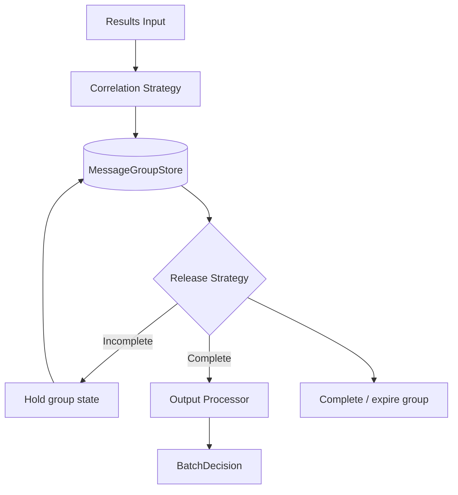
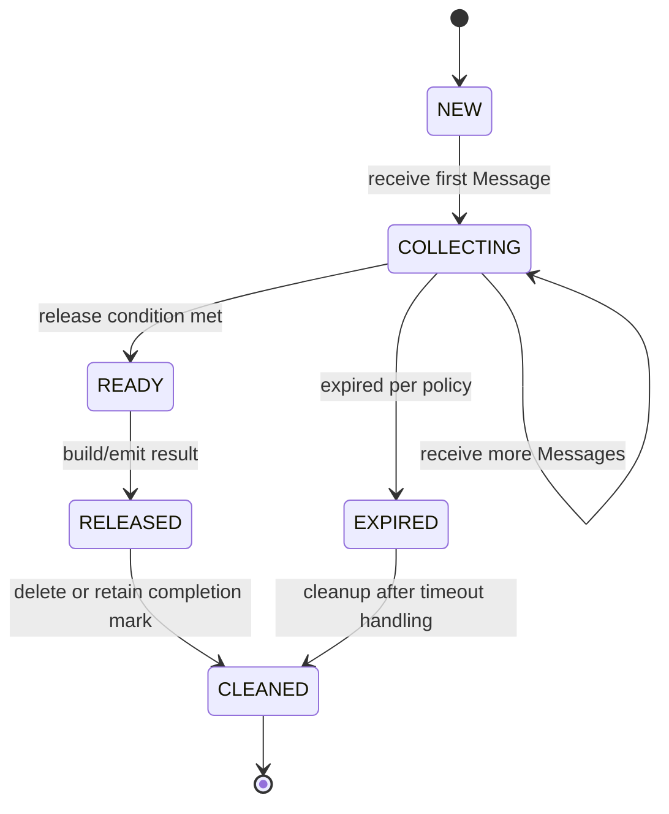
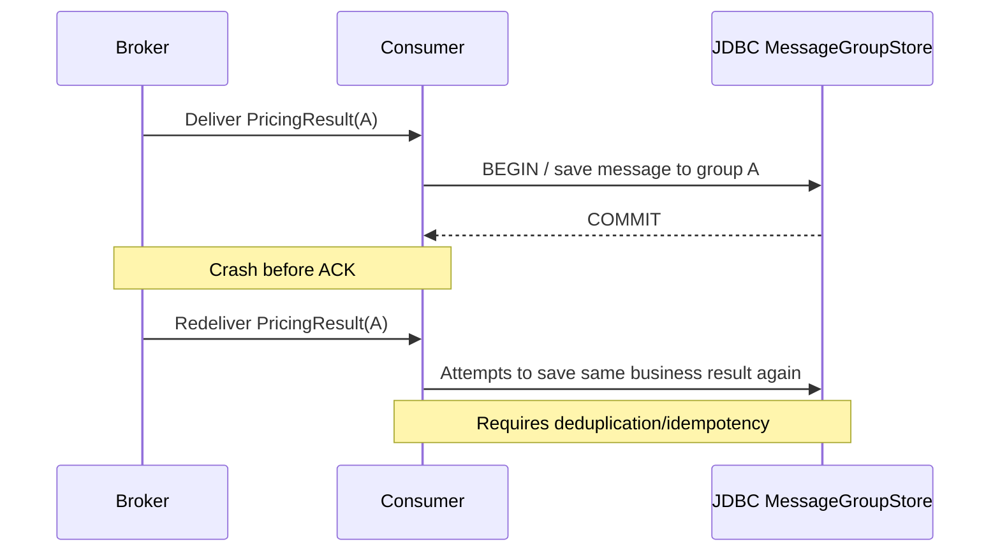
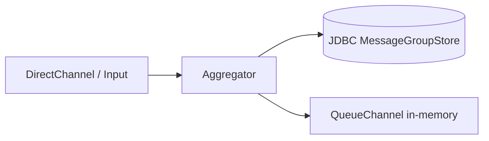
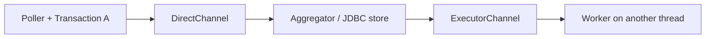
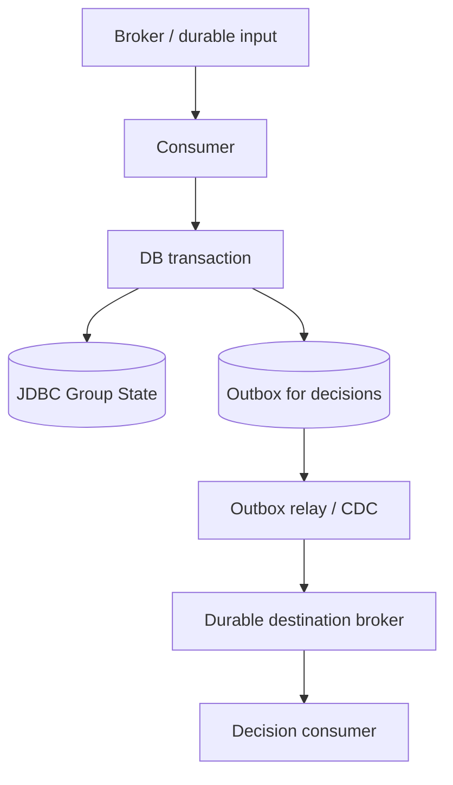
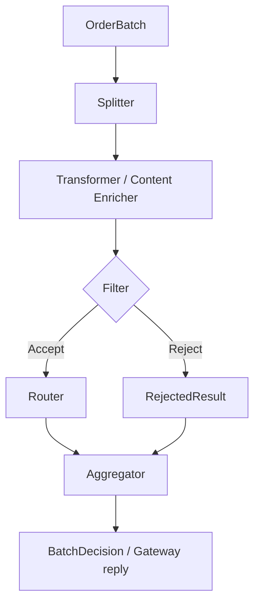

# Transactions and Persistence of Group State in Aggregator

When an order is split into three check requests for **inventory**, **pricing**, and **shipping**, results may return to the Aggregator at different times. A result group may stay incomplete for milliseconds, minutes, or longer if a service pauses temporarily. During that wait window, Aggregator must hold received Messages, know which group they belong to, and decide when the aggregated result can be produced.

Problems arise when the application **restarts**, a transaction **rolls back**, a broker **redelivers a Message**, or two application instances **receive Messages for the same group simultaneously**. If group state lives only in RAM, incomplete state can be lost. If the group is written to a database yet input Message acknowledgement or output dispatch happens at the wrong time, the system still risks losing results, processing duplicates, or emitting two aggregated outcomes.

The topic **Transactions and Persistence of Group State** in the **Aggregator** chapter of the `SPRING_INTEGRATION_PATTERN` module focuses on those boundaries. The module aims at implementing Enterprise Integration Patterns (Router, Filter, Transformer, Splitter, Aggregator, Gateway, retry, error channel, correlation) with Spring Integration to build loosely coupled, extensible, testable, and observable message flows. This lesson clearly distinguishes **persisting group state**, **transactions when adding/releasing Messages**, **durability of inputs and outputs**, and **recovery when failures occur**.

## 1. What State Does Aggregator Store?

Aggregator does not simply receive one Message and return one Message immediately. It is a **stateful** endpoint: receiving related Messages, holding them in a *message group*, evaluating completion conditions (*release condition*), and building aggregated output.

Example with three results for the same `attemptKey=A-01`:

```text
t1: CheckResult(INVENTORY, OK)   -> group A has 1 result
t2: CheckResult(PRICING, OK)     -> group A has 2 results
t3: CheckResult(SHIPPING, OK)    -> group A has 3 results
                                  -> release -> BatchDecision(A-01, OK)
```

A waiting group may need to persist:

| Component | Role | Impact If Lost |
| --- | --- | --- |
| **Group ID / correlation key** | Identifies Messages belonging to the same group | Messages misgrouped or new group created |
| **Received Messages** | Data used to compute the result | Earlier partial results lost |
| **Sequence / result type / business key** | Distinguishes elements within the group | Unknown which parts are still missing |
| **Completion or closed state** | Handles late arrivals and replays | Can release a second time |
| **Group creation/update timestamps** | Supports timeout/expiration | Stuck groups not handled on time |
| **Application error/progress metadata** | Diagnostics, retries, recovery | Hard to determine why results are missing |

Not every `MessageGroupStore` persists **all columns above with those exact names**. This table describes **required logical state**, while physical layout and actual metadata depend on `MessageGroupStore`, store type, and configuration.



**Core point:** group state is the **intermediate state of a multi-Message process**. Persisting it durably is an important prerequisite for recovery, yet **insufficient by itself** to guarantee the entire flow executes exactly once.

## 2. Correlation, Release, and Persistence Are Three Separate Responsibilities

Before discussing transactions, distinguish:

1. **Correlation strategy** picks the group for each Message, e.g., based on `attemptKey`.
2. **Release strategy** decides which group is ready to build output, e.g., all three check types present.
3. **`MessageGroupStore`** holds Messages and group metadata while waiting, either in RAM or persistently.

```text
correlationStrategy(message) = message.headers["attemptKey"]

releaseStrategy(group) = group has
    INVENTORY, PRICING, and SHIPPING

groupStore = where Messages are held until release/expire
```

If you merely switch the store from in-memory to JDBC while the correlation key is still wrong, the system **durably persists the wrong group**. If the release strategy merely counts three Messages, a duplicate `INVENTORY` delivery can still take `SHIPPING`'s slot. Persistence does not fix those business rules.

### Concepts Easily Conflated

| Concept | What It Guarantees | What It Does Not Automatically Guarantee |
| --- | --- | --- |
| Accurate correlation key | Places Messages into the right group | That enough Messages exist to release |
| Accurate release strategy | Decides when to build output per contract | That output was delivered durably |
| Persistent `MessageGroupStore` | State is written outside RAM | That broker input was ACKed atomically |
| Database transaction | DB operations in the same scope commit/rollback atomically | External HTTP/email/broker operations are equally atomic |
| Per-group lock | Prevents unsafe concurrent updates if properly deployed | Protection against replays after restart |
| Idempotency | Mitigates duplicate deliveries | Answering when a group is complete |

Each guarantee requires clear **system boundaries and applicability conditions**, not a single toggle that solves everything.

## 3. Lifecycle of a Message Group

A group can pass through the following logical states:



This is a **conceptual state machine** for design analysis, not a fixed Spring Integration enum.

For each group, determine:

- When the first Message arrives, when is the group created and saved?
- Can subsequent Messages arrive from multiple threads/instances?
- After release, how long are Messages in the group retained?
- If the output processor builds a result yet sending output fails, is the group retried?
- How will a late or redelivered Message with the same key be handled?
- What timeout or cleanup policy applies to incomplete groups?

A group being **marked complete** or **expired** does not mean all side effects at downstream consumers have finished.

## 4. How Do In-Memory Stores and Persistent Stores Differ?

Spring Integration provides the `MessageGroupStore` abstraction for Aggregator to maintain Message groups.

| Criterion | In-Memory Store | Persistent Store, e.g., JDBC |
| --- | --- | --- |
| Latency | Usually low, no DB I/O | Query/transaction overhead |
| Survives JVM restart | No, if held only in-process | Yes, if written/committed and DB retains data |
| Shared across instances | Not shared automatically | Can be shared with proper store and locking config |
| Capacity | Bounded by JVM heap | Bounded by database and cleanup policy |
| Serializability | Can hold objects in RAM | Requires compatible read/write format |
| DB transactions | Does not create DB transactions | Can participate in compatible transactions |
| Operations | Simpler | Needs schema, connections, migrations, backups, locks |
| Group loss from bad expiration | Still possible | Still possible |

For example, **in-memory** can use `SimpleMessageStore`; JDBC deployments typically use `JdbcMessageStore` from the Spring Integration JDBC module with its corresponding schema. A durable store does not help if the application never commits state or if headers/payloads cannot be serialized.

**Choose in-memory if** losing pending groups on restart is acceptable, the flow can rebuild state from the source, and exact recovery is unnecessary. **Choose a persistent store if** pending groups carry significant business value, wait times can be long, or restarts must not lose progress—while also designing matching transactions and error handling.

## 5. Transaction Boundaries: A More Important Question Than "Is There a DB?"

A Message can pass through multiple operations:

```text
1. Consumer receives Message from queue/broker
2. Aggregator adds Message to group store
3. Aggregator evaluates release strategy
4. If complete, builds aggregated result
5. Sends result to output channel/broker
6. Acknowledges (acks) input Message
```

A **transaction** only covers the resources and operations enlisted in that transaction. If saving group state uses JDBC while input acknowledgement uses Kafka or output goes over HTTP, a local JDBC transaction **cannot automatically roll back** operations outside the database.

### 5.1. Three Common Boundary Types

| Boundary | Example | Key Point |
| --- | --- | --- |
| DB transaction | `DataSourceTransactionManager` managing JDBC store | Atomic for operations sharing the same DB transaction |
| Messaging transaction | Broker/adapter supporting transactions or acks | Transport-specific mechanism; not automatically shared with DB transaction |
| Business transaction | Updating order status or issuing sub-commands | May span databases/HTTP/other workers |

Never call an Aggregator "transactional" without answering:

1. Who **starts** the transaction?
2. Which transaction manager governs it?
3. Which operations share the **same connection/resource**?
4. When does the transaction end?
5. Which operations sit **outside** the transaction?

### 5.2. Transactions Only Span Same-Scope Operations

For instance, a poller with a `DataSourceTransactionManager` transaction can span reading a JDBC-backed queue and updating `JdbcMessageStore` **if** both genuinely share the same transaction-manager-governed database/connection and execute on the same thread. Calls to HTTP or another broker still are not atomic with the JDBC commit merely because they run in the same Java method.

When a flow crosses an `ExecutorChannel`, the worker thread no longer carries the sender thread's transaction context. Establish a new transaction boundary at the async consumer or use appropriate message transactions rather than assuming transactions automatically cross threads.

## 6. Crash Points and Risks of Message Loss/Duplication

Suppose a consumer receives `PricingResult` for group A from a broker. Three critical milestones are **read**, **written to group store**, and **broker-acked**:

| Failure Point | Group Store | Input Broker | Risk |
| --- | --- | --- | --- |
| Stop before writing | Message absent | Unacked | Broker can redeliver; usually recoverable if source is durable |
| Written uncommitted, then crash | DB transaction rolls back | Unacked | Can redeliver and rewrite |
| Group store committed, unacked | Message saved | Broker can redeliver | **Duplicate Message** without deduplication |
| Input acked before group store commit, then crash | Not durably saved | Broker treats as processed | **Lost Message** from group |
| Release committed, output send fails | Group may be marked complete | Depends on input ack | **Lost aggregated result** without durable output/retry |
| Output sent successfully, completion state uncommitted | Output already emitted | Group may re-release | **Duplicate result emitted** |

This is an **architectural failure-window matrix**. Actual acks, transactions, persistence timing, and recovery differ across JDBC, AMQP, Kafka, in-memory queues, and adapters.

A pragmatic rule: **between two independent storage systems, assume at-least-once delivery and duplicate processing can happen**, unless backed by true shared transaction protocols and proof.



Durable group storage solves **remembering what was received**, yet cannot replace **recognizing that the same business result was already received**.

## 7. Configuring Aggregator with `MessageGroupStore`

The Java 17+ example below shows how an Aggregator uses an injected store. The default version of the example is **in-memory** so we can explain and test behavior inside a single application context. Afterward we replace the store bean with JDBC for persistence.

### 7.1. Domain Model and Flow

```java
package example.integration;

import java.util.List;

import org.springframework.context.annotation.Bean;
import org.springframework.context.annotation.Configuration;
import org.springframework.integration.channel.DirectChannel;
import org.springframework.integration.channel.QueueChannel;
import org.springframework.integration.config.EnableIntegration;
import org.springframework.integration.dsl.IntegrationFlow;
import org.springframework.integration.store.MessageGroupStore;
import org.springframework.integration.store.SimpleMessageStore;
import org.springframework.messaging.MessageChannel;
import org.springframework.messaging.PollableChannel;

@Configuration
@EnableIntegration
public class GroupStateAggregationConfiguration {

    public enum CheckType {
        INVENTORY, PRICING
    }

    public record CheckResult(CheckType type, boolean passed) {
    }

    public record GroupDecision(
            String attemptKey,
            int resultCount,
            boolean approved) {
    }

    @Bean
    public MessageChannel checkResultsInput() {
        return new DirectChannel();
    }

    @Bean
    public PollableChannel decisionsOutput() {
        return new QueueChannel(20);
    }

    @Bean
    public MessageGroupStore groupStore() {
        // Starter example: keeps state in RAM, not durable.
        return new SimpleMessageStore();
    }

    @Bean
    public IntegrationFlow aggregateChecks(MessageGroupStore groupStore) {
        return IntegrationFlow.from("checkResultsInput")
                .aggregate(spec -> spec
                        .correlationStrategy(message -> {
                            Object value = message.getHeaders()
                                    .get("attemptKey");
                            if (!(value instanceof String key)
                                    || key.isBlank()) {
                                throw new IllegalArgumentException(
                                        "attemptKey is required");
                            }
                            return key;
                        })
                        .releaseStrategy(group -> group.size() == 2)
                        .outputProcessor(group -> {
                            List<CheckResult> results =
                                    group.getMessages().stream()
                                            .map(m -> (CheckResult) m.getPayload())
                                            .toList();

                            long uniqueTypes = results.stream()
                                    .map(CheckResult::type)
                                    .distinct()
                                    .count();
                            if (uniqueTypes != 2) {
                                throw new IllegalStateException(
                                        "Expected INVENTORY and PRICING");
                            }

                            boolean approved = results.stream()
                                    .allMatch(CheckResult::passed);
                            return new GroupDecision(
                                    String.valueOf(group.getGroupId()),
                                    results.size(), approved);
                        })
                        .messageStore(groupStore)
                        .expireGroupsUponCompletion(true))
                .channel("decisionsOutput")
                .get();
    }
}
```

Explaining the components:

- `attemptKey` in the header selects the **message group**. A reprocessed order should use a different attempt key so results do not mix.
- `releaseStrategy(group -> group.size() == 2)` is a simplified **demo** condition, safe only without duplicates and when every group has exactly two valid results.
- `outputProcessor` builds `GroupDecision` from the two results and intentionally detects receiving the same result type twice.
- `.messageStore(groupStore)` explicitly wires the store into Aggregator. This is the swap point for a persistent store.
- `.expireGroupsUponCompletion(true)` cleans up groups upon completion per demo policy; it **does not mean** output was confirmed by a remote consumer.

**Example boundaries:** `SimpleMessageStore` uses RAM; synchronous `DirectChannel` and in-memory `QueueChannel` are also non-durable. Thus this snippet demonstrates group state mechanics, **not restart recovery, atomic input ACK, or exactly-once delivery**.

### 7.2. Why Should the Output Processor Not Assume Ordering?

`group.getMessages()` represents the group's collection of Messages. If business logic requires preserving line order, sort by sequence number or an appropriate business line number. In the example, `allMatch()` is order-independent, so `INVENTORY` and `PRICING` arriving in either order yield the same decision.

### 7.3. Why Is Checking Result Types at Release Insufficient?

Checking `uniqueTypes==2` only **detects** same-type duplicates at release time; it does not block duplicates before the group reaches size 2. In production, add deduplication by `(attemptKey, CheckType)` or a release strategy checking the required result set so wrong decisions are never emitted.

## 8. Replacing the In-Memory Store with JDBC for Durable Group State

Spring Integration JDBC provides database-backed Message/`MessageGroup` persistence, typically via `JdbcMessageStore`. Structurally, Aggregator still receives a `MessageGroupStore`; only the bean providing the implementation changes.

Example **replacement configuration** (do not register alongside the in-memory `groupStore()` bean from Section 7):

```java
package example.integration;

import javax.sql.DataSource;

import org.springframework.context.annotation.Bean;
import org.springframework.context.annotation.Configuration;
import org.springframework.integration.jdbc.store.JdbcMessageStore;
import org.springframework.integration.store.MessageGroupStore;

@Configuration
public class DurableGroupStoreConfiguration {

    @Bean
    public MessageGroupStore groupStore(DataSource dataSource) {
        return new JdbcMessageStore(dataSource);
    }
}
```

When integrating, ensure **two beans named `groupStore` are not instantiated simultaneously**. Split into in-memory/JDBC profiles or select one configuration per environment. The JDBC class requires the Spring Integration JDBC module and the Message Store schema matching your library version; this snippet **does not create databases, tables, or transaction managers automatically**.

### 8.1. What Must Be Prepared for `JdbcMessageStore`?

1. **`DataSource`** pointing to a reliable database with proper connection pooling.
2. **Schema/message-store tables** matching the Spring Integration version, managed via migrations; never guess table/column names from examples.
3. **Transaction manager** governing that datasource when flows require transactions.
4. **Serialization/conversion** suitable for persisted payloads and headers.
5. **Group cleanup and retention** for completed/expired groups.
6. **Locking/concurrency policy** when multiple threads/instances touch the same group.
7. **Backup/restore** and replay strategies if the store corrupts or a migration fails.

A `JdbcMessageStore` **does not magically persist arbitrary contents** in a form readable across every application version. Custom payloads, headers holding Java objects, and class/schema changes require proper serialization, compatibility, and migration strategies.

### 8.2. Do Not Carry Internal Java Headers Across Arbitrary Boundaries

Headers like `replyChannel` and `errorChannel` may reference in-JVM channel objects—meaningless after a process restart or on another node. When communicating across brokers, use **serializable reply/correlation addresses** and explicit transport contracts.

For persistent group state, prefer envelopes carrying `eventId`, `attemptKey`, `resultType`, `schemaVersion`, required sequence metadata, and business data with compatible types/formats.

### 8.3. JDBC Does Not Make Every Channel Durable

The diagram below shows an architecture where **only group state is durable**:



If the application stops after releasing the result yet before a consumer pulls the Message from the in-memory queue, the output can be lost. Therefore, beyond the store, examine **input, group state, and output together**.

## 9. Where Should Transactions Sit in the Flow?

Example real-world flow:

```text
Durable inbound queue/broker
    ↓
Transactional consumer / poller
    ↓
Aggregator + JDBC MessageGroupStore
    ↓
Durable output / outbox / downstream
```

In Spring Integration, the transaction boundary usually starts at the **consumer/poller or service invocation**, not merely from naming a `JdbcMessageStore` bean. A poller with transaction-managing advice can wrap synchronous processing on the same thread and compatible resources.

### 9.1. Transaction Boundary Pseudocode

```text
BEGIN JDBC transaction
  receive Message from transaction-enlisted source (if any)
  compute correlation key
  save Message into JDBC MessageGroupStore
  if group complete:
      build GroupDecision
      save outbound/outbox record in same DB transaction (if designed)
      update/close group per policy
COMMIT JDBC

after commit:
  separate publisher relays outbox to broker and retries as needed
```

This is **design pseudocode**, not a single built-in Spring Integration method. Putting an outbox into the same transaction is only feasible if those operations genuinely share the same transaction manager/database and are wired properly in the flow.

### 9.2. Async Boundaries Cut Across Transactions



`TransactionSynchronizationManager` transaction contexts are typically thread-bound; when a Message is handed off through an executor, worker execution **does not automatically** participate in transaction A.

Establish a new transaction at the async consumer or use suitable messaging transactions. Never conclude an entire diagram rolls back together just because `@Transactional` appears on one class.

### 9.3. `@Transactional` Also Has Limitations

With Spring proxy transactions, calling a `@Transactional` method from another method **on the same object** can bypass the proxy and fail to start a transaction as expected. Across message endpoints, verify that transaction advice/proxies actually wrap the proper invocation point.

Never treat placing `@Transactional` on an arbitrary method as proof that broker acks and output emission are atomic with JDBC group state.

## 10. Group-Save Transactions vs. Release Transactions

Two phases worth analyzing separately:

### 10.1. While the Group Is Incomplete

```text
Group A currently holds INVENTORY
Receive PRICING
  -> save PRICING
  -> releaseStrategy = false
  -> commit group state
```

With a persistent store and proper DB transaction, after a restart the group still holds both committed Messages. If the transaction rolls back, the PRICING addition is not persisted; the consumer must redeliver the Message or handle the error.

### 10.2. When the Final Message Completes the Group

```text
Group A currently holds INVENTORY, PRICING
Receive SHIPPING
  -> save SHIPPING
  -> releaseStrategy = true
  -> outputProcessor builds BatchDecision
  -> record group completion / cleanup
  -> emit BatchDecision
```

This is the most sensitive phase: **the result has been built** yet **is not necessarily durably delivered**.

If output goes to an in-memory queue after deleting the group, an application crash can lose the decision. If output reaches a broker yet the DB transaction rolls back or completion state never commits, the group can re-release when the Message redelivers.

**Never treat "release succeeded" as an atomic commitment across multiple systems.** Explicitly specify how group store and output coordinate.

## 11. Durable Output and the Transactional Outbox

A common solution when both group state and aggregated outcomes must be durable is **writing an outbox record in the same DB transaction as group state changes**, then having a relay publish the outbox to a broker.



Benefits:

- If the DB transaction rolls back, neither group state nor outbox record commits.
- If the DB transaction commits yet the relay crashes, the outbox record remains for publishing.
- Narrows the gap between **closing the group** and **recording intent to emit output**.

Yet an outbox still has a failure window:

```text
Relay sends BatchDecision successfully to broker
Relay crashes before marking outbox sent
Relay restarts and sends BatchDecision again
```

Hence the `BatchDecision` consumer needs idempotency keyed by a **stable decision ID / group completion ID**, rather than trusting the outbox alone for exactly-once delivery.

### 11.1. What Is Needed to Implement an Outbox?

1. Output records with a **stable ID** generated once.
2. Writing outbox records and mutating group state in the same DB transaction.
3. A relay tracking and retrying unacknowledged records.
4. Destination deduplication or idempotent handling by ID.
5. Observability for pending outbox backlog, retries, dead-letters, and lag.

Outbox is presented as a **complementary architectural pattern**; `.aggregate(...).messageStore(...)` does not automatically generate outbox records or run a relay.

## 12. Concurrent Access and Locking by Correlation Key

Suppose two consumers receive results belonging to the **same group A**:

```text
Thread 1: receives PRICING(A)
Thread 2: receives SHIPPING(A)
```

If both read a group holding one Message and then modify it simultaneously, the system must prevent:

- Losing one Message's update.
- Both seeing release conditions satisfied and emitting **two aggregated results**.
- One thread deleting the group while the other is still writing.
- Partial group updates when one transaction rolls back.

Spring Integration provides synchronization and locking for Aggregator/stores; actual safety **depends on store implementation, lock configuration, transactions, and deployment topology**.

### 12.1. Within One JVM

An in-process synchronous lock can protect against thread races inside the same application context. However, it cannot protect across instances running in separate JVMs.

### 12.2. Multiple Instances Sharing a JDBC Store

If A and B update the same database, you need a **locking mechanism visible to both instances**, such as a JDBC-based distributed lock or equivalent coordination by design. Spring Integration provides `LockRegistry` and JDBC implementations for suitable scenarios, though exact configuration must match your version.

Never put a `ReentrantLock` inside each replica and claim two replicas exclude each other. They do not share lock objects.

### 12.3. Partitioning by Group Key

In brokered systems, you can set `partitionKey = attemptKey` so Messages of a group preferentially route to the same partition/consumer per transport guarantees. This reduces contention and can preserve per-key ordering, yet:

- Does not replace DB transactions.
- Does not handle duplicate deliveries by itself.
- Does not guarantee proper locking if other flows also touch the store.
- Does not guarantee output is emitted exactly once.

Multiple measures usually combine: **partitioning + transactional store + locking + idempotency**.

## 13. Duplicates, Late Arrivals, and Completion State

A common failure window:

```text
Group A already received INVENTORY, PRICING
PRICING consumer committed to group store
Consumer crashes before ACK
Broker redelivers PRICING
```

With only `releaseStrategy(group -> group.size() == 3)`, the second PRICING can push group size to 3 while SHIPPING is still missing. **Persistent state does not deduplicate for you.**

### 13.1. Business-Result Idempotency Keys

Example:

```text
groupKey   = tenant-7:ORD-101:attempt-01
resultType = PRICING
version    = 1

dedupeKey = groupKey + ":" + resultType + ":" + version
```

If a result type can have multiple valid updates, distinguish **same-version retransmission** from a **new version**. If a group waits for the latest result, define version-selection and release rules instead of merely counting Messages.

### 13.2. Messages Arriving After Group Completion

With `.expireGroupsUponCompletion(true)`, group state may be purged immediately upon completion per endpoint contract. When a late Message with the **same correlation key** arrives afterward, do not assume it is blocked forever; depending on store/policy, it can start a new group.

A design must choose:

| Policy | Meaning |
| --- | --- |
| Retain completed-group marker for a window | Recognizes late arrivals |
| Persist completion ID in dedup table | Avoids reprocessing already-emitted results |
| Route late arrivals to an audit branch | Investigates overly delayed results |
| Open a new group version/attempt | Only when it is a valid new business event |

**Deleting group state and retaining completion markers are two different things.** Cleanup to save storage must not destroy late-arrival control when long-lived deduplication is required.

## 14. Group Timeout, Expiration, and Partial Results

An incomplete group can stay open forever without a timeout:

```text
Group A:
  INVENTORY = OK
  PRICING = OK
  SHIPPING = never arrives
```

The system needs policies:

- Wait longer because results may arrive late.
- Retry or re-query the service missing a result.
- After a deadline, emit `INCOMPLETE` with a list of missing parts.
- Return an error to the Gateway or require manual review.
- Clean up the group after durably recording expiration state.

### 14.1. Timeout Does Not Mean Successful Release

| Scenario | Appropriate Decision |
| --- | --- |
| Group has all 3 valid results | Produce successful aggregation |
| Group missing 1 result and expired | Error/partial result per contract |
| Group timed out because consumer paused briefly | Retry/recovery and backlog alert |
| Group incomplete because Filter dropped a Message | Emit rejected result or adjust expected count |
| Group state lost after restart | Recover/replay; never assume "already processed" |

Spring Integration provides group timeout/expiration/reaper mechanisms with various configuration options. With a persistent store, verify **what triggers timeouts after a restart**, because persisting waiting data does not mean an old JVM's scheduled task is still running.

### 14.2. Partial Release Has Transactional Implications

If `INCOMPLETE` is emitted and a missing Message arrives later, specify:

1. Should an **updated result** be emitted?
2. Did downstream record the old result as final?
3. Which **version or completion ID** prevents result confusion?
4. Does the group still retain state after partial release?

Never choose partial results merely to "avoid timeouts." It changes the business contract and forces downstream to handle updates/compensation.

## 15. How Splitter, Filter, Transformer, Router, and Gateway Affect Group State



### 15.1. Splitter and Correlation

Splitter typically attaches correlation/sequence metadata to child Messages. If one batch produces multiple Messages, they must keep the **same run group key** and each element's identity. When restart recovery is required, correlation keys must persist/serialize consistently.

### 15.2. Filter and Incomplete Groups

If Splitter sets `sequenceSize=3` and Filter drops one Message without emitting a substitute result, Aggregator can wait for three results forever. With a persistent store, this turns into a **durably stuck group** rather than a transient error that vanishes on restart.

One design pattern is having the reject branch emit `CheckResult(REJECTED)` with the same group key toward Aggregator, or using suitable release/timeout strategies.

### 15.3. Transformer and Header Propagation

If a Transformer builds a new Message while dropping `correlationId` or `attemptKey`, Aggregator may misgroup or throw errors. Test header propagation across every boundary, especially HTTP/AMQP/Kafka adapters where internal Java headers may not pass intact.

### 15.4. Router and Fan-Out Change Result Counts

If a child Message is routed to multiple recipients for checks, returning result count can be **larger than the initial `sequenceSize` from Splitter**. Release strategies must rely on the expected result set across branches, not just input item count.

### 15.5. Gateway and Reply Paths

A request–reply Gateway expects a result or error within its configured timeout. A persistent group can preserve waiting Messages across restarts, yet an internal `replyChannel` tied to an old JVM's request **cannot survive a restart**. When requests take a long time to reply, usually return `ACCEPTED` and offer status polling by `requestId`, or use a durable out-of-process reply destination.

## 16. JUnit 5 Testing Inside One Application Context

First, test grouping mechanics at the integration-flow level. This test uses an **in-memory `SimpleMessageStore`**, so it only proves grouping and release inside one JVM, not persistence across restarts.

```java
package example.integration;

import static org.junit.jupiter.api.Assertions.*;

import org.junit.jupiter.api.Test;
import org.springframework.context.annotation.AnnotationConfigApplicationContext;
import org.springframework.messaging.Message;
import org.springframework.messaging.MessageChannel;
import org.springframework.messaging.PollableChannel;
import org.springframework.messaging.support.MessageBuilder;

import example.integration.GroupStateAggregationConfiguration.CheckResult;
import example.integration.GroupStateAggregationConfiguration.CheckType;
import example.integration.GroupStateAggregationConfiguration.GroupDecision;

class GroupStateAggregatorTest {

    private void send(
            MessageChannel channel,
            String attempt,
            CheckType type,
            boolean passed) {
        assertTrue(channel.send(MessageBuilder
                .withPayload(new CheckResult(type, passed))
                .setHeader("attemptKey", attempt)
                .setHeader("eventId", "evt-" + attempt)
                .build()));
    }

    @Test
    void groupsInterleavedResultsAndReleasesOnlyCompleteGroups() {
        try (var context = new AnnotationConfigApplicationContext(
                GroupStateAggregationConfiguration.class)) {

            MessageChannel input =
                    context.getBean("checkResultsInput", MessageChannel.class);
            PollableChannel output =
                    context.getBean("decisionsOutput", PollableChannel.class);

            send(input, "A-01", CheckType.INVENTORY, true);
            send(input, "B-01", CheckType.INVENTORY, true);
            assertNull(output.receive(0));

            send(input, "A-01", CheckType.PRICING, true);
            Message<?> first = output.receive(0);
            assertNotNull(first);
            assertEquals(
                    new GroupDecision("A-01", 2, true),
                    first.getPayload());

            // B is still missing PRICING; A completing must not release B.
            assertNull(output.receive(0));

            send(input, "B-01", CheckType.PRICING, false);
            Message<?> second = output.receive(0);
            assertNotNull(second);
            assertEquals(
                    new GroupDecision("B-01", 2, false),
                    second.getPayload());
            assertNull(output.receive(0));
        }
    }
}
```

Because the input flow is synchronous and the in-memory output queue has no other consumers, `receive(0)` can observe output immediately after `send()`. In flows with executors, pollers, or brokers, wait with a finite timeout and inspect error flows rather than concluding no result exists just because it was not immediate.

### 16.1. What Does This Test Not Prove?

- No database or transaction manager.
- No JVM restart while a group is waiting.
- No concurrent updates to the same group from two instances.
- No duplicate inputs/redeliveries.
- No output broker or outbox.

Those require **a separate test suite** and cannot be inferred from groups A/B releasing properly inside one Spring context.

## 17. Testing Group State Recovery with JDBC and Restarts

To prove real persistence, write an integration test using a **real database or equivalent DB environment** with the JDBC Message Store schema initialized, then close/reopen the **application context** while **keeping the same database**.

### 17.1. Scenario to Run

```text
Context #1: uses JDBC MessageGroupStore on database D
  send INVENTORY for group A
  verify no GroupDecision yet
  commit processing and close Context #1

Context #2: uses same database D, compatible store/region
  send PRICING for group A
  verify GroupDecision(A) releases exactly once
  verify post-completion group state per cleanup policy
```

This is a **test scenario**, not an already executed test run. Creating a fresh database when booting Context #2 will fail to prove restart recovery.

### 17.2. Conditions to Pin Down

- Same schema, datasource, and store namespace/region.
- Compatible serializers and payload/header classes across both contexts.
- Ensure the first transaction **committed** before closing Context #1.
- Have a locking strategy if two contexts run concurrently.
- Isolate test data with unique keys to avoid leftover groups from earlier runs.
- Never confuse state lingering in `static` fields/JVM with real persistence.

### 17.3. Failure-Injection Tests for Transactions

| Test | Action | What to Observe |
| --- | --- | --- |
| **Rollback before commit** | Throw error after adding Message yet before commit | Message absent from group store if transaction spans properly |
| **Crash after DB commit, before ACK** | Stop consumer before broker ACK | Broker redelivers; dedup avoids counting twice |
| **Crash after release, before output** | Interrupt after DB completion yet before external send | Outbox/durable output can still emit |
| **Duplicate on one result type** | Send INVENTORY twice | Group does not release erroneously while PRICING is missing |
| **Concurrent same key** | Two instances send Messages for A | No lost updates, no double release |
| **Late arrival** | Send another Message after release | Follows group-closure policy |
| **Serialization upgrade** | Change payload version then read old group | Migration/compatibility or handleable error |
| **Timeout after restart** | Persist old group then restart and expire | Expiration/reaper executes per policy |

To test transactional rollback, genuinely activate a transaction and make code throw **inside that same transaction**; throwing outside the transaction and inspecting the DB does not prove rollback.

## 18. Monitoring Group State and Transactions

When Aggregator stalls, seeing "Consumer still running" is insufficient. Observe **per-group progress**, store health, and potential replay points.

| Suggested Metric | Meaning | Anomaly Sign |
| --- | --- | --- |
| `aggregator.groups.pending` | Unreleased group count | Unbounded growth |
| `aggregator.group.age` | Age of waiting groups | Exceeds business deadline |
| `aggregator.messages.stored` | Messages in store | Grows despite steady input |
| `aggregator.groups.released` | Completed group count | Drops while input rises |
| `aggregator.groups.expired` | Expired group count | Abnormal spike |
| `aggregator.store.write.failures` | State persistence errors | DB outage, schema/serialization error |
| `aggregator.transaction.rollbacks` | Transaction rollback count | Conflicts, mapping errors, or constraints |
| `aggregator.lock.wait` | Group lock wait duration | Contention across workers/instances |
| `aggregator.duplicate.results` | Duplicate result-type count | Broker redelivery or producer retry |
| `outbox.pending.decisions` | Recorded yet unpublished results | Slow relay/broker |
| `aggregator.late.arrivals` | Messages arriving after completion | Late retries or bad timeouts |

These are **suggested metrics to instrument**, not guaranteed default names in Micrometer/Spring Boot Actuator. `attemptKey`, `eventId`, and `orderId` have high cardinality and belong in logs/traces rather than arbitrary metric tags.

Example structured log:

```json
{
  "stage": "aggregation",
  "attemptKey": "tenant-7:ORD-101:attempt-01",
  "eventId": "evt-101",
  "resultType": "PRICING",
  "groupMemberCount": 2,
  "expectedTypes": ["INVENTORY", "PRICING", "SHIPPING"],
  "groupStatus": "COLLECTING",
  "store": "jdbc-message-store",
  "transactionOutcome": "COMMITTED"
}
```

This is an **application-defined log schema**; the framework does not automatically emit these exact JSON fields. `transactionOutcome=COMMITTED` must only be logged **after the transaction actually commits**; never log "committed" merely because a handler method returned.

## 19. Common Design Mistakes

| Symptom | Cause | Fix |
| --- | --- | --- |
| Restart loses pending groups | In-memory `SimpleMessageStore` only | Use persistent store if recovery is needed |
| Uses JDBC yet output still lost on restart | Output sits in RAM queue while group cleaned up | Durable output or outbox |
| Message counted twice | DB commits before broker ACK, Message redelivered | Deduplicate by attempt/result type/version |
| Group releases with missing results | Count-based release, duplicate takes slot | Release by result-type set and deduplicate |
| Two instances produce two decisions | Per-JVM lock instead of multi-instance coordination | Proper distributed lock/partitioning/transaction |
| Transaction rolls back yet side effect happened | HTTP/email called outside DB transaction | Outbox, idempotency, compensation |
| `.expireGroupsUponCompletion(true)` fails to block replays | Group cleanup removes dedup history | Completion registry/late-arrival policy |
| Persistent group unreadable after deploy | Incompatible payload/header serialization | Schema evolution, migrations, compatibility tests |
| Groups live forever | Missing timeout/reaper/cleanup | Design expiry and missing-result handling |
| Gateway times out while group still waits | `replyChannel` lived only in old JVM/request | Async status API/durable reply destination |
| Filter drops one child Message | `sequenceSize` still expects dropped element | Emit rejected result or adjust release strategy |
| `@Transactional` added yet no rollback occurs | Transaction inactive, self-invocation, or async boundary | Check proxy/poller/thread and resources |
| DB overloaded | Too many pending groups, weak indexes/schema/cleanup | Bound inflight groups, tune store and retention |

## 20. Checklist for Implementing Aggregator with Transactions and Persistence

- **Define groups clearly:** correlation key represents one processing run/batch/attempt, not overly broad.
- **Choose the right release strategy:** counts, result-type sets, versions, and duplicate policies.
- **Choose store per recovery needs:** in-memory vs. persistent; never confuse RAM with durability.
- **Verify schema/serialization:** payloads, headers, regions, migrations, post-upgrade readability.
- **Draw transaction boundaries:** input ACK, group store commit, group completion, output dispatch, downstream consumer.
- **Never assume cross-system atomicity:** a JDBC transaction cannot span independent HTTP/broker calls.
- **Design durable output:** consider outbox and idempotent consumers when losing decisions is unacceptable.
- **Control late arrivals:** retain completion/dedup state long enough per business rules.
- **Lock across multiple instances:** never rely on per-JVM locks.
- **Preserve metadata across EIPs:** Splitter/Filter/Transformer/Router must not drop correlation or identity.
- **Enforce group timeouts:** never let incomplete groups live forever.
- **Test real restarts:** same DB across two application contexts; claim persistence only when data survives context shutdown.
- **Inject deliberate faults:** crash after commit, before ACK, before output, on duplicate Messages.
- **Monitor DB and group state:** pending groups, age, rollbacks, lock waits, duplicates, outbox backlog.

## 21. Design Exercise: Three Check Branches with One Slow Branch

Suppose `OrderValidationRequested(attemptKey=A-01)` splits into three commands:

```text
INVENTORY(A-01) -> OK, arrives at 10:00:00
PRICING(A-01)   -> OK, arrives at 10:00:01
SHIPPING(A-01)  -> OK, arrives at 10:00:20
```

At 10:00:05, the Aggregator application restarts. The broker may redeliver `PRICING(A-01)` because it never received an ACK; the database already committed PRICING's result before the restart.

Determine:

1. Which store preserves INVENTORY and PRICING across the restart?
2. Why is deduplicating the redelivered PRICING result necessary?
3. If the group timeout is 10 seconds, what should happen to SHIPPING arriving late at 10:00:20?
4. Once the aggregated decision is computed, how do you avoid losing the result before sending to the broker?
5. If two replicas concurrently process Messages for A-01, which mechanism prevents double release?

A sound explanation is: **`JdbcMessageGroupStore`** preserves committed state; **deduplication by attempt/resultType/version** blocks duplicates; **group timeout/late-arrival policy** determines the outcome when SHIPPING arrives past deadline; **transactional outbox** keeps output-emission intent inside the DB transaction if infrastructure permits; and **proper locking/partitioning** coordinates the two replicas. These are complementary mechanisms, not the effect of a single config flag.

---

**Persistence preserves group progress, transactions define which operations commit/roll back together, and idempotency plus output coordination protect flows against replays or cross-system crashes.** When those three scopes are designed and tested separately, Spring Integration's Aggregator can reliably aggregate Messages across restarts, network errors, and concurrent load instead of working only on a single fault-free run.
