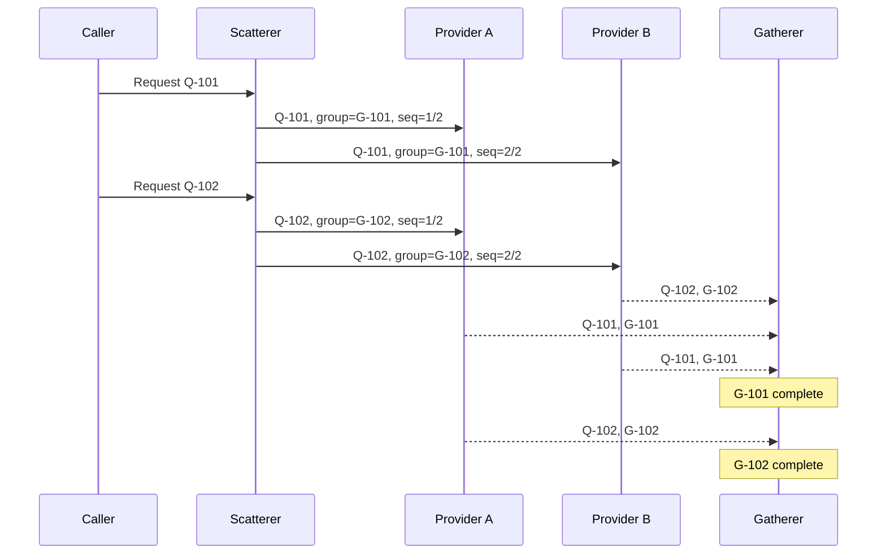
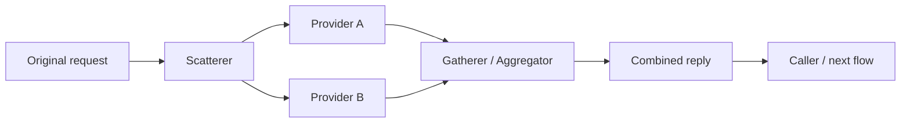
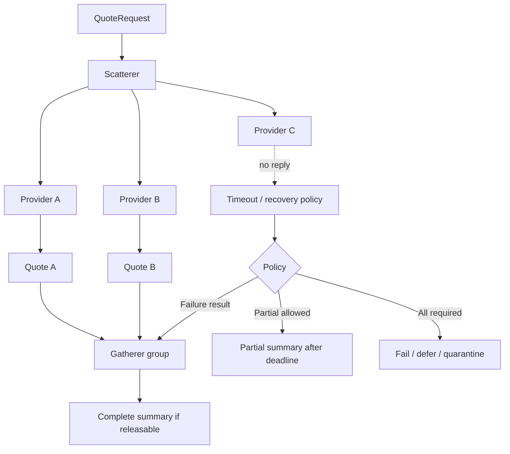
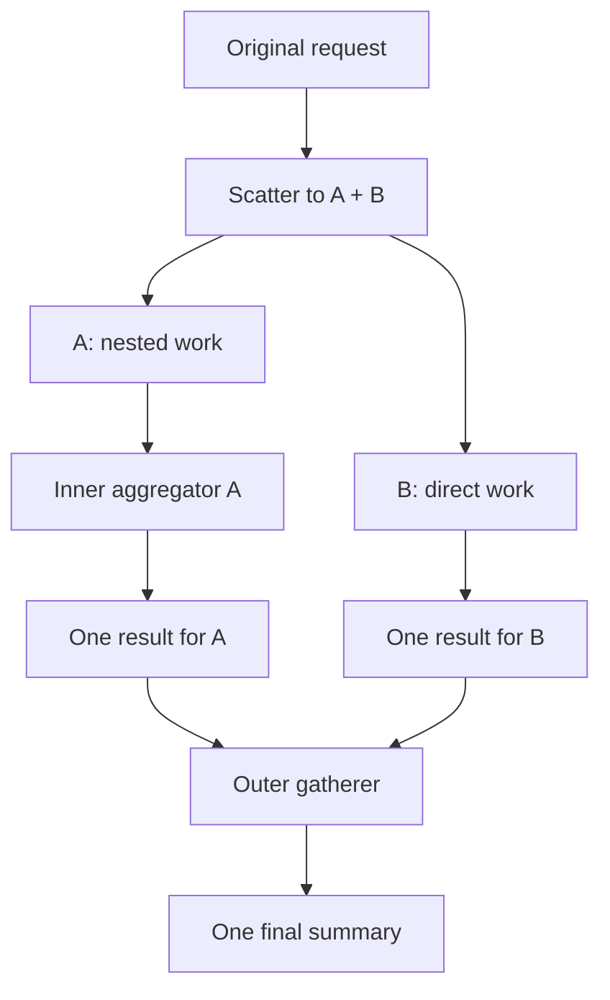
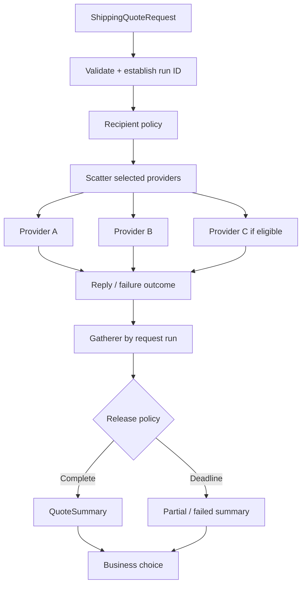

# Correlation Between Request and Response

In the **Scatter–Gather** pattern of Enterprise Integration Patterns (EIP), one request is **distributed to multiple processors** (*scatter*) and responses are **collected into a single result** (*gather*). The hard part is not sending one message to two or three handlers, but answering: **which response belongs to which request?** If two requests run concurrently, a partner responds slowly, a partner retries, or a response arrives after timeout, the system must still group the right results without mixing runs or treating missing responses as success.

In **Spring Integration**, Scatter–Gather can be implemented using recipient dispatch mechanisms (such as Recipient List Router or Publish–Subscribe) combined with an Aggregator. **Correlation metadata** links messages in a fan-out run; **sequence metadata** helps determine the expected number of responses; the **request–reply** path returns the aggregated result to the waiting caller. Those responsibilities are related, yet **cannot substitute for one another**.

This lesson belongs to the **Scatter gather** chapter of the `SPRING_INTEGRATION_PATTERN` module. The module's scope is learning to implement EIP with Spring Integration to build loosely coupled, extensible message flows; combining Router, Filter, Transformer, Splitter, Aggregator, Gateway, retry, error channel, and correlation, while testing and monitoring each branch.

**Learning objectives**

- Distinguish business `requestId`, `MessageHeaders.id`, `correlationId`, `sequenceNumber`, `sequenceSize`, and `replyChannel`.
- Explain how the Scatterer creates or propagates metadata so the Gatherer matches **multiple responses to the right single request run**.
- Predict behavior when responses **arrive out of order, are missing, duplicated, erroring, or late**.
- Build an in-JVM Scatter–Gather flow with two recipients returning typed results and test correlation across multiple requests.
- Design request–reply across a Gateway, executor, or broker without dropping correlation or producing unintended duplicate business outcomes.
- Select timeout, partial-result policy, idempotency, group store, and metrics appropriate to data criticality.

## 1. The problem: request A must not receive request B's response

Suppose a quoting application sends the same inquiry to two independent providers:

```text
Request Q-101: quote SKU-10, quantity 2
  ├── Provider A  -> 250.000 VND
  └── Provider B  -> 240.000 VND

Request Q-102: quote SKU-22, quantity 1
  ├── Provider A  -> 130.000 VND
  └── Provider B  -> 135.000 VND
```

In an asynchronous environment, responses can arrive in the order:

```text
T1: Provider B replies for Q-102
T2: Provider A replies for Q-101
T3: Provider B replies for Q-101
T4: Provider A replies for Q-102
```

If the Gatherer only counts "two responses arrived" without **grouping by request**, the result could contain one quote from Q-101 and one from Q-102. That is a severe logic bug, especially when responses carry prices, customer data, or access permissions.



`G-101` and `G-102` in the diagram are **illustrative symbols for group keys**, not header names or default values assigned by Spring. What must be preserved is **a sufficiently distinct identity for each fan-out run** within the scope of the gatherer.

### Correlation must answer two separate questions

1. **Which scatter run does the response belong to?** This is the concern of the **correlation strategy/group key** at the Gatherer.
2. **Which caller should receive the gathered result?** This is the concern of the **request–reply/reply-channel context**, which may involve the Gateway and internal channels managed by Scatter–Gather.

Sharing one ID for both purposes can be an application design choice, but **does not mean the two mechanisms are the same**.

## 2. IDs and headers you must distinguish

A request flowing through Scatter–Gather may carry many IDs. They serve different purposes:

| Field | Role | Should it be used as group key? |
| --- | --- | --- |
| `requestId` in payload | Application-defined business ID for a request. | Can be used in a **custom correlation strategy** if scope and lifecycle match. |
| `MessageHeaders.id` | ID of a specific Spring message. | Can serve as the basis for **one scatter run's** group; not guaranteed durable across replays. |
| `correlationId` | Identifies the group of responses to gather. | **Usually the default/expected key** for the corresponding Gatherer/Aggregator. |
| `sequenceNumber` | Position in a sequenced set of messages. | **Not** a group key. |
| `sequenceSize` | Expected group size when known. | Supports release, **does not** identify the group. |
| `replyChannel` | Path to send the reply back to the waiting endpoint/caller. | Not a group key and must not be altered arbitrarily. |
| `errorChannel` | Metadata supporting error handling in corresponding Spring Integration mechanisms. | Not used for grouping normal responses. |
| `traceId`/trace context | Observes a request across endpoints. | Do not use as authorization proof or sole group key. |
| `tenantId`, `runId` | Tenant scope and business execution run. | May be needed in **group identity** to avoid data mixing. |

`requestId`, `tenantId`, and `runId` are **application-defined** fields; not all of them are built-in Spring message headers. Nor should you equate `traceId` with `correlationId`: a single trace can contain multiple sub-requests and multiple independent scatter groups.

### Two layers of identity

Consider an original message:

```text
payload:
  requestId = Q-101
  sku       = SKU-10
  quantity  = 2

headers:
  id        = <spring-message-id>
  traceId   = trace-101
```

After scatter, the child messages might carry metadata like:

```text
Branch request A:
  requestId     = Q-101                 (business)
  correlationId = <scatter-group-key>   (response grouping)
  sequenceNumber = 1
  sequenceSize   = 2

Branch request B:
  requestId     = Q-101
  correlationId = <same-scatter-group-key>
  sequenceNumber = 2
  sequenceSize   = 2
```

This is a **conceptual model**. When using Spring Integration endpoints and sequence support, the framework can generate/copy headers for grouping. **Do not assume** the exact value of `correlationId` always equals `requestId` or a specific `MessageHeaders.id`; verify your topology/version and write tests.

## 3. Scatterer, Gatherer, and the reply path

A Scatter–Gather flow typically has two halves:



**The Scatterer** determines which recipients must receive the request and dispatches corresponding messages. When there are multiple recipients, sequence/correlation metadata must inform the Gatherer **how many responses are expected** per the chosen plan.

**The Gatherer** uses a correlation strategy to group responses, a release strategy to decide **when a group is complete**, and a group processor to build the result payload. When the group releases, the result must follow the **reply contract** of the original request.

### Scatter–Gather vs. one-way Publish–Subscribe

A `PublishSubscribeChannel` can send the same message to multiple subscribers, but if subscribers only log or return `null`, **there are no responses to gather**. Scatter–Gather requires each participating branch to have a **result-returning path** or an explicit policy for non-responses.

Example:

```text
Broadcast event -> audit (no reply)
                -> metrics (no reply)
```

This is **broadcasting**, not a two-result Scatter–Gather.

Conversely:

```text
QuoteRequest -> provider A -> QuoteResult A
             -> provider B -> QuoteResult B
                         -> gather -> QuoteSummary
```

This is the Scatter–Gather pattern when results are grouped accurately per request.

### Do not confuse `replyChannel` with `correlationId`

`replyChannel` is used by the request–reply system to identify **the destination for the result**, while `correlationId` is used by the Aggregator to identify **which responses belong to the same group**. In a Scatter–Gather flow, the framework may set up an **internal reply path** for branches before returning the final result to the caller.

If a worker constructs a brand-new `Message` and drops headers used for reply or correlation, the Gatherer may **fail to receive the response**, or receive it without **being able to group it**. Overwriting `replyChannel` with an arbitrary business channel can also misroute replies.

## 4. Right group is not enough: knowing when the group is complete

Suppose a scatter dispatches to three partners; A and B have replied, C timed out. The group has valid correlation, yet is missing a result:

```text
correlationId = G-201
expected responses = 3

Received:
  Provider A -> response 1
  Provider C -> response 3

Missing:
  Provider B -> ?
```

The received responses share the same correlation key, yet **the group is still missing one result**. The correlation strategy does not decide when a result can be emitted. That is the responsibility of the **release strategy**.

| Condition | Meaning |
| --- | --- |
| Same `correlationId` | Responses may belong to the same group. |
| Distinct, valid `sequenceNumber` | May represent different recipients/branches. |
| `sequenceSize=3` | Scatterer expects a 3-part group per the chosen sequence model. |
| Group receives all three valid parts | Can release if release strategy and contract permit. |
| Group receives two parts then times out | Can return partial, reject, or keep waiting per policy. |
| Group receives three messages but one is duplicate | Should **not** assume three distinct recipients replied. |

**Do not use `group.size()==sequenceSize` as universal proof of completeness.** Retries/redeliveries can create duplicates, Filters can drop responses, or one recipient may emit multiple messages. Understand the **actual cardinality** and verify each response's identity when business rules require it.

### Recipient count may be dynamic

If a Recipient List Router selects recipients by region, priority, or order type, request A might have **2** recipients while request B has **3**. Do not hardcode `sequenceSize=3` for every message.

The recipient plan must be determined by a trusted policy, and the response count must reflect **the number of results the Gatherer actually needs to complete**. When a recipient is dropped by a Filter, a handler returns no reply, or a branch produces multiple results, redefine the release strategy or emit a substitute result.

## 5. Designing typed responses with source identity

A common mistake is having every recipient return a plain `long` amount, so the Aggregator builds a list `[250000, 240000]`. If the two responses arrive out of order, the application no longer knows **which price came from which provider**. The solution is for every response to carry both **business request identity** and **recipient identity**.

Java 17+ example:

```java
import java.util.List;

record QuoteRequest(
        String requestId,
        String sku,
        int quantity
) {}

record ProviderQuote(
        String requestId,
        String providerId,
        long amountMinorUnits,
        String currencyCode,
        boolean available
) {}

record QuoteSummary(
        String requestId,
        List<ProviderQuote> quotes
) {
    QuoteSummary {
        quotes = List.copyOf(quotes);
    }
}
```

This is an **application data contract**, not a message type created by Spring Integration by default. `requestId` lets you verify that responses in a group truly belong to the same business request; `providerId` helps detect duplicate recipients, sort deterministically, and explain results.

### Do not use sequence as provider identity

In one scatter run, Provider A might get `sequenceNumber=1` and Provider B get `2`. However, if the recipient list or router order changes, `1` may represent a different partner.

Therefore:

- `sequenceNumber` is **routing/grouping metadata for a single dispatch run**.
- `providerId` is **the business identity of the quote source**.
- `requestId` is **the request identity in the contract**.
- `correlationId` is **the Aggregator's group identity**.

A response with `providerId=A` and `sequenceNumber=2` may still be valid if recipient ordering changed; conversely, two responses both with `providerId=A` may be **duplicates**, even with different sequence metadata. The application contract must specify how to handle this.

## 6. Using `MessageGroupProcessor` to validate responses before creating the summary

Below is an illustrative processor for **a complete group consisting of exactly two providers `A` and `B`**. It does more than count messages: it validates payload type, consistent `requestId`, and no duplicate `providerId`.

```java
import java.util.ArrayList;
import java.util.HashSet;
import java.util.List;
import java.util.Set;

import org.springframework.integration.aggregator.MessageGroupProcessor;
import org.springframework.integration.store.MessageGroup;
import org.springframework.messaging.Message;

final class QuoteGroupProcessor implements MessageGroupProcessor {

    private static final Set<String> REQUIRED_PROVIDERS = Set.of("A", "B");

    @Override
    public Object processMessageGroup(MessageGroup group) {
        List<ProviderQuote> quotes = new ArrayList<>();
        Set<String> seenProviders = new HashSet<>();
        String requestId = null;

        for (Message<?> message : group.getMessages()) {
            if (!(message.getPayload() instanceof ProviderQuote quote)) {
                throw new IllegalArgumentException("UNEXPECTED_QUOTE_PAYLOAD");
            }
            if (quote.requestId() == null || quote.requestId().isBlank()) {
                throw new IllegalArgumentException("MISSING_REQUEST_ID");
            }
            if (!REQUIRED_PROVIDERS.contains(quote.providerId())
                    || !seenProviders.add(quote.providerId())) {
                throw new IllegalArgumentException("DUPLICATE_OR_UNKNOWN_PROVIDER");
            }
            if (requestId == null) {
                requestId = quote.requestId();
            } else if (!requestId.equals(quote.requestId())) {
                throw new IllegalArgumentException("MIXED_REQUEST_GROUP");
            }
            if (quote.available() && quote.amountMinorUnits() <= 0) {
                throw new IllegalArgumentException("INVALID_QUOTE_AMOUNT");
            }
        }

        if (!seenProviders.equals(REQUIRED_PROVIDERS)) {
            throw new IllegalStateException("INCOMPLETE_QUOTE_GROUP");
        }

        quotes.sort(java.util.Comparator.comparing(ProviderQuote::providerId));
        return new QuoteSummary(requestId, quotes);
    }
}
```

**Reading the processor's responsibilities accurately:**

1. It **does not create the correlation key**; the group is already provided by the Aggregator.
2. It **does not decide release timing**; the release strategy must invoke the processor in the right state.
3. It checks the contract of **two distinct providers, same request**, preventing two replies from A from impersonating A+B.
4. It sorts by `providerId` because arrival order is non-deterministic.
5. It returns a **`QuoteSummary` payload** without calling suppliers or writing to a DB.
6. If configuration allows partial release, this processor **intentionally rejects** incomplete groups. A separate processor/DTO is needed for partial policies, rather than catching exceptions and returning an incomplete list.

### Why keep the processor pure?

If `processMessageGroup()` both picks the cheapest price and calls an order-placement API, an Aggregator retry or late response could cause **double purchasing**. Separate them:

```text
Correlation + release
      |
      v
Pure QuoteGroupProcessor
      |
      v
QuoteSummary
      |
      v
Business decision + idempotent side effect
```

The aggregated result can be replayed and tested independently. Critical side effects require durable idempotency keys and confirmation mechanisms in the proper handler.

## 7. Java DSL: an in-JVM Scatter–Gather flow

The following configuration illustrates **two synchronous recipients**, each returning a `ProviderQuote`, after which the Gatherer produces `QuoteSummary`. Java DSL APIs depend on the Spring Integration version; when implementing for real, compile and test against your project's dependency version.

```java
import org.springframework.context.annotation.Bean;
import org.springframework.context.annotation.Configuration;
import org.springframework.integration.aggregator.SimpleSequenceSizeReleaseStrategy;
import org.springframework.integration.channel.DirectChannel;
import org.springframework.integration.channel.QueueChannel;
import org.springframework.integration.config.EnableIntegration;
import org.springframework.integration.dsl.IntegrationFlow;

@Configuration
@EnableIntegration
class QuoteScatterGatherConfig {

    @Bean
    DirectChannel quoteRequests() {
        return new DirectChannel();
    }

    @Bean
    DirectChannel providerARequests() {
        return new DirectChannel();
    }

    @Bean
    DirectChannel providerBRequests() {
        return new DirectChannel();
    }

    @Bean
    QueueChannel quoteSummaries() {
        return new QueueChannel();
    }

    @Bean
    QuoteGroupProcessor quoteGroupProcessor() {
        return new QuoteGroupProcessor();
    }

    @Bean
    IntegrationFlow quoteScatterGather(QuoteGroupProcessor processor) {
        return IntegrationFlow.from("quoteRequests")
                .scatterGather(
                        scatterer -> scatterer
                                .recipient("providerARequests")
                                .recipient("providerBRequests"),
                        gatherer -> gatherer
                                .releaseStrategy(
                                        new SimpleSequenceSizeReleaseStrategy())
                                .outputProcessor(processor))
                .channel("quoteSummaries")
                .get();
    }

    @Bean
    IntegrationFlow providerA() {
        return IntegrationFlow.from("providerARequests")
                .handle(QuoteRequest.class, (request, headers) ->
                        new ProviderQuote(
                                request.requestId(), "A",
                                250_000, "VND", true))
                .get();
    }

    @Bean
    IntegrationFlow providerB() {
        return IntegrationFlow.from("providerBRequests")
                .handle(QuoteRequest.class, (request, headers) ->
                        new ProviderQuote(
                                request.requestId(), "B",
                                240_000, "VND", true))
                .get();
    }
}
```

**Limitations of the example:**

- `providerARequests` and `providerBRequests` are **in-JVM** channels/handlers only, making no real HTTP calls.
- Both handlers return **one result** in request–reply style; a handler that only logs/`return null` will not produce a response for the Gatherer.
- The Scatterer uses a Recipient List Router with two recipients; sequence/correlation attachment must be verified on **the Spring Integration version** your project uses.
- `SimpleSequenceSizeReleaseStrategy` demonstrates the **count-met** condition; it is **not** an absolute deduplication mechanism. The processor checks provider identity to catch errors before emitting the summary.
- `quoteSummaries` is a `QueueChannel` for tests to pull results, **not durable persistence** or a response sent back to an HTTP caller.
- Both handlers currently return fixed prices for illustration. In production, prices must include currency, version, validity window, and appropriate validation/verification rules.

**Key decision point:** Scatter–Gather must be configured so that **replies from each recipient actually reach the Gatherer**. If replacing a handler with a one-way outbound adapter, a corresponding response flow is required; never treat "request sent to provider" as "quote received".

## 8. Testing the happy path with Spring Test

With the configuration from section 7, the test verifies that one request produces **one summary containing both exact providers**. `@DirtiesContext` prevents interference from groups/queues of other tests.

```java
import static org.junit.jupiter.api.Assertions.assertEquals;
import static org.junit.jupiter.api.Assertions.assertNotNull;
import static org.junit.jupiter.api.Assertions.assertNull;
import static org.junit.jupiter.api.Assertions.assertTrue;

import org.junit.jupiter.api.Test;
import org.springframework.beans.factory.annotation.Autowired;
import org.springframework.beans.factory.annotation.Qualifier;
import org.springframework.integration.channel.QueueChannel;
import org.springframework.messaging.Message;
import org.springframework.messaging.MessageChannel;
import org.springframework.messaging.support.MessageBuilder;
import org.springframework.test.annotation.DirtiesContext;
import org.springframework.test.context.junit.jupiter.SpringJUnitConfig;

@SpringJUnitConfig(QuoteScatterGatherConfig.class)
@DirtiesContext(classMode = DirtiesContext.ClassMode.AFTER_EACH_TEST_METHOD)
class QuoteScatterGatherFlowTest {

    @Autowired @Qualifier("quoteRequests")
    MessageChannel input;

    @Autowired @Qualifier("quoteSummaries")
    QueueChannel output;

    @Test
    void gathersOnlyResponsesForTheCurrentRequest() {
        var first = new QuoteRequest("Q-101", "SKU-10", 2);

        assertTrue(input.send(MessageBuilder.withPayload(first)
                .setHeader("traceId", "trace-101")
                .build()));

        Message<?> result = output.receive(1_000);
        assertNotNull(result);

        QuoteSummary summary = (QuoteSummary) result.getPayload();
        assertEquals("Q-101", summary.requestId());
        assertEquals(2, summary.quotes().size());
        assertEquals("A", summary.quotes().get(0).providerId());
        assertEquals("B", summary.quotes().get(1).providerId());
        assertTrue(summary.quotes().stream().allMatch(quote ->
                "Q-101".equals(quote.requestId())));
        assertNull(output.receive(0));
    }

    @Test
    void consecutiveRequestsKeepDifferentSummaries() {
        input.send(MessageBuilder.withPayload(
                new QuoteRequest("Q-201", "SKU-A", 1)).build());
        input.send(MessageBuilder.withPayload(
                new QuoteRequest("Q-202", "SKU-B", 1)).build());

        QuoteSummary a = (QuoteSummary) output.receive(1_000).getPayload();
        QuoteSummary b = (QuoteSummary) output.receive(1_000).getPayload();

        assertEquals("Q-201", a.requestId());
        assertEquals("Q-202", b.requestId());
        assertEquals(2, a.quotes().size());
        assertEquals(2, b.quotes().size());
        assertNull(output.receive(0));
    }
}
```

This test **does not conclude that multi-threaded correlation has been fully proven**: both recipients in the sample config execute synchronously. With an executor, concurrent requests, and one slow provider, additional **interleaving** tests are needed to verify each group still contains the exact two providers with matching `requestId`.

### Header-level testing is required

In addition to the final payload, you can add interceptors/test handlers at the Scatterer and Gatherer boundaries to check:

- Both branch requests in one scatter run share **related correlation keys**, while remaining distinct from other request runs.
- Branches carry sequence metadata compatible with the release policy.
- Handler responses retain the metadata required for the Gatherer to group and reply.
- The final reply returns to the right `replyChannel` or Scatter–Gather output; not into another request's input channel.

Do not tie tests to a specific randomly generated ID; verify **relationships between IDs**, e.g., *A and B share the same group, and the second request does not reuse the first request's group*.

## 9. When responses arrive out of order

Asynchrony changes **arrival order** without changing the question to answer. Example:

```text
Q-301 -> A slow, B fast
  09:00:00.010  B reply
  09:00:00.400  A reply
```

The Gatherer must not assume the first callback is Provider A. Outputs must carry an explicit `providerId`. If downstream needs to prefer the cheaper provider, compare quotes using the same **currency and contract**, rather than picking the first element in `group.getMessages()`.

### Why is `sequenceNumber` not completion order?

Sequence number indicates **position within a sequenced recipient/message set**, not a timestamp or finish order. In an application using an `Executor`, Provider B may finish before Provider A. If the application needs results sorted by recipient order, use `providerId` or verified sequence metadata, not arrival order.

### Result count does not equal processing attempt count

A retried handler might be invoked three times yet should yield only **one valid business response** for a `(requestRunId, providerId)` per contract. A typed error result like `ProviderUnavailable` can also count as **a completed response** if the release policy needs a result from every branch.

## 10. One recipient does not respond: right correlation can still stall a group

Suppose scatter dispatches to A, B, C; A and B have replied, C times out. The group has valid correlation, yet is missing a result:



There are three main paths:

1. **Failure-as-response:** turn a determined failure from C into `ProviderOutcome(status=UNAVAILABLE, providerId=C, ...)`, preserving the group key/sequence. The Gatherer receives **all three outcomes** and returns a result with clear status.
2. **Partial result:** release upon deadline containing only the providers that responded; output must record `expected=3`, `received=2`, `complete=false`, never masquerading as a full summary.
3. **All-or-nothing:** if all three providers are mandatory, stop the business outcome and raise an error/quarantine/defer per policy. Never return `APPROVED` just because the first two providers succeeded.

`SimpleSequenceSizeReleaseStrategy` on its own cannot express partial or business-error policies. Corresponding release/expiry strategies and processors/DTOs are required.

### Do not implicitly treat a timeout as a response

A timeout is a signal that **no result was received within the window**, not proof that Provider C failed processing or that its price is 0. A response arriving late may be a valid result that **missed the acceptance window** of the current gather run. Late-reply handling must be specified up front.

## 11. Three types of timeouts in a request–reply system

A Scatter–Gather flow can have multiple clocks:

| Timeout | Where applied | What does it bound? |
| --- | --- | --- |
| **Provider/client timeout** | HTTP, JDBC, message gateway, or branch adapter. | How long to wait for each dependency to reply. |
| **Gather/group expiry timeout** | Aggregator/MessageGroupStore/recovery. | How long a group is allowed to accumulate responses. |
| **Caller/Gateway reply timeout** | Request–reply Gateway/caller. | How long the caller waits for **the aggregated result**. |

An illustrative deadline budget:

```text
Caller budget: 1.500 ms
  validate + scatter dispatch: 100 ms
  max provider attempt:        700 ms
  gather + mapping:            200 ms
  reply/network reserve:       500 ms
```

These numbers are for design illustration, not Spring defaults. If a provider is retried three times with a 700 ms timeout each, total time can exceed the caller budget. Propagate a **meaningful deadline or time budget** along the flow and bound backoff/retries per branch.

**Group expiry does not automatically mean the Gateway will return `PartialQuoteSummary`.** Conversely, a Gateway timeout does not mean workers or groups are automatically cancelled. Group state and late results need a recovery policy.

## 12. Late responses and already-released groups

Suppose `Q-401` needs A and B. A replies first, B times out; the group is partially released and removed. Then B replies:

```text
10:00:00 Q-401 scattered
10:00:01 A replied
10:00:02 Partial summary issued
10:00:05 B replied late
```

Without a **late-arrival policy**, response B could:

- Be dropped untracked.
- Create a new group with the same correlation key.
- Trigger a second summary and cause duplicate side effects.
- Land on a reply destination with no listener left.
- Grow backlog unbounded if there is no expiry.

### Designing post-release conditions

- **Completed groups must have durable identity** if emitting a second summary must be avoided.
- Decide whether **corrections/updates are accepted** after a partial summary.
- If not accepted, late responses are **audited + discarded/quarantined** with code `LATE_RESPONSE`.
- If updates are accepted, use a **summary version** or compensating event instead of silently overwriting already emitted results.
- If a request can be rerun, use a distinct `runId` to prevent old responses from falling into the next run's group.

Do not set `expireGroupsUponCompletion` or cleanup options solely to save memory while ignoring late-message consequences.

## 13. Retries and duplicates: a valid response can arrive twice

A provider may receive the same request again due to network glitches or broker redelivery; a consumer may send a response twice if an ACK is lost. Two responses with the same `requestId=Q-501` and `providerId=A` do not represent two independent quotes.

```text
Q-501 expected recipients: A + B

Received:
  A, attempt=1 -> 250000
  A, attempt=1 -> 250000 (duplicate)
  B, attempt=1 -> not yet received
```

If the Gatherer only sees **group size=2**, it might release prematurely. The illustrative processor in section 6 detects **`DUPLICATE_OR_UNKNOWN_PROVIDER`**, yet this **does not self-heal a group** that was released prematurely or handle prior duplicates cleanly.

A more resilient strategy:

1. Key responses by `(requestRunId, providerId)` or `(requestRunId, recipientId, responseType)` per contract.
2. **Deduplicate before adding to the group** or use a store/release policy that understands recipient identity.
3. Keep business `requestId` and `runId` if the same request can legitimately be re-executed.
4. Place idempotency at **provider invocation** if lookups have side effects, not only at the Aggregator.
5. Separate `attemptId` (a single try) from **request run** and business request identity.
6. Do not assume `MessageHeaders.id` of a message stays unchanged after replay.

### Retry the whole Scatter–Gather or just one recipient?

Retrying **the entire request** may re-invoke Provider A even though only Provider B failed. If A is a read-only quote lookup, that may be acceptable within rate limits; if A creates a reservation or order, retrying everything can cause duplicate side effects. Retry **per recipient** when appropriate, with deadlines and idempotency keys at the right boundaries.

## 14. Correlation across Transformer, Router, Filter, and Splitter

**Transformer:** A branch converts `QuoteRequest` to `ProviderQuote`. If returning a new payload via standard Spring Integration mechanisms, orchestration metadata can be propagated properly. If building `MessageBuilder.withPayload(...).build()` manually and omitting key headers, correlation/reply paths may be lost. Test propagation on the actual endpoints and adapters.

**Router:** The Scatterer can use a Recipient List Router to select multiple targets. An earlier business Router might choose providers by region. **Do not confuse a routing key** (e.g., `VN_SOUTH`) with **group identity**; two requests in the same region are still two distinct groups.

**Filter:** A recipient dropped by a Filter emits no result, causing a missing response. If the group still waits for three results, it may never complete. Have discarded branches emit a correlated `ProviderSkipped` or use a partial timeout policy.

**Splitter:** A Provider processes one request and then splits it into multiple subrequests. With two fan-out layers, the inner `sequenceSize` **cannot substitute for** the outer recipient count. Separate correlation by layer, gather inner results first, and return **one** representative response for the provider to the outer Gatherer, or explicitly define multi-layer group keys/cardinality.

**Aggregator:** The Gatherer is responsible for combining correlated results; a group is typically identified by `correlationId`. However, an application may need a custom correlation strategy to group by business run, tenant, or provider batch. When customizing, ensure **group IDs cannot collide and do not originate from untrusted sources**.



Each layer must know its **expected result unit**. If the outer layer expects 2 provider replies, A's inner layer must not send 5 subresults directly into the outer group while keeping `sequenceSize=2`.

## 15. Correlation across Kafka, AMQP, and other processes

Within the same JVM, Spring message headers can pass across compatible endpoints. When scattering to other services over Kafka, AMQP, or HTTP, **Spring `MessageHeaders` are not automatically preserved across every adapter**.

```text
Spring Scatterer
   |
   | Message<QuoteRequest> + group metadata + reply context
   v
Outbound adapter / serializer / header mapper
   |
   v
Broker / remote provider
   |
   v
Response message with application contract
   |
   v
Inbound adapter / deserialize / recreate Spring message
   |
   v
Gatherer + correlation strategy
```

Agree on a durable **correlation envelope**, for example:

```json
{
  "requestId": "Q-601",
  "requestRunId": "Q-601/run-1",
  "recipientId": "provider-A",
  "expectedRecipientCount": 2,
  "responseId": "resp-A-601-1",
  "status": "QUOTE_AVAILABLE",
  "quote": {
    "amountMinorUnits": 250000,
    "currencyCode": "VND"
  }
}
```

This is an **application-defined schema**, not a mandatory Spring Integration JSON format. The receiving Gateway or aggregator can map `requestRunId` back into the correlation strategy and use `recipientId` for deduplication.

### Why not serialize `replyChannel` as an arbitrary bean name?

An in-JVM `replyChannel` may be a reference to a Spring `MessageChannel` or internal routing context. A service in another JVM cannot by default reuse that reference to send a reply. Across a broker, design an **accessible reply destination**, message correlation ID, and matching response consumer/adapter.

Spring Integration supports header mapping and adapter request–reply patterns; however, they must be configured and tested on the specific transport. Do not simply serialize a `MessageChannel` object to JSON and treat it as a usable address in another service.

### Persist group state across restarts when durability is needed

If the application crashes after receiving A but before receiving B, an in-memory group store loses A. A persistent `MessageGroupStore` combined with proper transactions/recovery can help recover, yet **does not automatically guarantee exactly-once** across broker, producer, response handling, and downstream side effects. If recoverability is required, design group state, ACK/commit, expiry, idempotency, and test real restarts.

## 16. Security: the same `correlationId` does not mean the same principal

Correlation is a **message-grouping** mechanism, not authentication. If the application trusts a `correlationId` sent by an external client, a client could try to inject its response into another group.

Important safeguards:

- Authenticate request and response sources at ingress/adapters.
- Bind `requestRunId` to verified **tenant identity, permissions, and operation**.
- Verify that `requestId`/`providerId` in the response payload match the allowed group and recipient.
- Prevent one provider from impersonating another merely by setting `providerId=A`.
- Bound group count, messages per group, payload size, and TTL to prevent memory/storage exhaustion.
- Do not put PII, secrets, or raw payment data into headers that are easily logged/propagated.
- For a group store shared across tenants, keying solely by `requestId` can collide; use tenant-scoped group identity or a genuinely globally unique and verified ID.

**Principle:** Delivering a message to the right Gatherer **does not mean** that message is authorized to join the group or trigger post-aggregation side effects.

## 17. Recipient errors vs. Gatherer errors

A flow can fail at multiple stages:

| Stage | Example | Required behavior |
| --- | --- | --- |
| Scatter | Recipient channel has no consumer, bad topology. | Fail fast, error policy, do not create a "complete" state. |
| Provider | Timeout, 503, invalid response. | Bounded retry; failure-as-response or fail/defer. |
| Response transport | Header mapping drops correlation, publish failed. | Recovery/ack/retry with idempotency; validate envelope. |
| Gather correlation | Group key missing, invalid group ID. | Reject/quarantine, do not merge into a default catch-all group. |
| Gather release | Group waiting with missing replies. | Expiry/partial/fail policy, alert on group age. |
| Group processor | Duplicate provider, mixed request, wrong currency. | Validation, error handling, never emit invalid summary. |
| Reply/output | Gateway timed out, output channel/broker error. | Late reply recovery, idempotent result publishing. |

If branches run synchronously, exceptions may propagate back up the sending thread. With an executor/poller/async adapter, exceptions may be converted into an `ErrorMessage` per configured error handlers and `errorChannel`. **Do not assume** every provider error automatically turns into a correlated error reply sent to the Gatherer.

For example, if the Aggregator must receive an outcome from B when B fails, the recovery flow must **create a result carrying `requestRunId`, `recipientId`, and matching correlation/sequence**. Sending an exception straight to a global error channel without emitting a result to the Gatherer still leaves the group short an element.

## 18. Observing correlation and request lifecycle

A Scatter–Gather incident is hard to investigate with only "request sent" and "response received" logs. You must connect **the same request** across all branches and observe **group progress**.

Log fields might include:

```text
requestId=Q-701 runId=Q-701/run-1
groupKey=<scatter-group> recipient=A
outcome=REPLIED elapsedMs=125 traceId=trace-701

requestId=Q-701 runId=Q-701/run-1
groupKey=<scatter-group> expected=2 received=2
groupOutcome=COMPLETE summaryPublished=true
```

This is an **illustrative application format**, not logs emitted automatically by Spring Integration. When tracing across executors/reactive bridges, propagate context using the appropriate technology; do not assume MDC or `ThreadLocal` automatically crosses to worker threads.

| Illustrative metric | Meaning |
| --- | --- |
| `scatter_requests_total` | Count of original requests dispatched. |
| `scatter_recipients_total{recipient}` | Dispatch count per recipient. |
| `gather_response_received_total{recipient,outcome}` | Responses received and their outcome. |
| `gather_group_open` | Number of currently waiting groups. |
| `gather_group_completed_total` | Groups successfully released. |
| `gather_group_expired_total` | Groups expired due to timeout. |
| `gather_group_age_seconds` | Age of still-open groups. |
| `gather_duplicate_response_total{recipient}` | Duplicate responses per contract. |
| `gather_late_response_total` | Responses arriving after release. |
| `scatter_gather_request_duration_seconds` | Latency from incoming request to emitted summary. |

Metric names are **instrumentation suggestions**, not names guaranteed to be auto-provided by the framework. Use bounded labels such as `recipient`, `outcome`, `flow`, `errorType`; do not use `requestId`, `traceId`, `customerId`, or group keys as metric labels due to high cardinality.

### Distinguishing completion milestones

- **Scatter dispatched:** branch requests handed off at the channel boundary.
- **Provider replied:** one branch produced a response.
- **Group released:** Gatherer decided criteria were met to emit output.
- **Summary published:** aggregated result sent onward to the output channel.
- **Business action confirmed:** downstream persisted/completed confirmed side effects.

An earlier milestone **does not prove** a later one. In particular, `send()` returning `true` is not enough to claim both remote providers finished and results were durably stored.

## 19. Pre-production correlation test matrix

| Scenario | What to verify |
| --- | --- |
| One request, two providers both reply | Exactly one summary, two distinct providers, matching request ID. |
| Two requests with interleaved A/B responses | No mixed groups; each summary contains only its own request. |
| Response B arrives before A | Summary remains accurate; independent of arrival order. |
| Provider B returns no reply | Group timeout/expiry/partial/failure policy works. |
| Response has `requestId` but lacks `correlationId` | Not misgrouped; error/quarantine policy triggers. |
| Provider returns wrong request ID | Processor detects mixed request and suppresses invalid summary. |
| Same provider replies twice | Duplicate does not trigger premature release or duplicate side effects. |
| One provider throws exception without failure result | Clear error path; exception not mistaken for normal reply. |
| Filter drops a branch | Skipped/failure response emitted or expected count adjusted properly. |
| Recipient list varies by policy | Sequence size/release reflects actual expected result count. |
| Provider uses internal Splitter | Inner correlation does not break outer Scatter–Gather group. |
| Response arrives after partial release | Late-message policy prevents invalid summaries. |
| Gateway caller times out | Late reply is not misdelivered to another request. |
| Broker redelivery after crash | Group state and business IDs recover/deduplicate properly. |
| Two JVMs gather the same group | Proper store/affinity/locking; no split groups across processes. |
| Multi-tenant | No cross-tenant response mixing due to group key collisions. |
| High load | Memory/store, queue, and group lifetime limits hold. |

Tests must not rely solely on `group.size()` or invocation counts. With Scatter–Gather, correctness must be verified via **the relationship among request, recipient, group key, and response**.

## 20. Case study: quoting three shipping carriers

**Context:** An order needs shipping quotes from three carriers A, B, and C. Some regions only have two eligible carriers. The system must return a recommendation within 1.2 seconds max; some providers frequently time out, responses may arrive late, and broker messages may be redelivered. Users can submit multiple orders concurrently, and the system must avoid mixing orders or tenants.



### Practice tasks

1. **Define identities:** `requestId`, `requestRunId`, `tenantId`, `recipientId`, and `responseId`. Distinguish same-run retries from new requests.
2. **Select recipients:** domestic regions may require A/B; special regions use A/B/C. Expect response count based on **selected recipients**, not total system providers.
3. **Choose release:** If A replies, B times out, and C errors, do we return partial? If so, represent `complete=false`, `expected=3`, `responded=2` alongside C's error.
4. **Design failure-as-response:** When does a B timeout become `ProviderUnavailable` versus continuing to wait/retry?
5. **Correlation:** How do you prove two requests Q-900/Q-901 have distinct groups despite sharing the same SKU and tenant?
6. **Idempotency:** If A sends two identical responses due to broker redelivery, it must not count as having received A+B.
7. **Late reply:** If C replies at 1.5 seconds after summary publication, will it be stored, discarded, or emit a correction? Who decides?
8. **Recoverability:** If the JVM restarts after receiving two of three responses, which group store and message envelope prevent losing the group?
9. **Request–reply:** If the Gateway times out at 1.2 seconds while workers continue past timeout, how is status/async notification returned?
10. **Security:** Where are `tenantId` and provider permissions verified to prevent forged responses targeting another tenant's group ID?
11. **Testing:** scenarios for out-of-order arrival, duplicate responses, wrong request, timeout, no-reply, late reply, multi-instance, broker redelivery, and dynamic recipient lists.
12. **Observability:** separately measure scattered requests, pending groups, complete/partial/expired groups, and per-provider error rates.

### Self-assessment questions

**Question 1:** Are two responses with the same `requestId` but different `correlationId` guaranteed to belong to the same Scatter–Gather group? **No.** The Gatherer groups by correlation strategy; mapping and per-run semantics must be verified.

**Question 2:** `sequenceSize=3`, the group receives three responses, all from Provider A. Can a valid combined A/B/C quote summary be published? **No.** Recipient identity checking/deduplication is required; count alone is insufficient.

**Question 3:** Provider B times out, and `errorChannel` receives an `ErrorMessage`. Does the Gatherer automatically receive a `ProviderUnavailable` response? **No.** A recovery flow must build a correlated failure result if the contract requires it.

**Question 4:** Does Gateway timeout mean requests to A/B/C were cancelled and the group deleted? **Never assume that.** Caller timeout, group expiry, and worker cancellation are separate mechanisms.

**Question 5:** When moving Scatter–Gather from in-JVM to a broker, is keeping `replyChannel` name as a string enough? **No.** You need a transport-appropriate reply destination/adapter, correlation envelope, header mapping, and recovery mechanism.

## Summary

- In **Scatter–Gather**, correlation solves **which response belongs to which request run**, while request–reply context determines **where the aggregated result goes**. `correlationId` is not synonymous with `replyChannel`, `traceId`, `requestId`, or Spring message ID.
- The Scatterer selects recipients; the Gatherer uses **correlation strategy**, **MessageGroupStore**, **release strategy**, and **group processor**. Matching the right group does not yet mean the group has enough responses.
- **`sequenceNumber`/`sequenceSize`** help track request/response sets, yet **do not** replace recipient identity, do not automatically prevent duplicates, and must not be applied mechanically when recipient counts vary or one branch emits multiple results.
- A **missing, failing, duplicate, or late** response requires explicit timeouts, failure-as-response/partial/fail policies, deduplication, and late-arrival handling; do not assume exceptions are gathered like normal replies.
- With **Gateway, Transformer, Filter, nested Splitter, executor, or broker**, preserve or reconstruct group identity and reply paths per contract; durable IDs and idempotency are independent responsibilities.
- Test **concurrent requests and interleaved responses**, assert request–recipient–group relationships, monitor open/expired/late groups, and never infer business completion from `send()` or group release alone.
