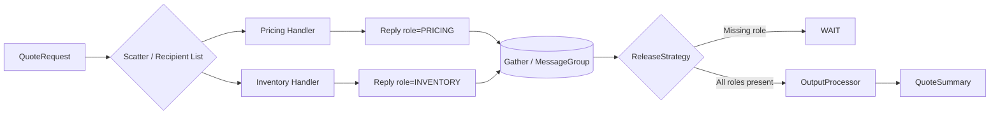
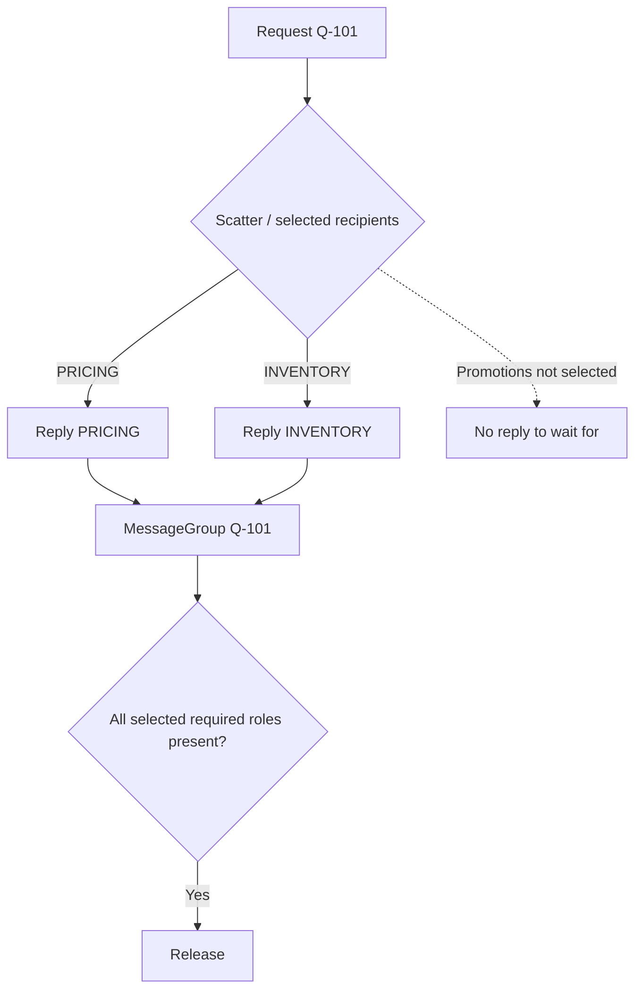
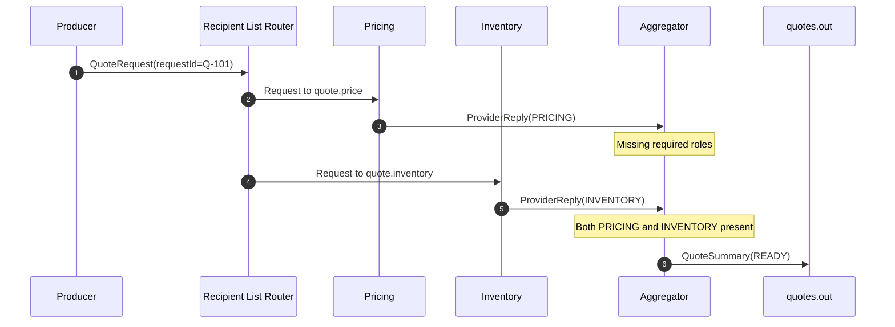
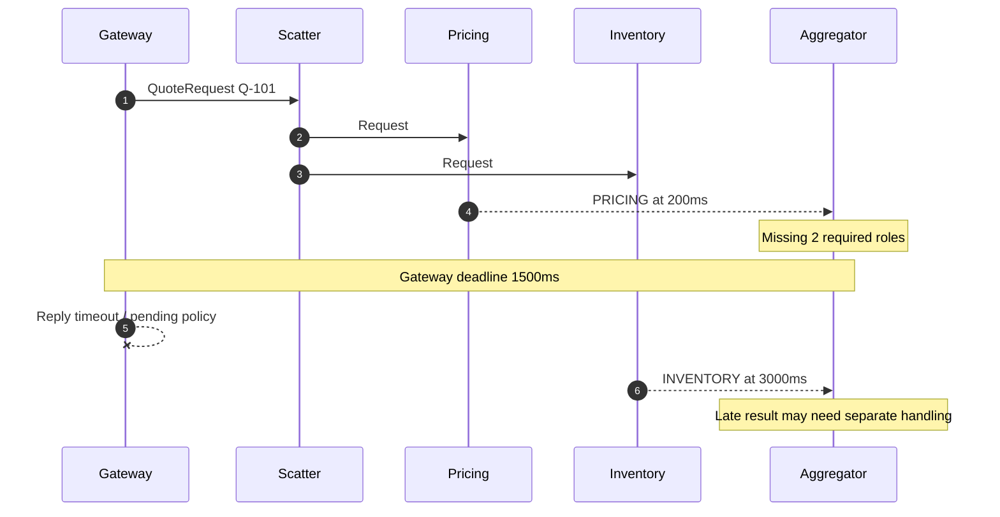
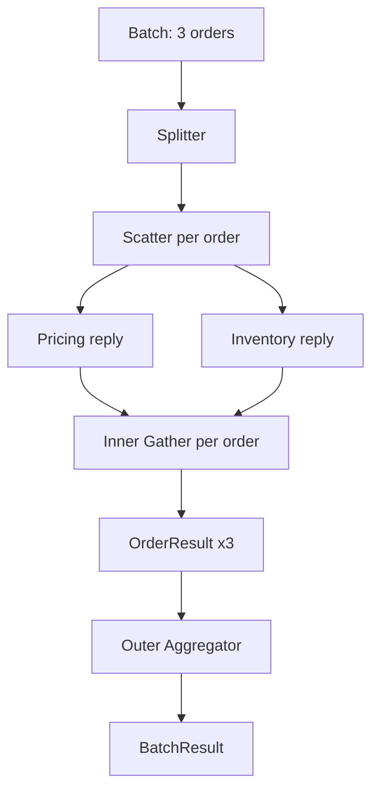

# Release Strategy for Gathered Replies

A service receives a quote request for an order. From **one request**, the system dispatches two independent checks concurrently: **Pricing** calculates the price and **Inventory** verifies stock. Afterward, the system must **gather the replies** to produce a single result. Yet if Pricing replies twice due to a retry, Inventory responds slowly, or one branch returns an error instead of a result, when is it valid to conclude "gathering is complete"?

That is the responsibility of the **Release Strategy** in the **Scatter–Gather** pattern. Scatter sends the request to multiple recipients; Gather uses an **Aggregator** to receive replies belonging to the same group. The release strategy determines **when the reply set satisfies completion criteria**, rather than merely checking whether a message has appeared at the output.

The lesson **"Release Strategy for Gathered Replies"** belongs to the **Scatter gather** chapter of the `SPRING_INTEGRATION_PATTERN` module. Within the scope of learning **Enterprise Integration Patterns** with Spring Integration, we will distinguish release strategy from correlation and output processing, build Java DSL/JUnit 5 examples, handle missing/duplicate/late replies, timeouts, error channels, and retries, and combine Router, Filter, Transformer, Splitter, Aggregator, and Gateway to create loosely coupled, extensible flows with per-branch observability.

> **Core takeaway:** A release strategy answers **"have all required replies arrived yet?"**. A `group.size() == N` check may suffice when replies are guaranteed exactly-once, but easily breaks when there are **duplicates, optional branches, conditional fan-out, or messages that never return to the Aggregator**. Design the condition around **the contract of replies that are genuinely required**.

## 1. Scatter–Gather has two halves of responsibility

Example request:

```json
{
  "requestId": "Q-101",
  "sku": "BOOK-02",
  "quantity": 3
}
```

Pricing returns:

```json
{
  "requestId": "Q-101",
  "role": "PRICING",
  "status": "SUCCESS",
  "detail": "unitPrice=120000"
}
```

Inventory returns:

```json
{
  "requestId": "Q-101",
  "role": "INVENTORY",
  "status": "SUCCESS",
  "detail": "available=18"
}
```

These are illustrative schemas. Once both replies are present, Gather produces a `QuoteSummary` or `QuoteReceipt` for downstream processing.



### 1.1. The Scatter half: sending to the right recipients

Scatter must determine **which recipients are actually selected**. You can use a **Recipient List Router** to pick multiple channels by rules, or **Publish–Subscribe** to broadcast to registered subscribers. Both can participate in implementing Scatter–Gather, but fan-out alone does not produce a complete reply set.

### 1.2. The Gather half: grouping, waiting, and building the result

Gather needs all of these components:

1. **Correlation strategy:** which replies belong to the same request?
2. **Message group store:** holds arrived replies while waiting for the remaining ones.
3. **Release strategy:** what condition permits the group to emit output?
4. **Group processor:** what aggregated result is constructed from those replies?
5. **Timeout/expiry policy:** what happens if a mandatory reply never arrives?
6. **Late-reply policy:** after completion or expiration, how are late replies handled?

**Release strategy does not replace all of Gather.** It usually only makes a **boolean decision about group readiness**; the group processor actually constructs the result data.

## 2. Distinguishing concepts that are often conflated

| Concept | Question it answers | Example |
| --- | --- | --- |
| **Recipient selection** | Who receives the scattered request? | Pricing + Inventory; Promotions is optional. |
| **Correlation key** | Which request does this reply belong to? | `requestId=Q-101`. |
| **Expected replies/roles** | Which replies must we wait for? | `{PRICING, INVENTORY}`. |
| **`ReleaseStrategy`** | Has the group met completion conditions yet? | Both required roles have been received. |
| **`MessageGroupProcessor`** | What output is emitted once complete? | `QuoteSummary(price, stock)`. |
| **Group timeout/expiry** | What to do if the deadline expires while incomplete? | Partial, pending, fail, or quarantine. |
| **Gateway reply timeout** | How long is the caller willing to wait? | HTTP caller waits at most 1.5 seconds. |
| **Idempotency** | Does repeated processing create extra side effects? | Do not deduct inventory twice. |

**Never equate "Scatter finished sending" with "Gather finished".** The two steps can be separated by milliseconds or many minutes. If a recipient receives the request but never sends a reply, the count of dispatched messages will not equal the count of received replies.

## 3. Which conditions can drive release?

| Strategy | Logical condition | When appropriate | Risk |
| --- | --- | --- | --- |
| **Count met** | `numberOfReplies == N`. | Fixed recipient set, exactly-once replies. | Duplicates can trigger a false count match. |
| **All required roles present** | `receivedRoles ⊇ requiredRoles`. | Pricing/Inventory are distinct sources. | Must authenticate roles and prevent duplicates. |
| **All selected recipients present** | `receivedRecipientIds ⊇ selectedRecipientIds`. | Dynamic recipient list per message. | Must lock the recipient list per request. |
| **Quorum** | Reached K independent, valid sources out of N. | Reading from replicas with consensus rules. | Two replies from one source do not form a quorum. |
| **First valid result** | Any reply satisfies acceptance criteria. | Interchangeable alternative sources. | Late replies still in flight; needs late-result policy. |
| **Completion marker/watermark** | Marker received and all parts before marker present. | Streaming without known N ahead of time. | Marker may arrive before a delayed message. |
| **Deadline/partial release** | Expired under a permitted policy. | Bounded SLA and partial results are valid. | Must never be marked as full success. |

### 3.1. Structural completion differs from business success

Suppose two replies have arrived:

```text
Pricing:   SUCCESS, unitPrice=120000
Inventory: OUT_OF_STOCK
```

Gather may be **structurally complete** (both Pricing and Inventory present), yet the business outcome is **out of stock**, not a successful quote.

A clean design:

- **Release strategy:** checks *whether a final outcome for every required role has arrived*.
- **Group processor:** classifies `READY`, `REJECTED`, or `PARTIAL_FAILURE` from the outcome contents.

If every role had to return **SUCCESS** to release, an `OUT_OF_STOCK` reply could make the group **wait forever** even though the system already knows enough to say "cannot fulfill". Instead, allow **terminal failure outcomes** to also count toward completeness, unless the workflow requires retries within a deadline before concluding.

### 3.2. Exactly one reply per role is not guaranteed automatically

A handler might:

- process and return a successful reply;
- retry, causing the same reply to be sent again;
- return no reply when a Filter drops the message;
- time out and finish after the deadline;
- return multiple messages via a Splitter or downstream fan-out.

Therefore every reply should carry **identity, source/role, terminal status, and correlation**. Do not blindly count `group.size()` when communicating over a broker or multiple async branches.

## 4. Why is `sequenceSize` not always the number of replies to wait for?

Spring Integration provides sequence headers, commonly seen with Splitter and Publish–Subscribe/Recipient List in certain configurations:

```text
correlationId = group key
sequenceNumber = position in sequence
sequenceSize = expected part count when known in advance
```

Yet they do not automatically solve every Scatter–Gather:

1. A **Splitter** producing 4 parts, where each fans out to Pricing and Inventory, can produce **8 outcomes**, not 4.
2. A **Recipient List** selecting 2 of 3 recipients per request; waiting statically for 3 replies will stall.
3. **PublishSubscribeChannel** may have a subscriber set that changes across lifecycle or runtime.
4. A Filter drops a message without replying; the initial sequence size does not shrink automatically.
5. A broker may **redeliver** a reply; received message count rises while completed role count does not.



**Conclusion:** If release depends on **the set of recipients actually selected**, persist or reliably reconstruct that set **per request**. A `sequenceSize` generated at another layer cannot by default represent the entire Scatter reply set.

### 4.1. `applySequence` assists; it does not replace the business contract

In Scatter–Gather setups based on `PublishSubscribeChannel`, enabling the appropriate sequence setting can help Gather know the expected reply count by default. With Recipient List, sequencing also depends on how the router/channel is configured. However:

- You must verify that **your version and topology** generate/preserve headers as expected.
- `applySequence` does not guarantee **every recipient actually returns a reply**.
- Replies over HTTP/AMQP/Kafka may alter or drop headers due to mappers/serialization.
- Multiple split/fan-out layers can create a **new sequence context**.

Do not replace a business-contract release strategy with an assumption that "the framework probably knows when it has enough".

## 5. Structuring a safe message group

For clarity, the example below uses a **business request ID** in the payload instead of relying on a message header that might change across adapters.

```java
// QuoteRequest.java
public record QuoteRequest(String requestId, String sku, int quantity) {}

// ProviderReply.java
public record ProviderReply(
    String requestId,
    String role,
    String status,
    String detail
) {}

// QuoteSummary.java
import java.util.Map;

public record QuoteSummary(
    String requestId,
    String overallStatus,
    Map<String, String> resultByRole
) {}
```

Required role set for the example:

```text
requiredRoles = {"PRICING", "INVENTORY"}
```

**Assumption to focus on release:** Replies are produced by **two trusted handlers inside the application**, sharing the original request's `requestId`; they are not data sent directly from an unauthenticated client. In production, validate version, source, permissions, and reply identity before entering the Aggregator.

### 5.1. Why put role in the payload?

`role` can live in a controlled header, but placing it in the payload in this example lets **the processor read the same contract even if custom handlers or adapters alter technical headers**. This is not a mandatory rule: what matters is that **the role field is stable, authenticated, and preserved across transport boundaries**.

### 5.2. Correlation key must be stable and properly scoped

`requestId=Q-101` can be generated at ingress/gateway as the key for grouping replies. However, **do not rely solely on a client-supplied ID** in a multi-tenant system; bind tenant identity/security boundaries or use an unforgeable internal ID.

If retrying the same request generates a new `requestId`, Gather may open a **new group**. If keeping the old requestId, you need a completed-group/late-reply policy so output is not emitted twice.

## 6. Custom release strategy by required roles

Here is a `ReleaseStrategy` that releases only when **both PRICING and INVENTORY** have been received, regardless of order and regardless of whether one role is sent repeatedly. It does not need to trust `sequenceSize`:

```java
// RequiredRolesReleaseStrategy.java
import java.util.HashSet;
import java.util.Set;
import org.springframework.integration.aggregator.ReleaseStrategy;
import org.springframework.integration.store.MessageGroup;
import org.springframework.messaging.Message;

public final class RequiredRolesReleaseStrategy
        implements ReleaseStrategy {

    private static final Set<String> REQUIRED =
        Set.of("PRICING", "INVENTORY");

    @Override
    public boolean canRelease(MessageGroup group) {
        if (group.getMessages().isEmpty()) {
            return false;
        }

        Set<String> received = new HashSet<>();
        String requestId = null;

        for (Message<?> message : group.getMessages()) {
            if (!(message.getPayload() instanceof ProviderReply reply)) {
                return false;
            }
            if (reply.requestId() == null || reply.requestId().isBlank()
                    || reply.role() == null
                    || !REQUIRED.contains(reply.role())
                    || reply.status() == null) {
                return false;
            }
            if (requestId == null) {
                requestId = reply.requestId();
            } else if (!requestId.equals(reply.requestId())) {
                return false; // Inconsistent group.
            }
            received.add(reply.role());
        }
        return received.containsAll(REQUIRED);
    }
}
```

**Evaluation behavior:**

- One `PRICING` reply: `false`.
- Two `PRICING` replies for the same request: still `false`.
- Valid `PRICING` and `INVENTORY` replies: `true`.
- Reply with mismatched request ID or invalid fields: **does not release**.

**Example limitations:** This strategy verifies **that an outcome for each role is present**; it does not classify `SUCCESS/FAILED` into business status. In production, replies with invalid schema/role must be **rejected/quarantined at ingress**, rather than returning `false` forever and holding the group until expiry. Before releasing, also validate deadlines, source, and version when required by the contract.

### 6.1. Why not use `group.size() >= 2`?

| Arrived replies | `group.size() >= 2` | Role-based strategy |
| --- | --- | --- |
| Pricing | Not enough | Not enough |
| Pricing, Pricing (duplicate) | **False match** | Not enough |
| Pricing, Inventory | Enough | Enough |
| Inventory, Inventory | **False match** | Not enough |

The framework does not necessarily deduplicate two messages with identical payloads automatically: broker redelivery can create messages with **different technical IDs**. Define a stable reply identity and test the ingress path directly.

### 6.2. Output processor must handle duplicates and conflicts

Role-set release can trigger when `group.size() > 2`. If the processor simply collects every payload into a list, it might produce two prices for one role.

```java
// QuoteGroupProcessor.java
import java.util.HashMap;
import java.util.Map;
import org.springframework.integration.store.MessageGroup;
import org.springframework.messaging.Message;

public final class QuoteGroupProcessor {

    private QuoteGroupProcessor() {}

    public static QuoteSummary build(MessageGroup group) {
        Map<String, ProviderReply> byRole = new HashMap<>();
        String requestId = null;

        for (Message<?> message : group.getMessages()) {
            ProviderReply reply =
                (ProviderReply) message.getPayload();
            if (requestId == null) {
                requestId = reply.requestId();
            }
            ProviderReply previous =
                byRole.putIfAbsent(reply.role(), reply);
            if (previous != null && !previous.equals(reply)) {
                throw new IllegalStateException(
                    "Conflicting replies for role " + reply.role());
            }
        }

        if (!byRole.keySet().containsAll(
                java.util.Set.of("PRICING", "INVENTORY"))) {
            throw new IllegalStateException(
                "Required replies are missing");
        }

        boolean allSuccessful = byRole.values().stream()
            .allMatch(r -> "SUCCESS".equals(r.status()));
        Map<String, String> detailByRole = Map.of(
            "PRICING", byRole.get("PRICING").detail(),
            "INVENTORY", byRole.get("INVENTORY").detail());

        return new QuoteSummary(
            requestId,
            allSuccessful ? "READY" : "REJECTED",
            detailByRole);
    }
}
```

The processor returns `READY` only when **both roles completed and both are SUCCESS**. If Inventory returns `OUT_OF_STOCK`, the group still releases to produce `REJECTED`. In practice, add schema validation, non-null `detail` checks, valid status allowlists, and separate handling for transient errors vs. terminal errors.

**Do not treat processor deduplication as sufficient to prevent duplicate side effects.** If a handler already wrote to a DB or called an API twice before replying to Gather, idempotency is required at the handler/consumer, not just at the output processor.

## 7. Java DSL example: Scatter to two handlers, Gather with Aggregator

To make every boundary explicit, this example implements Scatter–Gather with connected `IntegrationFlow` beans: a **Recipient List Router** for fan-out, two handlers producing replies, and an **Aggregator** for gather. Spring Integration also provides dedicated Scatter–Gather DSL/handlers; the split-flow topology below lets you test the release strategy without depending on `scatterGather(...)` overload signatures across versions.

### 7.1. Configuring scatter and two reply producers

```java
// QuoteWorkflowConfiguration.java
import org.springframework.context.annotation.Bean;
import org.springframework.context.annotation.Configuration;
import org.springframework.integration.channel.QueueChannel;
import org.springframework.integration.config.EnableIntegration;
import org.springframework.integration.dsl.IntegrationFlow;

@Configuration
@EnableIntegration
public class QuoteWorkflowConfiguration {

    @Bean("quotes.out")
    QueueChannel quotesOut() {
        return new QueueChannel(16);
    }

    @Bean
    IntegrationFlow quoteScatter() {
        return IntegrationFlow.from("quotes.in")
            .routeToRecipients(spec -> spec
                .recipient("quote.price")
                .recipient("quote.inventory"))
            .get();
    }

    @Bean
    IntegrationFlow priceRecipient() {
        return IntegrationFlow.from("quote.price")
            .handle(QuoteRequest.class, (request, headers) ->
                new ProviderReply(
                    request.requestId(), "PRICING",
                    "SUCCESS", "unitPrice=120000"))
            .channel("quotes.gather.in")
            .get();
    }

    @Bean
    IntegrationFlow inventoryRecipient() {
        return IntegrationFlow.from("quote.inventory")
            .handle(QuoteRequest.class, (request, headers) ->
                new ProviderReply(
                    request.requestId(), "INVENTORY",
                    "SUCCESS", "available=18"))
            .channel("quotes.gather.in")
            .get();
    }

    @Bean
    IntegrationFlow quoteGather() {
        return IntegrationFlow.from("quotes.gather.in")
            .aggregate(spec -> spec
                .correlationStrategy(message ->
                    ((ProviderReply) message.getPayload()).requestId())
                .releaseStrategy(new RequiredRolesReleaseStrategy())
                .outputProcessor(QuoteGroupProcessor::build))
            .channel("quotes.out")
            .get();
    }
}
```

**Data flow:**

1. `quotes.in` receives `QuoteRequest`.
2. `routeToRecipients` sends the same logical request to both channels `quote.price` and `quote.inventory`.
3. Each handler creates **one ProviderReply with a defined role** and forwards it to `quotes.gather.in`.
4. Gather groups replies by `requestId`.
5. `RequiredRolesReleaseStrategy` waits for both roles; `QuoteGroupProcessor` builds `QuoteSummary`.
6. `quotes.out` receives the combined result.

This is an **illustrative application topology**. The recipient set is fixed, handlers are synchronous, and replies travel via an internal channel. There is no broker, HTTP API, transaction, timer, or persistent group store; therefore, do not use this example to promise crash resilience or exactly-once delivery in production.

### 7.2. Execution diagram



**Pricing then Inventory order is illustrative only.** In flows using executors/brokers, replies can arrive **INVENTORY first**, or seconds apart; the release strategy depends on the role set rather than order.

### 7.3. What to add in production

- Real pricing/inventory lookups with **client connect/read timeouts**.
- Bounds on concurrent requests, pools/queues, and circuit breakers.
- Correlation IDs issued by trusted ingress with tenant/security boundaries.
- Retries/advice at appropriate endpoints, idempotency, and terminal vs. transient error classification.
- Group expiry and late-result policies.
- Durable brokers/group stores when crash/restart survival is required.
- Per-recipient and per-group monitoring.

## 8. JUnit 5: one request emits only one combined result

Test running the synchronous flow from section 7:

```java
import static org.junit.jupiter.api.Assertions.*;

import org.junit.jupiter.api.Test;
import org.springframework.beans.factory.annotation.Autowired;
import org.springframework.context.ApplicationContext;
import org.springframework.integration.channel.QueueChannel;
import org.springframework.messaging.Message;
import org.springframework.messaging.MessageChannel;
import org.springframework.messaging.support.MessageBuilder;
import org.springframework.test.context.junit.jupiter.SpringJUnitConfig;

@SpringJUnitConfig(QuoteWorkflowConfiguration.class)
class QuoteWorkflowTest {

    @Autowired ApplicationContext context;

    @Test
    void emitsOneSummaryWhenRequiredRepliesHaveArrived() {
        QuoteRequest request =
            new QuoteRequest("Q-101", "BOOK-02", 3);
        MessageChannel input =
            context.getBean("quotes.in", MessageChannel.class);

        assertTrue(input.send(
            MessageBuilder.withPayload(request).build()));

        QueueChannel output =
            context.getBean("quotes.out", QueueChannel.class);
        Message<?> message = output.receive(0);

        assertNotNull(message);
        assertInstanceOf(QuoteSummary.class, message.getPayload());
        QuoteSummary summary = (QuoteSummary) message.getPayload();
        assertEquals("Q-101", summary.requestId());
        assertEquals("READY", summary.overallStatus());
        assertEquals("unitPrice=120000",
            summary.resultByRole().get("PRICING"));
        assertEquals("available=18",
            summary.resultByRole().get("INVENTORY"));
        assertNull(output.receive(0));
    }
}
```

**What this test proves:** both handlers produce replies, Gather receives all roles, and it emits **one summary**. **What it does not yet prove:** that release did not happen after the first reply, because the synchronous flow executes both recipients inside the same `send(...)` call. To test **incomplete vs. complete** transitions, send individual replies to a Gather-only flow.

### 8.1. Testing release at the per-reply level

We can create a separate configuration using the exact same release strategy and processor without routing requests through scatter:

```java
// GatherOnlyConfiguration.java
import org.springframework.context.annotation.Bean;
import org.springframework.context.annotation.Configuration;
import org.springframework.integration.channel.QueueChannel;
import org.springframework.integration.config.EnableIntegration;
import org.springframework.integration.dsl.IntegrationFlow;

@Configuration
@EnableIntegration
class GatherOnlyConfiguration {

    @Bean("gather.result")
    QueueChannel result() {
        return new QueueChannel(8);
    }

    @Bean
    IntegrationFlow gatherReplies() {
        return IntegrationFlow.from("gather.reply.in")
            .aggregate(spec -> spec
                .correlationStrategy(message ->
                    ((ProviderReply) message.getPayload()).requestId())
                .releaseStrategy(new RequiredRolesReleaseStrategy())
                .outputProcessor(QuoteGroupProcessor::build))
            .channel("gather.result")
            .get();
    }
}
```

JUnit test:

```java
import static org.junit.jupiter.api.Assertions.*;

import org.junit.jupiter.api.Test;
import org.springframework.beans.factory.annotation.Autowired;
import org.springframework.context.ApplicationContext;
import org.springframework.integration.channel.QueueChannel;
import org.springframework.messaging.MessageChannel;
import org.springframework.messaging.support.MessageBuilder;
import org.springframework.test.context.junit.jupiter.SpringJUnitConfig;

@SpringJUnitConfig(GatherOnlyConfiguration.class)
class GatherReleaseStrategyTest {

    @Autowired ApplicationContext context;

    private void reply(String role, String detail) {
        MessageChannel input =
            context.getBean("gather.reply.in", MessageChannel.class);
        assertTrue(input.send(MessageBuilder
            .withPayload(new ProviderReply(
                "Q-201", role, "SUCCESS", detail))
            .build()));
    }

    @Test
    void waitsForDifferentRequiredRolesNotTwoMessages() {
        QueueChannel output =
            context.getBean("gather.result", QueueChannel.class);

        reply("PRICING", "unitPrice=100000");
        assertNull(output.receive(0));

        // Duplicate of same role: still not enough.
        reply("PRICING", "unitPrice=100000");
        assertNull(output.receive(0));

        reply("INVENTORY", "available=4");
        var result = output.receive(0);
        assertNotNull(result);

        QuoteSummary summary = (QuoteSummary) result.getPayload();
        assertEquals("Q-201", summary.requestId());
        assertEquals("READY", summary.overallStatus());
        assertEquals(2, summary.resultByRole().size());
        assertNull(output.receive(0));
    }
}
```

**This test properly distinguishes** `group.size()` from **the unique role set**. A duplicate Pricing message increases message count without releasing the group; once Inventory arrives, the group qualifies and the processor discards the identical duplicate.

In additional tests, use distinct request/group IDs or isolate the Spring context. If using async, replace `receive(0)` with conditional bounded waiting. Also test duplicates with **conflicting details** and error handling when the processor throws an exception.

## 9. Missing replies: Release Strategy needs to know when to stop waiting

A Gather can wait forever if a mandatory reply never comes back.

| Cause | Symptom | Mitigation |
| --- | --- | --- |
| Pricing service does not respond | Only Inventory present. | Client timeout, bounded retry, group expiry. |
| Filter before Pricing drops request | No Pricing reply. | Return `NOT_ELIGIBLE` outcome or adjust expected recipients before scatter. |
| Router sends to unmatched channel | One recipient never processes. | Explicit default/error route; do not drop replies silently. |
| Handler throws exception | No terminal reply created. | Error handling converts to correlated failed outcome if appropriate. |
| Queue/broker lag | Reply will arrive late. | Monitor lag, timeout/late-result policy. |
| Correlation ID lost | Reply goes to wrong group or errors. | Preserve/restore correlation at boundaries. |
| Recipient only does fire-and-forget | No obligation to reply. | Exclude that recipient from the **required reply set**. |

### 9.1. Producing a terminal failure outcome instead of "vanishing"

Suppose Pricing detects an invalid SKU and returns:

```json
{
  "requestId": "Q-101",
  "role": "PRICING",
  "status": "INVALID_SKU",
  "detail": "Unsupported SKU"
}
```

This is still **a valid terminal reply**. Gather can complete once Inventory also returns an outcome, and `QuoteGroupProcessor` produces `REJECTED`. Conversely, if Pricing throws an exception and emits no reply, the group must use an **expiry/error workflow**, because it cannot automatically know an error occurred elsewhere.

### 9.2. Do not catch every exception into a failed reply

Not every error is safe to turn into `FAILED` and close the group:

- An HTTP timeout may happen **after the external system already executed a side effect**.
- A database connection error may be transient and worth retrying within the deadline.
- Schema/version mismatches require quarantine and fixing the contract.
- An auxiliary notification may not belong to the required reply set.

Error adapters/handlers must **classify errors**, preserve verified correlation/role metadata, and decide whether to retry, emit a terminal outcome, or escalate failure. Never modify `sequenceSize` to "lower requirements" when a branch fails.

## 10. Group timeout, partial results, and Gateway deadline

Suppose the caller waits at most **1,500 ms**, Pricing replies at 200 ms, and Inventory takes 3 seconds:



**Three timestamps to distinguish:**

1. **Release condition:** which replies the group rule requires.
2. **Group timeout/expiry:** incomplete group past deadline, requiring partial/fail/discard per configuration.
3. **Gateway reply timeout:** caller stopped waiting per deadline; handlers or groups may still be running.

Do not assume a Gateway timeout cancels requests at Pricing/Inventory or deletes the group. Design timeouts across **HTTP/DB clients**, queues, brokers, and group lifecycle around the overall SLA.

### 10.1. When is a partial result safe?

A summary missing Inventory might have status:

```json
{
  "requestId": "Q-101",
  "overallStatus": "PENDING",
  "receivedRoles": ["PRICING"],
  "missingRoles": ["INVENTORY"],
  "final": false
}
```

This is an **application-defined schema**, not the default output of `sendPartialResultOnExpiry(true)`. To produce a proper PENDING state, the group processor/Transformer must know **requiredRoles** and distinguish partial from full release. Never label partial output as `READY`.

If stock availability is mandatory before reservation, a partial reply **must never trigger fulfillment**. It can be returned to the caller as a pending state paired with a status-lookup API later.

### 10.2. Example timeout policy on Aggregator

A flow variant can configure expiry:

```java
// Illustrates one option; do not declare two Aggregators
// reading the same input channel in parallel.
@Bean
IntegrationFlow gatherWithExpiry() {
    return IntegrationFlow.from("gather.deadline.in")
        .aggregate(spec -> spec
            .correlationStrategy(m ->
                ((ProviderReply) m.getPayload()).requestId())
            .releaseStrategy(new RequiredRolesReleaseStrategy())
            .groupTimeout(1_000)
            .sendPartialResultOnExpiry(true)
            .outputProcessor(QuotePartialAwareProcessor::build))
        .channel("gather.deadline.out")
        .get();
}

// QuotePartialAwareProcessor is an application component to
// implement: distinguish missing roles/partial and build proper status.
```

**Reading the intent accurately:** this snippet asks the framework to process the group on expiry and **optionally emit a result from an incomplete group**. It does not mean every API/version evaluates timeout as an absolute business deadline, nor that the framework synthesizes a complete reply automatically. In real usage, define the output channel bean, implement the processor, configure scheduler/expiry, and test timeouts under load.

### 10.3. Do not turn expiry into a substitute for replies

If a handler needs 3 seconds while timeout is 1 second, repeatedly expiring and retrying can:

- spawn multiple waiting groups for the same request;
- repeat calls to dependencies;
- accumulate late replies in brokers/error channels;
- report **PENDING** while downstream already executed side effects.

The solution must coordinate **end-to-end deadlines, backpressure, retry budgets, bounded cancellation, and idempotency**, rather than just tweaking `groupTimeout` up or down.

## 11. Late replies and completed-group policies

After full/partial release or expiry, a reply arriving later may be:

- intentionally ignored;
- routed to quarantine for reconciliation;
- used to transition state `PENDING → COMPLETE` if business rules permit;
- or turned into an **unintended new group** if completed-group state is not retained and the correlation ID is reused.

### 11.1. Timeline example

```text
T1: Q-101 receives PRICING
T2: group expiry → returns PENDING to caller
T3: Inventory finishes → reply arrives late
T4: consumer needs to know Q-101 already has a partial result
```

**Choose a policy before running in production:**

| Policy | When suitable | Additional requirements |
| --- | --- | --- |
| **Ignore after deadline** | Late replies have no remaining value. | Metrics/audit if needed, no wrong updates. |
| **Quarantine & reconcile** | Replies still hold investigative value. | DLQ/retention, read access, ops workflow. |
| **Progressive result** | Caller can query status later. | Persist state, version/update events, idempotency. |
| **Re-open/re-aggregate** | Contract allows revising emitted output. | Group generation/epoch, versioning, no duplicate finals. |

**Do not assume** Spring Integration automatically recognizes every late reply as "stale" if the application lacks a completed-group marker or matching policy.

### 11.2. One request ID with multiple generations

If the user genuinely requests a quote recalculation, you can create a **new generation/version**:

```text
(requestId=Q-101, generation=1)
(requestId=Q-101, generation=2)
```

These are **two distinct logical groups**. If correlating only by `requestId`, a late reply from generation 1 can mix into generation 2. When retries spawn a new version, clearly define **replaying the same request** vs. **a new business request**, using an appropriate group key.

## 12. Nested Splitter/Scatter and two-level release strategies

Suppose a batch has three orders, and each order needs Pricing and Inventory:



There are **two distinct completion criteria**:

| Level | Correlation | Releases when |
| --- | --- | --- |
| **Inner Gather** | Per-order `orderId`/`requestId` | Both **Pricing and Inventory outcomes** for that order arrive. |
| **Outer Aggregator** | `batchId` | All **three OrderResults** arrive, or deadline/partial per contract. |

A `sequenceSize=3` generated by the Splitter **cannot count six gathered replies** at the inner level. Only when Inner Gather emits one `OrderResult` per order can the Outer Aggregator use expected count 3.

### 12.1. Correlation/sequence across multiple levels

`correlationId` or `sequenceNumber` headers may be overwritten by a splitter/fan-out layer. Do not assume **one flat header set** can hold `batchId`, `orderId`, role, and generation simultaneously. Define:

- `batchId` and `orderId` per business contract.
- `requestId/generation` per scatter–gather.
- `role/recipientId` per reply.
- `partId/lineIndex` if input passed through a Splitter.
- `eventId`/idempotency key when communicating via a broker.

When adapters replace headers, restore metadata from a trusted format. Never let an external client choose another tenant's group/correlation.

## 13. Request–reply Gateway: does gathered replies mean one reply to the caller?

A Java Gateway can expose a facade:

```java
import org.springframework.integration.annotation.MessagingGateway;

@MessagingGateway(defaultRequestChannel = "quotes.in")
interface QuoteGateway {
    QuoteSummary quote(QuoteRequest request);
}
```

**Do not attach this Gateway to the section 7 example and expect it to work automatically:** that flow puts `QuoteSummary` into `QueueChannel quotes.out` for testing, rather than building a **reply path** for the Gateway. For request–reply, configure the return path, timeouts, and correlation appropriate to your actual DSL/handler.

With Spring Integration, you can use the **dedicated Scatter–Gather handler/DSL** supporting request–reply, or build a split-channel flow like above with a matching gateway reply handler. Either model must answer:

- Under what conditions is `QuoteSummary` emitted?
- Is there a reply for **terminal failures** as well?
- If the caller times out before group release, what happens?
- Can duplicate/late replies cause the caller to receive two results?
- When the caller retries, do we reuse or generate a new correlation key?

A `Gateway replyTimeout` **does not convert a slow reply into a failed outcome inside the Aggregator**. If the caller needs the final result after timeout, design a status store/query API or event callback.

## 14. Retries, error channels, and idempotency in Gather

Scatter–Gather often spans **multiple failure boundaries**:

| Failure point | Example | Response |
| --- | --- | --- |
| Scatter cannot dispatch | Channel has no subscriber, executor full. | Retry/abort per routing/dispatch policy; do not claim we are waiting on an unsent branch. |
| Recipient receives but does not reply | Handler timeout/drop. | Deadline, terminal failure outcome, or group expiry. |
| Recipient returns business error | `OUT_OF_STOCK`. | Gather receives terminal outcome and processor returns `REJECTED`. |
| Reply lacks correlation | Header/ID lost at adapter. | Reject/quarantine; do not misgroup. |
| Duplicate reply | Broker redelivery or retry. | Deduplicate by role/part identity; idempotency before side effects. |
| Conflicting replies | Two different prices for the same role. | Conflict policy; never pick one arbitrarily in silence. |
| Output processor throws exception | Result cannot be combined. | Error flow and recovery; never report success to caller. |
| Output channel refuses | Queue full or broken destination. | Clear backpressure/transaction/retry boundary. |
| Group store error | Database disconnect, lock, crash. | Recovery and MessageGroupStore consistency. |

### 14.1. Error channel does not automatically build a reply for a failing role

In synchronous flows, exceptions may propagate back to the sender. In async/poller/adapter flows, an exception may become an `ErrorMessage` when appropriately configured. However, **an `ErrorMessage` is not automatically `ProviderReply(role="PRICING", status="FAILED")`.**

If a group must **complete even when one branch fails**, an error handler must convert classified errors into **terminal outcomes carrying valid requestId/role**. Do not convert all exceptions to `FAILED` while retries are still pending; doing so too early can cause Gather to release before the final attempt completes.

### 14.2. Do not blindly retry the entire Scatter

Suppose Pricing succeeded while Inventory timed out. Retrying **the entire Scatter** would re-invoke Pricing, causing duplicate side effects or a second reply.

Usually better:

1. Retry **only the Inventory branch** within remaining budget.
2. Preserve trusted request ID/role/attempt metadata.
3. Ensure side-effectful handlers are **idempotent**.
4. Classify "unknown outcome" when a timeout occurs after a side effect.
5. Do not leave message groups open indefinitely after confirming terminal failure.

**Release strategy evaluates verified replies**; it does not replace per-branch attempt and transaction management.

### 14.3. Deduplication and idempotency are different

- **Deduplicate replies:** do not count the same role/part twice in Gather.
- **Idempotent recipient:** do not write to a database or charge payment twice when a request is retried.
- **Idempotent finalization:** do not emit a final `QuoteSummary` or update an order final state twice.

A system can deduplicate replies yet still repeat earlier side effects. All three must be controlled.

## 15. Persisted group state and multiple instances

In a single-JVM topology, `MessageGroupStore` may reside in memory. If the process dies after receiving Pricing but before receiving Inventory, the open group can be lost.

```text
Q-101:
    PRICING reply arrived → stored in in-memory group
    [process crash]
    INVENTORY reply arrives after restart
    → missing PRICING state if not recovered/replayed
```

If business rules require recovery:

- Choose a **persistent MessageGroupStore** matching your desired guarantees.
- Define transaction boundaries between broker acknowledgment and storing parts into the group store.
- Design locking/concurrency when multiple instances update the same group.
- Test crashes **before/after storing a part, releasing, publishing output, and acking**.
- Store completed-group state/tombstones if late/replay detection is needed.
- Set quotas, retention, and cleanup for stuck groups.

**A durable broker does not automatically make group state durable.** Conversely, a persistent group store does not guarantee a reply never received by the broker will appear. Evaluate boundaries separately and do not promise **end-to-end exactly-once** solely from Aggregator configuration.

### 15.1. Multiple instances and race conditions

Two replies for the same `requestId` may be processed by two pods. The system must verify:

1. No reply is lost due to concurrent updates.
2. **Two pods never release the same group.**
3. If one pod dies while releasing output, another can recover safely.
4. Duplicate/late replies do not reopen a group contrary to contract.
5. `requestId`/generation cleanly separates two request runs.

Do not replace `MessageGroupStore` with an unsynchronized `HashMap` and expect it to work across multiple JVMs.

## 16. Security: only accept gathered replies from authorized sources

In real systems, replies evaluated by the release strategy may arrive over HTTP or a broker. If an untrusted consumer sends:

```text
requestId = Q-101
role = INVENTORY
status = SUCCESS
detail = available=9999
```

then a group waiting for Inventory could **release falsely** with forged data.

Safeguards:

- Authenticate/authorize producers for each reply channel or topic/queue.
- Verify **role is attached by a trusted endpoint**, never trusting client self-declaration.
- Validate request ID, tenant, generation, schema version, and payload.
- Do not take raw correlation IDs from external clients to gather another tenant's replies.
- Allowlist roles/destinations; never dynamically route to arbitrary internal beans.
- Limit messages per group, wait times, payload sizes, and group store quotas.
- Restrict access to errors, DLQs, logs, and retained replies.
- Never place tokens, cookies, account numbers, or unnecessary personal data in headers/metrics.

**`ReleaseStrategy` can return true arithmetically while still being wrong functionally/security-wise** if replies are not authenticated at ingress. Validation and authorization must precede aggregation.

## 17. Observability: visibility into every required reply

Measuring `scatter_requests_total` alone does not prove Gather completed. You need instrumentation for:

| Suggested metric | Meaning |
| --- | --- |
| `scatter_requests_total` | Count of requests starting scatter. |
| `scatter_selected_recipients` | Count of recipients actually selected. |
| `recipient_dispatch_failures_total` | Branches that failed to dispatch. |
| `recipient_reply_latency` | Latency distribution per recipient. |
| `gather_open_groups` | Currently waiting groups count. |
| `gather_group_age_seconds` | Time groups remain open. |
| `gather_received_replies_total` | Raw replies received. |
| `gather_unique_roles` | Unique roles in a group per policy. |
| `gather_release_total` by reason | FULL, QUORUM, FIRST_ACCEPTABLE, PARTIAL. |
| `gather_missing_required_total` | Groups timed out still missing a required role. |
| `gather_duplicate_replies_total` | Duplicate replies detected. |
| `gather_conflicting_replies_total` | Two replies with same identity and conflicting content. |
| `gather_expired_groups_total` | Groups that did not release before expiry. |
| `gather_late_replies_total` | Replies arriving after group finalization/expiry. |
| `gateway_reply_timeouts_total` | Callers that timed out waiting. |

Metric names are **design suggestions**, not automatically emitted out of the box by `.aggregate()`. Use bounded labels such as `role=PRICING`, `outcome=TIMEOUT`. Never use per-message `requestId`/`correlationId` as metric labels due to high cardinality.

### 17.1. Logs explaining why a group is WAITING

```text
event=gather_waiting
flow=quote
group_ref=opaque-group-id
required_roles=PRICING,INVENTORY
received_roles=PRICING
missing_roles=INVENTORY
state=WAITING
```

```text
event=gather_released
flow=quote
group_ref=opaque-group-id
received_roles=PRICING,INVENTORY
release_reason=ALL_REQUIRED_ROLES
overall_status=READY
```

This is an application-defined format. Log only necessary metadata; avoid dumping entire replies containing prices, PII, or tokens. On sensitive systems, even `requestId` should be an opaque ID with read-access controls.

### 17.2. How to diagnose a stuck group

1. Are **requestId/tenant/generation** right?
2. Which **recipients were dispatched**?
3. Were replies sent to the right **gather input**?
4. Did a branch hit **Filter drop/Router unmatched**?
5. Is a reply sitting in an error channel/DLQ instead of a terminal outcome?
6. Is there a duplicate from one role while another role is still missing?
7. Is there a sequenceSize/expectedRoles mismatch due to conditional fan-out?
8. Are group timeout/expiry and the scheduler configured and running?
9. Did the output processor or output channel fail **after `canRelease=true`**?
10. Did the group store encounter a corrupted state/lock after restart?

Increasing group timeout will not fix **wrong correlation** or **a recipient with no reply path**.

## 18. Common mistakes

### Mistake 1 — "Two messages means two recipients replied"

**False.** Both could be replies from Pricing. Count **unique role/recipient identities**.

### Mistake 2 — "Splitter's `sequenceSize` equals the gathered reply count"

**Not by default.** Each part may fan out further, or a Recipient List may be conditional. Determine the actual reply set.

### Mistake 3 — "Release means all business logic succeeded"

**False.** Having all `SUCCESS/FAILED` replies is structural completion; the processor must interpret the business outcome.

### Mistake 4 — "When a Filter drops a message, Gather reduces expected count automatically"

**False.** You need a terminal rejected outcome or a policy updating the expected recipient set before Scatter.

### Mistake 5 — "An ErrorMessage automatically counts as a reply for the failing role"

**False.** Only an error handler designed with correlation/role can turn errors into outcomes Gather can use.

### Mistake 6 — "Gateway timeout stops all branches automatically"

**False.** Clients/handlers and groups may keep running. You need deadlines, late-result policies, cancellation where supported, and idempotency.

### Mistake 7 — "Receiving the last role means all replies definitely arrived"

**False.** Arrival order is not guaranteed; check **the set of received roles**.

### Mistake 8 — "Aggregator automatically deduplicates across every transport"

**Do not assume this.** Broker redeliveries/retries can deliver multiple messages with different technical IDs yet the same role/part.

### Mistake 9 — "Using a persistent broker makes MessageGroups durable automatically"

**False.** Dedicated MessageGroupStore/transaction/recovery design is required.

### Mistake 10 — "Having a partial result means it can be called READY"

**False.** Distinguish `PENDING`, `PARTIAL_FAILURE`, `REJECTED`, and `READY` per contract. Do not skip mandatory replies just to lower latency.

## 19. Practice exercises

**Exercise 1 — Reading a timeline.** Group `Q-1` receives Pricing, Pricing a second time, then Inventory. Record `canRelease` after each step with a count-based strategy and a role-based strategy. Explain why the two strategies differ.

**Exercise 2 — Negative JUnit.** Extend `GatherReleaseStrategyTest` with a new request, send only Inventory, and verify no output exists yet. Send Pricing afterward and assert exactly one summary.

**Exercise 3 — Terminal failure.** Pricing returns `INVALID_SKU` while Inventory returns `SUCCESS`. Write a test proving the group releases with `overallStatus=REJECTED` instead of waiting forever.

**Exercise 4 — Duplicate conflict.** Two Pricing replies have the same requestId but different details. When Inventory arrives, `QuoteGroupProcessor` must detect the conflict; design an error/quarantine path and never emit `READY`.

**Exercise 5 — Optional recipient.** Add Promotions selected only for eligible customers. Lock requiredRoles per request or separate the optional result, avoiding waiting for Promotions on requests that did not scatter that branch.

**Exercise 6 — Partial deadline.** Pricing replies, Inventory times out. Design `QuoteSummary(PENDING)`/`missingRoles` and a subsequent status-lookup flow without returning false success.

**Exercise 7 — Late reply.** Inventory arrives after group expiry. Compare discard, quarantine, and transitioning PENDING→READY; which idempotency/version fields are required?

**Exercise 8 — Nested scatter–gather.** A batch of three orders, two roles per order. Diagram both Aggregators and define correlation and release for each layer.

**Exercise 9 — Retry budget.** 1,500 ms SLA, Pricing 250 ms, Inventory timeout 500 ms. Design up to two Inventory attempts with backoff guarded by the deadline, without pointlessly retrying Pricing.

**Exercise 10 — Crash/restart.** Use a persistent MessageGroupStore in a lab, receive Pricing, then restart the instance; after restart Inventory arrives—verify the group recovers and releases only once even if duplicates are redelivered by the broker.

**Exercise 11 — Security.** Attempt sending `role=INVENTORY` from an unauthorized source or using another tenant's `requestId`. Explain how to block it at ingress before `ReleaseStrategy` evaluates.

**Exercise 12 — Dashboard.** Propose metrics for missing required roles, duplicate replies, group age, expiry, Gateway timeouts, and output failures; explain how to investigate a group stuck in WAIT.

## 20. Implementation checklist for Release Strategy on gathered replies

| Question | How to verify |
| --- | --- |
| Which recipients are selected per request? | Explicit **selected/required recipients** set, not inferred from static topology when conditional. |
| Does every recipient have a reply contract? | Terminal success/failure outcome or dedicated timeout policy exists. |
| What drives correlation? | `requestId`/generation/tenant are stable and authenticated. |
| What condition drives `ReleaseStrategy`? | Role set, expected recipient IDs, quorum, or tested policy. |
| Does it rely on raw `group.size()`? | Only when duplicates are impossible and count matches semantics. |
| Are sequence headers preserved across boundaries? | Verify `applySequence`, Splitter/fan-out, and actual header mapping. |
| Are duplicates and conflicts handled? | Stable reply ID/role, deduplication, and conflict policy exist. |
| Are structural completion and business success separated? | Processor returns `READY/REJECTED/PENDING` based on reply contents. |
| Can Filters/Routers drop replies? | Terminal rejected outcome or updated expected set per design. |
| Are deadlines and expiry configured? | Explicit group timeout, Gateway timeout, client timeout, retry budget. |
| Are partial results safe? | Never labeled READY when a mandatory role is missing. |
| How are late replies handled? | Ignore/quarantine/progressive update and completed-group state exist. |
| Is there a request–reply Gateway? | Explicit reply path and status/query contract, not assuming a test queue returns replies. |
| Is there nested split/fan-out? | Separate correlation and release per layer. |
| Do retries multiply calls/side effects? | Per-branch retry, idempotency at recipients and finalization. |
| Is the group store resilient enough? | Persistence/locking/recovery match requirements; crash-tested. |
| Are there multiple instances? | Never releases twice; never loses replies in races. |
| Is reply integrity protected? | Auth, source role, schema, quotas, tenant isolation. |
| Are incomplete groups observable? | Expected vs. received roles, age, duplicates, timeouts, failure metrics. |
| Is failure-injection tested? | Tests cover missing roles, duplicates, conflicts, late replies, restarts, and output failures. |

## Conclusion

**Release strategy for gathered replies** is the part that decides whether **Scatter–Gather has collected enough information to build a trustworthy result**. With Spring Integration, Gather typically uses an Aggregator: the **correlation strategy** groups matching replies for the same request, **`ReleaseStrategy`** decides when release is allowed, **`MessageGroupProcessor`** aggregates the result, and **group timeout/expiry** handles cases where full replies cannot arrive.

Instead of always counting `group.size()` or trusting `sequenceSize` from an arbitrary layer, define **which recipients/roles are genuinely required**, validate **unique and legitimate replies**, separate **structural completion from business success**, and design expiry, partial results, and late replies intentionally. Combined with Router, Filter, Transformer, Splitter, Gateway, retries, error channels, correlation, idempotency, and observability, Scatter–Gather will **neither finish prematurely, wait indefinitely, nor produce wrong results when a branch is slow or fails**.
