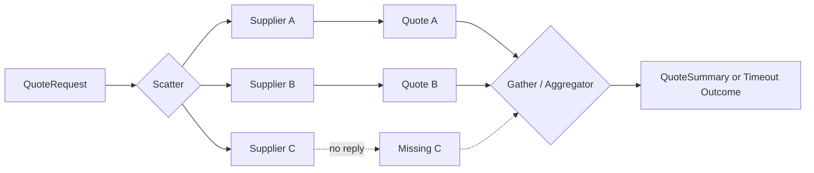
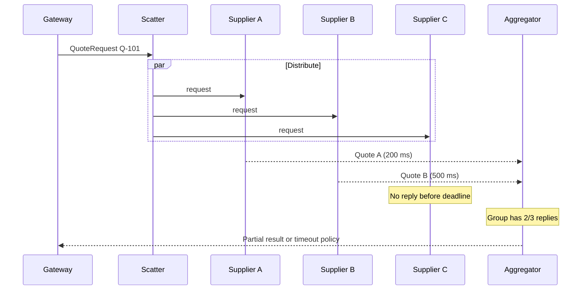
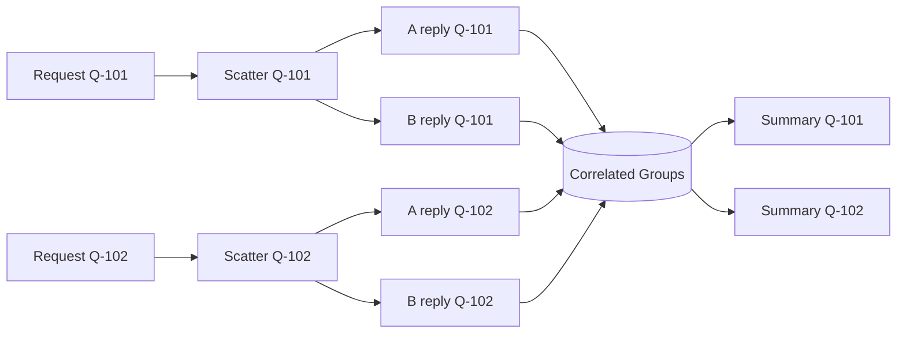
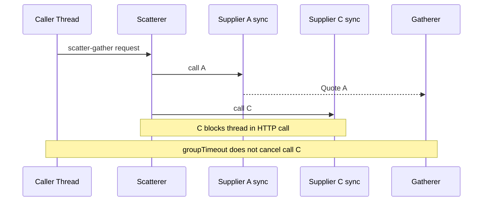
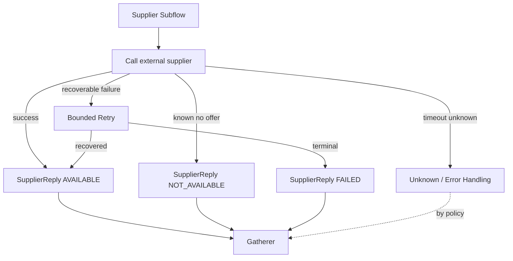
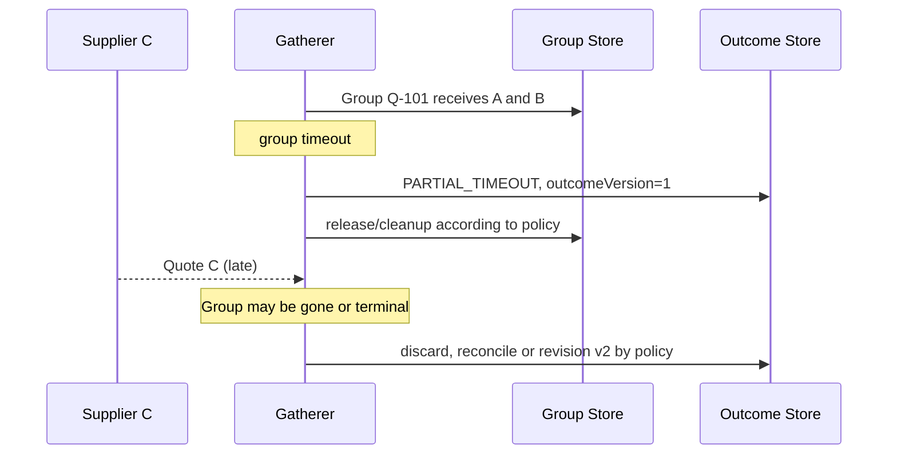
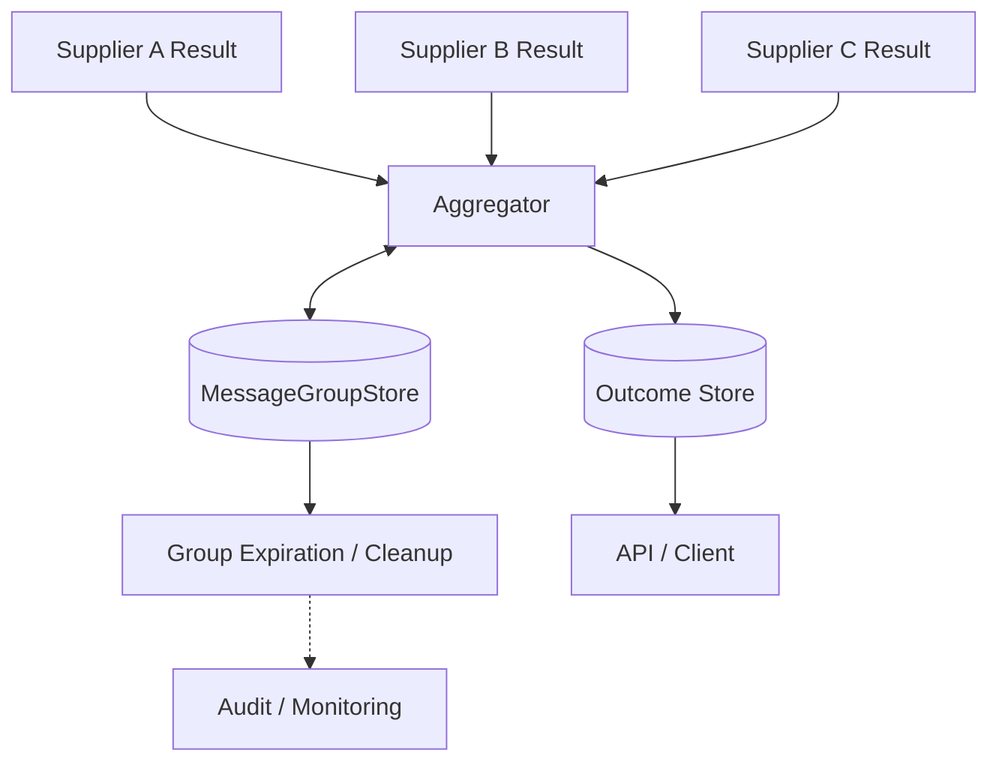
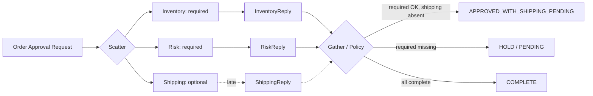

# Timeout When One Branch Does Not Reply

In Enterprise Integration Patterns (EIP), **Scatter-Gather** sends a request to multiple processing branches (**scatter**) and collects the responses into a single result (**gather**). This pattern is especially useful when querying multiple suppliers for quotes, checking one request against independent data sources, or running multiple validations and combining the conclusion.

However, a very common situation is: **two branches reply, and the third branch does not reply**. How long should the system wait? Can it use the two available results to decide? Is it allowed to return success when the missing result is a mandatory check? If the third branch replies after a partial result was already emitted, where does that response go?

That is the focus of **"Timeout When One Branch Does Not Reply"** in the **Scatter gather** chapter of the **SPRING_INTEGRATION_PATTERN** module. In the context of learning to implement Enterprise Integration Patterns with Spring Integration, we combine Scatter-Gather with Gateway, Router, Filter, Transformer, Splitter, Aggregator, retry, error channel, correlation, and testing to build loosely coupled, extensible, and observable message flows.

**Objective:** distinguish per-branch timeouts from aggregated result timeouts; understand `gatherTimeout` vs. `groupTimeout` in Spring Integration; design complete/incomplete response policies, partial results, late replies, and idempotency; and test scenarios with one silent branch, all silent branches, and one erroring branch.

## 1. How does Scatter-Gather work?

Suppose a system needs to ask three suppliers A, B, and C for the best price on the same item. The producer sends a `QuoteRequest`. Scatter dispatches the request to three branches; each branch returns a `SupplierQuote`. Gather aggregates the replies and selects an option per policy.



Typically, there are two scatter variants:

- **Auction / Publish-Subscribe:** sends the request to subscribers of a `PublishSubscribeChannel`. Each subscriber is expected to send a reply to the shared collection.
- **Distribution / Recipient List Router:** selects a subset of recipients matching the message and sends to the chosen destinations.

Both require the **gatherer** to know which replies belong to the same request and when release criteria are satisfied. In Spring Integration, `ScatterGatherHandler` combines a scatterer (PublishSubscribeChannel or RecipientListRouter) with an `AggregatingMessageHandler`.

**Sending once to three branches does not guarantee receiving three replies.** A branch may finish one-way without replying, fail before emitting a reply, respond slowly, be dropped by a Filter, or lose required reply/correlation metadata.

### Distinguishing sending from replying

| Milestone | What it proves | What it does not yet prove |
| --- | --- | --- |
| Scatter selected three recipients | Three branches are expected to participate | All three received the message |
| Dispatch accepted | Channel/transport accepted per its semantics | Handlers finished |
| One supplier returned a reply | One response sent back to gatherer | The other two suppliers finished |
| Gatherer released | Group met release/expiry policy | Every branch succeeded in business terms |
| Caller received result | Scatter-Gather/Gateway produced a response | Response includes all sources if partial |

Defining success at **each milestone** is foundational to preventing timeouts from becoming elusive bugs.

## 2. Scenario where one branch does not reply

Suppose A replies after 200 ms, B replies after 500 ms, and C remains hung:



Branch C might fail to reply for many reasons:

1. **Never dispatched:** wrong route config or channel has no subscriber.
2. **Dispatched but not started:** queue backlog or exhausted executor threads.
3. **In progress:** slow API, database lock, or downstream congestion.
4. **Completed but reply never returned:** lost `replyChannel` header, adapter or broker error.
5. **Threw exception:** no error handling to produce a substitute result.
6. **Dropped by Filter:** branch filtered out without producing a business reply.
7. **Reply arrived late:** gatherer already emitted a result and released the group.

Therefore, **"no reply within deadline" does not mean "the branch definitely did not execute side effects"**. When charging money, reserving stock, or sending notifications, a timeout is normally an **unknown state** requiring reconciliation and idempotency.

## 3. Multiple timeout layers, not just one

In a Scatter-Gather flow, at least five time limits must be considered:

| Timeout | Where does it live? | What does it bound? |
| --- | --- | --- |
| **Branch call timeout** | HTTP client, database adapter, or worker | How long one branch task waits on an external source |
| **Dispatch/send timeout** | Channel/adapter | How long sending/accepting a message waits where capacity is bounded |
| **Aggregator `groupTimeout`** | Gatherer / MessageGroupStore | When an incomplete group triggers expiration handling |
| **Scatter-Gather `gatherTimeout`** | `ScatterGatherHandler` | How long the handler waits for **a result from the gatherer** |
| **Gateway/client deadline** | Messaging Gateway, REST controller, gRPC caller | How long the caller agrees to wait for a reply |

These are clocks with **different responsibilities**, potentially starting from different points. Do not set the same number on all of them and assume everything finishes at the exact same instant.

### Example intentional configuration

Suppose a quote request permits partial results:

```text
Supplier HTTP timeout : 1.2 s
Aggregator groupTimeout: 1.5 s (after group creation/update)
Scatter-Gather gatherTimeout: 3.0 s
Gateway replyTimeout   : 4.0 s
```

These values are **explanatory examples**, not universal recommendations. You must account for scatter, queue, scheduler, network, group storage, serialization, and response time. `groupTimeout` is typically rescheduled on group activity when using a duration value; it is **not** by default an absolute deadline measured from request start.

**Important:** setting `groupTimeout` smaller than `gatherTimeout` is a sensible ordering if you want partial release to happen before the waiter gives up; however, it **does not guarantee** that will always occur. If the first reply arrives right near the limit, group timeout may not yet have fired, or the scheduler may lag. Design and test end-to-end.

## 4. `gatherTimeout` is not the same as `groupTimeout`

This is the most important distinction in this lesson.

### 4.1. `gatherTimeout`: how long Scatter-Gather waits for the gatherer's reply

`ScatterGatherHandler` is a request-reply endpoint. After scattering the request, it needs an aggregated result to return upstream. `gatherTimeout` limits that wait within the corresponding handler mechanism.

Per current Spring Integration documentation, **the default gather timeout is around 30 seconds**, and `requiresReply` defaults to `true`. If the wait expires without a reply from the gatherer, the mechanism may return `null` internally and result in `ReplyRequiredException` when a reply is required. **Defaults and handling details may vary across versions**, so read the documentation for your application's version.

Key takeaway: `gatherTimeout` **does not force the Aggregator to emit a partial result**. It may simply cause the upstream caller to stop waiting.

### 4.2. `groupTimeout`: when an incomplete group is processed

The gatherer is typically an Aggregator. When the release strategy is not yet satisfied, `groupTimeout` can schedule **forced completion/expiration** for the message group. Depending on configuration:

- `sendPartialResultOnExpiry(true)` allows emitting a result from the replies already received when the group expires.
- If partials are disabled, expiration can discard/close the group per policy.
- When expiration runs, the release strategy may be re-evaluated per framework mechanics.
- Group state and cleanup depend on the message store/configuration.

**If a group has not received even a single reply, there may be no group created to schedule a timeout on.** When all suppliers stay silent, setting `groupTimeout` is **not enough** to guarantee emitting `QuoteSummary(empty)`. `gatherTimeout` or a workflow-level deadline coordinator must have a clear plan for **0/3 replies**.

### 4.3. `sendTimeout` is yet another mechanism

An endpoint/channel `sendTimeout` can apply when sending a reply to an output channel **blocked by capacity**. It does not measure supplier HTTP call duration. Increasing send timeout will not solve a silent supplier.

### Illustrating three cases

| Case | Does gatherer have a group? | Can `groupTimeout` emit partial? | What does `gatherTimeout` do? |
| --- | --- | --- | --- |
| 3/3 replies before deadline | Yes | Not needed | Receives complete reply |
| 2/3 replies, branch C silent | Yes | Yes, **if partial is enabled and scheduler/expiration runs** | Receives partial if in time; otherwise wait expires |
| 0/3 replies | Possibly **no** | No data/group to emit partial in the normal case | Limits waiting; handles no-reply per contract |

Write **separate tests for both 2/3 and 0/3 cases**, because many flows only handle the first one.

## 5. Two result policies: all-required vs. partial-allowed

No single timeout policy fits every business domain.

| Goal | Is a non-replying branch acceptable? | Outcome |
| --- | --- | --- |
| Find cheapest quote from three suppliers | Possibly, if minimum number of quotes arrive | `PARTIAL_QUOTES` and missing list |
| Merge multi-source search results | Possibly, if UI accepts incomplete data | Partial + completeness metadata |
| Aggregate analytics | Possibly, if eventual correction is acceptable | Partial + outcome version |
| Mandatory fraud check | **No** | `PENDING_REVIEW`/fail closed |
| Transaction approval needing two signers | **No** | Do not approve with missing signature |
| Reserve stock for all line items | Usually no | Cannot report order fully reserved |
| Collect optional notifications | Possibly per SLA | Per-branch results |

### 5.1. All-required

If **every** branch must reply, one non-responding branch means the request **has not met completion criteria**. You can inform the client with `TIMED_OUT`, `PENDING`, or `FAILED` depending on determinability, but never treat this as success.

For example, a payment transaction requires three checks: compliance, risk, and balance. Missing the compliance response must never fall back to "skip compliance to meet SLA".

### 5.2. Partial-allowed

If 2/3 responses are usable, specify clearly:

- **Minimum quorum:** at least how many replies make a valid decision?
- **Mandatory recipients:** which branches must be present even if total reply count is met?
- **Type of missing:** reply has not arrived, errored, filtered out, or insufficient data?
- **Partial outcome contract:** caller sees partial status, not an identical payload to full success.
- **Late corrections:** can the result be updated later?

A quoting system may pick the best option from 2 responses if A and B are sufficient, yet must not present a quote lacking C as "compared the entire market".

## 6. Distinguishing an error-replying branch from a silent branch

Many designs only count successful responses as replies. This creates a situation where supplier B returns a clear error, yet the gatherer still waits for B until timeout because it never received a **result message**.

A good branch contract can return a **status-bearing result**:

```java
enum SupplierStatus {
    AVAILABLE,
    NOT_AVAILABLE,
    FAILED
}

record SupplierReply(
    String requestId,
    String supplierId,
    SupplierStatus status,
    java.math.BigDecimal totalPrice,
    String currency,
    String errorCode
) {}
```

**A `FAILED` reply can still count as a received reply.** If the policy only needs status responses from all three suppliers, the gatherer can complete without waiting for timeout. Yet having enough **responses** does not mean having enough **valid offers**.

| Supplier | Outcome | Counts as having replied? | Used for price selection? |
| --- | --- | --- | --- |
| A | `AVAILABLE(105000)` | Yes | Yes |
| B | `FAILED(TEMPORARY_ERROR)` | Yes | No |
| C | No reply | No | No |

The aggregation policy may be `PARTIAL_QUOTES` with one offer and one failure, or reject if at least two valid offers are required. Define this up front.

**Do not fabricate a `FAILED` reply when the provider may have already executed side effects.** For a read-only quote lookup, a failure reply may fit. For a timed-out payment capture, `UNKNOWN` requiring reconciliation is more accurate.

## 7. Correlation: replies must belong to the exact scatter run

When multiple callers send requests concurrently, all suppliers return messages into shared channels. The gatherer needs to know which replies belong to the same request.



Spring Integration uses metadata such as `correlationId`, `sequenceNumber`, and `sequenceSize` in corresponding distribution/aggregation patterns. With Scatter-Gather, configuring `applySequence` on the scatterer sets metadata supporting default correlation/release when appropriate. From Spring Integration 6.0, Java DSL/XML for Scatter-Gather conveniently enables `applySequence` per documentation; examples can still declare it explicitly for clarity.

However:

- A technical `correlationId` does not replace a `businessRequestId` needed for auditing and idempotency.
- If recipients are selected **conditionally**, `sequenceSize` or expected count must reflect **the number of recipients actually scattered to**.
- If using adapters over Kafka/HTTP/JMS or manually creating `Message<?>`, verify **reply/correlation metadata** survives transport.
- Do not use `orderId` as the sole correlation key if the same order can run **two valid scatter invocations** concurrently. Add `requestAttemptId`/workflow generation.
- Do not trust unverified correlation IDs or reply channels supplied by external clients.

### Sequence does not automatically prevent duplicates

If A sends the same reply twice, a release strategy checking raw `group.size() == 3` may mistake A, A, B for all 3. For complex multi-request/multi-branch flows, key by `(scatterRequestId, supplierId, resultVersion)` or an accurate recipient ID and **count unique supplier replies**.

## 8. Why does a branch fail to reply in Spring Integration?

### 8.1. Branch ends one-way

If a recipient flow uses a handler returning `null` or a one-way outbound adapter that produces no reply, the gatherer cannot know it succeeded.

```text
scatter -> audit service: record and return null
       -> quote service: return QuoteReply
gather expects 2 replies
```

In this design, audit is a **side-effect notification**, not a result-returning supplier. If the Aggregator must wait for audit, the audit branch must emit an **explicit contract ack/result message** only after the required business milestone completes.

### 8.2. Branch dropped by Filter

A Filter may discard a message conditionally. If the scatterer counted that branch as a recipient but the Filter dropped it without replying, the gatherer may wait until timeout.

Two solutions depending on business needs:

- **Select recipients before scatter:** Recipient List Router only scatters to branches that actually need processing, and expected count reflects that subset.
- **Represent skip as a result:** the Filter discard branch emits `SKIPPED` or `NOT_APPLICABLE` if the gatherer needs confirmation the branch was resolved.

A discard channel does not turn a filtered message into a reply automatically; a flow must emit a compatible result.

### 8.3. Branch throws an exception

In synchronous processing, an exception from a subflow can propagate straight back to Scatter-Gather and the caller, preventing other replies from being used as expected. With an executor/broker, the error happens on another thread; without proper error handling, the gatherer may receive nothing.

Spring Integration documentation describes configuring an error channel for async subflows and, when appropriate, converting `MessagingException` into a **compensation/error reply** carrying required metadata. **Swallowing exceptions without emitting a reply** is not a complete aggregation strategy.

### 8.4. Branch loses reply routing metadata

A Transformer creating a new `Message<?>`, an adapter failing to serialize headers, or a bridge overwriting `replyChannel` can cause a supplier to finish without the gatherer ever receiving the reply.

Especially in Scatter-Gather, **`gatherResultChannel`, `replyChannel`, `errorChannel`, and correlation-related headers** serve framework mechanics. Do not construct a fresh envelope copying only the business payload if the flow still needs to reply to the gatherer. Across boundaries that cannot carry channel objects, design **explicit reply channels/consumers and correlation mapping**, rather than arbitrarily serializing channel objects.

## 9. Do not expect timeouts to control a hung synchronous branch

Suppose the scatterer dispatches on a `DirectChannel` and supplier C makes a **synchronous** HTTP call that hangs indefinitely. The scattering thread may block inside C before even reaching the gather-waiting step.



**The Aggregator's group timeout does not automatically cancel or interrupt a hung HTTP call.** With synchronous subflows, execution may not even reach the point where Scatter-Gather starts waiting for gather replies.

Practical measures:

- Set **connect/read/response timeouts** on the HTTP client or source adapter.
- Use an **executor/async handoff** for independent branches so one slow branch does not block the scatter thread.
- Bound pools/queues/bulkheads to avoid thousands of hung tasks.
- Have an overall deadline and a policy when workers keep running after the caller times out.
- Ensure error handling preserves reply/correlation metadata.

**Async does not mean "once timed out, work stops automatically".** If a task sits on an executor and the caller stops waiting, the task may run to completion unless cancellation is supported; define what happens to late results.

## 10. Java: quote contract for Scatter-Gather

Let's build a three-supplier example: A, B, and C. One branch may be slow, yet the combined result may only report "fully complete" when all three identity-verified supplier replies arrive.

### 10.1. Request and reply

```java
import java.math.BigDecimal;
import java.time.Instant;
import java.util.List;

record QuoteRequest(
    String requestId,
    String sku,
    int quantity
) {}

enum QuoteStatus {
    AVAILABLE,
    NOT_AVAILABLE,
    FAILED
}

record SupplierQuote(
    String requestId,
    String supplierId,
    QuoteStatus status,
    BigDecimal totalPrice,
    String currency,
    String errorCode,
    Instant respondedAt
) {}

record QuoteSummary(
    String requestId,
    int expectedSuppliers,
    int receivedSuppliers,
    String status,
    List<SupplierQuote> replies,
    List<String> missingSupplierIds,
    Instant summarizedAt
) {}
```

`requestId` identifies one scatter invocation per the application contract. `supplierId` is the branch identity. `status` is each supplier's processing outcome, **not** the gatherer's state. `missingSupplierIds` shows who has not responded; this list is only accurate when the application knows the **expected recipient set**.

### 10.2. Service interface

```java
interface SupplierServices {
    SupplierQuote requestA(QuoteRequest request);
    SupplierQuote requestB(QuoteRequest request);
    SupplierQuote requestC(QuoteRequest request);
}
```

These methods return a **non-`null`** `SupplierQuote` on completion. If a supplier has no stock, it can return `NOT_AVAILABLE`. If an error can safely be turned into a business outcome, it can return `FAILED` with an error code; if throwing an exception, the flow needs matching error handling.

This is a request-reply example. Never use `void` handlers and expect the gatherer to guess the branch replied.

## 11. Aggregation processor: unique replies and partial status

A `MessageGroupProcessor` reads supplier replies for the same request and creates `QuoteSummary`.

```java
import java.time.Instant;
import java.util.ArrayList;
import java.util.HashMap;
import java.util.HashSet;
import java.util.List;
import java.util.Map;
import java.util.Set;
import org.springframework.integration.store.MessageGroup;
import org.springframework.messaging.Message;

final class QuoteGroupProcessor {

    private static final Set<String> EXPECTED =
        Set.of("A", "B", "C");

    boolean complete(MessageGroup group) {
        return replyMap(group).keySet().containsAll(EXPECTED);
    }

    QuoteSummary summarize(MessageGroup group) {
        Map<String, SupplierQuote> bySupplier = replyMap(group);
        List<String> missing = EXPECTED.stream()
            .filter(id -> !bySupplier.containsKey(id))
            .sorted()
            .toList();

        List<SupplierQuote> ordered = bySupplier.values().stream()
            .sorted(java.util.Comparator.comparing(
                SupplierQuote::supplierId))
            .toList();

        boolean hasOffer = ordered.stream()
            .anyMatch(q -> q.status() == QuoteStatus.AVAILABLE);

        String status;
        if (!missing.isEmpty()) {
            status = "PARTIAL_TIMEOUT";
        } else if (!hasOffer) {
            status = "COMPLETE_NO_OFFER";
        } else {
            status = "COMPLETE";
        }

        String requestId = ordered.get(0).requestId();
        return new QuoteSummary(
            requestId,
            EXPECTED.size(),
            ordered.size(),
            status,
            ordered,
            missing,
            Instant.now()
        );
    }

    private Map<String, SupplierQuote> replyMap(MessageGroup group) {
        Map<String, SupplierQuote> unique = new HashMap<>();
        String requestId = null;

        for (Message<?> message : group.getMessages()) {
            SupplierQuote reply =
                (SupplierQuote) message.getPayload();

            if (reply.requestId() == null
                    || reply.requestId().isBlank()
                    || !EXPECTED.contains(reply.supplierId())) {
                throw new IllegalArgumentException(
                    "Invalid supplier reply identity");
            }

            if (requestId == null) {
                requestId = reply.requestId();
            } else if (!requestId.equals(reply.requestId())) {
                throw new IllegalArgumentException(
                    "Mixed request IDs in group");
            }

            SupplierQuote old =
                unique.putIfAbsent(reply.supplierId(), reply);

            if (old != null && !old.equals(reply)) {
                // Do not arbitrarily pick one when two conflicting results exist.
                throw new IllegalStateException(
                    "Conflicting duplicate supplier reply");
            }
        }

        return unique;
    }
}
```

**This is an example for a fixed recipient set A/B/C**, with caveats to keep in mind:

- In this code, if the group is empty and the processor is called, `ordered.get(0)` will fail. That **intentionally avoids synthesizing a fake summary from 0 replies**. The 0/3 case must be handled by `gatherTimeout`/orchestrator.
- `PARTIAL_TIMEOUT` only makes sense when the processor is invoked due to expiration. If the system allows early release on a minimum quorum, use a **dedicated release reason**, rather than inferring partial purely from count.
- `complete` accepts `FAILED`/`NOT_AVAILABLE` replies to distinguish **all responses received** from having **valid quotes**. Best-offer selection policy is not yet implemented here.
- Duplicate results from the same supplier are detected, yet this **does not fully solve deduplication in the group store**. Block duplicates at ingress/adapters under high traffic.
- Checking `requestId` in the payload helps detect mixed groups; framework correlation keys must also be protected.
- If a dynamic recipient set varies per request, `EXPECTED` must be replaced by **a manifest locked per request**, not a hardcoded A/B/C set.

### Partial is not a promise of a usable price

For instance, A and B both return `NOT_AVAILABLE`, and C stays silent. A `PARTIAL_TIMEOUT` output may contain **0 valid offers**. Callers must inspect both `status` and `replies`, never displaying "best price found" just because the processor emitted a message.

## 12. Spring Integration Java DSL: async scatter, timeout-bounded gather

Below is an **outline of a Java DSL configuration matching versions supporting the `scatterGather` API**. The example keeps three suppliers as fixed recipients, each handing off to an executor so a slow HTTP call does not block the scatter thread. Production needs real HTTP timeouts, error handling configuration, and testing against the actual dependency version.

### 12.1. Gateway and executor

```java
import org.springframework.context.annotation.Bean;
import org.springframework.context.annotation.Configuration;
import org.springframework.integration.annotation.Gateway;
import org.springframework.integration.annotation.IntegrationComponentScan;
import org.springframework.integration.annotation.MessagingGateway;
import org.springframework.integration.channel.DirectChannel;
import org.springframework.integration.config.EnableIntegration;
import org.springframework.messaging.MessageChannel;
import org.springframework.core.task.TaskExecutor;
import org.springframework.scheduling.concurrent.ThreadPoolTaskExecutor;

@MessagingGateway
interface QuoteGateway {

    @Gateway(requestChannel = "quotes.requests", replyTimeout = 4_000)
    QuoteSummary request(QuoteRequest request);
}

@Configuration
@EnableIntegration
@IntegrationComponentScan
class QuoteChannelConfiguration {

    @Bean("quotes.requests")
    MessageChannel quoteRequests() {
        return new DirectChannel();
    }

    @Bean("quoteScatterExecutor")
    TaskExecutor quoteScatterExecutor() {
        ThreadPoolTaskExecutor executor = new ThreadPoolTaskExecutor();
        executor.setCorePoolSize(4);
        executor.setMaxPoolSize(8);
        executor.setQueueCapacity(64);
        executor.setThreadNamePrefix("quote-scatter-");
        executor.initialize();
        return executor;
    }

    @Bean
    QuoteGroupProcessor quoteGroupProcessor() {
        return new QuoteGroupProcessor();
    }
}
```

The thread pool is an **example**, not an optimal limit. In real systems, define concurrency, queue capacity, rejection policy, per-supplier deadlines, and shutdown behavior. A task blocked on an HTTP client can still hold a thread even after the gatherer times out.

### 12.2. Scatter-Gather flow

```java
import org.springframework.context.annotation.Bean;
import org.springframework.context.annotation.Configuration;
import org.springframework.core.task.TaskExecutor;
import org.springframework.integration.dsl.IntegrationFlow;

@Configuration
class QuoteScatterGatherFlow {

    @Bean
    IntegrationFlow gatherSupplierQuotes(
            SupplierServices suppliers,
            QuoteGroupProcessor processor,
            TaskExecutor quoteScatterExecutor) {

        return IntegrationFlow.from("quotes.requests")
            .scatterGather(
                scatter -> scatter
                    .applySequence(true)
                    .recipientFlow(f -> f
                        .channel(c -> c.executor(quoteScatterExecutor))
                        .transform(QuoteRequest.class,
                            suppliers::requestA))
                    .recipientFlow(f -> f
                        .channel(c -> c.executor(quoteScatterExecutor))
                        .transform(QuoteRequest.class,
                            suppliers::requestB))
                    .recipientFlow(f -> f
                        .channel(c -> c.executor(quoteScatterExecutor))
                        .transform(QuoteRequest.class,
                            suppliers::requestC)),
                gather -> gather
                    .releaseStrategy(processor::complete)
                    .outputProcessor(processor::summarize)
                    .groupTimeout(1_500L)
                    .sendPartialResultOnExpiry(true)
                    .expireGroupsUponCompletion(true),
                options -> options.gatherTimeout(3_000L))
            .get();
    }
}
```

How to read the flow:

1. The Gateway sends `QuoteRequest` to `quotes.requests`.
2. The Scatterer has three recipient flows. Each branch hands off to the executor and calls its corresponding supplier.
3. Each branch returns `SupplierQuote`; Scatter-Gather's request-reply setup must route replies to the gatherer with proper correlation/reply headers.
4. The Gatherer groups replies and calls `processor.complete`. When A/B/C arrive, it releases normally.
5. If only A/B exist and `groupTimeout` expires, `sendPartialResultOnExpiry(true)` lets the processor build `QuoteSummary(status="PARTIAL_TIMEOUT")` from existing replies.
6. `gatherTimeout(3_000L)` limits how long Scatter-Gather waits for the gatherer's reply. If none arrives in time, it does not fabricate a `QuoteSummary`.
7. The Gateway has `replyTimeout=4_000` for the caller-level request-reply contract. End-to-end timing can depend on scheduling and topology.

**Why verify your version?** Scatter-Gather DSL, spec options, and asynchronous behavior can evolve across Spring Integration releases. The code above is an educational configuration to test in a real project, not a claim of having run Gradle on the module. From Spring Integration 6.5.3 onward, documentation also describes an `async=true` option on `ScatterGatherHandler` that changes how gather results are awaited via reactive replies; enabling that mode must be reviewed and tested separately.

### 12.3. This timeout has not cancelled supplier C

If `suppliers.requestC` is blocked long, worker C can still keep running after the Gateway already returned partial. **Do not automatically fire another requestC just because of partial.** For APIs with side effects, retry or failover requires idempotency/reconciliation.

### 12.4. The 0/3 reply condition

If all suppliers stay silent, the group may never be created. In that case:

- `groupTimeout` cannot automatically emit a partial from an empty group in normal operation.
- Scatter-Gather hits `gatherTimeout`; with `requiresReply=true`, the exception/no-reply path must be handled.
- The API layer should translate this into an error/`PENDING` outcome per contract, rather than pretending it is `QuoteSummary(status="PARTIAL_TIMEOUT", received=0)` if no coordinator generated such a result.
- For durable workflows, you may need a **deadline registry** independent of the Aggregator to track even requests that received zero replies.

## 13. ReleaseStrategy should not count raw messages alone

If C does not reply while A sends two identical results due to redelivery, a group can hold messages A, A, B. Checking `group.size() == 3` evaluates to **count met** yet **missing one of the three suppliers**.

```text
Expected suppliers: {A, B, C}
Received messages: A, A, B
Raw count: 3
Unique supplier count: 2
Missing: {C}
```

Solution:

- Put supplier identity on replies issued by a trusted server/adapter.
- Release by **supplier set** or per-recipient reply state.
- Reject/quarantine replies from suppliers absent from the manifest.
- Handle duplicates from the same supplier via idempotency/version rules.
- Persist a terminal outcome so late replies cannot produce a second unauthorized result.

With a **dynamic Recipient List**, recipient counts can differ across requests. `applySequence` helps propagate distribution metadata matching the selected recipient count, yet if the business needs to know **the exact identity of every mandatory branch**, store a manifest or decision record instead of relying solely on `sequenceSize`.

## 14. Handling per-branch errors without crashing the whole scatter

An erroring subflow differs from a subflow that **never replies**. Handling can look like:



### 14.1. Synchronous branches

If A and B run synchronously on the scatter thread and B throws an exception, the exception can propagate up to the handler, failing the entire scatter-gather request instead of letting A/C proceed normally. Use advice or convert errors into **status-bearing replies** under a controlled contract.

### 14.2. Asynchronous branches

With ExecutorChannel or async adapters, exceptions happen on another thread. Configure an error channel/headers so `MessagePublishingErrorHandler` and related components handle errors; if the gatherer must receive a `FAILED` result, the error flow must **emit a reply** carrying valid correlation and reply routing.

Do not take an arbitrary `Throwable` and treat it as a quote. Map errors into `SupplierReply(status=FAILED, supplierId=...)` only after validating identity/context and safe fields.

### 14.3. Example converting an exception into a typed reply per contract

```java
final class SafeSupplierAdapter {
    private final SupplierServices suppliers;

    SafeSupplierAdapter(SupplierServices suppliers) {
        this.suppliers = suppliers;
    }

    SupplierQuote requestA(QuoteRequest request) {
        try {
            return suppliers.requestA(request);
        } catch (SupplierUnavailableException ex) {
            return new SupplierQuote(
                request.requestId(), "A",
                QuoteStatus.FAILED, null, null,
                "SUPPLIER_TEMPORARILY_UNAVAILABLE",
                java.time.Instant.now());
        }
    }
}

class SupplierUnavailableException extends RuntimeException {
    SupplierUnavailableException(String message) {
        super(message);
    }
}
```

This is an example of a **narrow catch** for a known error. Do not catch every `Exception` and return `FAILED`, as that can mask programming bugs, missing permissions, or external calls with indeterminate side effects. For errors that cannot be safely represented as typed replies, route them through appropriate error/review paths.

## 15. Late replies after partial release

Suppose at t=1.5 seconds, the gatherer emitted `QuoteSummary(PARTIAL_TIMEOUT)` from A and B. At t=2.3 seconds, C finally sends its quote.



If the message group was already deleted, a late reply can be treated as part of a **new group sharing the same correlation key**, depending on store and discard/expiry settings. An unversioned second `QuoteSummary` can cause the UI to display two results or overwrite wrongly.

Define one of these policies:

| Policy | When suitable | What to protect |
| --- | --- | --- |
| **Ignore and audit** | Result is finalized; changes not accepted | Count late replies, retain logs/traces |
| **Issue correction** | Price/status updates are possible | `outcomeVersion`, idempotent upsert |
| **Hold late reply** | Process requires manual review | Queue/store, retention, owner, and SLA |
| **Re-open explicitly** | Business workflow supports updating groups | Concurrency, generation ID, locks |
| **Cancel downstream** | Provider supports safe cancellation | Do not assume cancellation always succeeds |

To handle this properly, you usually need a dedicated **terminal outcome/tombstone** keyed by `scatterRequestId`, retained long enough to cover the retry/redelivery window. `expireGroupsUponCompletion` and group store cleanup do not automatically detect every late reply.

## 16. Timeouts can create retry and duplicate side-effect issues

A request sent to three branches sometimes does more than "read data". For example: calling three services to reserve stock, book tickets, or run paid credit checks.

If A executed its side effect yet the reply got lost, the gatherer sees A as "missing". After timeout, you cannot conclude A did nothing. Retrying A or switching to another branch can cause duplicate transactions.

**Distinguish three states:**

- `KNOWN_FAILED`: evidence exists that the branch did not execute side effects.
- `UNKNOWN`: timeout/lost ack; the branch may have executed.
- `CONFIRMED_SUCCESS`: confirmation received per contract.

For `UNKNOWN`:

1. Record request ID, supplier ID, idempotency key, and attempt.
2. Reconcile via status API/callback or provider-confirmed data.
3. Retry using a **stable idempotency key** if supported by the provider.
4. Do not send an equivalent command to another system without clear rerouting rules and authority.
5. If unable to reconcile, keep status as `PENDING_REVIEW` instead of forcing `FAILED` or `SUCCESS`.

**Group timeout is a result-waiting deadline, not proof of external transaction state.**

## 17. Request-reply Gateway and what status the API should return

A synchronous Gateway must specify what happens if no aggregated result arrives within the limit:

| Scenario | Reasonable API response per contract |
| --- | --- |
| 3/3 replies, has offer | `COMPLETE` + offers list/selected offer |
| 2/3 replies, partial allowed | `PARTIAL_QUOTES` + missing supplier |
| 2/3 replies, all-required | `PENDING`/`TIMED_OUT`, do not report complete |
| 0/3 replies | No-reply timeout/exception mapped to error/`PENDING` |
| One branch replies `FAILED` | `COMPLETE_WITH_FAILURES` or partial per business policy |
| Caller cancels waiting | Downstream work may still run; use status API/outcome store if needed |

If suppliers take many seconds to minutes, an **asynchronous API** may fit better:

```text
POST /quotes
  -> 202 Accepted + requestId

GET /quotes/{requestId}
  -> PENDING | PARTIAL | COMPLETE | FAILED
```

This is only an **API contract outline**. Returning `202 Accepted` means the server accepted the request per contract, **not** that all suppliers have replied. To support status queries across restarts, persist request/outcome state durably.

### End-to-end deadline differs from group lifetime

If an HTTP caller only waits 3 seconds, you may need to record `PENDING` before returning rather than waiting for the gatherer to finish on its own. An HTTP deadline does not necessarily delete the message group or cancel suppliers. A clear coordinator/state store is needed if late updates must be supported.

## 18. Managing MessageGroupStore and recoverability

The gatherer typically uses `MessageGroupStore` to hold replies until release or timeout. The default in-memory store is simple, yet provides no recovery across restarts.



Clarify:

- Do open groups survive an instance restart?
- How is the `groupTimeout` timer scheduled/recovered on restart?
- Can multiple instances process the same group and double-release?
- Is an emitted result persisted durably if the caller has not yet received it?
- If the output queue/broker fails after release, are there retry/outbox and idempotency mechanisms?
- Once a group is cleaned up, where does terminal state live to recognize late replies?
- What retention/security controls does the store need if replies contain sensitive data?

**A persistent MessageGroupStore does not automatically provide end-to-end exactly-once.** Concurrency control, acks, transactions, output idempotency, and access controls must be verified independently.

### `MessageGroupStoreReaper` is not the same as `groupTimeout`

`groupTimeout` handles per-group expiration inside the Aggregator. A reaper periodically scans long-lived groups in the store on a schedule. Using both together requires deciding which timer owns expiration and ensuring no duplicate output is emitted.

Do not simply use a reaper to "patch over" a slow branch without defining partial, late-arrival, and state cleanup policies.

## 19. Observability: knowing which branch did not reply

Logging a single line `scatter-gather timed out` is insufficient. Track **each supplier**:

| Field | Purpose |
| --- | --- |
| `requestId` / `correlationId` | Links full scatter and replies |
| `supplierId` | Identifies the branch |
| `dispatchAttempt` | Distinguishes re-dispatch attempts |
| `dispatchedAt` / `startedAt` | Pinpoints delay in queue vs. handler |
| `replyAt` | Measures reply latency |
| `branchOutcome` | AVAILABLE, NOT_AVAILABLE, FAILED, UNKNOWN |
| `groupExpected` / `groupReceived` | Shows completeness |
| `releaseReason` | FULL, TIMEOUT, MANUAL... |
| `policyVersion` | Recipient set and release rules |
| `outcomeVersion` | Distinguishes corrections on late replies |
| `errorCode` | Classifies errors without logging sensitive payloads |

An aggregated log:

```json
{
  "event": "scatter_gather_released",
  "requestId": "Q-101",
  "expectedSuppliers": ["A", "B", "C"],
  "receivedSuppliers": ["A", "B"],
  "missingSuppliers": ["C"],
  "releaseReason": "TIMEOUT",
  "outcome": "PARTIAL_TIMEOUT",
  "policyVersion": "quote-routing-v2"
}
```

The above is a **suggested structured log**, not output automatically generated by Spring Integration. Never log customer PII, tokens, card numbers, or sensitive response bodies just because a timeout occurred.

### Suggested metrics

```text
scatter_requests_total{flow="quote"}
scatter_branch_dispatch_total{supplier="A"}
scatter_branch_replies_total{supplier="A",status="available"}
scatter_branch_timeouts_total{supplier="C"}
scatter_group_releases_total{reason="partial_timeout"}
scatter_no_reply_total{flow="quote"}
scatter_late_replies_total{supplier="C"}
scatter_gather_duration_seconds{flow="quote"}
scatter_open_groups{flow="quote"}
```

These are example application-instrumented metrics. Never use `requestId` or `customerId` as metric tags due to high cardinality; keep those in access-controlled logs/audits/traces.

### Alerts should distinguish real failures from valid partials

If supplier C has a 99.9% SLA yet stops replying on 20% of requests, alert on **missing rate**, latency, and backlog. If the business allows 2/3 results within 1.5 seconds, a single partial is not necessarily a pager-worthy incident.

## 20. Testing timeouts when one branch is missing

### 20.1. Test matrix

| Case | Expectation |
| --- | --- |
| A/B/C reply before deadline | One `COMPLETE`, empty missing list |
| A/B reply, C silent | `PARTIAL_TIMEOUT` when policy permits |
| A/B reply, partial forbidden | No fake complete; timeout/no-reply handling runs |
| No supplier replies | `gatherTimeout`/deadline policy handles 0/3 |
| C returns structured `FAILED` | C counts as having replied; summary reflects error |
| C throws synchronous exception | Verify exception propagation and other branches |
| C errors asynchronously | Error channel/recovery reply preserves correlation |
| C replies after partial | Late policy runs; no arbitrary second complete |
| A replies twice | Counts unique A; does not falsely release as 3 |
| C replies with wrong `requestId` | Reject/quarantine; never mix two groups |
| Reply header lost | Timeout/metric recorded; test header mapping |
| Gateway expires before groupTimeout | Do not assume partial reached caller |
| Executor pool full | Dispatch rejection/backpressure handled |
| Recipient list changes | Expected count/manifest matches request |
| Restart with 2/3 replies | Recovers per chosen store/policy |
| Output publish fails after release | Idempotent output/recovery |
| Filter drops a branch | Sends SKIPPED reply or explicitly adjusts recipients |

### 20.2. Processor unit test

Use JUnit 5 with `SimpleMessageGroup` and `MessageBuilder` per your Spring Integration version's API to build groups with two or three `SupplierQuote` instances. Assertions should prove:

```java
// Assertion outline with MessageGroup created by a test fixture:
QuoteGroupProcessor processor = new QuoteGroupProcessor();

assertFalse(processor.complete(groupWithAAndB));
QuoteSummary partial = processor.summarize(groupWithAAndB);

assertEquals("PARTIAL_TIMEOUT", partial.status());
assertEquals(2, partial.receivedSuppliers());
assertEquals(java.util.List.of("C"),
    partial.missingSupplierIds());

assertTrue(processor.complete(groupWithAAndBAndC));
QuoteSummary complete = processor.summarize(groupWithAAndBAndC);

assertEquals("COMPLETE", complete.status());
assertTrue(complete.missingSupplierIds().isEmpty());
```

This is an **assertion outline** without the `MessageGroup` fixture declared, so it is not a standalone runnable test class yet. Also test duplicate A, an unlisted supplier, and a reply with a different request ID to verify invariants.

### 20.3. Integration test holding C silent in a controlled way

In Spring Test, mock the three suppliers:

- A replies immediately.
- B replies after a short delay.
- C waits on a `CountDownLatch` until the test releases it.

Invoke the Gateway in a test task; verify:

1. A and B were actually invoked.
2. After `groupTimeout`, the Gateway receives `QuoteSummary(PARTIAL_TIMEOUT)` if output arrives before `gatherTimeout`.
3. `missingSupplierIds` contains C.
4. Release C's latch **after partial** and observe the late-reply policy.
5. Never leave thread C stuck after the test finishes (use `try/finally` to release latches).
6. Do not rely on `Thread.sleep` as the sole scheduling mechanism; use latches/barriers and finite deadlines.
7. For flows disallowing partials, assert the outcome is timeout/error rather than complete.

**Write a separate test for 0/3**, since it does not take the same partial-expiration path as an already-created A/B group. Do not only test a slow supplier C and conclude the entire timeout policy works.

### 20.4. Testing asynchronous errors and request cancellation

Add scenarios:

- C throws an exception on the executor: verify the error flow receives the failed message and preserves correlation.
- C hits HTTP timeout: verify connect/response timeouts cut the call per configuration without infinite loops.
- Caller hits reply timeout: verify supplier tasks may continue and late replies are managed.
- Restart instance between 2/3 replies: verify persistence/recovery if business requires it.
- Multiple concurrent requests for the same SKU: verify correlation never mixes.
- Duplicate result redelivery: verify two summaries are not emitted.

**A passing test with three fast synchronous suppliers proves nothing about timeout behavior under queues, executors, brokers, or crashes.**

## 21. Common design mistakes

**"Setting `gatherTimeout` makes the Aggregator emit partials automatically."** No. It mainly bounds waiting for a reply from the gatherer. Emitting partials from open groups requires matching group expiration/release policies.

**"Setting `groupTimeout` handles 0/3 replies too."** No group exists when zero replies arrive, so a dedicated no-reply path is needed.

**"Gatherer timeout aborts in-flight HTTP calls."** No. Per-branch timeouts/cancellation must be designed separately.

**"`sendPartialResultOnExpiry(true)` means success."** A partial may lack a mandatory branch or contain zero valid offers.

**"Being dropped by a Filter counts as having replied."** No. Emit `SKIPPED`/`NOT_APPLICABLE` if the gatherer must know.

**"When a subflow throws an exception, the gatherer automatically counts one reply."** No. Error channel and compensation replies must be configured.

**"`group.size()==3` means all 3 suppliers replied."** Duplicates can satisfy raw message count while supplier C is still missing.

**"All replies share the same `orderId`."** One order may undergo multiple scatters; specific request/generation correlation is required.

**"Copy all headers to keep reply routing."** Untrusted headers can carry routing hints, reply/error channels, or sensitive data. Distinguish trust boundaries from internal hops.

**"Late messages after timeout are definitely dropped."** Depending on cleanup/store, they may create a new group; a terminal outcome policy is required.

**"A persistent group store gives exactly-once."** You still need acks, idempotency, locking, and output recovery.

**"When one supplier does not reply, just retry the whole Scatter-Gather."** That may re-invoke A/B even though they already finished. Retry per branch when the contract allows, with idempotency and separate state.

## 22. Exercise: aggregating order checks from three systems

An order-approval request is scattered to three services:

1. **Inventory**: verify stock availability.
2. **Risk**: check for fraud.
3. **Shipping**: estimate delivery time.

Policy:

- Inventory and Risk are **mandatory** and must return valid results.
- Shipping is **optional**; when missing, returning `APPROVED_WITH_SHIPPING_PENDING` is permitted if both mandatory branches pass.
- API response SLA is 3 seconds.
- Inventory usually takes 200 ms, Risk 600 ms, and Shipping sometimes takes 10 seconds.
- Shipping may reply after the API already returned.
- Kafka may redeliver a reply; every request has its own `requestId`.



Answer:

1. Should a "2 of 3 replies is enough" release strategy be used? Why could it fail if Risk is missing while Shipping already replied?
2. How should the **expected/mandatory recipient manifest** be stored alongside the request?
3. If Inventory returns `FAILED`, is that a reply or a timeout?
4. How should branch timeouts, `groupTimeout`, `gatherTimeout`, and Gateway `replyTimeout` be tuned to fit the SLA? Why can't exact guarantees come solely from numbers?
5. If zero branches reply, which component produces `PENDING`?
6. If Shipping replies after `APPROVED_WITH_SHIPPING_PENDING` was emitted, should a correction event or version update be sent?
7. If Risk finished evaluating yet its reply was lost, can we assume the risk check never ran?
8. If the Gateway caller timed out, can supplier threads still be running?
9. How will the error channel handle Shipping throwing an exception on the executor?
10. Which test proves the result cannot become `APPROVED` when Risk is silent, even with two other replies?
11. If the broker redelivers `InventoryReply`, how do you prevent premature release or double outcomes?
12. Which metrics distinguish Shipping being slow due to its HTTP source vs. executor backlog?

**Completion criteria:** Clear mandatory/optional policy, timeouts at every layer, 0-reply path, partial status never masquerading as full success, correlation/dedup/late-reply handling, plus integration tests at async and error boundaries.

## 23. Pre-production checklist for Scatter-Gather

- [ ] Distinguished **branch timeout**, `groupTimeout`, `gatherTimeout`, `sendTimeout`, and Gateway/client deadline.
- [ ] Know exact expected recipients and mandatory recipients per request.
- [ ] Release strategy does not count raw messages alone when duplicates or optional branches exist.
- [ ] Decided partial release rules and minimum quorum criteria.
- [ ] Partial outcomes carry status, received/missing lists, and release reason.
- [ ] **0/3 replies** has a dedicated path, not relying solely on `groupTimeout`.
- [ ] Supplier I/O has connect/read/response timeouts; thread pools are bounded.
- [ ] Synchronous subflows that could block scatter have been evaluated.
- [ ] Async subflows have matching error channel/recovery and preserve reply/correlation headers.
- [ ] Filtered/discarded branches requiring ack emit a result or are excluded from recipients.
- [ ] Late messages have terminal state/correction policies.
- [ ] Duplicate replies are controlled by supplier ID and request ID.
- [ ] Retry/failover does not duplicate side effects or bypass mandatory steps.
- [ ] `MessageGroupStore` and outcome store satisfy durability, privacy, and concurrency.
- [ ] Scheduler/group expiration/reaper are configured and tested.
- [ ] Traces/logs/metrics capture branch latency, missing, partial, and no-reply counts.
- [ ] API contract separates `ACCEPTED`, `PARTIAL`, `PENDING`, `FAILED`, and `COMPLETE`.
- [ ] Tests cover one silent branch, all silent branches, and one failing branch.
- [ ] Tests cover timeouts when the executor is congested and when output dispatch fails.
- [ ] Verified exact API and behavior against your actual Spring Integration version.

## Further reading

- [Spring Integration Reference — Scatter-Gather](https://docs.spring.io/spring-integration/reference/scatter-gather.html): ScatterGatherHandler model, auction/distribution, gather timeout, required reply, and error handling.
- [Spring Integration Reference — Aggregator](https://docs.spring.io/spring-integration/reference/aggregator.html): group timeout, partial results, MessageGroupStore, and differences from store reaper.

These links are public documentation. Use **documentation matching your project's framework version** when translating sample configurations into production code.

## Key takeaways

**Timeout when one branch does not reply** is an **aggregation and operational policy**, not merely a numeric parameter. In Spring Integration, `gatherTimeout` bounds how long Scatter-Gather waits for a result from the gatherer; `groupTimeout` governs processing an incomplete message group and can emit partials with `sendPartialResultOnExpiry(true)`. They do not replace supplier timeouts/cancellation and do not automatically guarantee an outcome when **zero branches reply**.

Define **which branches are mandatory**, **what counts as enough replies**, **whether partials are valid**, and **where late messages/retries go**. Use correlation IDs, supplier identities, expected recipient manifests, idempotency, error channels, `MessageGroupStore`, and async testing to avoid double counting, infinite waiting, or false success. A well-built Scatter-Gather flow does not require every supplier to always be fast; it must **handle delays explicitly, verifiably, and without compromising business correctness**.
