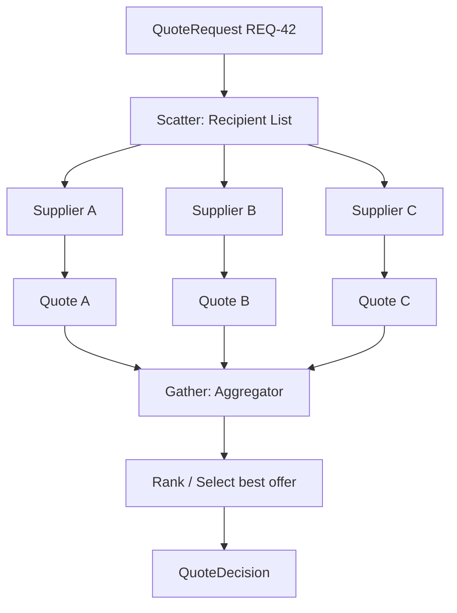
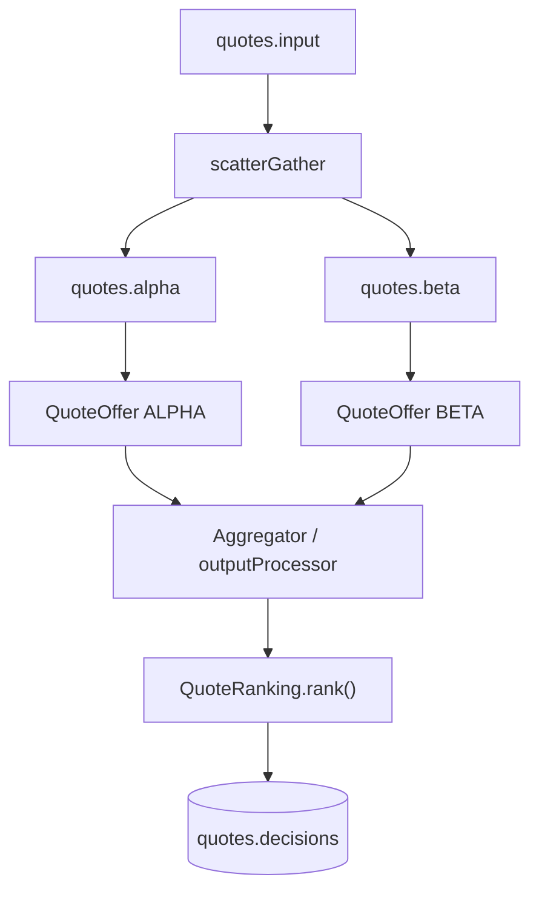
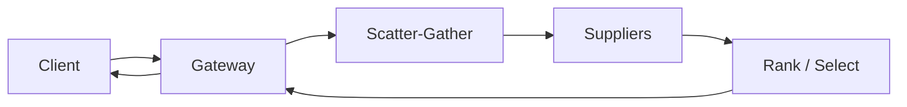

# Prioritizing or Ranking Results in Spring Integration Scatter-Gather

## Learning objectives

An e-commerce platform needs to compute shipping options for a new order. Instead of querying just one carrier, the system sends the same request to three partners, waits for replies, and picks the best option:

- Partner A delivers in 2 days, fee 95,000 VND.
- Partner B delivers in 3 days, fee 88,000 VND.
- Partner C charges 72,000 VND but delivers in 6 days, exceeding the 3-day SLA limit.

If the business priority is **meet the SLA first, then pick the lowest price**, B is the winning result; C is disqualified despite being cheapest. If A and B tie on price, a clear **tie-breaking rule** is required so the result does not depend on which order the two replies reach the Aggregator.

In Spring Integration, **Scatter-Gather** combines sending a request to multiple places (**scatter**) and collecting replies into a group (**gather**). **Prioritizing, ranking, or choosing the "best result"** is an application policy running over **the gathered result set**, not an automatic side effect of dispatching to multiple recipients.

This lesson belongs to the **Scatter gather** chapter of the **SPRING_INTEGRATION_PATTERN** module. The module targets practicing Enterprise Integration Patterns with Spring Integration to build loosely coupled, extensible message flows; combining Router, Filter, Transformer, Splitter, Aggregator, Gateway, retry, error channel, correlation, testing, and per-branch observability.

After this lesson, you can:

1. Distinguish **scatter strategy**, **correlation**, **release strategy**, **ranking policy**, and **output processor**.
2. Design a prioritization rule with **mandatory constraints**, ranking criteria, and **deterministic tie-breaking**.
3. Write Scatter-Gather Java DSL sending requests to multiple suppliers and configure `AggregatorSpec.outputProcessor(...)` to produce the winning result.
4. Test lowest-price selection, ties, SLA-violating quotes, and no-eligible-quote cases.
5. Explain why **the first reply** is not necessarily **the best reply** and why timeouts can yield decisions based on partial data.
6. Choose among **top-1**, **top-k**, **multi-criteria scoring**, **priority classes**, and fallbacks.
7. Handle duplicate replies, late messages, missing replies, retries, idempotency, data security, and decision-quality observability.

---

## 1. What problem does Scatter-Gather solve?

For a request `QuoteRequest(requestId=REQ-42)`:



Each step has its own responsibility:

| Step | Question it answers | Example |
| --- | --- | --- |
| **Scatter** | Which **suppliers** will receive the request? | Send to A, B, and C |
| **Correlation** | Which replies belong to **the same request**? | Share REQ-42's correlation |
| **Release strategy** | **When** is enough information available to decide? | All 3 replies arrived, or deadline hit |
| **Output processor** | **Which result is picked** from the gathered replies? | Filter SLA, rank, pick B |
| **Result handler** | How is the winning result used? | Return to Gateway or save proposal |

A common architectural mistake is trying to collapse these steps into "a Router picking the best supplier". A Router only selects where to send a message; before gathering replies, it lacks the evidence needed to rank the returned options.

### Two common Scatter-Gather styles

Spring Integration supports two ways to scatter:

- **Auction:** broadcasts the same request via `PublishSubscribeChannel` to participating subscribers. Useful when all suppliers are queried.
- **Distribution:** uses `RecipientListRouter` to pick a recipient set, optionally with selectors based on request conditions. Useful when only certain suppliers serve a shipping region or service tier.

In both styles, the gatherer is typically an `AggregatingMessageHandler`. Ranking can be configured via a `MessageGroupProcessor` and completion criteria via `ReleaseStrategy`.

### Difference from a plain Recipient List

`RecipientListRouter` can send a message to multiple channels, yet **does not automatically wait for and rank replies**. Scatter-Gather adds the reply collection path and Aggregator step so the caller receives **one combined result**.

## 2. "Priority" can mean many things

Define the word "priority" before writing a comparator.

| Goal | Suitable policy | Example |
| --- | --- | --- |
| **Best-value** | Exclude violating quotes, then pick lowest price | Deliver in ≤ 3 days, cheapest wins |
| **Fastest** | Prefer lowest `deliveryDays`, then price | Urgent delivery orders |
| **Reliability-first** | Prefer high reliability, then SLA/price | High-value shipments |
| **Priority tier** | Split GOLD/SILVER/BRONZE, then rank within tier | Preferred contracted partners |
| **Weighted score** | Normalize criteria, multiply by weights | Balance price, speed, success rate |
| **Top-k** | Return top k quotes in deterministic order | Let customer pick from 3 options |
| **First acceptable** | Pick first valid reply before deadline | Optimize latency, accept missing later quotes |

**There is no universal ranking formula for every problem.** A shipping system might prioritize SLA; a payment system might prioritize authorization likelihood and security over fee.

### Distinguishing message priority from result ranking

Spring Integration's `PriorityChannel` prioritizes **the order in which messages are dequeued** using a priority header. It **does not rank** returned quotes in Scatter-Gather.

- **Message priority:** which message a consumer processes first.
- **Result ranking:** which quote is selected after gathering replies.
- **Recipient order:** which destination the Router calls or registers first.

These three concepts are independent; never treat reply arrival order as business priority unless explicitly designed to do so.

## 3. Building a testable ranking policy

In this lesson's example, we use an illustrative policy:

1. Consider only quotes with `available=true`.
2. `totalPrice` must be present and positive.
3. `deliveryDays` must be between 1 and 3 days.
4. `reliabilityScore` must be in the range 0–100.
5. Among eligible quotes, **lowest price wins**.
6. Tie on price: **faster delivery wins**.
7. Tie on price and speed: **higher reliabilityScore wins**.
8. Tie on all criteria above: **ascending alphabetical `supplierId`**.

This is **lexicographic ranking** — comparing each criterion in priority order rather than adding values of incompatible units into an arbitrary number.

### Illustrative dataset

| Supplier | Price (VND) | Delivery days | Reliability | Available | Eligible? |
| --- | ---: | ---: | ---: | --- | --- |
| A | 95.000 | 2 | 96 | true | Yes |
| B | 88.000 | 3 | 93 | true | Yes |
| C | 72.000 | 6 | 98 | true | **No — misses SLA** |

Valid order: **B → A**. Quote C is excluded from ranking despite its lower price.

### Mandatory constraints must be filtered before sorting

```text
Replies
  -> Validate schema + eligibility
  -> Reject ineligible quotes
  -> Sort eligible quotes deterministically
  -> Take first (top-1) / first k (top-k)
  -> Return decision + explanation
```

If you simply run `min(totalPrice)` across all replies, you might select an option **that cannot meet the commitment**.

### A comparator must be deterministic

A good comparator avoids results depending on:

- Message arrival order at the Aggregator.
- Iteration order of `HashSet`, `HashMap`, or a message store.
- Thread completion timing.
- Unseeded randomness or missing version.
- A mutable metric changing between comparisons.

When all primary criteria tie, `supplierId` serves as the final tie-breaker. It does not imply supplier A is "better" than supplier B; it only ensures **the same data produces the same outcome**.

## 4. Data contract for ranking

Illustrative Java records:

```java
import java.math.BigDecimal;
import java.util.List;

public record QuoteRequest(
    String requestId,
    String scenario
) {}

public record QuoteOffer(
    String requestId,
    String supplierId,
    BigDecimal totalPrice,
    int deliveryDays,
    int reliabilityScore,
    boolean available
) {}

public record QuoteDecision(
    String requestId,
    String status,
    QuoteOffer winner,
    List<QuoteOffer> rankedEligible,
    List<QuoteOffer> excluded
) {}
```

`QuoteRequest.scenario` exists solely for **testing mock suppliers**, not as a mandatory field in a real shipping system.

- `requestId` identifies one quote inquiry and ties to correlation/idempotency.
- `supplierId` is a stable code used for duplicate reply detection and tie-breaking.
- `totalPrice` uses `BigDecimal` instead of `double` for money.
- `deliveryDays` and `reliabilityScore` represent metrics with clear contracts and trustworthy sources.
- `available` separates "can provide service" from "returned a valid quote".
- `rankedEligible` is an **ordered list**, not an unordered set.
- `excluded` explains why certain quotes did not enter ranking.
- `winner` may be `null` when `status="NO_ELIGIBLE_QUOTE"`.

In production, add currency, expiration timestamp, delivery region, service level, and policy version information. If suppliers quote in different currencies, **convert using an approved rule before comparing prices**.

## 5. Pure comparator: ranking decisions independent of Spring

To test business logic quickly and accurately, place ranking in a class testable without a Spring context.

```java
import java.math.BigDecimal;
import java.util.Comparator;
import java.util.HashSet;
import java.util.List;
import java.util.Set;

public final class QuoteRanking {

    private static final Comparator<QuoteOffer> BEST_FIRST =
        Comparator.comparing(QuoteOffer::totalPrice)
            .thenComparingInt(QuoteOffer::deliveryDays)
            .thenComparing(
                Comparator.comparingInt(
                    QuoteOffer::reliabilityScore).reversed())
            .thenComparing(QuoteOffer::supplierId);

    public static boolean eligible(QuoteOffer offer) {
        return offer.available()
            && offer.totalPrice() != null
            && offer.totalPrice().compareTo(BigDecimal.ZERO) > 0
            && offer.deliveryDays() >= 1
            && offer.deliveryDays() <= 3
            && offer.reliabilityScore() >= 0
            && offer.reliabilityScore() <= 100
            && offer.requestId() != null
            && !offer.requestId().isBlank()
            && offer.supplierId() != null
            && !offer.supplierId().isBlank();
    }

    public static QuoteDecision rank(List<QuoteOffer> all) {
        if (all.isEmpty()) {
            throw new IllegalArgumentException("NO_REPLIES");
        }

        String requestId = all.get(0).requestId();
        if (requestId == null || requestId.isBlank()) {
            throw new IllegalArgumentException("MISSING_REQUEST_ID");
        }

        Set<String> supplierIds = new HashSet<>();
        for (QuoteOffer offer : all) {
            if (!requestId.equals(offer.requestId())) {
                throw new IllegalArgumentException(
                    "MIXED_REQUEST_IDS");
            }
            if (offer.supplierId() == null ||
                    !supplierIds.add(offer.supplierId())) {
                throw new IllegalArgumentException(
                    "DUPLICATE_OR_MISSING_SUPPLIER");
            }
        }

        List<QuoteOffer> eligible = all.stream()
            .filter(QuoteRanking::eligible)
            .sorted(BEST_FIRST)
            .toList();

        List<QuoteOffer> excluded = all.stream()
            .filter(offer -> !QuoteRanking.eligible(offer))
            .sorted(Comparator.comparing(QuoteOffer::supplierId))
            .toList();

        if (eligible.isEmpty()) {
            return new QuoteDecision(
                requestId, "NO_ELIGIBLE_QUOTE",
                null, eligible, excluded);
        }

        return new QuoteDecision(
            requestId, "SELECTED",
            eligible.get(0), eligible, excluded);
    }

    private QuoteRanking() { }
}
```

This snippet is a **standalone sample**: in the complete configuration example below, records and helpers are declared as **nested types** for easy copy-pasting into a single file; the logic is unchanged.

### Three noteworthy points

**1. Never use subtraction to compare BigDecimal prices.** Use `compareTo` indirectly via `Comparator.comparing`, avoiding conversion to `double` and precision loss.

**2. Do not sort unvalidated data.** `BEST_FIRST` assumes `totalPrice` and `supplierId` are valid; `eligible` filters out bad quotes before sorting. The `excluded` list still needs non-null `supplierId` validation to sort safely.

**3. Deduplication and validation have their own policies.** The example above **rejects** replies with duplicate supplier IDs. A real application may use the terminal result by latest version/attempt, yet must specify clearly how to handle two disagreeing replies from the same supplier.

### Why store the entire ranked list?

If downstream only needs the winner, `winner` suffices. However, keeping `rankedEligible` helps:

- Show **top-k** options to the customer.
- Fall back to option #2 if #1 expires or becomes unavailable.
- Explain why a particular supplier did not win.
- Compare rankings across policy versions.
- Test ordering stability.

Consider limiting list size and retention time if quotes hold sensitive data or the supplier count is large.

## 6. Java DSL: Scatter-Gather and custom output processor

We build a model with two mock suppliers:

- `ALPHA`: default fee 95,000 VND, delivery in 2 days.
- `BETA`: default fee 88,000 VND, delivery in 3 days.
- Different scenarios in the request allow testing **ties**, **SLA violations**, or **no eligible quotes**.

The suppliers are `IntegrationFlow` instances returning `QuoteOffer`, **without** real shipping or network calls. The focus is how Scatter-Gather collects replies and invokes ranking.



### Complete configuration (Java 17+ / Spring Integration 6.x)

To keep the example self-contained, DTOs and ranking logic live right inside the config class. In a real project, extract `QuoteRanking` into its own bean/service with unit tests.

```java
import java.math.BigDecimal;
import java.util.Comparator;
import java.util.HashSet;
import java.util.List;
import java.util.Set;

import org.springframework.context.annotation.Bean;
import org.springframework.context.annotation.Configuration;
import org.springframework.integration.channel.DirectChannel;
import org.springframework.integration.channel.QueueChannel;
import org.springframework.integration.config.EnableIntegration;
import org.springframework.integration.dsl.IntegrationFlow;
import org.springframework.integration.store.MessageGroup;
import org.springframework.messaging.MessageChannel;
import org.springframework.messaging.PollableChannel;

@Configuration
@EnableIntegration
public class RankedScatterGatherConfig {

    public record QuoteRequest(
        String requestId, String scenario
    ) {}

    public record QuoteOffer(
        String requestId,
        String supplierId,
        BigDecimal totalPrice,
        int deliveryDays,
        int reliabilityScore,
        boolean available
    ) {}

    public record QuoteDecision(
        String requestId,
        String status,
        QuoteOffer winner,
        List<QuoteOffer> rankedEligible,
        List<QuoteOffer> excluded
    ) {}

    @Bean("quotes.input")
    MessageChannel input() {
        return new DirectChannel();
    }

    @Bean("quotes.alpha")
    MessageChannel alpha() {
        return new DirectChannel();
    }

    @Bean("quotes.beta")
    MessageChannel beta() {
        return new DirectChannel();
    }

    @Bean("quotes.decisions")
    PollableChannel decisions() {
        return new QueueChannel();
    }

    @Bean
    IntegrationFlow scatterAndRank() {
        return IntegrationFlow.from("quotes.input")
            .scatterGather(
                scatter -> scatter
                    .recipient("quotes.alpha")
                    .recipient("quotes.beta"),
                gather -> gather
                    .outputProcessor(QuoteRanking::summarize)
                    .expireGroupsUponCompletion(false),
                spec -> spec
                    .gatherTimeout(2_000L)
                    .requiresReply(true))
            .channel("quotes.decisions")
            .get();
    }

    @Bean
    IntegrationFlow alphaSupplier() {
        return IntegrationFlow.from("quotes.alpha")
            .handle(QuoteRequest.class, (request, headers) ->
                quoteFromAlpha(request))
            .get();
    }

    @Bean
    IntegrationFlow betaSupplier() {
        return IntegrationFlow.from("quotes.beta")
            .handle(QuoteRequest.class, (request, headers) ->
                quoteFromBeta(request))
            .get();
    }

    private static QuoteOffer quoteFromAlpha(QuoteRequest request) {
        if ("TIE".equals(request.scenario())) {
            return new QuoteOffer(
                request.requestId(), "ALPHA",
                BigDecimal.valueOf(90_000), 2, 95, true);
        }
        if ("SLA".equals(request.scenario())) {
            return new QuoteOffer(
                request.requestId(), "ALPHA",
                BigDecimal.valueOf(110_000), 1, 95, true);
        }
        if ("NONE".equals(request.scenario())) {
            return new QuoteOffer(
                request.requestId(), "ALPHA",
                BigDecimal.valueOf(110_000), 5, 95, true);
        }
        return new QuoteOffer(
            request.requestId(), "ALPHA",
            BigDecimal.valueOf(95_000), 2, 96, true);
    }

    private static QuoteOffer quoteFromBeta(QuoteRequest request) {
        if ("TIE".equals(request.scenario())) {
            return new QuoteOffer(
                request.requestId(), "BETA",
                BigDecimal.valueOf(90_000), 2, 95, true);
        }
        if ("SLA".equals(request.scenario())) {
            return new QuoteOffer(
                request.requestId(), "BETA",
                BigDecimal.valueOf(85_000), 5, 97, true);
        }
        if ("NONE".equals(request.scenario())) {
            return new QuoteOffer(
                request.requestId(), "BETA",
                BigDecimal.valueOf(75_000), 5, 98, true);
        }
        return new QuoteOffer(
            request.requestId(), "BETA",
            BigDecimal.valueOf(88_000), 3, 93, true);
    }

    public static final class QuoteRanking {

        private static final Comparator<QuoteOffer> BEST_FIRST =
            Comparator.comparing(QuoteOffer::totalPrice)
                .thenComparingInt(QuoteOffer::deliveryDays)
                .thenComparing(Comparator.comparingInt(
                    QuoteOffer::reliabilityScore).reversed())
                .thenComparing(QuoteOffer::supplierId);

        public static boolean eligible(QuoteOffer offer) {
            return offer.available()
                && offer.totalPrice() != null
                && offer.totalPrice().signum() > 0
                && offer.deliveryDays() >= 1
                && offer.deliveryDays() <= 3
                && offer.reliabilityScore() >= 0
                && offer.reliabilityScore() <= 100
                && offer.requestId() != null
                && !offer.requestId().isBlank()
                && offer.supplierId() != null
                && !offer.supplierId().isBlank();
        }

        public static QuoteDecision rank(List<QuoteOffer> all) {
            if (all.isEmpty()) {
                throw new IllegalArgumentException("NO_REPLIES");
            }

            String requestId = all.get(0).requestId();
            if (requestId == null || requestId.isBlank()) {
                throw new IllegalArgumentException(
                    "MISSING_REQUEST_ID");
            }

            Set<String> suppliers = new HashSet<>();
            for (QuoteOffer offer : all) {
                if (!requestId.equals(offer.requestId())) {
                    throw new IllegalArgumentException(
                        "MIXED_REQUEST_IDS");
                }
                if (offer.supplierId() == null
                        || !suppliers.add(offer.supplierId())) {
                    throw new IllegalArgumentException(
                        "DUPLICATE_OR_MISSING_SUPPLIER");
                }
            }

            List<QuoteOffer> eligible = all.stream()
                .filter(QuoteRanking::eligible)
                .sorted(BEST_FIRST)
                .toList();

            List<QuoteOffer> excluded = all.stream()
                .filter(q -> !QuoteRanking.eligible(q))
                .sorted(Comparator.comparing(QuoteOffer::supplierId))
                .toList();

            return new QuoteDecision(
                requestId,
                eligible.isEmpty()
                    ? "NO_ELIGIBLE_QUOTE" : "SELECTED",
                eligible.isEmpty() ? null : eligible.get(0),
                eligible,
                excluded);
        }

        public static QuoteDecision summarize(MessageGroup group) {
            List<QuoteOffer> replies = group.getMessages()
                .stream()
                .map(message ->
                    (QuoteOffer) message.getPayload())
                .toList();
            return rank(replies);
        }

        private QuoteRanking() { }
    }
}
```

### Why does the code use `scatterGather(...)`?

Java DSL provides `scatterGather(scatterer, gatherer, endpoint)` to attach a `RecipientListRouterSpec` and an `AggregatorSpec` at the same point in the flow.

- `scatter.recipient(...)` defines the supplier set.
- `gather.outputProcessor(QuoteRanking::summarize)` ranks **after** the reply group releases.
- `expireGroupsUponCompletion(false)` retains completed group markers to help guard against late replies while group state persists.
- `gatherTimeout(2_000)` bounds how long the example waits for the aggregated result.
- `requiresReply(true)` requires the endpoint to return a result; missing replies past timeout can raise an exception.
- `quotes.decisions` is a `QueueChannel` for tests to read the final decision.

From Spring Integration **6.0**, XML and Java DSL Scatter-Gather conveniently enable `applySequence` on the scatterer by default. If assembling `ScatterGatherHandler` manually from standalone Java beans, verify/enable sequencing properly or supply custom correlation/release strategies. Do not assume a manual constructor automatically configures the recipient list.

### Where do supplier replies go?

With `IntegrationFlow.from("quotes.alpha").handle(...)`, the handler returns `QuoteOffer`. Because the flow specifies no fixed output channel after the handler, the reply follows the `replyChannel` set by Scatter-Gather on the child requests back to the gatherer.

**Do not set a supplier's output to `quotes.decisions`**, because that is **the post-ranking destination**, not the Aggregator's reply collector channel.

If a supplier constructs a `Message<QuoteOffer>` manually, preserve routing/correlation metadata properly; across brokers/executors, verify mapping of Scatter-Gather's special headers and reply destination.

## 7. Integration tests: price, tie-break, SLA, and no eligible option

The test suite below proves that **ranking depends on data**, not bean names or reply order.

```java
import static org.assertj.core.api.Assertions.assertThat;

import org.junit.jupiter.api.Test;
import org.springframework.beans.factory.annotation.Autowired;
import org.springframework.beans.factory.annotation.Qualifier;
import org.springframework.messaging.Message;
import org.springframework.messaging.MessageChannel;
import org.springframework.messaging.PollableChannel;
import org.springframework.messaging.support.MessageBuilder;
import org.springframework.test.context.junit.jupiter.SpringJUnitConfig;

@SpringJUnitConfig(RankedScatterGatherConfig.class)
class RankedScatterGatherFlowTest {

    @Autowired
    @Qualifier("quotes.input")
    MessageChannel input;

    @Autowired
    @Qualifier("quotes.decisions")
    PollableChannel decisions;

    private RankedScatterGatherConfig.QuoteDecision submit(
        String requestId,
        String scenario
    ) {
        var request =
            new RankedScatterGatherConfig.QuoteRequest(
                requestId, scenario);

        assertThat(input.send(
            MessageBuilder.withPayload(request)
                .setHeader("traceId", "trace-" + requestId)
                .build()
        )).isTrue();

        Message<?> result = decisions.receive(2_000);
        assertThat(result).isNotNull();
        assertThat(decisions.receive(0)).isNull();

        return (RankedScatterGatherConfig.QuoteDecision)
            result.getPayload();
    }

    @Test
    void picksCheapestEligibleSupplier() {
        var result = submit("REQ-101", "NORMAL");

        assertThat(result.status()).isEqualTo("SELECTED");
        assertThat(result.winner().supplierId())
            .isEqualTo("BETA");

        assertThat(result.rankedEligible())
            .extracting(
                RankedScatterGatherConfig.QuoteOffer::supplierId)
            .containsExactly("BETA", "ALPHA");

        assertThat(result.excluded()).isEmpty();
    }

    @Test
    void breaksFullTieByStableSupplierId() {
        var result = submit("REQ-102", "TIE");

        assertThat(result.winner().supplierId())
            .isEqualTo("ALPHA");
        assertThat(result.rankedEligible())
            .extracting(
                RankedScatterGatherConfig.QuoteOffer::supplierId)
            .containsExactly("ALPHA", "BETA");
    }

    @Test
    void rejectsCheaperOfferThatViolatesSla() {
        var result = submit("REQ-103", "SLA");

        assertThat(result.winner().supplierId())
            .isEqualTo("ALPHA");
        assertThat(result.excluded())
            .extracting(
                RankedScatterGatherConfig.QuoteOffer::supplierId)
            .containsExactly("BETA");
    }

    @Test
    void returnsNoEligibleQuoteWhenAllViolateSla() {
        var result = submit("REQ-104", "NONE");

        assertThat(result.status())
            .isEqualTo("NO_ELIGIBLE_QUOTE");
        assertThat(result.winner()).isNull();
        assertThat(result.rankedEligible()).isEmpty();
        assertThat(result.excluded()).hasSize(2);
    }
}
```

The example assumes suppliers run **synchronously** on `DirectChannel` and reply immediately. The final `QueueChannel` has no background consumer and requests use distinct `requestId` values; tests do not run concurrently on the same queue.

This test does not verify real HTTP communication, real SLAs, or crash recovery. It verifies **the Scatter-Gather path and business ranking** using mock suppliers.

### Separate unit test for reply order

The comparator must not change its decision if replies arrive in a different order. We can test the pure helper:

```java
import static org.assertj.core.api.Assertions.assertThat;

import java.math.BigDecimal;
import java.util.List;

import org.junit.jupiter.api.Test;

class QuoteRankingPolicyTest {

    private RankedScatterGatherConfig.QuoteOffer offer(
        String supplier,
        long price,
        int days,
        int reliability
    ) {
        return new RankedScatterGatherConfig.QuoteOffer(
            "REQ-U", supplier,
            BigDecimal.valueOf(price),
            days, reliability, true);
    }

    @Test
    void ignoresArrivalOrder() {
        var alpha = offer("ALPHA", 95_000, 2, 96);
        var beta = offer("BETA", 88_000, 3, 93);

        var first = RankedScatterGatherConfig
            .QuoteRanking.rank(List.of(alpha, beta));

        var reversed = RankedScatterGatherConfig
            .QuoteRanking.rank(List.of(beta, alpha));

        assertThat(first.winner().supplierId())
            .isEqualTo("BETA");
        assertThat(reversed.winner())
            .isEqualTo(first.winner());
    }

    @Test
    void rejectsTwoRepliesFromSameSupplier() {
        var alpha1 = offer("ALPHA", 95_000, 2, 96);
        var alpha2 = offer("ALPHA", 90_000, 2, 96);

        org.assertj.core.api.Assertions.assertThatThrownBy(
            () -> RankedScatterGatherConfig.QuoteRanking.rank(
                List.of(alpha1, alpha2)))
            .isInstanceOf(IllegalArgumentException.class)
            .hasMessage("DUPLICATE_OR_MISSING_SUPPLIER");
    }
}
```

These unit tests confirm ranking is **a function of dataset content**, independent of arrival order.

## 8. Why does "first response wins" not equal "best response wins"?

Suppose:

```text
T=10 ms:  ALPHA quotes 120.000
T=80 ms:  BETA quotes   88.000
T=300 ms: GAMMA quotes  75.000
```

If picking the very first reply, the result is ALPHA. If waiting for all valid quotes, the result can be GAMMA.

Different contracts:

| Contract | When decided? | Trade-off |
| --- | --- | --- |
| **First valid** | Immediately upon first valid reply | Low latency, not guaranteed price-optimal |
| **All replies** | When all selected suppliers arrive | Higher comparison quality; waits for slow supplier |
| **K of N** | When at least K replies arrive | Balances latency, yet unreceived replies might be better |
| **Deadline** | At cutoff, rank arrived replies | Bounds SLA, yet decision may rest on an incomplete sample |
| **Quorum + deadline** | Quorum met or deadline hit per policy | Must specify when result is final vs. provisional |

**Never call a partial decision "cheapest on the market".** It is only "cheapest among eligible quotes received before deadline".

### Release strategy differs from output processor

A `ReleaseStrategy` determines **when a group is eligible to emit**. For example, the default checks `sequenceSize` (expected total reply count). `MessageGroupProcessor` decides **which quote is selected** from arrived replies.

To return results early, change **the release/completion policy**. Editing the comparator alone will not make the Aggregator release sooner.

## 9. Correlation, sequence, and reply path

Scatter-Gather creates/propagates metadata so supplier replies land in the right group. Typically involved headers:

| Header | Role |
| --- | --- |
| `correlationId` | Places replies of the same scatter request into one group |
| `sequenceNumber` | Index of the scattered part in the batch |
| `sequenceSize` | Number of suppliers/recipients expected to reply per policy |
| `replyChannel` | Destination where the supplier sends its reply |
| `errorChannel` | Error destination in supporting endpoint mechanisms |
| `gatherResultChannel` | Internal metadata for Scatter-Gather to receive the gathered result |
| `traceId` | Traces execution across services |
| `requestId` | Stable business key for audit, retry, and idempotency |

With Java DSL Scatter-Gather 6.x, `applySequence=true` is automatically configured in typical `RecipientListRouterSpec` usage. If wiring plain beans manually or swapping routing mechanisms, **re-verify sequence and correlation attachment**.

### Headers traversing suppliers

When a handler returns a payload via a standard Spring Integration endpoint, the framework preserves reply headers. If a supplier builds a new `Message<?>`, goes through a broker, or uses an adapter with a header mapper, ensure essential metadata reaches the gatherer.

Especially in async flows, dropping internal headers linking replies to the scatter request prevents the Aggregator from completing the group and leaves callers timing out. Do not simply copy a `replyChannel` object out of process as a serializable header.

### One group must correspond to one single request

If two distinct requests accidentally share a `correlationId`, the Aggregator can mix results. At external boundaries, never use `traceId` or a client-supplied header as the group key without authenticating the source.

Use a stable `requestId` and/or framework-generated correlation per scatter run; in multi-tenant systems, add tenant/generation to the business key.

## 10. Duplicate replies before release are a dangerous ranking bug

Suppose two suppliers are selected, `sequenceSize=2`:

```text
T1: ALPHA -> Quote A v1
T2: ALPHA -> Quote A v2  (retry generates new message ID)
T3: BETA  -> Quote B     (has not arrived before T2)
```

A release strategy checking only **message count** sees two replies from ALPHA and releases prematurely. The output processor may receive two quotes with the same `supplierId` and miss BETA.

In `QuoteRanking.rank(...)`, we **throw an exception** on duplicate suppliers because the data is untrustworthy for publishing a decision. Yet this only **detects the problem during processing**; it does not recover missing replies.

### Better production design

1. Use a unique result key `(requestId, supplierId)`.
2. Deduplicate before entering gather, or use a store with an appropriate unique constraint.
3. If suppliers are allowed to update offers, attach `offerVersion`/`attempt` and a rule for picking the valid version.
4. Base the release strategy on **the set of suppliers actually selected**, not just message count.
5. Retain completed groups or an external ledger to stop late replies from opening a new group.
6. Have the output processor pick exactly one terminal quote per supplier and audit the reason.

An **illustrative** custom release strategy:

```java
import java.util.Set;
import java.util.stream.Collectors;

import org.springframework.integration.aggregator.ReleaseStrategy;
import org.springframework.integration.store.MessageGroup;

public final class DistinctSupplierRelease
        implements ReleaseStrategy {

    private static final Set<String> EXPECTED =
        Set.of("ALPHA", "BETA");

    @Override
    public boolean canRelease(MessageGroup group) {
        Set<String> observed = group.getMessages().stream()
            .map(m -> (QuoteOffer) m.getPayload())
            .map(QuoteOffer::supplierId)
            .collect(Collectors.toSet());

        return observed.containsAll(EXPECTED);
    }
}
```

`QuoteOffer` in this snippet is the DTO described earlier. Hardcoded `EXPECTED` is for illustration only. In a system using dynamic selectors, persist the supplier set **chosen at scatter time** rather than reading the current mapping at gather time, since policy may change in between.

## 11. Handling error replies and invalid quotes

There are at least three scenarios:

1. **Supplier returns a schema-valid reply that fails criteria**: `available=false`, delivery past SLA. This is a terminal reply and can be placed into `excluded`.
2. **Supplier returns a business error**: e.g., carrier refuses hazardous cargo. Can be represented as `QuoteOffer(available=false)` or a `SupplierOutcome` with an error code, per contract.
3. **Supplier does not reply or throws an exception**: a communication/handler failure; the Aggregator may lack a part and needs timeout/error policies.

A **quote exclusion condition** must not fail the entire Scatter-Gather automatically: if ALPHA violates SLA while BETA passes, we still pick BETA.

Conversely, **a technical error with no reply** must not silently be treated as an infinitely expensive quote. Record separately that ranking was based only on responding suppliers.

### Extended outcome DTO

```java
public record SupplierOutcome(
    String requestId,
    String supplierId,
    String status,     // OFFERED, DECLINED, FAILED, TIMED_OUT
    QuoteOffer offer,
    String errorCode
) {}
```

A production design can gather `SupplierOutcome` instances so every supplier always emits **one terminal result** — success or failure. Ranking runs only on `status=OFFERED` entries with valid `offer` data.

If a handler throws an exception without an error flow converting it into `SupplierOutcome(FAILED)`, the Aggregator may wait longer or fail to release under the initial recipient count.

### Never mask exceptions with "price 0"

Never fabricate a quote with `totalPrice=0` as an error fallback; since the comparator picks the lowest price, 0 could **become the winner**. Attach `UNAVAILABLE` or an explicit failure status and exclude it from ranking.

## 12. Timeouts and partial ranking

Scatter-Gather has several distinct timeout knobs.

| Setting | Scope | Not synonymous with |
| --- | --- | --- |
| `sendTimeout` | Waiting to send to a bounded output channel | Waiting for supplier processing |
| `gatherTimeout` | How long Scatter-Gather waits for gatherer output | Policy to auto-pick best quote when replies miss |
| Aggregator `groupTimeout` | When/how long a group is force-completed per policy | Absolute request deadline in all cases |
| `sendPartialResultOnExpiry` | Whether to emit existing partial group on expiry | Complete replies from all suppliers |
| Gateway timeout | How long the caller waits for a reply | Whether real suppliers stopped working |

DSL snippet showing the idea:

```java
.scatterGather(
    scatter -> scatter
        .recipient("quotes.alpha")
        .recipient("quotes.beta"),
    gather -> gather
        .groupTimeout(1_500L)
        .sendPartialResultOnExpiry(true)
        .outputProcessor(QuoteRanking::summarize),
    spec -> spec
        .gatherTimeout(2_000L)
        .requiresReply(true))
```

This is an **alternative configuration snippet** to the main example; test on your actual version/framework with scheduler, delays, and reply flow. Do not register two endpoints on the same input channel at the same time just to compare.

**Note:** `QuoteRanking.summarize` in the main example does not yet know **the selected supplier set and deadline**, so if a group force-completes with one reply, it could still return `status=SELECTED`. That is **not accurate enough** for production.

### A more accurate partial decision model

```text
requestId = REQ-42
expectedSuppliers = {ALPHA, BETA, GAMMA}
receivedSuppliers = {ALPHA, BETA}
deadlineReached = true

decisionStatus = PARTIAL
winner = best eligible among {ALPHA, BETA}
missingSuppliers = {GAMMA}
```

A production `QuoteDecision` should carry `complete` or `coverageStatus`, `expectedSuppliers`, `receivedSuppliers`, `missingSuppliers`, `decisionTime`, and `policyVersion`.

Never describe the result above as "best overall" because GAMMA might return a better quote after the deadline.

### When replies arrive late

After emitting a **terminal** decision, late replies should be recorded without arbitrarily changing the winner unless the contract supports **re-ranking with a new version**. If updates are allowed:

```text
Decision v1 (deadline): winner = BETA, status = PROVISIONAL
Decision v2 (late reply): winner = GAMMA, status = REVISED
```

Then you need `decisionVersion` and version-idempotent consumers. If the customer already confirmed BETA, silently swapping the winner causes severe business bugs.

## 13. Weighted ranking: when to use it?

Lexicographic ranking enforces strict priority per criterion in sequence. Sometimes the business wants to balance factors:

- Price: 50%.
- Speed: 30%.
- Delivery success rate: 20%.

A general formula:

\[
\mathrm{score} = 0.50 \times P + 0.30 \times S + 0.20 \times R
\]

Where **P, S, R must be normalized scores on the same scale**, e.g. 0–100, with consistent "higher is better" polarity.

Directly summing `price(VND) + deliveryDays + reliabilityPercent` lets the monetary value completely dominate due to differing units. You must **normalize** and clamp ranges first.

### Hypothetical scorecard example

| Supplier | Price points | Speed points | Reliability points | Score |
| --- | ---: | ---: | ---: | ---: |
| ALPHA | 70 | 95 | 90 | 81.5 |
| BETA | 90 | 70 | 88 | 83.6 |
| GAMMA | 95 | 40 | 93 | 78.1 |

Example:

```text
BETA = 0.50*90 + 0.30*70 + 0.20*88
     = 45 + 21 + 17.6 = 83.6
```

**These are hypothetical normalized points**, not real shipping data.

### Hard constraints must be checked before scoring

A quote delivering in 12 days might have a low fee and a very high price score, yet must still be **disqualified** if the SLA allows at most 3 days. Thus a sound pipeline is usually:

```text
Mandatory eligibility -> weighted score -> deterministic tie-break
```

If close scores must be handled, specify:

- Use `BigDecimal` or `double`, and what rounding/epsilon rule?
- Does a "tie" mean exact equality, or difference below a threshold?
- Does tie-breaking favor contract policy or supplier ID?
- Do weights have **versions** and effective dates?
- Is there risk of suppliers gaming input metrics to inflate scores?

In financially impactful systems, use explainable, auditable, and regression-tested scoring.

## 14. Tiered priority and lexicographic rules

Another option is tiering suppliers:

```text
PREFERRED -> STANDARD -> FALLBACK
```

You must ask: **is "preferred" a hard priority or only a secondary tie-breaker?**

Two policies:

**Policy A — strict contract tier priority:**

1. Exclude SLA-violating quotes.
2. Pick PREFERRED if available.
3. Within the same tier, pick cheapest.

**Policy B — price first, tier breaks ties:**

1. Exclude SLA-violating quotes.
2. Pick cheapest.
3. When prices tie, prefer PREFERRED.

The same quotes can yield two different winners. Write decision-table unit tests before wiring into the Aggregator.

```java
// Illustrates comparator when tier is priority #1.
// tierOrder must already be validated: 0, 1, 2.
Comparator<QuoteWithTier> tierFirst =
    Comparator.comparingInt(QuoteWithTier::tierOrder)
        .thenComparing(QuoteWithTier::totalPrice)
        .thenComparing(QuoteWithTier::supplierId);
```

`QuoteWithTier` is an illustrative application DTO, not a Spring Integration class. The comparator must run after mandatory eligibility filtering.

## 15. Top-k instead of only top-1

When customers can choose their service, return **multiple ranked options**.

From the sorted list:

```java
List<QuoteOffer> topThree =
    decision.rankedEligible().stream()
        .limit(3)
        .toList();
```

If only two eligible quotes exist, top-3 returns two items without inventing a third quote. The order of `rankedEligible` is already fixed by the comparator, never relying on `MessageGroup.getMessages()` order.

### Why might top-k need diversification?

The top three quotes might come from the same carrier group or shared infrastructure route. If an outage hits that group, the top-k list provides no real redundancy.

When business needs diversification, add rules:

- At most one option per supplier group in top-k.
- At least one "fast delivery" option.
- At least one "low price" option.
- All must still satisfy mandatory criteria.

That is a **constrained selection** problem after ranking, not merely `limit(k)`. Test cases where not enough distinct groups exist.

## 16. Gateway and consistency when the customer picks a winner

A Gateway can invoke Scatter-Gather and return `QuoteDecision` to the caller:



However, **selecting a quote** does not guarantee **a successful booking**. Time elapses between:

1. Fetching quotes.
2. Choosing a winner.
3. Customer confirming.
4. Calling the supplier to create the shipment.

Quotes can expire or supplier capacity can change. Separate:

- **Query:** inquire and rank quotes.
- **Command:** confirm/book service with the chosen supplier.

If step 4 fails, propose the second-ranked option per policy and fresh state, **never creating two concurrent bookings**. The command needs an idempotency key like `orderId + bookingAttemptId`.

### Do not let ranking output trigger uncontrolled commands directly

In the example, `QuoteDecision` goes into a final `QueueChannel` with no side effects. If wiring straight into a booking handler, you must:

- Verify the quote has not expired.
- Ensure the client/order truly authorizes booking.
- Handle retries and timeouts without creating two shipments.
- Audit the winner, policy version, and reason.
- Have an approved fallback if the winning quote cannot be booked.

## 17. Idempotency, replay, and determinism

A request may be resent due to caller timeout, network glitch, or broker redelivery. Then:

```text
REQ-42 run 1 -> ALPHA, BETA -> winner BETA
REQ-42 run 2 -> ALPHA, BETA -> winner ALPHA (price just changed)
```

This may be **correct** if prices are allowed to refresh over time, yet causes confusion if the contract demands a stable decision for the same request.

Two models:

| Model | Rule |
| --- | --- |
| **Fresh quote per request** | Each inquiry uses a new request ID; re-ranking can produce a different winner |
| **Idempotent quote session** | Returning the same request ID serves the stored decision until expiration, or uses explicit versions |

With the second model, persist `QuoteDecision` and `expiresAt` keyed by `requestId` for safe replay. Never rely solely on in-RAM group state: restarts erase it.

### Three distinct layers of duplicates

1. **Duplicate request:** scatter request resent; may call suppliers a second time.
2. **Duplicate supplier reply:** one supplier sends the same result multiple times; can trigger bad group release.
3. **Duplicate business command:** winner used to book multiple times; needs idempotency in the booking service.

Each layer has its own mitigation; a deterministic comparator **does not solve** duplicates at other layers.

## 18. Concurrency, store, and ordering

Each supplier may run on a different thread or instance. Replies reach the gatherer in non-deterministic order.

- `MessageGroupStore` holds group replies.
- `LockRegistry` synchronizes group updates under concurrency.
- `ReleaseStrategy` decides when a group qualifies.
- `MessageGroupProcessor` runs on release and builds the decision.
- `expireGroupsUponCompletion` affects late arrivals.
- Group timeout/expiry affects missing replies.

If deploying multiple instances sharing a persistent group store, proper locking/transactions are required. Default in-memory stores/locks do not synchronize state across processes. When rankings govern significant money, persist decisions and policy versions durably.

### Do not rank directly on a mutable collection still managed by Aggregator

Per MessageGroupStore behavior, a group's message collection may be cleared after release. Inside the output processor, **build a separate list** using `.toList()` or `new ArrayList<>(...)` before exposing it. `QuoteRanking.summarize` copies payloads into a dedicated list before sorting.

### Dispatch order != arrival order != ranking order

```text
Dispatch order: ALPHA, BETA
Reply order:    BETA, ALPHA
Ranking order:  BETA, ALPHA (due to lower price)
```

Next run:

```text
Dispatch order: ALPHA, BETA
Reply order:    ALPHA, BETA
Ranking order:  BETA, ALPHA (still identical)
```

Two runs with different reply arrival orders but identical data must yield the same ranking under a deterministic policy.

## 19. Security and trustworthiness of ranking inputs

Suppliers may be external partners. An untrusted reply might contain:

- Negative or zero price trying to win selection.
- Fake currency.
- Mismatched `requestId`/`supplierId`.
- `deliveryDays=-1` or reliability score over 100.
- Header metadata pointing to an internal channel.
- Stale expired data.
- Sensitive recipient/address information.

**Never pass unvalidated replies straight into the comparator.**

Recommended pipeline:

1. Authenticate reply source at adapter/transport or via signature/contract.
2. Attach `supplierId` from trusted config rather than trusting self-declared payloads.
3. Validate schema and legal value bounds.
4. Normalize currency, units, timezones, and validity timestamps.
5. Filter SLA/policy constraints.
6. Rank over validated data.
7. Restrict user-facing data/logs; do not leak API keys or proprietary criteria.
8. Audit policy version, expected suppliers, missing replies, and exclusion reasons.

Be careful with `reliabilityScore`: do not let suppliers self-report high reliability scores without an independent, controlled source.

## 20. Observability: knowing why an option won

A good system can explain **why BETA won**, not just return the name BETA.

### Illustrative metrics

| Metric | Question |
| --- | --- |
| `scatter_request_total` | How many requests were scattered? |
| `scatter_supplier_selected_total{supplier}` | How many requests were sent to this supplier? |
| `gather_reply_received_total{supplier,status}` | Are supplier replies arriving completely? |
| `gather_group_wait_duration` | How long do groups wait before release? |
| `ranking_eligible_total` | How many quotes were eligible? |
| `ranking_rejected_total{reason}` | Common quote exclusion reasons? |
| `ranking_winner_total{supplier}` | Which suppliers win most often? |
| `ranking_tie_total` | How often was tie-breaking needed? |
| `ranking_partial_decision_total` | How many decisions relied on incomplete data? |
| `ranking_policy_version{version}` | Which policy version is active? |
| `gather_timeout_total` | How many requests timed out waiting for replies? |
| `gather_duplicate_reply_total` | How many duplicate replies occurred? |

These metric names are **application-defined suggestions**, not fixed built-in Spring Integration meters. Do not use `requestId` as a metric label due to high cardinality; keep it in access-controlled logs/traces or decision audit records.

### Structured log example

```text
traceId=trace-42 requestId=REQ-42
event=quote_ranking_completed
policyVersion=v3 expected=3 received=3 eligible=2
winner=BETA reason=CHEAPEST_WITHIN_SLA

traceId=trace-43 requestId=REQ-43
event=quote_ranking_partial
policyVersion=v3 expected=3 received=2 missing=GAMMA
winner=ALPHA reason=BEST_AVAILABLE_BEFORE_DEADLINE
```

**Logs must not record** full delivery addresses, phone numbers, tokens, or sensitive payloads. If detailed explanations are required, store them in an audit store with proper access controls and retention.

## 21. Troubleshooting table

| Symptom | Possible cause | Mitigation |
| --- | --- | --- |
| Cheapest supplier did not win | Failed SLA/availability, unnormalized currency, or different priority policy | Check eligibility + comparator + policy version |
| Winner flips on repeated runs of same quotes | Comparator lacks tie-breaker, relies on reply order or map iteration | Add deterministic tie-breaker, test reversed input order |
| Gather never releases | Missing reply, lost correlation/sequence, or silent supplier | Check reply path, timeouts, sequence |
| Result contains only one supplier | Released early due to duplicate/wrong sequence | Deduplicate by supplier and release by expected set |
| Result has two quotes from same supplier | Retry or supplier sent multiple versions | Dedupe/version policy before ranking |
| Gateway timeout | No replies or incomplete group | `gatherTimeout`, error handling, terminal outcomes |
| Error reply still selected as winner | Defaulted price to 0 or skipped eligibility check | `SupplierOutcome` model and filter before ranking |
| Partial result reported as absolute best | Missing expected/received supplier set | Add coverage/partial status |
| Expired quote still selected | Missing `expiresAt` check at decision/booking | Check validity and refresh quote |
| One request creates two bookings | Retry after ranking lacking command idempotency | Business idempotency key and transaction |
| Reply headers lost across broker | Header mapping dropped gather metadata | Design reply adapter, correlation, and registry |
| Different nodes return different decisions | Mismatched policy versions or unshared state store | Policy snapshot/version + durable store |
| Metrics only track average price | Missing SLA/reliability/missing-reply visibility | Track coverage and ranking reasons |

## 22. Practice exercises

### Exercise 1 — Selecting cheapest quote within SLA

Use `RankedScatterGatherConfig`. Send `QuoteRequest("REQ-1", "NORMAL")` and verify BETA wins with 88,000 VND and 3-day delivery, still meeting criteria.

### Exercise 2 — Deterministic tie-break

Send scenario `TIE`. Both suppliers match on price, delivery days, and reliability. Verify ALPHA wins by `supplierId`, regardless of supplier processing order in tests.

### Exercise 3 — Excluding SLA-violating quotes

Send scenario `SLA`. BETA is cheaper but delivers in 5 days, so ALPHA wins. Verify BETA appears in `excluded` and is absent from `rankedEligible`.

### Exercise 4 — No eligible quote

Send scenario `NONE`. Both deliver past SLA. Verify `NO_ELIGIBLE_QUOTE`, `winner=null`, and empty ranked list. Design the response the Gateway returns to callers.

### Exercise 5 — Top-k

Add supplier GAMMA and return top-2. Verify deterministic order, the case with only one eligible quote, and the case where multiple suppliers tie on score.

### Exercise 6 — Weighted score

Replace the lexicographic comparator with three normalized scores and 50/30/20 weights. Write tests verifying results, rounding, and hard SLA constraints. Version the weights.

### Exercise 7 — Non-replying supplier

Make one supplier respond slower than `gatherTimeout`. Compare behavior without partial release vs. `groupTimeout` + `sendPartialResultOnExpiry`. Record `expectedSuppliers` and `missingSuppliers`.

### Exercise 8 — Duplicate reply

Send two ALPHA replies with different message IDs and omit BETA. Demonstrate the risk of default count-based release. Fix using a unique supplier key and custom `ReleaseStrategy`.

### Exercise 9 — Replay and quote validity

Resend the same `requestId` after quotes changed. Design Fresh Quote Session and Idempotent Quote Session policies, specifying when the winner is permitted to change.

### Exercise 10 — Post-ranking booking

Add a command step confirming the winner. Simulate a booking timeout and retry. Use an idempotency key to prevent duplicate shipments and decide when switching to a backup supplier is allowed.

## 23. Implementation checklist

1. Is "best" defined by **price, speed, SLA, reliability, supplier tier, or weighted score**?
2. Which conditions are **mandatory** before ranking?
3. Does the comparator have a complete tie-breaker producing identical results for identical inputs?
4. Are currency, units, expiration timestamps, and supplier data validated/normalized?
5. Is the scattered recipient set fixed or dynamic per request?
6. Does every supplier return one **terminal reply** or error outcome?
7. Do correlation/sequence/reply headers survive every adapter and async boundary?
8. Does the release strategy check message count or **unique expected suppliers**?
9. Are duplicate replies before/after release and dedup/version policies handled?
10. Are `gatherTimeout`, `groupTimeout`, partial policy, and Gateway timeout compatible?
11. When replies are missing, does the decision record **PARTIAL** instead of claiming "absolute best"?
12. If a customer already chose a supplier, are late replies blocked from altering the decision?
13. Are ranking policy versions, input snapshots, and winner-explanation audits recorded?
14. Are both pure ranking unit tests and full Scatter-Gather integration tests in place?
15. If output triggers side effects, does the command have an idempotency key and separate retry mechanism?
16. Are reply latency, coverage, quote exclusions, tie-breaks, and group timeouts monitored?
17. Are sensitive data and partner-supplied scores controlled at trust boundaries?

### Key takeaways

**Scatter-Gather is the pattern for "querying multiple places and gathering replies", whereas prioritizing/ranking is an application policy executed once sufficient data arrives per release strategy.** In Spring Integration, `RecipientListRouter` or `PublishSubscribeChannel` handles scatter; Aggregator manages correlation, groups, and release timing; `MessageGroupProcessor` can build `QuoteDecision` after **filtering mandatory constraints, deterministic sorting, and selecting top-1/top-k**.

Do not confuse **fastest-replying supplier** with **best-fitting supplier**. A trustworthy system explicitly discloses when an outcome is **final** vs. **partial**, how duplicate/late replies are handled, which ranking rule version applied, and idempotency responsibilities in business execution after selecting the winner.

### References

- [Spring Integration Reference — Scatter-Gather](https://docs.spring.io/spring-integration/reference/scatter-gather.html)
- [Spring Integration Reference — Aggregator](https://docs.spring.io/spring-integration/reference/aggregator.html)
- [Spring Integration API — BaseIntegrationFlowDefinition](https://docs.spring.io/spring-integration/api/org/springframework/integration/dsl/BaseIntegrationFlowDefinition.html)
- [Spring Integration API — AggregatorSpec](https://docs.spring.io/spring-integration/api/org/springframework/integration/dsl/AggregatorSpec.html)
- [Spring Integration API — ScatterGatherSpec](https://docs.spring.io/spring-integration/api/org/springframework/integration/dsl/ScatterGatherSpec.html)
