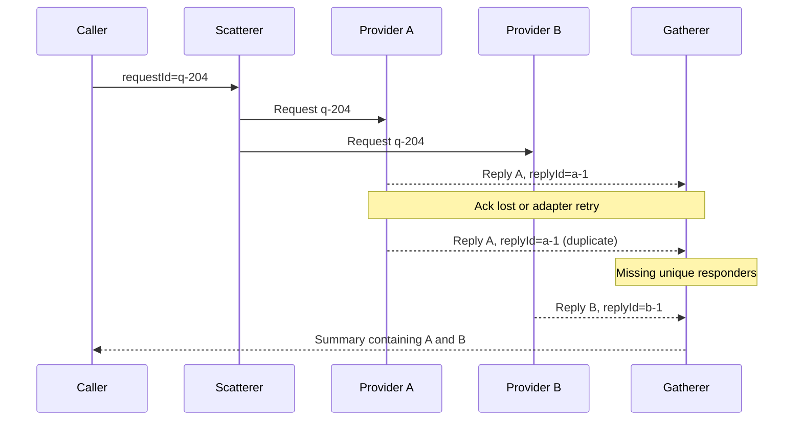
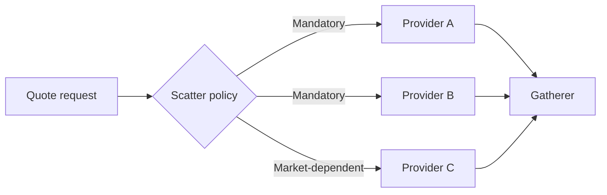
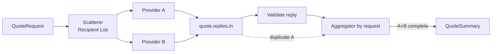
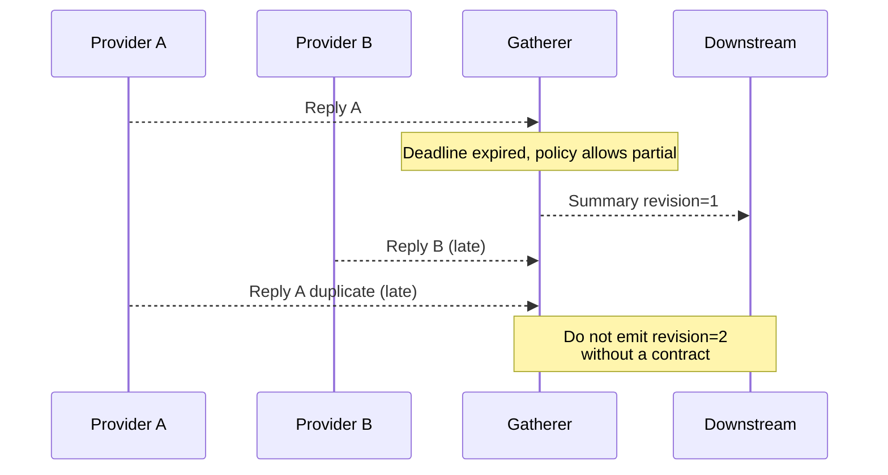
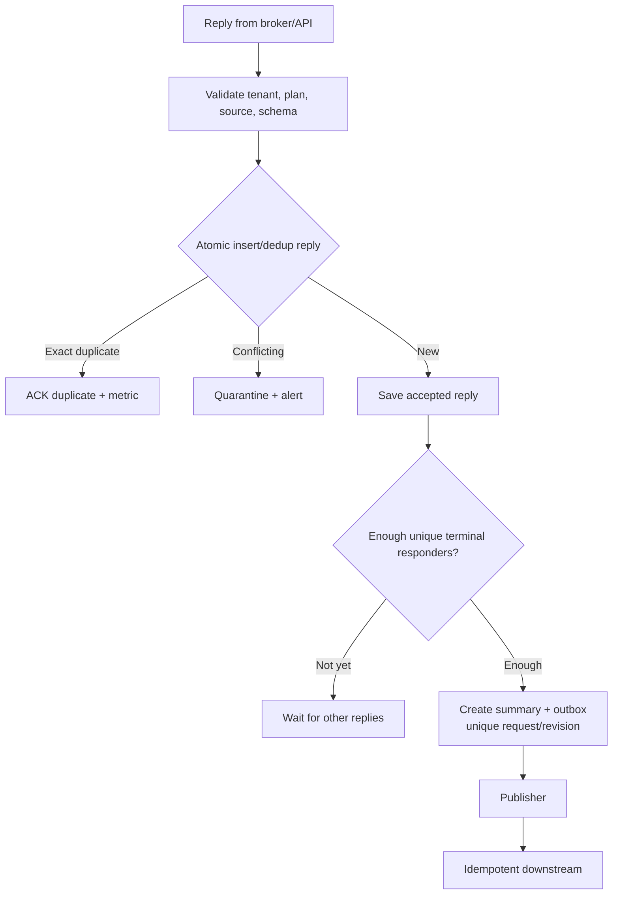
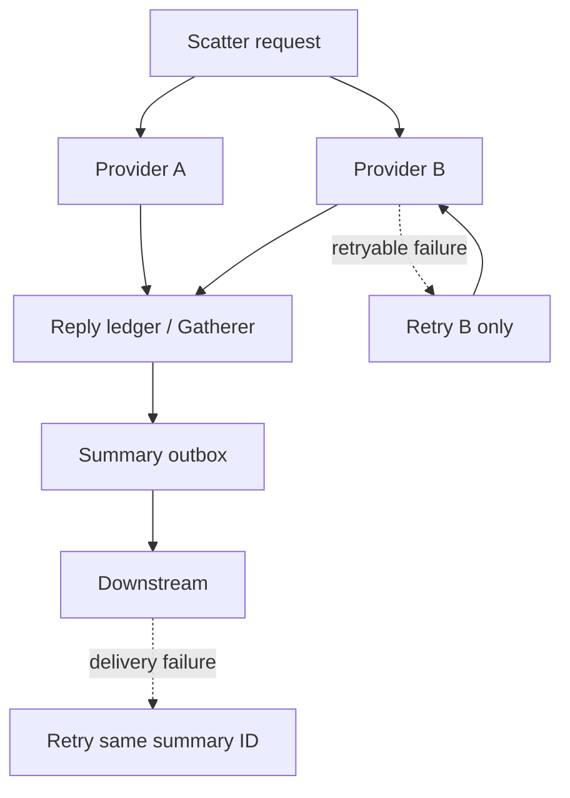

# Handling Duplicate Replies

## 1. The problem: two replies do not mean two sources replied

A pricing service receives a `QuoteRequest` and concurrently queries two suppliers: A and B. The aggregation side must receive **one valid result from each supplier**, compare prices, and return a `QuoteSummary`:

```text
Request: tenant-A / quote-204
Expected responders = {A, B}

09:00:01  A → reply A-1, price=100.00
09:00:02  A → reply A-1, price=100.00   (redelivery)
09:00:03  B → reply B-1, price= 95.00

Correct result: wait for B, then pick price 95.00 from B.
```

If using a release strategy `group.size() == 2`, the group could be emitted right after **two copies of A**, before receiving B. That result is wrong even though both messages are schema-valid.

This is the **duplicate reply** problem in **Scatter-Gather**:

- **Scatter:** sends one request to multiple recipients.
- **Gather:** collects replies corresponding to a request into a final result.
- **Duplicate reply:** the same logical reply may appear multiple times due to retries, redeliveries, duplicate producer sends, or duplicate flow wiring.

The lesson **"Handling Duplicate Replies"** belongs to the **Scatter gather** chapter of the **SPRING_INTEGRATION_PATTERN** module. The module focuses on implementing Enterprise Integration Patterns with Spring Integration to create loosely coupled and extensible message flows; practicing Router, Filter, Transformer, Splitter, Aggregator, Gateway, retry, error channel, and correlation alongside testing and monitoring each processing branch.

After this lesson, you can:

1. Distinguish duplicate replies from two valid replies from two different sources.
2. Design keys for **request**, **responder**, **logical reply**, and **processing attempt**.
3. Write a release strategy based on **expected responder set**, not raw message count.
4. Choose rules for identical duplicates, conflicting duplicates, and late replies.
5. Use Java DSL to simulate Scatter-Gather and write JUnit tests to verify.
6. Place idempotency, `MessageGroupStore`, transactions, timeouts, and error flows at the right boundaries.
7. Understand limitations of in-memory aggregation and how to scale to brokers/multi-instance.

## 2. Why do duplicate replies appear?



Some common causes:

| Cause | Sequence of events | Outcome |
| --- | --- | --- |
| Broker redelivery | Consumer finishes processing but crashes before ack | Same logical reply delivered again |
| Producer retry after timeout | Producer does not know if first publish succeeded | Two equivalent messages |
| Repeated HTTP callback | Remote service invokes callback twice | Two responses for the same request/responder |
| Scatter sent twice | Retries whole request when one recipient is slow | One provider may reply multiple times |
| Misconfigured topology | Same recipient registered twice; two flows target same destination | Two reply paths for one task |
| Multiple worker versions | Old and new workers process the same request | Replies may differ in payload or version |
| DLQ replay | Operator replays historical messages | A reply arrives after the group already released |
| Partial retry | Only provider B is retried | B has multiple attempts yet remains **one responder** |

**Not all identical payloads are duplicates.** Two providers may both quote 100.00 yet both are valid replies, because `responderId` differs.

Conversely, the same provider may produce two replies with different prices. That is a **conflicting reply**; never default to picking the last reply or summing both.

## 3. Four identifiers that must be separated

A fan-in message should carry IDs with distinct meanings:

| Identifier | Example | Used for |
| --- | --- | --- |
| `requestId` | `q-204` | Links replies belonging to one request |
| `responderId` | `A` or `B` | Identifies **who** replied |
| `replyId` | `A-q-204-v1` | Identifies **one logical result** being redelivered |
| `attemptId` / `deliveryAttempt` | `attempt-3` | Observes each send/processing attempt |

You should also include an authenticated `tenantId`, `requestRevision`, or `scatterPlanId` if the same business request can be re-evaluated.

The group's **correlation key** is typically the pair:

```text
(tenantId, requestId)
```

The **dedup key** can be:

```text
(tenantId, requestId, responderId, replyId)
```

Meanwhile, the question **"have enough replies arrived?"** relies on **mandatory responders having valid results**, not the count of `replyId` or `MessageHeaders.ID`.

### Why not use Spring Integration's Message ID?

`MessageHeaders.ID` can differ when an adapter builds a new `Message`, a message is transformed, or a broker redelivers. One logical reply `A-q-204-v1` can be represented by two distinct framework messages.

Using message ID as the dedup key will **fail to detect** business duplicates in many situations.

### Why not use monetary value as a key?

`A` and `B` can both return 100.00 yet must count as **two responding sources**. Conversely, `A` sending 100.00 and then 101.00 may be **two conflicting reply versions**. Comparing payloads alone is insufficient to know which message is valid.

## 4. Scatter-Gather needs an expected responder set

A scatterer does not always send the same number of requests:



For the first request, `{A,B}` might be expected; for the second request, `{A,B,C}`. The gatherer must use **the responder set selected for that specific request**.

A scatter plan (*scatter plan*) should record:

```json
{
  "tenantId": "tenant-A",
  "requestId": "q-204",
  "scatterPlanVersion": "quotes-v3",
  "requiredResponders": ["A", "B"],
  "optionalResponders": [],
  "deadline": "2026-11-21T09:00:10Z"
}
```

*Data is an illustrative example, not a schema generated automatically by Spring Integration.*

**Do not derive expected responders from the total number of deployed handlers** if a Router/Recipient List selects conditionally. A Filter may drop a branch, a provider may not apply, or policy may change after scatter time.

If a message is replayed after policy updated, use **the locked plan** or intentionally create a new revision. Silently re-evaluating can make the group wait for a responder that was never part of the original request.

## 5. Mistake: releasing by message count in the group

Suppose the Gatherer receives messages in the order:

```text
A1, A1, B1
```

With two mandatory responders, a naive `ReleaseStrategy`:

```java
// Unsuitable when duplicate replies can occur:
group -> group.size() == 2
```

could release right after two copies of A.

Similarly:

```java
// Reaching count still does not guarantee all responders:
group -> group.size() >= expectedCount
```

also fails when one provider produces multiple messages. Compare:

| Group received | Size | Unique responders | Allowed to release for A+B requirement? |
| --- | ---: | --- | --- |
| A | 1 | {A} | No |
| A, A | 2 | {A} | No |
| A, A, B | 3 | {A, B} | Yes, if both replies are valid and consistent |
| A, B | 2 | {A, B} | Yes |
| A, C | 2 | {A, C} | No; C is not in the plan |
| A, B, B | 3 | {A, B} | Yes for completeness, though B duplicate needs handling |
| A, B where A has non-terminal error | 2 | {A, B} | Depends on contract: do not treat failed attempt as terminal reply |

**Better formula:**

\[
\text{complete} \iff R_{\mathrm{required}}\subseteq R_{\mathrm{accepted,terminal}}
\]

This condition states "every mandatory responder has an accepted terminal reply". Yet it is **not sufficient** if there are conflicting replies or unauthorized senders. Validate identity, policy, scope, and consistency before emitting output.

## 6. Four duplicate types and corresponding responses

| Type | Example | Handling |
| --- | --- | --- |
| **Exact duplicate** | Same `replyId`, same responder, same canonical content | Recognize as redelivery; do not count extra, record metric |
| **Same-responder duplicate** | Two `replyId` values from A for the same request/revision | Apply policy: first terminal wins, intentional new version, or conflict |
| **Conflicting duplicate** | Same replyId with different amount or status | Flag integrity error; quarantine/audit, never pick arbitrarily |
| **Late duplicate** | A repeats after summary was already emitted | Do not emit a new summary; control group lifecycle and output idempotency |

If a source sends `FAILED` on a transient error and then retries into `SUCCESS`, separate **attempt failure** from **terminal business result**. Never let a transient error event occupy the responder slot and cause the Gatherer to release before the true result arrives.

### Is "first wins" always suitable?

No. If provider A's price can change within the same request and the business contract specifies picking the **latest quote version**, the policy must attach version/effective time, deadlines, and authoritative ordering. "Last message arrives wins" is dangerous: networks can reorder messages so an older message arrives later and overwrites a newer price.

In this lesson, the example specifies **each provider has one immutable terminal quote per request**. Redelivery of the same terminal quote is a duplicate; if the same responder issues different terminal quotes without a new revision, treat it as a conflict.

## 7. Example data model

We simulate a scatterer calling two providers A and B. The following records represent request, reply, and final result. All prices are assumed to be in **USD**, solely to focus on the duplicate problem.

```java
import java.math.BigDecimal;
import java.util.List;

record QuoteRequest(
        String tenantId,
        String requestId,
        String productCode) {}

record QuoteReply(
        String tenantId,
        String requestId,
        String responderId,
        String replyId,
        BigDecimal quotedPrice) {}

record QuoteSummary(
        String tenantId,
        String requestId,
        List<QuoteReply> uniqueReplies,
        String selectedResponder,
        BigDecimal selectedPrice) {}
```

Conventions:

- `requestId` is tied to one logical request; do not generate a new ID on every redelivery.
- `tenantId` comes from authenticated ingress.
- `responderId` uses logical provider names A/B, not pod names or endpoint URLs.
- `replyId` stays constant when the same reply is redelivered; changing content requires a defined revision.
- `quotedPrice` is positive and in the contract's currency.
- `QuoteSummary.uniqueReplies` contains **each responder exactly once**, deterministically sorted by `responderId`.
- If two providers quote the same price, select the responder by a deterministic tie-breaker.

Advanced exercises can add `quoteVersion`, `status`, `validUntil`, `currencyCode`, and signatures/source provenance; define their semantics before altering deduplication.

## 8. Shared logic: validating, releasing, and building summary

To keep the DSL readable, extract Gatherer logic into a pure class `ReplyRules`.

```java
import java.math.BigDecimal;
import java.util.Comparator;
import java.util.HashMap;
import java.util.HashSet;
import java.util.List;
import java.util.Map;
import java.util.Set;

import org.springframework.integration.store.MessageGroup;
import org.springframework.messaging.Message;

final class ReplyRules {

    private static final Set<String> EXPECTED =
        Set.of("A", "B");

    private ReplyRules() {}

    static boolean valid(QuoteReply reply) {
        return reply != null
            && notBlank(reply.tenantId())
            && notBlank(reply.requestId())
            && notBlank(reply.responderId())
            && notBlank(reply.replyId())
            && EXPECTED.contains(reply.responderId())
            && reply.quotedPrice() != null
            && reply.quotedPrice().signum() > 0
            && reply.quotedPrice().scale() <= 2;
    }

    private static boolean notBlank(String value) {
        return value != null && !value.isBlank();
    }

    // Length-prefix prevents collisions when delimiters appear in IDs.
    static String groupKey(QuoteReply reply) {
        String tenant = reply.tenantId();
        String request = reply.requestId();
        return tenant.length() + "#" + tenant
             + request.length() + "#" + request;
    }

    static boolean allRequiredSeen(MessageGroup group) {
        Set<String> responders = new HashSet<>();

        for (Message<?> message : group.getMessages()) {
            QuoteReply reply =
                (QuoteReply) message.getPayload();
            responders.add(reply.responderId());
        }

        // Only considers responses that passed validation.
        // Duplicates from the same provider do not satisfy completeness.
        return responders.equals(EXPECTED);
    }

    static QuoteSummary toSummary(MessageGroup group) {
        Map<String, QuoteReply> unique = new HashMap<>();

        for (Message<?> message : group.getMessages()) {
            QuoteReply reply =
                (QuoteReply) message.getPayload();

            if (!valid(reply)
                    || !groupKey(reply).equals(
                        String.valueOf(group.getGroupId()))) {
                throw new IllegalArgumentException(
                    "Invalid reply or correlation mismatch");
            }

            QuoteReply existing =
                unique.putIfAbsent(reply.responderId(), reply);

            if (existing != null && !existing.equals(reply)) {
                // Demo: same responder cannot have
                // two different terminal quotes.
                throw new IllegalStateException(
                    "Conflicting reply from "
                        + reply.responderId());
            }
        }

        if (!unique.keySet().equals(EXPECTED)) {
            throw new IllegalStateException(
                "Not all expected responders replied");
        }

        List<QuoteReply> replies = unique.values().stream()
            .sorted(Comparator.comparing(QuoteReply::responderId))
            .toList();

        QuoteReply winner = replies.stream()
            .min(Comparator
                .comparing(QuoteReply::quotedPrice)
                .thenComparing(QuoteReply::responderId))
            .orElseThrow();

        return new QuoteSummary(
            replies.get(0).tenantId(),
            replies.get(0).requestId(),
            List.copyOf(replies),
            winner.responderId(),
            winner.quotedPrice());
    }
}
```

### Role of each method

- `valid(...)` checks minimal schema and responder allowlist.
- `groupKey(...)` builds a correlation key of tenant + request, using length-prefixed encoding to avoid collisions when IDs contain delimiters.
- `allRequiredSeen(...)` checks **unique responder set** only; two messages from A still count as one responder.
- `toSummary(...)` enforces a stricter contract: duplicates must be **completely identical**, all replies match the group, no out-of-plan providers exist, and picks the lowest price after deduplication.

**Caution:** the `QuoteReply` record uses Java equality. With `BigDecimal`, `100.0` and `100.00` are numerically equal yet `BigDecimal.equals` can return `false` due to differing scales. The example only caps scale at 2 rather than normalizing to a fixed scale. In production, normalize amounts/currencies/schemas before creating a fingerprint or comparing business equivalence; never compare raw JSON byte-for-byte if field ordering, whitespace, or headers do not affect meaning.

### Why not delete duplicates directly inside ReleaseStrategy?

`ReleaseStrategy` is responsible for **deciding whether the group is ready**, not mutating `MessageGroupStore` or calling external APIs. To strip duplicates before storing in the group, place a **validation/dedup gate** at ingress and design atomicity with group admission. Using a `Set` here only observes completeness; **it does not remove duplicate messages from the store**.

## 9. Java DSL: simulating Scatter and Gather separately to observe duplicates

Spring Integration supports Scatter-Gather via dedicated endpoints/DSL. To test duplicate replies at the message level, this example **explicitly separates scatterer and gatherer**:

1. The Scatterer uses Recipient List to send requests to A and B.
2. Two mock providers produce `QuoteReply`.
3. All replies enter `quote.replies.in`.
4. The Gatherer uses correlation/release/processor from section 8.
5. Results go to `quote.summary.out`.



### Complete illustrative configuration

```java
import java.math.BigDecimal;

import org.springframework.context.annotation.Bean;
import org.springframework.context.annotation.Configuration;
import org.springframework.integration.channel.DirectChannel;
import org.springframework.integration.channel.QueueChannel;
import org.springframework.integration.config.EnableIntegration;
import org.springframework.integration.dsl.IntegrationFlow;

@Configuration
@EnableIntegration
public class DuplicateReplyScatterGatherConfig {

    @Bean("quote.requests.in")
    DirectChannel quoteRequests() {
        return new DirectChannel();
    }

    @Bean("quote.providerA.in")
    DirectChannel providerAInput() {
        return new DirectChannel();
    }

    @Bean("quote.providerB.in")
    DirectChannel providerBInput() {
        return new DirectChannel();
    }

    @Bean("quote.replies.in")
    DirectChannel repliesInput() {
        return new DirectChannel();
    }

    @Bean("quote.summary.out")
    QueueChannel summaryOutput() {
        return new QueueChannel();
    }

    @Bean
    IntegrationFlow scatterRequests() {
        return IntegrationFlow.from("quote.requests.in")
            .routeToRecipients(spec -> spec
                .recipient("quote.providerA.in")
                .recipient("quote.providerB.in"))
            .get();
    }

    @Bean
    IntegrationFlow providerA() {
        return IntegrationFlow.from("quote.providerA.in")
            .transform(QuoteRequest.class, request ->
                new QuoteReply(
                    request.tenantId(),
                    request.requestId(),
                    "A",
                    request.requestId() + "-A-r1",
                    new BigDecimal("100.00")))
            .channel("quote.replies.in")
            .get();
    }

    @Bean
    IntegrationFlow providerB() {
        return IntegrationFlow.from("quote.providerB.in")
            .transform(QuoteRequest.class, request ->
                new QuoteReply(
                    request.tenantId(),
                    request.requestId(),
                    "B",
                    request.requestId() + "-B-r1",
                    new BigDecimal("95.00")))
            .channel("quote.replies.in")
            .get();
    }

    @Bean
    IntegrationFlow gatherReplies() {
        return IntegrationFlow.from("quote.replies.in")
            .filter(QuoteReply.class,
                ReplyRules::valid,
                spec -> spec.throwExceptionOnRejection(true))
            .aggregate(spec -> spec
                .correlationStrategy(message ->
                    ReplyRules.groupKey(
                        (QuoteReply) message.getPayload()))
                .releaseStrategy(ReplyRules::allRequiredSeen)
                .outputProcessor(ReplyRules::toSummary))
            .channel("quote.summary.out")
            .get();
    }
}
```

**Important points about the configuration:**

- This is a **two-component simulation** of Scatter and Gather, not a full example of an integrated `ScatterGatherHandler`'s request–reply lifecycle.
- Both providers generate fixed prices without real HTTP/brokers; in production, each provider is an integration flow/adapter with its own timeout and result contract.
- `DirectChannel` is used for easy synchronous testing; an error in one provider can prevent the scatterer from dispatching to subsequent recipients.
- `quote.summary.out` is a `QueueChannel` for tests; receiving a summary in the queue does not mean downstream systems were updated.
- For the APIs and DSL used, check the overload signatures of your actual Spring Integration version before production deployment.
- `ReplyRules.EXPECTED={A,B}` is **the fixed set for this lesson**. If Scatter policy selects dynamically, use a **per-request** expected set rather than an application-wide constant.

### If using integrated Scatter-Gather DSL

Spring Integration also provides components combining scatterer/gatherer and configuring reply flows, correlation, timeouts, and gatherer aggregation. When using the integrated form, the same principles still apply: **identifying request and responder**, **releasing by unique expected replies**, **handling conflicts**, and **group lifecycle**. Never assume the gatherer's default configuration deduplicates business duplicates via `MessageHeaders.ID`.

In this lesson, splitting the two flows also makes it easy to **inject duplicate replies directly into the gatherer** to test independently of provider-calling logic.

## 10. Integration test: do not release when A replies twice

JUnit 5 + AssertJ:

```java
import static org.assertj.core.api.Assertions.assertThat;
import static org.assertj.core.api.Assertions.assertThatThrownBy;

import java.math.BigDecimal;

import org.junit.jupiter.api.Test;
import org.springframework.beans.factory.annotation.Autowired;
import org.springframework.beans.factory.annotation.Qualifier;
import org.springframework.integration.channel.QueueChannel;
import org.springframework.messaging.Message;
import org.springframework.messaging.MessageChannel;
import org.springframework.messaging.support.MessageBuilder;
import org.springframework.test.context.junit.jupiter.SpringJUnitConfig;

@SpringJUnitConfig(DuplicateReplyScatterGatherConfig.class)
class DuplicateReplyScatterGatherTest {

    @Autowired
    @Qualifier("quote.requests.in")
    MessageChannel requests;

    @Autowired
    @Qualifier("quote.replies.in")
    MessageChannel replies;

    @Autowired
    @Qualifier("quote.summary.out")
    QueueChannel summaries;

    private void send(
            String tenant,
            String requestId,
            String responder,
            String replyId,
            String price) {

        assertThat(replies.send(MessageBuilder.withPayload(
            new QuoteReply(tenant, requestId, responder,
                replyId, new BigDecimal(price)))
            .build())).isTrue();
    }

    @Test
    void duplicateAIsNotCountedAsB() {
        send("tenant-A", "q-dup", "A", "a-1", "100.00");
        send("tenant-A", "q-dup", "A", "a-1", "100.00");

        // Two messages, yet only one unique responder so far.
        assertThat(summaries.receive(0)).isNull();

        send("tenant-A", "q-dup", "B", "b-1", "95.00");

        Message<?> message = summaries.receive(1_000);
        assertThat(message).isNotNull();

        QuoteSummary summary = (QuoteSummary) message.getPayload();
        assertThat(summary.requestId()).isEqualTo("q-dup");
        assertThat(summary.selectedResponder()).isEqualTo("B");
        assertThat(summary.selectedPrice())
            .isEqualByComparingTo(new BigDecimal("95.00"));
        assertThat(summary.uniqueReplies())
            .extracting(QuoteReply::responderId)
            .containsExactly("A", "B");

        assertThat(summaries.receive(0)).isNull();
    }

    @Test
    void twoDifferentProvidersWithEqualPricesAreNotDuplicates() {
        send("tenant-A", "q-equal", "A", "a-2", "100.00");
        send("tenant-A", "q-equal", "B", "b-2", "100.00");

        QuoteSummary summary =
            (QuoteSummary) summaries.receive(1_000).getPayload();

        assertThat(summary.uniqueReplies()).hasSize(2);
        // Demo tie-breaker picks the smaller responder ID.
        assertThat(summary.selectedResponder()).isEqualTo("A");
    }

    @Test
    void unknownResponderIsRejectedBeforeAggregation() {
        assertThatThrownBy(() -> send(
            "tenant-A", "q-unknown",
            "UNKNOWN", "x-1", "50.00"))
            .isInstanceOf(RuntimeException.class);

        assertThat(summaries.receive(0)).isNull();
    }

    @Test
    void scatterAndGatherProduceOneSummary() {
        QuoteRequest request =
            new QuoteRequest("tenant-A", "q-normal", "SKU-1");

        assertThat(requests.send(
            MessageBuilder.withPayload(request).build()))
            .isTrue();

        Message<?> message = summaries.receive(1_000);
        assertThat(message).isNotNull();

        QuoteSummary summary = (QuoteSummary) message.getPayload();
        assertThat(summary.selectedResponder()).isEqualTo("B");
        assertThat(summary.uniqueReplies()).hasSize(2);
    }
}
```

**What does this test prove?** The Gatherer does not use raw message count to trigger release; a duplicate from A cannot substitute for B. Two providers returning the same price still count as two valid responders.

**What does this test NOT yet prove?** It does not prove durability across restarts, does not guarantee end-to-end exactly-once, does not test group expiration or broker/DB errors, and does not run over real transport. Those tests require adding `MessageGroupStore`/adapters and proper transaction mechanics.

## 11. Testing conflicting replies

A conflicting reply must never be treated as a harmless duplicate:

```text
A, replyId=a-1, amount=100.00
A, replyId=a-1, amount=120.00
B, replyId=b-1, amount=95.00
```

In the demo policy, `ReplyRules.toSummary()` detects that A has two unequal payloads and throws an exception when the group releases. You can add the test:

```java
@Test
void conflictingReplyMustNotProduceSummary() {
    send("tenant-A", "q-conflict", "A", "a-conf", "100.00");
    send("tenant-A", "q-conflict", "A", "a-conf", "120.00");

    assertThatThrownBy(() -> send(
        "tenant-A", "q-conflict", "B", "b-conf", "95.00"))
        .isInstanceOf(RuntimeException.class);

    assertThat(summaries.receive(0)).isNull();
}
```

Place this test **inside** `DuplicateReplyScatterGatherTest` in section 10, reusing the declared `send(...)` helper and channels.

However, for safe production operation, **do not wait until all sources reply to detect conflicts**. A dedup/consistency gate **before writing into `MessageGroupStore`** or a transactional reply ledger can detect them early:

1. Check whether `replyId` already exists for the same request/responder.
2. If canonical fingerprint matches → mark `DUPLICATE_IGNORED`.
3. If fingerprint differs → `CONFLICT_QUARANTINED` and alert.
4. If new → record reply, allow Gatherer to process.
5. All operations must account for concurrency and crash windows between recording in the ledger and admitting the message into the group.

In the example, an exception from the output processor can affect group state, retries, and error handling depending on configuration. Do not automatically release or delete an errored group without a recovery policy.

## 12. Deduplication levels: message, reply, responder, and summary

A system may require **four layers of protection**:

| Layer | Suggested key | Meaning |
| --- | --- | --- |
| Transport/message delivery | Broker offset/delivery ID, per transport | Identifies a delivery/redelivery at the infra layer |
| Logical reply | `tenantId + requestId + responderId + replyId` | Detects redelivery of the same result |
| Responder slot | `tenantId + requestId + responderId` | One source occupies only one slot in the gather plan |
| Summary/business output | `tenantId + requestId + summaryRevision` | Prevents downstream from processing the same result twice |

**Transport dedup does not replace logical dedup.** A broker producer can create messages with different IDs for the same business result.

**Responder slot is also not simply a "seen" Set.** If source A crashes mid-work, the system may lack a valid terminal reply. Marking `A=COMPLETED` as soon as the request is sent to A makes the Gatherer falsely think it is complete.

### Per-responder state model

| State | Meaning | Counts as terminal reply? |
| --- | --- | --- |
| `NOT_REQUESTED` | Not part of the scatter plan | No |
| `PENDING` | Request sent, no reply yet | No |
| `RETRYING` | An attempt failed, awaiting retry | No |
| `SUCCESS` | Valid terminal result present | Yes |
| `FAILED_FINAL` | Decided not to retry and failure envelope exists | Depends on contract; can count as terminal |
| `CONFLICT` | Multiple conflicting results received; needs investigation | Never treated as success |
| `EXPIRED` | Deadline passed with no result | Needs timeout/partial policy |

These states are a **proposed application model**, not statuses automatically emitted by `Aggregator`. If choosing to count `FAILED_FINAL` as terminal, the output must represent that failure rather than pretending the provider supplied a price.

## 13. Choosing release timing in Scatter-Gather

There are three common policies:

**All required responders.** Wait until both A and B have valid terminal replies. Suitable when comparing all mandatory suppliers completely.

**First successful or quorum.** Emit result once K sources succeed. For example, pick the first acceptable quote. Here the expected set differs from all-required, and output may need `QUORUM_REACHED` alongside the non-responding sources list.

**Deadline/partial result.** When time runs out, return arrived replies or failure/HOLD per contract.

| Scenario | All-required | Quorum 1/2 | Deadline partial |
| --- | --- | --- | --- |
| A succeeds, B has not replied | Wait | Can release per policy | Wait until deadline |
| A replies twice, B has not replied | Wait | Counts as only one source | Wait |
| A fails terminally, B succeeds | Depends on whether failure counts as terminal | B may satisfy quorum | Return partial or error |
| A and B both succeed | Release | May have released earlier | Release |
| B arrives after release | Handle late reply | Handle late reply | Can emit new revision if permitted |

**Never use duplicates to "reach quorum".** Quorum is the count of **independent sources with acceptable results**, not message count.

## 14. Timeouts and late replies

Suppose a group already released a summary after reaching quorum, or timed out and returned a partial result:



Once a group completes, `MessageGroupStore` and Aggregator settings may **retain completion markers**, **delete the group**, or apply group cleanup policies. Behavior for subsequent arrivals depends on settings such as expiration/group lifecycle and involved endpoints.

If a group is deleted completely and the same correlation key reappears, there is a risk **a new group is created for the same request ID**. A system that must avoid emitting a second summary needs a durable **completed-request ledger/tombstone**.

### Three options for late replies

1. **Ignore + record:** discard the late reply, log metrics and provenance. Suitable when the summary is final.
2. **Quarantine:** store for investigation if late replies may signal topology bugs or SLA breaches.
3. **Intentional revision:** emit `summaryRevision=2` and inform downstream this is an update, not the initial result.

Never pick "last write wins" just because a late reply arrived later. Reply source, quote version, and validity window must be governed by contract.

## 15. MessageGroupStore and deduplication

Gatherer/Aggregator is a **stateful** component. Message A may arrive seconds or longer before B. State lives in `MessageGroupStore`; with the in-memory default, groups do not survive process restarts.

| Storage model | What is supported | Risks / trade-offs |
| --- | --- | --- |
| In-memory group store | Easy testing, low latency | State lost on restart; fragmented across multiple instances |
| Persistent/JDBC group store | Can preserve groups across restarts | Transactions, locking, schema, cleanup |
| Partitioned/co-located consumers | All replies for one request go to one instance | Must control partition keys and rebalancing |
| Reply ledger + workflow state | Explicit dedup, conflict, status, and output revisions | More complex data/transaction design |
| External broker/outbox | Durable delivery/retry | Does not deduplicate at business layer on its own |

**A shared store does not automatically guarantee exactly-once.** Two workers may process replies A and B concurrently; you must understand claim conditions, locks, compare-and-set, and transactions when updating group state.

### A durable state model

Conceptual tables example:

```text
scatter_request(
    tenant_id, request_id, plan_version, deadline,
    expected_responders, state, summary_revision,
    UNIQUE(tenant_id, request_id)
)

accepted_reply(
    tenant_id, request_id, responder_id,
    reply_id, canonical_fingerprint,
    payload_reference, accepted_at,
    UNIQUE(tenant_id, request_id, responder_id, reply_id)
)

published_summary(
    tenant_id, request_id, summary_revision,
    result_reference, published_at,
    UNIQUE(tenant_id, request_id, summary_revision)
)
```

These tables are an **illustrative application-layer design**, not a Spring Integration schema. If uniqueness only covers `replyId`, two different terminal replies from the same provider are still accepted as two new rows. Add a **responder-slot policy** or conflict detection keyed by `(tenant,request,responder)`.

### Crash windows to account for

**Crash window A:** wrote `seen=reply A` successfully, process dies before inserting reply into group. After restart, duplicate A is blocked yet Gatherer never received A's data → incomplete group.

**Crash window B:** group already has A, process dies before broker ack. Broker redelivers A → group receives two messages without durable dedup.

**Crash window C:** summary sent downstream, process dies before persisting publish success. Retry may send summary again.

You cannot eliminate all three failure windows with just a `ConcurrentHashMap`. For critical data, use synchronized transaction/ledger/outbox designs with recovery and consumer idempotency.

## 16. Synchronizing the ledger with summary creation

A reliable design often rests on a **transactional reply ledger**:



If `accepted_reply`, group completion, and summary outbox reside in **one database**, transactions/locks/unique constraints can stop two workers from creating summaries simultaneously. When a single transaction cannot cover everything, define a recovery protocol and controlled replay.

Clarify:

- Atomic claim when two duplicate replies arrive concurrently.
- How canonical fingerprints are compared to detect conflicts.
- When a responder slot is marked terminal.
- When the group transitions to `COMPLETED` and blocks summary revision 1 from being emitted again.
- When transport ACK happens; ACKing before commit risks data loss.
- If summary publishing succeeds yet ACK is lost, downstream receiving it again must be idempotent.
- Ledger retention for replies/summaries long enough to cover broker redeliveries and DLQ replays.

A transactional outbox ties output emission to state-persistence transactions. **It does not create end-to-end exactly-once automatically**; publishers and consumers can still see duplicates and must handle them by business key.

## 17. Concurrent reply issues

Brokers are not the only source of duplicates. Two instances can process two copies of reply A simultaneously:

```text
Thread-1: SELECT reply A -> not found
Thread-2: SELECT reply A -> not found
Thread-1: INSERT A
Thread-2: INSERT A
```

If code performs non-atomic "check then write", both can begin processing. Use unique constraints/CAS/transactions; if a process is already handled by another worker, return in-progress or retry later per policy rather than assuming completion.

Another case: A and B arrive nearly simultaneously. Both workers see the responder set become complete and **emit summaries concurrently**. Thus a unique key at the output level like `(tenantId, requestId, summaryRevision)` is also vital, alongside locking/state transitions allowing only one worker to produce the output.

**Note:** `synchronized` on a bean only protects threads inside **one JVM**, not across multiple pods or processes.

### Why not just use a Redis Set?

Redis offers atomic key insertion across multiple instances, yet:

- A Redis marker might be written before the actual reply enters the group.
- Redis and the business database may not share a transaction.
- TTL may expire while a DLQ is still replayed.
- A `seen` key does not prove the reply became a valid terminal result.

Redis fits when consistency, durability, and failure recovery scopes are explicitly designed; it is not an automatic "cure-all" for duplicate replies.

## 18. Error replies, partial failures, and duplicates

A provider may return a **failure envelope** instead of a quote:

```java
enum ReplyStatus {
    SUCCESS,
    FAILED_FINAL,
    RETRYING
}

record ProviderOutcome(
    String tenantId,
    String requestId,
    String responderId,
    String replyId,
    ReplyStatus status,
    BigDecimal quotedPrice,
    String errorCode) {}
```

If `RETRYING` represents an incomplete attempt, never treat it as a terminal response for release. If `FAILED_FINAL` is allowed by business rules to count as terminal, the summary must distinguish:

- A produced a successful quote.
- B concluded with a terminal failure.
- Group outcome is `PARTIAL_FAILURE` or `NO_VALID_QUOTE`, per rules.

Never convert `FAILED_FINAL` into `price=0`. In a lowest-price problem, that would make the failed provider win.

### Duplicates of failure replies

If B sends `FAILED_FINAL` twice, that is still one terminal result from B. If B sends both `FAILED_FINAL` and `SUCCESS` for the same request without a revision, that is a **conflict** requiring a policy. Never count it as two responders or arbitrarily pick the later arrival.

## 19. Correlation, sequence, and reply headers

Scatter-Gather often works alongside other EIPs:

| Metadata | Purpose | Pitfall |
| --- | --- | --- |
| `correlationId` | Groups replies belonging to the same scatter request | Unstable across adapters/Transformers |
| `sequenceNumber`/`sequenceSize` | Position/total parts in a sequence | Duplicates can still carry different sequences or be regenerated |
| `requestId` | Business request ID across retries | Generating a new one per attempt |
| `responderId` | Identifies which provider replied | Trusting client-supplied headers |
| `replyId` | Identifies one logical result | Using framework Message ID instead of business ID |
| `planVersion` | Identifies expected source set | Replaying against a newer policy alters the expected set |
| `replyChannel` | Return destination in request/reply context | Lost when building new Messages or crossing transports |
| `errorChannel` | Error handling path per endpoint/adapter | Assuming every exception lands here automatically |

If using a Splitter, sequence headers can help. Yet duplicate replies in Scatter-Gather still need **per-responder identity**. You cannot treat `sequenceSize=2` as proof that the two messages are A and B.

In Spring Integration, some Scatter-Gather implementations maintain internal correlation/reply headers. When moving to brokers/HTTP, check header mapping and preserve business IDs; never store business outcomes solely in transient headers that adapters may strip.

## 20. Scoping retries properly

There are three distinct failure and retry points:

1. **Scatter dispatch failure:** failed to send to provider B. Retry sending to B; do not resend to A by default if A already received it.
2. **Provider processing failure:** provider B retries keyed by `(requestId, responderId)` and upon completion emits only one logical terminal reply per contract.
3. **Gatherer/output failure:** replies may already be saved, yet the Summary failed to reach downstream. Retry output using a stable summary ID without recalculating prices from current data.



**Retrying the entire Scatter-Gather** after one branch succeeded may re-invoke A and generate another reply. That can be acceptable if A is idempotent and the Gatherer deduplicates accurately, yet never treat re-fan-out as harmless.

A caller-side request timeout does not automatically cancel running providers. Replies can arrive after the caller gave up; define a clear lifecycle/late-result policy to avoid leaking groups or emitting unexpected summaries.

## 21. Group expiration and completed-request ledger

When requests have deadlines, you may need:

- Group timeout/expiration.
- Partial-result release policy.
- Discard channel or failure flow for expired messages.
- Post-completion retention to detect duplicates.
- Group reaper/cleanup to prevent unbounded store growth.
- Ledger retaining completed `requestId` values long enough for the redelivery/replay window.

Do not equate **Gateway reply timeout** with **MessageGroupStore expiration**. The Gateway may time out while the group still exists. Conversely, a group may expire and be cleaned up while a remote provider is still running.

### Where should dedup state TTL be derived from?

Consider:

- Broker retention and maximum redelivery duration.
- Maximum retry budget of senders/consumers.
- Possibility of operators replaying a DLQ days later.
- How long a request remains meaningful in business terms.
- Compliance and privacy requirements on stored data.

If replays happen after 30 days while the ledger retains 1 hour, a duplicate after 2 days is treated as a brand-new request. A short TTL may suffice to reduce telemetry noise, yet fails for financial actions requiring strict idempotency.

## 22. Multi-instance: the same request must be seen as one group

In a cluster with multiple Gatherer instances:

```text
Instance-1 receives A.
Instance-2 receives B.
Each instance has its own MemoryMessageStore.
=> Neither instance sees full {A,B}.
```

Three solutions:

1. **Partition/co-locate:** broker partitions replies by `tenantId+requestId` so the same group always reaches the same instance.
2. **Shared/persistent group store:** instances view shared groups with appropriate locking/transactions.
3. **Dedicated workflow ledger:** record accepted replies by unique key, then a transactional stage builds the summary.

If partition migration/rebalancing occurs, check in-flight group state and recovery. Partitioning provides locality, yet does not solve duplicates from broker redeliveries or output retries on its own.

### Key group ID by business request

Never generate a random UUID each time service A or B replies to build a group key. That puts each reply into a separate group.

In the demo, `ReplyRules.groupKey(...)` uses tenant + request, so all valid replies for the same request land in one group regardless of `MessageHeaders.ID`.

## 23. Output correctness matters more than "having an output"

A dangerous bug: the group releases early on A+A and downstream receives a summary. Later B arrives and the app emits a new summary; users or downstream systems may have already acted on the initial price.

Therefore, test at **two levels**:

- **Gather correctness:** exact unique responder set, conflicts, deadlines, deterministic selection.
- **Business effect correctness:** delivering the same summary ID multiple times produces only one side effect at the consumer.

If the summary is advisory, logging/revisions may suffice. If the summary triggers **payment capture or booking**, you need idempotency keys/transactions and proper compensation rules; the Aggregator does not create atomic transactions across multiple systems.

### Reply order does not determine validity

Suppose B arrives before A. The summary must still be identical for equivalent terminal quotes unless the business contract specifies otherwise. `ReplyRules.toSummary(...)` sorts outputs by responder and uses a deterministic tie-breaker, so results do not depend on arrival order within a valid group.

## 24. Observability: seeing duplicates at the exact layer

A log `"received reply"` does not tell whether it is a new reply, an old reply, or a duplicate. Structured events should contain:

```text
event=scatter_gather_reply_received
tenantScope=tenant-A
requestId=q-204
responderId=A
replyId=A-q-204-v1
planVersion=quotes-v3
replyDecision=DUPLICATE_IDENTICAL
groupState=WAITING_FOR_B
attemptNumber=2
```

Values are an **illustrative schema**, not logs auto-generated by Spring Integration. Never log tokens, PII, or sensitive quote payloads unless permitted by data-protection policies.

Suggested metrics:

| Application metric | Question |
| --- | --- |
| `scatter.request.total` | How many requests were fanned out? |
| `gather.reply.received.total{responder}` | How many replies did each source return? |
| `gather.reply.duplicate.total{kind}` | How many identical, conflicting, or late duplicates? |
| `gather.group.open` | How many requests are currently waiting? |
| `gather.group.unique_responders` | How many valid sources replied? |
| `gather.group.completed.total{policy}` | How many groups released? |
| `gather.group.timeout.total` | How many groups exceeded deadline? |
| `gather.summary.published.total` | How many summaries were emitted? |
| `gather.summary.delivery.retry.total` | Is output delivery retrying frequently? |
| `gather.reply.conflict.total{responder}` | Which source emitted conflicting results? |

Names are application design suggestions. Never put `requestId`/`replyId` as metric labels because cardinality can grow unbounded.

### Distinguish the steps

**REPLY_RECEIVED**, **REPLY_ACCEPTED**, **DUPLICATE_IGNORED**, **GROUP_COMPLETED**, **SUMMARY_CREATED**, **SUMMARY_DISPATCHED**, and **DOWNSTREAM_PROCESSED** are distinct events.

A message accepted into a group before the group releases **is not an error**. Nor does a dispatched summary prove downstream committed if the channel is asynchronous.

## 25. Troubleshooting matrix

| Symptom | Possible cause | What to check |
| --- | --- | --- |
| Summary emitted before B replied | Released on `group.size()`, duplicate A arrived | Compare unique responder set against expected set |
| Two providers with same price treated as duplicates | Deduplicated by amount/payload | Use request+responder+logical reply ID |
| Same provider sends two prices and one is picked randomly | Missing conflict policy | Compare canonical fingerprints and version/attempt |
| No summary even though A+B replied | Wrong correlation key, missing tenant, or split across instances | Check group ID and header mapping |
| Group grows after repeated retries | Duplicates not filtered before store | Atomic dedup/retention, bound group size |
| Duplicate summaries after restart | In-memory store or repeated output publish | Persistent ledger, outbox, output idempotency |
| Late B produces a different summary | Completed group deleted, same key started new group | Tombstone/late-result policy |
| Summary picks price from unauthorized provider | Responder ID not validated | Trusted allowlist and source authentication |
| Summary mixes two tenants | Key lacks tenant or was spoofed | Correlation key with authenticated tenant |
| Retry resends to both A and B | Retrying whole scatterer | Per-recipient delivery state and provider idempotency |
| Provider sends FAILED then SUCCESS causing bad release | Attempt counted as terminal | Count only terminal outcomes per policy |
| Timeout yet group lingers | Gateway timeout does not clean `MessageGroupStore` | Dedicated group expiration/reaper |
| Two workers emit summaries simultaneously | Non-atomic completion check | Locks/unique summary key/transactions |
| Errors miss global `errorChannel` | Synchronous exception or unconfigured error handler | Inspect threads/endpoints/adapters and real error flow |

## 26. Tests needed beyond the happy path

| Scenario | Expectation |
| --- | --- |
| A then B | Releases exactly one summary |
| B then A | Identical summary for equivalent data |
| A, A, B | Does not release after A+A; emits one summary after B |
| A, B same price | Two valid sources, deterministic tie-breaker |
| A sends one message across two transports | Recognized as duplicate by logical ID |
| A sends two different terminal quotes | Conflict; never pick arbitrarily |
| Unknown responder X | Excluded from expected set; rejected/quarantined |
| Tenant-A/A and Tenant-B/B share `requestId` | No cross-tenant mixing |
| A arrives first, B never arrives | Waits or times out/partial per policy |
| B arrives after timeout | Late-reply handling per contract |
| Duplicate A after completion | Never emits summary revision 1 again |
| Two workers receive duplicate A concurrently | Atomic dedup prevents double counting |
| Crash after saving reply before ack | Redelivery neither loses nor duplicates logical result |
| Crash after publishing summary before ack | Idempotent output consumer |
| Scatter plan changes on replay | Uses pinned plan or creates audited new revision |
| Provider returns retryable failure then terminal success | Failure attempt not counted as terminal |
| Spoofed source identity | Rejected at trust boundary |

### Additional tests for pure logic

To test `ReplyRules` without a Spring context, construct a test `MessageGroup` containing `Message<QuoteReply>` instances and call `allRequiredSeen(...)` and `toSummary(...)` directly. Verify:

- After A+A, `allRequiredSeen` returns false.
- After A+A+B, it returns true.
- `toSummary` returns exactly two unique replies.
- Conflicting duplicates throw an exception.
- Both sources quoting the same price still pick A via tie-breaker.
- Payloads missing tenant, request, or quote amount are rejected.

**Never write only a `count=2` test and assume duplicates are handled.** Verify distinct business identity and downstream effects.

## 27. Security and trustworthiness

Never treat a reply claiming `responderId="A"` as sufficient proof it came from A. In real systems:

- Authenticate service identity at transport level and map to logical responder ID.
- Verify tenant/request authorization before admitting a reply into a group.
- Never allow providers to alter the scatter plan's expected responder set.
- Never use SpEL or arbitrary channel names supplied by providers to route replies.
- Cap replies per group, payload size, and duplicate rate to prevent DoS.
- Guard against unauthorized replays when old replyIds reappear after retention, per business contract.
- Manage retention, encryption, and ACLs on reply ledgers, DLQs, and summaries.
- Validate schema versions, amounts/currencies, signatures, or provenance where domain requires.
- Never rely on client-supplied timestamps as proof of "latest reply".
- Alert on rising conflict rates; that can signal implementation bugs or security issues.

Algorithmically correct deduplication without trust-boundary checks can still be abused to **occupy a legitimate provider's slot**, causing the Gatherer to release wrongly.

## 28. Practice exercises

### Exercise 1 — Fixing a broken ReleaseStrategy

Configure a flow using `group.size() == 2`. Send A, A, B. Observe the bug, then switch to checking responder set `{A,B}`. Assert no summary exists after A+A, and one summary exists after B.

### Exercise 2 — Distinguishing reply ID from delivery attempt

Create two Messages with different `MessageHeaders.ID` values yet identical `tenantId, requestId, responderId, replyId`. Verify they count as one logical reply. Then create a reply from B with the same `quotedPrice` as A; confirm it is **not** a duplicate.

### Exercise 3 — Conflicting duplicate

Send A with the same `replyId` yet two different prices. Write a test reporting conflict and routing the message to a failure/quarantine flow. Test `100.0` vs. `100.00`; define canonicalization to avoid false conflicts if the business treats them as equivalent.

### Exercise 4 — Dynamic scatter plan

Some requests query only A, B; others query A, B, C. Store the expected set alongside plan version. Write a per-request plan release strategy and test that an "extra" C reply does not release an A+B group prematurely.

### Exercise 5 — Timeout and partial reply

B fails to reply before the deadline. Design policies:
- All-or-nothing: return failure/timeout.
- Best available quote: optionally return A with PARTIAL status and provenance.
- Manual review: hold request for intervention.

Explain how to handle B arriving later, as well as A being redelivered by the broker after release.

### Exercise 6 — Durable reply ledger

Design the schema and transaction for receiving replies, unique keys for deduplication, conflict checks, summary creation, and outbox. Simulate crashes between reply insert and broker ACK, as well as between summary publish and ACK. Prove replay causes no duplicate side effects.

### Exercise 7 — Multi-instance

Two instances receive A and B for the same request. Explain why separate in-memory stores fail to complete the group. Propose partitioning by tenant/request or a shared `MessageGroupStore` with locking; test concurrent duplicate A.

### Exercise 8 — Error replies

One provider returns `RETRYING`, then `FAILED_FINAL`. Another provider returns SUCCESS. Design group outcomes and terminal reply rules. Never use `price=0` as an error placeholder.

### Exercise 9 — Relationship between Gateway and Aggregator

A Gateway invokes Scatter-Gather and waits 2 seconds. B replies after 3 seconds. Distinguish Gateway timeout from group expiration; design the late-reply path and caller retry policy.

### Exercise 10 — Dashboard

Create metrics and alerts: duplicate rate, conflicting reply count, open groups, age of oldest group, timed-out groups, late replies, summaries published, and downstream idempotency hits. Propose a runbook when duplicates spike after deploying a new provider.

**Completion criteria:** learners must be able to explain **which replies belong to the same logical result**, **which responders replied**, **when a group is truly complete**, **how conflicts/late/timeouts are handled**, and **why summary downstream still requires idempotency**.

## 29. Pre-production checklist

- [ ] Stable business request ID across retries and redeliveries.
- [ ] Verified logical responder ID, never taken blindly from untrusted headers.
- [ ] Clear semantics for reply ID / attempt ID.
- [ ] Expected responders snapshotted per scatter plan/version.
- [ ] Release strategy based on **unique terminal responders**, not just `group.size()`.
- [ ] Rules defined for exact duplicates, same-source conflicts, unknown sources, and late replies.
- [ ] Validation of content, schema/version, amount/currency, and tenant authorization.
- [ ] Atomic dedup or transactions when multiple instances process the same reply.
- [ ] Group timeout/expiration/cleanup and completed-request retention configured.
- [ ] Business-defined partial/quorum/all-required policy.
- [ ] `MessageGroupStore` suited to restart, concurrency, and throughput needs.
- [ ] Idempotent output consumer or unique summary key.
- [ ] Retries scoped properly: scatter delivery, provider worker, or summary output.
- [ ] Error flow separates transient failures from permanent conflicts.
- [ ] Trace/correlation preserved across Transformer, Router, Gateway, and adapters.
- [ ] Tests cover duplicates before release, duplicates after release, and crash windows.
- [ ] Metrics track open groups, duplicates, conflicts, timeouts, and latency.
- [ ] No unnecessary secrets, PII, or sensitive payloads logged/stored.
- [ ] Runbooks exist for stuck groups, DLQ replays, and providers sending conflicting results.
- [ ] Schema evolution and scatter plan migration plan in place.

## 30. Summary

**Duplicate replies are a problem of identity and state, not merely message count.** In Scatter-Gather, two replies from A cannot substitute for one reply from B. Therefore:

- **Correlation** groups replies belonging to the same request and tenant.
- **Responder identity** identifies which source replied.
- **Logical reply identity** detects redeliveries of the same result.
- **Release strategy** releases only when mandatory responders have completed per policy.
- **Output processor** deduplicates safely, handles conflicts, and builds a typed summary.
- **Group lifecycle, reply ledger, and idempotency** protect against late arrivals, crashes, concurrent processing, and re-emitted outputs.

The Java DSL example in this lesson separates Scatter and Gather into distinct flows to make duplicate testing straightforward. In production, you can use integrated Scatter-Gather DSL or broker-backed topologies, yet these identity, verification, and recovery rules **remain business contracts that must be designed and tested**.

**Never let `group.size()` answer a question that only a unique responder set can answer.**

## References

- [Spring Integration Reference — Scatter-Gather](https://docs.spring.io/spring-integration/reference/scatter-gather.html)
- [Spring Integration Reference — Aggregator](https://docs.spring.io/spring-integration/reference/aggregator.html)
- [Spring Integration Reference — Router](https://docs.spring.io/spring-integration/reference/router.html)
- [Spring Integration Reference — Message Group Store](https://docs.spring.io/spring-integration/reference/message-store.html)
- [Spring Integration Reference — Error Handling](https://docs.spring.io/spring-integration/reference/error-handling.html)
- [Spring Integration Reference — Java DSL](https://docs.spring.io/spring-integration/reference/dsl.html)
- [Spring Integration Reference — Idempotent Receiver](https://docs.spring.io/spring-integration/reference/handler-advice/idempotent-receiver.html)
- [Enterprise Integration Patterns — Scatter-Gather](https://www.enterpriseintegrationpatterns.com/patterns/messaging/BroadcastAggregate.html)
- [Enterprise Integration Patterns — Aggregator](https://www.enterpriseintegrationpatterns.com/patterns/messaging/Aggregator.html)
- [Enterprise Integration Patterns — Idempotent Receiver](https://www.enterpriseintegrationpatterns.com/patterns/messaging/IdempotentReceiver.html)
- [Enterprise Integration Patterns — Correlation Identifier](https://www.enterpriseintegrationpatterns.com/patterns/messaging/CorrelationIdentifier.html)

Examples use Java 17+ (records), Spring Integration Java DSL, and JUnit 5 for illustration. When applying to a real codebase, verify exact API/overloads of your running version, channel/adapter semantics, `MessageGroupStore`, transactions, concurrency, and delivery guarantees. This lesson belongs to STEP 4 NEW: compilation runs and specialized Content QA rounds are performed in a separate step.
