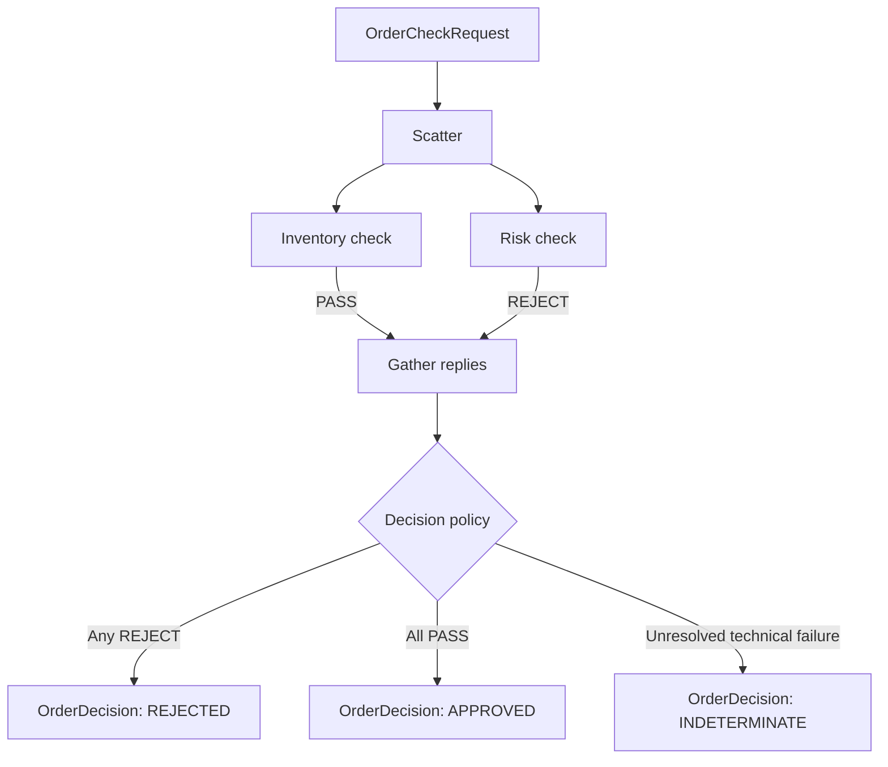
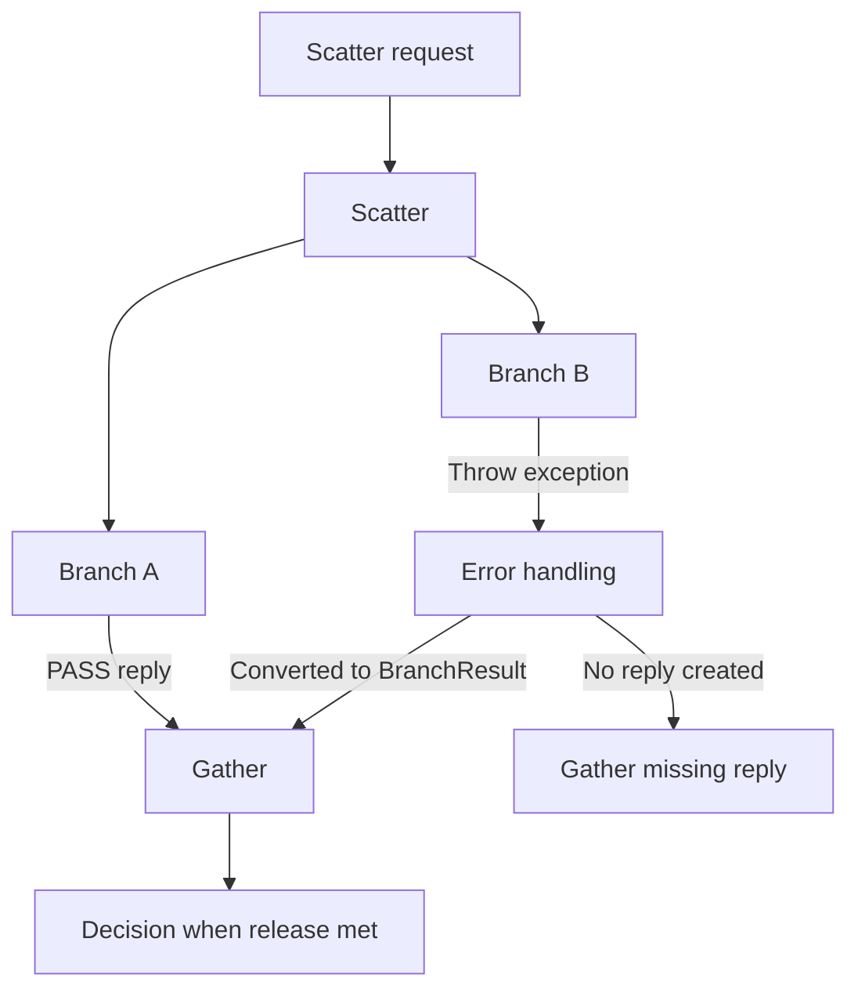
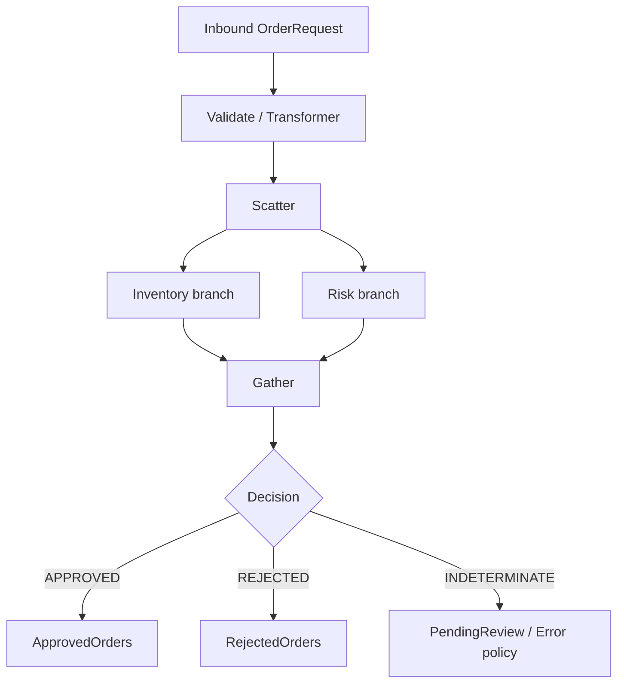

# Failing Branches and Succeeding Branches in Scatter–Gather

In an order-processing system, accepting an order may require running two checks concurrently: **inventory** and **transaction risk**. An order might have enough inventory yet fail the risk check; one check might succeed while the other service times out. If the application only knows how to wait for two successful results, it will fail to distinguish **a valid rejection decision** from **a technically failing branch that could not send a reply**.

**Scatter–Gather** is an Enterprise Integration Patterns (EIP) pattern with two halves: **Scatter** distributes a request to multiple processing branches; **Gather** collects related replies to build a combined result. When some branches succeed and others error, the challenge is not merely choosing channels, but **designing reply contracts, correlation, release strategies, timeouts, and final decision policies**.

This lesson belongs to the **Scatter gather** chapter of the `SPRING_INTEGRATION_PATTERN` module. The module aims to teach and practice Router, Filter, Transformer, Splitter, Aggregator, Gateway, retry, error channel, and correlation in Spring Integration, alongside testing and observing each processing branch. The content focuses on **cases where branches produce mixed outcomes**, including success, business rejection, technical failure, and missing responses.

## 1. One request, multiple branches, multiple reply possibilities

Suppose a request:

```json
{
  "requestId": "req-1001",
  "orderId": "ORD-1001",
  "inventoryAvailable": true,
  "riskAllowed": false
}
```

Two processing branches are assigned:

| Branch | Business question | Possible responses |
| --- | --- | --- |
| `inventoryChecks` | Is enough stock available? | `PASS`, `REJECT`, warehouse query error, timeout |
| `riskChecks` | Is the transaction permitted? | `PASS`, `REJECT`, risk service error, timeout |

In the example, inventory returns `PASS` and risk returns `REJECT`. These are **two valid replies** from a protocol standpoint: both branches responded. However, the final business decision must be `REJECTED`.



**There is no default rule that Gather automatically throws an exception upon receiving `REJECT`.** Gather only understands reply Messages and group metadata; how those outcomes translate into a business decision is defined by the application.

## 2. Distinguishing four situations often lumped together as "errors"

A good design needs clear terminology:

| Situation | Normal reply present? | Example | How to interpret |
| --- | --- | --- | --- |
| **Successful branch** | Yes | `PASS` | Checked and approved |
| **Business rejection branch** | Yes | `REJECT/OUT_OF_STOCK` | Checked and decided not to approve |
| **Branch returning structured technical error** | Yes, if app converts error to payload | `TECHNICAL_FAILURE/LOOKUP_TIMEOUT` | Could not determine business outcome |
| **Branch throwing exception or returning no reply** | No normal reply | HTTP timeout, handler throws exception | Gather may lack a part; needs error/timeout policy |

The last two rows are not equivalent. **A Message carrying `TECHNICAL_FAILURE` is still an arrived reply** if the flow intentionally creates it. Conversely, an exception not converted into a result can halt the processing path or prevent Gather from receiving its expected reply count.

### 2.1. `REJECT` is not necessarily an exception

Out of stock is a normal business condition: inventory genuinely replied that it cannot fulfill. If a branch throws an exception for every out-of-stock case, the system may retry pointlessly and mislead Gather into treating a rejection decision as a technical outage.

### 2.2. `TECHNICAL_FAILURE` does not mean `REJECT`

A non-responding risk service **does not prove** the order is high risk. Depending on the contract, the final decision could be `INDETERMINATE`, `PENDING_REVIEW`, or an error returned to the caller. Never silently coerce it to `REJECT` or `PASS` unless a business policy explicitly allows it.

### 2.3. Exceptions do not automatically become replies

A `@ServiceActivator` throwing an exception does not automatically send a `BranchResult` with status `TECHNICAL_FAILURE` back to Gather. Exception propagation and `ErrorMessage` routing depend on synchronous/asynchronous boundaries, error channels, handlers, and adapters. If Gather must receive **a result for every branch**, converting errors into results must be designed intentionally.

## 3. Scatter, Gather, and mandatory contracts

A Scatter–Gather has at least three contracts:

1. **Scatter contract:** which branches must be called, how many replies are expected, and are any branches optional?
2. **Branch reply contract:** what data type must each branch return, including on rejection or inability to check?
3. **Gather contract:** when are release criteria met, and how is the final decision constructed?

Example with two mandatory branches:

```text
expectedBranches = {INVENTORY, RISK}

received:
  INVENTORY -> PASS
  RISK      -> REJECT

release = results present for both INVENTORY and RISK
decision = REJECTED
```

That represents **both branches replying completely**, even though not both branches succeeded in business terms.

### 3.1. Scatter does not always execute truly in parallel

Scatter distributes Messages to multiple recipients; **whether recipients run in parallel depends on channels and executors**. With synchronous `DirectChannel` instances, both branches may run sequentially on the sending thread. If you need latency close to the slowest branch rather than the sum of both branches, design bounded asynchronous execution with correlation and timeouts.

### 3.2. Gather is not Publish–Subscribe

Publish–Subscribe delivers Messages to subscribers, whereas Gather must **collect replies**, distinguish replies per request, and decide when completion happens. A fire-and-forget fan-out does not turn into Scatter–Gather unless downstream has a path returning results to the collection point.

## 4. Designing status-bearing reply payloads

For Gather to handle both `PASS` and `REJECT` uniformly, use a **unified reply type**. Each branch includes `branch`, status, and reason code:

```json
{
  "requestId": "req-1001",
  "orderId": "ORD-1001",
  "branch": "RISK",
  "status": "REJECT",
  "reasonCode": "RISK_POLICY_DENIED"
}
```

We define:

| Property | Purpose |
| --- | --- |
| `requestId` | Identifies one check invocation, distinct across independent retries |
| `orderId` | Business key linking to the order |
| `branch` | Indicates the producing branch: `INVENTORY` or `RISK` |
| `status` | `PASS`, `REJECT`, or `TECHNICAL_FAILURE` |
| `reasonCode` | Standardized code independent of internal exception messages |

A unified reply type keeps the Aggregator from guessing status based on exception class, string text, or output channel name.

### 4.1. Reason codes must be stable

Example:

```text
PASS:
  OK

REJECT:
  OUT_OF_STOCK
  RISK_POLICY_DENIED

TECHNICAL_FAILURE:
  INVENTORY_UNAVAILABLE
  RISK_TIMEOUT
```

Do not put stack traces, internal URLs, access tokens, or raw exceptions into business replies. Reason codes are a contract with consumers; logs keyed by correlation ID should hold technical diagnostic details.

## 5. Rules for combining succeeding and failing branches

With two mandatory branches, a simple decision matrix:

| Inventory | Risk | Final outcome | Reason |
| --- | --- | --- | --- |
| `PASS` | `PASS` | `APPROVED` | Both checks passed |
| `PASS` | `REJECT` | `REJECTED` | Risk branch rejected |
| `REJECT` | `PASS` | `REJECTED` | Insufficient stock |
| `REJECT` | `REJECT` | `REJECTED` | Both rejected |
| `PASS` | `TECHNICAL_FAILURE` | `INDETERMINATE` | Risk outcome unknown |
| `TECHNICAL_FAILURE` | `PASS` | `INDETERMINATE` | Stock status unknown |
| `REJECT` | `TECHNICAL_FAILURE` | `INDETERMINATE` in example policy | Prioritizes reporting missing technical info |
| `TECHNICAL_FAILURE` | `TECHNICAL_FAILURE` | `INDETERMINATE` | Insufficient data to decide |

Here the policy specifies **`TECHNICAL_FAILURE` takes higher precedence than `REJECT`**, avoiding marking a request as finally rejected when one branch has not responded reliably. This is **only the example's policy**. An application may choose `REJECT` as final whenever one branch rejects; explain and test that policy explicitly.

Questions to answer before coding:

- Is deciding with **incomplete replies** acceptable?
- Does `REJECT` permit **short-circuiting**, or is the remaining result still needed for audit?
- If technical errors become `TECHNICAL_FAILURE`, should retries run before emitting that result?
- Is `INDETERMINATE` a final result or a temporary state updated later?
- Does the caller require **one synchronous reply** or accept an async workflow with a request ID?

**Do not confuse release condition with decision policy**: release says *when enough data exists to evaluate*, while policy says *how to evaluate*.

## 6. Java model for two branches and the final decision

Java 17+ example using records and enums:

```java
package example.integration;

import java.util.List;

public final class ScatterGatherModel {

    private ScatterGatherModel() {
    }

    public enum Branch {
        INVENTORY, RISK
    }

    public enum OutcomeStatus {
        PASS, REJECT, TECHNICAL_FAILURE
    }

    public enum DecisionStatus {
        APPROVED, REJECTED, INDETERMINATE
    }

    public record CheckRequest(
            String requestId,
            String orderId,
            boolean inventoryAvailable,
            boolean riskAllowed) {
    }

    public record BranchResult(
            String requestId,
            String orderId,
            Branch branch,
            OutcomeStatus status,
            String reasonCode) {
    }

    public record GatherDecision(
            String requestId,
            String orderId,
            DecisionStatus status,
            List<BranchResult> branchResults) {
    }
}
```

A `BranchResult` must state **which request it belongs to and which branch produced it**. Never return just a bare boolean, because Gather would be unable to tell `INVENTORY` from `RISK`, especially under retries or when adding new branches.

In a real build, add validation for `requestId`, `branch`, `reasonCode`, and `null` values; validation checks are shown in the aggregation section to keep the lesson structure clear.

## 7. Spring Integration Java DSL: two branches always return result payloads

In the main example, both branches return a `BranchResult` for every **valid business outcome**. There are no network errors and no deliberate exceptions. This scenario proves that a `REJECT` branch can still be collected normally by Gather.

### 7.1. Configuration with Scatter–Gather

```java
package example.integration;

import java.util.Comparator;
import java.util.List;
import java.util.Set;
import java.util.stream.Collectors;

import org.springframework.context.annotation.Bean;
import org.springframework.context.annotation.Configuration;
import org.springframework.integration.annotation.ServiceActivator;
import org.springframework.integration.channel.DirectChannel;
import org.springframework.integration.channel.QueueChannel;
import org.springframework.integration.config.EnableIntegration;
import org.springframework.integration.dsl.IntegrationFlow;
import org.springframework.integration.store.MessageGroup;
import org.springframework.messaging.MessageChannel;
import org.springframework.messaging.PollableChannel;

import example.integration.ScatterGatherModel.*;

@Configuration
@EnableIntegration
public class MixedOutcomeScatterGatherConfiguration {

    @Bean
    public MessageChannel checkRequests() {
        return new DirectChannel();
    }

    @Bean
    public MessageChannel inventoryChecks() {
        return new DirectChannel();
    }

    @Bean
    public MessageChannel riskChecks() {
        return new DirectChannel();
    }

    @Bean
    public PollableChannel checkDecisions() {
        return new QueueChannel(20);
    }

    @Bean
    public IntegrationFlow checksScatterGatherFlow() {
        return IntegrationFlow.from("checkRequests")
                .scatterGather(
                        scatter -> scatter
                                .recipient("inventoryChecks")
                                .recipient("riskChecks"),
                        gather -> gather
                                .releaseStrategy(group -> group.size() == 2)
                                .outputProcessor(
                                        MixedOutcomeScatterGatherConfiguration
                                                ::toDecision))
                .channel("checkDecisions")
                .get();
    }

    @ServiceActivator(inputChannel = "inventoryChecks")
    public BranchResult inventory(CheckRequest request) {
        return new BranchResult(
                request.requestId(),
                request.orderId(),
                Branch.INVENTORY,
                request.inventoryAvailable()
                        ? OutcomeStatus.PASS
                        : OutcomeStatus.REJECT,
                request.inventoryAvailable() ? "OK" : "OUT_OF_STOCK");
    }

    @ServiceActivator(inputChannel = "riskChecks")
    public BranchResult risk(CheckRequest request) {
        return new BranchResult(
                request.requestId(),
                request.orderId(),
                Branch.RISK,
                request.riskAllowed()
                        ? OutcomeStatus.PASS
                        : OutcomeStatus.REJECT,
                request.riskAllowed() ? "OK" : "RISK_POLICY_DENIED");
    }

    private static GatherDecision toDecision(MessageGroup group) {
        List<BranchResult> results = group.getMessages().stream()
                .map(message -> (BranchResult) message.getPayload())
                .sorted(Comparator.comparing(
                        result -> result.branch().ordinal()))
                .toList();

        if (results.size() != 2) {
            throw new IllegalStateException("Expected two branch results");
        }

        Set<Branch> branches = results.stream()
                .map(BranchResult::branch)
                .collect(Collectors.toSet());
        if (!branches.equals(Set.of(Branch.INVENTORY, Branch.RISK))) {
            throw new IllegalStateException(
                    "Missing or duplicate branch response");
        }

        String requestId = results.get(0).requestId();
        String orderId = results.get(0).orderId();
        boolean differentRequest = results.stream()
                .anyMatch(result ->
                        !requestId.equals(result.requestId())
                        || !orderId.equals(result.orderId()));
        if (differentRequest) {
            throw new IllegalStateException(
                    "Replies from different requests were mixed");
        }

        DecisionStatus decision;
        if (results.stream().anyMatch(result ->
                result.status() == OutcomeStatus.TECHNICAL_FAILURE)) {
            decision = DecisionStatus.INDETERMINATE;
        } else if (results.stream().anyMatch(result ->
                result.status() == OutcomeStatus.REJECT)) {
            decision = DecisionStatus.REJECTED;
        } else {
            decision = DecisionStatus.APPROVED;
        }

        return new GatherDecision(
                requestId, orderId, decision, List.copyOf(results));
    }
}
```

**Scope of the example:** the config uses two `DirectChannel` beans and one output `QueueChannel` in the same JVM; branches return data immediately. This illustrates the semantics of `scatterGather`, not a production system with timeouts, retries, durable state storage, and networked services.

When integrating, verify the Java DSL overloads `scatterGather(...)`, `recipient(...)`, and Aggregator configuration against your project's **actual Spring Integration version**. This lesson did not run a build, so it does not claim the code was compiled and tested in a repository.

### 7.2. Difference between two branches and a regular Router

If using a regular Router to pick **only one** of `inventoryChecks` and `riskChecks`, we would not collect two results for Gather. Scatter in the example sends one request to **both recipients**, and Gather waits for two replies.

### 7.3. Why does `REJECT` not cause Gather to lose a Message?

The `risk(...)` method **returns a `BranchResult`** even when `riskAllowed=false`. The reply travels back to the flow's gather mechanism. If the method replaced `return` with `throw` on business rejection, we would change the contract: from a valid reply to an execution failure, and Gather could end up missing a result.

### 7.4. Why check the branch set instead of just count?

`group.size() == 2` does not prove both `INVENTORY` and `RISK` arrived. Two duplicate `INVENTORY` replies could give the group two Messages while missing risk. The check in `toDecision` catches structural errors before returning a decision. Production should also include deduplication or a release strategy checking **the mandatory branch set**, not just count.

### 7.5. When Gather must preserve order

Replies can arrive out of scatter order. For example, sorting `branchResults` by `Branch.ordinal()` stabilizes output for tests and serialization. This **does not force branches to run sequentially**; it only defines presentation order of the results.

## 8. JUnit 5: testing succeeding and rejecting branches

Integration tests should verify **together**: branches were invoked, Gather received all replies, the final decision is right, and two request runs are not mixed.

### 8.1. Both branches PASS

```java
package example.integration;

import static org.junit.jupiter.api.Assertions.*;

import org.junit.jupiter.api.Test;
import org.springframework.context.annotation.AnnotationConfigApplicationContext;
import org.springframework.messaging.Message;
import org.springframework.messaging.MessageChannel;
import org.springframework.messaging.PollableChannel;
import org.springframework.messaging.support.MessageBuilder;

import example.integration.ScatterGatherModel.*;

class MixedOutcomeScatterGatherTest {

    @Test
    void allSuccessfulBranchesProduceApprovedDecision() {
        try (var context = new AnnotationConfigApplicationContext(
                MixedOutcomeScatterGatherConfiguration.class)) {
            MessageChannel input =
                    context.getBean("checkRequests", MessageChannel.class);
            PollableChannel output =
                    context.getBean("checkDecisions", PollableChannel.class);

            CheckRequest request = new CheckRequest(
                    "req-1001", "ORD-1001", true, true);

            assertTrue(input.send(MessageBuilder.withPayload(request)
                    .setHeader("eventId", "evt-1001")
                    .build()));

            Message<?> reply = output.receive(0);
            assertNotNull(reply);
            GatherDecision decision =
                    (GatherDecision) reply.getPayload();

            assertEquals("req-1001", decision.requestId());
            assertEquals(DecisionStatus.APPROVED, decision.status());
            assertEquals(2, decision.branchResults().size());
            assertTrue(decision.branchResults().stream()
                    .allMatch(result ->
                            result.status() == OutcomeStatus.PASS));
            assertNull(output.receive(0));
        }
    }

    @Test
    void successPlusBusinessRejectionProducesRejectedDecision() {
        try (var context = new AnnotationConfigApplicationContext(
                MixedOutcomeScatterGatherConfiguration.class)) {
            MessageChannel input =
                    context.getBean("checkRequests", MessageChannel.class);
            PollableChannel output =
                    context.getBean("checkDecisions", PollableChannel.class);

            CheckRequest request = new CheckRequest(
                    "req-1002", "ORD-1002", true, false);
            assertTrue(input.send(MessageBuilder.withPayload(request)
                    .build()));

            Message<?> reply = output.receive(0);
            assertNotNull(reply);
            GatherDecision decision =
                    (GatherDecision) reply.getPayload();

            assertEquals(DecisionStatus.REJECTED, decision.status());
            assertEquals(2, decision.branchResults().size());
            assertTrue(decision.branchResults().stream()
                    .anyMatch(result ->
                            result.branch() == Branch.INVENTORY
                            && result.status() == OutcomeStatus.PASS));
            assertTrue(decision.branchResults().stream()
                    .anyMatch(result ->
                            result.branch() == Branch.RISK
                            && result.status() == OutcomeStatus.REJECT
                            && "RISK_POLICY_DENIED".equals(
                                    result.reasonCode())));
            assertNull(output.receive(0));
        }
    }
}
```

The second test is especially important: one branch `PASS`, one branch `REJECT`, yet **Gather still collects both replies and emits `REJECTED`**, without hanging or routing to an error channel.

In a synchronous setup with `DirectChannel` and an uncontested `QueueChannel`, `receive(0)` can read right after `send()`. When switching to executors, pollers, or brokers, wait with finite timeouts and correlate by request ID.

### 8.2. Two different requests must not mix

Another test should send:

```text
req-A: INVENTORY=PASS, RISK=REJECT
req-B: INVENTORY=PASS, RISK=PASS
```

The right expectation is one `REJECTED` for `req-A`, one `APPROVED` for `req-B`, each decision having two `BranchResult` items sharing **the same request ID**. Under async processing, replies may arrive in reverse send order. Tests should map outputs by `requestId` rather than assuming the first result always belongs to req-A.

## 9. What happens when a branch throws an exception?

Consider the inventory-check handler:

```java
@ServiceActivator(inputChannel = "inventoryChecks")
public BranchResult inventory(CheckRequest request) {
    // Fault simulation snippet: no BranchResult is returned.
    throw new IllegalStateException("Inventory dependency unavailable");
}
```

This is a **replacement snippet for failure analysis**; do not register it concurrently with `inventory(...)` from section 7 on the same input channel.

With a synchronous `DirectChannel`, the exception may propagate back to scatter/gateway/caller. Depending on how the framework dispatches to multiple recipients and error configuration, scattering may stop before remaining branches run or before Gather completes. Never assume all branches ran.

With asynchronous branches, the initial `send()` may succeed because the Message was enqueued, yet the handler fails later on another thread. Without a mechanism to produce a failure reply or matching error flow, Gather **does not receive all replies** and may wait until timeout.

### 9.1. An exception is a processing-path event, not automatically a result Message



If the intent is that **every branch must return a structured result**, the failing branch should be converted into `TECHNICAL_FAILURE` per a specific policy. That does not mean swallowing all errors: severe failures should fail the flow promptly instead of returning a bogus result.

### 9.2. `errorChannel` is different from Gather's reply channel

`errorChannel` typically receives an `ErrorMessage` when an endpoint/adapter is configured to publish exceptions via messaging. It is not by default one of the **normal replies** the Aggregator is waiting for.

| Path | Payload | Handled by |
| --- | --- | --- |
| Success reply | `BranchResult(PASS)` | Gather |
| Business rejection reply | `BranchResult(REJECT)` | Gather |
| Structured failure reply | `BranchResult(TECHNICAL_FAILURE)` | Gather per policy |
| ErrorMessage when handler throws | Exception with context | Configured error flow |
| No reply | No payload to collect | Timeout/expiration/failure policy |

To turn an `ErrorMessage` into a reply for Gather, preserve **request/branch correlation and reply destination**, while ensuring no duplicate reply is emitted for a branch that already succeeded. Never blindly forward every `ErrorMessage` onto a shared gather channel without verifying which group it belongs to.

## 10. Converting classified technical errors into branch results

One approach is **separating the query client from the branch adapter**. The adapter calls the client, retries per policy, and returns `BranchResult` instead of letting a handled error drop the reply.

Abbreviated Java example:

```java
// Example branch logic; do not register on the same inventory endpoint as section 7.
public BranchResult checkInventorySafely(
        CheckRequest request, InventoryClient client) {

    try {
        boolean available = client.isAvailable(request.orderId());
        return new BranchResult(
                request.requestId(), request.orderId(),
                Branch.INVENTORY,
                available ? OutcomeStatus.PASS : OutcomeStatus.REJECT,
                available ? "OK" : "OUT_OF_STOCK");
    } catch (InventoryTimeoutException timeout) {
        // Assumes bounded retries have finished or are disallowed.
        return new BranchResult(
                request.requestId(), request.orderId(),
                Branch.INVENTORY,
                OutcomeStatus.TECHNICAL_FAILURE,
                "INVENTORY_UNAVAILABLE");
    }
}
```

`InventoryClient` and `InventoryTimeoutException` are **illustrative domain types**, not defined in the main config. This snippet explains error classification principles, not standalone compilable source.

### 10.1. Never catch all exceptions and default to `PASS`

Do not write:

```java
try {
    return inventoryClient.check(orderId);
} catch (Exception ignored) {
    return true; // WRONG: infrastructure failure turned into approval
}
```

Such a `PASS` fallback turns an unknown state into an approval decision. If a non-critical system requires **fail-open**, document the policy and monitor it separately; it is never a safe default for payments or risk checks.

### 10.2. Separating transient errors from unrecoverable errors

| Error | Handling approach |
| --- | --- |
| Out of stock | `REJECT`, do not retry hoping stock magically appears |
| Risk check failed | `REJECT`, preserve reason code |
| Transient HTTP timeout | Bounded retry with backoff if safe |
| Extended dependency outage | `TECHNICAL_FAILURE` or fail whole flow per SLA |
| Payload missing required fields | Validation error; never interpret as `PASS` |
| Unexpected code/null pointer bug | Observe via error flow; do not mask as normal decision |

For branches with side effects, retries can repeat the action. Per-branch idempotency is required before enabling retries.

## 11. Release strategy with failing and succeeding branches

A common question: **Should we wait for all branches even when one branch already returned `REJECT`?**

There is no single answer for every case. Separate **release condition** from **decision rule**:

| Option | Release condition | Best when | Risk |
| --- | --- | --- | --- |
| **All replies** | All mandatory branches arrived | Audit or complete summary required | One silent branch delays waiting |
| **First decisive result** | One branch suffices to conclude | A single `REJECT` is a valid final outcome | Late replies, side effects in other branches |
| **Quorum** | Threshold of count/outcomes met | Voting or rule-based redundancy | Must understand meaning of error votes |
| **Deadline partial** | Wait expired, emit partial result | Tight SLA and partial results supported | Cannot equate missing reply with `PASS` |

The example in section 7 picks **all replies** with two mandatory branches. It is simple and clearly shows the `PASS + REJECT` case.

### 11.1. Why not use `size==2` in every case?

If the same branch emits two Messages due to retry or misconfiguration, the Group can hold two Messages yet still miss one of the two required branches. A stronger release strategy checks the reply set:

```java
// Illustrative logic: release only when both branches are present.
Set<Branch> expected = Set.of(Branch.INVENTORY, Branch.RISK);
Set<Branch> received = group.getMessages().stream()
        .map(message -> (BranchResult) message.getPayload())
        .map(BranchResult::branch)
        .collect(Collectors.toSet());
boolean ready = received.containsAll(expected);
```

This is a logic illustration requiring proper imports from section 6. Even with branch-set checks, **deduplicate before/upon storing in the group** to prevent memory growth or repeated releases.

### 11.2. Short-circuiting needs its own policy

Suppose inventory returns `REJECT` and the business decides risk evaluation is no longer needed. To stop early:

- Should the in-flight risk branch be allowed to finish naturally?
- If a branch already created side effects, must they be undone?
- Are late replies ignored or audited?
- Can the Gateway receive two replies for one request?
- How do correlation and the store manage the closed group?

Never assume `releaseStrategy` returning `true` **automatically cancels all running branches**. Scatter may have dispatched work before Gather decides to emit the result.

## 12. When one branch never replies: timeouts and partial results

Example:

```text
t0       scatter request R
t0+20ms  inventory -> PASS
t0+...   risk -> no reply
```

If Gather waits for both replies while risk never returns, the request can stall until timeout. Relevant timeouts include:

- Timeout sending the request to the branch.
- HTTP/DB client timeout inside the branch.
- Gather wait timeout for replies.
- Gateway or API caller timeout.
- Group timeout/expiration if using stateful Aggregator storage.

These timeouts **are not synonymous**. A Gateway timing out earlier than Gather can cause Gather to emit a result after the caller stopped waiting; handle late replies explicitly.

### 12.1. Defining an overall deadline

An SLA example:

```text
Gateway/request deadline:       3.0 s
Inventory client timeout:       1.0 s
Risk client timeout:            1.5 s
Gather decision deadline:       2.5 s
```

These numbers are **illustrative only**, not Spring Integration defaults. Configuration must ensure layered timeouts align, leaving budget for transport, error handling, and replying to the client.

### 12.2. Partial results can be valid yet must disclose what is missing

If the deadline arrives with only `INVENTORY=PASS`, a payload could be:

```json
{
  "requestId": "req-1001",
  "decision": "INDETERMINATE",
  "receivedBranches": ["INVENTORY"],
  "missingBranches": ["RISK"],
  "timedOut": true
}
```

This is an **application response contract**, not default JSON from Scatter–Gather. A partial result is **not** "both branches PASSED". If `APPROVED` is needed, full policy evidence is required.

### 12.3. Group expiration and late results

If Gather/Aggregator closed a group after the deadline, late replies need a policy:

1. Ignore while recording logs/audits.
2. Save for investigation.
3. Update a versioned business state if permitted.
4. Emit a state-adjustment event per async contract.

Never let a late reply create **a second final decision** for the same request if consumers expect only one final result.

## 13. Correlation: which request does this reply belong to?

When two requests A and B run concurrently:

```text
A: inventory(A) -> PASS
B: risk(B)      -> REJECT
A: risk(A)      -> PASS
B: inventory(B) -> PASS
```

If simply grouping **the two closest replies**, results from A and B will mix. Gather must keep **correlation groups** accurate per scatter run.

| ID | Meaning | Use as group key? |
| --- | --- | --- |
| `requestId` | Identifies one check run | Suitable if unique and stable across all replies |
| `orderId` | Identifies the order | Insufficient if one order has multiple checks |
| `eventId` | Identifies the event | Suitable per event/attempt scope |
| Per-reply Message ID | Identifies each Message | No, each reply usually differs |
| Framework `correlationId` | Group metadata | Use per channel/adapter contract |

Spring Integration Scatter–Gather manages request-reply/correlation within the flow; however, **never assume HTTP, Kafka, or AMQP adapters preserve all internal headers untouched**. If replies cross external systems, define serializable correlation IDs and reply destinations.

### 13.1. Do not test payloads alone

A concurrency test should assert:

- Each `GatherDecision` carries the right `requestId`.
- Both `BranchResult` entries inside share the same `requestId` and `orderId`.
- No reply from another request enters the group.
- Every mandatory branch appears exactly once.
- Duplicate and late replies do not trigger bad releases.

## 14. Error channel, retry, and per-branch idempotency

### 14.1. Where do ErrorMessages go?

When an async branch throws an exception, error handling can route an `ErrorMessage` to a configured error channel. An error flow can:

- Log and record metrics.
- Retry or dead-letter.
- Map a known error to `BranchResult(TECHNICAL_FAILURE)`.
- Report an overall error to a coordinator/Gateway.

However, **having an error channel does not automatically give Gather all its replies**. You need a link connecting the error to the specific request/branch; never send raw `ErrorMessage` payloads of a different schema straight into the gather channel.

### 14.2. Retries must bound attempt counts

Example:

```text
risk check:
  attempt 1 -> HTTP timeout
  attempt 2 -> HTTP timeout
  attempt 3 -> success
```

If every intermediate timeout is sent as `TECHNICAL_FAILURE` to Gather, one branch can **emit multiple replies** or release Gather prematurely before retries finish. Emit **only one final branch outcome** per chosen policy, after retries complete or failure is finalized.

### 14.3. Idempotency key by request and branch

Example:

```text
requestId = req-1001
branch = INVENTORY

idempotencyKey = req-1001:INVENTORY
```

If a branch permits multiple valid checks, append version or branch-attempt; never confuse a retry of the same check with a brand-new check.

Branch idempotency **does not replace** deduplication in Gather. A reply Message can be redelivered by a broker even if the branch executed business logic only once.

## 15. Routing through Transformer, Filter, Router, Gateway, and Aggregator

Scatter–Gather often lives inside a flow with many EIPs:



### 15.1. Filters can drop replies

If the `riskChecks` branch has a Filter and non-matching Messages are dropped **without a result-producing branch**, Gather can end up missing a reply. If Filter rejection is a business outcome, convert it to `BranchResult(REJECT, ...)` or route it to an equivalent result-returning flow.

### 15.2. Transformers must preserve correlation

If a Transformer constructs a new Message and drops required reply/correlation metadata, Gather cannot tell which group the response belongs to. For replies over external transports, map to serializable correlation fields rather than relying on Java objects in headers.

### 15.3. Routers changing recipient count

A dynamic Recipient List Router may pick one or more branches based on content. When the recipient set changes, **the expected reply count may also change**. Do not hardcode `releaseStrategy(size==2)` if some requests only dispatch to one branch; reflect the branches actually selected and mandatory replies.

### 15.4. Gateway waiting for one combined decision

A Gateway typically expects one final reply. If Gather lacks enough results, have a deadline/error policy so the Gateway does not hang indefinitely. If processing outlasts an HTTP request lifecycle, return `ACCEPTED` with `requestId` and let clients poll status or receive completion events.

## 16. Multi-instance processing and durable group state

Section 7 runs in one JVM with synchronous branches and no long-lived message holds. In distributed processing, Gather may hold a group while a branch responds slowly; `MessageGroupStore` choice then matters.

| Requirement | Approach |
| --- | --- |
| Short waits in one JVM | In-memory may fit SLA |
| Long-lived groups surviving restarts | Compatible persistent `MessageGroupStore` |
| Multiple instances receiving replies for one request | Shared store/coordination and proper locking |
| Broker can redeliver replies | Deduplicate by request/branch/result version |
| Produce decision and durable output | Transactions/outbox, idempotent consumers |
| Replies arriving after group closure | Completion registry and late-arrival policy |

A persistent store **does not automatically make** consuming from a broker, updating a group, and publishing decisions to another broker atomic. If final outcomes must never be lost, design transaction boundaries and durable outputs explicitly.

### 16.1. Crash between two replies

```text
t1 Inventory(A) -> PASS, persisted in group state
t2 Application restart
t3 Risk(A) -> REJECT
```

If the store is RAM-only, the `INVENTORY` reply is lost. With a durable store and proper commits, Gather can resume pending group data after restart, **provided** correlation, serialization, locking, and deadlines are designed properly.

## 17. Testing technical errors, timeouts, and duplicates

Beyond the two PASS/REJECT tests, build a negative test suite:

| Test | How to construct scenario | Required assertion |
| --- | --- | --- |
| `PASS + PASS` | Both clients return valid PASS | `APPROVED`, both branches present |
| `PASS + REJECT` | Risk rejects | `REJECTED`, still has both replies |
| `REJECT + PASS` | Out of stock | `REJECTED`, reason matches branch |
| `PASS + TECHNICAL_FAILURE` | Branch returns structured error | `INDETERMINATE` per policy |
| Synchronous branch throw | Handler deliberately throws exception | Error propagates per contract; no fake Gather reply |
| Async branch timeout | No reply returned | Timeout/partial/error policy triggers |
| Duplicate reply | Resend same branch result | No fake group completion or double release |
| Wrong-request reply | Send different correlation | No cross-request mixing |
| Late reply | Result arrives past deadline | Handled per late-arrival policy; no second final decision |
| Branch dropped by Filter | Filter sends no reply | Missing branch detected; no false approval |
| Router picks subset | Only one valid branch selected | Gather tracks exact expected branch count |
| Application restart | Stop between two replies | State survives if persistent store is contracted |

### 17.1. Testing policy separately from infrastructure

Extract the decision from `List<BranchResult>` into a pure function, then unit test the entire section 5 matrix. Testing policy independently avoids spinning up a Spring Context for every combination.

Pseudo-JUnit:

```java
// Uses pure summarize(...) extracted from toDecision(...).
assertEquals(
        DecisionStatus.INDETERMINATE,
        summarize(List.of(
                result(Branch.INVENTORY, OutcomeStatus.PASS),
                result(Branch.RISK, OutcomeStatus.TECHNICAL_FAILURE))));
```

This is a **unit-test idea snippet**, not standalone runnable Java; `summarize` and `result` need definitions when refactoring policy into its own component. Integration tests are still required to verify scatter/gather/correlation wiring.

### 17.2. Testing throwing branches at the right layer

In synchronous flows, use `assertThrows(...)` around `input.send(...)`. In async flows, attach an error consumer/spy and await an `ErrorMessage` with a timeout; `send()` may succeed before the error occurs.

Never hardcode an assertion that **every exception always occurs on the `send()` calling thread** or always lands on the default error channel.

## 18. Observability: which branch drove the final decision?

Operational logs should reveal:

- `requestId`, `orderId`, request type.
- Expected branch list and branches that replied.
- Each branch's outcome plus `reasonCode`.
- Whether retries, timeouts, duplicates, or late arrivals happened.
- Which release condition fired Gather and what the final decision was.

Structured log example:

```json
{
  "stage": "order-scatter-gather",
  "requestId": "req-1002",
  "orderId": "ORD-1002",
  "expectedBranches": ["INVENTORY", "RISK"],
  "receivedBranches": ["INVENTORY", "RISK"],
  "branchOutcomes": {
    "INVENTORY": "PASS",
    "RISK": "REJECT"
  },
  "decision": "REJECTED",
  "reasonCodes": ["RISK_POLICY_DENIED"],
  "timedOut": false
}
```

This is an **application-defined schema**, not default logs auto-generated by Spring Integration. Never write sensitive payloads, exception stack traces, or unnecessary customer data to general logs.

| Suggested metric | Purpose |
| --- | --- |
| `scatter_gather.requests` | Requests started |
| `scatter_gather.branch.pass` | Branches returning PASS |
| `scatter_gather.branch.reject` | Branches returning REJECT |
| `scatter_gather.branch.technical_failure` | Branches returning structured error |
| `scatter_gather.branch.no_reply` | Branches failing to reply by deadline |
| `scatter_gather.gather.completed` | Groups released |
| `scatter_gather.gather.timeout` | Groups expired |
| `scatter_gather.gather.pending` | Waiting groups |
| `scatter_gather.branch.duplicate` | Duplicate replies by request/branch |
| `scatter_gather.duration` | Duration from scatter to decision |

Metric names are **instrumentation suggestions**, not a guaranteed built-in Micrometer/Actuator catalog. Avoid high-cardinality metric tags like `requestId` or `orderId`; keep them in access-controlled logs and traces.

## 19. Common design mistakes

| Symptom | Cause | Mitigation |
| --- | --- | --- |
| One REJECT branch fails the whole flow with exception | Using exceptions for business rejection | Return `BranchResult(REJECT)` when Gather should evaluate it |
| Gather lacks complete results | Branch threw exception or returned no reply | Error flow, timeouts, and structured error results |
| `PASS + REJECT` becomes APPROVED | Decision policy only counts replies | Inspect each branch's status |
| HTTP timeout treated as REJECT | Caught error and returned wrong business outcome | Separate TECHNICAL_FAILURE from REJECT |
| Two replies from same branch satisfy count | Size-based release without deduplication | Verify branch set and idempotency |
| Group A grabs B's reply | Missing correlation or broken header mapping | Preserve request ID and test interleaving |
| Handler returns `void` | No reply payload for Gather | Return explicit result or design separate one-way flow |
| Filter drops Message inside branch | Discard never returns to Gather | Rejected branch needs reply or timeout policy |
| Caller timed out before Gather released | Gateway deadline shorter than internal work | Align SLAs and handle late replies |
| Scatter assumed parallel yet runs slowly | Synchronous sequential `DirectChannel` | Configure executor/broker when parallelism is needed |
| Retries emit two replies | Emitting intermediate errors or duplicate delivery | Emit only final branch outcome; deduplicate |
| Decision lost on restart | In-memory output or non-durable group state | Persistent store/output, outbox when needed |
| ErrorMessage sent straight to Gather with wrong schema | Confusing error channel with reply channel | Controlled mapping preserving correlation |

## 20. Checklist for designing failing and succeeding branches

- **Define three clear statuses:** `PASS`, `REJECT`, `TECHNICAL_FAILURE`; never conflate technical failures with business rejections.
- **One branch, one final outcome:** when required by contract, each branch must return a reply with `branch`, `requestId`, and `reasonCode`.
- **Scatter targets the right recipients:** define mandatory and optional branch lists.
- **Contract-accurate release strategy:** never just count Messages if duplicates or dynamic recipients exist.
- **Independent decision policy:** define `PASS + REJECT`, `REJECT + FAILURE`, and every remaining case.
- **Real timeouts:** never wait forever when a branch sends no reply.
- **Never mistake error channel for replies:** turning exceptions into results requires explicit mapping and correlation.
- **Control retries and idempotency:** avoid emitting multiple replies from one branch.
- **Preserve correlation:** test interleaved concurrent requests, adapters, and late replies.
- **Do not assume parallel scatter:** verify actual channels/executors and load bounds.
- **Design Gateway responses:** return one final result or error/timeout per SLA.
- **Have partial and late-arrival policies:** never treat missing data as approved.
- **Test at two levels:** unit test the decision matrix; integration test the Scatter–Gather flow and error paths.
- **Per-branch observability:** metrics, logging, and tracing for replies, errors, timeouts, duplicates, and final decisions.

## 21. Practice exercise

A payment-approval application sends one request to three branches: `INVENTORY`, `FRAUD`, `CREDIT`. In one run:

```text
INVENTORY -> PASS after 100 ms
FRAUD     -> REJECT after 250 ms
CREDIT    -> no response within 2 s
```

Answer:

1. If policy mandates results from every branch, can Gather return `APPROVED` or `REJECTED` immediately at 250 ms?
2. If `FRAUD=REJECT` suffices for a final refusal, which policy lets the system release early? Did it cancel `CREDIT`?
3. If waiting the full 2 s, how should the result be represented when `CREDIT` is missing?
4. If `CREDIT` returns `PASS` at 3 s, past deadline, what prevents a second final decision?
5. Which correlation key should be used when a transaction is retried in a new attempt?

Under the **all replies** contract in this lesson, missing CREDIT is insufficient grounds for a final `APPROVED` decision and requires timeout/partial policies. If business rules allow a **decisive REJECT**, short-circuiting can be designed, without assuming already-started branches are cancelled. Late replies must follow the closed-group policy. A correlation key should identify **the request run/attempt**, not just a shared order or transaction ID across multiple review attempts.

---

**The key to Scatter–Gather is separating "a branch replied" from "a branch approved", and separating "a reply carrying error status" from "an exception leaving no reply".** When branches follow clear result contracts, Gather uses accurate correlation/release strategies, and the system enforces timeouts, retries, deduplication, and observability, a Spring Integration flow can make reliable decisions even across mixed succeeding, rejecting, and technically failing branches.
