# Comparing Scatter-Gather with Recipient List in Spring Integration

> **Chapter:** Scatter gather  
> **Lesson:** Comparing scatter-gather with recipient list  
> **Scope:** Enterprise Integration Patterns (EIP) in Spring Integration: routing, fan-out, multi-branch processing, collecting replies, correlation, release strategy, timeouts, retries, error channels, and testing.

## 1. The problem: is sending to multiple places the same as collecting results from multiple places?

A system receives quote requests for orders. Each request must query two suppliers, obtain price and delivery window, and select the option meeting business criteria.

Another requirement is that when an order is created, the system emits events to audit, notification, and metrics. All three receive the event, yet the publisher **does not need to wait** for an aggregated result.

Both problems share the trait of **one message sent to multiple recipients**. However, their completion goals differ:

- In audit/notification/metrics, what matters is **distributing the message** to the policy-matched recipient set.
- In quoting, what matters is **distributing the request and then collecting and aggregating replies** before returning a result.

That is the main difference between **Recipient List** and **Scatter-Gather**.

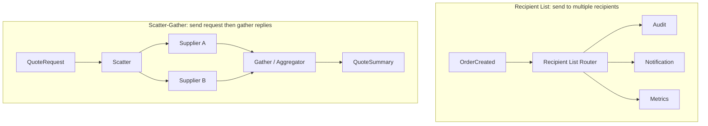

**Key takeaway right up front:** the two patterns **are not mutually exclusive**. A Recipient List Router can serve as **the scatter component** in Scatter-Gather. The differentiator is whether or not there is a **gather phase and completion contract** producing a combined reply.

### Learning objectives

After this lesson, you can:

1. Distinguish Recipient List, Scatter-Gather, and Publish-Subscribe Channel.
2. Choose the right pattern for one-way event broadcast vs. multi-branch request-reply.
3. Explain how Scatter-Gather combines scatterer, reply channel, correlation, and gatherer.
4. Design a release strategy aligned with the recipient set actually selected.
5. Configure Java DSL examples and write JUnit tests for fan-out and result gathering.
6. Analyze latency, timeouts, exceptions, retries, partial results, and idempotency.
7. Preserve metadata cleanly across Transformer, Router, Filter, Gateway, and adapters.
8. Avoid anti-patterns such as waiting for a fixed recipient count when the router selected only a subset.

## 2. What pattern is Recipient List?

**Recipient List** receives a message, determines a list of destinations, and sends the message to those destinations. The list can be static or depend on payload, headers, policies, and other conditions.

```text
Incoming Message
       |
       v
Recipient List Router
       |
       +-- Recipient A
       +-- Recipient B
       +-- Recipient C
```

In Spring Integration, a common implementation is `RecipientListRouter` or Java DSL `routeToRecipients(...)`.

Example applications:

- An order event is sent to Audit and Metrics.
- If the customer opted into notifications, the event also goes to Notification.
- If the order is high value, add Fraud Audit.
- The publisher does not necessarily receive a combined response from recipients.

### What does Recipient List decide?

It answers the question: **"Which destinations should this message be sent to?"**

Example:

```text
OrderCreated ORD-101
  → Audit
  → Metrics
  → Notification (if opted-in)

OrderCreated ORD-102
  → Audit
  → Metrics
  → Fraud Audit (if high value)
```

There is no default requirement that all recipients produce replies and have their results merged.

If a recipient merely writes an audit record and returns `void`, that fits a one-way Recipient List perfectly. Yet that exact same behavior would prevent a waiting Scatter-Gather from ever completing.

### Recipient List does not produce an aggregated result on its own

Recipient List can dispatch to three channels, and three handlers can process successfully. Still, the pattern itself does not define:

- A combined reply/result for the caller.
- How many replies to wait for before completing.
- How to combine multiple replies into one payload.
- Partial-response policy when one recipient fails.
- Where to store pending replies.

To gain those properties, you must add a gather/aggregation step — i.e., Scatter-Gather or an equivalent coordinating flow.

## 3. What pattern is Scatter-Gather?

**Scatter-Gather** is a two-phase cycle:

1. **Scatter:** sends a request to multiple handlers/recipients.
2. **Gather:** collects related replies, waits for completion criteria, and builds a combined result.

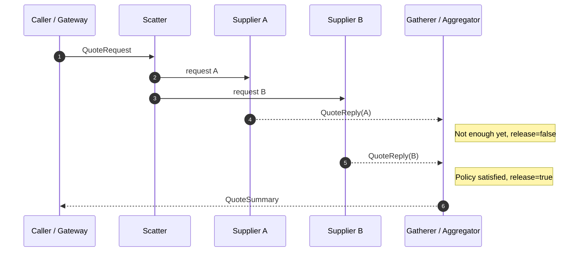

In Spring Integration, Scatter-Gather is an EIP with `ScatterGatherHandler`, coordinating a **scatterer** (e.g., `RecipientListRouter` or `PublishSubscribeChannel`) with a **gatherer** (usually an Aggregator).

The core idea: it is **one request, multiple contributions, then one result**, not merely copying messages.

### Main responsibilities

| Component | Responsibility | Required for valid Scatter-Gather? |
| --- | --- | --- |
| Scatterer | Selects and dispatches to branches | Yes |
| Recipient/worker | Processes request and produces reply | Yes, unless policy handles missing replies |
| Reply correlation | Binds replies to the right original request | Yes |
| Gatherer/Aggregator | Receives replies, groups, and tracks state | Yes |
| ReleaseStrategy | Decides when enough replies have arrived | Yes |
| Output processor | Builds the aggregated payload | Yes |
| Timeout/recovery | Handles slow branches / lost replies | Needed for safe operations |

Without an explicit gather policy, labeling a one-way Recipient List as "Scatter-Gather" is inaccurate.

## 4. Quick comparison table

| Criterion | Recipient List | Scatter-Gather |
| --- | --- | --- |
| Goal | Route one message to a set of recipients | Send request to multiple recipients and collect results |
| Fan-out step | Yes | Yes |
| Requires replies from recipients | Not by default | Yes per gather contract |
| Has Aggregator | Optional | Usually the central gather component |
| Has ReleaseStrategy | Not Recipient List's responsibility | Required to determine result completeness |
| Typical output | Multiple independent processing paths | One combined result |
| Caller waits for aggregated result | Not by default | Common in request-reply |
| Correlation of replies | Unnecessary for simple one-way fan-out | Required to separate concurrent scatters |
| If one branch returns no reply | May be valid | Causes timeout or partial/failure |
| Dynamically selected branches | Yes | Yes; gather must know expected contributor set |
| Example | Audit, Metrics, Notification | Query multiple suppliers for quotes and choose |
| State cost | Usually lighter | Must manage reply groups and deadlines |

**In short:** Recipient List defines **where to send**. Scatter-Gather defines **where to send + how to collect results + when it is complete**.

## 5. Recipient List vs. Publish-Subscribe Channel

Here are three easily confused concepts:

- **Recipient List:** a router configurable with a destination list and per-recipient selection conditions.
- **Publish-Subscribe Channel:** a channel broadcasting messages to registered subscribers per the channel's dispatch mechanism.
- **Scatter-Gather:** pairs scattering via Recipient List **or** Publish-Subscribe with gathering to produce an aggregated result.

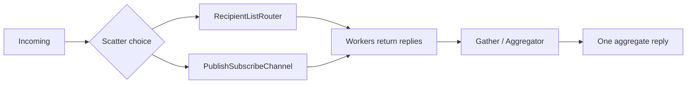

### When to choose Recipient List?

When recipients vary per message:

```text
Recipient A: all orders
Recipient B: verified orders only
Recipient C: high-value orders only
```

Recipient List clearly expresses **conditional destination sets**. The actual recipient set must be known at dispatch time when designing gather.

### When to choose Publish-Subscribe?

When an event must be broadcast to subscribers registered on the channel, without needing a per-message recipient selector list in the style of Recipient List.

In Scatter-Gather, Publish-Subscribe can act as the scatterer. Still, watch subscriber count, reply requirements, and sequencing/correlation: **"having three subscribers" does not automatically prove gather will receive three replies**.

### Do not equate broadcast with concurrent execution

Neither Recipient List nor Publish-Subscribe runs in parallel by default. With `DirectChannel` or synchronous dispatchers, handlers may run on the sending thread; with executors or brokers, they can run asynchronously.

Latency and timeouts depend on **actual topology**, not the pattern name alone.

## 6. Use case comparison: Audit events vs. fetching quotes

### Use case A: One-way OrderCreated fan-out

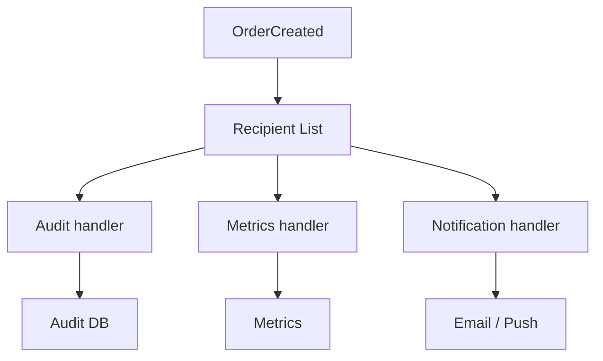

Here:

- Audit can persist the event.
- Metrics updates counters.
- Notification sends an alert if policy permits.
- No need to wait for all three to return an `OrderResult`.
- Each recipient can have its own retry/idempotency policy.

**Suitable:** Recipient List or Publish-Subscribe.

### Use case B: Comparing quotes from multiple suppliers

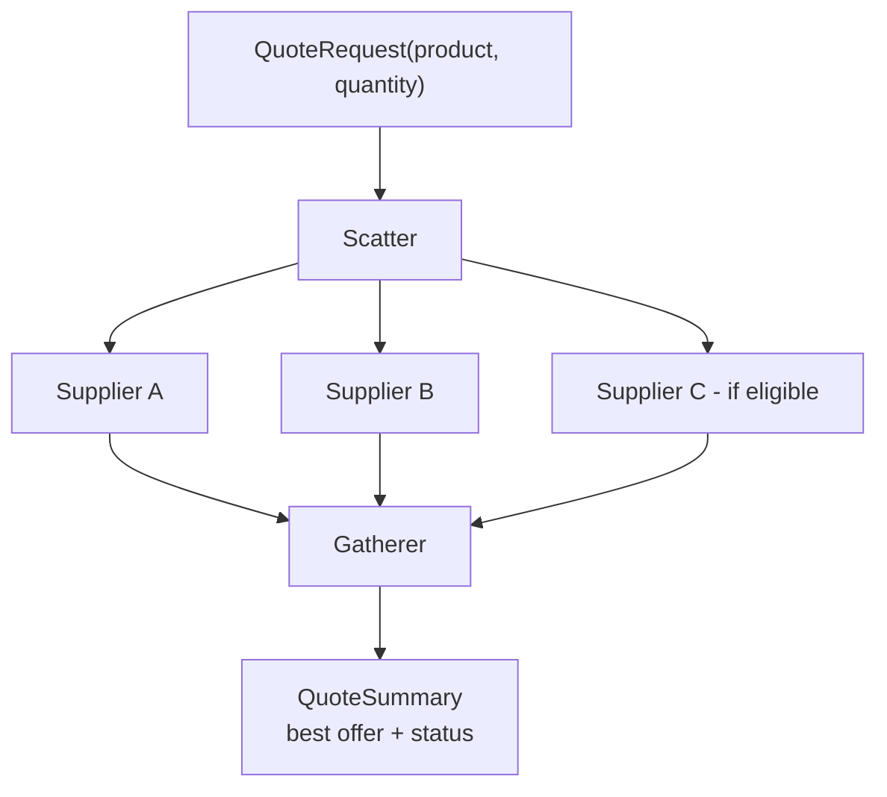

Here:

- Each supplier returns a `QuoteReply`.
- The Gatherer groups replies for the same request.
- The Release strategy decides whether enough arrived or whether to accept a partial result.
- The Output processor picks the best price, checking currency, delivery window, and errors.
- The Caller receives one `QuoteSummary`.

**Suitable:** Scatter-Gather, using Recipient List as the scatterer if suppliers are selected dynamically.

## 7. Java DSL: one-way Recipient List

First, implement the simple case. An `OrderEvent` message is sent to two independent channels for audit and metrics. Both channels are `QueueChannel` instances to test fan-out, with no side-effectful handlers yet.

### 7.1. Data types

```java
package example.integration;

public record OrderEvent(
    String eventId,
    String orderId,
    long amountMinorUnits
) {}
```

### 7.2. Configuring Recipient List Router

```java
package example.integration;

import org.springframework.context.annotation.Bean;
import org.springframework.context.annotation.Configuration;
import org.springframework.integration.channel.DirectChannel;
import org.springframework.integration.channel.QueueChannel;
import org.springframework.integration.config.EnableIntegration;
import org.springframework.integration.dsl.IntegrationFlow;
import org.springframework.messaging.MessageChannel;

@Configuration
@EnableIntegration
public class RecipientListDemoConfig {

    @Bean
    public MessageChannel eventsInput() {
        return new DirectChannel();
    }

    @Bean
    public QueueChannel auditEvents() {
        return new QueueChannel();
    }

    @Bean
    public QueueChannel metricsEvents() {
        return new QueueChannel();
    }

    @Bean
    public IntegrationFlow recipientListFlow() {
        return IntegrationFlow.from("eventsInput")
            .routeToRecipients(router -> router
                .recipient("auditEvents")
                .recipient("metricsEvents"))
            .get();
    }
}
```

Explanation:

- `eventsInput` receives an event.
- `routeToRecipients(...)` configures Recipient List in Java DSL.
- Both `auditEvents` and `metricsEvents` receive the message per recipient policy.
- **There is no gatherer** and **no `QuoteSummary`** in the flow.
- `QueueChannel` illustrates in-JVM distribution only, without restart durability.

This is a Recipient List example, not Scatter-Gather, even though there are two recipients.

### 7.3. When the recipient list is conditional

A Recipient List configuration can add recipients when a message meets certain conditions, e.g., `amountMinorUnits` exceeding a threshold. You can use a recipient selector in the router API matching your Spring Integration version.

Concept:

```text
auditEvents:
  always receives

metricsEvents:
  always receives

highValueReviewEvents:
  receives only when amountMinorUnits >= configuredThreshold
```

The notable point is **each message can have a different actual recipient count**. If evolving toward Scatter-Gather, the gatherer must know how many branches were selected and how many valid replies are expected; never hardcode "three recipients" just because the config lists three options.

## 8. JUnit 5: proving Recipient List only fans out

Testing one input send and two queues both receiving the event:

```java
package example.integration;

import static org.junit.jupiter.api.Assertions.*;

import org.junit.jupiter.api.Test;
import org.springframework.beans.factory.annotation.Autowired;
import org.springframework.beans.factory.annotation.Qualifier;
import org.springframework.integration.channel.QueueChannel;
import org.springframework.messaging.Message;
import org.springframework.messaging.MessageChannel;
import org.springframework.messaging.support.MessageBuilder;
import org.springframework.test.context.junit.jupiter.SpringJUnitConfig;

@SpringJUnitConfig(RecipientListDemoConfig.class)
class RecipientListDemoTest {

    @Autowired
    @Qualifier("eventsInput")
    private MessageChannel eventsInput;

    @Autowired
    @Qualifier("auditEvents")
    private QueueChannel auditEvents;

    @Autowired
    @Qualifier("metricsEvents")
    private QueueChannel metricsEvents;

    @Test
    void deliversOneEventToBothRecipients() {
        OrderEvent event =
            new OrderEvent("EV-101", "ORD-2048", 750_000L);

        Message<OrderEvent> message = MessageBuilder
            .withPayload(event)
            .setHeader(
                "businessCorrelationId", "order:ORD-2048")
            .build();

        assertTrue(eventsInput.send(message));

        Message<?> audit = auditEvents.receive(1_000);
        Message<?> metrics = metricsEvents.receive(1_000);

        assertNotNull(audit);
        assertNotNull(metrics);

        assertEquals(event, audit.getPayload());
        assertEquals(event, metrics.getPayload());

        assertEquals("order:ORD-2048",
            audit.getHeaders().get("businessCorrelationId"));
        assertEquals("order:ORD-2048",
            metrics.getHeaders().get("businessCorrelationId"));

        assertNull(auditEvents.receive(0));
        assertNull(metricsEvents.receive(0));
    }
}
```

The test proves **one message reaches two recipients**. It makes no assertions about reply sets, completion counts, gatherer timeouts, or aggregated outcomes because the flow **does not implement** those concepts.

If later adding a third recipient only for high-value orders, test both an event selecting 2 recipients and an event selecting 3 recipients.

## 9. Designing Scatter-Gather: request and reply must have a contract

Suppose `QuoteRequest` must query two suppliers. One recipient responds:

```text
QuoteReply:
  supplierCode = "A"
  priceMinorUnits = 120000
  deliveryDays = 2
  accepted = true
```

Another recipient returns:

```text
QuoteReply:
  supplierCode = "B"
  priceMinorUnits = 115000
  deliveryDays = 4
  accepted = true
```

The Gatherer must know:

1. Which `QuoteRequest` do these two replies belong to?
2. Are exactly two replies expected?
3. If one supplier returns `REJECTED`, does that count as a completed contribution?
4. If supplier B times out, return a partial result or fail?
5. If supplier A sends two replies due to a retry, should it be counted twice?
6. If three recipients exist yet only two were selected for the current request, what is the expected count?

### Suggested message contract

| Data | Example | Role |
| --- | --- | --- |
| `requestId` | `Q-101` | Identifies the business quote inquiry |
| `businessCorrelationId` | `quote:Q-101` | Traces across the whole flow |
| `supplierCode` | `A` | Identifies the contributing source |
| `correlationId` | Scatter request's reply group ID | Used by Gatherer to group |
| `sequenceNumber` | 1 or 2 | Contribution position if using sequences |
| `sequenceSize` | 2 if two replies are truly expected | Completion expectation |
| `replyChannel` | Framework-managed reply destination | Routes lookup results back properly |
| `errorChannel` | Optional error path | Observes branch exceptions |

**Do not treat `requestId`, `correlationId`, and `replyChannel` as the same thing.** Business ID serves reconciliation, group ID serves aggregation, and reply destination serves request-reply communication.

## 10. Scatterer can be Recipient List or Publish-Subscribe

There are two common ways to organize scattering in Spring Integration:

### 10.1. Recipient-list scatter

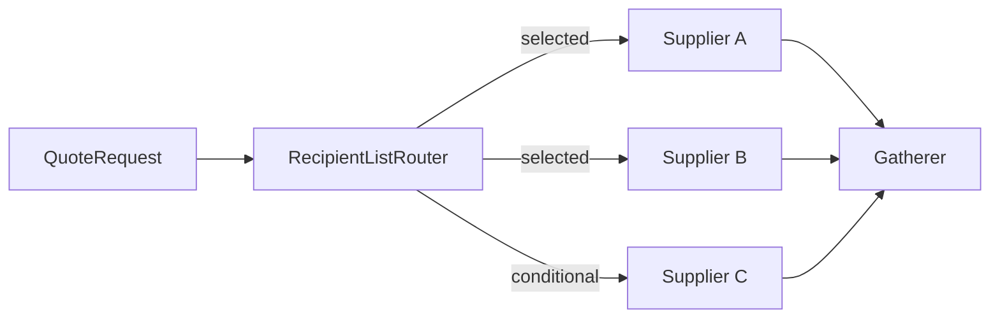

Advantages:

- Can pick the exact supplier set based on product type, region, capacity, or policy.
- Easy to manage per-recipient conditions.
- Avoids forcing every supplier to receive every request.

Requirements:

- Expected count must reflect **the actually selected recipient set**, not total suppliers in the registry.
- No branch counts as "completed" merely because the scatterer sent the request successfully.
- Define rules for recipients that emit no reply.

### 10.2. Publish-subscribe scatter

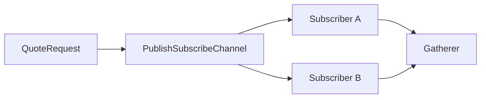

Advantages:

- Fits subscribers explicitly registered in the application.
- Can use an executor for asynchronous dispatch.
- Simple channel structure for a fixed audience.

Limitations:

- If subscriber count changes or one subscriber produces no reply, the gatherer must know how to handle it.
- A subscriber emitting a one-way notification is not a valid contribution if the gatherer awaits a business reply.
- In-JVM Publish-Subscribe does not create durable fan-out or exactly-once on its own.

**Never claim:** every broadcast event automatically becomes Scatter-Gather just because an Aggregator sits somewhere downstream. Clear correlation, reply routing, and release contracts are required.

## 11. Business domain example: quotes from two suppliers

We design three immutable data types. Each supplier returns a `QuoteReply` for the corresponding request.

```java
package example.integration;

import java.util.List;

public record QuoteRequest(
    String requestId,
    String sku,
    int quantity
) {}

public record QuoteReply(
    String requestId,
    String supplier,
    long unitPriceMinorUnits,
    int deliveryDays,
    boolean available
) {}

public record QuoteSummary(
    String requestId,
    String selectedSupplier,
    Long selectedUnitPriceMinorUnits,
    int repliesReceived,
    boolean complete,
    List<QuoteReply> allReplies
) {}
```

Business decisions:

- `QuoteRequest.quantity` must be positive and SKU non-blank.
- `QuoteReply.requestId` must match the original request.
- Each supplier contributes at most once.
- Prices are comparable only when currency/units match; the example assumes normalized currency units.
- `available=false` is still a **valid reply** from a gather perspective, even though it is not a selectable quote.
- The final result states clearly whether all replies arrived or only a partial set.

### Two simple suppliers

```java
package example.integration;

public final class SupplierAService {

    public QuoteReply quote(QuoteRequest request) {
        return new QuoteReply(
            request.requestId(),
            "A",
            120_000L,
            2,
            true);
    }
}

public final class SupplierBService {

    public QuoteReply quote(QuoteRequest request) {
        return new QuoteReply(
            request.requestId(),
            "B",
            115_000L,
            4,
            true);
    }
}
```

These are two demo services returning fixed data, keeping focus on correlation/gather. Production needs timeouts, retry policies, currency normalization, validation, and separating out-of-stock outcomes from infrastructure exceptions.

## 12. Java DSL: visualizing Scatter-Gather in Spring Integration

In Spring Integration, `scatterGather(...)` in Java DSL coordinates the scatterer and gatherer. The example below presents an **illustrative DSL structure**: exact overloads/specs must be verified against your project's Spring Integration version during specialized QA.

```java
// Illustrates organization, not a standalone configuration file.
// supplierA and supplierB are injected beans.

IntegrationFlow flow = IntegrationFlow.from("quoteRequests")
    .scatterGather(
        scatterer -> scatterer
            .recipientFlow(f -> f.handle(supplierA, "quote"))
            .recipientFlow(f -> f.handle(supplierB, "quote")),
        gatherer -> gatherer
            .releaseStrategy(group -> group.size() == 2)
            .outputProcessor(group -> summarizeQuotes(group)))
    .channel("quoteSummaries")
    .get();
```

### What does each piece mean?

- `IntegrationFlow.from("quoteRequests")`: receives a quote request.
- Scatterer: dispatches the request to two processing flows.
- Two suppliers: produce `QuoteReply` via Service Activators.
- Gatherer: collects replies by correlation group.
- `releaseStrategy(...)`: illustrates waiting for two contributions.
- `outputProcessor(...)`: creates a `QuoteSummary`.
- `quoteSummaries`: output of the combined quote inquiry, not individual output from supplier A or B.

**Crucial adjustment for production:** `group.size()==2` is safe only when **exactly two recipients are selected, each returns exactly one reply**, and duplicates are prevented. If recipients are selected dynamically, suppliers emit multiple replies, or duplicates can occur, build a stronger completion rule.

### Example output processor

```java
import java.util.Comparator;
import java.util.List;
import java.util.Optional;

import org.springframework.integration.store.MessageGroup;

public QuoteSummary summarizeQuotes(MessageGroup group) {
    List<QuoteReply> replies = group.getMessages().stream()
        .map(m -> (QuoteReply) m.getPayload())
        .toList();

    Optional<QuoteReply> best = replies.stream()
        .filter(QuoteReply::available)
        .min(Comparator
            .comparingLong(QuoteReply::unitPriceMinorUnits)
            .thenComparingInt(QuoteReply::deliveryDays));

    String requestId = replies.get(0).requestId();

    return new QuoteSummary(
        requestId,
        best.map(QuoteReply::supplier).orElse(null),
        best.map(QuoteReply::unitPriceMinorUnits).orElse(null),
        replies.size(),
        replies.size() == 2,
        List.copyOf(replies));
}
```

This is also illustrative logic assuming the input group is non-empty, shares one request ID, uses one currency, and has no duplicate supplier replies. In production, enforce those invariants before permitting release so the output processor never receives invalid group data.

### Why use an explicit final result type?

`QuoteSummary.complete` differs from having a best offer:

- `complete=true`: the group received all contributions per policy.
- `selectedSupplier=null`: no supplier reported availability.
- `allReplies`: retains audit evidence, though sensitive fields may be limited/redacted per SLA.
- On partial release, `complete=false` must be exposed rather than masquerading as full success.

## 13. Dynamically selected recipients: expected count mismatch

This is the most common mistake when comparing the two patterns.

Suppose Recipient List is configured with three suppliers A, B, C. Yet request `Q-101` selects only A and B because C does not serve the delivery region.

```text
Configured recipients: [A, B, C]
Selected recipients:   [A, B]
Actual requests sent:  2
Expected valid replies: 2
```

If the Gatherer waits for `sequenceSize=3` because three suppliers exist in configuration, the group may time out even after both actual recipients have replied.

### The right rule

Expected reply count must reflect **the contributions expected from the current scatter run**, not merely the number of recipients declared in configuration.

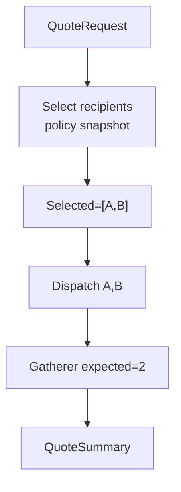

Persist the selected recipient set when decisions may be replayed or when policies change at runtime. If a retry uses a newer policy that increases recipient count, the completion contract changes mid-flight.

### When each recipient returns a varying number of replies

A supplier might return multiple tiers, such as standard and express. Then "one supplier = one reply" no longer holds. Consider:

1. Normalizing each supplier to return one `SupplierQuoteSet` holding all its options.
2. If each offer must be a separate contribution, keying explicitly by `(supplierId, offerType)` with a matching expected set.
3. Using a nested Aggregator: gather offers into one supplier result, then gather supplier results.

Never arbitrarily bump `sequenceSize` without logical contribution identities.

## 14. Correlation: concurrent scatters must never mix replies

In production, thousands of `QuoteRequest` runs may be active simultaneously. Replies from A/B can arrive interleaved.

```text
Q-101 -> A reply
Q-102 -> B reply
Q-101 -> B reply -> release Q-101
Q-102 -> A reply -> release Q-102
```

If all replies enter the same gatherer without correlation, the two requests will mix.

Relevant metadata:

| Metadata | Role | Recommendation |
| --- | --- | --- |
| `requestId` | Business quote inquiry ID | Always keep stable |
| `businessCorrelationId` | Correlate logs and traces across services | Separate from group ID if needed |
| `correlationId` | Aggregator's message group key | Determined consistently by infra/flow |
| `sequenceNumber` | Contribution position when sequenced | Preserve through every handler |
| `sequenceSize` | Total expected contributions | Match selected recipient set |
| `replyChannel` | Request-reply exchange return path | Never overwrite arbitrarily |
| `MessageHeaders.id` | Per-message ID | Not a shared group key |

**Do not assume `requestId == correlationId`.** A business request may be re-scattered under a new workflow run; reusing the same group ID without accounting for retries and lifecycle can mix old and new replies.

### Business correlation differs from technical group

Example:

```text
QuoteRequest Q-101
  businessCorrelationId = quote:Q-101

Scatter run #1
  correlationId = group-701

Intentional retry, scatter run #2
  correlationId = group-702

Both share businessCorrelationId,
yet must not necessarily merge into the same MessageGroup.
```

To audit decisions, store `scatterRunId`, `selectedRecipients`, and `policyVersion` when needed instead of overwriting technical headers with arbitrary business codes.

## 15. Reply channel: crucial difference from one-way Recipient List

When using Recipient List purely for auditing, handlers can return `void`. Nobody upstream is waiting to collect a set of replies.

In Scatter-Gather, each branch is expected to produce **a reply with a path back to the gatherer**.

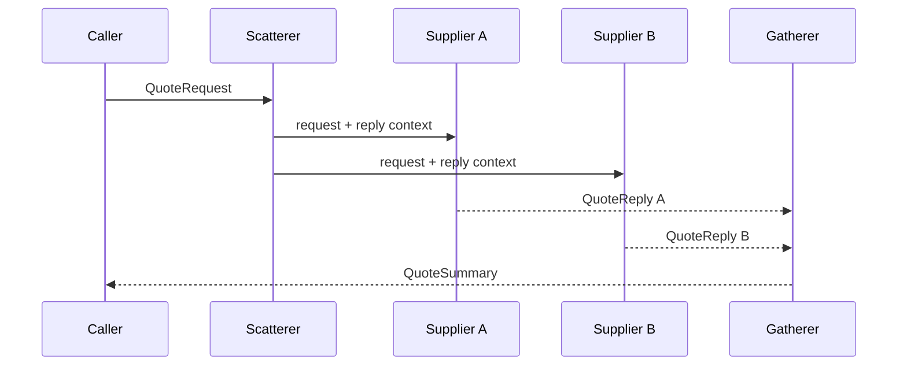

In Spring Integration, request-reply headers and endpoints manage internal reply paths. When creating custom `Message<?>` instances or crossing a broker, preserve reply destination/correlation protocols accurately.

**Never override `replyChannel` on individual branches to point straight back to the Gateway.** If both suppliers send straight to the Gateway, the caller may receive a single raw quote without aggregation, or late messages may find no receiver.

### What if one branch returns void?

```java
public void audit(QuoteRequest request) {
    auditRepository.saveRequest(request);
}
```

This handler fits a one-way Recipient List yet **contributes no `QuoteReply`** to Scatter-Gather. If the gatherer waits for N replies, the group will miss a part and time out.

If you need both audit **and** quotes, separate audit from replying branches or define a dedicated result type in the gather contract. Never treat "audit recorded" as a valid quote.

## 16. ReleaseStrategy: when is Scatter-Gather truly complete?

The Gatherer is typically an Aggregator and must define **when to release**.

### Case 1: all N suppliers reply

```text
Selected: [A, B]
Reply A: received
Reply B: received
=> release and summarize
```

Suitable when the caller needs complete data and suppliers meet deadlines.

### Case 2: quorum met

```text
Selected: [A, B, C]
Reply A: received
Reply B: received
Reply C: still pending
Policy: >= 2 valid independent suppliers
=> release partial/early per contract
```

Apply only when business rules permit deciding without waiting for everyone. Output must state clearly that quorum was met while not all recipients responded.

### Case 3: deadline

```text
Selected: [A, B, C]
Replies: A, C
B: timeout

Policy:
  strict -> fail
  partial allowed -> summarize A,C + missing B
```

**Timeout does not automatically make `ReleaseStrategy` return true.** Configure group timeout/expiry or a matching deadline/partial-release mechanism.

### Case 4: zero recipients selected

If policies filter out every supplier, the scatterer may have nobody to send to. Then the gatherer may receive no messages to even create a group.

Define a dedicated outcome:

- `NO_ELIGIBLE_SUPPLIER`.
- Or fail-fast per business rule.
- Never leave the caller waiting forever on an uncreated gather group.

## 17. Custom release rule: distinct suppliers instead of raw counts

With two selected suppliers A and B, a rule can release only once replies from **both A and B** arrive, one reply per supplier.

```java
import java.util.Set;
import java.util.stream.Collectors;

import org.springframework.integration.store.MessageGroup;

public boolean receivedBothSuppliers(MessageGroup group) {
    Set<String> required = Set.of("A", "B");

    Set<String> actual = group.getMessages().stream()
        .map(m -> (QuoteReply) m.getPayload())
        .map(QuoteReply::supplier)
        .collect(Collectors.toSet());

    return actual.equals(required)
        && group.size() == required.size();
}
```

This is an **illustrative rule** suitable only for two fixed suppliers. It prevents releasing on two copies from A while missing B. However, if a duplicate already entered the store, the rule returns false and the group can stall; dedicated deduplication/recovery is needed.

### When the supplier list is dynamic

Do not hardcode `Set.of("A","B")` in production. Replace it with an expected suppliers set locked at scatter time and stored in safely accessible workflow context/group metadata.

```text
expectedSuppliers = {A, B, C}
receivedSuppliers = {A, C}
release=false

expectedSuppliers = {A, B}
receivedSuppliers = {A, B}
release=true
```

When policy changes while a message is in flight, **do not recompute expected suppliers from the new config**. That changes the contract mid-flight; use an explicit re-scatter/reroute event if business requires it.

### Must we wait for "successful" replies?

A supplier might return `available=false`. That is still a completed communication reply. If the gather contract requires a response from every supplier, it counts as a contribution. The final outcome can be "no suitable offer found".

Never wait indefinitely for every supplier to return `available=true`; unavailability is a negative business result, not a transport error to retry.

## 18. Latency: waiting for all lets one slow branch dominate

Suppose:

| Supplier | Reply time |
| --- | --- |
| A | 100 ms |
| B | 450 ms |
| C | 1,200 ms |

If all three are required, completion **cannot finish earlier than the last reply**. When branches truly run in parallel, latency approaches the slowest branch plus coordination overhead; if scatterer dispatch and handlers run synchronously in sequence, total time can be much higher.

```mermaid
gantt
    title Illustrative timeline if three suppliers run in parallel
    dateFormat X
    axisFormat %L
    section Supplier A
    A response :a, 0, 100
    section Supplier B
    B response :b, 0, 450
    section Supplier C
    C response :c, 0, 1200
```

The diagram illustrates relative latencies, not Spring Integration measurements.

### Scatter does not guarantee parallelism

A Recipient List Router sending to `DirectChannel` beans may run handlers synchronously on the dispatch thread. If handler A is slow, it delays sending to B.

For true concurrency:

- Use appropriate executor/adapter boundaries.
- Configure timeouts and bounded queues.
- Ensure handlers are thread-safe.
- Prevent one congested supplier from exhausting workers meant for other suppliers.
- Monitor active threads, queue depth, and rejections.

If low latency is required and business permits, consider quorum/partial strategies rather than always waiting N/N.

## 19. Timeouts: release timeout, Gateway timeout, and I/O timeout

Scatter-Gather typically has **multiple distinct deadlines**:

1. **Supplier HTTP/DB timeout:** bounds each external call.
2. **Scatter/send timeout:** when sending is blocked or channels saturate.
3. **Gather group timeout:** how long to wait for replies in the group.
4. **Gateway reply timeout:** how long the caller waits for the combined result.
5. **Business deadline:** cutoff after which a quote choice is no longer valid.

Never lump them together as "a 5-second timeout" without specifying where it applies.

### Diagram of two deadlines

```text
Caller / Gateway
  |--------------------------------- reply timeout
  |
  +-- Scatter
        |
        +--> A: HTTP timeout
        +--> B: HTTP timeout
        |
        +-- Gatherer --------------- group timeout
```

If Gateway times out **before** Gatherer, a `QuoteSummary` emitted afterward may have no waiting caller left. Define result persistence and late-reply handling; never assume the framework holds HTTP requests forever.

### Group timeouts must yield explicit outcomes

If B fails to reply:

- **Strict:** produce `QUOTE_INCOMPLETE` error; never fake full success.
- **Partial:** choose among received offers, with `complete=false` and missing recipients list.
- **Deferred:** persist `PENDING` state to complete later and let caller query.
- **Cancel/retry:** per contract with idempotency and deadlines.

A partial result is a **business decision**, not an automatic default behavior of Scatter-Gather.

## 20. Single-branch failure: separating failures from no-reply

A supplier may:

- Return valid `available=false`.
- Return explicit business error `NOT_SUPPORTED`.
- Time out on infrastructure.
- Throw an exception before creating a reply.
- Return a malformed message.
- Reply past the deadline.
- Send the same reply twice.

These differ:

| Scenario | Counts as contribution? | Suggestion |
| --- | --- | --- |
| `available=false` in valid reply | Yes, if contract requires reply | Aggregate as no offer |
| `NOT_SUPPORTED` in valid response | Yes, if policy accepts | Record reason |
| HTTP timeout | No valid reply yet | Retry/recovery/partial |
| Exception in handler | No valid reply unless converted | Error channel and recovery |
| Reply with wrong `requestId` | No | Reject/quarantine |
| Duplicate reply from same supplier | Only one logical contribution | Deduplication |
| Reply after completion | Per late-message policy | Ignore/audit/quarantine |

### Recovery result

You can standardize every supplier to return a structured result:

```java
public record SupplierOutcome(
    String requestId,
    String supplier,
    String status,
    QuoteReply quote,
    String errorCode
) {}
```

For instance, `status` is `SUCCESS`, `NOT_AVAILABLE`, or `FAILED`. If all three count as **a supplier's completed outcome**, the gatherer can count all contributions and the output processor determines business status.

Never write `catch (Exception e) { return null; }`. In many request-reply endpoints, `null` means no reply; the gatherer waits until timeout and the root error is masked.

### When to retry?

- HTTP 503 or transient timeout: retry that individual branch with backoff.
- Supplier returned `available=false`: usually do not retry the same request hoping stock appears.
- Malformed schema or customer authorization failure: fail-fast/quarantine.
- Gateway timeout after supplier already processed: retrying whole scatter can cause side effects if suppliers are not read-only.

Retry results must attach to the right scatter run rather than inventing an extra bogus contribution.

## 21. Duplicates, redeliveries, and idempotency

A message may be redelivered by a broker, handler retry, or caller resend.

```text
QuoteRequest Q-101
  -> supplier A returns reply A#1
  -> connection error, A retries returning A#2
  -> supplier B returns reply B#1

If gatherer counts raw messages:
  A#1, A#2 -> 2 replies => false release.
```

Maintain a logical contribution key:

```text
contributionKey = (scatterRunId, supplierCode)
```

If each supplier can submit multiple offers, add `offerType`/`quoteVersion` per contract.

**Never use `correlationId` alone as the per-supplier idempotency key.** All replies in the same group share `correlationId`, so it does not distinguish A from B.

### Retrying the whole scatter can change the recipient set

Policy initially chose A,B. A minute later the recipient registry changes, and an automatic retry selects A,B,C. If the old gatherer still waits for two replies, a C reply could hit the wrong group or arrive post-completion.

For deterministic replay:

1. Lock `selectedRecipients` and `scatterRunId` at start time.
2. Persist them if restart recovery is needed.
3. Retry each supplier under a stable contribution ID.
4. Start a new scatter run only when business rules decide to re-scatter.
5. Ensure old and new results never mix groups.

## 22. Filter and Transformer inside recipient flows

A branch may need to normalize requests or filter conditionally:

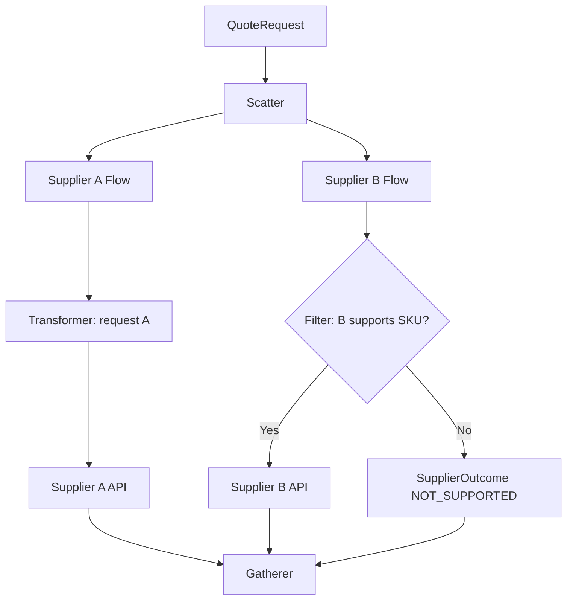

### Transformer: preserving reply correlation

If a custom Transformer constructs a brand-new `Message<?>` without preserving routing metadata, the gatherer cannot correlate the reply. In internal flows, rely on standard header propagation or `MessageBuilder` preserving selected headers.

```java
public Message<QuoteReply> preserveHeaders(
        Message<QuoteRequest> input,
        QuoteReply reply) {

    return MessageBuilder.withPayload(reply)
        .copyHeaders(input.getHeaders())
        .build();
}
```

This is an internal illustrative pattern; never blindly copy `replyChannel`, `errorChannel`, or sensitive data across trust boundaries or external brokers.

### Filter: never silently drop a contribution

If Supplier B does not support the product, a Filter may return false. Yet if the Filter just drops the message, the gatherer misses B's reply.

Instead, emit `SupplierOutcome(status=NOT_SUPPORTED)` as a completed contribution. Whether it counts as a valid reply depends on the release contract.

### Router inside a recipient

A supplier adapter might route by region or protocol. Internal routing must not accidentally emit two replies for one supplier unless the contract explicitly defines multiple contributions.

## 23. How does Splitter/Aggregator differ from Scatter-Gather?

**Splitter → Aggregator** and **Scatter-Gather** both have fan-out/fan-in, yet differ in element origin and purpose.

- **Splitter** breaks **input data** into parts, such as order line items.
- **Scatter** sends **one request** to multiple handlers/suppliers, often keeping the request payload nearly identical.
- **Aggregator/Gatherer** collects related messages to build one output.

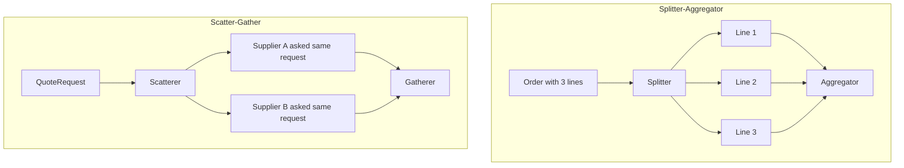

Both can use sequence/correlation headers and release strategies. However, **Splitter's `sequenceSize`** describes split item count, whereas **Scatter-Gather's expected replies** must match expected contributions from recipients.

If a child message from a Splitter is itself scattered to two sources, multi-level grouping or finer contribution identities are required.

## 24. Request-reply Gateway: only the gatherer produces the caller's result

A `@MessagingGateway` can submit a `QuoteRequest` into Spring Integration and expect a `QuoteSummary`:

```java
import org.springframework.integration.annotation.MessagingGateway;

@MessagingGateway(defaultRequestChannel = "quoteRequests")
public interface QuoteGateway {
    QuoteSummary compare(QuoteRequest request);
}
```

This is an illustrative interface. To run completely, configure Gateway scanning, a scatter-gather flow producing `QuoteSummary`, matching reply paths, and timeouts.

Diagram:

```text
Java Caller
    |
    v
QuoteGateway.compare(...)
    |
    v
Scatter A,B
    |
    v
Gatherer receives replies
    |
    v
QuoteSummary
    |
    v
Gateway reply -> Java Caller
```

**Never** let supplier A and supplier B send `QuoteReply` directly back to the Gateway's original `replyChannel`. Otherwise the Gateway could receive a single raw quote or suffer reply contention instead of a summary.

### Two reply layers

1. Replies from each supplier back to **the gatherer**.
2. Final reply from **the gatherer** back to **the Gateway**.

Reply paths must be managed consistently by the framework or transport. `businessCorrelationId` aids tracing yet does not replace the reply destination.

### When the caller only needs "accepted"

If querying multiple suppliers takes several minutes, expose `submitQuoteInquiry` returning `PENDING` with `requestId`, then complete via state store/event callbacks. Never hold a synchronous Gateway call open for minutes just waiting on every supplier.

## 25. Testing Scatter-Gather: test more than fan-out

Testing Recipient List in section 8 only needed to confirm multiple queues received the message. Scatter-Gather must also verify **reply correlation, release, and output**.

### 25.1. Unit tests for the supplier-set rule

For example, test `receivedBothSuppliers(...)` with a mock `MessageGroup` or matching Spring Integration fixture:

```text
group Q-101:
  reply(A)                 -> release=false
  reply(A) + reply(B)      -> release=true
  reply(A) + reply(A)      -> release=false
  reply(B)                 -> release=false
```

No broker is needed here. Unit tests prove distinct-supplier logic, yet do not prove replies receive the right correlation in a live Spring Integration flow.

### 25.2. Integration test: two replies, one summary

An end-to-end flow test should:

1. Create `QuoteRequest("Q-101","BOOK-1",2)`.
2. Send to the scatter-gather request channel.
3. Have suppliers A and B return `QuoteReply` with the same `requestId`.
4. Await output from the gatherer.
5. Assert `repliesReceived==2`.
6. Assert the selected supplier matches price/availability comparison rules.
7. Assert exactly one `QuoteSummary` is emitted.
8. Assert no replies from any other quote inquiry appear in the summary.

Sample JUnit 5 assertions, assuming `quoteRequests` and `quoteSummaries` are injected for a complete flow:

```java
@Test
void gathersTwoSupplierRepliesIntoOneSummary() {
    QuoteRequest request =
        new QuoteRequest("Q-101", "BOOK-1", 2);

    assertTrue(quoteRequests.send(
        MessageBuilder.withPayload(request)
            .setHeader(
                "businessCorrelationId", "quote:Q-101")
            .build()));

    Message<?> result = quoteSummaries.receive(2_000);
    assertNotNull(result);
    assertInstanceOf(QuoteSummary.class, result.getPayload());

    QuoteSummary summary = (QuoteSummary) result.getPayload();
    assertEquals("Q-101", summary.requestId());
    assertEquals("B", summary.selectedSupplier());
    assertEquals(2, summary.repliesReceived());
    assertTrue(summary.complete());
    assertEquals(2, summary.allReplies().size());

    assertNull(quoteSummaries.receive(0));
}
```

This is an **illustrative test fragment**, not a runnable class without declaring beans/test fixtures. When implementing, configure scatterer/gatherer per your version's DSL and verify correlation/replies are properly formed.

### 25.3. Testing abnormal branch terminations

| Scenario | What to prove |
| --- | --- |
| Supplier A replies before B | Gatherer does not release prematurely |
| Supplier B replies before A | Summary remains accurate |
| One supplier returns no reply | Timeout/partial/error contract fires |
| Supplier A replies twice | Not counted as two contributions |
| Two requests Q-101 and Q-102 interleaved | Replies never mix |
| `selectedRecipients` contains only A | Expected count is 1 |
| Supplier returns `available=false` | Counted per contract rather than hanging forever |
| Filter drops branch B | Explicit outcome or missing-reply policy runs |
| Supplier replies late after completion | Late-message policy runs |
| Caller times out before gather | Result observability is not lost |

### 25.4. Asynchronous tests

When suppliers run over `ExecutorChannel` or a broker, **never** assert output immediately after `send(...)` without waiting. Use `CountDownLatch`, Awaitility, or `receive(timeout)` and check deadlines.

Never use fixed `Thread.sleep(...)` to assume a group completed, especially on CI with fluctuating load.

## 26. Parallel operation: balancing workers and backpressure

Scatter-Gather multiplies load quickly. One request to three suppliers triggers three external calls. With 1,000 concurrent requests, total calls reach 3,000 before retries.

### Required limits

- Maximum concurrently scattering requests.
- Active executor tasks and queue limits.
- Per-supplier timeouts.
- Per-supplier rate limits or bulkheads.
- Circuit breakers for chronically failing sources.
- Gatherer/group store backlog limits.
- Memory caps on reply payloads.
- Backpressure when the system cannot sustain fan-out load.

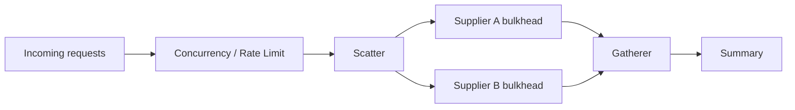

**Do not treat an executor as infinite throughput.** Slow suppliers occupy workers and grow queues; without bounds, cascading timeouts can overload the entire system.

### When to isolate resources per supplier?

If supplier B frequently responds slowly, a shared executor can be monopolized by B's tasks. Separating bulkheads/queues or worker pools per supplier limits blast radius at higher operational cost. Base the choice on SLAs and real measurements.

## 27. MessageGroupStore and recoverability

The Gatherer typically stores pending replies. With a RAM-only group store, an app crash before all replies arrive loses group state.

Durable requirements may need:

- A persistent `MessageGroupStore` or matching state store.
- Reply/contribution idempotency.
- Scoped workflow run IDs.
- Transactional policies between store updates and output publishing.
- Broker acknowledgements/retries.
- Completion markers for finished groups.
- Late-message policies.

**A persistent store does not automatically guarantee exactly-once side effects.** If output was sent yet marking completion failed, a group may be reprocessed. Downstream business handlers need matching idempotency.

### Multi-instance

If reply A lands on pod 1 and reply B lands on pod 2, two isolated in-memory group stores never see both replies. You need a shared store with proper locking/transactions, or partition/consumer routing by correlation key so all replies for a group hit the same node.

A shared `correlationId` **does not automatically route** replies to the same node. Operational partitioning or shared storage is required.

## 28. Observability: measuring both scatter and gather

A one-way Recipient List mainly tracks per-branch delivery and processing. Scatter-Gather also needs to know **how many replies a group collected and who is still missing**.

| Metric / log | Recipient List | Scatter-Gather |
| --- | --- | --- |
| Distributed message count | Important | Important |
| Selected recipients | Important | Critical to know expected set |
| Per-handler latency | Per branch | Per branch |
| Per-recipient errors/retries | Per branch | Per branch |
| Reply received count | Not a general requirement | Important |
| Active gather groups | Not needed by default | Important |
| Gather completion latency | Not applicable by default | Important |
| Missing recipients | Business-dependent | Important |
| Partial/timeout result count | Not applicable by default | Important |
| Duplicate/late reply count | Potentially useful | Important |

### Example timeline log

```text
requestId=Q-101 scatterRunId=RUN-701 selected=A,B
stage=SCATTER_DISPATCHED recipients=2

requestId=Q-101 supplier=A stage=REPLY_RECEIVED
group=RUN-701 received=1 expected=2 release=false

requestId=Q-101 supplier=B stage=REPLY_RECEIVED
group=RUN-701 received=2 expected=2 release=true

requestId=Q-101 stage=GATHER_COMPLETED
summary=BEST_SUPPLIER_B complete=true
```

Lines are **illustrative application logs**, not verbatim Spring Integration output.

### Correlation helps explain latency

A trace can connect:

```text
QuoteGateway
  -> Scatter
       -> Supplier A [100 ms]
       -> Supplier B [450 ms]
  -> Gather [release at 460 ms]
  -> QuoteSummary
```

Never put `requestId`, `customerId`, or individual IDs into metric labels causing high cardinality. Use structured logs/traces; avoid logging tokens, sensitive info, or full supplier responses unnecessarily.

## 29. Common mistakes

### 29.1. Treating Recipient List as Scatter-Gather just because it fans out

Fan-out alone has no gatherer, release strategy, or aggregated reply. Define output contracts explicitly.

### 29.2. Using Scatter-Gather for notifications needing no reply

If subscribers only log or send emails, gather is pure overhead and can cause events to time out due to `void` handlers. Use one-way Recipient List/Publish-Subscribe.

### 29.3. Waiting for configured recipient count instead of selected count

Recipient List has dynamic selectors. A Gatherer waiting for three replies when only two recipients were selected will never complete properly.

### 29.4. Counting N raw messages without deduplicating

Two replies from A cannot substitute for B's reply. Use unique supplier IDs or contribution identities.

### 29.5. Missing reply channel or dropping headers

Custom Transformers/adapters can stop replies from reaching the gatherer. Verify propagation and transport mappings.

### 29.6. A branch Filter dropping messages

A branch expected to reply gets silently dropped by a Filter. Use a structured `SupplierOutcome` or partial/timeout policies.

### 29.7. Assuming scatter always executes concurrently

With `DirectChannel`/synchronous handlers, total latency can be high. Parallel execution requires configuring executors/adapters.

### 29.8. Confusing "out of stock" with "no reply"

`available=false` is valid business data. Timeout is a missing reply. Both have different retry and release policies.

### 29.9. Gateway receiving one supplier's reply instead of a summary

Suppliers must not send straight back to the caller when gathering is required. The Gatherer must build the final reply per contract.

### 29.10. Ignoring late replies

A supplier replying after timeout can emit a second result or spawn a new group. Use completion records and late-message policies.

### 29.11. Retrying whole scatter without a run ID

Two scatter runs can mix replies. Pin `scatterRunId`, selected recipients, and policy version.

### 29.12. Treating a persistent group store as an exactly-once guarantee

Durable stores do not replace transactions, idempotency, and broker acknowledgements.

## 30. Practice exercise: comparing both architectures in the same domain

**Context:** an app receives `TravelBookingRequest` with itinerary code and departure time. When searching trips, the system queries two ticket providers. When a user books successfully, the system emits events for audit and notification.

### Part A — Recipient List

1. Create an immutable `BookingCreated`.
2. Send the event to `bookingEvents`.
3. Recipient List routes to `auditEvents` and `notificationEvents`.
4. Add a selector so notification receives only if the user enabled notifications.
5. Test that audit always receives while notification receives conditionally.
6. Prove no `BookingSummary` gathered from replies is required.
7. Handle exceptions and retries per subscriber with idempotency.

### Part B — Scatter-Gather

1. Create `TicketQuoteRequest(requestId, itinerary, passengerCount)`.
2. Select suppliers A/B/C by market supported by the request.
3. Persist selected suppliers and `scatterRunId`.
4. Send requests to suppliers via scatterer.
5. Each supplier returns `TicketQuoteOutcome` once per contract.
6. Gatherer groups by run ID.
7. Release only once all selected suppliers arrive or deadline hits under partial policy.
8. Output processor picks the best price among valid offers.
9. Gateway returns exactly one `TicketQuoteSummary`.
10. Test out-of-order replies, missing replies, duplicates, and interleaved requests.
11. Evaluate timeouts/I/O budgets and concurrency.
12. If lookup takes long, switch to a stateful workflow returning `PENDING`.

### Expected outcome table

| Scenario | Recipient List | Scatter-Gather |
| --- | --- | --- |
| Two subscribers receive event | Two destinations get messages | Not yet enough to be gather |
| Recipient returns no reply | Can be completely valid | May cause missing contribution |
| A/B return price results | Does not aggregate on its own | Gathers and produces summary |
| A arrives before B | Irrelevant for one-way flow | Waits per release policy |
| Only A selected | Sends only to A | Expected count must be 1 |
| A returns two replies | May be two distinct events per contract | Must prevent duplicate contribution |
| B times out | Branch B handles error individually | Group partial/timeout/recovery |
| Gateway needs one summary | Not provided by default | Output of gatherer |
| One reply arrives late | Depends on recipient workflow | Needs late-message policy |

### Self-assessment questions

**Question 1.** Is Recipient List the same as Scatter-Gather?

*No. Recipient List focuses solely on selecting and sending to recipients; Scatter-Gather also collects and aggregates replies per a completion contract. Recipient List can be used as the scatterer.*

**Question 2.** Should Scatter-Gather be used when branches only write `void` audits and send `void` emails?

*Usually no. Without needing an aggregated result, one-way Recipient List or Publish-Subscribe is simpler.*

**Question 3.** If three recipients are configured yet a request selects only two, how many replies should the gatherer wait for?

*Under a one-reply-per-recipient contract, it should wait for two. Record the recipient set actually selected.*

**Question 4.** Can two replies from supplier A substitute for replies from A and B?

*No. Contribution identity and deduplication are required; counting two raw messages can release wrongly.*

**Question 5.** When a supplier has no stock yet returns a valid reply, does it count as having replied?

*Yes if the gather contract needs an outcome from each supplier; unavailability is a business result, unlike a silent timeout.*

**Question 6.** Why separate `replyChannel` from `businessCorrelationId`?

*Reply channel decides where responses go; business correlation ID links logs and reconciliation. They do not replace each other.*

## 31. Pre-implementation pattern-selection checklist

- **Goal:** fan-out only or aggregated result needed?
- **Recipient selection:** fixed recipient set or conditional per message?
- **Request-reply:** must recipients return results or is one-way allowed?
- **Scatterer:** use Recipient List Router or Publish-Subscribe Channel?
- **Expected contributions:** based on selected recipients, not static configured count.
- **Correlation:** clear request ID, scatter run ID, group key, and reply destination.
- **ReleaseStrategy:** define all, quorum, deadline, or partial per business rules.
- **Duplicates:** never count two replies from the same logical contributor.
- **Missing replies:** have timeouts, error outcomes, and recovery policies.
- **Failure semantics:** distinguish negative business results from infrastructure exceptions.
- **Ordering:** never trust reply arrival order; sort explicitly if output requires.
- **Concurrency:** use executors/bulkheads/backpressure; never assume automatic parallelism.
- **Gateway:** receive only the final summary from gatherer when contracted.
- **Headers:** preserve metadata across Transformer, Filter, brokers, and HTTP.
- **Retries:** never mix results across scatter runs or policy versions.
- **Durability:** `MessageGroupStore`/outbox/broker meet recovery requirements.
- **Idempotency:** at recipients and final outputs, not just inside the gatherer.
- **Observability:** measure dispatched recipients, replies received, group age, timeouts, late/duplicates.
- **Testing:** full replies, partials, dynamic selected sets, out-of-order, duplicates, two concurrent requests.

## 32. Conclusion

**Recipient List** solves the question: *"Which recipients should this message be distributed to?"* **Scatter-Gather** solves the broader problem: *"Send a request to recipients, then which replies should we collect, under which key should they be grouped, and when is a combined result emitted?"*

In Spring Integration, a Recipient List Router or Publish-Subscribe Channel can act as the **scatterer**. What turns it into Scatter-Gather is **the gatherer, correlation, release strategy, and final reply contract**.

Therefore, choose Recipient List for one-way fan-out like Audit/Notification; choose Scatter-Gather when results from multiple sources must be compared or combined. When dealing with dynamic recipients, asynchronous execution, retries, and branch errors, lock the expected contribution set, prevent duplicates, handle timeouts/late replies, and track each group's lifecycle.

Understanding this boundary helps build EIP pipelines that are loosely coupled, extensible, and thoroughly testable and auditable across both **message distribution** and **result aggregation**.
