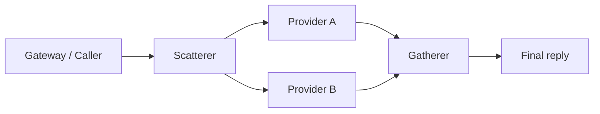
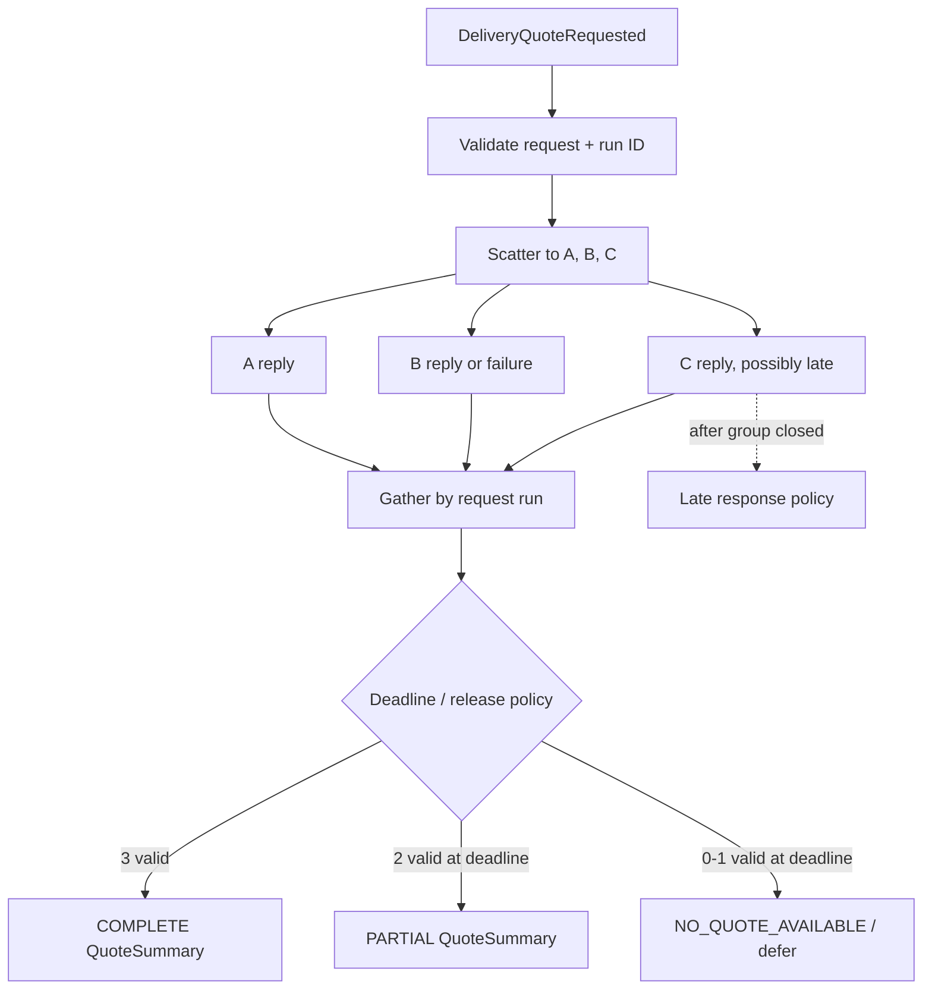

# Testing Complete, Missing, and Expired Replies

In the **Scatter–Gather** pattern of Enterprise Integration Patterns (EIP), one request is sent to multiple recipients (*scatter*) and the system waits for replies to build an aggregated result (*gather*). A test suite proving only that **all recipients reply on time** is not enough. In production, a branch can return `null`, be dropped by a Filter, time out, reply late, throw an exception, or resend the same response on retry. Without testing those cases, the Gatherer can **wait forever**, emit **incomplete data**, **release prematurely**, or emit **two results for the same request**.

This lesson belongs to the **Scatter gather** chapter of the `SPRING_INTEGRATION_PATTERN` module, focusing on implementing Spring Integration and Router, Filter, Transformer, Splitter, Aggregator, Gateway, retry, error channel, and correlation patterns to build loosely coupled, extensible message flows with testable branches and bottleneck visibility.

The focus of this lesson is **testing the three core reply states**:

1. **Complete:** all valid replies from expected recipients arrive before the deadline.
2. **Missing:** one or more recipients send no reply, send an error, or are dropped from the flow.
3. **Expired/Late:** replies or group completion occur past the deadline, possibly arriving **after the caller timed out** or after the Gatherer already released/expired the group.

After this lesson, you can design test data, place timeouts properly, write time-bounded tests, build partial/late-response policies, verify correlation and duplicates, and distinguish an **orchestration-logic test** from a **real Spring Integration integration test**.

## 1. Why are happy-path tests insufficient?

Suppose a system needs delivery quotes from two carriers `A` and `B`:

```text
QuoteRequest(requestId=Q-101)
             |
             v
          Scatter
          /     \
         A       B
         |       |
       25.000  28.000
          \     /
           Gather
             |
             v
     QuoteSummary(Q-101)
```

The ideal scenario has two valid results. Yet production systems can see:

| Scenario | Received data | What must be tested |
| --- | --- | --- |
| **FULL** | A and B reply before deadline. | Group releases once, right request, both sources present. |
| **MISSING** | Only A replies; B returns nothing. | Never produces fake complete result; never hangs forever. |
| **TIMEOUT** | B replies after deadline. | Policy clearly treats B as late; no second summary emitted. |
| **DUPLICATE** | A replies twice; B has not replied. | Never treats `A + A` as two valid recipients. |
| **ERROR** | A succeeds, B throws exception. | Does exception turn into a failure response or stay missing? |
| **WRONG_CORRELATION** | A belongs to Q-101, B to Q-102. | Never mixes responses from two requests. |
| **INVALID_REPLY** | B returns bad schema/unit. | Never produces wrong business aggregate even if count is met. |
| **CANCELLED** | Caller cancelled/expired, provider still replies. | Late reply observed and handled per policy. |

**Do not equate `send()` succeeding with "all replies received".** `MessageChannel.send(...)` confirms a send operation at the channel boundary per that channel's semantics. It does not prove remote providers replied, the Aggregator released, results were durably persisted, or the caller received a response.

## 2. Timing model: three distinct deadlines

A Scatter–Gather flow can have at least three time limits:



| Clock | What does it control? | When time runs out |
| --- | --- | --- |
| **Provider timeout** | An HTTP/JDBC/remote gateway call to each provider. | Branch needs bounded retry, failure outcome, or error signal. |
| **Gather/group timeout** | How long a group is allowed to wait for all replies. | Group can expire, release partial, or fail per configuration. |
| **Caller/Gateway reply timeout** | How long the caller waits for a combined result. | Caller stops waiting; **does not automatically cancel workers or groups**. |

Design example:

```text
t0       Gateway receives request Q-201
t0+20ms  Scatterer sends to A and B
t0+80ms  A returns reply
t0+300ms B client timeout
t0+450ms Gather deadline expires
t0+500ms Gateway reply timeout
t0+700ms B returns late reply after remote work finished
```

**Numbers are illustrative only.** The key point is that events are separate: B may be considered timed out by the client yet still finish remotely; the Gatherer may expire before/at/after the Gateway's deadline; a late reply does not automatically turn into a valid response.

### Absolute deadlines vs. relative wait durations

In tests, define:

```text
startedAt = 2026-11-21T08:00:00Z
deadline  = startedAt + 500 ms
```

Instead of stacking `Thread.sleep(...)` calls, use a **test-controlled `Clock` or `Instant`** for policy logic. For real framework timers, test with finite timeouts and reasonable buffers to reduce flakiness. Real client timeouts must be configured on the actual client, not only in tests.

## 3. Correlation: two replies for the wrong request is still a bug

A valid reply must **belong to the exact request run**. If two requests Q-301 and Q-302 run concurrently:

```text
t1  A replies Q-302
t2  A replies Q-301
t3  B replies Q-302
t4  B replies Q-301
```

The Gatherer must produce:

```text
Summary Q-301 = {A/Q-301, B/Q-301}
Summary Q-302 = {A/Q-302, B/Q-302}
```

Not `{A/Q-302, A/Q-301}` just because those two arrived first.

| Value | Meaning | How to use in tests? |
| --- | --- | --- |
| `requestId` in payload | Application-defined business ID. | Assert every response in the summary has the right request ID. |
| `requestRunId` | ID of a specific execution/scatter run. | Distinguish retries/replays at run level if contract requires. |
| `correlationId` | Group key used by Aggregator to group. | Assert same-run replies group together and different runs never mix. |
| `sequenceNumber` | Marked branch/sequence position. | Validate properly; never substitute for recipient identity. |
| `sequenceSize` | Expected element count when known. | Never treat count as duplicate protection. |
| `replyChannel` | Return destination for request–reply. | Assert final result reaches the right Gateway/output; not a group key. |
| `MessageHeaders.id` | ID of one Spring message. | Never treat as durable idempotency key across replays. |

In Spring Integration, scatterers and Gatherers can generate or propagate correlation metadata per endpoint used. **Never hardcode** that `correlationId` always equals `requestId`: inspect the exact topology and test relationships between messages. Across brokers, a dedicated envelope may be needed to reconstruct group identity.

## 4. Defining the contract for three test outcomes

For clear testing, a request must declare **the actually expected recipient set** and a meaningful deadline.

```java
import java.util.Set;

record QuoteRequest(
        String requestId,
        String requestRunId,
        String sku,
        Set<String> expectedProviders
) {
    QuoteRequest {
        expectedProviders = Set.copyOf(expectedProviders);
    }
}

record ProviderQuote(
        String requestId,
        String requestRunId,
        String providerId,
        long amountMinorUnits,
        String currencyCode
) {}

enum GatherStatus {
    PENDING,
    COMPLETE,
    TIMED_OUT
}
```

These types are an **illustrative application contract**, not auto-generated by Spring Integration. Decide semantics before writing tests:

- **COMPLETE:** received one valid response from every provider in `expectedProviders` **before the deadline**.
- **PENDING:** not all received yet and **before the deadline**.
- **TIMED_OUT:** deadline arrived with providers still missing; group closed per test policy.
- **LATE:** response arrived after the group closed or at/after the deadline.
- **DUPLICATE:** same provider already has a valid response in this request run.
- **WRONG_GROUP:** response does not match the group's `requestId`/`requestRunId`.

If the product permits **partial results**, use a supplemental contract — e.g., `QuoteSummary(complete=false, missingProviders=...)` — rather than sharing the same `COMPLETE` status for both full and incomplete outcomes.

## 5. Designing a framework-independent test oracle

A good test knows **where right vs. wrong is defined**. Never let tests follow "whatever the framework returns is expected". For Scatter–Gather, we can build a simple **oracle**:

```text
expected = {A, B}
received = {}
deadline = t0 + 500ms

on(A, t0+100ms):
  received = {A}
  status = PENDING

on(B, t0+200ms):
  received = {A, B}
  status = COMPLETE

on(B, t0+700ms) after timeout:
  status remains TIMED_OUT if the group was previously closed
  response classified as LATE
```

The oracle describes **product policy**, not Spring Integration's internal scheduler mechanics. When testing a real flow, use the oracle to assert outputs/side effects and compare actual state against the chosen policy.

### Why must exact boundary behavior be specified?

If the deadline is `t0+500ms`, specify whether a reply arriving **exactly** at `t0+500ms` is on time or late. In this lesson, the illustrative convention is:

```text
accepted if receivedAt < deadline
late     if receivedAt >= deadline
```

Other conventions may be valid, yet tests must check **before, right at, and after the boundary** so there is no ambiguity at the edge.

## 6. Policy test class using simulated time

To test all three states without sleeping, we build a pure Java state class taking an explicit `Instant now`. This is a **business model for testing and design**, not a Spring Integration class; it spawns no threads or timers.

```java
import java.time.Instant;
import java.util.ArrayList;
import java.util.HashMap;
import java.util.HashSet;
import java.util.List;
import java.util.Map;
import java.util.Set;

enum ReceiveStatus {
    ACCEPTED,
    COMPLETE,
    DUPLICATE,
    LATE
}

record GatherView(
        GatherStatus status,
        Set<String> receivedProviders,
        Set<String> missingProviders,
        List<ProviderQuote> quotes
) {}

final class QuoteGatherState {
    private final String requestId;
    private final String runId;
    private final Set<String> expected;
    private final Instant deadline;
    private final Map<String, ProviderQuote> replies = new HashMap<>();

    private boolean closed;
    private GatherStatus finalStatus;

    QuoteGatherState(
            String requestId,
            String runId,
            Set<String> expectedProviders,
            Instant deadline) {

        if (requestId == null || requestId.isBlank()
                || runId == null || runId.isBlank()
                || expectedProviders == null || expectedProviders.isEmpty()
                || deadline == null) {
            throw new IllegalArgumentException("INVALID_GATHER_CONTRACT");
        }
        this.requestId = requestId;
        this.runId = runId;
        this.expected = Set.copyOf(expectedProviders);
        this.deadline = deadline;
    }

    synchronized ReceiveStatus onReply(ProviderQuote reply, Instant now) {
        if (reply == null || now == null) {
            throw new IllegalArgumentException("INVALID_REPLY");
        }
        if (!requestId.equals(reply.requestId())
                || !runId.equals(reply.requestRunId())
                || !expected.contains(reply.providerId())) {
            throw new IllegalArgumentException("WRONG_REQUEST_OR_PROVIDER");
        }

        expireIfNeeded(now);
        if (closed) {
            return ReceiveStatus.LATE;
        }
        if (replies.containsKey(reply.providerId())) {
            return ReceiveStatus.DUPLICATE;
        }
        if (reply.amountMinorUnits() <= 0
                || !"VND".equals(reply.currencyCode())) {
            throw new IllegalArgumentException("INVALID_QUOTE_CONTRACT");
        }

        replies.put(reply.providerId(), reply);
        if (replies.keySet().containsAll(expected)) {
            closed = true;
            finalStatus = GatherStatus.COMPLETE;
            return ReceiveStatus.COMPLETE;
        }
        return ReceiveStatus.ACCEPTED;
    }

    synchronized GatherView snapshot(Instant now) {
        if (now == null) {
            throw new IllegalArgumentException("CLOCK_REQUIRED");
        }
        expireIfNeeded(now);

        Set<String> missing = new HashSet<>(expected);
        missing.removeAll(replies.keySet());

        List<ProviderQuote> ordered = new ArrayList<>(replies.values());
        ordered.sort(java.util.Comparator.comparing(
                ProviderQuote::providerId));

        GatherStatus status = closed ? finalStatus : GatherStatus.PENDING;
        return new GatherView(
                status,
                Set.copyOf(replies.keySet()),
                Set.copyOf(missing),
                List.copyOf(ordered));
    }

    private void expireIfNeeded(Instant now) {
        if (!closed && !now.isBefore(deadline)) {
            closed = true;
            finalStatus = GatherStatus.TIMED_OUT;
        }
    }
}
```

**Important limitations of this model:**

1. It serves as an **example oracle and policy**, not a claim of reflecting 100% of `ScatterGatherHandler` or `MessageGroupStore` behavior across all versions.
2. `snapshot(now)` checks the deadline **when invoked**; it does not schedule expiration automatically. In real Spring Integration, timeout/expiry must be configured on the appropriate endpoint or scheduler/store.
3. `onReply()` guards the method inside **one instance** via `synchronized`. It does not guarantee atomicity across multiple JVMs.
4. `closed` blocks further responses after completion/expiration, yet lacks a **persistent closed-group tombstone**; restarts lose in-memory state.
5. Payload checks only `VND` for simplicity; production needs full currency, schema, amount, and provider validity contracts.
6. A reply after `COMPLETE` returns `LATE` to avoid modifying the published summary; another product may define a separate `DUPLICATE_AFTER_COMPLETE`.

Separating **logic correctness** from **scheduling/transport correctness** makes unit tests fast and repeatable, after which integration tests verify framework execution.

## 7. Unit test 1 — all replies before deadline

Tests should prove the group does not release early after the first response, yet releases accurately once both A and B arrive:

```java
import static org.junit.jupiter.api.Assertions.assertEquals;
import static org.junit.jupiter.api.Assertions.assertTrue;

import java.time.Instant;
import java.util.Set;

import org.junit.jupiter.api.Test;

class QuoteGatherStateTest {

    private static final Instant T0 =
            Instant.parse("2026-11-21T08:00:00Z");

    private static ProviderQuote quote(
            String requestId, String provider, long amount) {
        return new ProviderQuote(
                requestId, requestId + "/run-1",
                provider, amount, "VND");
    }

    @Test
    void completeOnlyAfterAllExpectedProvidersReply() {
        QuoteGatherState group = new QuoteGatherState(
                "Q-101", "Q-101/run-1",
                Set.of("A", "B"), T0.plusMillis(500));

        assertEquals(ReceiveStatus.ACCEPTED,
                group.onReply(quote("Q-101", "B", 24_000),
                        T0.plusMillis(80)));
        assertEquals(GatherStatus.PENDING,
                group.snapshot(T0.plusMillis(100)).status());

        assertEquals(ReceiveStatus.COMPLETE,
                group.onReply(quote("Q-101", "A", 25_000),
                        T0.plusMillis(200)));

        GatherView view = group.snapshot(T0.plusMillis(250));
        assertEquals(GatherStatus.COMPLETE, view.status());
        assertTrue(view.missingProviders().isEmpty());
        assertEquals(2, view.quotes().size());
        assertEquals("A", view.quotes().get(0).providerId());
        assertEquals("B", view.quotes().get(1).providerId());
    }
}
```

This is a **reversed-arrival-order test** (B arrives before A). Never assert only `quotes.size()==2`: also verify **source identities**, group identity, and deadlines. When flows have downstream side effects, verify the final summary/command is **emitted only once**.

## 8. Unit test 2 — one reply missing within window

A non-replying recipient does not have to be an exception. The branch may have received the request and returned `null`, been dropped by a Filter, suffered an unconverted remote error, or lost the response in transit.

```java
@Test
void remainsPendingWhileOneProviderIsMissingBeforeDeadline() {
    QuoteGatherState group = new QuoteGatherState(
            "Q-102", "Q-102/run-1",
            Set.of("A", "B"), T0.plusMillis(500));

    assertEquals(ReceiveStatus.ACCEPTED,
            group.onReply(quote("Q-102", "A", 25_000),
                    T0.plusMillis(100)));

    GatherView view = group.snapshot(T0.plusMillis(499));
    assertEquals(GatherStatus.PENDING, view.status());
    assertEquals(Set.of("A"), view.receivedProviders());
    assertEquals(Set.of("B"), view.missingProviders());
    assertEquals(1, view.quotes().size());
}
```

This test proves **incomplete** is not conflated with **failed/expired**. In a default Gatherer waiting for the full sequence, the group may still sit in the store.

### If a recipient returns `null`

In Spring Integration, a request–reply handler **produces no reply** if it returns `null` per corresponding endpoint semantics. Never assume `null` becomes a valid `Message<null>` for the Aggregator to count. With a non-responding recipient, the group will stay incomplete until a timeout/expiry policy fires.

If you want to mean "this branch finished yet offers no quote", emit a **typed outcome**:

```java
record ProviderOutcome(
        String requestId,
        String requestRunId,
        String providerId,
        String status,
        Long amountMinorUnits,
        String reasonCode
) {}
```

For instance, `status=UNAVAILABLE` is **a business response with a reason**, whereas "no reply message" means the Gatherer **has not received an element**.

## 9. Unit test 3 — expired and late replies

When the deadline arrives with B still missing, the test must assert **TIMED_OUT**. A subsequent reply from B must not accidentally turn a closed group into COMPLETE.

```java
@Test
void closesOnDeadlineAndRejectsLateReply() {
    QuoteGatherState group = new QuoteGatherState(
            "Q-103", "Q-103/run-1",
            Set.of("A", "B"), T0.plusMillis(500));

    group.onReply(quote("Q-103", "A", 25_000),
            T0.plusMillis(100));

    GatherView expired = group.snapshot(T0.plusMillis(500));
    assertEquals(GatherStatus.TIMED_OUT, expired.status());
    assertEquals(Set.of("B"), expired.missingProviders());

    assertEquals(ReceiveStatus.LATE,
            group.onReply(quote("Q-103", "B", 24_000),
                    T0.plusMillis(700)));

    GatherView afterLate = group.snapshot(T0.plusMillis(800));
    assertEquals(GatherStatus.TIMED_OUT, afterLate.status());
    assertEquals(Set.of("B"), afterLate.missingProviders());
    assertEquals(1, afterLate.quotes().size());
}
```

**Exact-deadline boundary is tested too**: when `now == deadline`, the illustrative policy uses `!now.isBefore(deadline)` so the group is marked expired. An additional test should send B at `T0+499ms` and assert COMPLETE.

### Do not equate timeout with "provider failed"

If the client timed out waiting, the remote provider may **still be processing** and eventually emit a valid response. The Gatherer rejecting a late response is a **request acceptance-window policy**, not proof the provider skipped side effects.

For booking/charging operations, use idempotency or status queries rather than blindly retrying the entire scatter after timeout without checking prior results.

## 10. Boundary testing: just before, right at, and after the deadline

To catch time-comparison bugs:

| `receivedAt` | Deadline | Expectation under `< deadline` policy |
| --- | --- | --- |
| `t0 + 499 ms` | `t0 + 500 ms` | Accept reply; COMPLETE if full. |
| `t0 + 500 ms` | `t0 + 500 ms` | LATE/TIMED_OUT if not yet complete. |
| `t0 + 501 ms` | `t0 + 500 ms` | LATE/TIMED_OUT. |
| After group is COMPLETE | Any | Never mutate the emitted summary. |
| After group is TIMED_OUT | Any | Never become COMPLETE unless an explicit re-open policy exists. |

**The model test using `Instant` is completely deterministic.** With real Spring timers, never assert exact millisecond precision on CI machines: schedulers, thread pools, and system load have jitter. Use clear time buffers and bounded wait conditions instead of sleeping and guessing.

## 11. Testing duplicates, wrong requests, and invalid responses

Enough messages **does not guarantee enough recipients**.

```java
@Test
void duplicateFromSameProviderDoesNotCompleteGroup() {
    QuoteGatherState group = new QuoteGatherState(
            "Q-104", "Q-104/run-1",
            Set.of("A", "B"), T0.plusMillis(500));

    group.onReply(quote("Q-104", "A", 25_000),
            T0.plusMillis(100));

    assertEquals(ReceiveStatus.DUPLICATE,
            group.onReply(quote("Q-104", "A", 25_000),
                    T0.plusMillis(200)));

    GatherView view = group.snapshot(T0.plusMillis(250));
    assertEquals(GatherStatus.PENDING, view.status());
    assertEquals(Set.of("B"), view.missingProviders());
}

@Test
void wrongRequestCannotJoinOtherRequestsGroup() {
    QuoteGatherState group = new QuoteGatherState(
            "Q-105", "Q-105/run-1",
            Set.of("A", "B"), T0.plusMillis(500));

    org.junit.jupiter.api.Assertions.assertThrows(
            IllegalArgumentException.class,
            () -> group.onReply(
                    quote("Q-106", "A", 25_000),
                    T0.plusMillis(100)));
}
```

In production, you may need to distinguish **valid duplicates** (same result/response ID) from **conflicting duplicates** (same provider yet different quote). Never silently let "last write wins" decide when monetary values are affected; require revisions/versions and explicit replacement rules.

### Testing schema-invalid responses

Add tests for `amountMinorUnits<=0`, unsupported currency, unlisted providers, or missing `requestRunId`. **Never count contract-invalid responses as valid replies** just to release a group early. If returning a business error, convert it to a typed `ProviderOutcome(status=INVALID_RESPONSE)` after validation.

## 12. Spring Integration test: two in-process recipients

The unit tests above prove **policy** only. We need tests proving **the Scatterer sends requests, recipients actually return replies, and the Gatherer combines results** inside a Spring application context.

Below is an illustrative Java DSL config using two synchronous branches. Note that exact `scatterGather`/spec APIs may differ across Spring Integration versions; when applying to a real project, verify against your version and compile/test rather than treating an article as proof the code ran.

```java
import org.springframework.context.annotation.Bean;
import org.springframework.context.annotation.Configuration;
import org.springframework.integration.aggregator.SimpleSequenceSizeReleaseStrategy;
import org.springframework.integration.channel.DirectChannel;
import org.springframework.integration.channel.QueueChannel;
import org.springframework.integration.config.EnableIntegration;
import org.springframework.integration.dsl.IntegrationFlow;

@Configuration
@EnableIntegration
class QuoteScatterGatherConfig {

    @Bean
    DirectChannel quoteInput() {
        return new DirectChannel();
    }

    @Bean
    DirectChannel providerAInput() {
        return new DirectChannel();
    }

    @Bean
    DirectChannel providerBInput() {
        return new DirectChannel();
    }

    @Bean
    QueueChannel quoteOutput() {
        return new QueueChannel();
    }

    @Bean
    IntegrationFlow providerAFlow() {
        return IntegrationFlow.from("providerAInput")
                .handle(QuoteRequest.class, (request, headers) ->
                        new ProviderQuote(
                                request.requestId(), request.requestRunId(),
                                "A", 25_000, "VND"))
                .get();
    }

    @Bean
    IntegrationFlow providerBFlow() {
        return IntegrationFlow.from("providerBInput")
                .handle(QuoteRequest.class, (request, headers) ->
                        new ProviderQuote(
                                request.requestId(), request.requestRunId(),
                                "B", 28_000, "VND"))
                .get();
    }

    @Bean
    IntegrationFlow quoteScatterGather() {
        return IntegrationFlow.from("quoteInput")
                .scatterGather(
                        scatterer -> scatterer
                                .recipient("providerAInput")
                                .recipient("providerBInput"),
                        gatherer -> gatherer
                                .releaseStrategy(
                                        new SimpleSequenceSizeReleaseStrategy()))
                .channel("quoteOutput")
                .get();
    }
}
```

**Points to understand:**

- The Scatterer sends the request to both recipients; each branch handler **returns a `ProviderQuote`**.
- The Gatherer receives replies via Scatter–Gather mechanics and uses sequence/correlation metadata created/propagated by the flow.
- `SimpleSequenceSizeReleaseStrategy` illustrates waiting by count; it **does not prevent duplicates on its own**. For sensitive workflows, also verify provider identity.
- `quoteOutput` is a `QueueChannel` for tests to read results. In real systems, use a proper group processor producing a **`QuoteSummary`** with clear identity and status.
- This config **does not yet configure timeouts/partial release**, so **do not use it unmodified to test a silent recipient** without a wait bound.
- Do not register a second test flow consuming `quoteInput` simultaneously unless intentionally designing competing topologies.

### Testing complete results

```java
import static org.junit.jupiter.api.Assertions.assertEquals;
import static org.junit.jupiter.api.Assertions.assertNotNull;
import static org.junit.jupiter.api.Assertions.assertTrue;

import java.util.List;

import org.junit.jupiter.api.Test;
import org.springframework.beans.factory.annotation.Autowired;
import org.springframework.beans.factory.annotation.Qualifier;
import org.springframework.integration.channel.QueueChannel;
import org.springframework.messaging.Message;
import org.springframework.messaging.MessageChannel;
import org.springframework.messaging.support.MessageBuilder;
import org.springframework.test.annotation.DirtiesContext;
import org.springframework.test.context.junit.jupiter.SpringJUnitConfig;

@SpringJUnitConfig(QuoteScatterGatherConfig.class)
@DirtiesContext(classMode = DirtiesContext.ClassMode.AFTER_EACH_TEST_METHOD)
class QuoteScatterGatherCompleteTest {

    @Autowired @Qualifier("quoteInput")
    MessageChannel input;

    @Autowired @Qualifier("quoteOutput")
    QueueChannel output;

    @Test
    void receivesBothProviderRepliesBeforeCompleting() {
        var request = new QuoteRequest(
                "Q-201", "Q-201/run-1",
                "SKU-10", java.util.Set.of("A", "B"));

        assertTrue(input.send(
                MessageBuilder.withPayload(request)
                        .setHeader("traceId", "trace-201")
                        .build()));

        Message<?> gathered = output.receive(1_000);
        assertNotNull(gathered);

        // Default output may be a collection/list of payloads
        // depending on configured Gatherer/group processor.
        // In production tests, normalize to QuoteSummary and
        // assert request ID, provider identities, count, currency.
    }
}
```

**Never assert only `gathered != null` and declare the test sufficient.** In production flows, use a custom group processor producing typed results and explicitly assert: `requestId`, `requestRunId`, `providerIds={A,B}`, valid result count, `complete=true`, and **exactly one** final reply. The snippet above only illustrates booting the flow and checking an output; policy logic must be tested as in sections 7–11.

## 13. Missing-reply integration test: never wait forever

In a missing-reply test, replace provider B with a branch that **produces no response**. Depending on wiring, the handler may `return null`, a Filter may drop it, or a remote adapter may send no reply back.

```java
// Intentional fixture: one-way handler for recipient B.
IntegrationFlow.from("providerBInput")
        .handle(QuoteRequest.class, (request, headers) -> {
            // Record that the request reached B in the test fixture.
            return null; // Produces no reply for the Gatherer.
        })
        .get();
```

This is a **replacement fixture** for `providerBFlow()` in a separate test context; do not register both handlers on the same input channel at once when simulating B deterministically failing to reply.

### Never write tests that risk hanging

Avoid:

```java
// Avoid: can hang if Gatherer has no timeout/recovery.
input.send(message);
assertNull(output.receive());
```

Instead:

1. **Configure a finite timeout** on the Gatherer/Scatter–Gather mechanism supported by your Spring Integration version.
2. Configure **the timeout outcome policy**: no output, partial output, or exception/error message.
3. Send the request inside a thread-managed test fixture if the call can block.
4. Await results using `receive(timeoutMillis)` or a test utility with an explicit timeout.
5. Assert **the final outcome per contract**, not merely that a thread timed out.

Example check for a policy **emitting no complete summary when B is missing**:

```java
// Integration test pseudocode; not runnable standalone
// without timeout fixtures and named channels.

sendRequestWithFiniteGatherDeadline("Q-MISSING");

Message<?> complete = quoteOutput.receive(300);
// When policy emits no partial result before deadline:
assertNull(complete);

// Then inspect group state / expiry / error flow per config,
// rather than concluding solely from output == null.
assertEquals(1, observedRepliesFrom("Q-MISSING"));
assertEquals(1, missingRecipientsFor("Q-MISSING").size());
```

`sendRequestWithFiniteGatherDeadline`, `observedRepliesFrom`, and `missingRecipientsFor` are **mock test helpers** to be implemented by the test author, **not Spring Integration APIs**. The example illustrates required assertions rather than pretending a `receive()` timeout proves the entire error path works.

### Valid outcomes for a missing-reply test depend on policy

| Application policy | Right assertion |
| --- | --- |
| **All-or-nothing** | Does not emit `COMPLETE`; emits failure/timeout outcome or error response per contract. |
| **Partial allowed** | Emits `QuoteSummary(complete=false, expected=2, received=1)` at deadline. |
| **Durable defer** | Persists request for recovery; does not ACK source if contract requires. |
| **Failure-as-response** | B is represented as `ProviderUnavailable`; Gatherer receives both outcomes and releases with matching status. |

No single default outcome fits every product. **Tests must state the policy first and then assert against the framework.**

## 14. Late-reply integration test: distinguishing "late" from "missing"

A **missing** scenario observes the *not-yet-received* state. A **late** scenario adds a new event: the response actually arrives **after the group/caller already expired**.

A good test controls **exactly when provider B is permitted to reply**, rather than relying on whether the CI machine happens to be slow.

### Test fixture using latches

```java
import java.util.concurrent.CountDownLatch;
import java.util.concurrent.TimeUnit;

final class DelayedProviderFixture {
    private final CountDownLatch invoked = new CountDownLatch(1);
    private final CountDownLatch allowReply = new CountDownLatch(1);

    ProviderQuote handle(QuoteRequest request) {
        invoked.countDown();

        try {
            if (!allowReply.await(2, TimeUnit.SECONDS)) {
                throw new IllegalStateException("TEST_FIXTURE_NOT_RELEASED");
            }
        } catch (InterruptedException e) {
            Thread.currentThread().interrupt();
            throw new IllegalStateException("TEST_INTERRUPTED", e);
        }

        return new ProviderQuote(
                request.requestId(), request.requestRunId(),
                "B", 28_000, "VND");
    }

    boolean awaitInvocation() throws InterruptedException {
        return invoked.await(1, TimeUnit.SECONDS);
    }

    void releaseReply() {
        allowReply.countDown();
    }
}
```

**This fixture only works** if branch B actually executes on a separate thread/executor or via an async adapter. If `handle()` runs synchronously on the sending thread, the sender itself blocks on `await()` and the test will never reach `releaseReply()`. Configure a dedicated executor/test worker or an appropriate mock remote adapter.

### Late-reply test sequence

```text
1. Start context with B blockable by a latch.
2. Send Q-LATE via a call that does not block the test thread.
3. Wait for fixture to confirm B received the request.
4. Trigger/await Gatherer deadline expiration in a bounded test.
5. Assert group = TIMED_OUT or partial/failure outcome emitted.
6. Release latch so B returns its reply.
7. Assert B's reply is handled per late-arrival policy.
8. Assert no second COMPLETE summary and no duplicate side effects.
9. Clean up executor/latches/context even if prior assertions failed.
```

**Deadline expiration** should be driven by a fake clock/test scheduler when architecture allows; if real timers are needed, use **reasonable buffered timeouts** and solid cleanup. Doing `Thread.sleep(1000)` and asserting "reply surely arrived late" is a classic source of flaky tests.

### What must the test check after B arrives late?

Do not only assert an empty output queue. Observe at least one mechanism:

- A `lateReply` counter/log or a late-response channel.
- Group store/tombstone showing the group is closed.
- Output summary count does not grow beyond policy.
- Downstream side effects are not re-invoked.
- If *correction* is allowed, the update carries `summaryVersion` and clear status.

If the group was deleted from the store after release, B's response may be treated as a new group depending on configuration. Test **against the application's actual cleanup/expiry settings**, not merely a toy model.

## 15. Limitations of `assertTimeout` and `Thread.sleep` in integration tests

JUnit 5 provides `assertTimeout` and `assertTimeoutPreemptively`, whose messaging caveats must be understood:

- **`assertTimeout`** checks duration after the code finishes. If code blocks **forever**, it cannot cut off the block immediately upon exceeding the limit.
- **`assertTimeoutPreemptively`** runs the code on another thread to enforce the limit, yet **interrupting does not guarantee stopping every I/O call or downstream task**. It can also alter thread-bound context/transactions compared to production.
- **`Thread.sleep`** provides no meaningful synchronization; sleeping long enough locally may still fail on CI.
- **`QueueChannel.receive(timeout)`** keeps tests from hanging forever, yet observes only one channel; it does not prove group expiry, remote cancellation, or error routing worked.
- **`CountDownLatch`** orders events deterministically, provided `finally` cleanup and fixture timeouts prevent dangling threads after tests.

**Recommendation:** use **unit tests with `Instant`/Clock** for deadline policies; use **time-bounded integration tests** to verify Spring wiring, group stores, error flows, and late handling; use **end-to-end tests with real brokers/clients** for cross-process delivery guarantees.

## 16. Configuring Gatherer for partial results and group expiry

For an application to emit partial results when full replies do not arrive, design **two things**:

1. **When the group expires:** a framework-supported group timeout/expiry policy or release trigger.
2. **What output is built on expiry:** `PartialQuoteSummary`, failure result, recovery-pending event, or audited drop.

An Aggregator config in Spring Integration may expose options like `groupTimeout`, `sendPartialResultOnExpiry`, `expireGroupsUponCompletion`, `MessageGroupStore`, and custom group processors depending on version.

Below is an **illustrative DSL sketch**; verify exact overload/option names and semantics with tests on your version:

```java
// Sketch of a Gatherer with expiry/partial policy.
// Do not merge straight into section 12 flow without deciding
// the response contract and group-store lifecycle.

gatherer -> gatherer
        .groupTimeout(500)
        .sendPartialResultOnExpiry(true)
        .expireGroupsUponCompletion(true)
        .outputProcessor(customSummaryProcessor)
```

**`customSummaryProcessor` must distinguish complete from partial.** If the processor assumes every group always has two replies and throws an exception when only one exists, enabling `sendPartialResultOnExpiry(true)` will not magically give you a valid partial summary.

### A DTO for partial output

```java
import java.util.List;
import java.util.Set;

record QuoteSummary(
        String requestId,
        String requestRunId,
        boolean complete,
        int expectedCount,
        int receivedCount,
        Set<String> missingProviders,
        List<ProviderQuote> quotes
) {
    QuoteSummary {
        missingProviders = Set.copyOf(missingProviders);
        quotes = List.copyOf(quotes);
    }
}
```

Invariants tests should verify:

- `receivedCount <= expectedCount`.
- `complete=true` only when **every valid recipient** replied before the deadline.
- `missingProviders` equals `expectedProviders - receivedProviders`.
- Never two results for the same `(requestRunId, summaryVersion)` unless the contract permits corrections.
- Never mix distinct requests/tenants in the same summary.
- Provider results have valid currency/schema, not merely matching count.

### Message group store and timers are two separate concerns

A persistent `MessageGroupStore` can preserve received replies across restarts, yet **does not automatically mean** groups get scanned/expired on time, or that summaries are sent exactly-once. To support timeouts/restarts, configure group expiry, schedulers/recovery, and store-compatible transactions/locking. Prove this via integration tests rather than assuming it from having a store bean.

## 17. Gateway reply timeout vs. Gatherer timeout

A Gateway may wait at most 600 ms, while the Gatherer lets a group wait 1,000 ms. Once the caller hits timeout:

```text
t0       Gateway sends request
t0+600ms Gateway wait expires
t0+800ms Gatherer receives final reply and releases summary
```

The combined result formed, yet the caller **is no longer waiting per the original contract**. Tests must decide whether the late result is persisted to status, emitted as an event, or dropped, instead of assuming the Gateway receives it after timeout.

### Testing mismatched timeout pairs

| Configuration | Risk |
| --- | --- |
| Gateway timeout **shorter** than Gatherer deadline | Caller expires before summary is ready. |
| Provider timeout **longer** than Gatherer deadline | Provider keeps working after group closed. |
| Sum of per-provider retries **exceeds** overall deadline | Increases load and late replies; breaks "all branches before deadline" assumption. |
| No deadline on group | One missing reply leaks state/queues indefinitely. |

Tests should assign explicit **time budgets** per stage; never assume configuring one timeout solves everything.

### When to switch to an async API

If business operations can wait minutes or hours, synchronous request–reply via an HTTP Gateway is usually unsuitable. Return `ACCEPTED_FOR_PROCESSING` with `requestId`, persist progress durably, and provide **status queries/result events**. An in-memory Scatter–Gather does not provide a durable workflow on its own.

## 18. Recipient errors: failure-as-response or exception?

Recipient B may fail to reply due to:

- **Business failure:** supplier declines to quote.
- **Technical failure:** HTTP 503/timeout.
- **Contract failure:** malformed JSON response.
- **No reply:** handler returns `null` or emits no output.
- **Rejected path:** Filter drops request before calling B.

If the Gatherer needs to know **B finished with no quote**, creating **a typed outcome** can be a clean approach:

```java
record ProviderOutcome(
        String requestId,
        String requestRunId,
        String providerId,
        OutcomeStatus status,
        ProviderQuote quote,
        String reasonCode
) {}

enum OutcomeStatus {
    QUOTED,
    DECLINED,
    UNAVAILABLE,
    INVALID_RESPONSE
}
```

A `ProviderOutcome(status=UNAVAILABLE)` can still count as **a reply from B** under the release policy, yet the summary must never disguise it as `QUOTED` or `COMPLETE_SUCCESS` when it is not a real business offer.

### When exceptions are not converted into replies

If a handler throws an exception on a `DirectChannel`, the error may propagate to the sender. With executors/pollers/brokers, an error handler and `errorChannel` may handle it if configured. **Never assume** an `ErrorMessage` sent to a global error channel reaches the Gatherer automatically as a response from B.

To preserve correlation, the recovery flow must build a **`ProviderOutcome` with matching request/run/recipient and group metadata**, or enter another path designed to close/expire the group.

### Retries must have deadlines and idempotency

If B times out after creating a remote booking or charge, retrying the entire scatter can repeat side effects for both A and B. Use durable idempotency keys and retry **per recipient** when appropriate. Never use `MessageHeaders.id` from a send attempt as the sole durable key across broker redeliveries.

## 19. Protecting correlation across Router, Transformer, Splitter, and brokers

**Router:** The Scatterer may choose different recipient counts by region; `expectedProviders` must reflect **the set actually dispatched**. Never hardcode every group to 2 if some requests use 3 recipients.

**Transformer:** A worker converts `QuoteRequest` to `ProviderQuote`. If building `MessageBuilder.withPayload(reply).build()` manually without copying required headers, `correlationId`/`replyChannel` may be lost; test at the boundary. Conversely, never copy all headers from untrusted sources when internal routes/permissions are involved.

**Filter:** If a recipient is filtered out (`false`), the group may still wait for that recipient's reply. Emit `ProviderSkipped`/`ProviderUnavailable` or apply partial/failure policies.

**Splitter:** If a provider splits a request into subtasks, aggregate **results inside the provider** before returning **one outcome** to the outer Scatter–Gather, or design multi-level correlation. Never use the inner layer's `sequenceSize` to release the outer group.

**Broker/HTTP:** Across Kafka, AMQP, or REST, Spring headers do not automatically serialize and restore intact. Use an **application envelope** containing `requestId`, `requestRunId`, `recipientId`, `responseId`, and matching expected-set/version. Inbound adapters map these into correlation strategies without trusting raw external headers as authorization proof.

```json
{
  "requestId": "Q-901",
  "requestRunId": "Q-901/run-1",
  "recipientId": "A",
  "responseId": "R-901-A-1",
  "outcome": "QUOTED",
  "amountMinorUnits": 25000,
  "currencyCode": "VND"
}
```

This is an **illustrative application schema**, not a default Spring Integration format. Enforce duplicate/replay checks on `responseId` or an appropriate business key. With multiple tenants, use tenant-scoped correlation keys and source authentication to prevent cross-principal response mixing.

## 20. Testing restarts, late arrivals, and multiple instances

In-JVM tests with `QueueChannel` do not prove a flow recovers from crashes or handles multiple replicas. When reliability requirements are high, also test:

```text
1. Receive A/Q-1001, persist group state.
2. Restart application / consumer.
3. Receive B/Q-1001.
4. Verify summary is produced exactly once.
5. Redeliver A/Q-1001 after summary.
6. Verify duplicate/late policy preserves correctness.
```

### In-memory vs. persistent group store

| Aspect | In-memory | Properly configured persistent store |
| --- | --- | --- |
| Groups across restart | Usually lost. | Can recover state. |
| Multi-instance | State not shared automatically. | Shareable with proper store and locking. |
| Group expiry | Still needs scheduler/policy. | Still needs scheduler/policy and transactions. |
| Duplicates | Does not deduplicate automatically. | **Also does not deduplicate** business duplicates automatically. |
| Exactly-once side effects | Not guaranteed. | Not guaranteed by store alone. |

If responses for the same group spread across three JVMs each with a local store, no instance sees all replies. You need group affinity/partitioning or a shared store with locking. For sensitive operations, prove correlation and idempotency in tests with real brokers/stores.

### Late responses after group cleanup

A reply from B may arrive after a partial group was deleted. If it spawns a new group, the system can emit a second summary or leave an incomplete group dangling forever. Tests must assert **final summary count**, idempotency state, group count, and late counters — not just the last message's payload.

## 21. Observability and preventing flaky tests

A Scatter–Gather test suite should measure **group progress**, not just aggregate throughput:

| Illustrative metric | Purpose |
| --- | --- |
| `scatter_request_total` | Requests dispatched to recipients. |
| `scatter_recipient_dispatched_total{recipient}` | Dispatches per recipient. |
| `gather_reply_received_total{recipient,status}` | Replies received by branch/outcome. |
| `gather_group_open` | Currently waiting groups. |
| `gather_group_complete_total` | Complete groups released. |
| `gather_group_partial_total` | Partial groups emitted per policy. |
| `gather_group_timeout_total` | Expired groups. |
| `gather_reply_late_total` | Replies arriving after group closure. |
| `gather_reply_duplicate_total` | Duplicate replies per recipient/run. |
| `gather_group_age_seconds` | Wait duration of open groups. |

Metric names are **self-instrumented examples**, not guaranteed Spring Integration built-ins. Never put `requestId`, `responseId`, `traceId`, or customer IDs into metric labels due to high cardinality and data leaks.

Log example:

```text
requestRunId=Q-103/run-1 expected=2 received=1
status=TIMED_OUT missingProviders=B
deadline=2026-11-21T08:00:00.500Z

requestRunId=Q-103/run-1 provider=B
status=LATE receivedAt=2026-11-21T08:00:00.700Z
```

When tests flake, collect **event timelines**, group store state, queue sizes, thread/executor state, retry counts, actual deadlines, and error channels. Never "fix" a test by endlessly increasing `Thread.sleep`: diagnose the synchronization and time-budget root cause.

### Rules for a reliable test suite

1. **Policy unit tests use a fake clock or explicit `Instant`**; never run real timers for deadline edge cases.
2. **Integration tests use finite timeouts** on every `receive`, latch, and remote call.
3. **Each test isolates state** or resets group stores, queues, and mocks; `@DirtiesContext` is simple though costly.
4. **Close resources after tests**: executors, schedulers, temporary brokers/containers, latches, subscriptions.
5. **Never assert arrival order** of asynchronous branches unless guaranteed by contract.
6. **Assert identities, not just counts**: request ID, run ID, provider ID, response ID, status, and emitted summary count.
7. **Test explicit failure policies**: full, partial, no-result/error, late/correction — never let one test accept arbitrary outcomes.
8. **Track side effects too**: not just output DTOs, also handler invocation counts or store writes when significant.

## 22. Complete test matrix for Scatter–Gather

| Case | Input / scenario | Minimum assertions |
| --- | --- | --- |
| FULL-01 | A then B before deadline | COMPLETE, both A/B present, right request, single output. |
| FULL-02 | B then A before deadline | Same as FULL-01, independent of arrival order. |
| FULL-03 | Two interleaved requests | No cross-group mixing; two independent outputs. |
| MISSING-01 | Only A replies, before deadline | PENDING, missing={B}, no complete output. |
| MISSING-02 | B handler returns `null` | No-reply policy holds; `null` never counted as reply. |
| MISSING-03 | Filter drops B | Discard/failure-result policy clear; group never hangs forever. |
| TIMEOUT-01 | B missing at deadline | TIMED_OUT or partial/fail output per policy. |
| TIMEOUT-02 | B replies right at deadline | Inclusive/exclusive boundary tested explicitly. |
| LATE-01 | B replies after expiry | Late recorded; no false complete summary emitted. |
| LATE-02 | B replies after Gateway timeout | Not misdelivered to another request; recovery runs. |
| DUP-01 | A replies twice, B missing | Does not release early at count=2. |
| DUP-02 | Duplicate response after completion | No second side effect or summary. |
| ERROR-01 | B throws network error | Error policy, retry/failure-as-response works. |
| ERROR-02 | B returns bad schema | Never counted as valid quote. |
| CORR-01 | B belongs to different request | Not mixed; rejected/quarantined. |
| CORR-02 | Missing correlation header across adapter | Never grouped into a shared catch-all group. |
| DYNAMIC-01 | Recipient list changes 2 → 3 | Expected count/set reflects actual recipients. |
| NESTED-01 | Provider A uses internal Splitter | Outer group receives only contract outcome. |
| RESTART-01 | Crash after A, before B | State recovers if durability is required. |
| CLUSTER-01 | A/B replies hit two instances | Group affinity/shared store works properly. |
| SECURITY-01 | Same ID, different tenant | No data mixing or privilege bypass. |
| LOAD-01 | High request volume and late replies | Group age/store/backpressure bounded; no memory leaks. |

## 23. Case study: three carriers, quote returned within 800 ms

**Context:** An application sends `DeliveryQuoteRequested` to three partners A, B, and C. A responds fast, B may fail, C is often slower than the deadline. Users wait at most **800 ms**; business allows returning a **partial quote** if at least two valid results arrive. With zero or one valid result, return `NO_QUOTE_AVAILABLE` or defer per policy. Prices must never leak from another request.



### Practice steps

1. **Define the contract** with `requestId`, `requestRunId`, `tenantId`, `providerId`, `responseId`, `currency`, `receivedAt`, deadline, and summary status.
2. **Define clocks**: provider timeouts A/B/C, Gatherer deadline, and Gateway reply timeout; ensure total budgets do not conflict.
3. **Write deterministic unit tests** for three outcomes: all 3, B missing before deadline, C missing past deadline.
4. **Write boundary tests**: responses at 799 ms, 800 ms, and 801 ms; specify `< deadline` vs. `<= deadline`.
5. **Test duplicates**: A replies twice while B/C have not replied; group must not count two completed providers.
6. **Test correlation**: two interleaved requests Q-X/Q-Y; no summary contains results from the other request.
7. **Test errors**: B hits timeout/503; separate exceptions from typed `ProviderUnavailable`.
8. **Test late responses**: C replies after partial release; assert no second summary without a correction contract.
9. **Test Gateway**: caller times out before Gatherer; verify how late replies are handled.
10. **Test restart**: if recovery is required, use durable group store/transport and replay crash after one reply.
11. **Test security**: a response with wrong `tenantId` or spoofed `providerId` must not enter the group.
12. **Observe**: count full, partial, timed-out, late, and duplicate groups; never use request IDs as metric labels.

### Self-assessment questions

**Question 1:** A succeeded, B has not replied, deadline has not expired. Can COMPLETE be asserted? **No.** The group is still incomplete per contract; only PENDING or an explicitly designed early-termination mechanism applies.

**Question 2:** A replied twice and B has not replied. `sequenceSize=2` and the group holds two messages; is that enough to mark complete? **No.** Distinct recipient identity/deduplication is needed; raw counts can lie.

**Question 3:** Does `QueueChannel.receive(300)` returning `null` prove the group expired? **No.** It only proves no message was observed during the wait; check group expiry/error/partial policies directly.

**Question 4:** When the Gateway times out, do workers and the Gatherer definitely stop too? **No.** Caller timeout, provider timeout, and group expiry are separate.

**Question 5:** Response C arrives late after partial release. Should partial silently turn into complete? **Not by default.** Either apply a correction/version policy or record late and keep the emitted result.

**Question 6:** Can all timing tests be solved by increasing `Thread.sleep`? **No.** Use fake clocks, latches, and bounded waits to reduce flakiness and prove logic accurately.

## Summary

- **Scatter–Gather testing requires three foundational scenario groups:** **complete replies**, **missing replies**, and **expired/late replies**; then extend to duplicates, wrong correlation, exceptions, partials, and late arrivals.
- **Right correlation does not prove completeness**: verify distinct recipient identities, expected sets, response validity, and release policies; `sequenceSize`/counts alone do not prevent duplicates.
- **Provider timeout, Gather/group timeout, and Gateway reply timeout** are three different clocks; `receive(timeout)` does not prove group expiry or downstream cancellation.
- Use **deterministic unit tests with `Instant`/Clock** for deadlines and state transitions, **Spring Integration tests** for wiring/correlation/reply paths, and **real broker/store tests** when cross-process durability/recovery is required.
- Missing/late tests must enforce **finite timeouts, controlled threads/fixtures, and cleanup**, avoiding hangs or flaky `Thread.sleep`.
- With **partial/failure-as-response/late correction**, use explicit status payloads, preserve durable business IDs, design idempotency, and test that **no duplicate summaries or side effects** occur.
- Monitor **pending groups, timeouts, partials, late replies, duplicates, and group age**; a successful `send()` does not prove every recipient replied or business work completed.
