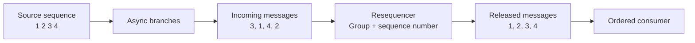
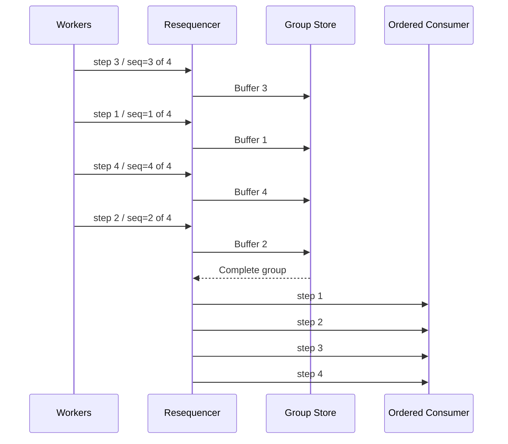
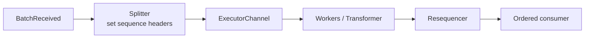

# Resequencer Orders Messages by Sequence

## 1. Problem: Messages Arrive Out of Business Order

Suppose a system processes a shipment consisting of four steps numbered 1 through 4. After a Splitter, each step is sent through processing branches with different response times. The third step finishes first, while the second step is the slowest:

```text
Business order:            1 → 2 → 3 → 4
Message arrival order:     3 → 1 → 4 → 2

Desired downstream order:  1 → 2 → 3 → 4
```

If downstream builds a shipping log, generates event sequence numbers, or performs operations that **require strict ordering**, forwarding messages in arrival order causes discrepancies. The **Resequencer** in Enterprise Integration Patterns (EIP) solves this problem by **grouping messages belonging to the same sequence, ordering them by sequence number, and releasing them in the defined order**.

In the **Resequencer** chapter of the **SPRING_INTEGRATION_PATTERN** module, learners practice Enterprise Integration Patterns with Spring Integration to build loosely coupled and scalable messaging flows. Resequencer appears in pipelines alongside Splitter, Router, Filter, Transformer, Gateway, and asynchronous channels; using it properly also involves Aggregator, correlation, retry, error channels, and testing processing branches.



**What Resequencer guarantees is ordering messages according to sequence metadata within the scope of its group and release policy.** It does not invent business order, modify payload data, guarantee exactly-once delivery, or detect a missing message without a rule specifying the expected element count or an end signal.

## 2. How Resequencer Differs from Aggregator, Sort, and Queue

Resequencer and Aggregator are both **stateful per group** and need a way to determine which messages belong to the same group. However, they produce different outputs:

| Pattern / Component | Goal | Output |
| --- | --- | --- |
| **Splitter** | Split one message into multiple child messages | Multiple individual messages |
| **Resequencer** | Reorder **message release sequence** within a sequence | Still **multiple individual messages**, in order |
| **Aggregator** | Combine multiple messages into a single result | Usually one aggregated message |
| **Filter** | Accept or discard messages by predicate | Less than or equal to the number of input messages |
| **Router** | Select a processing channel | Messages routed to the selected branches |
| **Queue** | Store and forward messages | Does not inherently know *business* order after parallel processing |
| **Sort a List** | Sort a collection already in RAM | One sorted collection |
 
Example:

```text
Input messages (in arrival order):
  Message(step=3)
  Message(step=1)
  Message(step=2)

Resequencer output:
  Message(step=1)
  Message(step=2)
  Message(step=3)

Aggregator output:
  Message(payload=[step=1, step=2, step=3])
```

**Key point:** Resequencer is not a `List.sort` operation inside a Transformer. It receives messages **arriving at different times**, holds those that cannot yet be released in a group store, waits for missing parts, and decides when to release.

### 2.1. When Do You Need a Resequencer?

Some suitable scenarios:

- A Splitter dispatches work items to multiple executors/workers, and the results must be sent downstream in the original order.
- Events belong to a finite sequence with sequence metadata and traverse multiple fast/slow processing branches.
- Parts of a document or result set are processed concurrently and then require a predefined sequence.
- A batch of commands has a deterministic order, but the message broker or consumer logic does not guarantee in-order arrival.

**It should not be used in every case.** If steps depend on each other (step 2 must read step 1's output), merely sorting **after** parallel execution does not guarantee correct execution logic. In that case, **sequential orchestration or workflow dependencies** are needed, not just placing a Resequencer at the end.

### 2.2. When Should You Not Use It?

- Unbounded streams with no sequence boundary or window definition.
- Extremely large groups with many sequence gaps where bounded state cannot be maintained.
- Systems requiring **global order** across all tenants/batches; Resequencer only guarantees order per group, not a total order across groups.
- The flow after the Resequencer sends to multiple independent executors without an order-preserving mechanism.
- Sources lacking reliable sequence numbers; arrival order or timestamps do not automatically turn into a business sequence.

According to Spring Integration documentation, Resequencer works best with **relatively short sequences with few gaps**; many fragmented groups and large gaps can degrade performance due to state retention and inspection.

## 3. Three Foundational Headers: Correlation, Sequence Number, Sequence Size

Spring Integration typically uses the following three pieces of information for Resequencer to operate:

| Header | Responsibility | Example |
| --- | --- | --- |
| `IntegrationMessageHeaderAccessor.CORRELATION_ID` | Key identifying the sequence/group | `tenant-hcm:SHIP-105:v1` |
| `IntegrationMessageHeaderAccessor.SEQUENCE_NUMBER` | **One-based** position of the message in the sequence | `3` |
| `IntegrationMessageHeaderAccessor.SEQUENCE_SIZE` | Total expected elements in a finite sequence | `4` |

**Sequence numbers start at 1, not 0.** If an application stores a zero-based `sourceIndex`, it must convert it to a sequence number per contract, such as `sequenceNumber = sourceIndex + 1`. Never treat them as equivalent.

```text
SourceIndex:         0   1   2   3
SequenceNumber:      1   2   3   4
SequenceSize:        4   4   4   4
CorrelationId:     SHIP-105 for all 4 messages
```

If the same `SEQUENCE_NUMBER=2` appears in **two different groups**, those are two independent messages and both can be valid. If two messages in the same group both carry `SEQUENCE_NUMBER=2`, there is a risk of duplicate/conflict and an explicit policy must be applied.

### 3.1. Do Not Use Message ID as the Correlation Key

`MessageHeaders.ID` is an **envelope** identifier. When a broker redelivers or an adapter recreates a `Message`, the ID may change. Business ordering and groups must be identified by a stable key such as `(tenantId, batchId, sequenceVersion)` generated by a trusted source.

### 3.2. Headers Must Be Consistent Within the Same Group

A valid group has:

- The same `CORRELATION_ID`, determined from an authenticated source.
- `SEQUENCE_NUMBER` as a positive integer within the expected range.
- `SEQUENCE_SIZE` with the same positive value for messages of a fixed sequence.
- Consistent `tenantId`, `schemaVersion`, and `workflowVersion` when those attributes affect business logic.
- Elements identified by a stable item key to prevent duplicates on redelivery.

If clients are allowed to set arbitrary `CORRELATION_ID` values, two tenants might send colliding keys and get merged into the same group. Resequencer only orders properly if **messages are grouped correctly from the start**.

## 4. How Resequencer Maintains State and Releases Messages

An intuitive way to view this is that each correlation group has:

```text
Group {
  correlationId
  expectedSize
  bufferedMessages keyed by sequenceNumber
  lastReleasedSequence / release progress
  createdAt / updatedAt
  completion / expiration state
}
```

This is a **conceptual model** to explain the mechanism. The actual internal structure is managed by the framework and `MessageGroupStore`, and does not necessarily have Java fields matching the exact names above.

When a message arrives:

1. Read the correlation key, sequence number, and size.
2. Place the message into the group in the store, handling duplicates according to policy.
3. Determine which sequences can be released based on the **release strategy**.
4. When the condition is met, release eligible messages in ascending `SEQUENCE_NUMBER` order.
5. Maintain necessary state/tombstone metadata to recognize completed groups and handle late arrivals.

### 4.1. Example Arrival Order 3 → 1 → 4 → 2

For a finite sequence with `size=4`, in **wait-for-full-sequence mode**:

| Arrival | New Item | Buffer After Arrival | Complete? | New Output |
| --- | ---: | --- | --- | --- |
| 1 | 3 | {3} | No | None |
| 2 | 1 | {1,3} | No | None |
| 3 | 4 | {1,3,4} | No | None |
| 4 | 2 | {1,2,3,4} | Yes | **1,2,3,4** |

Arrival order is not used as output order; `SEQUENCE_NUMBER` determines the position.



### 4.2. Resequencer Does Not Transform Messages Into a New Payload

Upon release, Resequencer **forwards each individual message** in order; it does not perform payload merging like Aggregator. Changing payloads, computing totals, or building summaries belongs to Transformer/Aggregator. However, as a message passes through multiple endpoints, routing metadata may still be subject to framework rules; test headers on the output rather than assuming every transport-specific header will always be preserved.

## 5. Two Release Policies: Full Sequence and Partial Sequence

Spring Integration supports choosing between:

- **Full sequence / releasePartialSequences(false):** waits for the complete sequence and then releases in order.
- **Partial contiguous / releasePartialSequences(true):** can release **contiguous in-order prefixes** early as they become ready, then waits for missing parts.

Under standard configuration, `releasePartialSequences` defaults to **false**. Setting it to true **does not mean** any arriving item is released immediately: gaps must still be respected.

### 5.1. Case partial = false

```text
arrival:      3, 1, 4, 2
after 3:     output []
after 1:     output []
after 4:     output []
after 2:     output [1, 2, 3, 4]
```

Suitable when downstream requires a **complete set** and must not see partial data. In return, total latency is greater than or equal to the wait time for the last item.

### 5.2. Case partial = true

```text
arrival:      3, 1, 4, 2
after 3:     output []
after 1:     output [1]
after 4:     output []
after 2:     output [2, 3, 4]

Final output order: 1, 2, 3, 4
```

If a group has already released sequence 1, and receives sequence 3 while sequence 2 has not arrived yet, Resequencer **must not release 3 past the gap at 2** under "partial contiguous" semantics.

| Property | Full sequence | Partial contiguous |
| --- | --- | --- |
| When release starts | After the group meets completion condition | When a contiguous range starting at the next position is available |
| Latency of first item | Potentially high | Usually lower |
| Waiting when middle item is missing | Entire group waits | Items after the gap wait |
| State to maintain | Until sequence is complete | Holds unreleased items; tracks release progress |
| Use with all-or-nothing workflows | Better suited for **release condition** | May expose results downstream before group completes |
| Consumer transaction guarantee | **No** | **No** |

**Important note:** Full release is not a transaction. If all four items arrive and Resequencer releases item 1 successfully, then item 2 fails downstream, item 1's side effect may already be committed. Therefore, idempotency, error handling, and recovery are still required.

### 5.3. Partial Mode Does Not Fix Permanent Gaps

If message 2 is lost:

```text
expected:  1  2  3  4
received:  1     3  4

partial mode:
  1 is released
  3 and 4 may remain held because 2 is missing
```

You need timeout/expiration, alerts, redelivery, retrieval of missing messages, or a **policy allowing partial results upon group expiration**. Do not configure `releasePartialSequences(true)` and assume all messages will eventually be released.

## 6. A Realistic Pipeline and Resequencer Placement

A common pipeline:



**Place the Resequencer after the segment that can reorder messages and before the consumer that truly requires ordering.** If you place it **before** an `ExecutorChannel` executing in parallel, messages can go out of order again after resequencing.

### 6.1. Arrival Order and Completion Order Differ

- `DirectChannel` typically executes the handler on the calling thread; ordering at a single send point can be easier to control.
- `ExecutorChannel` hands off processing to a thread pool; even if messages are sent as 1,2,3,4, workers may finish as 3,1,4,2.
- `PublishSubscribeChannel` with an executor or multiple consumers can produce different completion times across branches.
- Kafka/RabbitMQ have their own partition/ordering semantics; **do not** assume an application using a broker will always preserve a global business order.

Resequencer can only restore order at the **point where resulting messages converge**. If the flow remains async afterward, ordering must be preserved in the next downstream segment or identity/sequence metadata must be carried for another layer to handle.

### 6.2. Do Not Generate Sequence Metadata by "Counting Arriving Messages"

A source sending four items must know the mapping:

```text
sourceIndex 0 -> sequenceNumber 1
sourceIndex 1 -> sequenceNumber 2
sourceIndex 2 -> sequenceNumber 3
sourceIndex 3 -> sequenceNumber 4
sequenceSize   = 4
```

Do not assign sequence numbers **by arrival order after workers** because that turns completion order into business order. Metadata should be attached **before asynchronous fan-out**, typically in a Splitter or a contract-bound producer.

## 7. Java DSL: Basic Resequencer Configuration

The following Spring Integration Java DSL example only requires an input channel bean, an output channel bean, and an `IntegrationFlow` using `resequence()`. You can explicitly configure `releasePartialSequences(false)` to express the contract of waiting for the complete group.

### 7.1. Channel and Flow Configuration

```java
import org.springframework.context.annotation.Bean;
import org.springframework.context.annotation.Configuration;
import org.springframework.integration.channel.DirectChannel;
import org.springframework.integration.config.EnableIntegration;
import org.springframework.integration.dsl.IntegrationFlow;
import org.springframework.messaging.MessageChannel;

@Configuration
@EnableIntegration
class ShipmentResequencerFlow {

    @Bean("shipment.parts.in")
    MessageChannel partsIn() {
        return new DirectChannel();
    }

    @Bean("shipment.parts.ordered")
    MessageChannel orderedParts() {
        return new DirectChannel();
    }

    @Bean
    IntegrationFlow reorderShipmentParts() {
        return IntegrationFlow.from("shipment.parts.in")
                .resequence(spec -> spec
                        .releasePartialSequences(false))
                .channel("shipment.parts.ordered")
                .get();
    }
}
```

`IntegrationFlow.resequence()` is a built-in EIP method in the DSL. Because Resequencer configuration is primarily a specialized endpoint/handler, Spring Integration does not provide a `@Resequencer` annotation equivalent to `@Splitter`; configure it via Java DSL or supported framework configuration.

**Responsibility of each step:**

1. `shipment.parts.in` receives messages with valid correlation/sequence headers.
2. Resequencer groups and buffers messages until the release condition is satisfied.
3. `shipment.parts.ordered` receives each message **in sequence order within the group**.
4. The consumer subscribes to `shipment.parts.ordered` to process one element at a time.

`DirectChannel` in this example is used for synchronous integration tests. Receiving messages in order on the output channel does not guarantee a downstream broker/executor will maintain that order if it continues parallel processing.

### 7.2. Payload and Producer Creating Out-of-Order Messages

```java
record ShipmentStep(
        String shipmentId,
        int businessStep,
        String action) {}
```

Create messages with sequence metadata using official Spring Integration constants:

```java
import org.springframework.integration.IntegrationMessageHeaderAccessor;
import org.springframework.messaging.Message;
import org.springframework.messaging.support.MessageBuilder;

final class ShipmentPartFactory {

    static Message<ShipmentStep> step(
            String tenantId,
            String shipmentId,
            int sequenceNumber,
            int sequenceSize,
            String action) {

        if (tenantId == null || tenantId.isBlank()
                || shipmentId == null || shipmentId.isBlank()
                || action == null || action.isBlank()
                || sequenceSize <= 0
                || sequenceNumber < 1
                || sequenceNumber > sequenceSize) {
            throw new IllegalArgumentException("Invalid shipment sequence");
        }

        var payload = new ShipmentStep(
                shipmentId, sequenceNumber, action);

        String groupKey =
                tenantId + "|" + shipmentId + "|plan-v1";

        return MessageBuilder.withPayload(payload)
                .setHeader(
                        IntegrationMessageHeaderAccessor.CORRELATION_ID,
                        groupKey)
                .setHeader(
                        IntegrationMessageHeaderAccessor.SEQUENCE_NUMBER,
                        sequenceNumber)
                .setHeader(
                        IntegrationMessageHeaderAccessor.SEQUENCE_SIZE,
                        sequenceSize)
                .setHeader("tenantId", tenantId)
                .setHeader("eventId",
                        tenantId + ":" + shipmentId
                                + ":plan-v1:step:" + sequenceNumber)
                .setHeader("planVersion", "plan-v1")
                .build();
    }

    private ShipmentPartFactory() {}
}
```

Example producer sending in completion order:

```java
import org.springframework.messaging.MessageChannel;

// input: MessageChannel bean named "shipment.parts.in".
input.send(ShipmentPartFactory.step(
        "tenant-hcm", "SHIP-105", 3, 4, "PACK"));
input.send(ShipmentPartFactory.step(
        "tenant-hcm", "SHIP-105", 1, 4, "VALIDATE"));
input.send(ShipmentPartFactory.step(
        "tenant-hcm", "SHIP-105", 4, 4, "DISPATCH"));
input.send(ShipmentPartFactory.step(
        "tenant-hcm", "SHIP-105", 2, 4, "RESERVE"));
```

Expected output on `shipment.parts.ordered` in sequence:

```text
ShipmentStep(shipmentId=SHIP-105, businessStep=1, action=VALIDATE)
ShipmentStep(shipmentId=SHIP-105, businessStep=2, action=RESERVE)
ShipmentStep(shipmentId=SHIP-105, businessStep=3, action=PACK)
ShipmentStep(shipmentId=SHIP-105, businessStep=4, action=DISPATCH)
```

**Demo limitation:** Unauthenticated caller data must not dictate `CORRELATION_ID`. In multi-tenant systems, the group key must be built from an authenticated tenant and a sufficiently unique workflow ID. Concatenating strings with `|` is only for readability; production needs unambiguous encoding or trusted group IDs.

### 7.3. A Consumer with Side Effects Placed After Resequencer

```java
import org.springframework.integration.annotation.ServiceActivator;
import org.springframework.messaging.Message;
import org.springframework.stereotype.Component;

interface ShipmentStepService {
    void apply(ShipmentStep step, String eventId);
}

@Component
class OrderedShipmentConsumer {
    private final ShipmentStepService service;

    OrderedShipmentConsumer(ShipmentStepService service) {
        this.service = service;
    }

    @ServiceActivator(inputChannel = "shipment.parts.ordered")
    public void handle(Message<ShipmentStep> message) {
        String eventId = (String) message.getHeaders().get("eventId");
        if (eventId == null || eventId.isBlank()) {
            throw new IllegalArgumentException("Missing eventId");
        }
        service.apply(message.getPayload(), eventId);
    }
}
```

Resequencer only orders **messages delivered to the handler**. If `service.apply` has side effects, transactions and idempotency keyed by `(tenantId, shipmentId, businessStep, planVersion)` are needed. Do not use `sequenceNumber` alone because different shipments all have steps 1, 2, 3, and 4.

### 7.4. Preserving Headers Across Transformers

If a message passes through a custom Transformer before Resequencer, you must preserve `CORRELATION_ID`, `SEQUENCE_NUMBER`, `SEQUENCE_SIZE`, and required business IDs. With `IntegrationFlow.transform(...)` returning a new payload, the framework handles message metadata propagation, but when constructing a new `Message` manually or crossing a broker/HTTP boundary, **header mapping must be integration tested**.

A poorly written transform can strip correlation headers from messages, causing them to be rejected or grouped incorrectly. Sequence headers are not optional objects that can be dropped arbitrarily if a downstream Resequencer depends on them.

## 8. Partial Release with Java DSL

If the consumer can process **contiguous ranges** early, you can use an **alternative** flow with its own channel names:

```java
import org.springframework.context.annotation.Bean;
import org.springframework.context.annotation.Configuration;
import org.springframework.integration.channel.DirectChannel;
import org.springframework.integration.config.EnableIntegration;
import org.springframework.integration.dsl.IntegrationFlow;
import org.springframework.messaging.MessageChannel;

@Configuration
@EnableIntegration
class PartialShipmentResequencerFlow {

    @Bean("shipment.partial.in")
    MessageChannel partialInput() {
        return new DirectChannel();
    }

    @Bean("shipment.partial.ordered")
    MessageChannel partialOutput() {
        return new DirectChannel();
    }

    @Bean
    IntegrationFlow resequenceWithPartialRelease() {
        return IntegrationFlow.from("shipment.partial.in")
                .resequence(spec -> spec
                        .releasePartialSequences(true))
                .channel("shipment.partial.ordered")
                .get();
    }
}
```

Using the same send order `3,1,4,2`:
- After message 3: first step is missing, nothing released.
- After message 1: step 1 can be released.
- After message 4: step 2 is still missing, 3 and 4 are not released yet.
- After message 2: 2,3,4 can be released.

This is **an alternative configuration**; do not attach both flows to consume from the same `DirectChannel` input and expect every message to be delivered to both. When comparing, use separate channels and test contexts as in the two examples.

**Technical reference:** Spring Integration Reference — [Resequencer](https://docs.spring.io/spring-integration/reference/resequencer.html) and [Aggregators and Resequencers (Java DSL)](https://docs.spring.io/spring-integration/reference/6.2/dsl/java-aggregators.html). Specific APIs should be verified against the project's dependency version during the next QA/compile pass.
## 9. When Sequences Are Missing, Duplicated, Malformed, or Late

In production environments, sequences are rarely as clean as the four-item demo. Producers may send invalid headers, brokers may redeliver messages, Filters may drop items, or consumers may disconnect while a group is waiting.

### 9.1. Missing Message in the Middle of a Sequence

```text
size=5
received: 1, 2, 4, 5
missing:  3
```

In **full release** mode, the group is not complete enough to release normally. In **partial release** mode, 1 and 2 can be released, but 4 and 5 must be held due to the gap at 3.

If 3 never arrives:
- The group may stay alive for a long time and consume memory/store capacity.
- Pending group count and latency increase.
- A Gateway waiting for the final reply may time out.
- A downstream Aggregator step may also wait indefinitely for a result that is never released.

The solution is **timeout + recovery policy**: request redelivery of item 3, move the group to quarantine, or release valid parts upon expiration **only if business rules allow**. No configuration can infer the content of a lost message 3.

### 9.2. Duplicate Sequence Numbers

```text
correlationId = tenant-hcm:SHIP-105:v1
received sequence numbers = 1, 2, 2, 4
expected size = 4
```

Both copies might represent the same event (broker redelivery), or they might be two distinct events mistakenly assigned the same sequence number. Never rely solely on the count of received messages to conclude a sequence is complete.

Distinguish between:
1. **Exact duplicate:** same `itemBusinessId` and same version → can be suppressed idempotently.
2. **Conflicting duplicate:** same group and sequence number but different payload → contract error requiring investigation.
3. **Intentional new revision:** an item was corrected and resent → create a new sequence version or workflow according to rules.

A MessageStore or framework may handle duplicates by message ID, but **do not assume** it automatically deduplicates every business duplicate when two envelopes have different IDs. Deduplication must rely on stable business identity and be covered by integration tests.

### 9.3. Out-of-Range Sequence Numbers and Inconsistent Sequence Sizes

A sequence with `SEQUENCE_SIZE=4` where an item carries `SEQUENCE_NUMBER=0` or 9 is invalid data. If one item states size 4 and another states size 5, the group has no consistent expectation.

Practices:
- Validate immediately at ingress or before Resequencer.
- Cap maximum `SEQUENCE_SIZE` based on system capacity to prevent unbounded groups/DoS.
- Verify consistent `tenantId` and `planVersion` within the same sequence.
- Do not auto-"heal" mismatched sizes by taking max(size) unless there is an explicit business contract.
- Classify input errors separately from transient downstream errors.

### 9.4. Late-Arriving Messages

Suppose a group has already released 1..4 and then a duplicate of item 2 arrives later. It may be discarded by the framework or handled against completed group metadata, depending on retention/expiration settings. A clear **late arrival** policy is required:

| Type | Example | Handling |
| --- | --- | --- |
| Copy of already-released message | Step 2 arrives again | Suppress idempotently |
| Missing item arriving after timeout | Step 3 arrives past deadline | Controlled replay or log as late |
| Intentional new revision | Updated step 2 after sequence closed | Route to a new sequence/version |
| Wrong group key | Different tenant with same correlation ID | Reject, raise security alert |

**Do not erase all traces of a group immediately upon release without accounting for late arrivals.** Spring Integration provides options to retain empty group/tombstone metadata and group cleanup mechanisms; specific choices depend on MessageStore configuration, expiration, and framework version.

## 10. Validating Sequence Headers Before Entering Resequencer

Enforcing explicit boundary checks prevents groups that can never release. Example metadata validation helper:

```java
import org.springframework.integration.IntegrationMessageHeaderAccessor;
import org.springframework.messaging.Message;

final class SequenceEnvelopeValidator {
    private static final int MAX_SEQUENCE_SIZE = 10_000;

    static void validate(Message<?> message) {
        Object group = message.getHeaders().get(
                IntegrationMessageHeaderAccessor.CORRELATION_ID);
        Object number = message.getHeaders().get(
                IntegrationMessageHeaderAccessor.SEQUENCE_NUMBER);
        Object size = message.getHeaders().get(
                IntegrationMessageHeaderAccessor.SEQUENCE_SIZE);

        if (!(group instanceof String key) || key.isBlank()) {
            throw new IllegalArgumentException("MISSING_CORRELATION_ID");
        }
        if (!(number instanceof Integer position)
                || !(size instanceof Integer expectedSize)) {
            throw new IllegalArgumentException("INVALID_SEQUENCE_HEADERS");
        }
        if (expectedSize < 1 || expectedSize > MAX_SEQUENCE_SIZE
                || position < 1 || position > expectedSize) {
            throw new IllegalArgumentException("OUT_OF_RANGE_SEQUENCE");
        }
    }

    private SequenceEnvelopeValidator() {}
}
```

This helper checks **types/ranges** but cannot prove the tenant is valid or that the entire group agrees on size: add security context and state/version validation at the producer/control-plane or a group consistency check step.

When ingesting from HTTP/brokers, never let callers supply `tenantId` and `CORRELATION_ID` headers unauthenticated. A malicious key can:
- Mix data across tenants.
- Create excessive new groups leading to memory exhaustion.
- Cause huge gaps or sequences that never complete.
- Flood error/quarantine channels with messages.

### 10.1. Distinguishing "Invalid Input" from "Incomplete Sequence"

A group with valid headers missing item 3 is **incomplete**, not a malformed message. An item with `sequenceNumber=-1` is **invalid input** and should be rejected immediately. If both go to the same error channel, attach a clear reason code so recovery does not retry invalid data indefinitely.

## 11. MessageStore, Timeouts, and Resource Limits

Resequencer must buffer messages that cannot yet be released. Depending on configuration, the group store can be in-memory or a persistent store. Each message holds payload, headers, and metadata, so cost grows with the number of pending groups and buffered elements.

### 11.1. In-Memory vs. Persistent Store

| Option | Pros | Risks |
| --- | --- | --- |
| In-memory MessageStore | Easy to configure, low latency | Restart can lose incomplete groups |
| JDBC / persistent group store | Can recover state after restart | Requires transaction, locking, and cleanup design |
| Distributed store | Multiple instances can share state | Adds consistency overhead, lock contention, network latency |
| Partition routing by correlation key | Items of the same group go to the same worker | Must handle rebalance/failover |

**A persistent MessageStore does not automatically provide exactly-once delivery.** A message may be delivered to the consumer and then a crash occurs before source ACK/commit. Resequencer or consumer may reprocess it; downstream side effects must be idempotent.

### 11.2. Timeouts and Group Expiration

When a timeout expires and a sequence is still missing some items, the system must decide:

1. **Wait longer with a limit** (if the source can still deliver the rest).
2. **Request resend** of the missing sequence numbers.
3. **Expire and quarantine the group**; store correlation ID, received items, gaps, and replay info.
4. **Release partial results upon expiration** only if **accepted by business rules** (not by default).
5. **Reject the flow and return a Gateway error** with specific reason/timeouts.

Spring Integration provides properties for group timeout, expiration, discarding, and sending partial results on group expiry. Do not try adding a `sleep` inside a handler to "wait for the last item"; that blocks threads and does not solve persistence/recovery.

**Important:** Releasing incomplete results on timeout is **different** from enabling `releasePartialSequences(true)`. One option allows early release of contiguous prefixes; the other governs what happens to a group when it expires.

### 11.3. Monitoring Gaps and Stuck Groups

Metrics/fields worth observing:

```text
correlationId = tenant-hcm:SHIP-105:v1
expectedSize  = 4
received      = [1,3,4]
missing       = [2]
groupAge      = 15 seconds
releaseMode   = PARTIAL_CONTIGUOUS
lastReleased  = 1
```

This log model is illustrative; values like `missing` or `lastReleased` may be computed by the application from the store rather than emitted out-of-the-box by Resequencer in the exact same structure.

Enforce limits on:
- Number of concurrent groups.
- Maximum payload size and sequence size.
- Maximum wait time and group metadata retention.
- Number of unreleased messages per group.
- Inbound message rate and worker/downstream concurrency.

High memory usage in Resequencer is not necessarily a memory leak: it may be caused by business processes frequently dropping middle items.

## 12. Retry, Error Channel, and Idempotency

Resequencer handles **ordering**, not sole responsibility for reliability. A message may be redelivered by a producer, broker, adapter, or replayed from a MessageStore group.

### 12.1. Three Common Failure Layers

| Layer | Example | Handling |
| --- | --- | --- |
| **Input metadata** | Missing correlation, invalid sequence number | Reject/quarantine; do not retry indefinitely |
| **Resequencer/group state** | Store timeout, lock conflict, group expired | Bounded retry, state recovery, late arrival handling |
| **Consumer after resequencing** | DB timeout, HTTP API failure | Idempotent consumer, backoff, compensation when needed |

With `DirectChannel`, exceptions from downstream handlers can propagate back to the sending thread. With `ExecutorChannel`, pollers, or brokers, errors may occur on another thread and be handled by an error handler/`errorChannel` depending on configuration. **An error channel does not automatically provide retry, persistence, or a dead-letter queue.**

### 12.2. Do Not Treat Resequencer as a Deduplicator

If two messages have the same `SEQUENCE_NUMBER` and the same group but different `MessageHeaders.ID` values, the framework may need an explicit duplicate-handling policy. Even after a group releases in order, a broker can still redeliver a message after a lost ACK. Thus downstream needs an idempotency key such as:

```text
(tenantId, shipmentId, planVersion, businessStep)

tenant-hcm : SHIP-105 : plan-v1 : 2
```

When side effects and deduplication live in the same database, one solution is a unique constraint and recording processing markers in the **same transaction** as the business update. For remote APIs, use an idempotency key or reconcile results when a timeout leaves execution status unknown.

### 12.3. When the Consumer Fails Mid-Sequence

The full sequence arrives and Resequencer releases items 1,2,3,4. If the handler for item 2 fails:

- Item 1's side effect may already have succeeded.
- Depending on dispatch/error mechanics, items 3 and 4 may not have been processed yet.
- Retrying the entire group risks re-executing item 1.
- Retrying only item 2 may suffice if the consumer supports checkpointing.

Do not treat waiting for a complete group and releasing it as an **all-or-nothing batch transaction**. If business rules require all operations to complete in order atomically, dedicated orchestration, appropriate transactions, or compensation are required.

## 13. Unit Tests for Metadata and Ordering Logic

### 13.1. Testing Validation

```java
import org.junit.jupiter.api.Test;
import org.springframework.integration.IntegrationMessageHeaderAccessor;
import org.springframework.messaging.support.MessageBuilder;

import static org.junit.jupiter.api.Assertions.*;

class SequenceEnvelopeValidatorTest {

    @Test
    void acceptsValidSequenceHeaders() {
        var message = ShipmentPartFactory.step(
                "tenant-hcm", "SHIP-105", 2, 4, "RESERVE");
        assertDoesNotThrow(() ->
                SequenceEnvelopeValidator.validate(message));
    }

    @Test
    void rejectsOutOfRangeSequence() {
        var invalid = MessageBuilder.withPayload("bad")
                .setHeader(
                        IntegrationMessageHeaderAccessor.CORRELATION_ID,
                        "tenant-hcm:SHIP-105:v1")
                .setHeader(
                        IntegrationMessageHeaderAccessor.SEQUENCE_NUMBER, 5)
                .setHeader(
                        IntegrationMessageHeaderAccessor.SEQUENCE_SIZE, 4)
                .build();

        assertThrows(IllegalArgumentException.class, () ->
                SequenceEnvelopeValidator.validate(invalid));
    }

    @Test
    void rejectsMissingCorrelation() {
        var missing = MessageBuilder.withPayload("bad")
                .setHeader(
                        IntegrationMessageHeaderAccessor.SEQUENCE_NUMBER, 1)
                .setHeader(
                        IntegrationMessageHeaderAccessor.SEQUENCE_SIZE, 2)
                .build();

        assertThrows(IllegalArgumentException.class, () ->
                SequenceEnvelopeValidator.validate(missing));
    }
}
```

These unit tests verify header format/ranges, but **do not replace** Resequencer integration tests. Actual messages must be sent through Spring Integration and the order observed at the consumer.

## 14. Integration Test: Messages Arrive 3,1,4,2 and Exit 1,2,3,4

A minimal integration test uses a Spring context containing `ShipmentResequencerFlow` and a subscriber recording output. Each test creates its own context to avoid group state/tombstones leaking from other tests.

```java
import java.util.ArrayList;
import java.util.List;
import org.junit.jupiter.api.Test;
import org.springframework.context.annotation.AnnotationConfigApplicationContext;
import org.springframework.integration.channel.DirectChannel;
import org.springframework.messaging.Message;
import org.springframework.messaging.MessageChannel;

import static org.junit.jupiter.api.Assertions.*;

class ShipmentResequencerFlowTest {

    @Test
    void holdsWholeGroupThenReleasesInSequenceOrder() {
        try (var context = new AnnotationConfigApplicationContext(
                ShipmentResequencerFlow.class)) {

            var received = new ArrayList<Message<?>>();
            DirectChannel output = context.getBean(
                    "shipment.parts.ordered", DirectChannel.class);
            output.subscribe(received::add);

            MessageChannel input = context.getBean(
                    "shipment.parts.in", MessageChannel.class);

            input.send(ShipmentPartFactory.step(
                    "tenant-hcm", "SHIP-105", 3, 4, "PACK"));
            assertTrue(received.isEmpty());

            input.send(ShipmentPartFactory.step(
                    "tenant-hcm", "SHIP-105", 1, 4, "VALIDATE"));
            assertTrue(received.isEmpty());

            input.send(ShipmentPartFactory.step(
                    "tenant-hcm", "SHIP-105", 4, 4, "DISPATCH"));
            assertTrue(received.isEmpty());

            input.send(ShipmentPartFactory.step(
                    "tenant-hcm", "SHIP-105", 2, 4, "RESERVE"));

            List<Integer> actual = received.stream()
                    .map(m -> ((ShipmentStep) m.getPayload())
                            .businessStep())
                    .toList();
            assertEquals(List.of(1, 2, 3, 4), actual);
            assertEquals(4, received.size());
        }
    }
}
```

**Why can this test assert immediately after send?** The example uses synchronous `DirectChannel`s and the subscriber records output directly on the sending thread. With async channels/brokers, use `CountDownLatch`/Awaitility with a bounded timeout rather than arbitrary `Thread.sleep`.

### 14.1. Partial Mode Integration Test

```java
import java.util.ArrayList;
import java.util.List;
import org.junit.jupiter.api.Test;
import org.springframework.context.annotation.AnnotationConfigApplicationContext;
import org.springframework.integration.channel.DirectChannel;
import org.springframework.messaging.Message;
import org.springframework.messaging.MessageChannel;

import static org.junit.jupiter.api.Assertions.*;

class PartialShipmentResequencerFlowTest {

    @Test
    void releasesOnlyContiguousPrefixes() {
        try (var context = new AnnotationConfigApplicationContext(
                PartialShipmentResequencerFlow.class)) {

            var received = new ArrayList<Message<?>>();
            var output = context.getBean(
                    "shipment.partial.ordered", DirectChannel.class);
            output.subscribe(received::add);

            var input = context.getBean(
                    "shipment.partial.in", MessageChannel.class);

            input.send(ShipmentPartFactory.step(
                    "tenant-hcm", "SHIP-206", 3, 4, "PACK"));
            assertTrue(received.isEmpty());

            input.send(ShipmentPartFactory.step(
                    "tenant-hcm", "SHIP-206", 1, 4, "VALIDATE"));
            assertEquals(List.of(1), sequenceOf(received));

            input.send(ShipmentPartFactory.step(
                    "tenant-hcm", "SHIP-206", 4, 4, "DISPATCH"));
            assertEquals(List.of(1), sequenceOf(received));

            input.send(ShipmentPartFactory.step(
                    "tenant-hcm", "SHIP-206", 2, 4, "RESERVE"));
            assertEquals(List.of(1, 2, 3, 4), sequenceOf(received));
        }
    }

    private static List<Integer> sequenceOf(
            List<Message<?>> received) {
        return received.stream()
                .map(m -> ((ShipmentStep) m.getPayload())
                        .businessStep())
                .toList();
    }
}
```

This test verifies actual behavior: in partial mode, message 1 is released **before** item 2 arrives; however, items 3 and 4 still wait for the gap to close.

### 14.2. Minimum Test Matrix

| Scenario | What to Verify |
| --- | --- |
| 3,1,4,2 with full release | Output 1,2,3,4 **after completion** |
| 3,1,4,2 with partial release | Output 1 early; 2,3,4 when gap fills |
| 1,2,3,4 in order | Correct output, unaltered |
| Two interleaved correlation IDs | Each group maintains **its own** order, no global order required |
| Sequence number 0 or > size | Rejected by validation |
| Varying sequence sizes within group | Contract conflict detected |
| Duplicate item with different message ID | No duplicate side effects, no wrong release |
| Group missing an item | Held/expired/recovered per policy |
| Late arrival after release | Discarded/reopened/versioned per explicit policy |
| Crash before group completes | State recovered if persistent store is chosen |
| Downstream handler fails after item 1 | Proper retry/compensation/idempotency |
| Splitter + Filter drops an item | Does not wait for the wrong expected element count |
| Headers through Transformer/broker | Correlation, number, and size are not lost |
| Async after Resequencer | Check whether order gets scrambled again |

### 14.3. Do Not Assert Only Received Message Count

Four messages might be released in the wrong order 1,3,2,4; or four arrivals could be 1,2,2,4 missing 3. Therefore:
- Assert the **list of `SEQUENCE_NUMBER` or businessStep values** is in exact order.
- Assert output count matches unique identities per contract.
- Assert correlation IDs are not mixed across batches/tenants.
- Assert final consumer state under retries, not just mock invocation counts.
- In partial mode, assert *relative timing*: 1 is released before 2 arrives, and 3 does not bypass 2.

## 15. Metrics and Operations

Resequencer typically increases latency while waiting for missing messages. Dashboards must distinguish **expected policy-driven waiting** from **stuck groups**.

| Metric | Meaning |
| --- | --- |
| `resequencer.groups.active` | Number of incomplete groups |
| `resequencer.messages.buffered` | Number of messages waiting to be released |
| `resequencer.group.age` | Time from first item to group closure |
| `resequencer.missing.positions` | Number of missing positions across groups |
| `resequencer.release.latency` | Time a message waits before release |
| `resequencer.out.of.order.arrivals` | Messages arriving out of order |
| `resequencer.duplicate.detected` | Duplicate/sequence conflicts |
| `resequencer.group.expired` | Expired groups |
| `resequencer.late.arrival` | Messages arriving after group closure |
| `resequencer.store.errors` | State store/lock errors |
| `downstream.retry` | Failures when consumer receives reordered items |

The metric names above are **suggested application metrics**, not default metric names automatically exported by Spring Integration. Micrometer observations and logging can be added at the appropriate endpoints.

Logs should record group reference, `eventId`, `tenantId` (per security policy), sequenceNumber/sequenceSize, attempt count, and reason code. Avoid using `eventId` or group ID as high-cardinality **metric labels**. Do not log payloads/headers containing PII, tokens, or sensitive financial data.

### 15.1. Interpreting Symptoms

| Symptom | Suspect | Investigation |
| --- | --- | --- |
| Active groups steadily increasing | Missing items or missing group timeout | Inspect gaps / producer |
| High full release latency | Slow final item | Measure workers by sequence |
| Partial release stuck after 1 | Missing item 2 | Trace step 2 |
| Output becomes out of order again | Async downstream after Resequencer | Inspect subsequent channels/executors |
| Duplicate side effects | Redelivery / non-idempotent consumer | Check stable business keys |
| Cross-tenant group | Correlation key not tenant-scoped | Fix ingress and validate correlation |
| Restart loses groups | Using volatile store | Check persistence/ACK recovery |
| Resequencer uses high memory | Long groups / large gaps / large payloads | Limit group size and retention |

## 16. Common Design Mistakes

1. **Treating sequence number as arrival order** instead of business order assigned by producer/Splitter.
2. **Zero-based numbering** for sequence headers using the standard one-based mechanism.
3. **Using Message ID as correlation key**, causing replays to create separate groups.
4. **Omitting sequence size or completion definition** and expecting sequences to complete automatically.
5. **Using `releasePartialSequences(true)` and assuming gaps will be skipped**.
6. **Treating full release as a whole-batch transaction**, ignoring partial downstream commits.
7. **Placing Resequencer before another ExecutorChannel** while expecting the final output to remain sequential.
8. **Sharing group keys across tenants**, causing data mixing.
9. **Not checking duplicate sequence numbers** on broker redelivery.
10. **Not designing timeout/expiration** for groups with missing elements.
11. **Not limiting sequence size or active group count**, overloading store and memory.
12. **Trusting an in-memory store to survive restarts**.
13. **Treating Resequencer as an idempotency mechanism** even though consumers have side effects.
14. **Copying correlation/sequence headers improperly across Transformers or protocol adapters**.
15. **Confusing sequence order with dependency execution order**, running dependent steps concurrently and sorting afterward.
16. **Testing only output count**, without asserting order and timing of partial prefix releases.

## 17. Practice Exercise and Self-Assessment

**Exercise:** Build a flow processing `DocumentChunk` items of a four-part document. Each message carries `documentId`, `tenantId`, `chunkIndex`, `chunkText`, `eventId`, and sequence headers. Workers may finish out of order.

1. Create a Splitter or producer setting `SEQUENCE_NUMBER=chunkIndex+1` and `SEQUENCE_SIZE=4`.
2. Run four mock workers sending results in order `4,2,1,3`.
3. Use Java DSL `resequence()` and verify output `1,2,3,4`.
4. Enable `releasePartialSequences(true)`; prove only contiguous prefixes are released.
5. Create two different documents with interleaved chunks; each group must preserve its own order.
6. Simulate missing chunk 2; design appropriate timeout, retry/recovery, and quarantine.
7. Resend chunk 1 with a new message ID; verify duplicate/idempotency policy.
8. Test header number=0, number=5/size=4, missing correlation, and inconsistent size.
9. Have a Filter drop chunk 3; explain how the completion contract must change or how rejected status should be emitted.
10. Place an `ExecutorChannel` after Resequencer; demonstrate why the consumer can finish out of order even though Resequencer released in order.
11. Configure a persistent store for groups and test restarting mid-chunks.
12. Design key `(tenantId, documentId, chunkIndex, revision)` to prevent duplicate downstream processing.
13. Add tracing/metrics for group age, missing chunks, buffered messages, and release latency.
14. Compare the requirement "read chunks in order" vs "merge chunks into a single document"; when do you need Resequencer vs Aggregator?

**Self-check:** How does Resequencer's output differ from Aggregator's? Is a message with `sequenceNumber=3` arriving before 1 released immediately when partial=true? If 2 is missing, what happens to messages 3 and 4? When a group is complete but the consumer fails on item 2, do earlier side effects roll back automatically? Does Resequencer guarantee system-wide order across different correlation groups?

**Resequencer ordering messages by sequence** is the pattern that solves out-of-order message arrival **within a group that has reliable sequence metadata**. To use it safely with Spring Integration, design correlation/sequence/size carefully, choose between full or partial release, manage state/timeouts, handle missing/duplicate/late arrivals, protect downstream idempotency, and test exact output order. It adds ordering capability to asynchronous flows, but does not replace orchestration, transactions, or Aggregator when business logic requires combining contents into a single result.
