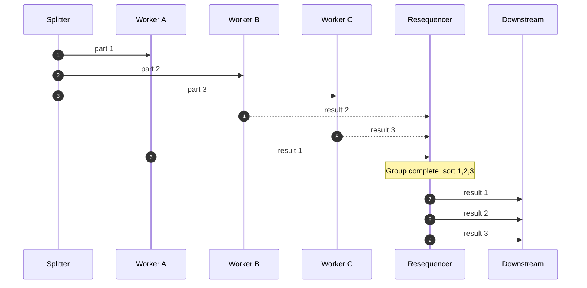
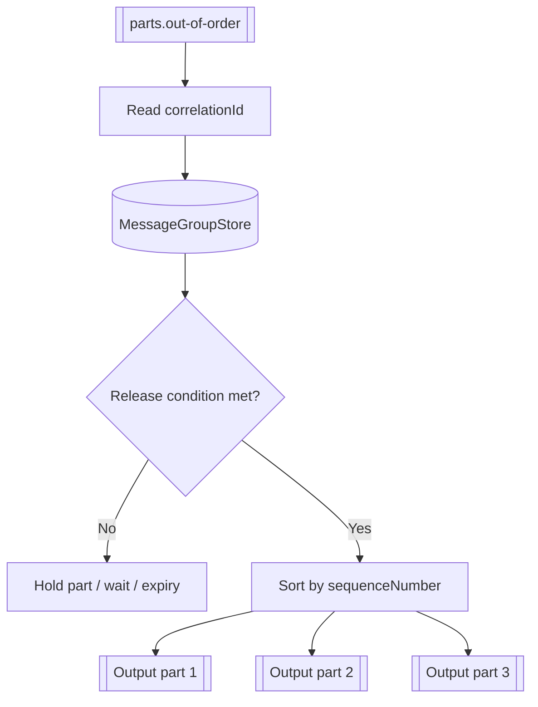
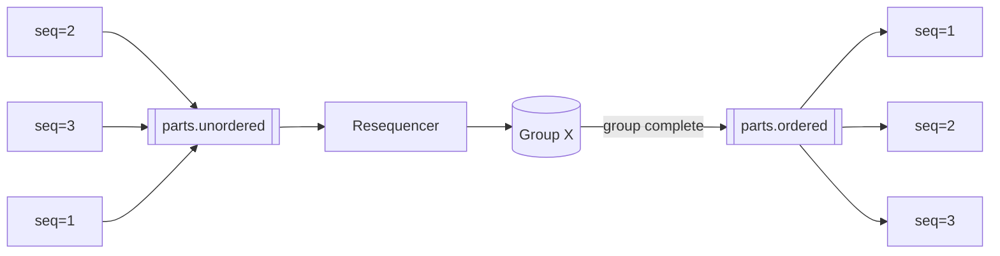
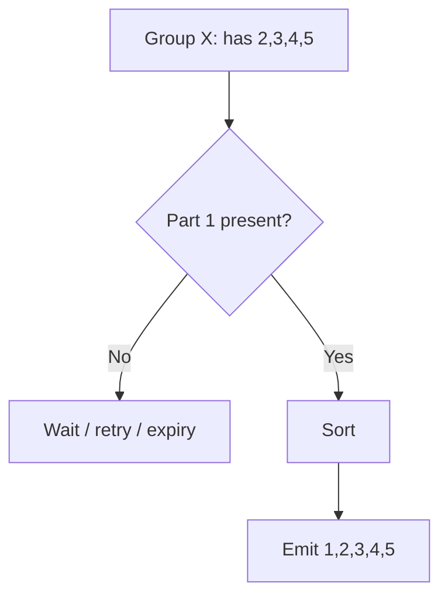
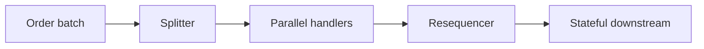
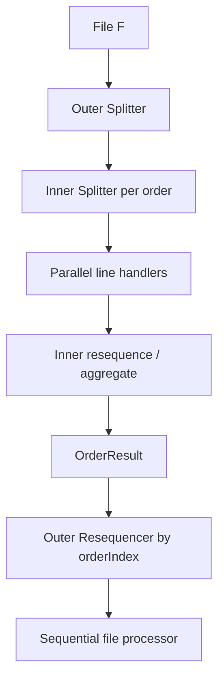

# Messages Arriving Out of Order

An order processing system splits a batch of three product lines into three child messages. Each line is checked independently on different workers. The second line finishes in 100 ms, the third in 300 ms, while the first waits on the inventory service for 800 ms. **Results arrive in order 2 → 3 → 1**, even though the parts were originally created in order **1 → 2 → 3**.

This is normal in **asynchronous and distributed** architectures, yet it can cause errors if downstream requires parts of the **same group** to be processed **in order**. **Resequencer**, a pattern in **Enterprise Integration Patterns (EIP)**, helps **collect messages arriving out of order and re-emit them in the order defined by metadata**. It differs from **Aggregator**: Resequencer continues emitting **individual messages**, whereas Aggregator typically produces **one combined result**.

The lesson **"Messages Arriving Out of Order"** belongs to the **Resequencer** chapter of the `SPRING_INTEGRATION_PATTERN` module. It focuses on using Spring Integration to control message order without forcing systems to always run sequentially: understanding causes of out-of-order delivery, `sequenceNumber`/`sequenceSize`/`correlationId`, how Resequencer holds and releases groups, missing or duplicate parts, `MessageGroupStore` durability, Java DSL and JUnit 5, and connections to Router, Filter, Transformer, Splitter, Aggregator, Gateway, retry, error channels, and correlation.

> **Principle:** Resequencer **does not infer business order from message arrival time**. It requires **a meaningful and sufficiently reliable order** supplied via sequence metadata or an equivalent strategy. Proper ordering also **does not mean** a message was processed exactly once, a transaction committed, or global system-wide order is guaranteed.

## 1. When Can Messages Arrive Out of Order?

In a sequential Java method call, we easily expect outputs to preserve input order. However, a Spring Integration flow can cross multiple concurrency boundaries:

- **ExecutorChannel/TaskExecutor:** handlers execute on different threads; a thread dispatched later may finish earlier.
- **Publish–Subscribe/Recipient List:** each subscriber/recipient has different processing speed and conditions.
- **Router:** messages take separate branches, each with different processing time and retries.
- **HTTP/database adapter:** each network call has variable latency.
- **Broker:** partitions, multiple consumers, redelivery/requeue, retries, and rebalancing alter completion order.
- **Gateway timeout/retry:** the caller times out and retries while the old attempt may still be running.
- **Splitter:** creates child messages in order, but does not guarantee downstream async steps preserve that order.

Example timeline:

| Message | Creation Order | Processing Time | Arrival Position at Resequencer |
| --- | ---: | ---: | ---: |
| Line A | 1 | 800 ms | 3 |
| Line B | 2 | 100 ms | 1 |
| Line C | 3 | 300 ms | 2 |



**The issue is not that messages were assigned wrong sequence numbers**. The issue is that **arrival time** no longer reflects **logical order**. Resequencer holds parts per group and emits them according to sequence policy rather than worker completion order.

### 1.1. Four Types of "Order" Not to Conflate

| Concept | Definition | Example |
| --- | --- | --- |
| **Business order** | Position required by the domain. | Order lines 1, 2, 3; update versions 7, 8, 9. |
| **Emission order** | Which message the producer/adapter sends first. | Producer publishes part 1 then part 2. |
| **Arrival order** | Order Resequencer receives messages at its input. | Part 2 arrives before part 1. |
| **Side-effect completion order** | When DB/API/handler actually commits. | Part 3 commits before part 1. |

Resequencer primarily controls **emission order at its own output**. It cannot reverse side effects that occurred **before** messages reached Resequencer. Therefore, **where to place Resequencer** is a critical architectural decision.

## 2. How Does Resequencer Work?

At a logical level, Resequencer:

1. Receives a message.
2. Identifies the **group** using a correlation strategy.
3. Stores the message in a **message group store**.
4. Checks whether the group has enough data to release per policy.
5. Sorts messages by **sequence number**.
6. Emits **each message individually**, without merging payloads into a list by default.
7. Manages waiting, completed, expired groups, and late-arriving messages.



**How it differs from sorting a List:** Resequencer usually receives **independent messages at different times**. It must maintain state for incomplete groups, decide what to do when parts are missing, and handle messages arriving after a group has been released.

### 2.1. Resequencer vs. Aggregator

| Criterion | **Resequencer** | **Aggregator** |
| --- | --- | --- |
| Purpose | Fix ordering of **individual messages**. | Combine **multiple messages** into one group result. |
| Input | Parts sharing correlation and logical order. | Messages sharing group relationship. |
| Typical output | `part1`, `part2`, `part3` in order. | One `BatchResult`/`List<Part>`. |
| Uses message group | Yes. | Yes. |
| Release condition | Complete group or partial sequence policy. | Depends on release strategy: size, role, quorum, timeout… |
| Business ordering | Primary focus. | Merely a property if processor needs sorting. |
| Duplicate/missing handling | Still needs policy, no automatic exactly-once. | Still needs policy. |

If downstream needs **a single summary report**, Aggregator is usually a better fit. If downstream needs **each event in exact sequence** to update a state machine, Resequencer is the right candidate.

## 3. Three Headers Underlying Resequencing

A message can carry:

```text
correlationId   = 8f...        # Group identifier
sequenceNumber  = 2           # Position of this message
sequenceSize    = 3           # Expected message count (if known)
```

Spring Integration exposes technical header names via `IntegrationMessageHeaderAccessor`.

### 3.1. `correlationId`: Do Not Mix Groups

Example:

```text
Batch A: (A, seq=1), (A, seq=2), (A, seq=3)
Batch B: (B, seq=1), (B, seq=2)
```

Two parts with `seq=1` but different `correlationId` values **must not be placed in the same group**. A Resequencer maintains independent state for A and B according to its correlation policy.

In a standard Splitter flow, the correlation ID is typically tied to the **original message ID of the split invocation**, not automatically equal to a business `orderId` or `batchId`. If the same batch is resent as a new message, it may get a different correlation ID. A **durable group identity** is needed if business logic requires sharing the same sequence across restarts/replays.

### 3.2. `sequenceNumber`: Logical Position, Not Arrival Index

In a typical group, order `1,2,3` is represented by corresponding integer `sequenceNumber` values. If part 3 arrives first, **its sequence value remains 3**, not changed to 1.

Two key points:

- `sequenceNumber` **must follow the contract**: typically 1-based in Splitter-generated sequences, not 0-based.
- It is **not equivalent to a Kafka offset, timestamp, lineId, or arrival index**. If business logic uses version numbers 100, 101, 102, use a proper mapping/sorting strategy rather than forcing those versions into another group's metadata.

### 3.3. `sequenceSize`: Expected Part Count, Not Arrived Count

For a three-part group:

```text
seq=2, size=3   → group currently has 1/3
seq=3, size=3   → group currently has 2/3
seq=1, size=3   → group currently has 3/3
```

`sequenceSize=3` helps a default Resequencer configuration know when all parts of a **fixed-size** sequence have arrived. However, this metadata:

- Does not assert all three parts were actually sent.
- Does not assert all three parts arrived.
- Does not assert all three parts committed in business logic.
- Does not automatically remove duplicates.
- Does not guarantee an Iterator/Stream source **knows N in advance**.

If size is unknown or the header is missing, **do not assume the current received count is the final count**. You need another completion contract or a partial/expiry policy.

### 3.4. Reading Headers with Proper Types

```java
import org.springframework.integration.IntegrationMessageHeaderAccessor;
import org.springframework.messaging.Message;

void inspectSequence(Message<?> message) {
    Object correlation = message.getHeaders().get(
        IntegrationMessageHeaderAccessor.CORRELATION_ID);
    Integer position = message.getHeaders().get(
        IntegrationMessageHeaderAccessor.SEQUENCE_NUMBER,
        Integer.class);
    Integer expected = message.getHeaders().get(
        IntegrationMessageHeaderAccessor.SEQUENCE_SIZE,
        Integer.class);

    // Verify/compare in tests or process permitted metadata.
    System.out.printf("corr=%s, number=%s, size=%s%n",
        correlation, position, expected);
}
```

This is a metadata inspection example. In production, avoid logging raw correlation IDs if they contain sensitive data; avoid dumping full payloads/headers. After HTTP/Kafka/AMQP adapters, verify that header mapping preserves these fields with the right types.

## 4. Release on Complete Group or Partial Release?

There are two behavioral modes to understand:

1. **Complete sequence:** wait for all parts in the sequence before emitting in order.
2. **Partial sequence:** can emit an available contiguous segment according to rules, even if later parts have not arrived yet.

Spring Integration Resequencer versions and configurations may support **release partial sequences** policies. Exactly when it releases, handles gaps, and handles group expiry depends on the handler, release strategy, and version in use. Do not assume toggling a single option makes every partial scenario safe.

### 4.1. Waiting for the Complete Group

Example three-part group:

| Time | New Part | Stored Parts | Output |
| --- | --- | --- | --- |
| T1 | `seq=2` | `{2}` | Nothing emitted. |
| T2 | `seq=3` | `{2,3}` | Nothing emitted. |
| T3 | `seq=1` | `{1,2,3}` | `1,2,3`. |

Pros: simple, never emits an incomplete sequence before completeness is confirmed.

Cons: **head-of-line blocking**. An early part or any single part that never arrives can stall the entire group forever without expiry.

### 4.2. Releasing a Contiguous Segment

Suppose a system wants lower latency and allows emitting early parts as soon as a contiguous prefix is ready:

```text
Part 1 arrives → can emit 1
Part 3 arrives → must hold 3 because 2 is missing
Part 2 arrives → can emit 2 then 3
```

This is the **partial resequencing concept**, not a promise about individual `send`/`receive` calls in every default configuration. Always test the enabled policy, especially after a **group timeout** or when messages arrive after a partial release.

### 4.3. Comparison

| Goal | Complete sequence | Partial sequence |
| --- | --- | --- |
| Simplicity when batch size N is known | High. | Requires tracking emitted positions. |
| Latency for part 1 when part N is slow | Potentially high. | Potentially lower. |
| Missing part in the middle | Group is held. | Parts behind the gap must still wait if ordering is required. |
| Handling duplicates after emission | Needs policy. | Even more reliant on position/tombstone tracking. |
| Caller expects one final batch result | Usually consider Aggregator. | Does not replace GroupResult. |

**Only enable partial release if downstream accepts processing individual parts before the group is complete.** If the workflow requires validating the whole batch before writing to the DB, emitting part 1 early can violate the contract.

## 5. Java DSL: A Standalone Resequencer

The following example creates a flow receiving part messages that already carry sequence metadata:

```text
parts.unordered → Resequencer → parts.ordered
```

It differs from `.aggregate()` because output remains **multiple individual messages**. To focus on ordering, we send **simulated parts to the input** without using a broker or simulating network delays.

### 5.1. DTO Representing a Result

```java
// LineResult.java
public record LineResult(
    String lineId,
    String status
) {}
```

### 5.2. Spring Integration Flow

```java
// ResequencerConfiguration.java
import org.springframework.context.annotation.Bean;
import org.springframework.context.annotation.Configuration;
import org.springframework.integration.channel.QueueChannel;
import org.springframework.integration.config.EnableIntegration;
import org.springframework.integration.dsl.IntegrationFlow;

@Configuration
@EnableIntegration
public class ResequencerConfiguration {

    @Bean("parts.ordered")
    QueueChannel orderedParts() {
        return new QueueChannel(32);
    }

    @Bean
    IntegrationFlow resequenceResults() {
        return IntegrationFlow.from("parts.unordered")
            .resequence()
            .channel("parts.ordered")
            .get();
    }
}
```

With valid sequence/correlation headers and standard group-completion settings, `.resequence()` **waits for the required parts and sends them ordered by sequenceNumber**. `parts.ordered` is a `QueueChannel` so tests can read sequentially.

**Do not assume from this short snippet that persistence or retry exists.** The default MessageGroupStore in a simple flow may be in-memory; if the JVM dies while a group is missing parts, pending state may be lost. For business processing, wire a downstream handler/adapter or another flow to `parts.ordered`.

### 5.3. Logical Flow When Resequencer Receives 2,3,1



This is the **emission order** at the Resequencer's output. If downstream subsequently dispatches across multiple executors/partitions, **side-effect completion order** can still be scrambled again.

## 6. JUnit 5: Send 2 → 3 → 1 and Receive 1 → 2 → 3

The test uses `MessageBuilder` to **explicitly build group headers**. This isolates testing the Resequencer rather than depending on Splitter mechanics to create test data.

```java
import static org.junit.jupiter.api.Assertions.*;

import java.util.ArrayList;
import java.util.List;
import org.junit.jupiter.api.Test;
import org.springframework.beans.factory.annotation.Autowired;
import org.springframework.context.ApplicationContext;
import org.springframework.integration.IntegrationMessageHeaderAccessor;
import org.springframework.integration.channel.QueueChannel;
import org.springframework.messaging.Message;
import org.springframework.messaging.MessageChannel;
import org.springframework.messaging.support.MessageBuilder;
import org.springframework.test.context.junit.jupiter.SpringJUnitConfig;

@SpringJUnitConfig(ResequencerConfiguration.class)
class ResequencerTest {

    @Autowired ApplicationContext context;

    private void sendPart(int position, String lineId) {
        MessageChannel input =
            context.getBean("parts.unordered", MessageChannel.class);

        Message<LineResult> part = MessageBuilder
            .withPayload(new LineResult(lineId, "CHECKED"))
            .setHeader(
                IntegrationMessageHeaderAccessor.CORRELATION_ID,
                "GROUP-101")
            .setHeader(
                IntegrationMessageHeaderAccessor.SEQUENCE_NUMBER,
                position)
            .setHeader(
                IntegrationMessageHeaderAccessor.SEQUENCE_SIZE,
                3)
            .build();

        assertTrue(input.send(part));
    }

    @Test
    void restoresOrderAfterOutOfOrderArrival() {
        QueueChannel output =
            context.getBean("parts.ordered", QueueChannel.class);

        sendPart(2, "L-2");
        assertNull(output.receive(0)); // Group not complete yet.

        sendPart(3, "L-3");
        assertNull(output.receive(0)); // Still missing seq=1.

        sendPart(1, "L-1");

        List<String> ordered = new ArrayList<>();
        for (int expectedNumber = 1; expectedNumber <= 3;
                expectedNumber++) {
            Message<?> message = output.receive(0);
            assertNotNull(message);

            Integer actualNumber = message.getHeaders().get(
                IntegrationMessageHeaderAccessor.SEQUENCE_NUMBER,
                Integer.class);
            assertEquals(expectedNumber, actualNumber);

            LineResult result = (LineResult) message.getPayload();
            ordered.add(result.lineId());
        }

        assertEquals(List.of("L-1", "L-2", "L-3"), ordered);
        assertNull(output.receive(0));
    }
}
```

**What the test proves:**

1. Two parts arriving first while part 1 is missing **are not emitted** under complete-sequence policy.
2. Once the group has all three parts, output order is **1,2,3** even though input arrived as **2,3,1**.
3. Payloads remain **three individual results**, not one aggregated List.
4. No extra output appears after the three parts.

**Limitations:** this synchronous in-process test does not prove order is preserved after output traverses a broker, multiple consumers, or executors. Nor does it test duplicates, partial release, group expiry, restarts, or side effects. If a Spring Integration version has different defaults, configure the release strategy explicitly and re-verify.

### 6.1. Why Not Use `Thread.sleep(...)`?

Testing "send 2, sleep, send 3, sleep, send 1" is unnecessary to verify **resequencing logic**. We intentionally send out of order and verify output. If you want to test thread contention, use executors/latches and condition synchronization instead of fixed timing delays that easily turn flaky.

### 6.2. Additional Test for Two Independent Groups

An extended test:

```text
G-A: seq=2/2
G-B: seq=1/2
G-A: seq=1/2
G-B: seq=2/2
```

Output must preserve **order within each group**, without requiring a strict global order between groups A and B. If downstream needs A globally before B, an additional cross-group ordering contract is required; correlation-based Resequencer does not automatically know business order across all groups.

## 7. Minimum Conditions for Correct Resequencing

Before using Resequencer, ask yourself:

| Question | Required Condition |
| --- | --- |
| Which group does the part belong to? | Stable and validated correlation key. |
| What is the part's position? | Properly typed, non-negative, non-contradictory `sequenceNumber`. |
| How many parts does the group have? | `sequenceSize` when known upfront, or another completion/partial policy. |
| Which sequence numbers have been seen? | Reliable group state; not just a counter. |
| Will the missing part arrive later? | Retry/expiry/reconciliation policy. |
| Can a part arrive repeatedly? | Deduplication and idempotency before side effects. |
| What happens to messages arriving after completion? | Late-arrival/group lifecycle policy. |
| What order does downstream require? | By batch, order, tenant, key, or global? |

**Without reliable sequence metadata, Resequencer cannot reconstruct a business order out of thin air.** Fix the producer/adapter or define a proper sequence key before adding this endpoint.

### 7.1. Validation Before Storing in Group

A trustworthy boundary should reject or quarantine:

- Missing/invalid `correlationId`.
- `sequenceNumber` not an integer matching the contract.
- `sequenceNumber < 1` in 1-based systems.
- Negative, oversized, or inconsistent `sequenceSize` across parts.
- `sequenceNumber > sequenceSize` when positive size is known.
- Messages from the wrong tenant or a producer unauthorized to write to the group.

**Never let Resequencer wait indefinitely on a corrupted group**. Validate at ingress with a concrete outcome/error flow.

## 8. Head-of-Line Blocking: One Gap Holds the Whole Sequence

A missing or delayed message at the head of a sequence:

```text
Received:
seq = 2, 3, 4, 5

Not yet received:
seq = 1

Downstream needs 1 → 2 → 3 → 4 → 5.
```

If part 2 cannot be emitted before part 1, all subsequent parts must wait. This is **head-of-line blocking**. Practical options:

1. **Wait:** suitable for strictly ordered data with finite deadlines.
2. **Retry/re-fetch missing part:** requires replay capability from producer/broker/event store.
3. **Expire/fail group:** report error or quarantine so groups are not held forever.
4. **Partial processing:** only when business rules accept a contiguous prefix or incomplete results.
5. **Switch to Aggregator/simplify:** if only the final combined result is actually needed rather than each message sequentially.



### 8.1. Increasing Timeout Does Not Fix a Lost Part

If part 1 was dropped by a Filter or routed to a channel without a consumer, waiting another 30 seconds in Resequencer **will not make the part appear**. Trace upstream, ensure a terminal outcome exists, or provide a replay mechanism.

### 8.2. Why Do Gaps Also Affect Memory?

If thousands of groups are missing their leading part, Resequencer may buffer a large number of messages in the group store. With an in-memory store, this risks heap pressure; with a persistent store, disk/quota/lock contention. You need:

- Caps on group count and messages per group.
- Group timeout/expiry or deadlines.
- Backpressure toward producers.
- Metrics for **oldest group age, missing positions, and buffer utilization**.
- Operational runbooks for stuck groups rather than restarting the app and hoping it clears.

## 9. Group Timeout and Partial-Sequence Policy

Suppose input expects `seq=1/3`, but only `seq=2` and `seq=3` arrive. Upon expiration:

| Policy | Meaning | What to Verify |
| --- | --- | --- |
| **Fail/expire group** | Do not emit incomplete data; send to error/quarantine/reconciliation. | Reason and source retry path are recorded. |
| **Allowed partial release** | Emit eligible parts per policy. | Required ordering is preserved; partial status is flagged. |
| **Controlled extended wait** | Extend deadline knowing the part is retrying. | Maximum deadline and resource limits exist. |
| **Skip gap per business rule** | Treat missing part as unnecessary and proceed. | Domain genuinely allows omission; gap is audited/marked. |

Spring Integration provides options such as `releasePartialSequences`, `groupTimeout`/group expiry depending on DSL version. **Do not assume** flipping a single option handles all scenarios above. Test:

- Missing part at the **beginning** vs **middle** of a group.
- Parts arriving after the group has already partially released.
- Group expiring while the output channel is full.
- Late Gateway replies.
- Duplicates/replays after completion.

### 9.1. Illustrative Partial Policy Configuration

In a DSL version supporting the corresponding options, configuration may look like:

```java
// Illustrative variant; do not declare concurrently
// with resequenceResults() on the same input channel.
@Bean
IntegrationFlow resequenceWithPartialPolicy() {
    return IntegrationFlow.from("parts.partial.in")
        .resequence(spec -> spec
            .releasePartialSequences(true)
            .groupTimeout(5_000))
        .channel("parts.partial.out")
        .get();
}
```

This snippet only shows **where to configure the policy**; appropriate channel beans, message store, scheduler/expiry setup, and verification of method names against your actual Spring Integration version are required. In particular, **`groupTimeout` is not equivalent to Gateway reply timeout**; group expiry does not automatically cancel running HTTP/DB calls or synthesize a `BatchFailed`.

**Lesson:** partial behavior must be specified as a **concrete data and release contract**, then mapped to the framework API in use. Never promise "enabling partial means every arriving part emits immediately" while ordering gaps remain.

## 10. Duplicates and Redelivery: Correct Order Can Still Be Business-Wrong

A broker may redeliver part 2 after a consumer processed it without acking, or producer retries may re-emit a part with the same sequence number.

```text
Group X:
seq=1  → payload A
seq=2  → payload B
seq=2  → payload B  (duplicate)
seq=3  → payload C
```

If Resequencer only counts messages, a duplicate can fool completion logic. Even if Resequencer detects duplicate sequence numbers, side effects in handlers **before it** may already have executed twice.

### 10.1. Stable Identity

Use a `partId`/`eventId` generated by the domain or trusted producer, combined with `batchId` or generation:

```text
(businessBatchId, generation, partId)
```

or an equivalent identity agreed upon for retries/replays. `(correlationId, sequenceNumber)` can work **within a single split**, but if a replay generates a new correlation ID, that pair is no longer stable across deliveries.

### 10.2. Two Parts with the Same Sequence Number but Different Payloads

```text
seq=2, detail=PRICE:100
seq=2, detail=PRICE:200
```

This is no longer a harmless duplicate. It may indicate a **version conflict, inconsistent result, or serialization bug**. Never arbitrarily pick first-arrived or last-arrived unless there is an explicit versioning rule. Quarantine and reconciliation are the safe choice for critical data.

### 10.3. Idempotency Before and After Resequencer

| Boundary | Protection |
| --- | --- |
| Producer publish | Stable event/part ID; consider outbox to prevent dual-write. |
| Handler before Resequencer | Idempotent side effects; retry budget. |
| Resequencer input | Schema validation, dedup/conflict policy. |
| Resequencer output | Do not emit duplicates of the same logical part. |
| Handler after Resequencer | Idempotency if broker/outbound path can redeliver. |

**Correct order does not imply exactly-once.** Parts could still be processed as 1,2,2,3 — non-decreasing in order, yet part 2 is still duplicated.

## 11. Kafka, RabbitMQ, and Key-Based Ordering

Many assume "using a broker guarantees messages arrive in order." This holds **only under specific conditions**:

| System | What You Can Rely On | What Requires Caution |
| --- | --- | --- |
| **Kafka** | Record order per **partition**, under proper producer/consumer settings. | No global order across partitions; multiple branches can finish out of order. |
| **RabbitMQ** | Queues have ordered delivery semantics under certain conditions. | Multiple consumers, redelivery/requeue, priorities, and async processing alter completion order. |
| **JMS queue/topic** | Ordering per provider/destination contract and JMS constraints. | Redelivery, selectors, multiple consumers/subscriptions, and priorities. |
| **ExecutorChannel** | Dispatches tasks to an executor. | Thread scheduling does not guarantee completion order. |

### 11.1. When Resequencer Is Unnecessary

If a Kafka consumer group processes all events for **each orderId** in the **same partition** using **a single sequential thread**, and the contract only requires ordering *per key*, adding a Resequencer may add unnecessary complexity.

However, if the consumer fans out events to multiple workers and collects results, that fan-out itself can break completion order. In that case, a Resequencer may still be needed **right before the step requiring sequential order**.

### 11.2. Resequencer Cannot Recover Records Missing Beyond Retention

Kafka retains records per retention policy; RabbitMQ queues have TTL/quota/ack policies. If a part is lost or purged before the consumer reads it, Resequencer **cannot synthesize the missing message**. Replay from a source of truth, quarantine, or fail per contract.

### 11.3. Ordering vs. Throughput

A global ordering constraint typically trades off parallelism. A cleaner design is **ordering per business key** (`orderId`, `accountId`, `batchId`) with matching correlation and partitioning, whenever the business does not require one single system-wide sequence.

## 12. Should Resequencer Come Before or After Other EIPs?

Resequencer placement directly determines the outcome:

### 12.1. Splitter → Async Processing → Resequencer



This is the natural use case when **parts are processed in parallel**, while a downstream step needs **results in their original order**.

### 12.2. Filter Can Create a Gap

```text
Splitter emits 1/3, 2/3, 3/3
Filter drops seq=2
Resequencer only sees 1/3 and 3/3
```

With complete sequence mode, the group may never release. If a Filter must drop parts, either:

- **Filter before Splitter** so size reflects the remaining list; or
- **Convert dropped parts into a `SKIPPED/REJECTED` outcome** keeping the same identity/sequence so Resequencer still receives all slots; or
- Choose a business-approved partial/expiry policy.

**Filter does not automatically decrement `sequenceSize`** on already-emitted messages.

### 12.3. Router Can Create Branches That Never Return

When `seq=3` enters an unmatched branch or a handler that produces no reply, Resequencer receives only two parts. Design a **common return path** for all awaited outcomes, including rejections and terminal failures, or define a different expected set.

### 12.4. Transformer Must Preserve Sequence Metadata

A handler:

```java
// Risk of losing metadata when creating a new message from scratch:
Message<LineResult> transformWithoutHeaders(
        Message<String> input) {
    return org.springframework.messaging.support.MessageBuilder
        .withPayload(new LineResult(input.getPayload(), "OK"))
        .build();
}
```

If a transform manually builds a message as above, correlation and sequence metadata may not be preserved. When creating a new message is necessary, **copy permitted and required headers**, or use a Transformer endpoint with tested header propagation semantics:

```java
// Illustrates selectively preserving existing headers per contract.
Message<LineResult> transformPreservingAllowedHeaders(
        Message<String> input) {
    var headers = input.getHeaders();
    return org.springframework.messaging.support.MessageBuilder
        .withPayload(new LineResult(input.getPayload(), "OK"))
        .setHeader(
            IntegrationMessageHeaderAccessor.CORRELATION_ID,
            headers.get(IntegrationMessageHeaderAccessor.CORRELATION_ID))
        .setHeader(
            IntegrationMessageHeaderAccessor.SEQUENCE_NUMBER,
            headers.get(IntegrationMessageHeaderAccessor.SEQUENCE_NUMBER))
        .setHeader(
            IntegrationMessageHeaderAccessor.SEQUENCE_SIZE,
            headers.get(IntegrationMessageHeaderAccessor.SEQUENCE_SIZE))
        .build();
}
```

This is an **illustrative technical snippet**; import `IntegrationMessageHeaderAccessor` and validate headers before copying. Never blindly copy all HTTP headers containing tokens/cookies or untrusted metadata.

### 12.5. Resequencer and Aggregator Can Be Chained

If business logic requires **preserving input order when constructing the final result**, there are two options:

1. **Resequencer → Aggregator:** emit properly ordered parts into Aggregator and combine them.
2. **Aggregator with a sorting group processor:** collect and sort elements by sequence before building the result.

You do not necessarily need **both**. If only one final `BatchResult` is needed, a sorting processor inside Aggregator is often simpler. Resequencer is valuable when **each part must still be processed individually in order** downstream.

### 12.6. Recipient List/Publish–Subscribe Adds Another Sequence Layer

A part from Splitter fanned out to Pricing and Inventory can produce **two replies** for the same part. If Resequencer sees both as two parts with the same `sequenceNumber`, logic can run into duplicate/conflict errors even though the two replies have **different roles**.

A cleaner design:

```text
Splitter: 3 LineRequests
  → Scatter each line to Pricing + Inventory
  → Inner Aggregator: 1 LineResult / line
  → Resequencer: LineResult seq=1,2,3
  → Stateful downstream
```

With an **Inner Aggregator**, Resequencer receives **one logical result per line sequence**, instead of 6 replies with mixed semantics.

## 13. Gateway, Timeouts, and Returning the Final Result

A `@MessagingGateway` can hide internal flow details:

```java
import java.util.List;
import org.springframework.integration.annotation.MessagingGateway;

@MessagingGateway(defaultRequestChannel = "orders.batch.in")
interface OrderBatchGateway {
    BatchReceipt process(List<String> lines);
}

// BatchReceipt is an application-provided DTO.
// The real flow needs an Aggregator/handler producing a corresponding reply.
```

**Do not expect adding Resequencer alone to make the Gateway receive `BatchReceipt`.** Resequencer emits **multiple child messages**, not **a single reply** to the caller by default. If the Gateway needs a batch result, an Aggregator or receipt-building step matching the contract plus a reply path is required after Resequencer.

### 13.1. Distinguishing Timeouts

| Timeout | Meaning |
| --- | --- |
| **Resequencer group timeout** | Group waits too long for a complete sequence. |
| **Gateway reply timeout** | Caller waits too long for a reply from the flow. |
| **Channel send timeout** | Cannot deliver a message to a channel within the allowed time. |
| **HTTP/DB client timeout** | I/O call to a dependency does not finish in time. |
| **Business deadline** | Overall processing must not exceed a business threshold. |

Gateway timeout **does not automatically cancel a part running in a worker or HTTP client**. Nor does group expiry automatically roll back already-executed side effects. Dedicated **retry, idempotency, and late-result handling** policies are required.

## 14. Resequencer Is Not Automatically Durable Across Restarts

Suppose:

```text
Group X receives seq=2/3, seq=3/3
Process crash
Process restart
seq=1/3 arrives
```

If group state is only in memory, the first two parts may be lost; part 1 arriving afterward has no way to know where those earlier messages went.

Spring Integration provides **`MessageGroupStore`** infrastructure for components that maintain groups. When surviving restarts is required, choose a **persistent store** and verify its semantics.

### 14.1. Coordinating Multiple Boundaries

1. **Broker durability:** how did the broker receive/persist the message?
2. **Group store persistence:** has Resequencer durably stored the part?
3. **Consumer ack/offset:** when does the broker consider the part processed?
4. **Output dispatch:** has the part been sent downstream, or is it still buffered in the group?
5. **Downstream side effect:** has the DB/API committed yet?
6. **Completed-group tracking:** will replayed/late parts be reprocessed?

A persistent broker does not make the group store persistent. A persistent group store does not solve **output emitted successfully followed by a crash before recording completion**. Test crashes at every boundary.

### 14.2. Multiple Instances Need Safe Group Locking

If two instances update the same group in a shared store, ensure you prevent:

- losing a part due to concurrent writes;
- releasing the same group twice;
- emitting parts interleaved across two nodes;
- accidentally recreating a group after it completed/expired;
- mixing parts from two tenants or two generations.

When ordering is mandatory, account for **single-owner/key partitioning, distributed locking/fencing, or store transactions**, not just an in-JVM `HashMap`.

### 14.3. Emission Order Is Not Commit Order

Resequencer may emit seq 1, 2, 3 in order, yet if the output channel is an `ExecutorChannel` and three handlers run in parallel, they may **commit to the DB as 2,3,1**. If business logic requires **sequential side effects**, downstream must process sequentially per key or enforce version/concurrency guards.

## 15. Error Channel and Retries for Out-of-Order Flows

| Incident | What Not to Do | What to Consider |
| --- | --- | --- |
| Missing seq=1 due to upstream failure | Wait indefinitely. | Retry/replay, group expiry/quarantine. |
| Seq=2 arrives twice | Count as two distinct parts. | Duplicate detection and idempotency. |
| Message missing correlation | Merge into a shared fallback group. | Validation/rejection with clear reason. |
| Wrong sequence size | Guess N automatically. | Metadata contract and error policy. |
| Handler after Resequencer times out | Blame Resequencer. | Retry/error handling at that handler, protect side effects. |
| Output queue full | Mark part as successfully processed. | Backpressure and recovery. |
| Late part after group completion | Forward directly downstream. | Explicit completed-group/late policy. |

**`errorChannel` does not magically recreate missing messages.** In synchronous flows, exceptions may bubble back to the sender; in async/poller/adapter flows, errors may become `ErrorMessage`s per configuration. A part on an error channel **is not considered delivered to Resequencer**, and retrying does not guarantee it arrives before other parts.

### 15.1. Retry Per Part, Do Not Multiply the Whole Batch

If only part 1 fails, retrying **the entire batch** can re-emit parts 2 and 3, creating duplicates or repeated side effects. Better practices:

- Track `batchId`, `partId`, `attempt`.
- Retry **only the failed part** within the deadline.
- Preserve `sequenceNumber/sequenceSize/correlation` on retry if it is the same logical part.
- Use idempotent handlers for operations with side effects.
- Move unrecoverable parts to quarantine with a **structured error outcome** or expiry policy.

If the domain requires failing the whole batch when one part fails, do not assume Resequencer knows that automatically. Implement explicit workflow/group-level failure handling.

## 16. Nested Splitters and Multiple Sequence Layers

A file contains three orders, each with two lines:

```text
File F
  Outer split: Order 1, Order 2, Order 3
      Inner split: Line 1, Line 2 within each Order
```

Two levels of ordering:

| Level | Order to Preserve | Group |
| --- | --- | --- |
| Outer | Order 1 → Order 2 → Order 3 | File F. |
| Inner | Line 1 → Line 2 | Each order. |

**A single flat `correlationId/sequenceNumber/sequenceSize` header trio cannot represent two nested levels by itself.** An inner Splitter creates sequence metadata for the inner group; reconstructing the outer order requires preserving `fileId` and `orderIndex` per contract or designing two layers of grouping/Resequencer.



Do not try to use inner line sequence numbers to determine outer order sequence. If the inner flow aggregates into `OrderResult`, the output must carry **outer correlation and orderIndex** for the outer Resequencer to work properly.

## 17. Security: Sequence Metadata Is Control Data

An untrusted client can send:

```text
correlationId = another-tenant-batch
sequenceNumber = 1
sequenceSize = 999999999
```

If Resequencer trusts these values blindly, risks include:

- mixing data across tenants;
- creating huge groups or unbounded retention;
- exhausting group store and application resources;
- emitting messages in a forged order, causing wrong side effects.

Mitigations:

1. **Generate or validate correlation at trusted ingress**.
2. Cap `sequenceSize`, open group count, and payload size.
3. Validate `sequenceNumber`, expected count, schema/generation, and ownership.
4. Accept parts only from authorized producers/channels/topics.
5. Never use emails, tokens, or account numbers as correlation IDs or metric labels.
6. Mask sensitive information in logs, failed messages, DLQs, and persistent stores.
7. Enforce quotas, TTL/retention, and expired-group handling.
8. Isolate group identities by tenant/security boundary.

**Arithmetic correctness in reordering does not ensure security if sequence or group identity is forged.**

## 18. Observability: Monitoring Gaps, Buffers, and Wait Times

Measuring only inbound/outbound message counts in Resequencer does not explain why a group is stalled. Track:

| Suggested Signal | Purpose |
| --- | --- |
| `resequencer_received_total` | Messages entering Resequencer. |
| `resequencer_emitted_total` | Messages emitted in sequence. |
| `resequencer_open_groups` | Number of waiting groups. |
| `resequencer_buffered_messages` | Messages held in store not yet emitted. |
| `resequencer_group_age_seconds` | Age of the oldest waiting group. |
| `resequencer_missing_positions` | Missing positions in a group when expected size is known. |
| `resequencer_duplicate_parts_total` | Duplicate parts detected. |
| `resequencer_conflicting_parts_total` | Duplicates with conflicting data. |
| `resequencer_group_expiries_total` | Groups expired while incomplete. |
| `resequencer_late_parts_total` | Parts arriving after group completion/expiry. |
| `resequencer_release_latency` | Wait duration before part/group emission. |
| `downstream_processing_latency` | Distinguish resequencing wait from slow handlers. |

These are **suggested metric names**, not all built into Spring Integration by default. Use bounded-cardinality labels like `flow=orderLines`, `reason=GAP`, `outcome=EXPIRED`. **Never use per-batch correlation IDs as metric labels**; place them in access-controlled logs/traces when needed for investigation.

### 18.1. Logging Stuck Groups

```text
event=resequencer_waiting
flow=orderLines
group_ref=opaque-group
expected_parts=3
received_positions=2,3
missing_positions=1
outcome=WAITING
```

```text
event=resequencer_released
flow=orderLines
group_ref=opaque-group
emitted_sequence=1,2,3
release_reason=COMPLETE_SEQUENCE
```

This is an **illustrative application-designed log format**. Knowing missing positions requires tracking the **set of received positions**, not just `group.size()`. For groups with very large `sequenceSize`, avoid logging overly long lists of numbers; log bounded summaries instead.

### 18.2. Diagnosing Missing Output

1. Did messages reach the right **input channel**?
2. Does `correlationId` match the expected group?
3. Are `sequenceNumber` and `sequenceSize` valid and consistent?
4. Did a **Filter drop** or unmatched Router branch cause a missing part?
5. Did a part go to the **error channel/DLQ** without being replayed?
6. Have all unique positions arrived, or are duplicates masking a gap?
7. Are group timeout/expiry configured, and is the scheduler running?
8. Does `MessageGroupStore` have locking/persistence errors?
9. Did Resequencer release, only for the **output channel** to block or lack a consumer?
10. Is downstream running async, making **completion order** differ from emission order?

Do not raise `groupTimeout` indefinitely when the real root cause is a part that **will never arrive**.

## 19. Common Mistakes

### Mistake 1 — "The first message to arrive has `sequenceNumber=1`"

**False.** Sequence number represents the assigned logical position, not arrival order. Part 3 may arrive first.

### Mistake 2 — "Adding a Resequencer makes the whole system FIFO"

**False.** It controls output order per **group and its own policy**. Parallel downstream stages can finish out of order; separate groups have no automatic global order.

### Mistake 3 — "Resequencer and Aggregator are the same thing"

**False.** Resequencer emits **multiple ordered messages**, whereas Aggregator typically emits **one group result**.

### Mistake 4 — "Seeing the last seq means the group is complete"

**False.** `seq=3/3` can arrive before `seq=1/3` and `seq=2/3`. All positions must be accounted for.

### Mistake 5 — "`sequenceSize=3` means three parts have arrived"

**False.** It is the expected size; actual received count may be 0, 1, 2, or include duplicates.

### Mistake 6 — "If a Filter drops a part, sequence size shrinks automatically"

**False.** You need a replacement outcome, filtering before Splitter, or an expiry/partial policy.

### Mistake 7 — "Retries do not affect ordering"

**False.** Retries can cause part 1 to arrive after parts 2/3 or redeliver duplicates. Stable identity, metadata, and idempotency are required.

### Mistake 8 — "Using a broker means no resequencing is needed"

**Not necessarily.** Brokers provide ordering within specific scopes, yet fan-out, concurrency, and downstream retries can still cause out-of-order results. Conversely, adding Resequencer unnecessarily adds state and latency.

### Mistake 9 — "An in-memory MessageGroupStore is durable enough"

**False.** Restarts lose waiting groups; persistence/recovery is needed if the contract requires it.

### Mistake 10 — "Partial release means any arriving part emits immediately"

**Do not assume that.** Ordering must still be maintained for emitted parts; exact release behavior on gaps/expiry depends on policy and version.

### Mistake 11 — "Gateway timeout cancels all in-flight parts"

**False.** The caller timing out does not automatically cancel running workers, I/O, or transactions.

### Mistake 12 — "Proper ordering means no duplicates"

**False.** You can still get `1,2,2,3`. Explicit identity/deduplication and idempotency are required.

## 20. Practice Exercises

**Exercise 1 — Recognizing Order.** A batch has four parts with arrival order `3,1,4,2`. Write the expected output of a complete-sequence Resequencer and explain when the group completes.

**Exercise 2 — Running Java DSL/JUnit.** Using `ResequencerConfiguration`, send `2,3,1`. Add another test sending `3,1,2` and verify output is always `1,2,3`.

**Exercise 3 — Two Correlation Groups.** Interleave messages from groups A and B, each with a different N. Verify **ordering within each group** without asserting group A always releases before B.

**Exercise 4 — Head Gap.** Send `2,3,4` with `sequenceSize=4` without sending 1. Design group timeout, error/quarantine, and retrieval of part 1 from the source store.

**Exercise 5 — Partial Release.** Compare complete vs. partial release with arrival `1,3,2`. Write the expected output timeline according to **your tested policy**, avoiding assumptions that every version behaves identically.

**Exercise 6 — Filter Dropping a Part.** Splitter emits `1,2,3`; Filter drops 2. Design a `SKIPPED` message preserving correlation/sequence so Resequencer does not wait forever, or define partial expiry with the domain contract.

**Exercise 7 — Duplicate Conflict.** Send seq 2 twice with identical payloads, then with differing payloads. Define stable identity and conflict policy before group release.

**Exercise 8 — Retry After Gateway Timeout.** Caller times out while part 1 is running. Explain why both the old and new attempts can produce side effects; propose an idempotency key and deadline.

**Exercise 9 — Kafka Partitions.** Three events for the same orderId are published across two partitions. Analyze why there is no total order; propose a partition key or stateful Resequencer if needed.

**Exercise 10 — Nested Split.** One file has two orders, each with three lines. Design two levels of correlation and ordering to return line results first, then orders, without mixing sequences.

**Exercise 11 — Crash/Restart.** Resequencer holds 2/3 and 3/3 when the process restarts. Use an appropriate persistent MessageGroupStore, test what happens when 1/3 arrives after restart—whether it emits once—and how duplicates are handled.

**Exercise 12 — Metrics.** Design a dashboard for gap age, open groups, buffered messages, duplicates, and release latency; explain how to distinguish upstream missing parts from an overloaded output channel.

## 21. Resequencer Implementation Checklist

| Question | What to Verify |
| --- | --- |
| Is ordering actually required? | Know which **group/key ordering** is needed; do not add Resequencer gratuitously. |
| Is the source assigning sequence numbers reliable? | Properly typed, stable, authenticated values. |
| Is group identity correct? | `correlationId`/business key never mixes batches/tenants/generations. |
| Is expected size known? | `sequenceSize` or an alternative completion/partial policy exists. |
| Complete or partial chosen? | Ordering requirements defined and tested with gaps. |
| Is Resequencer placed correctly? | Placed **before** side effects that require sequential order. |
| Can upstream Filter/Router drop parts? | Replacement outcome or explicit expiry/error policy exists. |
| Do Transformers/adapters preserve metadata? | Tested across actual HTTP/Kafka/AMQP/JMS boundaries. |
| Are there fan-outs/nested splits? | Sequence/correlation scoped to the **right level**, never confusing replies with parts. |
| Are duplicates/redeliveries possible? | Stable event/part ID, dedup/conflict handling, and idempotency. |
| Is there timeout/expiry for incomplete groups? | Bounded state retention and quarantine/replay. |
| Must the group store survive restarts? | Persistence, locking, recovery, and crash tests. |
| Does downstream run in parallel again? | If ordered commits are required, constrain execution or add version guards. |
| Is there a Gateway reply? | Aggregator/handler creates a single reply with an explicit deadline. |
| Does the error channel have proper semantics? | Never treat ErrorMessage as an auto-recovered missing part. |
| Is sequence metadata secured? | Validation, allowlists, quotas, tenant isolation. |
| Are gaps observable? | Open groups, missing positions, buffered count, group age, output failures. |
| Are failure conditions tested? | Out-of-order, missing, duplicate, late, restart, full queue, concurrency. |

## Conclusion

**Messages arriving out of order** are common whenever Spring Integration combines asynchronous branches, Routers, Splitters, brokers, and retries. **Resequencer** restores a **logical order** for messages belonging to the **same group** based on `correlationId`, `sequenceNumber`, and `sequenceSize` or an equivalent strategy. It emits **individual messages in order**, rather than one aggregated result like Aggregator.

A reliable Resequencer flow must account for **gaps/head-of-line blocking, complete vs. partial release, group expiry, duplicates/late arrivals, persistence, correlation, and idempotency**. Also place Resequencer **before the step that truly requires sequential execution**, because emission order does not guarantee commit order in parallel downstream consumers. When coordinated properly with Filter, Transformer, Router, Gateway, Aggregator, retry, error channel, and observability, a system can **process in parallel for throughput while preserving required order at the right business boundary**.