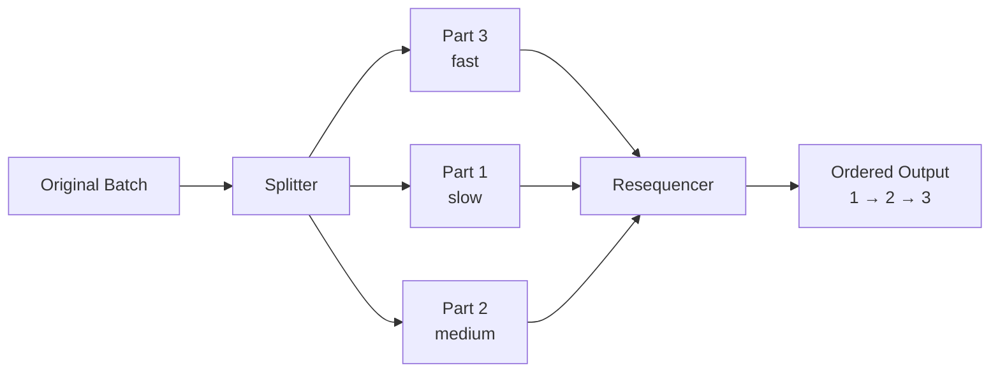
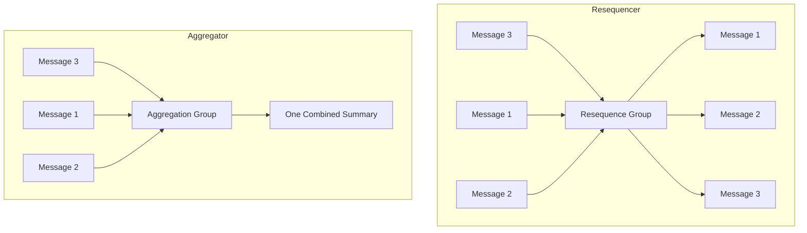
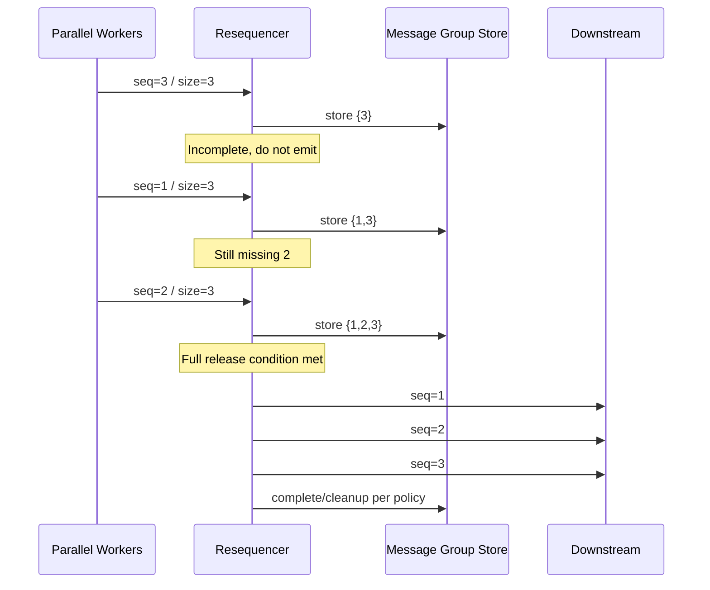
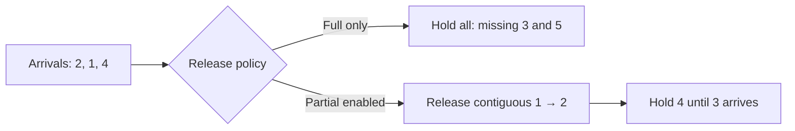
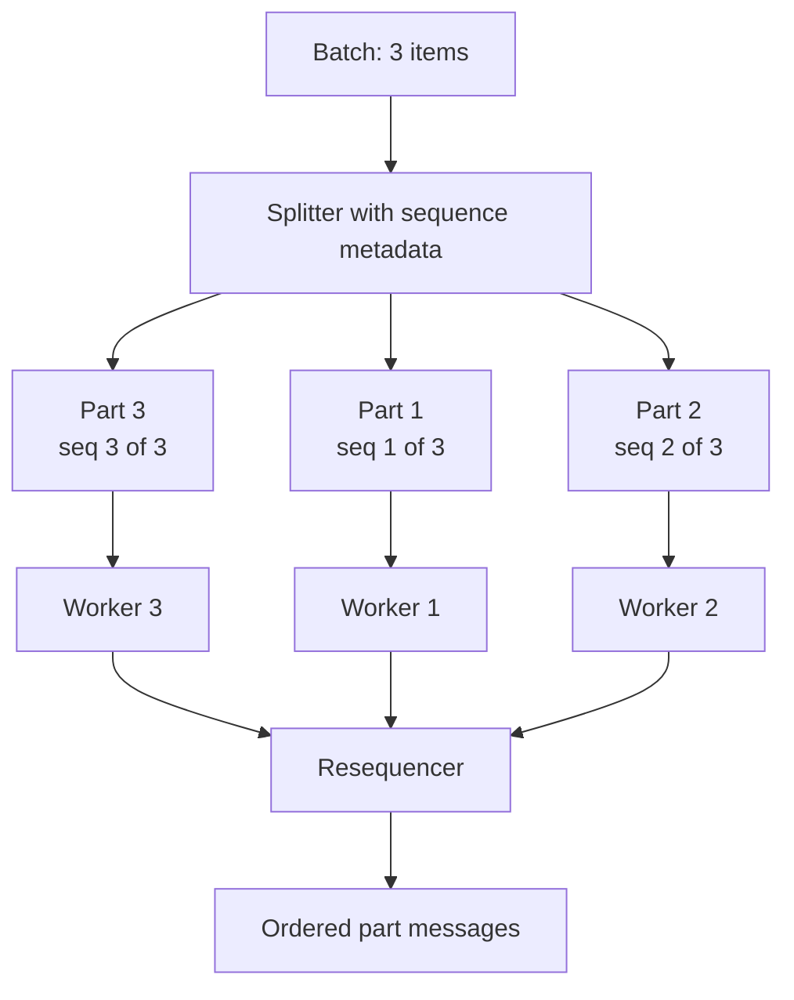
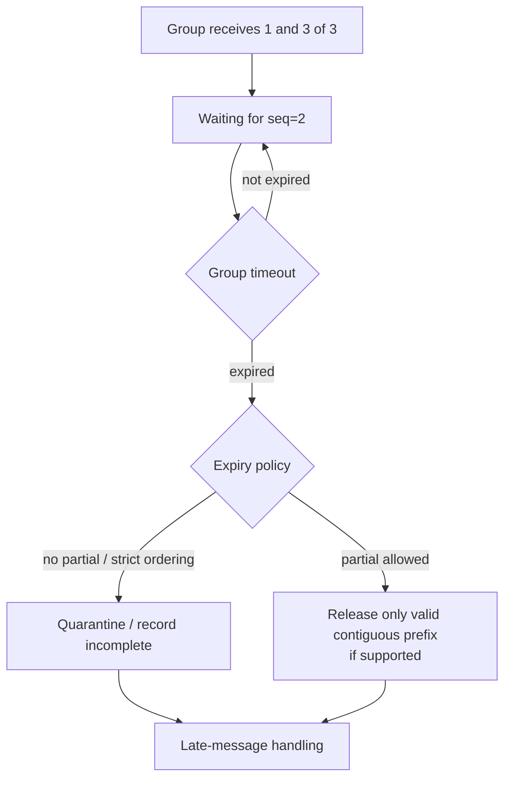
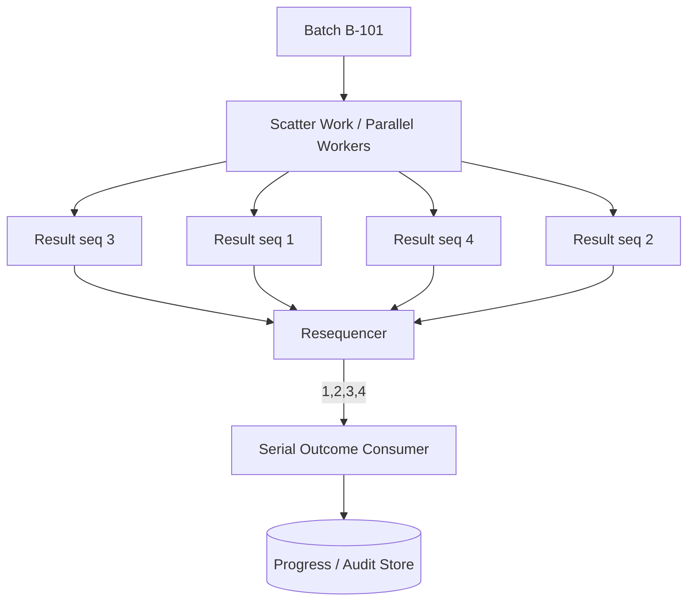

# Release When Sequence Is Complete

**Resequencer** is an Enterprise Integration Pattern (EIP) used to **put messages belonging to the same group back into their proper order** when they arrive out of their original order. In Spring Integration, Resequencer typically relies on metadata such as `correlationId`, `sequenceNumber`, and `sequenceSize` to recognize group members, wait for release conditions, and then emit **each message** in exact order.

For example, an order is split by a Splitter into three parts sent to independent workers. Due to differing processing times, results return in sequence **3 → 1 → 2**. Yet a downstream handler requires processing in order **1 → 2 → 3**. Forwarding immediately upon arrival would send result 3 before 1 and break processing semantics.

The lesson **"Release When Sequence Is Complete"** belongs to the **Resequencer** chapter of the **SPRING_INTEGRATION_PATTERN** module. The module's goal is practicing Enterprise Integration Patterns with Spring Integration to build loosely coupled, extensible messaging flows: Router, Filter, Transformer, Splitter, Aggregator, Gateway, retry, error channels, correlation, and techniques for testing/observing branches.

The focus of this lesson is **when Resequencer has enough information to release a group**, the limits of `sequenceSize`, how to handle missing/duplicate/late messages, and how to configure a testable Spring Integration flow.

**After this lesson**, you will be able to distinguish Resequencer from Aggregator, understand complete-sequence waiting mechanics, design consistent metadata, distinguish full release from partial release, select appropriate timeouts and message stores, and build tests proving messages are emitted strictly in order per contract.

## 1. Why Resequence?

In a sequential pipeline, messages flow through steps in emission order. However, with a Splitter, `ExecutorChannel`, multiple workers, brokers, or parallel processing, **completion order** can differ from **source order**.



Suppose there are three results:

| Message | `sequenceNumber` | Completion Time | Arrival Order at Resequencer |
| --- | ---: | ---: | ---: |
| `Part-1` | 1 | 700 ms | 2nd |
| `Part-2` | 2 | 950 ms | 3rd |
| `Part-3` | 3 | 200 ms | 1st |

If downstream needs to write an ordered log or apply dependent steps, receiving **3, 1, 2** is unsuitable. Resequencer **buffers by group**, waits until conditions are met, and emits by sequence number:

```text
Arrival order : 3, 1, 2
Group members : {1, 2, 3}
Release order : 1, 2, 3
```

However, not every flow needs a Resequencer. If results are written via version-guarded upserts or commutative operations, arrival order may not matter. **Do not add unbounded wait buffers just to "look ordered."**

### Why Is Strict Order Sometimes Mandatory?

- **Business audit:** `CREATED` event must be recorded before `PAID` in a meaningful sequence.
- **State accumulation from events:** a later step cannot apply before an earlier step when transitions are non-commutative.
- **Content assembly:** data chunks must emit in `chunkIndex` order to reconstruct accurately.
- **Ordered batch processing:** downstream requires element 1 before element 2 per contract.
- **Controlled replay:** replayed messages must not overwrite newer version results.

Resequencer resolves **output message order within a defined group scope**. It **does not validate business state itself, does not create transactional commit ordering across async consumers**, and does not make side effects idempotent automatically.

## 2. How Does Resequencer Differ from Aggregator?

Both patterns group messages and evaluate release conditions, but their goals differ.

| Criterion | Resequencer | Aggregator |
| --- | --- | --- |
| Purpose | **Reorder** messages | **Combine** multiple messages into one result |
| Input | N messages with correlation/sequence | N messages with correlation/grouping criteria |
| Output | Usually **N individual messages** in order | Usually **one combined message/result** |
| Release condition | Complete sequence or configured partial policy | Custom business release strategy |
| Payload handling | Preserves each message's payload per contract | Builds combined, summarized, or merged payload |
| Example | 3,1,2 → 1,2,3 | 3 item results → BatchSummary |



Both patterns can be chained: Splitter divides messages, workers return results, Resequencer restores result order, and Aggregator builds a report. Yet **if Aggregator only needs to collect by ID set without caring about order**, adding Resequencer may be unnecessary.

### Do Not Confuse "Released All Messages" with "Business Success"

Having all 3 responses does not mean all 3 succeeded. A `FAILED` result can still be a **valid sequence member** per contract. Resequencer restores the order of those results; deciding whether the batch succeeded or failed belongs downstream.

## 3. Three Core Metadata Fields: Correlation, Number, and Size

Resequencer needs to know **which group a message belongs to**, **its position**, and **how many elements are expected**.

| Attribute | Role | Example |
| --- | --- | --- |
| `correlationId` | Groups messages of the same sequence | `batch-101` |
| `sequenceNumber` | Position of an item within the group | `1`, `2`, `3` |
| `sequenceSize` | Expected message count in the complete sequence | `3` |
| `eventId`/`partId` | Stable business identity for deduplication | `evt-101-part-2` |
| `tenantId`/`workflowId` | Authorization scope and group isolation | `tenant-a` |

Example of three messages in the same group:

```text
Message A
  payload = "fragment-1"
  headers:
    correlationId = "batch-101"
    sequenceNumber = 1
    sequenceSize = 3

Message B
  payload = "fragment-2"
  headers:
    correlationId = "batch-101"
    sequenceNumber = 2
    sequenceSize = 3

Message C
  payload = "fragment-3"
  headers:
    correlationId = "batch-101"
    sequenceNumber = 3
    sequenceSize = 3
```

In Spring Integration, corresponding headers are typically represented via `IntegrationMessageHeaderAccessor` and the framework's Splitter/correlation handlers. Across external transports like Kafka/JMS/HTTP, **verify header mappers, serializers, and data contracts**; never assume in-JVM header names or types survive crossing processes.

### Correlation ID Must Be Sufficiently Unique

Setting `correlationId=orderId` alone can merge two valid processing runs of the same order into one group. Prefer a server-generated **generation/batch attempt ID**, such as `tenantId + orderId + processingRunId`.

In particular, client-supplied correlation IDs must never be trusted across tenant boundaries. A colliding or forged key can group two customers' messages together and leak data.

### Sequence Number Is Position Within a *Group*, Not the Entire Stream

`sequenceNumber=2` of group A has no direct relation to `sequenceNumber=2` of group B. Nor should it be confused with an **aggregate version** like `orderVersion=42`, unless the business contract explicitly equates the two.

## 4. What Does "Release When Sequence Is Complete" Mean Exactly?

For a group with a reliable `sequenceSize=N`, the full-release condition should be understood as:

> The group has received valid elements at **every position from 1 to N**, with matching correlation scope and consistent metadata; messages are then emitted in ascending position order.

Full sequence set:

\[
S = \{1, 2, \ldots, N\}
\]

Deduplicated set of actually received positions is \(R\). Condition:

\[
R = S
\]

Example `N=4`:

| Received | Sequence Complete? | Reason |
| --- | --- | --- |
| `{3}` | No | Missing 1, 2, 4 |
| `{1,3,4}` | No | Missing 2 |
| `{1,2,3,4}` | Yes | All positions present |
| `{1,2,2,4}` | No | Duplicate at position 2; still missing 3 |
| `{1,2,3,5}` | Invalid | Position 5 exceeds N=4 |
| `{1,2,3,4,4}` | Complete by **position**, but has duplicate needing policy | Must not emit item 4 twice accidentally |

**Checking only `group.size() == sequenceSize` is insufficient** in systems with duplicates or malformed inputs. A sound contract checks *distinct positions*, sequence bounds, and message identity.

### Distinguish Framework Defaults from Additional Business Contracts

Spring Integration's Resequencer has grouping/release mechanics based on sequence metadata and options. However, **do not assume the framework automatically verifies every business invariant** like tenant ID, part ID, signatures, schema versions, or valid duplicates.

For untrusted external sources, validate at ingress or in a Filter/validation step before admitting messages to a group. That matters far more than raw counting.

## 5. Lifecycle of a Group When Messages Arrive Out of Order

Suppose `N=3` and messages arrive 3 → 1 → 2:



This is an **explanatory model**, not a promise that store/send operations form an atomic transaction in every configuration.

The system must answer:

1. Are messages stored durably?
2. If the process restarts while holding `{1,3}`, are they preserved?
3. If seq=1 emits and the output channel fails on seq=2, where does retry resume?
4. If a duplicate seq=2 arrives after release, how is it handled?
5. If groups A and B interleave, is ordering *between the two groups* required?
6. If output is an `ExecutorChannel` with multiple workers, can downstream finish seq=3 before seq=1?

Resequencer solves **emission order**, while points 3–6 require idempotency, late-message policies, and downstream concurrency control.

## 6. When to Wait for the Full Group vs. Allow Partial Release?

There are two approaches:

- **Full release:** wait for all positions 1 through N, then emit N messages in order.
- **Partial sequence release:** allows emitting **a contiguous leading segment** when supported by policy and configuration, even before all N messages arrive.

Example `N=5`, messages arriving in order `2, 1, 4`:

- With **full release**, no output occurs until 3 and 5 arrive.
- With **partial release**, 1 and 2 can be emitted because a **contiguous leading segment** exists. 4 cannot emit before 3 merely because 4 arrived.



In Spring Integration, Resequencer provides the **`releasePartialSequences`** option on supporting configurations. Full partial-release behavior, group retention, and timeouts should be verified against your framework version.

### When to Choose Full Release?

Fits when downstream can only start after **all elements are present**, or when output groups must not be split across separate emissions. For instance, a document assembler requiring every chunk before releasing any part.

Drawback: one missing message can **stall the entire group**, increasing latency and storage usage.

### When to Choose Partial Release?

Fits streaming cases where emitting contiguous prefixes early is safe, such as rendering content chunks sequentially. It reduces latency while requiring downstream to process incrementally before sequence completion.

**Resequencer partial release is not the same as Aggregator "partial batch success."** It governs **which contiguous sequence segments may emit**, not whether a business workflow succeeded.

## 7. Missing Sequence Scenarios

Suppose we receive:

```text
correlationId=batch-101
sequenceSize=4
arrivals: 1, 3, 4
missing: 2
```

Under full release, the group cannot emit per contract. Under partial release, item 1 may have emitted, yet 3 and 4 cannot cross the gap at 2 while preserving order.

**Timeouts cannot conjure missing sequence number 2.** They only trigger a predefined expiration/recovery behavior.

### Business Options When an Element Is Missing

| Option | When Applicable | Safeguards Needed |
| --- | --- | --- |
| **Keep waiting** | Within SLA, message may still arrive | Time/capacity limits |
| **Retry producer/worker for item 2** | Stable identity and safe retry exist | Idempotency, no duplicates |
| **Quarantine whole group** | Position 2 cannot be skipped | State retention, ops tooling, SLA |
| **Emit a failure/skip marker for position 2** | Business allows marking failed slots | Consistent sequence and outcome semantics |
| **Close group and record incomplete** | Unrecoverable within reason | Terminal outcome, late-message handling |
| **Allow partial release per policy** | Downstream accepts valid leading segments | Never emit 3 before 2 |

A dangerous shortcut is **mutating `sequenceSize` from 4 down to 3** just to force release. If seq=2 actually exists and arrives late, changing size breaks the source contract and leaves that message stranded.

### Messages Dropped by Filter Must Be Accounted for in Expected Count

If Splitter emits 4 parts and Filter drops part 2, Resequencer still expects four sequence numbers unless adjusted properly. Options:

- Filter **before Splitter**, so Splitter creates sequence metadata based on items actually being processed.
- If filtering after Splitter, have the discard branch emit a **typed result** carrying `sequenceNumber=2` (e.g., `REJECTED` or `SKIPPED`), letting downstream know that slot was resolved by policy.
- Use a **manifest** and re-indexing endpoint when part counts change, rather than mutating headers ad hoc.

A Filter's discard flow **does not automatically generate a replacement message** for Resequencer.

## 8. Generating Clean Metadata at the Splitter Source

A Spring Integration Splitter can emit sequence headers for split parts. In that setup, parts share correlation metadata and `sequenceNumber` values scoped to the batch.



Before applying:

- Verify Splitter has **apply sequence** configured properly and the source knows the full element count.
- Each worker must **preserve** correlation and sequence metadata when returning results, or map them via an explicit envelope contract.
- Across brokers, verify header mappers still transmit full data; never assume arbitrary Java objects in headers serialize cleanly.
- If Splitter receives an unsized stream, `sequenceSize` may not be provided as expected; use a different release strategy rather than assuming N is known.
- With nested Splitters, keep outer-group and inner-group metadata distinct. Never pull sequence headers from the wrong level.

**A message with `sequenceNumber=3` does not guarantee messages 1 and 2 ever existed.** The source must generate metadata from a reliable input set, and operations need a way to recover lost parts.

## 9. Java Example: Data Model for Per-Part Results

Let us build an example for a three-line order batch. Workers may finish out of order, while downstream wants results emitted in `1, 2, 3` order.

```java
import java.time.Instant;

record PartResult(
    String batchId,
    String itemId,
    int index,
    int expectedCount,
    String status,
    Instant completedAt
) {
    PartResult {
        if (batchId == null || batchId.isBlank()
                || itemId == null || itemId.isBlank()
                || index <= 0 || expectedCount <= 0
                || index > expectedCount
                || completedAt == null) {
            throw new IllegalArgumentException("Invalid part result");
        }
    }
}
```

Here, `index` and `expectedCount` are domain fields usable for **cross-checking** against headers. By default, Resequencer uses **sequence headers** to determine groups and order, not `PartResult.index`, unless you configure a custom strategy.

When building messages, keep both sources aligned:

```java
import org.springframework.messaging.Message;
import org.springframework.messaging.support.MessageBuilder;

final class PartMessageFactory {

    Message<PartResult> toMessage(PartResult result) {
        return MessageBuilder.withPayload(result)
            .setHeader("correlationId", result.batchId())
            .setHeader("sequenceNumber", result.index())
            .setHeader("sequenceSize", result.expectedCount())
            .setHeader("partId", result.itemId())
            .build();
    }
}
```

This shows internal message creation with metadata. In multi-tenant environments, a bare `batchId` **is insufficient** if IDs can collide across tenants. Use a server-unique batch generation ID or a correlation strategy building a safe key from tenant and batch. Likewise, `sequenceSize` must come from a trusted source rather than an unvalidated client header.

### Validating Headers and Payload at Ingress

```java
final class PartResultContract {
    void validate(Message<PartResult> message) {
        PartResult part = message.getPayload();

        Object number = message.getHeaders().get("sequenceNumber");
        Object size = message.getHeaders().get("sequenceSize");
        Object correlation = message.getHeaders().get("correlationId");

        if (!(number instanceof Integer n)
                || !(size instanceof Integer s)
                || !(correlation instanceof String key)
                || !key.equals(part.batchId())
                || n != part.index()
                || s != part.expectedCount()) {
            throw new IllegalArgumentException(
                "Sequence headers do not match payload");
        }
    }
}
```

If the framework or transport uses different types for these fields, normalize/parse per contract before validation. This example assumes `sequenceNumber` and `sequenceSize` headers are `Integer` as produced by the factory above.

**Validation must run before Resequencer** so invalid messages never enter the group store. It verifies payload-header consistency, though it does not prove an index belongs to the expected item list; that requires a batch manifest.

## 10. Spring Integration Java DSL: Resequencer Releasing Only When Sequence Is Complete

A minimal flow comprises:

1. Trusted ingress validates `Message<PartResult>` and sequence headers before sending.
2. `parts.unordered` receives validated messages.
3. Resequencer buffers groups and releases only when complete in full mode.
4. `parts.ordered` receives each message emitted in order.

```java
import org.springframework.context.annotation.Bean;
import org.springframework.context.annotation.Configuration;
import org.springframework.integration.channel.DirectChannel;
import org.springframework.integration.channel.QueueChannel;
import org.springframework.integration.config.EnableIntegration;
import org.springframework.integration.dsl.IntegrationFlow;
import org.springframework.messaging.MessageChannel;
import org.springframework.messaging.PollableChannel;

@Configuration
@EnableIntegration
class OrderedPartFlowConfiguration {

    @Bean("parts.unordered")
    MessageChannel unorderedParts() {
        return new DirectChannel();
    }

    @Bean("parts.ordered")
    PollableChannel orderedParts() {
        // For testing only; in-memory queue is not durable.
        return new QueueChannel();
    }

    @Bean
    IntegrationFlow resequenceParts() {
        return IntegrationFlow.from("parts.unordered")
            .resequence(spec -> spec
                .releasePartialSequences(false))
            .channel("parts.ordered")
            .get();
    }
}
```

**This is an illustrative Java DSL configuration**; check exact APIs against your application's Spring Integration version and test thoroughly. `releasePartialSequences(false)` expresses the choice **not to emit early prefixes**; options like `groupTimeout`, `messageStore`, and `expireGroupsUponCompletion` can be added per defined timeout/durability policy.

### Validation Must Not Drop Messages in a One-Way Endpoint

Never use a one-way `Service Activator` returning `null` to validate between input and Resequencer: that endpoint would **terminate the flow**. A clean option is checking the contract **before sending** to the Resequencer channel:

```java
import org.springframework.messaging.Message;
import org.springframework.messaging.MessageChannel;

final class ValidatingPartPublisher {
    private final MessageChannel input;
    private final PartResultContract contract =
        new PartResultContract();

    ValidatingPartPublisher(MessageChannel input) {
        this.input = input;
    }

    void publish(Message<PartResult> message) {
        contract.validate(message);
        if (!input.send(message)) {
            throw new IllegalStateException(
                "Resequencer input rejected");
        }
    }
}
```

`ValidatingPartPublisher` must be wired to `parts.unordered`, and callers must be authenticated. In production, prevent any other source from sending unvalidated messages straight to the channel, or place validation in a proper, tested pass-through endpoint. Across brokers/adapters, header normalization may need to run before `PartResultContract`.

### Difference Between Output and Downstream Commit

`parts.ordered` is a `QueueChannel` readable sequentially in tests. If replaced by a multi-worker `ExecutorChannel` or parallel consumer group, Resequencer emitting **1 before 2** does not prove the database commits in that same order. For true **commit order**, use a per-group/key sequential consumer or database version guards.
## 11. Practice: Sending 3, Then 1, Then 2

Simulate a parallel source returning messages out of original order using the defined `PartMessageFactory`:

```java
import java.time.Instant;
import org.springframework.messaging.Message;
import org.springframework.messaging.MessageChannel;
import org.springframework.messaging.PollableChannel;

// Outline inside a Spring test fixture with injected channels:
MessageChannel unordered = /* bean "parts.unordered" */ null;
PollableChannel ordered = /* bean "parts.ordered" */ null;
PartMessageFactory factory = new PartMessageFactory();

Message<PartResult> third = factory.toMessage(
    new PartResult("batch-101", "item-3", 3, 3,
        "SUCCESS", Instant.now()));
Message<PartResult> first = factory.toMessage(
    new PartResult("batch-101", "item-1", 1, 3,
        "SUCCESS", Instant.now()));
Message<PartResult> second = factory.toMessage(
    new PartResult("batch-101", "item-2", 2, 3,
        "SUCCESS", Instant.now()));

unordered.send(third);
unordered.send(first);

// When full release configuration is active,
// there must be no message in ordered at this point.
Message<?> beforeComplete = ordered.receive(100);
// expected: null

unordered.send(second);

Message<?> out1 = ordered.receive(1_000);
Message<?> out2 = ordered.receive(1_000);
Message<?> out3 = ordered.receive(1_000);

// expected sequenceNumber: 1, 2, 3
```

The `null` values for `unordered`/`ordered` here are **placeholders illustrating the call pattern**; the snippet is not a standalone runnable program. The JUnit test with injection is shown in section 18.

In full release mode, before the missing seq=2 arrives, there must be no output. Once seq=2 arrives, the group is complete and output must follow order `1,2,3`.

### What If Groups A and B Interleave?

Example:

```text
arrival:
  A3, B2, A1, B1, A2

possible output by full groups:
  B1, B2
  A1, A2, A3
```

Resequencer guarantees order **within each correlation group** per contract; it does not mean messages across all groups follow system-wide creation time. If global ordering is required, a **global sequence** and corresponding serialization are needed, which can reduce parallelism.

## 12. Variable or Unknown Sequence Size

Full release is simplest when `sequenceSize=N` is known upfront and **immutable** within the group.

However, some streaming systems only know the part count at the end. For example, a producer emits chunks continuously and only marks "last chunk" at the tail.

Options:

- Emit a **manifest/expected count** after preparing all data, before sending chunks.
- Use a trusted **end-of-sequence marker** and design a matching release strategy.
- Use **partial contiguous release** to lower latency, paired with a gap policy for missing chunks.
- Build a **stateful streaming reorder buffer** with monotonic sequences and deadlines if the problem does not fit Resequencer's fixed-group-size model.
- For infinite event streams, use partition ordering and consumer version guards instead of assuming a complete group exists.

**Never arbitrarily set `sequenceSize=1` on every message** to make them "emit immediately"; that strips away completeness semantics and hides data errors.

### Interaction with Streaming Splitters

If a Splitter divides an unsized source, the framework may not attach `sequenceSize` the way it does for finite collections. Verify input type, countability, sequence options, and actual release policy. When N is unknown, full release **has no built-in completion criterion**.

## 13. Duplicates, Retries, and Out-of-Order Are Three Separate Problems

A solid Resequencer design must withstand:

| Issue | Example | Protection |
| --- | --- | --- |
| **Out-of-order** | 3 arrives before 1 | Resequencer buffers and emits in order |
| **Duplicate** | Seq=2 sent twice | Dedup by `batchId + sequenceNumber + itemId`/version |
| **Missing** | Seq=2 never arrives | Timeout/gap recovery |
| **Late arrival** | Seq=2 arrives after group closed | Terminal state/tombstone, late-reply policy |
| **Conflicting version** | Two different payloads share seq=2 | Validate version/attempt; reject or resolve by rule |
| **Cross-tenant key collision** | Two tenants share a batch ID | Safe correlation scoping |
| **Downstream commit reordering** | seq 2 commits before seq 1 | Serial consumer or database version guard |

**Resequencer is not an exactly-once tool.** Even with ordered output, messages can be redelivered if acknowledgments fail. For important side effects, consumers must be idempotent.

### Example of a Dangerous Duplicate

```text
sequenceSize=3
messages:
  1: item-A
  2: item-B
  2: item-B   (redelivery)
  3: never received
```

Counting three messages to release would treat the group as complete even though **position 3 is missing**. Enforce uniqueness by sequence key rather than counting every stored item as a distinct part.

### Where Should Deduplication Live?

- **At ingress:** block the same event ID from entering a group multiple times.
- **In release validation:** verify the full set of positions 1..N.
- **At output:** prevent re-emitting results after crash/retry.
- **In consumer:** prevent duplicate side effects even if transport redelivers.

Each layer guards against a different risk; never put a bare in-RAM `HashSet` in place and claim distributed retries are solved.

## 14. Timeouts for Incomplete Sequences

A group may never complete. Without timeouts or cleanup, `MessageGroupStore` can accumulate items indefinitely.

In Spring Integration, Resequencer/Aggregator configuration can provide `groupTimeout` and group expiration options. However, **group timeout does not synthesize missing messages** and **does not automatically justify skipping missing positions**.



Design considerations:

1. **Deadline:** inactivity timeout or absolute deadline from source?
2. **Partial conditions:** is releasing 1 allowed while 2 and 3 are missing?
3. **Order preservation:** never emit 3 past 2 just to close out.
4. **Incomplete outcome:** where are missing sequence numbers, batch ID, and reason code recorded?
5. **Terminal state:** is an expired group deleted; how are late messages handled?
6. **Recovery:** is there a mechanism to request resending seq=2?
7. **Observability:** how many groups are open, how old are they, and which branch has rising timeouts?

In some configurations, group timeout causes expiration/discarding rather than emitting elements. **Do not assume enabling timeout gives safe partial release.** Test interactions among `groupTimeout`, `releasePartialSequences`, output/expiry handlers, and framework version in integration tests.

### Group Timeout Is Not Worker Timeout

A worker processing seq=2 may keep running after the group expires. Configure dedicated timeouts for HTTP/database calls and a policy for late results. Group timeout only decides **when to stop waiting on the group as before**.

## 15. MessageGroupStore, Restarts, and Multiple Instances

Resequencer is **stateful**: it must retain messages until release conditions are met.

| Store Option | Pros | Limitations |
| --- | --- | --- |
| In-memory (common in examples) | Easy setup, low latency | Loses groups on restart |
| Persistent store | Can recover open groups | Must test transactions, schema, and recovery |
| Shared/distributed store | Multiple instances see shared state | Complex locking, ownership, concurrency |
| Durable event log + rebuild | Can reconstruct state from messages | Needs checkpoints, versions, and replay logic |

**An in-memory output `QueueChannel` does not create durability**, even if the group store is persistent. To avoid losing output after release, evaluate **group state, output publication, acks, and downstream idempotency together**.

### Group Completion and Cleanup

Once a group releases, the framework may retain or purge group metadata per `expireGroupsUponCompletion` and related options. If purged completely, a late duplicate could start a new group with the same correlation ID.

Practical safeguards when guarantees matter:

- Store a **terminal group record/tombstone** keyed by `tenantId + batchId + generation`.
- Deduplicate before admitting messages to Resequencer.
- Set retention matching redelivery and replay windows.
- If a new sequence must run for the same batch, use a **new generation ID**.
- Across multiple instances, apply locking/fencing/transactions to stop two nodes from releasing concurrently.
- If a group partially emitted before a crash, persist release progress per policy to avoid misordered re-emission.

**A persistent `MessageGroupStore` does not guarantee end-to-end exactly-once.** That is a shared responsibility across transport, store, output, and consumer.

## 16. Header Propagation Across Transformer, Router, and Broker

Resequencer relies on metadata; losing a single header can prevent proper grouping.

### 16.1. Transformer Returning Payload vs. New Message

If a Transformer returns only a new payload, Spring Integration typically builds the output message and propagates appropriate input headers. If constructing `Message<?>` manually, test actual propagation at the output endpoint.

When input is `seq=2/3`, output must keep the same correlation scope and sequence if it remains **the same part**. If a Transformer splits again into new parts, old sequence metadata no longer fits; generate new group/sequence metadata per contract.

### 16.2. Router and Filter

If a Router sends parts of the same group down different branches, no branch may drop sequence metadata if they are expected to reconverge. A Filter may discard a part; Resequencer will then wait for the missing part if policy still expects N.

To avoid artificial gaps, consider filtering before Splitter or emitting a typed rejection/skip result for filtered items.

### 16.3. Brokers and Multiple Consumers

Kafka preserves **record order within a partition**, but cannot fix a stream where the producer sent wrong business sequences, nor does it provide topic-wide ordering. With parallel workers, completion order can still scramble.

When messages travel from Spring Integration through Kafka/AMQP/JMS and back, verify:

- Correlation ID/sequence serialize into reliable types.
- Part identity and tenant scope are present on the consumer side.
- Consumers do not invent a different `sequenceSize` from the source.
- Schema/version suffices to reconstruct messages on retry.
- Clients cannot use raw headers to spoof internal correlation or reply routes.

Resequencer helps when **arrival order is not guaranteed** for a finite set with clear sequence metadata; do not insert it into every streaming flow just because a broker is used.

## 17. Preserving Output Order Is Not Enough to Preserve Side-Effect Order

A Resequencer may emit:

```text
seq=1 -> seq=2 -> seq=3
```

Yet if output goes to three executor workers:

```text
seq=1 start  t=0 ms ; completes t=500 ms
seq=2 start  t=10 ms; completes t=30 ms
seq=3 start  t=20 ms; completes t=40 ms
```

Commit order becomes **2,3,1**, even though Resequencer dispatched in order.

To apply results in sequence downstream, options include:

- **One sequential consumer** per group/key at the tail.
- **Partitioning by key** with sequential execution per partition.
- **Optimistic version guard**: apply seq=k only if seq=k−1 has already been applied; handle gaps explicitly.
- **Separate non-commutative side effects** from parallelizable computations.
- **Idempotency** for retries/redeliveries so the same seq never applies twice.

**Resequencer protects message emission order within its scope, not as a transaction coordinator.**

## 18. Testing "Release Only When Sequence Is Complete" with JUnit

A unit test checking only that a comparator sorts `[3,1,2]` into `[1,2,3]` does not prove Resequencer **holds messages until the group is complete**. Test channel behavior directly.

### 18.1. Test Matrix

| Scenario | Expectation |
| --- | --- |
| Send seq=3 then seq=1, N=3 | **No output** in full-release mode |
| Then send seq=2 | Emits in exact order 1,2,3 |
| Send 1,2,3 initially | Emits 1,2,3 once release condition met |
| Interleaved groups A/B | Correct order **within each group**, no data mixing |
| Invalid `sequenceSize` | Reject/quarantine per validation policy |
| Seq=0 or seq>N | Reject before store |
| Duplicate seq=2 | Must not cause premature/wrong release |
| Different payloads sharing seq | Conflict handled per idempotency policy |
| Missing seq=2 | Do not emit seq=3 past seq=2 in strict mode |
| Full release with timeout | Incomplete group handled per expiry/recovery policy |
| Partial release enabled | Emits only contiguous prefixes per verified semantics |
| Late message after completion | Prevent opening new group / duplicate outcome |
| Restart with open group | Recovered per chosen store |
| Concurrent downstream processing | Separate test for commit order / version guard |
| Splitter→Transformer→Resequencer | Headers remain intact for grouping/release |
| Broker redelivery | Event ID stays stable, no double side effects |

### 18.2. Integration Test with Spring Test

```java
import static org.junit.jupiter.api.Assertions.*;

import java.time.Instant;
import org.junit.jupiter.api.Test;
import org.springframework.beans.factory.annotation.Autowired;
import org.springframework.beans.factory.annotation.Qualifier;
import org.springframework.boot.test.context.SpringBootTest;
import org.springframework.messaging.Message;
import org.springframework.messaging.MessageChannel;
import org.springframework.messaging.PollableChannel;

@SpringBootTest
class ResequencerReleaseIntegrationTest {

    @Autowired
    @Qualifier("parts.unordered")
    MessageChannel input;

    @Autowired
    @Qualifier("parts.ordered")
    PollableChannel output;

    private final PartMessageFactory factory =
        new PartMessageFactory();

    private Message<PartResult> part(int index) {
        return factory.toMessage(new PartResult(
            "batch-101", "item-" + index,
            index, 3, "SUCCESS", Instant.now()));
    }

    @Test
    void releasesOnlyWhenAllThreeSequenceMembersArrive() {
        input.send(part(3));
        input.send(part(1));

        // No message emitted while seq=2 is missing.
        assertNull(output.receive(100));

        input.send(part(2));

        Message<?> first  = output.receive(1_000);
        Message<?> second = output.receive(1_000);
        Message<?> third  = output.receive(1_000);

        assertNotNull(first);
        assertNotNull(second);
        assertNotNull(third);
        assertEquals(1, first.getHeaders().get("sequenceNumber"));
        assertEquals(2, second.getHeaders().get("sequenceNumber"));
        assertEquals(3, third.getHeaders().get("sequenceNumber"));
        assertNull(output.receive(50));
    }
}
```

This is a **test outline requiring a real fixture**: Spring Boot configuration, imported/scanned beans, and group store/queue isolation between tests. If using Spring Integration without Spring Boot, switch to `@SpringJUnitConfig` and register the appropriate configuration class.

Do not assume this test verifies concurrency, durability, retries, or late arrivals. It only verifies **a complete three-part group** with deliberately out-of-order inputs.

### 18.3. Time-Bounded Testing of Duplicates and Missing Parts

An additional test:

1. Send 1,3 for group N=3.
2. Wait less than the timeout policy and assert no output.
3. Send duplicate 3; verify **it does not trigger full release**.
4. Send 2; verify only 1,2,3 emit per policy.
5. If ingress deduplication exists, verify the duplicate is dropped/metered properly.

To test timeouts, configure a short deadline **in the test configuration** and wait via the scheduler with a bounded timeout. Avoid relying solely on `Thread.sleep` and assuming the scheduler behaves identically under all loads.

### 18.4. Testing Output Failure

Have the consumer/output channel throw an exception on seq=2, then verify per transport/transaction:

- Was seq=1 committed or only dispatched?
- How is seq=2 retried?
- Is seq=3 emitted after seq=2 fails?
- Does group state remain for recovery?
- Is seq=1 duplicated on replay?
- Do final side effects have idempotency/version guards?

A test that only reads ordered items from `QueueChannel` **does not** answer these questions.

## 19. Observability: Knowing Which Sequence Number a Group Is Waiting For

Do not observe only total inbound/outbound counts. For a group that has received `{1,3,4}` of N=4, the operational question is: **"Where is sequence 2?"**

A useful log entry:

```json
{
  "event": "resequencer_group_waiting",
  "groupId": "batch-101",
  "expectedSize": 4,
  "receivedUniqueSequence": [1, 3, 4],
  "missingSequence": [2],
  "releasePolicy": "FULL",
  "status": "WAITING"
}
```

This is an **illustrative log model**. Spring Integration does not emit this exact JSON automatically; the application must instrument appropriate points if needed.

Suggested metrics:

```text
resequencer_messages_received_total{flow="order-parts"}
resequencer_groups_open{flow="order-parts"}
resequencer_group_releases_total{flow="order-parts",type="full"}
resequencer_group_timeouts_total{flow="order-parts"}
resequencer_duplicate_messages_total{flow="order-parts"}
resequencer_late_messages_total{flow="order-parts"}
resequencer_group_age_seconds{flow="order-parts"}
resequencer_output_failures_total{flow="order-parts"}
```

Never use `batchId`/`eventId` as metric tags due to high cardinality; keep those IDs in access-controlled logs/traces/audits.

### Milestones to Track

| Milestone | What to Record |
| --- | --- |
| Input accepted | Group ID, seq, size, part ID |
| Group updated | Received count, unique positions, missing count |
| Full release | Group ID, sequence range, release reason |
| Partial release | Last emitted position, which numbers remain missing |
| Timeout | Group age, expected/received, expiry outcome |
| Late message | Which seq arrived after terminal state |
| Output dispatched | Destination, attempt, send error if any |
| Downstream committed | Last applied sequence, transaction outcome |

Logging only "received seq=3" without tracking `lastAppliedSequence` at the consumer makes it hard to tell **reordering in Resequencer** apart from **reordering downstream**.

## 20. Common Mistakes

**"Receiving N messages means N sequence numbers are complete."** False if duplicates exist. Check distinct positions 1..N.

**"Receiving seq=N means the group is complete."** False; seq=1 through seq=N−1 may still be missing.

**"Resequencer automatically knows which tenant a group belongs to."** It only knows the correlation metadata supplied; tenant/key must be verified at a trusted boundary.

**"A batch's sequence ID is the same as business entity version."** The two concepts have different scopes and are not interchangeable without an explicit contract.

**"Resequencer is like Aggregator and emits one combined payload."** False; it focuses on emitting individual messages in order.

**"Enabling partial release emits every message currently present."** False; you must not break order by emitting seq=4 before seq=3 when contiguous order is required.

**"If a message is missing, set a timeout to skip it."** Timeouts neither synthesize missing messages nor legitimize skipping mandatory steps.

**"Filter dropped a part, so sequenceSize doesn't need adjusting."** If Resequencer still expects the dropped item, the group can stall. Emit a typed skipped result or re-sequence safely.

**"If Resequencer outputs in order, commits are in order too."** False when downstream runs concurrently; control concurrency or use version guards.

**"One release means exactly-once."** Group stores, acks, retries, outputs, and consumers can still replay or reprocess.

**"Using an in-RAM queue makes it durable."** Default in-memory queues/group stores lose data on restart; use appropriate persistent storage.

**"Deleting a completed group automatically drops late messages."** Losing terminal state lets late messages spawn a brand-new group.

**"Copying all headers across a broker is safe."** Control, tenant, and internal reply/error routing headers from external sources are untrusted; use mappers/allowlists.

**"Full release works for unbounded streams."** Not without a reliable `sequenceSize` or end marker; use a different streaming model.

## 21. Exercise: Preserving Order of Order Events Under Parallel Processing

A sales platform has batch `B-101` with four events that must apply in order:

```text
seq=1: validate order
seq=2: reserve inventory
seq=3: charge payment
seq=4: confirm order
```

Steps execute on parallel workers according to a designed workflow; result messages arrive as follows:

```text
t=100ms   seq=3, SUCCESS
t=150ms   seq=1, SUCCESS
t=240ms   seq=4, SUCCESS
t=700ms   seq=2, FAILED
```

The application places a Resequencer before a consumer recording progress. Design:



Answer:

1. What should `correlationId` include so results from two runs never mix?
2. Which headers/fields are needed: `sequenceNumber`, `sequenceSize`, part ID, event ID, tenant?
3. When only 3,1,4 have arrived, can the group release in full mode?
4. When seq=2 arrives with status `FAILED`, is the group **complete with results**? Does that mean the workflow succeeded?
5. If duplicate seq=3 arrives before seq=2, could counting messages cause a false release?
6. If seq=2 never arrives, what should the timeout and missing-sequence policy be?
7. If partial release is enabled and 1,3,4 have arrived, which message(s) can emit?
8. If the consumer writes to the database on multiple threads, is Resequencer alone enough to guarantee commit order?
9. On restart after storing 1,3,4, what `MessageGroupStore`/recovery is required?
10. If batch `B-101` reruns, should it reuse the exact same correlation ID?
11. If an item is dropped by a Filter, how would you emit a typed `SKIPPED` result or update the manifest?
12. Which test proves "three messages arrived, yet only two distinct sequence numbers" still does not trigger full release?

**Completion criteria:** The design has trustworthy sequence metadata, an explicit release policy, safe handling of missing/duplicate/late messages, properly ordered output, and consumer idempotency/version guards if side effects require ordered commits.

## 22. Resequencer Implementation Checklist

- [ ] Defined **per-group** correlation key sufficiently unique by tenant and workflow generation.
- [ ] `sequenceNumber` starts and increments per a consistent contract.
- [ ] `sequenceSize` reflects the true part count and comes from a trusted source.
- [ ] Duplicate messages cannot falsely mark a group "complete."
- [ ] Checked out-of-range numbers, inconsistent sizes, and duplicate sequences with conflicting payloads.
- [ ] Full release or partial release chosen with clear business justification.
- [ ] Partial release emits only contiguous segments and never silently skips gaps.
- [ ] Policy defined for when a sequence item never arrives.
- [ ] Timeouts, group expiration, and recovery accounted for.
- [ ] Filter/Router/Transformer do not break correlation/sequence metadata.
- [ ] Splitter knows size upfront, or uses a manifest/end marker when needed.
- [ ] `MessageGroupStore` matches durability and multi-instance concurrency needs.
- [ ] Terminal state/tombstones protect against late arrivals and redeliveries.
- [ ] Output consumer has idempotency and commit-order control when needed.
- [ ] Error channel/retry is not confused with group timeout.
- [ ] Metrics exist for open groups, missing gaps, timeouts, duplicates, and late messages.
- [ ] Test sends 3,1,2 and verifies **no output before the group is complete**.
- [ ] Tests cover interleaved groups, timeouts, and restarts if required.
- [ ] Java DSL/APIs verified against your Spring Integration version.

## Key Takeaways

**Release when sequence is complete** means Resequencer knows **which messages belong together**, **which positions are required**, and **emits in order only when the release condition is satisfied**. For a finite group with `sequenceSize=N`, the strict requirement is all numbers **1..N**, not merely N deliveries that might contain duplicates.

In Spring Integration, Resequencer restores message order after Splitters, parallel execution, or transports that do not preserve completion order. For a safe system, design `correlationId`, `sequenceNumber`, and `sequenceSize` properly, control duplicates/missing/late arrivals, explicitly choose full or partial release, test timeouts and `MessageGroupStore`, and protect downstream idempotency and commit ordering. **Resequencer reorders messages; it does not automatically turn a distributed flow into a sequential transaction or exactly-once delivery.**
