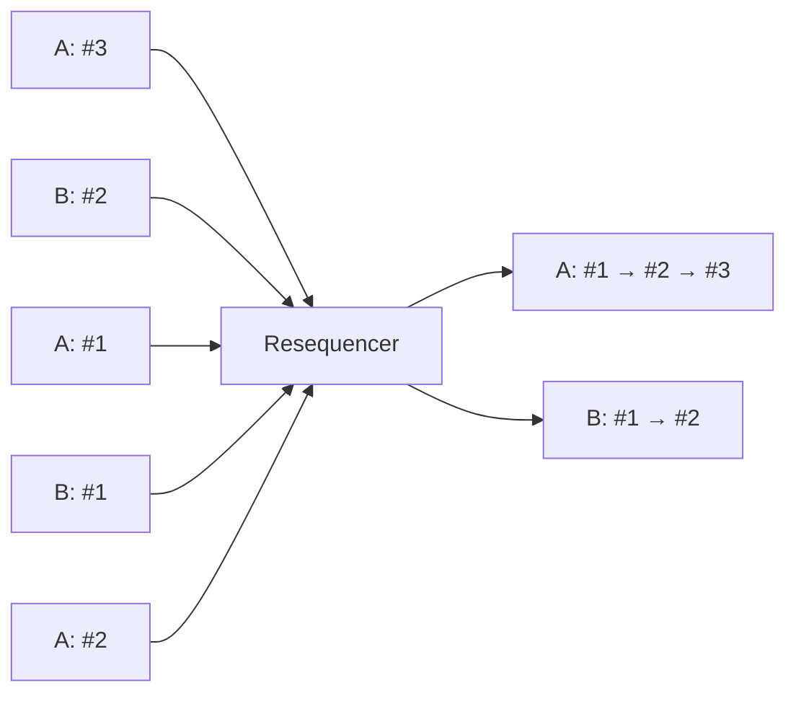
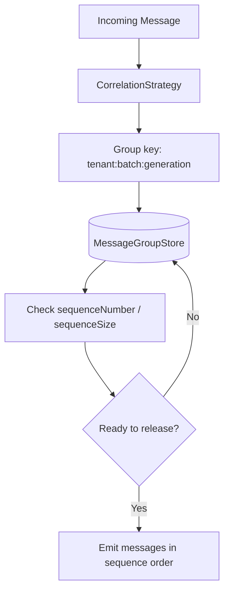
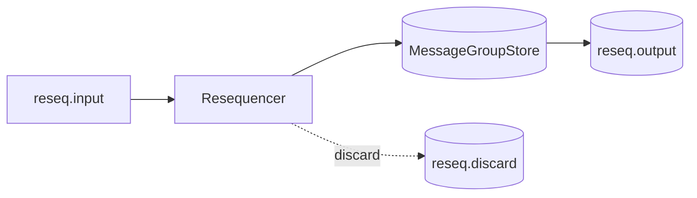
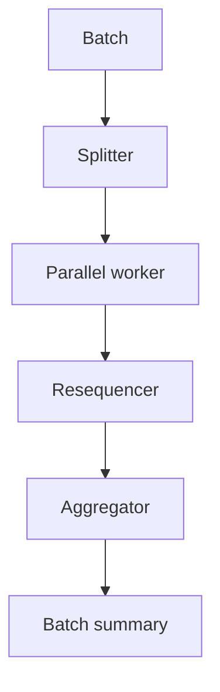
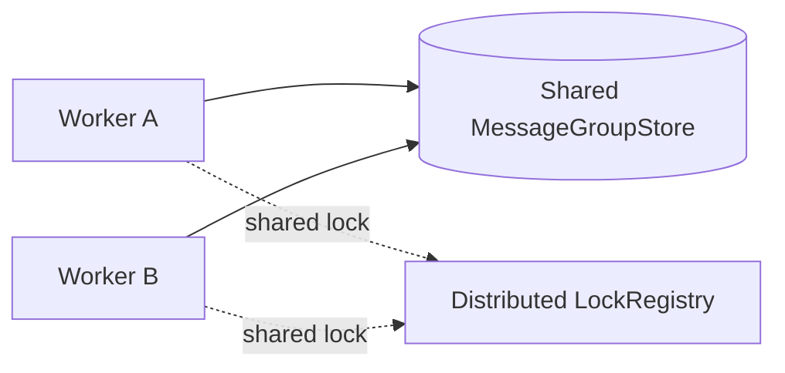

# Sequence Groups and Correlation Keys in Spring Integration Resequencer

## Lesson Objectives

A system receives data parts processed in parallel. The parts have **logical order** 1, 2, 3, yet actually arrive as 3, 1, 2. If applied immediately upon arrival, business state can become corrupted: part #3 updates an entity before part #1 has finished initializing it.

At the same time, two independent requests can arrive interleaved:

```text
Arrival time         Group       Sequence
T1                   A           3
T2                   B           2
T3                   A           1
T4                   B           1
T5                   A           2
```

A **Resequencer** needs to answer two questions before reordering:

1. **Which messages belong to the same sequence group?** The answer typically relies on `correlationId` or a custom correlation key.
2. **Within each group, what position does the message hold?** The answer relies on `sequenceNumber` and size metadata `sequenceSize`.

Spring Integration's **Resequencer** uses group state to accept messages that may arrive out of order, and emits them in `sequenceNumber` order. It **does not combine payloads into one unified result** like Aggregator.

This lesson belongs to the **Resequencer** chapter of the **SPRING_INTEGRATION_PATTERN** module, where we practice Enterprise Integration Patterns with Spring Integration to build loosely coupled and extensible messaging flows combining Router, Filter, Transformer, Splitter, Aggregator, Gateway, retry, error channels, correlation, plus testing and monitoring branches.

After this lesson, you will be able to:

1. Explain the roles of `correlationId`, `sequenceNumber`, and `sequenceSize` in forming groups and restoring order.
2. Distinguish a Resequencer **sequence group** from the set of all messages on the same channel.
3. Write Java DSL `.resequence(...)` and build JUnit tests for two groups with interleaved arrivals.
4. Compare **waiting for the whole group** with **releasing partial sequences** when a contiguous prefix is available.
5. Design custom correlation keys for multi-tenancy, batches, and multiple processing runs (generations).
6. Understand the impact of missing/duplicate messages, inconsistent sizes, timeouts, late arrivals, and retention in `MessageGroupStore`.
7. Know when Splitter generates sequence headers, when manual assignment is needed, and when alternatives to Resequencer are required.
8. Establish observability, retry, idempotency, and failure-testing criteria so **ordered emission** is never confused with **successful once-only processing**.

## 1. What Exactly Does Resequencer Do?

Model:



**Diagram note:** the two outbound arrows represent **each group's internal order**, not two separate physical output channels. With one shared `outputChannel`, parts from different groups can still interleave depending on when each group becomes ready and which thread executes.

Resequencer has four core responsibilities:

1. **Compute the group key** for each message.
2. **Store unreleased messages** in a `MessageGroupStore`.
3. **Evaluate the release strategy** as matching parts arrive.
4. **Emit each message** in sequence order.

Example for group A:

```text
Input order:  A3, A1, A2
Output order: A1, A2, A3
```

Example for independent group B:

```text
Input order:  B2, B1
Output order: B1, B2
```

Group B completing **before** group A is completely valid. Resequencer does not attempt to enforce a total cross-group order solely from producer emission times.

### Resequencer vs. Aggregator

| Criterion | Resequencer | Aggregator |
| --- | --- | --- |
| Goal | Restore order of parts | Combine multiple parts into one result |
| State | Buffers messages by correlation key | Buffers messages by correlation key |
| Each output | Typically remains **individual child messages** | Typically **one result message per group** |
| Payload data | Does not intentionally transform payloads | May build a new aggregated payload |
| Ordering | Based on `sequenceNumber` | Depends on processor/strategy; not its primary role |
| Release condition | Full sequence or contiguous segments in partial mode | Release strategy for combined result |
| Use case | Fixing order scrambled by concurrency | Aggregating results from a fan-out |

Do not use Aggregator just to sort a list if downstream still expects **individual messages**; and do not use Resequencer if the business wants **one unified summary** across branches.

## 2. Three Core Headers: Correlation, Number, and Size

A message in sequence A may carry:

```text
Message:
  payload = "A-2"
  headers:
    correlationId  = "BATCH-A"
    sequenceNumber = 2
    sequenceSize   = 3
    traceId        = "trace-A"
```

Meaning:

| Header | Example | Function |
| --- | --- | --- |
| `correlationId` | `"BATCH-A"` | Identifies **which group** the message belongs to |
| `sequenceNumber` | `2` | Position of the message **within the group** |
| `sequenceSize` | `3` | Expected part count in a known-size sequence |
| `traceId` | `"trace-A"` | Observability/tracing; **not automatically a group key** |
| `sourceId` | `"document-42"` | Business source identifier |
| `tenantId` | `"tenant-a"` | Authenticated tenant context |
| `attempt` | `2` | Attempt number; must not substitute for `sequenceNumber` |

By default, Resequencer looks up **`IntegrationMessageHeaderAccessor.CORRELATION_ID`** to partition groups and emits sorted by **`IntegrationMessageHeaderAccessor.SEQUENCE_NUMBER`**. For full-group release, **`SEQUENCE_SIZE`** helps determine when a group is complete. <https://docs.spring.io/spring-integration/reference/resequencer.html>

### Correlation Key Does Not Determine Order

```text
Group = "BATCH-A"

A-1: sequenceNumber 1
A-2: sequenceNumber 2
A-3: sequenceNumber 3
```

All share the same correlation key while carrying distinct sequence numbers. Changing A-3's correlation key to `"BATCH-B"` means A-3 **cannot fill position 3 of A** even if the payload matches.

### Sequence Number Does Not Identify the Group

The two messages below share `sequenceNumber=1`, yet are not duplicates:

```text
BATCH-A: seq=1
BATCH-B: seq=1
```

They are the first part of **two separate groups**. Never build a dedup key from `sequenceNumber` alone; at minimum combine **group key + position**, and many systems also need **generation/version**.

### Size Is Not Arrival Order

With `sequenceSize=3`, even if messages arrive as `3,1,2`, the valid part count is still three. `sequenceSize` does not mean "three arrived messages guarantee all positions are present": two copies of the same position raise the count while leaving another position missing.

## 3. A Sequence Group Is a Business Boundary

A group should map to **one unit of work with its own ordering**: a document, a batch, an account stream, or a workflow generation.

Example:

```text
tenant-a / document-42 / run-1
tenant-a / document-42 / run-2
tenant-b / document-42 / run-1
```

Those three keys should be treated as **three distinct groups** if business rules allow rerunning the same document or colliding IDs across tenants.

### Rules for Constructing Group Keys

A good key must be:

- **Stable** across every message of the same cycle.
- **Unique enough** never to merge two cycles.
- **Derived from trusted information**, especially in multi-tenant environments.
- **Available at reception time**; avoid network calls per message to resolve keys whenever possible.
- **Bounded in lifecycle**: clear when the group completes and state is cleaned up.

You can define:

```text
correlationId = tenantId + ":" + batchId + ":" + generation
```

Example:

```text
tenant-a:batch-42:1
tenant-a:batch-42:2
tenant-b:batch-42:1
```

`generation` is not always required, yet becomes essential when **the same `batchId` is reused in a new run**. Without separating generations, new messages can be mistaken for late arrivals of the old run or collide with incomplete state.

### Avoid Using `MessageHeaders.ID` as the Group Key

`MessageHeaders.ID` typically identifies **a single message instance**, not a group of messages. Each part produced by a Splitter gets its own ID. Using each part's own ID as correlation causes Resequencer to create many one-item groups and never restore order.

Nor is `traceId` automatically a reliable group key: one trace can span multiple groups, or retries can get fresh traces. Only use trace IDs for correlation when an explicit contract states they truly represent the same sequence.

## 4. Relationship Between Groups and `MessageGroupStore`

Resequencer is a **stateful endpoint**. When group A is missing part #2, it must retain parts #1 and #3 until all required data arrives or an expiration condition triggers.



Practical components:

| Component | Role | Notes |
| --- | --- | --- |
| `MessageGroupStore` | Stores messages and group metadata | Default in-memory does not survive restarts |
| `CorrelationStrategy` | Determines group key | Null/wrong keys cause failures or mis-grouping |
| `ReleaseStrategy` | Decides when emission can occur | Do not replace with raw count without understanding gaps |
| `LockRegistry` | Synchronizes operations on the same group | Local locks do not replace distributed locks |
| `MessageGroupStoreReaper` | Cleans up old groups | May remove ability to detect late messages |
| `discardChannel` | Observes rejected/expired messages | Needs a consumer and explicit replay policy |
| `groupTimeout` | Handles groups waiting too long | Interacts with partial release/discarding |

**In-memory group state does not become a durable sequence log.** If state must survive restarts or be shared across instances, configure appropriate store/locking/transactions.

### One Group Does Not Equal One Fixed Thread

Multiple threads can submit messages to the same group. Adding to and releasing from a group must be synchronized; never roll an unlocked application `HashMap` under concurrent updates.

Conversely, two distinct groups do not logically block each other. However, shared output channels or worker pools can introduce backpressure or interleaving.

## 5. First Example: Two Groups with Interleaved Arrival Order

Suppose sequence A has 3 parts and sequence B has 2 parts:

```text
Arrival:
  A#3
  B#2
  A#1
  B#1
  A#2

Full-sequence release:
  A#3 -> store A, no output
  B#2 -> store B, no output
  A#1 -> store A, still missing A#2
  B#1 -> group B complete: output B#1, B#2
  A#2 -> group A complete: output A#1, A#2, A#3
```

**Global output in this example can be:** `B#1, B#2, A#1, A#2, A#3`.

This is valid because **order inside each group** is restored:

```text
A: 1, 2, 3
B: 1, 2
```

If business rules require "**all of A before all of B**" regardless of which finishes first, add a **cross-group ordering coordinator**. By default, Resequencer has no knowledge of business order across distinct correlation keys.

## 6. Java DSL: Resequencer Using Default Headers

A simple flow has:

- Input: `reseq.input`.
- Resequencer: groups by `correlationId`, waits for the complete sequence.
- Output: `reseq.output` so tests read messages in order.
- Discard: `reseq.discard` for messages discarded under configured conditions.



### Spring Integration Configuration (Java 17+, Spring Integration 6.x/7.x)

```java
import org.springframework.context.annotation.Bean;
import org.springframework.context.annotation.Configuration;
import org.springframework.integration.channel.DirectChannel;
import org.springframework.integration.channel.QueueChannel;
import org.springframework.integration.config.EnableIntegration;
import org.springframework.integration.dsl.IntegrationFlow;
import org.springframework.messaging.MessageChannel;
import org.springframework.messaging.PollableChannel;

@Configuration
@EnableIntegration
public class GroupResequencerConfig {

    @Bean("reseq.input")
    MessageChannel input() {
        return new DirectChannel();
    }

    @Bean("reseq.output")
    PollableChannel output() {
        // Test sink: no background consumer in this example.
        return new QueueChannel();
    }

    @Bean("reseq.discard")
    PollableChannel discarded() {
        return new QueueChannel();
    }

    @Bean
    IntegrationFlow groupResequencerFlow() {
        return IntegrationFlow.from("reseq.input")
            .resequence(spec -> spec
                // Wait for the complete sequence before emitting.
                .releasePartialSequences(false)
                .discardChannel("reseq.discard"))
            .channel("reseq.output")
            .get();
    }
}
```

Key takeaways:

1. `.resequence(...)` creates the Resequencer endpoint. Spring Integration has no `@Resequencer` annotation requirement; Java DSL is the idiomatic choice.
2. `releasePartialSequences(false)` explicitly states the intent **not to emit contiguous prefixes before the full group arrives**.
3. By default, Resequencer takes the group key from `correlationId` and ordering from `sequenceNumber`.
4. `DirectChannel` lets tests control execution synchronously on each `send`.
5. `QueueChannel` collects resequenced messages for tests to read via `receive()`.
6. `discardChannel` can receive late messages when completed group metadata is still retained. It **is not automatically a catch-all for exceptions**.

**Do not also attach an Aggregator to `reseq.input` to "help sort."** Multiple endpoints on a `DirectChannel` compete for messages via the dispatcher rather than broadcasting. If both resequencing and aggregation are needed, place them **sequentially**.

## 7. Sending Sequenced Messages with Proper Headers

A producer that already holds child parts can attach sequence headers directly. Below is a snippet using an input bean from the Spring context:

```java
import org.springframework.messaging.Message;
import org.springframework.messaging.MessageChannel;
import org.springframework.messaging.support.MessageBuilder;

// input is injected from the MessageChannel bean named "reseq.input".
void sendPart(
    MessageChannel input,
    String groupId,
    int sequenceNumber,
    int sequenceSize,
    String payload
) {
    Message<String> message = MessageBuilder
        .withPayload(payload)
        .setHeader("correlationId", groupId)
        .setHeader("sequenceNumber", sequenceNumber)
        .setHeader("sequenceSize", sequenceSize)
        .setHeader("sourceId", groupId)
        .setHeader("traceId", "trace-" + groupId)
        .build();

    input.send(message);
}
```

Sending out of order:

```java
sendPart(input, "A", 3, 3, "A-3");
sendPart(input, "B", 2, 2, "B-2");
sendPart(input, "A", 1, 3, "A-1");
sendPart(input, "B", 1, 2, "B-1");
sendPart(input, "A", 2, 3, "A-2");
```

The system orders **header-annotated messages**, not by parsing the `"-1"` suffix of the payload. `"A-1"` can be replaced by a business DTO and Resequencer will still work as long as sequence/correlation headers are accurate.

### Why Not Group by Channel Name?

Messages for both A and B enter **the same `reseq.input` channel**. A channel name is merely a transport endpoint, not a discriminator for logical sequences. Conversely, a single group may receive parts from multiple ingress sources normalized to the same key after authentication.

### Header Types Must Be Consistent

`sequenceNumber` and `sequenceSize` in this example are `Integer`s. Never send the string `"3"` assuming every endpoint converts types automatically as an implicit API contract. For data from HTTP/JSON/Kafka, validate and coerce to the exact expected type at the boundary.

## 8. JUnit Tests: Group Isolation and Exact Ordering

The tests below rely on `GroupResequencerConfig`. Two separate groups complete at different times; the test confirms outputs **never cross-contaminate**.

```java
import static org.assertj.core.api.Assertions.assertThat;

import java.util.List;

import org.junit.jupiter.api.Test;
import org.springframework.beans.factory.annotation.Autowired;
import org.springframework.beans.factory.annotation.Qualifier;
import org.springframework.messaging.Message;
import org.springframework.messaging.MessageChannel;
import org.springframework.messaging.PollableChannel;
import org.springframework.messaging.support.MessageBuilder;
import org.springframework.test.context.junit.jupiter.SpringJUnitConfig;

@SpringJUnitConfig(GroupResequencerConfig.class)
class GroupResequencerFlowTest {

    @Autowired
    @Qualifier("reseq.input")
    MessageChannel input;

    @Autowired
    @Qualifier("reseq.output")
    PollableChannel output;

    @Autowired
    @Qualifier("reseq.discard")
    PollableChannel discarded;

    private void send(
        String groupId, int number, int size, String payload
    ) {
        Message<?> m = MessageBuilder.withPayload(payload)
            .setHeader("correlationId", groupId)
            .setHeader("sequenceNumber", number)
            .setHeader("sequenceSize", size)
            .setHeader("traceId", "trace-" + groupId)
            .build();
        assertThat(input.send(m)).isTrue();
    }

    private Message<?> receive() {
        Message<?> message = output.receive(2_000);
        assertThat(message).isNotNull();
        return message;
    }

    @Test
    void twoIndependentGroupsReleaseInTheirOwnSequenceOrder() {
        send("GROUP-A-101", 3, 3, "A-3");
        send("GROUP-B-101", 2, 2, "B-2");
        send("GROUP-A-101", 1, 3, "A-1");

        // Neither group is complete yet.
        assertThat(output.receive(0)).isNull();

        send("GROUP-B-101", 1, 2, "B-1");
        Message<?> b1 = receive();
        Message<?> b2 = receive();
        assertThat(List.of(b1.getPayload(), b2.getPayload()))
            .containsExactly("B-1", "B-2");

        assertThat(b1.getHeaders().get("correlationId"))
            .isEqualTo("GROUP-B-101");
        assertThat(b2.getHeaders().get("sequenceNumber"))
            .isEqualTo(2);
        assertThat(output.receive(0)).isNull();

        send("GROUP-A-101", 2, 3, "A-2");
        Message<?> a1 = receive();
        Message<?> a2 = receive();
        Message<?> a3 = receive();

        assertThat(List.of(
            a1.getPayload(), a2.getPayload(), a3.getPayload()))
            .containsExactly("A-1", "A-2", "A-3");

        assertThat(a1.getHeaders().get("correlationId"))
            .isEqualTo("GROUP-A-101");
        assertThat(a2.getHeaders().get("sequenceNumber"))
            .isEqualTo(2);
        assertThat(a3.getHeaders().get("sequenceSize"))
            .isEqualTo(3);
        assertThat(a3.getHeaders().get("traceId"))
            .isEqualTo("trace-GROUP-A-101");

        assertThat(output.receive(0)).isNull();
        assertThat(discarded.receive(0)).isNull();
    }

    @Test
    void oneOutOfOrderSequenceIsEmittedInOrder() {
        send("GROUP-C-102", 2, 3, "second");
        send("GROUP-C-102", 3, 3, "third");
        assertThat(output.receive(0)).isNull();

        send("GROUP-C-102", 1, 3, "first");

        assertThat(List.of(
            receive().getPayload(),
            receive().getPayload(),
            receive().getPayload()
        )).containsExactly("first", "second", "third");

        assertThat(output.receive(0)).isNull();
    }

    @Test
    void aStillIncompleteGroupDoesNotEmitEarly() {
        send("GROUP-D-103", 1, 3, "first");
        send("GROUP-D-103", 3, 3, "third");

        assertThat(output.receive(0)).isNull();

        // Complete the group so the test does not leave an unfinished group.
        send("GROUP-D-103", 2, 3, "second");
        assertThat(List.of(
            receive().getPayload(),
            receive().getPayload(),
            receive().getPayload()
        )).containsExactly("first", "second", "third");
        assertThat(output.receive(0)).isNull();
    }
}
```

**What is proven:** with `releasePartialSequences(false)`, groups A and B are isolated by correlation ID, and each group emits messages in sequence order once all parts arrive.

**What is not yet proven:** exactly-once processing, survival across restarts, distributed locks across multiple instances, or successful business commits after downstream consumes output.

### Isolating Test State

Resequencer maintains state for incomplete groups. `aStillIncompleteGroupDoesNotEmitEarly` verifies the waiting state **before** sending the missing part, then completes the group to clean up unreleased state. In tests intentionally simulating groups that never complete, use a **separate context or `@DirtiesContext`**, or timeouts/cleanup, so shared stores do not pollute other tests.

## 9. Two Release Modes: Waiting for Full Sequence vs. Early Contiguous Prefix

This is the most critical choice after defining the group key.

### Mode A — Wait for the Full Sequence

```java
.resequence(spec -> spec.releasePartialSequences(false))
```

Suppose sequence size = 4:

```text
Arrival #3      -> buffer
Arrival #1      -> buffer
Arrival #4      -> buffer
Arrival #2      -> release #1, #2, #3, #4
```

Pros:

- Downstream receives the entire sequence in one burst when ready.
- Easy to reason about "all parts are present."
- Well suited to short groups with clear deadlines.

Cons:

- One missing part holds the **entire group** in the store.
- Latency of `#1` depends on the slowest-arriving part.
- Group size and incomplete group counts impact memory.

### Mode B — Early Contiguous Prefix Release

```java
.resequence(spec -> spec.releasePartialSequences(true))
```

With `releasePartialSequences(true)`, Resequencer can emit a **valid ordered prefix** without waiting for the entire group.

```text
Arrival #3      -> buffer, #1/#2 missing
Arrival #1      -> release #1
Arrival #2      -> release #2 then #3
Arrival #4      -> release #4
```

Core rule: **never jump over a gap in the sequence**. Having `#3` does not permit emitting it while `#2` is absent and no policy allows skipping `#2`.

Benefits:

- Reduces latency for early prefixes.
- Useful when downstream can process parts sequentially without waiting for the entire batch to finish.

Trade-offs:

- A group may remain incomplete even after some parts have emitted.
- If `#2` never arrives, `#3` and later parts stay buffered.
- Downstream must distinguish an **emitted prefix** from a **completed sequence**.
- When late or duplicate messages arrive, protection against duplicate side effects is still required.

Per Spring Integration documentation, `releasePartialSequences` defaults to **`false`**. <https://docs.spring.io/spring-integration/reference/resequencer.html>

### When to Choose Which Mode?

| Need | Recommendation |
| --- | --- |
| Process only when every part is present | `false` |
| Stream already-ordered prefixes early | `true` |
| Large gaps or frequent missing parts | Consider another pattern, timeouts, and tracking |
| Must emit *one* final summary | Add Aggregator or an appropriate processor |
| Need strict order across multiple groups | Higher-level coordination, not just `resequence` |

**Do not confuse `releasePartialSequences(true)` with `sendPartialResultOnExpiry(true)`.** The former allows early emission of **valid contiguous segments** while the group is still receiving; the latter governs behavior **when a group expires** and may require different gap policies.

## 10. Custom Correlation Key: Tenant, Batch, and Generation

In practice, upstream might only attach three headers:

```text
tenantId = "tenant-a"
batchId = "batch-42"
generation = 2
```

You can use a custom `CorrelationStrategy` or a SpEL `correlationExpression` to construct the key from normalized fields.

### Java DSL Configuration Using an Expression

```java
@Bean
IntegrationFlow tenantAwareResequencerFlow() {
    return IntegrationFlow.from("tenant.reseq.input")
        .resequence(spec -> spec
            .correlationExpression(
                "headers['tenantId'] + ':' + " +
                "headers['batchId'] + ':' + headers['generation']")
            .releasePartialSequences(false)
            .discardChannel("tenant.reseq.discard"))
        .channel("tenant.reseq.output")
        .get();
}
```

This is an **excerpt**: define the referenced channels and ensure inputs pass validation first. `correlationExpression(...)` returns the grouping key; `sequenceNumber` and `sequenceSize` must still be valid for Resequencer to sort.

### Why Validate Headers First?

If `tenantId` or `batchId` is `null`, the expression may produce a broken key or throw, breaking isolation. If `tenantId` is client-supplied without checking against authenticated identity, messages from different tenants can merge accidentally.

Place an ingress step to:

1. Authenticate the tenant.
2. Normalize batch/generation.
3. Validate `sequenceNumber`, `sequenceSize`, and valid ranges.
4. Build a trusted group key header or assign `correlationId` properly.
5. Pass the message to Resequencer.

### When a Trusted `correlationId` Already Exists

If the producer/adapter already sets `correlationId` accurately, skip custom correlation expressions. **Less configuration usually means less risk**, especially when multiple Splitter/Aggregator endpoints rely on Spring Integration's standard headers.

### Avoid Naive String Concatenation When Delimiters Can Appear

`tenantId + ":" + batchId + ":" + generation` is easy to read but can collide if any field may contain `:`. Validate character sets, escape components, or use an immutable value object as an in-process key. If keys are persisted across brokers/stores, use a deterministic encoding shared consistently across all instances.

## 11. Where Do Sequence Headers Come From?

Usually they come from a **Splitter** or scatter component with `applySequence` enabled.


A compact Java DSL example:

```java
@Bean
IntegrationFlow splitThenResequence(
    org.springframework.core.task.TaskExecutor executor
) {
    return IntegrationFlow.from("batch.input")
        .split()
        .channel(
            org.springframework.integration.dsl.MessageChannels.executor(
                executor))
        .resequence()
        .channel("batch.ordered")
        .get();
}
```

This snippet requires `batch.input` and `batch.ordered` channel beans, a `TaskExecutor` bean, and downstream result handling. When splitting a collection, `split()` creates child messages sharing correlation ID and sequence metadata by default; the executor path can alter **processing/arrival timing**, giving Resequencer work to do.

**Note:** the snippet does not automatically simulate complex parallel load; some `ExecutorChannel` setups may still happen to preserve order under light load. To test resequencing reliably, **explicitly send out-of-order messages** as in section 8.

### Splitter Can Produce `sequenceSize=0`

For an `Iterator`-based Splitter or a stream whose total part count is unknown upfront, `sequenceSize` can be **0**. In that case, a Resequencer waiting for a complete group cannot deduce "all arrived" from size alone.

To complete groups when the stream ends, consider:

- Computing count/expected size from trusted metadata beforehand.
- Using an end marker (such as `FileSplitter` START/END) with an explicit tracker/release policy.
- Using a time window with deadlines and terminal outcomes.
- Choosing another strategy if neither position nor end markers can be provided.

**Never turn `sequenceSize=0` into `1` just to force group release**: you are breaking the sequence contract rather than solving correctness.

## 12. Headers Lost Between Splitter and Resequencer

A complex topology might look like:

```text
Splitter
   -> Transformer
   -> Router
   -> async queue / broker
   -> Resequencer
```

Intermediate steps may construct new messages or run serialization adapters. If `correlationId`/`sequenceNumber`/`sequenceSize` are dropped, Resequencer loses track of group and position.

### How to Test and Prevent Loss

- Assert headers at **Splitter output** and **Resequencer input**.
- When constructing a new `Message<?>` internally, use `MessageBuilder` with a proper header copy/allowlist policy.
- Across Kafka/JMS/AMQP/HTTP, verify `headerMapper`, supported value types, and serialization.
- Do not serialize internal `replyChannel` or `errorChannel` objects across process boundaries.
- Never let a Transformer strip `correlationId` and expect Resequencer to "guess" batch membership from the payload.
- With nested Splitters, verify how `sequenceDetails` are pushed/popped and which header represents the group at the active level.

### Nested Sequences Are a Separate Problem

Suppose batch A splits into files, and each file splits into lines. Line sequence numbers inside a file cannot automatically order **the files** at the outer level.

```text
Batch A
  File 1
    Line 1, Line 2
  File 2
    Line 1, Line 2
```

Preserve level metadata—`batchId`/`fileId`/`lineNo`—or use sequence details matching the topology. Never confuse inner sequence group keys with outer sequence keys; each Resequencer should manage **one well-defined ordering level**.

## 13. Group Keys Cannot Restore Global Cross-Group Order

If A and B are two distinct batches:

```text
A#1 -> A#2
B#1 -> B#2
```

Resequencer guarantees **order within A and within B**, yet cannot know business rules expect all of A to finish before B without a **global order index**.

Compare three concepts:

| Ordering | Required Data | Pattern / Tool |
| --- | --- | --- |
| **Per group** | `correlationId + sequenceNumber` | Resequencer |
| **Per key/partition** | Business key + event offset/version | Broker partition ordering or per-key sequencer |
| **Global total order** | System-wide numbering source and sequential commits | Stronger coordinator/log/transaction policy |

One Resequencer per app instance does not create global order across instances. If multiple instances share group state, use a shared store/lock; if groups are partitioned by key to single owners, verify adapter/broker partitioning and ownership rules.

## 14. Duplicate Sequence Numbers: Same Position Is Not Two New Parts

Example:

```text
Group = G-42, size = 3

Receive seq=1: event v1
Receive seq=2: event v1
Receive seq=2: event v1 redelivery (new message ID)
Receive seq=3: event v1
```

Relying only on **message count** can make the group appear complete as soon as the duplicate seq=2 arrives, even though seq=3 has not arrived yet. Distinguish:

- **Same message ID:** store may recognize an already-seen message; does not form a business dedup contract.
- **Two different message IDs, same `sequenceNumber`:** requires an explicit duplicate-handling policy.
- **Same `sequenceNumber`, different payloads:** may indicate producer bugs, races, or a newer version—never pick randomly.
- **Same payload, different `sequenceNumber`:** two distinct valid parts can legitimately carry identical content.

Spring Integration has different release strategies, including options that check duplicate sequence numbers with performance trade-offs. Defaults in `AbstractCorrelatingMessageHandler` for common cases have evolved across versions; **do not rely on defaults as a business idempotency mechanism**.

### Suggested Dedup Key

```text
tenantId + batchId + generation + sequenceNumber
```

However, this key only identifies **logical position**. If a position may be updated on retry, include `partVersion` or terminal state. Duplicate handling rules might be:

1. Reject duplicates outright.
2. Keep the first terminal result.
3. Replace with a part having a higher valid version/attempt.
4. Route conflicts to quarantine without releasing.

Each choice impacts ordering, correctness, and replayability. Test **missing messages** and **duplicate messages** occurring together.

### Resequencer Does Not Guarantee Exactly-Once

Emitting messages in order does not stop downstream consumers from reprocessing on broker redeliveries, caller retries, or process crashes. Business side effects still need idempotency keys and proper transactions.

## 15. Inconsistent Sequence Sizes

Same group, conflicting headers:

```text
G-42 seq=1 size=3
G-42 seq=2 size=4
G-42 seq=3 size=3
```

This is a **contract violation** unless a special policy exists. Resequencer lacks a single consistent group definition if the same generation expects both 3 and 4 parts.

Safeguards:

1. On the first part, capture `expectedSequenceSize` from an authenticated source.
2. Cross-check every subsequent part.
3. Enforce `sequenceNumber >= 1` and `sequenceNumber <= expectedSequenceSize` when size is known.
4. If size is unknown, use markers/end-of-stream or dedicated deadlines.
5. If policy allows growing part counts, create a **new generation** or a window/append-only contract instead of mutating size arbitrarily.

### Do Not Treat Count as Proof of All Parts

```text
Count=3
Seen sequence numbers={1, 2, 2}
Expected={1, 2, 3}
```

Three messages arrived, yet **#3 is missing**. This is why you must track separately:

- Messages **received**.
- **Distinct `sequenceNumber`s** seen.
- Set of **missing positions**.
- Parts **released**.

With dedicated per-group tracking, these figures are invaluable for diagnosing failures.

## 16. Late Arrivals After Group Completion

After a group emits the full sequence, an old part may arrive due to a retry:

```text
G-42: #1, #2, #3 -> released
Later: #2 arrives again
```

If completed-group metadata remains in the store, the late part can be discarded; if metadata was deleted, the same group key can spawn a new group and hang waiting for the rest.

### Completed-Group Retention

- Retain completed-group state long enough to recognize late arrivals.
- Define retention explicitly based on retry/redelivery windows.
- Sweep expired metadata with a reaper bounded by memory/storage limits.
- After cleanup, if business rules still require deduplication, use a durable **business idempotency ledger**.

`discardChannel` is well suited for observing messages arriving after group completion; however, **discarding does not automatically undo side effects**.

### Using Custom Generations

`tenant-a:batch-42:1` and `tenant-a:batch-42:2` are two separate cycles. An old message from generation 1 will never accidentally enter generation 2 to "fill" a missing slot, even though the batch ID is identical.

This is a strong reason to embed generation in correlation keys instead of reusing bare batch IDs.

## 17. Timeouts, Missing Parts, and Partial Expiry

A group may wait forever because:

- Producer never sent a part.
- A Filter dropped a part before Resequencer.
- A worker processing that part failed without returning a result.
- Broker retry is delayed.
- Correlation/sequence header was lost or misassigned.

Example:

```text
Group G, size=4
Received: #1, #3, #4
Missing:  #2
```

With `releasePartialSequences(false)`, the group cannot complete. With `true`, prefix `#1` can emit, yet `#3`/`#4` must wait for the gap to resolve.

### Group Timeout Is Not Send Timeout

| Property | Meaning |
| --- | --- |
| `groupTimeout` | When an incomplete group is evaluated for expiry |
| `sendPartialResultOnExpiry` | Whether buffered waiting messages emit when the group expires |
| `discardChannel` | Receives messages discarded under configured discard/expiry rules |
| `expireGroupsUponTimeout` | Retain or remove group state on timeout |
| `minimumTimeoutForEmptyGroups` | Helps retain empty group metadata long enough during cleanup |
| `sendTimeout` | Time limit for sending to a target channel if it can block |

Configuration excerpt:

```java
.resequence(spec -> spec
    .releasePartialSequences(false)
    .groupTimeout(5_000L)
    .sendPartialResultOnExpiry(false)
    .expireGroupsUponTimeout(false)
    .discardChannel("reseq.discard"))
```

This is an **expiration policy example**, not a complete flow. Configure an appropriate scheduler, message store, and outcome handling for your application. Five seconds is illustrative, not a default SLA.

### Handling Gaps with Partial Results

If business rules call for "at the deadline, emit whatever parts arrived," `sendPartialResultOnExpiry(true)` governs the **expiry policy**, not `releasePartialSequences(true)`. When gaps remain, clarify whether downstream accepts a **non-contiguous** sequence or requires generating a `MISSING_PART` outcome.

Example:

```text
G-42 received = {#1, #3, #4}
Deadline reached
Policy A: discard #3/#4, report missing #2
Policy B: emit available parts with gap warning
Policy C: fail whole group, request replay from producer
```

Do not pick Policy B if downstream requires a contiguous sequence to maintain state. Never equate "partial expiry" with "close enough, skip the gap."

### Relative Timeouts vs. Absolute Deadlines

Some group timeouts reschedule whenever a new message arrives. If business rules demand an absolute deadline measured from batch start, store a **saved deadline timestamp** and use a matching `groupTimeoutExpression`/tracker. Never use a relative timeout and claim every group always finishes within N seconds of the first part.

## 18. Resequencer After Filter, Transformer, and Router

### Splitter → Filter → Resequencer

```text
Splitter creates 4 parts: 1,2,3,4
Filter drops part #2
Resequencer receives: 1,3,4
```

Resequencer does not automatically know `#2` was intentionally dropped by Filter. In full-sequence mode, the group may never release. In partial mode, `#1` emits while `#3`/`#4` wait.

Solutions:

1. **Filter before Splitter** so remaining parts get consistent sequence numbers and sizes.
2. **Emit a `SKIPPED` placeholder/outcome for the dropped part**, keeping slot `#2` so the sequence remains contiguous.
3. Design custom completion + timeout for gap-tolerant flows, explicitly representing missing info.

Never tweak `sequenceSize` individually on surviving messages to "trick" release; group metadata must stay consistent.

### Transformer Can Strip Headers

A Transformer creating a new message must preserve `correlationId`, `sequenceNumber`, and `sequenceSize` as long as it represents the same part. If a transform restructures into multiple distinct messages, that behaves like a new Splitter and must design a new sequence level.

### Router and Multiple Branches

A Router may dispatch parts to different workers that return results asynchronously. When reconverging results to Resequencer, preserve the **original sequence position**. Never use worker completion order as the sequence number.

### Recipient List / Publish-Subscribe

If **the same part fans out to three subscribers**, do not feed all three results carrying the same correlation/sequence directly into **one** Resequencer expecting a single result per position. Those are three different outcomes for the same slot. Clarify the unit being reordered: **part in batch** vs. **branch outcome of a part**; you may need per-part aggregation before resequencing.

## 19. Chaining Resequencer and Aggregator

A common pipeline:



- Splitter divides into child messages with sequence headers.
- Workers may finish parts out of order.
- Resequencer emits them by `sequenceNumber`.
- Aggregator combines them into **one** result, such as a list or summary.

Things to remember:

- Aggregator does not strictly require Resequencer ahead of it: Aggregator can group by correlation and its processor can sort while building the summary if needed.
- Resequencer is useful when an **intermediate handler needs to process each part in order**.
- If Aggregator uses sequence headers, do not strip correlation/sequence when passing through Resequencer or handlers.
- With multiple groups running concurrently, never assume one output channel yields global order.

### Request-Reply with a Gateway

A Gateway expects **one reply**, whereas Resequencer emits **multiple messages**. Wiring a Gateway straight to Resequencer without a result-combining step can cause unexpected replies or timeouts.

Explicit design:

```text
Gateway request
  -> Splitter
  -> parallel work
  -> Resequencer
  -> Aggregator
  -> one BatchSummary reply
```

Alternatively, the Gateway sends a command and receives only an acknowledgment that the batch was accepted; individual part results publish to a separate event channel. Never assume a Gateway automatically collapses multiple output messages into one response.

## 20. Emission Order Does Not Mean Completion Order

Suppose Resequencer emits:

```text
#1 -> #2 -> #3
```

If the output channel is an `ExecutorChannel` and downstream processes concurrently, `#3` can **commit to the DB before `#1`**.

Distinguish:

1. **Arrival order:** order messages arrive at Resequencer.
2. **Release order:** order Resequencer emits them.
3. **Processing start order:** order workers begin.
4. **Commit order:** order side effects take effect.

Resequencer guarantees (2) within a group; it does not guarantee (3) or (4) if downstream runs concurrently without constraints.

If business logic requires sequential commits per account:

- Choose sequential channels/consumers keyed by **business key**.
- Use partitioning / one actor per key across multiple instances.
- Enforce transactions and version checks / optimistic locking.
- Apply idempotency and verify expected next version in the database.

### A State Version Strategy

```sql
-- Illustrates checking expected sequence version.
UPDATE account_state
SET balance = :new_balance,
    next_sequence = next_sequence + 1
WHERE account_id = :account_id
  AND next_sequence = :received_sequence;
```

Zero updated rows can mean an out-of-order message, an already-processed duplicate, or a nonexistent account. Classify each case explicitly; this SQL statement alone is not a complete financial ledger solution.

## 21. Multi-Instance, Locking, and Persistence

When running multiple replicas:



If parts of one group reach two different replicas:

- Instance-local stores **split the group in half** so neither ever completes.
- A shared store with only local locks risks races during add/release.
- A persistent store alone does not guarantee exactly-once downstream delivery if a process crashes between state update and output send.
- You need consistent key-based routing or a shared store + distributed locking, paired with transactions and retries.

### When Do You Need a Persistent Store?

- Batches can span minutes or hours.
- Buffered messages must survive restarts.
- Multiple replicas share responsibility for a group.
- Producers cannot be asked to replay every part after a crash.

For simple apps, in-RAM `SimpleMessageStore` is easy to use, yet lacks all of the guarantees above.

### Cleaning Up Completed Groups

Completed-group metadata enables late-message detection, yet keeping it forever grows storage. Set retention matching the retry/redelivery window and maintain an **external business dedup ledger** once store state is purged.

### Resequencer Fits Short Groups with Small Gaps

Spring Integration documentation notes Resequencer is designed mainly for **relatively short sequences with small gaps**. For massive long-lived streams or huge unbounded gaps, evaluate streaming/broker partition ordering and other windowing models to avoid memory and latency pressure. <https://docs.spring.io/spring-integration/reference/resequencer.html>

## 22. Observability: Monitor by Group, Not Just by Message

Metrics an application can define:

| Metric | Meaning |
| --- | --- |
| `reseq_part_received_total` | Total parts entering Resequencer |
| `reseq_part_released_total` | Total parts emitted |
| `reseq_group_open` | Number of groups still waiting |
| `reseq_group_completed_total` | Number of completed groups |
| `reseq_group_timeout_total` | Number of expired groups |
| `reseq_late_discard_total` | Parts arriving after completion |
| `reseq_duplicate_position_total` | Duplicate sequence positions |
| `reseq_missing_position_count` | Missing positions across groups |
| `reseq_group_wait_duration` | Wait time for full group or prefix |
| `reseq_buffered_messages` | Unreleased buffered messages |
| `reseq_store_failure_total` | Group store read/write failures |
| `reseq_replay_total` | Replays of a batch/part |

These names are **illustrative**, not all emitted out of the box by Spring Integration with these exact names. Integrate Micrometer, structured logging, tracing, and group-state dashboards.

### Log Examples

```text
traceId=trace-A sourceId=batch-A groupId=tenant-a:batch-A:1
event=part_received sequenceNumber=3 sequenceSize=3

traceId=trace-A groupId=tenant-a:batch-A:1
event=group_ready received=3 uniquePositions=3
releasedPositions=1,2,3 durationMs=18

traceId=trace-B groupId=tenant-a:batch-B:1
event=group_gap missingPositions=2 bufferedPositions=1,3
```

**Do not use high-cardinality `groupId` values as metric tags**; keep specific IDs in access-controlled logs/traces. Never log full payloads containing payment info, PII, or tokens.

### Useful Data for Debugging

- Group key and generation.
- Expected size, unique positions seen, and missing positions.
- Count of released parts.
- Arrival timestamps of first and latest parts.
- Reason for timeout/expiry/discard.
- Retry and duplicate counts.
- Handling instance and policy version across multiple replicas.

If you only log `message received`, it is very hard to tell whether a group stalled due to missing `#2` or faulty correlation.

## 23. Troubleshooting Table

| Symptom | Possible Cause | Investigation |
| --- | --- | --- |
| Message group never emits | Missing sequence number or wrong size | Check missing positions and timeouts |
| Groups get mixed | Same `correlationId` reused across batches/generations | Build sufficiently unique business keys |
| Each message lands in its own group | Message ID used as correlation key | Use stable batch/workflow ID |
| Sequence exits out of order | `sequenceNumber` header altered/lost or parallel downstream | Inspect headers before/after Resequencer and commit order |
| Group B finishes before A | Two independent groups; B completed sooner | Usually expected behavior |
| Prefix does not emit early | `releasePartialSequences(false)` or `#1` still missing | Adjust policy if business permits |
| Prefix stalls after `#1` | Gap at `#2`, so `#3`/`#4` are not contiguous | Recover missing part or apply expiry policy |
| Group has right count yet missing part | Duplicate seq before release | Deduplicate by group + position; validate unique set |
| Late message spawns new group | Group metadata was deleted | Retention + dedup ledger |
| State lost on restart | In-memory `MessageGroupStore` | Persistent store or controlled replay |
| Multi-instance state inconsistency | Shared store lacks distributed lock or split local stores | Shared `LockRegistry`/partitioning |
| Downstream Aggregator waits forever | Filter dropped a part without updating `sequenceSize` | `SKIPPED` outcome or custom release |
| Gateway replies multiple times or times out | Resequencer emits multiple messages with no gather step | Add Aggregator or use async event design |
| Downstream DB writes out of order | Parallel executor after Resequencer | Serialize commits by business key and version check |
| `sequenceSize=0` | Streaming Splitter with unknown total | End marker/deadline/custom completion |
| Store grows rapidly | Too many incomplete groups or uncleaned tombstones | TTL/reaper/capacity/alerts |

## 24. Practice Exercises

### Exercise 1 — Two Interleaved Groups

Using `GroupResequencerConfig`, send A#3, B#2, A#1, B#1, A#2. Prove B emits #1/#2 first and A emits #1/#2/#3 afterward. Assert group/correlation headers are intact.

### Exercise 2 — Waiting for Complete Sequence

Send group C with `sequenceSize=4` in order #4, #1, #3; verify no output yet. Send #2 and verify all four messages emit in logical order.

### Exercise 3 — Partial Prefix

Create a separate test flow with `releasePartialSequences(true)`. Send #3 then #1, verifying #1 emits before group completion; then send #2 and observe #2/#3 emitting without bypassing gaps.

### Exercise 4 — Custom Correlation Key

Send three parts sharing `batchId` across two different tenants. Use `correlationExpression` combining tenant/batch/generation and verify no groups ever mix. Add a missing-tenant case rejected by validation.

### Exercise 5 — Duplicate Sequence

Send #1, #2, #2 (different message ID), #3 with size 3. Observe current release policy; add deduplication by group key + position. Assert the set of positions, not just count.

### Exercise 6 — Inconsistent Size

Send #1 size 3, #2 size 4, #3 size 3. Propose an input validation and quarantine step rather than letting a group exist with contradictory metadata.

### Exercise 7 — Filter Before Resequencer

Have a Splitter produce 4 parts and a Filter drop #2. Compare three approaches: filtering before Splitter, `SKIPPED` placeholder, and custom timeout. Verify a downstream Aggregator does not hang forever.

### Exercise 8 — Timeout and Late Messages

Omit part #2 and configure `groupTimeout` with a discard flow. After expiry, send #2 late; verify behavior when retaining vs. purging completed-group metadata.

### Exercise 9 — Restart

Use a persistent `MessageGroupStore` in an appropriately configured test environment. Send #3 and #1, restart the app, then send #2. Compare against an in-memory store, including checking for duplicate output if restarting near release time.

### Exercise 10 — DB Ordering

Have Resequencer emit #1, #2, #3 in order, while a multi-threaded executor consumer commits #3 first. Add an optimistic version check or per-key sequential worker and rerun the test.

### Exercise 11 — Nested Splitter

A batch has two files, each with multiple lines. Assign separate group keys for file order and line order; verify `sequenceNumber=1` from lines is never used to order files.

### Exercise 12 — Observability

Add metrics for buffered positions, group gaps, timeouts, duplicates, and release latency. Log group ID/expected size/missing positions without logging full payloads or putting high-cardinality IDs in metric tags.

## 25. Implementation Checklist

1. Do messages have **valid `correlationId`, `sequenceNumber`, and `sequenceSize`** entering Resequencer?
2. Is the group key stable within a batch and unique across tenants/generations?
3. Are `traceId`/`MessageHeaders.ID` kept separate from the business correlation key?
4. Does `sequenceNumber` start at 1 and stay within declared size?
5. Within a group, is `sequenceSize` consistent and can it be 0?
6. Have you deliberately chosen **full sequence release** or **partial contiguous prefix**?
7. Are missing positions handled via retry, timeout, `SKIPPED`, or replay?
8. Are duplicate positions detected/deduplicated by an explicit business key?
9. Do headers propagate through Transformers, Routers, and adapters before Resequencer?
10. If using nested Splitters, are sequence and correlation levels distinct per layer?
11. Is it clear Resequencer does not create **global order across groups**?
12. Does downstream introduce concurrency/queues/brokers that alter **commit** order?
13. Does group state need a persistent store across restarts?
14. Across multiple instances, do you use a proper store/lock registry or partition ownership?
15. Does completed-group retention match retry/late-arrival windows?
16. Are `discardChannel`, error channels, and group expiry wired explicitly?
17. If a Gateway expects a reply, does the flow gather outputs into one result?
18. Are out-of-order, interleaved groups, missing/duplicate sizes, timeouts, and restarts tested?
19. Are buffered counts, missing positions, release latency, and duplicates monitored?
20. Are group sizes bounded and sensitive data kept out of logs?

### Key Takeaways

**Sequence group** answers "which parts belong to the same sequence"; **correlation key** is how Resequencer stores and looks up that group; **sequence number** specifies each part's position; **sequence size** indicates when a fixed-size sequence is complete. In Spring Integration, Resequencer emits **individual messages**, preserving business payloads in positional order **per group**, rather than merging into a single payload like Aggregator.

When implementing, distinguish **waiting for the full group** from **emitting contiguous prefixes**, never mistake duplicates for new parts, prevent group key collisions across tenants/generations, and never treat ordered emission as a guarantee of exactly-once or downstream commit order. **Gaps, timeouts, state stores, distributed locks, retries, and observability** determine whether a resequencing system operates reliably in production.

### References

- [Spring Integration Reference — Resequencer](https://docs.spring.io/spring-integration/reference/resequencer.html)
- [Spring Integration Reference — Aggregators and Resequencers (Java DSL)](https://docs.spring.io/spring-integration/reference/dsl/java-aggregators.html)
- [Spring Integration Reference — Aggregator](https://docs.spring.io/spring-integration/reference/aggregator.html)
- [Spring Integration Reference — Message Store](https://docs.spring.io/spring-integration/reference/message-store.html)
- [Spring Integration API — BaseIntegrationFlowDefinition](https://docs.spring.io/spring-integration/api/org/springframework/integration/dsl/BaseIntegrationFlowDefinition.html)
- [Spring Integration API — ResequencerSpec](https://docs.spring.io/spring-integration/api/org/springframework/integration/dsl/ResequencerSpec.html)
