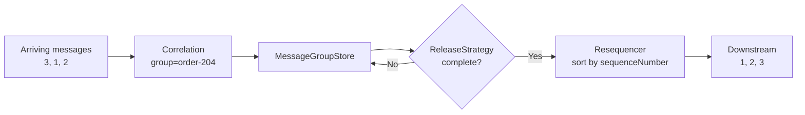
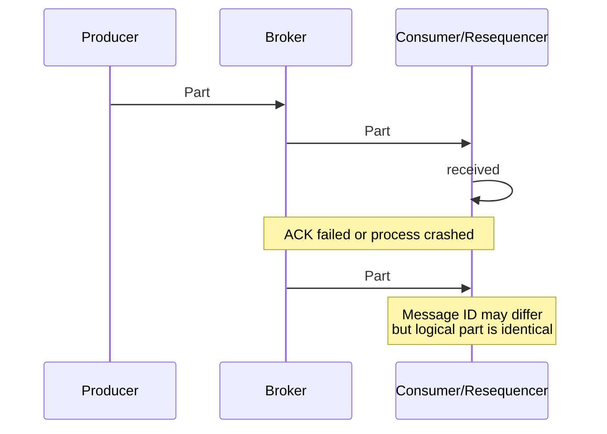
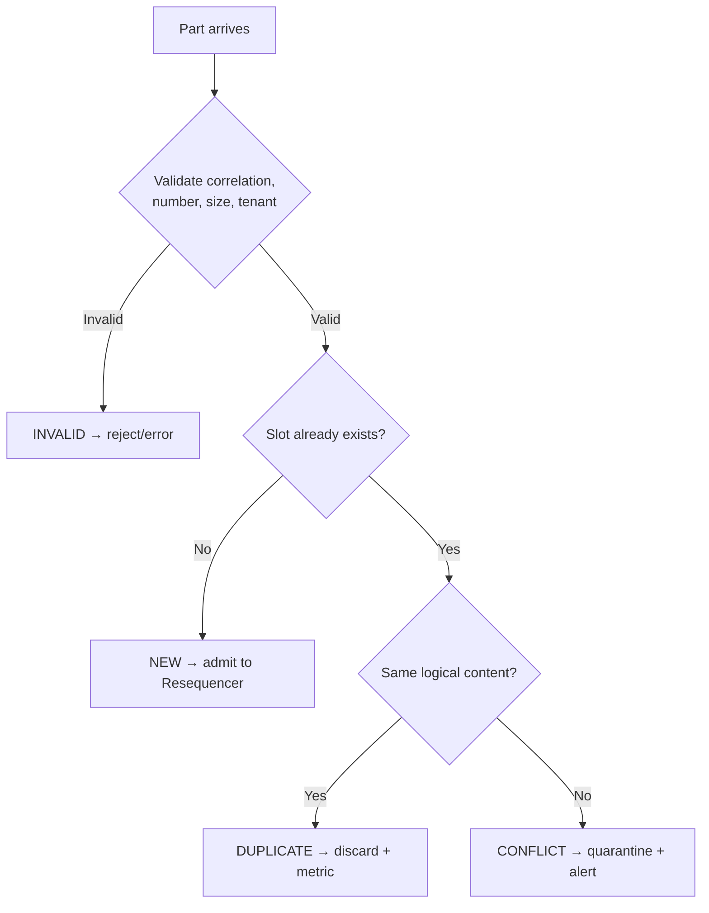
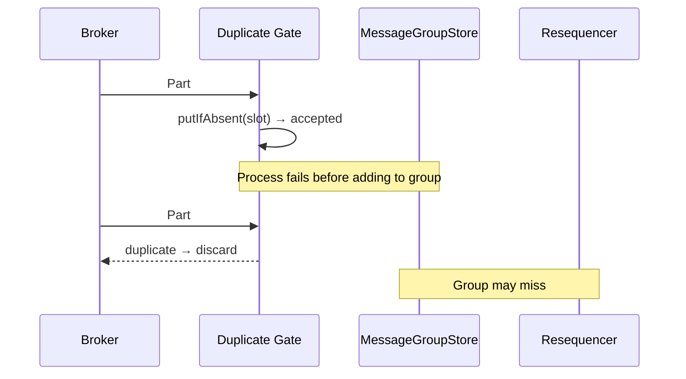
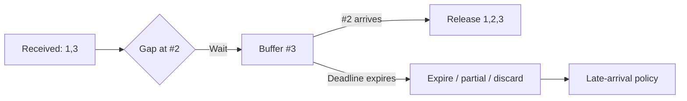
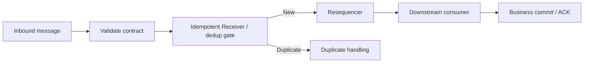

# Duplicate Sequence Number

## 1. When the Same Sequence Number Appears Twice

An order has three independent processing tasks whose results return to one stream with no guaranteed ordering:

```text
batchId = order-204
sequenceSize = 3

Actual arrivals:
  3 → packing result
  1 → validation result
  1 → validation result (broker redelivery)
  2 → tax calculation result

Desired downstream order:
  1 → 2 → 3
```

The issue lies in two messages both carrying `sequenceNumber=1`. If the system treats them as two **independent parts**, the group could reach three messages upon receiving `3, 1, 1` even though **part #2 has not arrived yet**. If both copies of #1 are emitted, downstream processes the same step twice.

In Enterprise Integration Patterns, **Resequencer** receives messages belonging to the same sequence, buffers them until release conditions are met, and then **emits individual messages in sequence order**. It does not merge them into a single aggregated payload like Aggregator.

The lesson **"Duplicate Sequence Number"** belongs to the **Resequencer** chapter of the **SPRING_INTEGRATION_PATTERN** module. The module teaches how to implement Enterprise Integration Patterns with Spring Integration to create loosely coupled, extensible flows combining Router, Filter, Transformer, Splitter, Aggregator, Gateway, retry, error channels, and correlation, while testing and observing branches.

After this lesson, you will be able to:

1. Distinguish **duplicate message**, **duplicate sequence number**, **duplicate business part**, and **retry attempt**.
2. Understand how Resequencer uses `CORRELATION_ID`, `SEQUENCE_NUMBER`, and `SEQUENCE_SIZE`.
3. Explain the risk of **message-count-based** release when sequence numbers repeat.
4. Design validation and a duplicate/conflict gate before Resequencer.
5. Write Spring Integration Java DSL and JUnit examples testing `3,1,1,2 → 1,2,3`.
6. Evaluate partial release, gaps, late arrivals, `MessageGroupStore`, replays, and multi-instance deployments.
7. Know when a persistent dedup ledger, idempotent consumer, and recovery are needed instead of an in-RAM Set.

## 2. Basic Resequencer Model



Three types of metadata:

| Header | Role | Example |
| --- | --- | --- |
| `CORRELATION_ID` | Identifies messages belonging to **the same sequence** | `tenant-A/order-204/rev-1` |
| `SEQUENCE_NUMBER` | Position of a part within the sequence | `1`, `2`, `3` |
| `SEQUENCE_SIZE` | Expected total parts of the sequence | `3` |

**Correlation** is not sequence number. A message #1 for order-204 and a message #1 for order-205 are both valid because they belong to two different groups.

**Resequencer is not Aggregator:** Resequencer keeps the notion of "one message in corresponds to one message emitted on release," merely reordering; Aggregator typically creates **a new message** containing the combined group result.

The definition of *complete* must match reality: a group holding three messages does not imply three distinct sequence numbers unless duplicates are controlled.

## 3. Distinguishing Four Easily Confused Cases

| Scenario | Example in Same Batch | Assessment | Action |
| --- | --- | --- | --- |
| Two distinct parts | `#1=validate`, `#2=tax` | Valid | Order properly |
| Identical duplicate | Two `#1=validate, eventId=e1` | Likely redelivery | Admit **one logical part** |
| Same number, different content | `#1=validate OK` and `#1=validate FAIL` | **Conflict** or undeclared revision | Reject/quarantine; never pick arbitrarily |
| Same number in different batch | `order-204/#1` and `order-205/#1` | Valid | Form two correlation groups |

Another critical case: two messages sharing **the same business part ID** yet carrying different sequence numbers. This can be a producer bug assigning unstable sequences. If you deduplicate only by sequence number, you might miss **one business part appearing at two positions**.

```text
batch=order-204, logicalPartId=validate
  attempt 1: sequenceNumber=1
  attempt 2: sequenceNumber=2   ← contract error
```

A strict system must define a **mapping contract** between logical part ID and sequence number, rather than merely counting distinct numbers.

## 4. Why Is the Same Message Redelivered?



Sources of duplicates:

- **At-least-once** broker redelivers after a missed ACK.
- Producer publishes successfully, times out, and retries the same part.
- A Gateway/HTTP callback is invoked multiple times.
- A pipeline has two flows sending duplicate results.
- An operator replays messages from a DLQ.
- A Splitter reruns after a downstream timeout.
- Multiple workers pick up the same business task when claiming fails.

**Never use `MessageHeaders.ID` to detect business duplicates.** The same part can be wrapped in different `Message` instances with different framework IDs. Conversely, sequence numbers only have meaning **within a correlation group** and must not be used as a system-wide unique key.

## 5. Differences Between the Two Release Modes

Resequencer has two common usage modes:

**Release when sequence is complete:** wait for all expected sequences, then emit in order. This is the easiest to test when `sequenceSize` is known upfront.

**Release partial sequences:** emit valid contiguous segments earlier without waiting for the entire group. This configuration can reduce latency, yet requires tighter control over **gaps, late arrivals, and already-emitted duplicates**.

```text
Arrival: 2, 3             No 1 yet → must wait
Arrival: 1, 2, 3          Valid segment starting at 1
Arrival: 1, 3             Missing 2 → cannot assume 3 is ready
Arrival: 1, 2, 2, 3       #2 repeated → must not emit #2 again
```

**Spring Integration-specific warning:** duplicate sequence number detection depends on the release strategy and version. Spring Integration documentation notes:

- `SequenceSizeReleaseStrategy` was the default prior to Spring Integration 5.0; it handles duplicate sequence detection, though at a cost for large groups.
- For non-partial release cases, `SimpleSequenceSizeReleaseStrategy` became the default starting in Spring Integration 5.0; it is optimized for group-size checks and **is not a full business duplicate detector**.
- Resequencer shares `MessageGroupStore` and `ReleaseStrategy` concepts with Aggregator, yet **emits individual messages** ordered by `SEQUENCE_NUMBER`.

Do not rely on memory that "Resequencer always blocks every duplicate sequence number automatically" or assume size-based release is safe for every source. When correctness relies on deduplication, **make the duplicate policy an explicit, tested contract**. See the Spring documentation links at the end of this lesson.

### Defaults Do Not Guarantee Exactly-Once

Even when a framework version blocks duplicate sequence numbers inside a group, that **does not** solve:

- Duplicate messages arriving **after the group completed and state was removed**.
- The same part sent with a **different sequence number**.
- Two conflicting contents sharing a sequence number and **version selection rules**.
- Downstream side effects already committed when an ACK is lost.
- Lost or split state across multiple JVMs.

Resequencing and idempotency are related responsibilities, not identical ones.

## 6. Designing Keys for a Sequence Slot

Separate your identifiers:

| Key | Example | Purpose |
| --- | --- | --- |
| `tenantId` | `tenant-A` | Data boundary and access control |
| `batchId` | `order-204` | Business group |
| `processingRevision` | `r1` | Distinguishes an authorized rerun |
| `sequenceNumber` | `2` | Order slot within a group |
| `logicalPartId` | `calculateTax` | Distinct task identifier within a group |
| `eventId` | `evt-tax-204-r1` | Stable ID across retries |
| `attemptId` | `attempt-3` | Delivery attempt; **do not use** as dedup key |

A **slot key** can be:

```text
(tenantId, batchId, processingRevision, sequenceNumber)
```

A **logical part key** can be:

```text
(tenantId, batchId, processingRevision, logicalPartId)
```

Both keys support different checks. Using only the slot key can miss the same task being assigned to two positions; using only the logical part key can miss **two distinct tasks receiving the same sequence number**.

### Fingerprinting and Payload Equivalence

Once a slot is found to already exist, the application must determine whether the two copies are **truly equivalent**.

- Same `eventId` and same content may be a valid duplicate.
- Same `eventId` with different payload may be an **integrity violation**.
- Different `eventId` at the same slot may be two producers racing to write.
- Identical payload text for different tenants or revisions is **not** a duplicate.

Use a **canonical business fingerprint** or compare well-defined fields rather than hashing raw JSON. JSON can vary in field order, technical timestamps, whitespace, or numeric formatting like `1.0` vs. `1.00`. When currency, precision, or schema versions exist, normalize per contract before comparing.

## 7. Admission Rules Before Resequencer

An *admission gate* can return three outcomes:



**Core point:** identical duplicates may be ACKed/discarded per delivery contract; conflicts must never "overwrite old with new" based on network arrival order.

A production state machine may include `NEW`, `ACCEPTED`, `RELEASED`, `COMPLETED`, and `CONFLICT`. A cache recording `seen=true` before sending a message into Resequencer **does not** prove the message was persisted in the store or processed downstream. That is a limitation to keep in mind in the example below.

## 8. Java: Input Model and Validator

The example uses a fixed **three-part** sequence for clarity. Each part has `sequenceNumber` 1–3 with `sequenceSize=3`. In production, expected size/expected sets must come from a verified batch plan, never trusting arbitrary client-declared numbers.

```java
record ShipmentPart(
        String tenantId,
        String batchId,
        String processingRevision,
        String eventId,
        String logicalPartId,
        int sequenceNumber,
        int sequenceSize,
        String result) {}

record SequenceSlot(
        String tenantId,
        String batchId,
        String revision,
        int sequenceNumber) {}

final class SequenceContracts {

    private SequenceContracts() {}

    static void requireValid(ShipmentPart part) {
        if (part == null
                || blank(part.tenantId())
                || blank(part.batchId())
                || blank(part.processingRevision())
                || blank(part.eventId())
                || blank(part.logicalPartId())
                || blank(part.result())
                || part.sequenceSize() != 3
                || part.sequenceNumber() < 1
                || part.sequenceNumber() > part.sequenceSize()) {
            throw new IllegalArgumentException(
                "Invalid shipment sequence part");
        }
    }

    static String groupKey(ShipmentPart part) {
        // Length-prefix: avoids key ambiguity when IDs contain ':'.
        String tenant = part.tenantId();
        String batch = part.batchId();
        String revision = part.processingRevision();
        return tenant.length() + "#" + tenant
            + batch.length() + "#" + batch
            + revision.length() + "#" + revision;
    }

    static SequenceSlot slot(ShipmentPart part) {
        return new SequenceSlot(
            part.tenantId(), part.batchId(),
            part.processingRevision(), part.sequenceNumber());
    }

    private static boolean blank(String s) {
        return s == null || s.isBlank();
    }
}
```

**Meaning:**

1. `sequenceNumber` must lie within 1 through `sequenceSize`.
2. `sequenceSize=3` is the demo contract, not a value inferred from `group.size()`.
3. `groupKey` includes tenant, batch, and revision so two distinct sequences never mix.
4. `logicalPartId` and `eventId` must remain stable when the same part is resent.
5. An event using `processingRevision=r2` is meaningful only when business rules **explicitly authorize** reprocessing the whole batch; never bump revision on a network retry.

### Why Check Size on Every Part?

If `#1` carries `sequenceSize=3` while `#2` carries `sequenceSize=4`, there is no clear contract on whether the group expects three or four parts. In flows with partial release, already-emitted parts cannot be recalled.

In production, persist an **expected plan** out-of-band or sign/verify metadata before admitting to a group. Untrusted header values are mere claims, not verified facts.

## 9. Java: In-JVM Gate Against Duplicate Sequence Numbers

A `ConcurrentHashMap.putIfAbsent(...)` can guarantee **a slot is accepted at most once within a single JVM**. The snippet intentionally separates the gate from the framework for easy unit testing.

```java
import java.util.concurrent.ConcurrentHashMap;
import java.util.concurrent.ConcurrentMap;

final class SequenceAdmissionGate {

    private final ConcurrentMap<SequenceSlot, ShipmentPart> accepted =
        new ConcurrentHashMap<>();

    boolean acceptFirst(ShipmentPart part) {
        SequenceContracts.requireValid(part);

        SequenceSlot slot = SequenceContracts.slot(part);
        ShipmentPart existing = accepted.putIfAbsent(slot, part);

        if (existing == null) {
            return true;
        }

        if (existing.equals(part)) {
            // A logical duplicate; do not accept again.
            return false;
        }

        throw new IllegalStateException(
            "Conflicting payload for sequence slot: "
                + slot);
    }
}
```

**Key limitations:**

- The gate only guards duplicate **slots** in RAM of one process; multiple pods can accept the same slot.
- On crash/restart, the Map is lost.
- If a message is marked in the Map yet **has not reached `MessageGroupStore`**, an in-process retry of the same part could be dropped by the Filter even though the group lacks the data.
- If downstream side effects committed and the ACK failed, the Map cannot replace consumer idempotency.
- If groups have many parts and group count is unbounded, the Map can grow indefinitely.
- The code compares the whole record via `equals`, so technical fields that vary across retries **must not live on this record** if retries should count as equivalent duplicates.
- The gate does not check whether two different slots point to the same `logicalPartId`. That is another invariant to verify in production.
- Thread-safety within one JVM does not create an atomic transaction across Map, queue, database, and broker.

Thus this is a **learning demo for admission, duplicates, and conflicts**, not an exactly-once solution for financial workflows or zero-loss data streams.

## 10. Java DSL: Filter Before Resequencer

Flow example:

```text
seq.in
  → Filter(SequenceAdmissionGate)
      ├─ identical duplicate → seq.duplicates
      ├─ conflict/invalid    → exception + error policy
      └─ first accepted      → Resequencer
                                  → seq.out (1,2,3)
```

Spring Integration configuration:

```java
import org.springframework.context.annotation.Bean;
import org.springframework.context.annotation.Configuration;
import org.springframework.integration.channel.DirectChannel;
import org.springframework.integration.channel.QueueChannel;
import org.springframework.integration.config.EnableIntegration;
import org.springframework.integration.dsl.IntegrationFlow;

@Configuration
@EnableIntegration
public class DuplicateSequenceResequencerConfig {

    @Bean
    SequenceAdmissionGate admissionGate() {
        return new SequenceAdmissionGate();
    }

    @Bean("seq.in")
    DirectChannel sequenceInput() {
        return new DirectChannel();
    }

    @Bean("seq.out")
    QueueChannel orderedOutput() {
        return new QueueChannel();
    }

    @Bean("seq.duplicates")
    QueueChannel duplicateOutput() {
        return new QueueChannel();
    }

    @Bean
    IntegrationFlow resequenceShipmentParts(
            SequenceAdmissionGate gate) {

        return IntegrationFlow.from("seq.in")
            .filter(ShipmentPart.class,
                gate::acceptFirst,
                spec -> spec.discardChannel("seq.duplicates"))
            .resequence()
            .channel("seq.out")
            .get();
    }
}
```

Key points:

- Filter **proactively handles duplicates before storing in the group**.
- Identical duplicates route to `seq.duplicates`, never adding an extra entry in Resequencer.
- Conflicts/invalid items throw exceptions; on a synchronous `DirectChannel`, errors propagate back to the sender.
- Resequencer emits accepted messages sorted by `SEQUENCE_NUMBER` upon release.
- Configuration does not enable partial sequence release; the test waits for all three parts. Specific overloads and defaults should be checked against your Spring Integration dependency at compile time.
- `QueueChannel` is used to read results in tests. It does not prove downstream workers completed business work or survived restarts.
- In this example, the gate derives keys from the **trusted payload**. Sequence headers must be generated consistently with the payload at ingress, never allowing clients to supply an independent set of headers.

**Why not use `.releaseStrategy(g -> g.size() == 3)` to prevent duplicates?** Because a release strategy does not eliminate duplicate Map entries, and counting three messages cannot prove three distinct sequence numbers arrived.

## 11. Building Messages with Consistent Sequence Headers

Spring Integration uses sequence headers to resequence. In this lesson, the helper creates messages from a validated payload, avoiding cases where the payload says `#2` while the header says `#1`.

```java
import org.springframework.integration.IntegrationMessageHeaderAccessor;
import org.springframework.messaging.Message;
import org.springframework.messaging.support.MessageBuilder;

final class ShipmentMessages {

    private ShipmentMessages() {}

    static Message<ShipmentPart> of(ShipmentPart part) {
        SequenceContracts.requireValid(part);

        return MessageBuilder.withPayload(part)
            .setHeader(
                IntegrationMessageHeaderAccessor.CORRELATION_ID,
                SequenceContracts.groupKey(part))
            .setHeader(
                IntegrationMessageHeaderAccessor.SEQUENCE_NUMBER,
                part.sequenceNumber())
            .setHeader(
                IntegrationMessageHeaderAccessor.SEQUENCE_SIZE,
                part.sequenceSize())
            .setHeader("businessEventId", part.eventId())
            .build();
    }
}
```

These headers must originate from a verified boundary, such as a Splitter/adapter or trusted application mapper. In production, if a message crosses a broker with different header mappings, validate at ingress:

- Does `CORRELATION_ID` match the right tenant/batch/revision?
- Does `SEQUENCE_NUMBER` match the logical part/expected plan?
- Is `SEQUENCE_SIZE` consistent with the persisted plan?
- Is `eventId` from an authorized publisher/tenant?

**Never blindly trust client-sent `tenantId` or `correlationId`** when those values govern grouping across multiple customers. A wrong header can mix messages between two unrelated groups.

## 12. Integration Test: 3, 1, Duplicate 1, 2

Uses JUnit 5, AssertJ, and Spring Test. While part #2 is missing, output must remain empty. After part #2 arrives, Resequencer emits in exact order 1–2–3.

```java
import static org.assertj.core.api.Assertions.assertThat;
import static org.assertj.core.api.Assertions.assertThatThrownBy;

import org.junit.jupiter.api.Test;
import org.springframework.beans.factory.annotation.Autowired;
import org.springframework.beans.factory.annotation.Qualifier;
import org.springframework.integration.channel.QueueChannel;
import org.springframework.messaging.Message;
import org.springframework.messaging.MessageChannel;
import org.springframework.test.context.junit.jupiter.SpringJUnitConfig;

@SpringJUnitConfig(DuplicateSequenceResequencerConfig.class)
class DuplicateSequenceResequencerTest {

    @Autowired
    @Qualifier("seq.in")
    MessageChannel input;

    @Autowired
    @Qualifier("seq.out")
    QueueChannel output;

    @Autowired
    @Qualifier("seq.duplicates")
    QueueChannel duplicates;

    private ShipmentPart part(
            String batch, int seq, String value) {
        return new ShipmentPart(
            "tenant-A", batch, "r1",
            batch + "-part-" + seq,
            "step-" + seq,
            seq, 3, value);
    }

    private void send(ShipmentPart part) {
        assertThat(input.send(ShipmentMessages.of(part)))
            .isTrue();
    }

    private int receiveSequenceNumber() {
        Message<?> message = output.receive(1_000);
        assertThat(message).isNotNull();
        return (Integer) message.getHeaders().get(
            "sequenceNumber");
    }

    @Test
    void duplicatePositionDoesNotFillMissingGap() {
        ShipmentPart first = part("b-out-of-order", 1, "validate");
        ShipmentPart third = part("b-out-of-order", 3, "pack");

        send(third);
        send(first);
        send(first); // duplicated logical part, same slot & content

        assertThat(output.receive(0)).isNull();

        Message<?> duplicate = duplicates.receive(1_000);
        assertThat(duplicate).isNotNull();
        assertThat(duplicate.getPayload()).isEqualTo(first);

        send(part("b-out-of-order", 2, "tax"));

        assertThat(receiveSequenceNumber()).isEqualTo(1);
        assertThat(receiveSequenceNumber()).isEqualTo(2);
        assertThat(receiveSequenceNumber()).isEqualTo(3);
        assertThat(output.receive(0)).isNull();
    }

    @Test
    void conflictingPositionIsNotSilentlyReplaced() {
        ShipmentPart original = part("b-conflict", 1, "OK");
        ShipmentPart changed = part("b-conflict", 1, "FAILED");

        send(original);

        assertThatThrownBy(() -> send(changed))
            .isInstanceOf(RuntimeException.class);
        assertThat(output.receive(0)).isNull();
    }

    @Test
    void samePositionInDifferentBatchIsNotDuplicate() {
        send(part("b-a", 1, "validate"));
        send(part("b-b", 1, "validate"));

        assertThat(duplicates.receive(0)).isNull();

        send(part("b-a", 2, "tax"));
        send(part("b-a", 3, "pack"));

        assertThat(receiveSequenceNumber()).isEqualTo(1);
        assertThat(receiveSequenceNumber()).isEqualTo(2);
        assertThat(receiveSequenceNumber()).isEqualTo(3);

        // b-b is still waiting for 2 and 3, no output emitted yet.
        assertThat(output.receive(0)).isNull();
    }
}
```

### What Do Test Results Protect?

- **Out of order:** 3 then 1 are not emitted early under full-group release.
- **Exact duplicate:** two copies of `#1` pass through the Filter only once.
- **Gap:** while `#2` is missing, output remains empty.
- **Completion:** when `#2` arrives, downstream receives `#1`, `#2`, `#3`.
- **Conflict:** same slot with differing payload is not overwritten.
- **Correlation:** two batches with the same sequence number do not deduplicate each other.

These tests illustrate a synchronous `ApplicationContext`. They **do not prove** behavior of persistent stores, transactions, remote brokers, or crash recovery. With executors or pollers, use deadline-based assertions and observe error channels; never blindly assume `send()` waits for every downstream handler.

### Note on Running Multiple Tests Sharing One Context

`SequenceAdmissionGate` is a singleton holding state across tests. Each test uses a distinct `batchId` and drains outputs of completed batches to minimize interference. In real projects, isolate fixtures/contexts or provide clean resets rather than depending on JUnit execution order.

## 13. Unit Testing the Gate Without Spring

A small unit test verifies duplicate and conflict logic:

```java
import static org.assertj.core.api.Assertions.assertThat;
import static org.assertj.core.api.Assertions.assertThatThrownBy;

import org.junit.jupiter.api.Test;

class SequenceAdmissionGateTest {

    private final SequenceAdmissionGate gate =
        new SequenceAdmissionGate();

    private ShipmentPart event(
            String eventId, int seq, String result) {
        return new ShipmentPart(
            "tenant-A", "batch-unit", "r1",
            eventId, "step-" + seq, seq, 3, result);
    }

    @Test
    void sameSlotAndSameLogicalPayloadIsDuplicate() {
        ShipmentPart first = event("evt-1", 1, "valid");

        assertThat(gate.acceptFirst(first)).isTrue();
        assertThat(gate.acceptFirst(first)).isFalse();
    }

    @Test
    void differentPayloadAtSamePositionIsConflict() {
        gate.acceptFirst(event("evt-1", 1, "valid"));

        assertThatThrownBy(() ->
            gate.acceptFirst(event("evt-2", 1, "invalid")))
            .isInstanceOf(IllegalStateException.class)
            .hasMessageContaining("Conflicting");
    }

    @Test
    void differentSequencePositionsAreIndependent() {
        assertThat(gate.acceptFirst(
            event("evt-1", 1, "validate"))).isTrue();
        assertThat(gate.acceptFirst(
            event("evt-2", 2, "tax"))).isTrue();
    }

    @Test
    void outOfRangeNumberIsRejected() {
        assertThatThrownBy(() ->
            gate.acceptFirst(event("evt-0", 0, "bad")))
            .isInstanceOf(IllegalArgumentException.class);
    }
}
```

If production code uses canonical fingerprints rather than record equality, unit tests should verify `100.0` vs. `100.00`, JSON field order, enum values, and versions to avoid false conflicts or false duplicates.

## 14. Race Condition: Why Is Check-Then-Put Wrong?

A naive implementation:

```java
// Unsafe when multiple threads receive the same slot concurrently.
if (!map.containsKey(slot)) {
    map.put(slot, part);
    return true;
}
return false;
```

Two threads can both see the key absent and both return `true`. `ConcurrentHashMap.putIfAbsent(...)` fixes the **in-JVM** race when claiming a slot, yet does not form an atomic transaction with `MessageGroupStore`.

A concurrency test should:

1. Spawn 20 threads calling `acceptFirst(part)` concurrently for the same slot.
2. Start all threads together using a `CountDownLatch`.
3. Collect the count of `true` results.
4. Assert **exactly one** thread was admitted.
5. Set a bounded timeout and shut down the executor afterward.

Never use `Thread.sleep(100)` as proof there are no races. And **never extrapolate single-JVM test results to multi-JVM deployments**, because each JVM has its own Map.

## 15. Crash Window: "Seen" Differs from "Stored in Group"



This is why **the in-memory Filter from section 9 cannot serve as a durable solution**. Recording in a dedup store and inserting into `MessageGroupStore` are **two separate operations**.

The reverse case:

```text
1. Part #1 is saved in MessageGroupStore.
2. Process crashes before ACKing broker.
3. Broker redelivers #1.
4. If dedup state was lost while store kept #1, the part may be written again.
```

And after release:

```text
1. Resequencer emits #1 downstream.
2. Downstream commits successfully.
3. ACK is lost; message is redelivered.
4. If downstream is not idempotent, side effects run again.
```

**Resequencer only handles message emission order; it does not replace exactly-once guarantees for side effects.**

### A More Reliable Recovery Model

You can place a ledger/gateway ahead of Resequencer:

```text
accepted_part(
  tenant_id,
  batch_id,
  processing_revision,
  sequence_no,
  logical_part_id,
  event_id,
  canonical_fingerprint,
  state,  -- RECEIVED/BUFFERED/RELEASED/COMPLETED
  PRIMARY KEY(tenant_id, batch_id, processing_revision, sequence_no)
)
```

If ledger and group state live in the same transactional database, both writes can share a verified transaction. Across separate Redis + JDBC + brokers, you need a recovery protocol / transactional outbox or replay strategy. **Never claim atomicity across distinct storage engines simply because each supports atomic puts individually.**

## 16. Same Sequence, Different Payload: How to Handle?

Example:

```text
batch=order-204, sequence=2, eventId=e-tax-204

Reply 1: tax = 35.50
Reply 2: tax = 36.00
```

At least three possibilities exist:

- Producer emitted **two distinct logical versions**, forgetting to bump revision.
- A conversion/serialization bug altered the data.
- One of the replies is untrusted or tampered with in transit.

**Never automatically pick "last write wins."** The later-arriving message might have been created earlier; brokers/retries can reorder deliveries.

Recommended rules:

1. Normalize schema, currency, and precision before comparing.
2. If a slot already holds an **identical** fingerprint, classify as `DUPLICATE_IDENTICAL`.
3. If the fingerprint **differs**, classify as `CONFLICTING_SEQUENCE` and route to quarantine/error flow.
4. Allow replacement by a new revision/epoch only when explicitly defined by business contract and fully audited.
5. If signatures or trusted producer IDs exist, verify at ingress before accepting.

If downstream already received the old `#2`, emitting a new `#2` requires an **update/compensation contract**. Resequencer is designed to **emit messages in order**, not roll back previously published results.

## 17. Same `logicalPartId` Appearing at Two Positions

Example:

```text
batch=b-204
  #1: logicalPartId=validate-order
  #2: logicalPartId=validate-order  ← same operation, wrong mapping
  #3: logicalPartId=write-order
```

The gate in section 9 only sees that slots `#1`, `#2`, and `#3` differ, so it could admit all three.

A production system can add a **logical part index**:

```text
(tenantId, batchId, revision, logicalPartId) → sequenceNumber
```

When a logical part already mapped to `sequence=1` reappears at `sequence=2`, that is a **contract violation**. However, some domains legitimately allow multiple steps of the same *type*, such as 100 `validate-line` steps for 100 order lines. In that case, `logicalPartId` must include each line ID, not merely the operation name.

The lesson is distinguishing **task type** from **specific part identity**.

## 18. Duplicates After Sequence Completion

Scenario:

```text
09:00:01 #1 received
09:00:02 #2 received
09:00:03 #3 received → release 1,2,3
09:00:04 #2 redelivered
```

After release, a `MessageGroupStore`/Resequencer may keep **empty completed group metadata** to detect late arrivals or remove the group depending on configuration. Spring Integration docs explain that retaining completed-group state discards late arrivals, whereas deleting the group entirely allows a new group with the same correlation key to be created.

**Do not rely on unbounded group tombstones**:

- If completed metadata is kept too long, the store grows.
- If deleted too soon, a duplicate after restart/replay may be treated as a new sequence.
- If the group key changes on retry, the old tombstone offers no protection.

Calculate your **retention horizon** from broker redelivery windows, producer retries, DLQ replays, business processing deadlines, and data retention policies.

### Late Duplicate vs. Late Missing Part

- **Late duplicate `#2`:** `#2` was already part of the emitted sequence and can be safely dropped given evidence.
- **Late missing `#2`:** the group previously timed out and emitted partial `#1`/`#3` per policy; `#2` arriving late is a genuinely new, overdue part. The application needs a late-arrival policy (ignore, quarantine, or revision) instead of dismissing it as a duplicate simply because the group closed.

## 19. Gaps and Partial Release

If `1, 3` arrive for a size-3 sequence:

- Full 1–3 is not present to emit the entire set.
- If partial release is enabled, **a contiguous segment starting at a valid position** can emit per Resequencer semantics, yet `#3` must not skip over the gap at `#2` when ordering is required.
- If `#2` never arrives, the group stays buffered until timeout/expiry.



Never enable `releasePartialSequences(true)` assuming every edge case is solved. Clarify:

- Which positions have already emitted?
- Are non-contiguous parts retained in the group?
- If a duplicate of an already-emitted position arrives, which handler drops it?
- If the missing part arrives after group expiry, does a new batch revision start?
- Can downstream tolerate partial outputs?

With large sequences, frequent gaps, and many open groups, Resequencer incurs substantial state-management overhead. Spring Integration documentation notes Resequencer is better suited for **relatively short sequences with few gaps**.

## 20. Inconsistent `SEQUENCE_SIZE`

Example:

```text
Part #1: size=3
Part #2: size=4
Part #3: size=3
```

You cannot safely infer whether the group should wait for three or four messages without an authoritative source for expected size.

Rules:

1. Lock `expectedSize` and expected-part plan when starting a batch.
2. Every part must match the stored plan.
3. `sequenceNumber` must be positive and not exceed `expectedSize`.
4. If the plan can change, use a **new revision** with explicit semantics.
5. Never let messages from an old revision slip into a new revision's group.
6. Wrong sizes must be flagged as **`INVALID_SEQUENCE_METADATA`**, never silently rewritten to `group.size()`.

Some flows use a Splitter to generate sequence headers automatically. If the Splitter reruns on a modified list, the same correlation ID could receive a different size; decide whether replays use the original snapshot or a new revision.

## 21. `MessageGroupStore` and Multiple Instances

Resequencer is a **stateful** endpoint. It receives parts at different times, stores groups in `MessageGroupStore`, and emits when ready.

| Store / Deployment | Pros | Risks |
| --- | --- | --- |
| In-memory store in one JVM | Simple, good for demos | Lost on restart; each instance holds different parts |
| Persistent JDBC store | Survives restarts | Schema, transactions, locking, and cleanup |
| Shared store / distributed coordination | Multiple instances coordinate | Network, consistency, contention |
| Broker partitioned by group | Keeps same batch on one consumer | Partition reassignments, replays, duplicates still occur |
| Dedicated workflow/part ledger | Explicit control of slots, conflicts, completion | More schemas and recovery logic |

**Risk of fragmentation:**

```text
Instance A receives sequences 1,3
Instance B receives sequence 2
Each instance has its own in-memory store
→ Neither instance has complete 1,2,3.
```

Co-locate/partition messages of the same group, or use a store with proper transactions and locking. Using a **shared store** does not stop producers from emitting duplicates; deduplication logic and consumer idempotency are still needed.

### Persist Both the Gate and the Group

If dedup state is persisted while group state is only in memory, after a restart an old part may be rejected as "already seen" even though the group vanished. If the group is persisted while dedup state is in memory, duplicates can re-enter the group.

For critical workflows, both layers must share a **consistent recovery contract**: e.g., a single ledger acting as source of truth from which groups can rebuild after crashes.

## 22. Retries, ACKs, and Error Channels

There are three distinct failure boundaries:

| Boundary | Example | Appropriate Retry |
| --- | --- | --- |
| **Ingress/validation** | Out-of-range sequence number, conflict | Never retry forever; fix data/quarantine |
| **Store/resequencer** | Database/lock unavailable | Bounded retry per message and store transaction |
| **Downstream** | HTTP/database consumer timeout | Retry output with idempotency; do not renumber sequence |

Errors on a `DirectChannel` typically propagate back to the sender. With executors, pollers, and broker listeners, exceptions route via configured error flows. **Never assume every error automatically lands on the global `errorChannel`**.

An identical duplicate can be a normal outcome: the logical part was already received and can be ACKed per contract if there is proof it was durably stored. With an in-memory gate, however, receiving a duplicate and returning ACK does not prove the group or side effect was persisted.

### Why Retrying the Whole Pipeline Can Be Harmful

Suppose an upstream Splitter emits 1,2,3 and downstream throws an error; retrying the whole Splitter re-emits every part. Resequencer must handle those duplicates, and downstream consumers must remain idempotent.

If an error only occurred in the handler processing `#3`, retry **only handler/output `#3`** by business key rather than resending the entire sequence without knowing 1 and 2 already committed.

## 23. Resequencer and Spring Integration Idempotent Receiver

Spring Integration provides the **Idempotent Receiver** pattern, where `IdempotentReceiverInterceptor` can combine a `MetadataStoreSelector` and a metadata store to detect repeated messages.

A possible topology:



Caveats:

- The selector/metadata store must use a true business key, not just `MessageHeaders.ID`.
- Recording a marker before Resequencer persists the part still leaves a crash window.
- `SimpleMetadataStore` or local Maps do not span multiple JVMs.
- Shared Redis/JDBC stores require verifying atomicity, transactions, and TTLs.
- Downstream consumer duplicates after resequencing still need separate guards when side effects exist.
- Conflict rules (same slot, different payload) must be defined; a simple boolean selector may not classify conflicts.

**Never equate "filtering duplicate messages" with "guaranteeing exactly-once."** Idempotency is a business contract spanning storage, retries, transport, and side effects.

## 24. Should Deduplication Sit Before or After Resequencer?

| Placement | What It Solves | What It Does Not Solve Alone |
| --- | --- | --- |
| **Before Resequencer** | Stops duplicate slots from skewing groups/releases | Crash between claim and store; output side effects |
| **At group admission/store** | Synchronizes slot uniqueness with group state | Remote consumer commits; cross-store transactions |
| **After Resequencer** | Stops reprocessing already-released parts | Upstream duplicates can still trigger wrong group release |
| **At business consumer** | Prevents repeated side effects | Cannot fix gaps/order/groups corrupted by upstream duplicates |
| **At both boundaries** | Protects both group correctness and business correctness | Requires coordinating keys, retention, and recovery |

For critical workflows, you typically need **deduplication before/at group admission** and **idempotency downstream**. The two layers serve different goals, and a single `seen=true` flag cannot replace both.

## 25. Observing Duplicate Sequences

Logging only "message received" is insufficient. Example application log:

```text
event=sequence_admission
tenantScope=tenant-A
batchId=order-204
revision=r1
sequenceNumber=1
sequenceSize=3
logicalPartId=validate-order
eventId=evt-validate-204-r1
decision=DUPLICATE_IDENTICAL
attempt=2
```

This is a suggested schema, not fields always emitted by the framework. Never log sensitive raw payloads or secrets. Business IDs in traces/logs must follow access-control and retention rules.

Suggested metrics:

| Metric | Tracks |
| --- | --- |
| `resequencer.input.total` | Inbound messages |
| `resequencer.sequence.invalid.total{reason}` | Invalid number, size, missing correlation |
| `resequencer.duplicate.total{kind}` | Identical, conflict, late |
| `resequencer.group.open` | Waiting groups |
| `resequencer.group.age.seconds` | Age of incomplete groups |
| `resequencer.gap.count` | Missing sequence positions |
| `resequencer.group.released.total` | Released groups |
| `resequencer.group.expired.total` | Expired groups |
| `resequencer.output.redelivery.total` | Redelivered outputs |
| `resequencer.store.error.total` | `MessageGroupStore` errors |
| `resequencer.downstream.failed.total` | Handler failures after Resequencer |

These metrics are **custom instrumentation suggestions**. Avoid using `batchId` or `eventId` as unbounded-cardinality metric labels. To trace a specific batch, use access-controlled traces/logs with correlation IDs.

### Distinguish "Received" Count from "Unique" Count

A dashboard showing `group size=3` while `uniqueSequencePositions=2` must indicate an **incomplete group**, never marked successful solely due to message count.

## 26. Common Pitfalls

| Symptom | Possible Cause | Resolution |
| --- | --- | --- |
| Output shows 1,1,3 | Duplicates unblocked, wrong release | Gate before resequencer; inspect strategy |
| Output emits early despite missing `#2` | Counting messages instead of distinct sequences | Verify unique slots and expected set |
| Conflict on `#1` goes undetected | Silent first-wins or faulty fingerprint | Conflict policy + quarantine |
| Two different batches block each other | Key uses only sequence number | Include tenant/batch/revision in key |
| `#2` blocked while incomplete retry runs | Gate marked seen before group admission | Transactions/ledger and recovery |
| Duplicates reappear after restart | In-memory gate lost | Durable state or controlled replay |
| Group never releases | Missing number, wrong size, or fragmented state | Inspect gaps, expected plan, and store |
| Stalled groups inflate memory | Missing expiration/cleanup | Group timeout, reaper, quotas |
| Late message spawns new group | Completed metadata deleted too soon | Proper tombstones/retention |
| Consumer reprocesses after release | Lost ACK, non-idempotent downstream | Consumer dedup by business key |
| Partial enabled, `#3` exits before `#2` | Misconfigured release/gap policy | Check partial semantics and test gaps |
| One part uses two sequence numbers | Unstable producer mapping | Validate `logicalPartId`→seq mapping |
| Tenants A and B merged | Correlation lacks authenticated tenant | Fix trusted key, security review |
| Errors missing from `errorChannel` | Synchronous error or unconfigured endpoint | Inspect right thread/error policy |
| Throughput drops on long groups | Deep release strategy checks, many gaps | Limit group size, measure cost, consider partitioning |

## 27. Security and Reliability

Resequencer can inadvertently become a storage sink if clients supply malicious metadata:

- Never let clients pick `CORRELATION_ID` targeting another tenant's group.
- Cap maximum `SEQUENCE_SIZE` to block a message claiming millions of parts.
- Validate `SEQUENCE_NUMBER` bounds.
- Authenticate the source of each logical part; prevent one producer from spoofing another producer's parts.
- Enforce limits on open groups, messages per group, memory, and storage.
- For replies from other services, verify `logicalPartId` belongs to an authorized scatter/split plan.
- Use allowlists/schemas/plans instead of trusting arbitrary headers.
- Assess whether buffers, DLQs, and message stores contain PII.
- Protect dedup ledgers with ACLs, encryption, retention, and change auditing.
- Never allow a conflicting duplicate to silently overwrite previously emitted results.

Sudden spikes in duplicates/conflicts may indicate retry bugs, bad deployments, or abuse; alert on rates, not just totals.

## 28. Essential Test Matrix

| Scenario | Expected |
| --- | --- |
| 1,2,3 | Emits 1,2,3 |
| 3,1,2 | Emits 1,2,3 |
| 3,1,1,2 | Exact duplicate `#1` discarded; still emits 1,2,3 |
| 1,1,3 | Not treated as complete; `#2` still missing |
| 1(A),1(B) same slot | Conflict if payloads are not equivalent |
| 1 of batch A, 1 of batch B | Two independent slots |
| `#0` or `#4` with size=3 | Reject invalid metadata |
| `#1` size=3, `#2` size=4 | Reject or quarantine inconsistent plan |
| Same `logicalPartId` at `#1`/`#2` | Caught by domain mapping validation |
| `#1` completes then duplicate after release | No duplicate business side effects |
| Group missing `#2` past deadline | Explicit timeout/expiration/partial policy |
| `#2` arrives after group expired | Late-arrival policy; no duplicate summary/sequence |
| Crash after dedup claim | Recover from ledger; never lose `#1` |
| Crash after business commit | Redelivery does not duplicate side effects |
| Concurrent duplicates across workers | Cluster-wide consistent claim/dedup |
| Splitter reruns same batch | No inflated count or duplicate business actions |
| Two tenants share `batchId` | Never merged together |
| Different payload sharing `eventId` | Flagged as integrity conflict |
| Partial release enabled | Output preserves contiguity per config/tests |
| `MessageGroupStore` restart | Groups recovered if SLA requires |

## 29. Practice Exercises

### Exercise 1 — Recognizing Duplicate Sequence Numbers

With group size=3, simulate arrivals `[1,2,3]`, `[3,1,1,2]`, `[1,1,3]`, and `[2,2,2]`. Identify the actual sequence number set, missing positions, and when release becomes valid. Explain why group size does not equal unique sequence count.

### Exercise 2 — Implementing Filter Before Resequencer

Use `SequenceAdmissionGate` and `DuplicateSequenceResequencerConfig` to send `3,1,1,2`. Assert output is 1–2–3 and the duplicate routes to the separate channel. Add a test verifying no output when `#2` is missing.

### Exercise 3 — Conflicts and Canonical Fingerprints

A producer sends amount `100.0`, then retries with `100.00`; another sends `101.00` for the same slot. Define equivalence rules using `BigDecimal` and source. Write unit tests distinguishing exact duplicates, equivalent formatting, and conflicting values.

### Exercise 4 — `logicalPartId` Changing Position

Add a Map validating `logicalPartId → sequenceNumber`. Send the same `logicalPartId` at `#1` and `#2`. Explain why a slot-only gate misses this and how to coordinate both indexes in one transaction.

### Exercise 5 — Partial Release with Gaps

Use Java DSL `.resequence(r -> r.releasePartialSequences(true))` in an **alternative** flow. Send `1,3` first; verify what was and was not emitted on your real version. Then send `#2` and duplicate `#1`. Design idempotency so an already-emitted sequence position is never processed a second time.

### Exercise 6 — Failure When Consumer Commits Before Lost ACK

Resequencer emits `#1`; consumer updates the database and crashes before ACK. Broker redelivers `#1`. Propose a business idempotency key and transaction or workflow state to prevent duplicate side effects. Explain why an in-memory Filter before Resequencer is insufficient.

### Exercise 7 — Persistent Store and Multiple Instances

Have instance A receive `#1/#3` and instance B receive `#2`. Explain why per-instance stores fail. Propose partitioning by trusted group key or a persistent shared group store with locking. Simulate a restart before the full sequence arrives.

### Exercise 8 — Expiration and Replay

A size-3 group receives only `#1` and `#3` and times out. An operator replays `#2` a day later. Design retention and late-arrival policies. If a new revision is emitted, record the revision and block duplicates downstream.

### Exercise 9 — Security Vulnerability

A client sends `tenantId=tenant-B` and tenant B's `correlationId` to inject message `#2` into an unauthorized group. Design trusted ingress that reconstructs metadata; test that unauthenticated sources are rejected without mixing tenants.

### Exercise 10 — Observability and Runbook

Build a dashboard tracking open groups, oldest group age, gaps, identical duplicates, conflicts, expired groups, and output redeliveries. Write a runbook distinguishing missing producer messages, wrong size metadata, fragmented group state, and retry duplicates.

**Completion criteria:** clearly state **which slot is duplicated**, **which slot is missing**, **when release is valid**, **how conflicting payloads are handled**, **where state lives**, and **why downstream must remain idempotent**.

## 30. Pre-Production Checklist

- [ ] Correlation key includes verified tenant, business batch, and revision.
- [ ] `SEQUENCE_NUMBER` and `SEQUENCE_SIZE` validated against a trusted plan.
- [ ] Stable business ID exists for every logical part and event.
- [ ] `MessageHeaders.ID` is never used as a business dedup key.
- [ ] Classification exists for exact duplicates, conflicts, invalid inputs, and late arrivals.
- [ ] Release policy never confuses message count with unique sequence positions.
- [ ] Default/release strategy understood for your exact Spring Integration version.
- [ ] Tests cover both complete and partial release.
- [ ] Dedup state cannot be lost or cause false completion across crashes/retries.
- [ ] Atomic claim/transaction or recovery protocol connects ledger and group state when needed.
- [ ] Downstream consumer enforces idempotency when side effects exist.
- [ ] `MessageGroupStore` matches restart and multi-instance SLAs.
- [ ] Group timeout, expiration, retention, and cleanup configured.
- [ ] Policies exist for changed sequence numbers, unfilled gaps, and inconsistent sizes.
- [ ] Policies exist for ACKs, bounded retries, error channels/DLQs.
- [ ] Clients cannot forge group keys or spoof tenants.
- [ ] Quotas cap group count, size, payloads, and backlogs.
- [ ] Metrics and alerts track duplicates, gaps, group age, and store errors.
- [ ] Tests cover concurrency, redeliveries, crashes, and replays.
- [ ] Schema/key migration plan exists when logical part versions evolve.

## 31. Summary

A **duplicate sequence number** is a sequence identity and integrity problem, not just sorting a list of numbers.

Spring Integration's Resequencer uses `CORRELATION_ID` for grouping, `SEQUENCE_NUMBER` for ordering, and `SEQUENCE_SIZE` with a release strategy to decide when to emit. However, **duplicate detection depends on the release strategy and version** and is not sufficient for business idempotency.

A responsible design includes:

1. **Validating** source, correlation, sequence number, size, and revision.
2. **Deduplicating / detecting conflicts** via slot keys and controlled logical part identities.
3. **Resequencing** per group with explicit release and timeout policies.
4. **Persisting / recovering** state across restarts or multiple instances when needed.
5. **Idempotent downstream consumers** so redelivered outputs never duplicate side effects.

**Never let two copies of `#1` fool Resequencer into thinking `#2` arrived.** And never treat emitting a message in order as proof that the whole business transaction committed once.

## References

- [Spring Integration Reference — Resequencer](https://docs.spring.io/spring-integration/reference/resequencer.html)
- [Spring Integration Reference — Aggregator](https://docs.spring.io/spring-integration/reference/aggregator.html)
- [Spring Integration Reference — Aggregators and Resequencers Java DSL](https://docs.spring.io/spring-integration/reference/dsl/java-aggregators.html)
- [Spring Integration API — SequenceSizeReleaseStrategy](https://docs.spring.io/spring-integration/api/org/springframework/integration/aggregator/SequenceSizeReleaseStrategy.html)
- [Spring Integration Reference — Message Group Store](https://docs.spring.io/spring-integration/reference/message-store.html)
- [Spring Integration Reference — Message Filtering](https://docs.spring.io/spring-integration/reference/filter.html)
- [Spring Integration Reference — Idempotent Receiver](https://docs.spring.io/spring-integration/reference/handler-advice/idempotent-receiver.html)
- [Spring Integration Reference — Error Handling](https://docs.spring.io/spring-integration/reference/error-handling.html)
- [Enterprise Integration Patterns — Resequencer](https://www.enterpriseintegrationpatterns.com/patterns/messaging/Resequencer.html)
- [Enterprise Integration Patterns — Idempotent Receiver](https://www.enterpriseintegrationpatterns.com/patterns/messaging/IdempotentReceiver.html)
- [Enterprise Integration Patterns — Message Sequence](https://www.enterpriseintegrationpatterns.com/patterns/messaging/MessageSequence.html)

Examples use Java 17+ (records), Spring Integration Java DSL, and JUnit 5 for illustration. When integrating into a real system, verify APIs and release strategies against your running version and test on real `MessageGroupStore`, channels, transactions, and transports. This lesson belongs to STEP 4 NEW; compilation, running integration tests, and specialized Content QA happen in separate stages.
