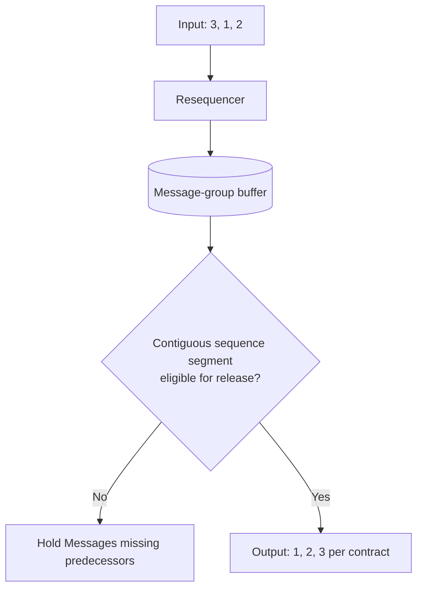
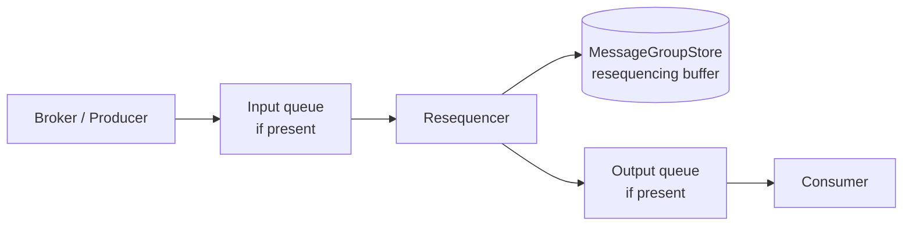
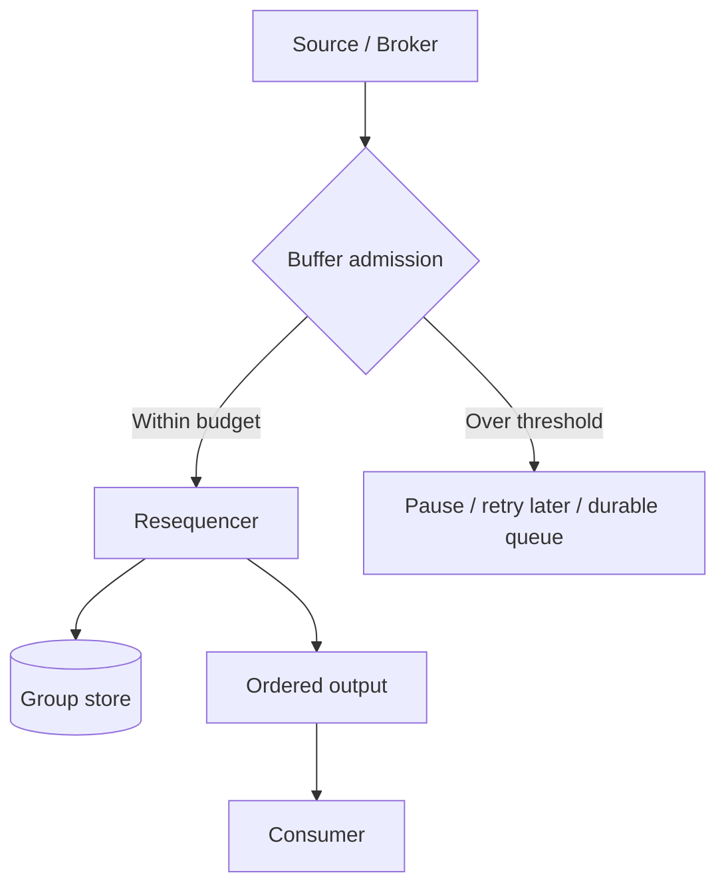
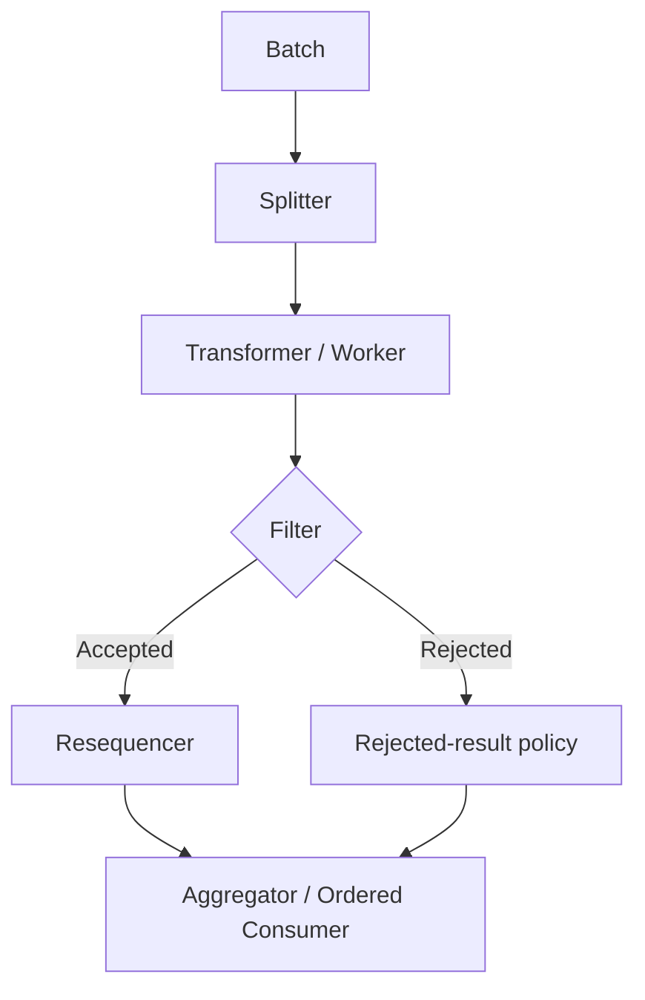

# Bounding Buffer Memory in Resequencer

In an event-driven system, Messages do not necessarily arrive in the order they were created. A batch of three items can run across parallel workers and reach the final endpoint in order `3 → 1 → 2`. If business rules require processing in order `1 → 2 → 3`, the system needs a **Resequencer** to reorder the Messages. To do so, Resequencer typically must **temporarily hold Messages that cannot yet be emitted**.

Problems arise when the next expected sequence number never arrives, a branch fails, inbound rate outpaces outbound rate, or too many groups are waiting. Messages can pile up in the **buffer** and consume ever more memory. A configuration that works fine with three Messages in a unit test may fail under thousands of incomplete groups in production.

The lesson **Bounding Buffer Memory** belongs to the **Resequencer** chapter of the `SPRING_INTEGRATION_PATTERN` module. The module teaches how to implement Enterprise Integration Patterns with Spring Integration, combining Router, Filter, Transformer, Splitter, Aggregator, Gateway, retry, error channels, and correlation while testing and monitoring branches. This lesson focuses on **why memory grows during resequencing, how to size buffer budgets, timeout/eviction/backpressure policies, differences between in-memory and persistent stores, and how to test bottleneck scenarios**.

## 1. Why Does Resequencer Need a Buffer?

Suppose an order has three tasks numbered `1`, `2`, `3`:

```text
Logical order:
    M1 → M2 → M3

Message arrival order:
    M3 → M1 → M2

Order required by consumer:
    M1 → M2 → M3
```

Resequencer cannot emit `M3` before `M1` when the downstream contract requires order from the start of the group. Upon receiving `M3`, it must **wait**. Once `M1` arrives, depending on release settings, it may immediately emit the ready contiguous segment or wait further; when `M2` arrives, the flow can complete the sequence.



**Buffering is an inevitable consequence of waiting for order**, not a framework bug. The risk lies in **how long to wait, how many elements are allowed, and what happens when wait conditions cannot be met**.

### 1.1. Resequencer vs. Aggregator

| Component | Input | Output | Role of Buffer |
| --- | --- | --- | --- |
| **Resequencer** | Multiple sequenced Messages | Multiple Messages emitted in defined order | Holds early items until eligible to emit |
| **Aggregator** | Multiple Messages in same group | Usually one combined result Message | Holds members to compute group result |
| **Splitter** | One Message containing many parts | Multiple child Messages | Usually the source of sequence headers |
| **QueueChannel** | Messages sent to queue | Messages consumed later | Transport buffer; does not reorder by sequence |

Resequencer can share message-group abstractions similar to Aggregator, yet **the goal is not merging payloads into one result**. Memory limits must align with emitting individual Messages in order.

## 2. How Is a Resequencer Group Identified?

In Spring Integration, child Messages typically carry these headers:

| Header | Meaning | Example |
| --- | --- | --- |
| `correlationId` | Which group the Message belongs to | `batch-A-01` |
| `sequenceNumber` | Logical order of the Message in the group | `1`, `2`, `3` |
| `sequenceSize` | Expected total elements when known upfront | `3` |
| `eventId` | Application-assigned business event ID | `evt-A-03` |
| `businessOrderId` | Business key tied to the order | `ORD-1001` |

Example:

```text
Message A3
  payload: LineReady(lineId="L3")
  correlationId: batch-A-01
  sequenceNumber: 3
  sequenceSize: 3

Message A1
  payload: LineReady(lineId="L1")
  correlationId: batch-A-01
  sequenceNumber: 1
  sequenceSize: 3
```

`correlationId` selects the **message group**; `sequenceNumber` determines position **within the group**. Never use `sequenceNumber` as the group key: every batch can have item #1.

### 2.1. One Order ID Can Have Multiple Processing Attempts

If the same `ORD-1001` runs twice, `correlationId="ORD-1001"` can mix Messages from both runs. A safer key is **scoped per attempt/batch**, e.g.:

```text
tenant-7:ORD-1001:attempt-01
tenant-7:ORD-1001:attempt-02
```

Proper key scoping reduces both **mis-ordering** risk and **buffers accumulating groups that never terminate**.

### 2.2. Sequence Metadata Must Have an Explicit Contract

When a Message lacks `sequenceNumber`, has a negative/0 value, mismatched `sequenceSize`, or loses metadata in a Transformer/adapter, Resequencer has no basis to emit as expected. Never solve this by renumbering in arrival order if business rules require **source order**.

For unknown-size sequences, design an explicit termination contract; never assume every streaming source provides an accurate `sequenceSize` upfront.

## 3. Three Places That Can Hold Waiting Messages

When analyzing memory, it is easy to look only at channels and overlook other places:



| Location | What It Holds | Impacts JVM RAM? |
| --- | --- | --- |
| **Input `QueueChannel`** | Messages not yet pulled by Resequencer | Yes, if in-memory queue |
| **`MessageGroupStore`** | Group Messages not yet processed/released/cleaned up | Yes for in-memory store; persistent stores still have caches/metadata/temp objects |
| **Output `QueueChannel`** | Released Messages not yet consumed | Yes, if in-memory queue |
| **Executor tasks** | Messages and lambdas/tasks awaiting threads | Possibly, depending on executor |
| **External broker** | Messages in messaging system outside JVM | Does not occupy JVM heap directly like RAM queues, yet still consumes broker resources |

**A `QueueChannel(100)` does not cap the entire Resequencer at 100 Messages.** It bounds only that queue; `MessageGroupStore` is a **separate** state area.

A Message may be pulled from the input queue while still sitting in the group store waiting for a missing sequence number. Seeing queue depth = 0 then **does not prove the buffer is empty**.

## 4. When Does the Buffer Grow Unboundedly?

### 4.1. Missing First Sequence Number

```text
Expected: 1 2 3 4 5 6 ...
Received:   2 3 4 5 6 ...
Missing: 1
```

If policy prohibits release without `1`, trailing elements accumulate. Adding downstream throughput does not help, because **no valid segment exists to emit**.

### 4.2. Missing Middle Sequence Number

```text
Expected: 1 2 3 4 5 6 7 8
Received: 1 2   4 5 6 7 8
Missing: 3
```

An implementation may have released `1`, `2`, yet must hold elements after the gap when the contract forbids skipping missing sequence numbers.

### 4.3. Too Many Concurrent Groups

```text
Group A: waiting for seq 2
Group B: waiting for seq 1
Group C: waiting for seq 5
...
Group Z: waiting for seq 3
```

Even if each group holds only a few Messages, a surge in **open group count** consumes memory for members, group metadata, correlation keys, and management structures.

### 4.4. Groups with Huge `sequenceSize`

A batch of hundreds of thousands of elements creates memory pressure before the final element arrives, especially when the release policy waits for the entire group or a prolonged gap occurs.

### 4.5. Failed Messages Retried/Redelivered

A source resending the same Message can inflate received counts, cause duplicates, or overload components ahead of Resequencer. **Retries never cure a permanently missing sequence.**

### 4.6. Slow Downstream

Even when Resequencer releases Messages in valid order, the output queue or executor can back up. Pressure then shifts from **group buffer** to **output backlog**. Monitor both sides.

## 5. Calculating a Memory Budget: Do Not Just Count Messages

An initial estimation model:

\[
B_{\text{groups}} \approx \sum_{g \in G}
  \left(M_g + \sum_{m \in g} S_m\right)
\]

Where:

- \(G\): set of stored active groups.
- \(M_g\): overhead for group, collections, locks, metadata, and state.
- \(S_m\): actual memory of one Message, including payload, headers, and object overhead.

Total JVM demand also includes input queues, output queues, executor backlogs, caches, thread stacks, libraries, and business logic heap.

### 5.1. Budgeting Example

For initial planning, suppose:

- At most **2,000 open groups**.
- Each group holds an average of **20 Messages** waiting on gaps.
- Estimated size per buffered Message is **3 KiB**, including payload and expected overhead.

Held Messages alone equal:

```text
2,000 groups × 20 messages/group = 40,000 messages
40,000 × 3 KiB = 120,000 KiB ≈ 117.2 MiB
```

That figure **excludes** per-group metadata, runtime overhead, input/output queues, and temporary structures. Never treat it as an exact heap measurement. Payloads with large `byte[]` fields, nested objects, or shared references shift estimates significantly.

### 5.2. What Should You Measure in Production?

| Metric | Unit | Why It Matters |
| --- | --- | --- |
| In-flight group count | groups | Caps open group count |
| Buffered Message count | Messages | Estimates held item count |
| Estimated buffered bytes | bytes | Catches oversized Messages |
| Oldest group age | duration | Spots groups missing sequences |
| Max messages per group | Messages/group | Spots huge batches or duplicates |
| Input queue depth | Messages | Inbound pressure |
| Output queue depth | Messages | Downstream pressure |
| JVM heap / GC pause | bytes/ms | Checks actual JVM impact |

**Counting Messages is insufficient**: 100 Messages carrying 5 MiB payloads are far riskier than 1,000 Messages carrying 1 KiB. Measure serialized payload sizes or use a verified size estimator rather than relying on `String.length()` for every type.

## 6. Types of Buffer Limits

A practical design usually combines multiple limits:

| Limit | Policy Example | What It Protects |
| --- | --- | --- |
| **Max in-flight groups** | Do not open more than N groups concurrently | Overhead and stalled group count |
| **Max messages per group** | Do not hold more than M items/group | An abnormally large batch |
| **Max buffered bytes** | Do not let total estimated bytes exceed B | Heap and large payloads |
| **Max group age** | Overdue groups trigger policy | Gaps that never fill |
| **Max input queue depth** | Bounded queue | Messages awaiting Resequencer |
| **Max output queue depth** | Bounded queue | Released Messages awaiting consumption |
| **Max concurrent processing** | Bounded executor/poller | Concurrent task count and RAM demand |

These limits are **architectural policies**. Not all of them are direct properties toggleable via a single `.resequence(...)` method. Depending on your Spring Integration version, you may need upstream admission control, an appropriate `MessageGroupStore`, a group-cleanup scheduler, monitoring, or custom components.

### 6.1. Soft Limits vs. Hard Limits

- **Soft limit:** alert when buffer hits 70–80% of budget, giving operations time to intervene.
- **Hard limit:** refuse new admissions, pause consumers, or spill work to durable queues once exceeded.
- **Recovery threshold:** lower than the hard limit to resume admission without rapid flapping.

These percentages are **design examples**, not framework defaults. Calibrate thresholds using measured traffic, payload sizes, and real failure patterns.

## 7. Spring Integration Java DSL: A Basic Resequencer

The Java 17+ example below creates two channels, an in-memory `SimpleMessageStore`, and a flow using `.resequence(...)`. The goal is showing **where the message-group buffer lives**, not claiming this setup already enforces a hard memory cap.

```java
package example.integration;

import org.springframework.context.annotation.Bean;
import org.springframework.context.annotation.Configuration;
import org.springframework.integration.channel.DirectChannel;
import org.springframework.integration.channel.QueueChannel;
import org.springframework.integration.config.EnableIntegration;
import org.springframework.integration.dsl.IntegrationFlow;
import org.springframework.integration.store.MessageGroupStore;
import org.springframework.integration.store.SimpleMessageStore;
import org.springframework.messaging.MessageChannel;
import org.springframework.messaging.PollableChannel;

@Configuration
@EnableIntegration
public class ResequencerBufferConfiguration {

    public record LineReady(String orderId, String lineId) {
    }

    @Bean
    public MessageChannel incomingLines() {
        return new DirectChannel();
    }

    @Bean
    public PollableChannel orderedLines() {
        // Bounds only the output queue, NOT the group store.
        return new QueueChannel(64);
    }

    @Bean
    public MessageGroupStore resequencerStore() {
        // Uses RAM for illustration; waiting groups do not survive JVM restarts.
        return new SimpleMessageStore();
    }

    @Bean
    public IntegrationFlow resequenceLines(MessageGroupStore resequencerStore) {
        return IntegrationFlow.from("incomingLines")
                .resequence(spec -> spec
                        .messageStore(resequencerStore)
                        .correlationStrategy(message -> {
                            Object groupKey =
                                    message.getHeaders().get("batchAttemptKey");
                            if (!(groupKey instanceof String key)
                                    || key.isBlank()) {
                                throw new IllegalArgumentException(
                                        "batchAttemptKey is required");
                            }
                            return key;
                        })
                        .groupTimeout(30_000))
                .channel("orderedLines")
                .get();
    }
}
```

Key takeaways:

1. `incomingLines` receives Messages from producers.
2. `.resequence(...)` applies reordering based on Message sequence metadata.
3. `.correlationStrategy(...)` derives the group key from `batchAttemptKey`, preventing unrelated runs from mixing.
4. `.messageStore(resequencerStore)` specifies where Messages for each waiting group are buffered.
5. `.groupTimeout(30_000)` illustrates a timeout threshold to trigger overdue group handling per endpoint mechanics; **it is not a Message count or byte limit**.
6. `orderedLines` holds emitted Messages for tests/consumers to receive.

**This configuration illustrates mechanics, not a production template with memory caps.** APIs for timeouts, expiration, and partial release can vary across Spring Integration versions; verify against your exact dependency when implementing. In particular, post-timeout handling of waiting Messages must be defined and tested rather than assumed from `30_000` alone.

### 7.1. Do Not Confuse Timeout with Completed Eviction

Setting a timeout does not automatically prove groups are cleaned up, dead-lettered, returned to a Gateway, or recovered after restart. Specify whether the expiry handler will:

- Release eligible partial items or not.
- Drop incomplete items or route them to error/audit channels.
- Keep the group waiting longer or expire/clean up.
- Handle late-arriving Messages after group closure.

With a persistent store, configure an appropriate reaper/expiration mechanism so stale groups are processed even if no new Messages arrive.

## 8. Building Messages with Correlation and Sequence Headers

Producers should attach contract-compliant headers upfront rather than expecting Resequencer to guess order. For instance, an `OrderBatch` split into three child Messages sharing a group key:

```java
package example.integration;

import org.springframework.integration.IntegrationMessageHeaderAccessor;
import org.springframework.messaging.Message;
import org.springframework.messaging.support.MessageBuilder;

import example.integration.ResequencerBufferConfiguration.LineReady;

public final class LineEventFactory {

    private LineEventFactory() {
    }

    public static Message<LineReady> line(
            String groupKey, int number, int total, String lineId) {

        if (groupKey == null || groupKey.isBlank()) {
            throw new IllegalArgumentException("groupKey is required");
        }
        if (number <= 0 || total <= 0 || number > total) {
            throw new IllegalArgumentException("Invalid sequence metadata");
        }

        return MessageBuilder
                .withPayload(new LineReady("ORD-1001", lineId))
                .setHeader("batchAttemptKey", groupKey)
                .setHeader(
                        IntegrationMessageHeaderAccessor.CORRELATION_ID,
                        groupKey)
                .setHeader(
                        IntegrationMessageHeaderAccessor.SEQUENCE_NUMBER,
                        number)
                .setHeader(
                        IntegrationMessageHeaderAccessor.SEQUENCE_SIZE,
                        total)
                .setHeader("businessOrderId", "ORD-1001")
                .setHeader("eventId", groupKey + ":" + number)
                .build();
    }
}
```

Here, `batchAttemptKey` and framework `correlationId` hold the same value by application choice. They do not always have to match in every flow; what is mandatory is that **Resequencer has a consistent grouping strategy**.

### 8.1. Do Not Trust Sequences from Unauthenticated Sources

If an external producer can submit `sequenceSize=1_000_000_000` or mint infinite distinct `batchAttemptKey` values, the system can end up buffering impossible groups.

Therefore verify:

- `sequenceNumber` is positive and within contractual batch limits.
- `sequenceSize` falls within allowed bounds when present.
- Group key belongs to the right tenant or authorized source.
- A sequence number is not improperly reused within the same attempt.
- Payload does not exceed maximum accepted size.

Validation should run **before Messages enter the accumulation area** so uncompletable data is never buffered.

## 9. Demo: Receiving `3 → 1 → 2` and Emitting in Order

The snippet below uses the configuration from section 7:

```java
package example.integration;

import java.util.ArrayList;
import java.util.List;

import org.springframework.context.annotation.AnnotationConfigApplicationContext;
import org.springframework.messaging.Message;
import org.springframework.messaging.MessageChannel;
import org.springframework.messaging.PollableChannel;

import example.integration.ResequencerBufferConfiguration.LineReady;

public class ResequencerDemo {

    public static void main(String[] args) {
        try (var context = new AnnotationConfigApplicationContext(
                ResequencerBufferConfiguration.class)) {

            MessageChannel input =
                    context.getBean("incomingLines", MessageChannel.class);
            PollableChannel output =
                    context.getBean("orderedLines", PollableChannel.class);

            input.send(LineEventFactory.line("attempt-A", 3, 3, "L3"));
            input.send(LineEventFactory.line("attempt-A", 1, 3, "L1"));
            input.send(LineEventFactory.line("attempt-A", 2, 3, "L2"));

            List<String> lineIds = new ArrayList<>();
            for (int i = 0; i < 3; i++) {
                Message<?> result = output.receive(0);
                if (result == null) {
                    throw new IllegalStateException(
                            "Expected 3 resequenced messages");
                }
                lineIds.add(((LineReady) result.getPayload()).lineId());
            }

            System.out.println(lineIds); // [L1, L2, L3]
        }
    }
}
```

Expected result is logical order `L1`, `L2`, `L3`. **Do not assume Resequencer always waits for all three before emitting all at once**: depending on release strategy, it might emit `L1` once the sequence head is valid and `L2`, `L3` afterward. What must be tested is **order on the output**, not the exact instant every Message exits the buffer.

Because this example uses a synchronous `DirectChannel` and a `QueueChannel` with no competing consumer, `receive(0)` works after sending all three Messages. With executors, brokers, or pollers, use bounded-timeout waits.

## 10. JUnit 5: Testing Ordering and Metadata

A test calling `sort()` on a Java list does not verify that the Resequencer endpoint receives and emits Messages properly. Test through real channels.

```java
package example.integration;

import static org.junit.jupiter.api.Assertions.*;

import java.util.ArrayList;
import java.util.List;

import org.junit.jupiter.api.Test;
import org.springframework.context.annotation.AnnotationConfigApplicationContext;
import org.springframework.messaging.Message;
import org.springframework.messaging.MessageChannel;
import org.springframework.messaging.PollableChannel;

import example.integration.ResequencerBufferConfiguration.LineReady;

class ResequencerIntegrationTest {

    @Test
    void emitsOutOfOrderInputsInSequenceOrder() {
        try (var context = new AnnotationConfigApplicationContext(
                ResequencerBufferConfiguration.class)) {

            MessageChannel input =
                    context.getBean("incomingLines", MessageChannel.class);
            PollableChannel output =
                    context.getBean("orderedLines", PollableChannel.class);

            assertTrue(input.send(
                    LineEventFactory.line("attempt-A", 3, 3, "L3")));
            assertTrue(input.send(
                    LineEventFactory.line("attempt-A", 1, 3, "L1")));
            assertTrue(input.send(
                    LineEventFactory.line("attempt-A", 2, 3, "L2")));

            List<String> actual = new ArrayList<>();
            for (int i = 0; i < 3; i++) {
                Message<?> message = output.receive(0);
                assertNotNull(message);
                LineReady line = (LineReady) message.getPayload();
                actual.add(line.lineId());
                assertEquals(
                        "ORD-1001",
                        message.getHeaders().get("businessOrderId"));
            }

            assertEquals(List.of("L1", "L2", "L3"), actual);
            assertNull(output.receive(0));
        }
    }

    @Test
    void twoGroupsNeverMixTheirSequenceOrder() {
        try (var context = new AnnotationConfigApplicationContext(
                ResequencerBufferConfiguration.class)) {

            MessageChannel input =
                    context.getBean("incomingLines", MessageChannel.class);
            PollableChannel output =
                    context.getBean("orderedLines", PollableChannel.class);

            input.send(LineEventFactory.line("A", 2, 2, "A2"));
            input.send(LineEventFactory.line("B", 2, 2, "B2"));
            input.send(LineEventFactory.line("A", 1, 2, "A1"));
            input.send(LineEventFactory.line("B", 1, 2, "B1"));

            List<String> received = new ArrayList<>();
            for (int i = 0; i < 4; i++) {
                Message<?> message = output.receive(0);
                assertNotNull(message);
                received.add(
                        ((LineReady) message.getPayload()).lineId());
            }

            assertEquals(List.of("A1", "A2", "B1", "B2"), received);
            assertNull(output.receive(0));
        }
    }
}
```

The first test verifies ordered output despite `3 → 1 → 2` input. The second test verifies two independent groups; Messages of B **never count toward group A** even though both carry sequence numbers 1 and 2.

In this synchronous test, once A receives #1, A's elements become eligible to emit before B receives #1; thus expected order between A and B reflects **the demo's completion send order**. In asynchronous models, never enforce a global order across groups; only ensure each group preserves its internal order.

**Scope:** this is sample code for learners integrating into projects; this authoring pass did not run Gradle/JUnit. When changing library versions or customizing release policies, run tests to verify your application's exact semantics.

## 11. Unit Tests Do Not Prove Memory Caps

The two tests in section 10 prove ordering, **not that memory is bounded**. To test buffer growth risks, build scenarios with missing Messages and measure group/element counts retained in the store.

### 11.1. Testing a Group Blocked by Missing #1

Scenario:

```text
Group A, sequenceSize=5
Receive: 2, 3, 4, 5
Missing: 1
```

What to verify:

1. Never emit a wrong order like `2, 3, 4, 5` if the contract requires starting at 1.
2. Waiting Messages are reflected in group store metrics.
3. Age/timeout thresholds trigger per policy.
4. If `1` arrives within the deadline, output has valid order.
5. If `1` never arrives, the group is handled per defined policy—never hanging indefinitely without alerts.

With **partial release configured**, assertions must reflect that policy; never assume "zero output until the whole group arrives" if the framework is configured to emit valid leading segments early.

### 11.2. Testing Many Concurrent Waiting Groups

```text
group-A: receive seq 2/3
group-B: receive seq 2/3
group-C: receive seq 2/3
...
group-N: receive seq 2/3
```

After sending, measure:

- Open group count and age of the oldest group.
- Messages held in the group store.
- Input/output queue depths.
- Heap size and GC counts.
- Behavior when hitting application-defined soft/hard limits.

Key point: **measurement must inspect the real store or application metrics**, rather than inferring buffered counts solely from `input.send()` call counts.

## 12. Bounding `QueueChannel` Does Not Bound the Resequencer Buffer

Suppose you configure:

```java
@Bean
public PollableChannel orderedLines() {
    return new QueueChannel(64);
}
```

When the output queue fills up, subsequent sends block or fail depending on channel mechanics, timeout, and calling thread. Yet that **does not directly cap** Messages sitting inside `MessageGroupStore` waiting on incomplete sequences.

```text
Input queue capacity    = 100 (separate limit)
Resequencer group store = uncapped unless explicitly designed
Output queue capacity   = 64 (separate limit)
```

A flow can have an empty output queue while the group store balloons because #1 items are missing. Conversely, the group store can drain rapidly while the output queue fills due to a slow consumer.

**Measure and bound every region independently**, never relying on a single queue capacity parameter to claim the entire flow is memory-safe.

## 13. Admission Control Before Resequencer

If Messages may sit long in the group store, the most effective limit usually starts **before admitting new work**.

An admission policy might check:

```text
allow(message) when:
    openGroups < MAX_GROUPS
    AND bufferedMessages + 1 <= MAX_MESSAGES
    AND estimatedBufferedBytes + estimate(message) <= MAX_BYTES
    AND groupMessageCount < MAX_PER_GROUP
```

This is **policy pseudocode**, not a built-in Spring Integration method named `allow()`.

### 13.1. What to Do When Thresholds Are Exceeded?

| Action | When Appropriate | What to Avoid |
| --- | --- | --- |
| **Pause source/poller** | Consumer/broker supports pause/retry | Pausing indefinitely without alerts |
| **Return overload/retryable status** | Producer honors retry/backoff contract | Retrying too fast, causing thundering herds |
| **Spill to durable queue** | Decouple load without data loss | Calling an in-RAM queue "durable" |
| **Route to dead-letter/inspection** | Invalid Message or policy-violating batch | Using DLQ as a dumping ground for recoverable Messages |
| **Allow intentional partial release** | Business tolerates missing items | Claiming full order despite gaps |
| **Change processing model** | Very large streams or long-lived groups | Keeping all Messages in JVM indefinitely |

If building custom quota counters, use **atomic reserve/release** across concurrent threads, roll back quotas when Messages fail to persist, and recover quotas after restarts. A lone `AtomicInteger` does not preserve cluster-wide consistency across instances.

### 13.2. Counting New Groups Differently from Existing Groups

In a max-groups policy, a new Message for an **already-open group** may still be admitted even at the group cap, so that group can finish and drain. Blocking **every** Message when full could reject the very missing element needed to free the buffer.

Example:

```text
MAX_GROUPS = 100
100 groups open, each waiting for seq 1

If blocking everything:
    seq 1 cannot enter
    100 groups cannot advance
    system deadlocks
```

Therefore, admission policies should distinguish **opening a new group**, **appending to a waiting group**, and **gap-closing Messages**. Pair this with byte/per-group caps so an old group cannot become an unbounded sink.

## 14. Group Timeout and Expiration: Clean Up in the Right Place with the Right Policy

**Timeout** is the waiting time limit; **eviction/expiration** is the action of processing or removing the group. The two are related, not identical.

A group created at 10:00:

```text
10:00:00 group A receives sequence 2
10:00:05 group A receives sequence 3
10:00:30 sequence 1 is still missing
```

Once the group passes its deadline, options include:

1. Record a `MISSING_SEQUENCE` error and halt group processing.
2. Move waiting Messages to durable storage for inspection/replay.
3. Emit parts permitted by partial release policy.
4. Grant limited extra time aligned with bounded retries.
5. Close the group and record completion/failure state to handle late arrivals.

### 14.1. Never Silently Drop Messages Just to Reclaim RAM

Deleting a group from the store frees memory, yet if it holds critical business events, the system just lost unprocessed data. Decide:

- Is dropping permitted?
- Who is alerted, and under which identifier?
- Can Messages be replayed from a broker or outbox?
- Are reason code, group ID, and missing sequences recorded?
- Can the group reopen, or must a new attempt start?

A financial command pipeline may forbid dropping groups; a non-critical analytics pipeline may tolerate controlled skips. This is a **business choice**, not merely a technical optimization.

### 14.2. Timeouts Alone Do Not Guarantee Strict Memory Bounds

Even if every group lives at most 30 seconds, a traffic burst can inject massive Messages **within those 30 seconds**. Thus `groupTimeout` cannot replace **hard caps on group count and bytes**.

Moreover, if `MessageGroupStore` is shared or persisted across restarts, configure an appropriate **scheduler/reaper/expiration setup** so stale groups still get processed per policy even when no new Messages arrive.

## 15. Partial Resequencing: Lower Latency, Changed Contract

Some flows may allow **releasing valid contiguous sequence segments** before the whole group finishes. Example:

```text
Received: 3, 1, 2

When 1 arrives:
    can release 1

When 2 arrives:
    can then release 2, 3
```

This reduces buffer dwell time for some Messages when supported by implementation and configuration. However, it does not eliminate gaps:

```text
Received: 1, 2, 5, 6
Missing: 3, 4

Can release 1, 2
Yet 5, 6 must still wait when strict ordering is required
```

If on timeout you **skip the gap** and emit `5, 6`, the system has chosen a **best-effort** policy: the consumer may never see `3`, `4`. Document which sequences were missing and whether downstream tolerates that.

Never assume every `releaseStrategy` or Spring Integration version behaves identically in partial mode. Test explicitly:

- Does it emit contiguous received prefixes early or wait for all?
- Does it preserve order when sequences arrive late?
- On group timeout, does it emit partial results?
- Does partial release close the group or keep waiting?
- How are late arrivals handled?

## 16. Persistent `MessageGroupStore`: Offloading Pressure from Heap

When thousands of long-waiting groups cannot fit in RAM, use a database-backed persistent store. Spring Integration provides the `MessageGroupStore` abstraction and implementations like `JdbcMessageStore` from Spring Integration JDBC.

**Alternative** bean replacing the in-memory one in section 7:

```java
package example.integration;

import javax.sql.DataSource;

import org.springframework.context.annotation.Bean;
import org.springframework.context.annotation.Configuration;
import org.springframework.integration.jdbc.store.JdbcMessageStore;
import org.springframework.integration.store.MessageGroupStore;

@Configuration
public class PersistentResequencerStoreConfiguration {

    // Use instead of the in-memory resequencerStore() bean;
    // DO NOT register two beans with the same name in one configuration.
    @Bean
    public MessageGroupStore resequencerStore(DataSource dataSource) {
        return new JdbcMessageStore(dataSource);
    }
}
```

This snippet only illustrates swapping the **store implementation**. It does not configure the datasource, Message Store table schema, migrations, serializers, transaction manager, or distributed locks. Add the Spring Integration JDBC module and configure it for your framework version.

### 16.1. What Does a Persistent Store Give You?

- Committed group state can survive application restarts.
- Reduces reliance on keeping all Messages on JVM heap, depending on caching/querying.
- Enables sharing groups across multiple processes with proper synchronization/locking.
- Supports operating long-lived groups with retention, backups, and data governance.

### 16.2. What Does a Persistent Store Not Solve?

- Does not automatically stop **database tables from growing forever**.
- Does not automatically guarantee `groupTimeout` cleans up groups after restarts.
- Does not automatically reduce network bandwidth, CPU, lock contention, or I/O.
- Does not handle broker ACKs, redeliveries, or exactly-once delivery on its own.
- Does not protect against bad correlation keys or duplicate sequences by itself.
- Does not persist headers holding non-serializable Java objects.

**Moving from RAM to JDBC changes the buffer's location and characteristics, not the capacity problem itself.** Quotas, cleanup, metrics, and load tests remain essential.

### 16.3. Payloads and Headers Must Serialize and Deserialize Cleanly

When persisting, verify:

- Which serialization format/version do payloads use?
- Do DTO classes change between deployments?
- Do in-JVM `replyChannel`/`errorChannel` header objects still make sense after a restart?
- Is all correlation/sequence metadata persisted?
- Does the store share a stable namespace/region across instances?

In particular, never rely solely on an in-RAM `replyChannel` object to return Gateway replies across restarts.

## 17. Backpressure and Inbound Throttling

If inbound Messages arrive faster than they can be resequenced and consumed, apply **backpressure** instead of letting the buffer grow endlessly.

A system can flow like:



### 17.1. `DirectChannel` Does Not Automatically Create Durable Backpressure

In synchronous flows, pressure or exceptions can propagate back to the sender. Yet whether the producer actually slows down or retries safely depends on the **sender's contract**. If callers retry immediately in a tight loop when the buffer is full, load worsens.

### 17.2. Brokers Need Proper Pause/ACK/Retry

With Kafka/AMQP or other brokers, evaluate:

- When does the consumer acknowledge a Message?
- If the buffer did not admit a Message, can it retry/redeliver safely?
- Can partitions/consumers pause when thresholds are exceeded?
- While a group waits on a gap, should more Messages for that group still be admitted?
- Can key partitioning preserve order straight from the source?

If ordering is already guaranteed by key-based partitioning, sometimes **Resequencer is not needed** for that stage. Avoid adding a stateful buffer when transport/producers already satisfy the ordering contract.

### 17.3. Never Use Unbounded Queues as a Solution

An unbounded queue only relocates risk: instead of waiting in the group store, Messages wait in input/output queues while still consuming resources. Bound throughput, consumer capacity, timeouts, and error strategies end to end.

## 18. Transactions, Redeliveries, and Idempotency

Suppose Message #2 is saved to `JdbcMessageStore`, and the app crashes before the broker receives ACK. Upon restart, the broker redelivers Message #2.

```text
T1: save group A seq=2 -> DB commit
T2: crash before broker ACK
T3: broker redelivers seq=2
```

If the system stores both copies as two valid parts, the buffer grows and resequencing logic can break.

An appropriate strategy:

- Identify every part by `(groupKey, sequenceNumber, eventVersion)` or a stable business key.
- Distinguish replays of the same event from valid updates with newer versions.
- Deduplicate at a trustworthy layer, persisting state if needed.
- Never use `MessageHeaders.ID` as a stable key across producer Message recreations.
- ACK only after confirming the Message is persisted under the desired durability contract.

A local JDBC transaction guarantees atomicity only for DB resources inside that transaction; it **does not atomically coordinate** with Kafka offsets, HTTP responses, or external brokers. Consumer design must evaluate the failure window between group-store commit and ACK.

### 18.1. When Output Has Released Yet Consumer Is Slow

If resequenced Messages publish to another broker, you may see:

```text
Group state released successfully
Output sent successfully
Crash before recording completion
```

Results may be re-emitted. The final consumer needs idempotency or durable completion tracking. Resequencer **does not guarantee exactly-once side effects**.

## 19. Multi-Instance: Limits Must Align Cluster-Wide

If two replicas receive Messages for group A using separate `SimpleMessageStore` instances, one replica may hold sequences 1 and 3 while the other holds 2. **Neither replica ever sees the complete group**, and memory grows on both.

Architectural options:

| Approach | Pros | Watch Out For |
| --- | --- | --- |
| Partition by group key | Related Messages route to the same consumer | Depends on partition stability and rebalancing |
| Shared persistent `MessageGroupStore` | Instances access shared state | Requires synchronized locking/transactions |
| Distributed `LockRegistry` | Coordinates updates to the same group | Needs proper lock implementation and timeouts |
| Single consumer per partition | Reduces contention | Does not solve replays/late arrivals alone |
| Sharding group state | Distributes load by key | Needs stable routing; avoid losing state on scale |

With **per-instance admission counters**, each instance might admit up to `MAX_GROUPS`, making the cluster total larger than planned. For cluster-wide hard caps, coordinate quotas and usage or allocate explicitly per shard/replica.

## 20. Traversing Filter, Transformer, Splitter, and Aggregator



### 20.1. Splitter

Splitter usually creates child Messages carrying `correlationId`, `sequenceNumber`, and `sequenceSize`. This is the natural feed for Resequencer. If `sequenceSize=100` yet only 99 Messages arrive due to mid-flow errors, the group can stall without a missing-part policy.

### 20.2. Filter

A Filter dropping a child Message can create a **sequence gap**. For example, dropping #2 leaves Resequencer with `1, 3` waiting forever for #2.

To preserve the sequence rather than dropping silently, emit a **tombstone / rejected result** carrying that sequence number to mark the skipped item, or filter the input contract before splitting. Make sure doing so is business-safe and introduces no wrong side effects.

### 20.3. Transformer

A Transformer altering payloads typically keeps order intact, yet if it builds a new Message while dropping correlation/sequence headers, Resequencer can no longer reorder accurately. Test header propagation across Transformers and broker adapters.

### 20.4. Router and Publish–Subscribe

If a Message fans out to multiple recipients or subscribers, one input sequence item can produce multiple results. Resequencer must know **which single result** represents that sequence slot; never feed two distinct replies with the same sequence number into the same group without explicit rules.

### 20.5. Aggregator

Aggregator waits for a group to satisfy completion and produces one combined output. Placing Resequencer before Aggregator keeps inputs ordered prior to aggregation. Yet if aggregation is order-independent (such as summing quantities), adding Resequencer only adds memory and latency.

**Only resequence when order has real business value.** That is the most effective way to bound buffers.

## 21. Gateway, Timeouts, and Reply Paths

A request-reply Gateway may expect an answer within seconds. If Resequencer holds a Message waiting for a sequence item that never arrives, the Gateway may time out before Resequencer releases.

```text
Gateway request timeout = 3 s
Resequencer group timeout = 30 s
Expected sequence item never arrives

→ Caller may time out at 3 s
→ Group continues waiting
```

Gateway timeout and group timeout are **two separate bounds**. Decide:

- Once the caller stops waiting, must the Message still be resequenced and processed?
- If yes, can you return `ACCEPTED` + `requestId` and process asynchronously?
- When the group expires, where should errors or partial results go?
- Does the reply channel still exist across restarts?
- Is there a late-arrival policy preventing returning a result twice?

Never treat a Gateway timeout as an automatic buffer-cleanup mechanism in Resequencer. They are two components with separate lifecycles.

## 22. Observability: See What the Buffer Is Waiting For

A Resequencer can appear silent while memory climbs because it lacks a valid sequence segment to emit. Observability must answer **which groups are waiting, which sequence numbers are missing, and for how long**.

### 22.1. Suggested Operational Metrics

| Illustrative Metric | Meaning |
| --- | --- |
| `resequencer.groups.active` | Groups currently holding state |
| `resequencer.buffer.messages` | Messages currently buffered |
| `resequencer.buffer.estimated_bytes` | Estimated size of waiting data |
| `resequencer.group.oldest_age` | Age of the longest-waiting group |
| `resequencer.group.max_size` | Largest message count held in a single group |
| `resequencer.sequence.gaps` | Groups with missing sequence items |
| `resequencer.messages.released` | Messages emitted per policy |
| `resequencer.messages.duplicate` | Duplicate sequence/business key arrivals |
| `resequencer.groups.expired` | Overdue groups handled on expiry |
| `resequencer.admission.rejected` | Messages rejected due to quotas |
| `resequencer.output.queue.depth` | Backlog after resequencing |
| `jvm.gc.pause` / heap used | Signs of JVM memory pressure |

These are **suggested metric names**, not a complete list exported out-of-the-box by Spring Integration/Micrometer. Some require boundary instrumentation or version-appropriate store/monitoring hooks.

### 22.2. Structured Logs

```json
{
  "stage": "order-resequencer",
  "batchAttemptKey": "tenant-7:ORD-1001:attempt-01",
  "receivedSequences": [1, 3, 4],
  "nextExpectedSequence": 2,
  "bufferedMessageCount": 2,
  "oldestBufferedAgeMs": 12000,
  "groupState": "WAITING_FOR_GAP",
  "action": "RETAIN"
}
```

This log is an **application-defined schema**, not a framework default. It shows logging a group holding `3,4` due to missing `2`, after letting `1` proceed per policy.

Avoid high-cardinality metric tags like `batchAttemptKey` or `eventId`; those keys belong in logs/traces governed by security and retention rules.

### 22.3. Useful Alerts

- Buffered messages/bytes steadily rise while output throughput drops.
- Many groups pass deadlines without cleanup.
- Groups carry abnormally large `sequenceSize`.
- Inbound rate rises while group completion percentage drops.
- Retries and duplicates spike unusually.
- High memory pressure / long JVM GC pauses.
- Persistent store old-record count grows without shrinking.

Base alerts on **trends and traffic-calibrated thresholds**, avoiding single instantaneous spikes.

## 23. Load Testing and Failure Injection Specifically for Buffers

A Resequencer capacity test suite needs more than "Messages come out in order":

| Scenario | Test Data | What to Measure |
| --- | --- | --- |
| Normal | Complete groups `1..N` | Throughput, latency, and ordering |
| Reversed order | `N, ..., 2, 1` | Peak buffered messages/bytes |
| Missing head | `2..N`, without `1` | Group age, timeout/cleanup |
| Missing middle | `1,2,4..N` | Waits on gap, never emits out of order |
| Many concurrent groups | Thousands of distinct keys | Total buffer size and heap |
| Large payloads | Messages with multi-MiB payloads | Byte quotas, GC, serialization |
| Duplicates | Send same sequence multiple times | Deduplication, no unbounded growth |
| Late arrivals | Send missing part after expiration | Late-arrival policy |
| Slow downstream | Throttle consumer | Output backlog and backpressure |
| Restart | Hold group in persistent store, then restart | State reloaded and resumed |
| Multiple instances | Group Messages hit multiple replicas | Correlation, locking, cluster-wide quotas |
| Store failure | DB timeout / connection loss | Error handling and retries per contract |

### 23.1. Test Budgets, Not Just Correctness

A run passes when:

1. Heap and buffer size stay within budget under allowed load.
2. When hitting hard limits, producers/consumers receive predictable backpressure/errors.
3. Overdue groups are handled per published policy.
4. No Messages emit out of order or disappear without audit logs.
5. The system recovers cleanly once load subsides and drains the backlog.

Never infer these criteria pass merely because a simple `JUnit` test is green. Test under realistic load with real measurements.

## 24. Common Implementation Mistakes

| Symptom | Cause | Fix |
| --- | --- | --- |
| Heap grows while output queue is empty | Messages held in `MessageGroupStore` waiting on gaps | Monitor group store, timeouts, quotas |
| Set `QueueChannel(100)` yet still OOMs | Queue cap does not cover group buffer | Cap total groups/messages/bytes |
| One group fills RAM | Huge batch or missing sequence | Max per-group, validation, expiration |
| Many small groups fill RAM | New group keys created too fast | Max in-flight groups, admission control |
| OOMs even with timeout | Burst too large within timeout window | Hard caps plus backpressure |
| Using JDBC yet DB grows forever | Missing retention/cleanup | Expiration, reaper, table monitoring |
| Out-of-order after partial mode | Skipped gap when consumer needed full sequence | Clarify strict vs. best-effort |
| Group never completes | Filter dropped an item or metadata lost | Tombstone/rejected result, header tests |
| Two instances never see full group | Each JVM has its own in-memory store | Partitioning or shared store/locking |
| One sequence counted twice | Broker redelivery | Deduplicate by group/sequence/version |
| Re-emits duplicate after release | Late arrival after cleanup | Completion state and idempotency |
| Gateway times out while group stays forever | Lifecycles not linked | Deadlines and cleanup/error policies |
| Producer retries overload system | Overload responses lack backoff | Rate limits and backoff retries |
| Metrics look fine yet heap is high | Only measuring queues, ignoring store/caches | End-to-end metrics, heap profiling |

## 25. Checklist for Designing Resequencer Buffer Limits

- **Justify resequencing:** if transport already orders by key, avoid adding unnecessary buffers.
- **Define group keys:** give each attempt its own key; never mix tenants or runs.
- **Specify sequences accurately:** numbering, total size, missing/duplicate, and late arrivals.
- **Measure every buffer:** input queue, `MessageGroupStore`, output queue, executors, and caches.
- **Build a memory budget:** by group count, Message count, estimated bytes, and heap overhead.
- **Set soft/hard limits:** never rely on just a single queue limit.
- **Design smart admission:** avoid blindly blocking missing items needed to release open groups.
- **Configure timeout/expiration:** incomplete groups get resolved rather than living forever.
- **No silent drops:** when dropping Messages, follow business-approved error/audit/replay policies.
- **Choose strict vs. partial ordering:** state explicitly if skipping gaps is ever permitted.
- **Evaluate persistent stores:** restartability, schema, transactions, cleanup, and locking.
- **Design backpressure:** pause/retry/durable queues and producer deadlines.
- **Preserve metadata across EIPs:** Splitter, Filter, Transformer, and adapters keep correlation/sequence intact.
- **Prevent duplicates:** stable idempotency keys, not just framework-generated Message IDs.
- **Load test:** many incomplete groups, large payloads, slow downstream, and restarts.
- **Make buffers observable:** active groups, missing sequences, age, bytes, GC, and backlogs.

---

**Bounding Resequencer buffer memory cannot be solved merely by raising heap size or setting a `QueueChannel` capacity.** You must understand why Messages wait for order, cap allowed groups and bytes, set deadlines and recovery paths for missing sequences, and combine backpressure, persistent stores, and idempotency where needed. A strong Resequencer does more than emit in order when everything arrives—it **keeps the system stable and its decisions explainable** when Messages arrive late, go missing, or exceed resource budgets.
