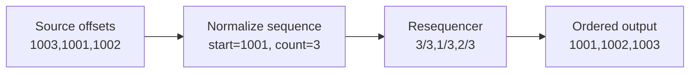
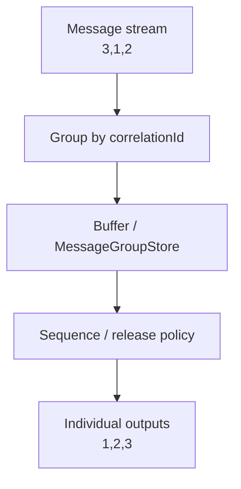
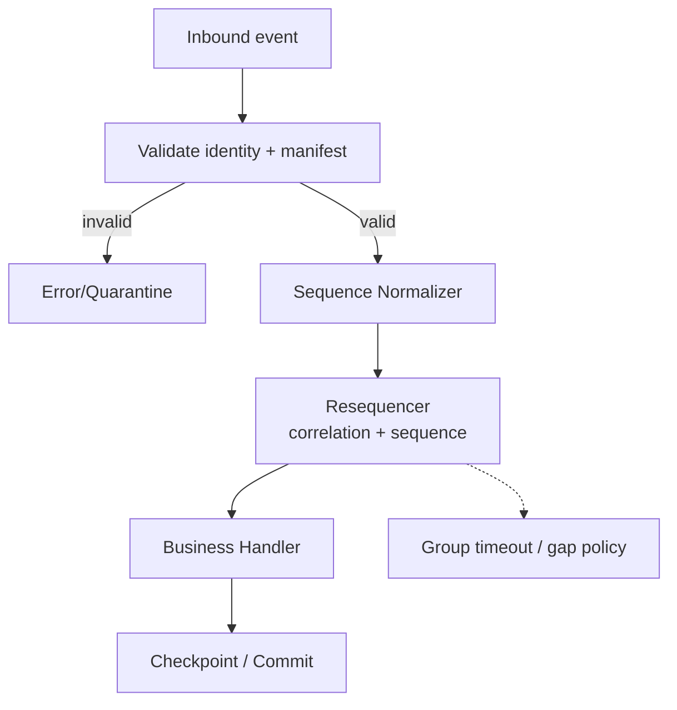
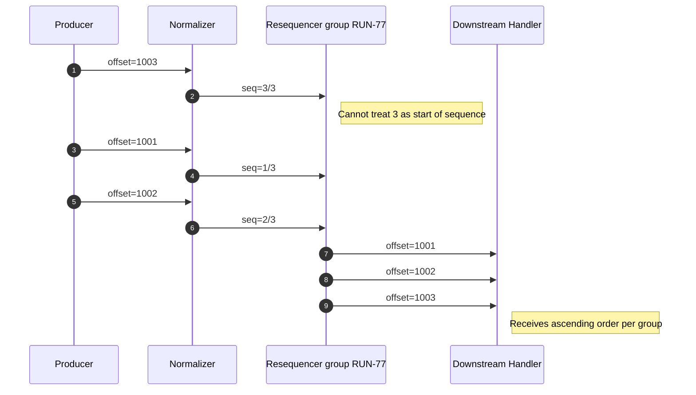
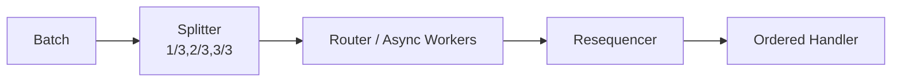
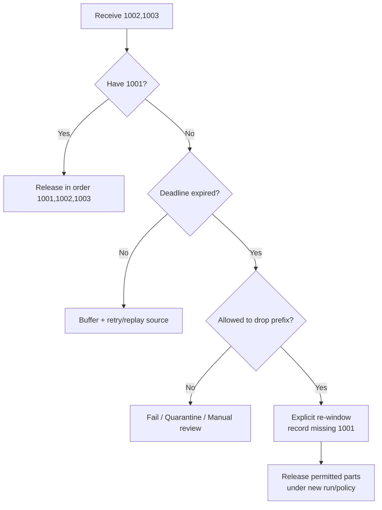
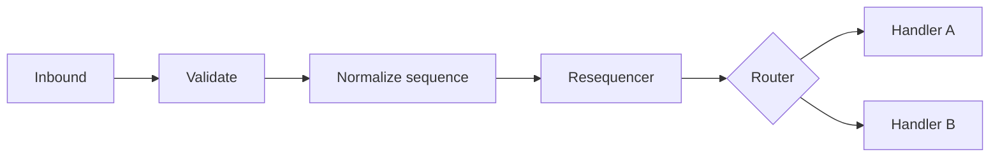
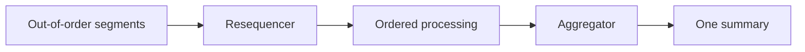
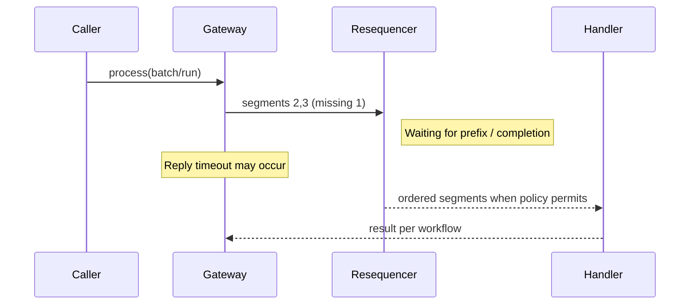

# Handling Sequences That Do Not Start at the Expected Value with Spring Integration Resequencer

> **Chapter:** Resequencer  
> **Lesson:** Handling Sequences That Do Not Start at the Expected Value  
> **Context:** Practicing Enterprise Integration Patterns (EIP) with Spring Integration. This lesson combines Resequencer, Splitter, Aggregator, Router, Filter, Transformer, Gateway, retry, error channels, correlation, and testing to safely handle out-of-order message flows.

## 1. Problem: The First Message to Arrive Is Not Necessarily the First Element

A system ingests data from a shipping partner. The partner numbers records in each batch by business offset: `1001`, `1002`, `1003`. Messages are distributed across multiple workers, so actual arrival order may be:

```text
Source order:            1001 -> 1002 -> 1003
Arrival order:           1003 -> 1001 -> 1002
Desired processing:      1001 -> 1002 -> 1003
```

In Spring Integration, **Resequencer** receives related messages, waits according to an appropriate strategy, and emits them in sequence order. However, one critical detail applies: sequence headers commonly used in **Splitter/Resequencer** flows are **1-based** within a group, whereas business source offsets may start at 0, 1001, 50000, or another base.

A common mistake is taking `sourceOffset=1003` and assigning directly:

```text
correlationId  = batch-77
sequenceNumber = 1003
sequenceSize   = 3
```

Then metadata **contradicts itself**: the group has three elements numbered 1001, 1002, 1003 rather than 1, 2, 3. If Resequencer or a release strategy expects standard sequence bounds, the group will fail to release as intended.



**Core solution:** distinguish **source numbering** from **the sequence metadata Resequencer uses**, then normalize against a **trusted start marker**—never infer that start marker from the first arriving message.

### After This Lesson, You Will Be Able To

1. Explain why `sequenceNumber`, `sequenceSize`, and `correlationId` must remain consistent.
2. Distinguish source offset, technical sequence, and business correlation.
3. Recognize sources numbered from 0, 1001, or arbitrary bases.
4. Normalize offsets into 1-based sequences using expected start and expected count.
5. Distinguish a **differently numbered** leading sequence from a **genuinely missing** leading message.
6. Design buffering, timeouts, gap handling, late messages, retries, and idempotency.
7. Build a Spring Integration Java DSL example and JUnit 5 tests.
8. Organize tracing, Gateway replies, correlation, and recovery across brokers and multiple instances.

## 2. What Does Resequencer Do?

In EIP, **Resequencer** receives a set of related messages arriving out of desired order; it reorganizes them and emits individual messages according to a sequence policy.



Distinguishing from **Aggregator**:

| Criterion | Resequencer | Aggregator |
| --- | --- | --- |
| Goal | Reorder messages | Combine multiple messages into one result |
| Output | Usually emits individual messages in defined order | Usually emits one aggregate result |
| Correlation | Must identify messages in the same sequence | Must identify messages in the same group |
| Sequence | Essential for ordering | May matter for release/aggregation |
| Completion condition | Policy waiting for parts/sequence and partial release | Message group release strategy |
| Problem when head element is missing | May not establish the true starting point | Group completion condition may never be met |
| Typical use case | Restoring event, chunk, or reply order | Combining results from parallel branches |

Resequencer often builds on message-group infrastructure similar to Aggregator, yet **do not assume the two patterns share the same output contract**.

### Do Not Confuse Reordering with "Once-Only Processing"

A Resequencer may emit 1,2,3 in order while a downstream handler is still invoked twice due to broker redelivery. Side effects still require idempotency.

Likewise, Resequencer does not resolve lost messages by itself, cannot synthesize item 1 if it never arrived, and does not guarantee the accuracy of externally supplied source offsets.

## 3. Essential Headers and Scopes

A message entering Resequencer must carry appropriate metadata.

```text
payload:
  SegmentEvent(eventId="EV-1002", sourceOffset=1002, data="...")

headers:
  correlationId         = stream:RUN-77
  sequenceNumber        = 2
  sequenceSize          = 3
  sourceOffset          = 1002
  expectedStartOffset   = 1001
  businessCorrelationId = shipment:SHIP-2048
```

| Header/field | Meaning | Example | Should Not Substitute For |
| --- | --- | --- | --- |
| `correlationId` | Technical group key for resequencing | `stream:RUN-77` | Source offset |
| `sequenceNumber` | Position in group per 1-based contract | `2` | Original offset |
| `sequenceSize` | Expected element count when known | `3` | Ending offset marker |
| `sourceOffset` | Source-assigned sequence number | `1002` | Technical sequence without normalization |
| `expectedStartOffset` | Starting offset of the run/window | `1001` | First arrival's sequence number |
| `businessCorrelationId` | Links events of the same business entity | `shipment:SHIP-2048` | Default group key |
| `eventId` | Logical event identifier for dedup | `EV-1002` | `correlationId` |
| `MessageHeaders.id` | ID of a single Spring message | UUID | Stable event ID across replays |

### Why Not Use `businessCorrelationId` as the Default Group Key?

An order can emit multiple data batches or be replayed. If Resequencer groups solely by `shipmentId`, elements from multiple runs can mix together. Technical groups need exact scopes like `streamRunId` or `(streamId, windowId)`.

### Why Preserve Source Offset After Normalization?

Header `sequenceNumber=2` lets Resequencer operate, while offset `1002` enables source reconciliation, detecting lost records, and saving checkpoints. When downstream records progress against the source store, it usually needs the **original offset**, not the normalized window index.

## 4. Two Easily Confused Cases: Non-1 Start Offset vs. Missing First Message

This is the core of the lesson.

### Case A — Source Starts Numbering at 1001, All Data Present

```text
Source has:      [1001,1002,1003]
Consumer gets:   [1003,1001,1002]
Run manifest:    start=1001, count=3

After normalize:
1001 -> sequenceNumber=1, sequenceSize=3
1002 -> sequenceNumber=2, sequenceSize=3
1003 -> sequenceNumber=3, sequenceSize=3
```

No message is missing. The issue is solely **different sequence reference frames**. Normalization suffices before entering Resequencer.

### Case B — Expected Sequence Truly Starts at 1001, Yet 1001 Has Not Arrived

```text
Run manifest:      start=1001, count=3
Consumer received: 1002,1003

After normalize:
1002 -> 2/3
1003 -> 3/3
Missing: 1/3
```

**Never** treat `1002` as the new start and turn 1002 into 1/2 merely because it arrived first. Message 1001 may be delayed, retrying, or lost.

Handling must rely on **deadlines and a missing-prefix policy**: wait, retry source, alert error, gap-marked partial release, or cancel workflow. Never infer the head of a sequence from arrival time.

### Case C — Expected Start Is Unknown

```text
Consumer sees first: 1003
No manifest/checkpoint exists.
Unknown whether messages 1001,1002 ever existed.
```

This is a **missing information** problem, not a sorting bug solvable by sorting a short buffer. Establish the source contract:

- Does the source publish a manifest with start/end offsets?
- Did the consumer save a checkpoint from the previous run?
- Are there `BEGIN_WINDOW` or `WINDOW_CLOSED` markers?
- Can the source be queried for the earliest expected offset?
- Under what policy is the system permitted to drop old prefixes?

Without an answer, never declare a "complete sequence" just because available messages sort in ascending order.

## 5. Never Use First Arrival as Expected Start

Anti-pattern:

```java
// Should not be used to infer the start marker of a run.
long expectedStart = firstMessageReceived.getSourceOffset();
```

If message 1003 arrives before 1001, picking `start=1003` causes:

- 1001 and 1002 to look "before window" or yield negative sequences.
- Message 1003 to process early despite two missing predecessors.
- Reconnects/replays to pick different starts for identical data.
- Logs/metrics failing to explain why records vanished.

### Where Should the Start Marker Come From?

| Source Defining Start | Suitable For | What to Verify |
| --- | --- | --- |
| Batch manifest | Finite batches | Manifest is authenticated and consistent |
| Committed checkpoint | Continuous streams | Checkpoint advances only after side effects commit |
| `BEGIN_WINDOW` event | Windowed workflows | Marker cannot be lost or mis-scoped |
| Producer metadata | Producer-managed numbering | Clients cannot forge arbitrarily |
| Authoritative data store | Source recovery | Versioning, timeouts, and consistency |
| Time-window policy | Dropping stale prefixes permitted | Watermarks/lateness and business sign-off |

**Rule:** *expected first* is domain/orchestration metadata, not a random guess from network arrival order.

## 6. Formula to Normalize Sequences Not Starting at 1

For a finite group with trusted `expectedStartOffset` and `expectedCount`:

\[
\text{sequenceNumber} = \text{sourceOffset} - \text{expectedStartOffset} + 1
\]

\[
\text{sequenceSize} = \text{expectedCount}
\]

Example:

| Source offset | Expected start | SequenceNumber | SequenceSize |
| --- | --- | --- | --- |
| 1001 | 1001 | 1 | 3 |
| 1002 | 1001 | 2 | 3 |
| 1003 | 1001 | 3 | 3 |

If source offsets are 0-based, three items `0,1,2` map to `1,2,3`.

### Always Check Bounds

Valid only when:

```text
expectedCount > 0
sourceOffset >= expectedStartOffset
sourceOffset - expectedStartOffset < expectedCount
sequenceNumber in 1..expectedCount
```

If `sourceOffset=999` and `expectedStart=1001`, it does not belong to this run. If `sourceOffset=1004` with `count=3`, the offset lies outside the window.

**Never clamp to 1 or 3** using `Math.max`/`Math.min`. Doing so collapses distinct offsets onto the same sequence number, causing duplicates and breaking reconciliation.

### Beware of Overflow

Offsets are usually `long`; subtracting directly into `int` can overflow for large values. Use `Math.subtractExact` and `Math.toIntExact` or validate bounds before casting.

## 7. Proposed Architecture: Validate Manifest → Normalize → Resequence



Step responsibilities:

1. **Ingress:** receive events and verify metadata provenance.
2. **Manifest validation:** ensure `streamRunId`, start offset, and count stay consistent across the run.
3. **Sequence Normalizer:** map source offset to 1-based `sequenceNumber`.
4. **Resequencer:** order messages in the same group without altering business offsets.
5. **Business Handler:** execute idempotent side effects.
6. **Checkpoint:** persist processed position per commit policy—never advance merely on receipt.
7. **Error/Recovery:** handle missing prefixes, duplicates, late arrivals, invalid metadata, and timeouts.

This architecture separates **sequence-start policy** from **reordering mechanics**. Resequencer is never forced to guess information it lacks.

## 8. DTO for Java 17+ Example and Trusted Contract

Let us build an example receiving three events of a batch. Each event carries metadata enabling mapping to technical ordering.

```java
package example.integration;

public record StreamSegment(
    String eventId,
    String streamRunId,
    String businessId,
    long sourceOffset,
    long expectedStartOffset,
    int expectedCount,
    String data
) {}
```

Three example payloads:

```java
new StreamSegment("EV-1003", "RUN-77", "SHIP-2048",
    1003L, 1001L, 3, "part-3");

new StreamSegment("EV-1001", "RUN-77", "SHIP-2048",
    1001L, 1001L, 3, "part-1");

new StreamSegment("EV-1002", "RUN-77", "SHIP-2048",
    1002L, 1001L, 3, "part-2");
```

**Key precondition:** `expectedStartOffset`, `expectedCount`, and `streamRunId` in this example are assumed to be **verified metadata from the run manifest**, not arbitrary values trusted blindly from any client.

If individual event producers could alter start/count, one buggy event would corrupt the entire group. Production should store an authoritative manifest keyed by `streamRunId` and validate each event against it before calling the normalizer.

### Why Keep Both `eventId` and `sourceOffset`?

- `eventId` identifies the logical event for deduplication.
- `sourceOffset` identifies the source position for replay or checkpointing.
- `sequenceNumber` is the **technical position within a run/window**, which can differ from source offset.
- `streamRunId` prevents multiple runs for the same business entity from mixing.

## 9. SequenceNormalizer: Setting Correlation and Headers by Contract

Use a component taking `Message<StreamSegment>` and returning a message equipped with proper metadata for Resequencer.

```java
package example.integration;

import org.springframework.messaging.Message;
import org.springframework.messaging.support.MessageBuilder;

public final class SequenceNormalizer {

    public Message<StreamSegment> normalize(
            Message<StreamSegment> input) {

        StreamSegment segment = input.getPayload();

        if (segment.eventId() == null
                || segment.eventId().isBlank()
                || segment.streamRunId() == null
                || segment.streamRunId().isBlank()
                || segment.businessId() == null
                || segment.businessId().isBlank()
                || segment.data() == null
                || segment.expectedCount() <= 0) {
            throw new IllegalArgumentException(
                "Missing segment data/manifest");
        }

        long position = Math.subtractExact(
            segment.sourceOffset(),
            segment.expectedStartOffset());

        if (position < 0 || position >= segment.expectedCount()) {
            throw new IllegalArgumentException(
                "Offset outside expected window");
        }

        int sequence = Math.toIntExact(position + 1L);

        return MessageBuilder.fromMessage(input)
            // Overwrite untrusted metadata from ingress.
            .setHeader(
                "correlationId", "stream:" + segment.streamRunId())
            .setHeader("sequenceNumber", sequence)
            .setHeader("sequenceSize", segment.expectedCount())
            .setHeader("sourceOffset", segment.sourceOffset())
            .setHeader(
                "expectedStartOffset",
                segment.expectedStartOffset())
            .setHeader(
                "businessCorrelationId",
                "shipment:" + segment.businessId())
            .build();
    }
}
```

### Point-by-Point Analysis

**Single position calculation:** `position = offset - start`; 1-based output is `position+1`.

**Validation before building:** offsets outside the expected window are never silently coerced into another sequence number.

**Preserve original payload:** the business handler still sees `sourceOffset` and `data`; no need to reverse-compute offsets from `sequenceNumber`.

**Set stable group key:** `stream:RUN-77` differs from `shipment:SHIP-2048`. Another ingestion run for the same shipment needs a distinct `streamRunId` if groups must stay isolated.

**Header trust boundary:** never let inbound clients dictate `correlationId` and `sequenceNumber`. Normalizer overwrites them from the verified manifest.

### Limitations of the Normalizer

The method validates **each individual event**, without proving every event in the group shares one manifest. Production still requires an authoritative manifest store or a group-level consistency check:

```text
RUN-77:
  expectedStart=1001
  expectedCount=3
  sourceVersion=17

Every RUN-77 event must be verified against this record.
```

For multi-window runs, the group key must also include `windowId`; otherwise `sequenceNumber=1` from two windows could land in the same group.

## 10. Spring Integration Java DSL: Normalize → Resequence → Output

The configuration below wires the normalizer into Resequencer via Java DSL. It uses `DirectChannel` for input and `QueueChannel` for output to verify emission order; no side-effecting business handler is attached yet.

```java
package example.integration;

import org.springframework.context.annotation.Bean;
import org.springframework.context.annotation.Configuration;
import org.springframework.integration.channel.DirectChannel;
import org.springframework.integration.channel.QueueChannel;
import org.springframework.integration.config.EnableIntegration;
import org.springframework.integration.dsl.IntegrationFlow;
import org.springframework.messaging.MessageChannel;

@Configuration
@EnableIntegration
public class StreamResequencerConfiguration {

    @Bean
    public MessageChannel segmentsInput() {
        return new DirectChannel();
    }

    @Bean
    public QueueChannel orderedSegments() {
        return new QueueChannel();
    }

    @Bean
    public SequenceNormalizer sequenceNormalizer() {
        return new SequenceNormalizer();
    }

    @Bean
    public IntegrationFlow reorderStreamSegments(
            SequenceNormalizer normalizer) {

        return IntegrationFlow.from("segmentsInput")
            // Convert source offset to 1-based sequence.
            .transform(normalizer, "normalize")

            // Group by correlation and emit by sequence.
            .resequence()

            .channel("orderedSegments")
            .get();
    }
}
```

### Explanation

- `segmentsInput` accepts events from adapters/producers.
- `SequenceNormalizer.normalize(...)` populates correlation/sequence headers from trusted manifest data.
- `.resequence()` uses Spring Integration's Resequencer to order messages within each group.
- `orderedSegments` holds emitted messages in sequence for test inspection.
- Outputs remain individual messages carrying `StreamSegment`; **not** a `List<StreamSegment>` created by an Aggregator.
- Whether prefixes emit early or wait for the full group depends on your Resequencer's release/partial-sequence policy in your actual version and configuration. Tests must verify the desired contract rather than guessing from method names.

The example uses a finite fixed-size group for clarity. For long-lived streaming data, apply windowing/offset policies and durable state rather than letting one infinite group grow forever.

### Why Not Simply Sort with `Collections.sort`?

A complete list already in RAM can be sorted with plain Java. Integration applications, however, receive messages **incrementally, asynchronously, with correlation, retries, and timeouts**.

```text
Batch with all 3 items already present:
  list.sort(...) -> sufficient for internal processing

Messages arriving independently:
  recv offset 1003
  ... wait ...
  recv offset 1001
  ... wait ...
  recv offset 1002
  -> requires message groups, completion, error/recovery policies
```

Resequencer shines when order must be restored **at the messaging-flow level**, not merely inside an already-complete collection.

## 11. Timeline: Receiving 1003 First, Yet Emitting 1001 First

Assume `expectedStart=1001` and `count=3` are verified before dispatch.



The diagram shows **output order upon group completion**. With configs supporting early release of contiguous prefixes before all parts arrive, Resequencer can emit part of the sequence earlier. The invariant remains **never emitting 1003 before 1001** when the contract requires starting at 1001.

### State Table

| Time | Newly Received Offset | Normalized Sequence | Contiguous Prefix Available from 1 | Can Complete Full Group? |
| --- | --- | --- | --- | --- |
| T1 | 1003 | 3 | None yet | No |
| T2 | 1001 | 1 | 1 | No |
| T3 | 1002 | 2 | 1,2,3 | Yes |

If policy only allows **full-group release**, output emits after T3. If policy allows prefix release, define when prefixes are safe to emit, especially when older messages arrive late.

## 12. JUnit 5: Verifying Output Order and Metadata

The first test uses a real Spring context. It sends three events in order 1003,1001,1002, then verifies output order 1001,1002,1003.

```java
package example.integration;

import static org.junit.jupiter.api.Assertions.*;

import org.junit.jupiter.api.Test;
import org.springframework.beans.factory.annotation.Autowired;
import org.springframework.beans.factory.annotation.Qualifier;
import org.springframework.integration.channel.QueueChannel;
import org.springframework.messaging.Message;
import org.springframework.messaging.MessageChannel;
import org.springframework.messaging.support.MessageBuilder;
import org.springframework.test.annotation.DirtiesContext;
import org.springframework.test.context.junit.jupiter.SpringJUnitConfig;

@SpringJUnitConfig(StreamResequencerConfiguration.class)
@DirtiesContext(
    classMode = DirtiesContext.ClassMode.AFTER_EACH_TEST_METHOD)
class StreamResequencerTest {

    @Autowired
    @Qualifier("segmentsInput")
    private MessageChannel segmentsInput;

    @Autowired
    @Qualifier("orderedSegments")
    private QueueChannel orderedSegments;

    private StreamSegment segment(long offset) {
        return new StreamSegment(
            "EV-" + offset,
            "RUN-77",
            "SHIP-2048",
            offset,
            1001L,
            3,
            "part-" + offset);
    }

    private void send(StreamSegment payload) {
        Message<StreamSegment> message =
            MessageBuilder.withPayload(payload).build();
        assertTrue(segmentsInput.send(message));
    }

    @Test
    void emitsOffsetsInOrderEvenIfReceivedOutOfOrder() {
        send(segment(1003L));
        send(segment(1001L));
        send(segment(1002L));

        long[] expectedOffsets = {1001L, 1002L, 1003L};

        for (int i = 0; i < expectedOffsets.length; i++) {
            Message<?> message = orderedSegments.receive(1_000);
            assertNotNull(message);

            StreamSegment output =
                (StreamSegment) message.getPayload();

            assertEquals(
                expectedOffsets[i], output.sourceOffset());

            assertEquals(i + 1,
                ((Number) message.getHeaders()
                    .get("sequenceNumber")).intValue());

            assertEquals(3,
                ((Number) message.getHeaders()
                    .get("sequenceSize")).intValue());

            assertEquals(
                "stream:RUN-77",
                message.getHeaders().get("correlationId"));

            assertEquals(
                "shipment:SHIP-2048",
                message.getHeaders().get(
                    "businessCorrelationId"));
        }

        assertNull(orderedSegments.receive(0));
    }
}
```

**What is proven:** once all data arrives, Resequencer output carries normalized technical sequences while preserving source offsets for reconciliation.

**What the test does not prove:** timeout handling, duplicates, queue overflow, group persistence, or infinite streams. Add dedicated tests for those.

### Why Not Assert "No Output Yet" Immediately After Each Send?

Resequencer may behave differently under full vs. partial sequence configurations. This test verifies **overall order** once complete without assuming an unconfigured timing policy. If an SLA requires "emit only after all three arrive," configure the matching release strategy explicitly before asserting empty output at T1/T2.

## 13. Normalizer Unit Tests: 0-Based and 1001-Based Sources

You can test `SequenceNormalizer` independently without a Spring context.

```java
package example.integration;

import static org.junit.jupiter.api.Assertions.*;

import org.junit.jupiter.api.Test;
import org.springframework.messaging.Message;
import org.springframework.messaging.support.MessageBuilder;

class SequenceNormalizerTest {

    private final SequenceNormalizer normalizer =
        new SequenceNormalizer();

    @Test
    void normalizesOffsetStartingAtZero() {
        StreamSegment segment = new StreamSegment(
            "EV-0", "RUN-0", "SHIP-1",
            0L, 0L, 3, "first");

        Message<StreamSegment> output = normalizer.normalize(
            MessageBuilder.withPayload(segment).build());

        assertEquals(1,
            output.getHeaders().get("sequenceNumber"));
        assertEquals(3,
            output.getHeaders().get("sequenceSize"));
        assertEquals(0L,
            output.getHeaders().get("sourceOffset"));
    }

    @Test
    void normalizesOffsetStartingAtOneThousandOne() {
        StreamSegment segment = new StreamSegment(
            "EV-1003", "RUN-77", "SHIP-2048",
            1003L, 1001L, 3, "third");

        Message<StreamSegment> output = normalizer.normalize(
            MessageBuilder.withPayload(segment).build());

        assertEquals(3,
            output.getHeaders().get("sequenceNumber"));
        assertEquals(3,
            output.getHeaders().get("sequenceSize"));
    }

    @Test
    void rejectsOffsetBeforeExpectedStart() {
        StreamSegment segment = new StreamSegment(
            "EV-999", "RUN-77", "SHIP-2048",
            999L, 1001L, 3, "too early");

        assertThrows(IllegalArgumentException.class, () ->
            normalizer.normalize(
                MessageBuilder.withPayload(segment).build()));
    }

    @Test
    void rejectsOffsetBeyondWindow() {
        StreamSegment segment = new StreamSegment(
            "EV-1004", "RUN-77", "SHIP-2048",
            1004L, 1001L, 3, "too late");

        assertThrows(IllegalArgumentException.class, () ->
            normalizer.normalize(
                MessageBuilder.withPayload(segment).build()));
    }

    @Test
    void rejectsInvalidExpectedCount() {
        StreamSegment segment = new StreamSegment(
            "EV-101", "RUN-77", "SHIP-2048",
            1001L, 1001L, 0, "invalid");

        assertThrows(IllegalArgumentException.class, () ->
            normalizer.normalize(
                MessageBuilder.withPayload(segment).build()));
    }
}
```

### Add Overflow and Bad-Manifest Tests

`Math.subtractExact` throws `ArithmeticException` if `long` subtraction overflows. Production should catch and classify meaningful input errors rather than treating them as retryable infrastructure failures.

Another test should send the same `RUN-77` with `expectedStart=1002` or `expectedCount=4`, verifying manifest validation rejects it. `normalize(...)` alone is stateless and cannot spot contradictory metadata across events in the same run—that belongs to manifest verification.

## 14. Interleaved Runs: Group Keys Must Be Properly Scoped

Two independent batches may arrive interleaved:

```text
RUN-77: 1003, 1001, 1002
RUN-88: 5002, 5001

Arrival:
  RUN-77:1003
  RUN-88:5002
  RUN-77:1001
  RUN-88:5001
  RUN-77:1002
```

If both share `correlationId="shipment"`, Resequencer risks mixing the groups or colliding sequence numbers. Use separate group keys:

```text
RUN-77 -> correlationId=stream:RUN-77
RUN-88 -> correlationId=stream:RUN-88
```

### Test Requirements

- Send two runs interleaved.
- Collect all outputs with a timeout.
- Group test outputs by `correlationId`.
- Assert offsets of each run increase in expected order.
- Never assert **global order** between `RUN-77` and `RUN-88` when both groups are independent.

Cross-group ordering is a separate problem from **intra-group** ordering. If business rules require global order, build a global coordinator rather than relying on independent Resequencer groups.

### Reruns and Replays

The same `businessId=SHIP-2048` might rerun under `RUN-99` after a failure. When outputs of two runs must remain distinct, correlation keys need distinct `RUN-77` and `RUN-99`, while `businessCorrelationId` still ties them to the same shipment.

## 15. Using Existing `sequenceNumber` from Splitter: Often Simpler

If messages originate from a Spring Integration Splitter configured to apply sequences on a finite list, it typically generates headers like:

```text
correlationId = group G
sequenceNumber = 1, 2, 3
sequenceSize = 3
```

After traversing async branches, they can feed directly into Resequencer **without an offset normalizer**.



Only add a normalizer when the source uses a different numbering scheme or metadata is lost/transformed across transport boundaries.

**Never normalize twice.** A message already carrying `sequenceNumber=1` alongside `sourceOffset=1001` can be miscomputed if a second step treats `sequenceNumber` as `sourceOffset`. Pick a single **source of truth** for each field.

### Note on Nested Splitters

If a batch holds multiple packages, and each package splits into lines, sequence metadata exists at multiple levels. Never reuse one `correlationId` across all levels if they have distinct group lifecycles.

When Resequencer sits inside the line-processing branch, it must use the **line group** key. When returning to a package/order-level Aggregator, preserve or restore outer-level group metadata properly.

## 16. When the First Sequence Item Is Genuinely Missing: How Long to Wait?

Suppose `expectedStart=1001`, `count=3`; the consumer receives only 1002 and 1003. Under a strict contract, 1001 has not arrived yet, so **1002 must not process as the first element**.



### Possible Policies

| Policy | When Head Element Is Missing | Consequence |
| --- | --- | --- |
| **Strict ordering** | Wait until deadline, then fail/recover | Never skips gaps silently |
| **Re-fetch** | Query source for missing offset | Requires source replay/checkpoint |
| **Partial after timeout** | Skip gap per SLA, emit flagged results | Risk of data loss if policy is wrong |
| **Explicit re-window** | Start a new run/window at another offset | Must audit reason for shifting start |
| **Park message** | Move to queue/store for investigation | State cost; requires worker/ops |
| **Compensate** | Cancel or compensate prior steps | Fits side-effecting workflows |

A timeout is only a **signal that the group is slow**. It does not prove the missing offset never existed.

### Why Not Arbitrarily "Reduce Expected Count"?

Suppose `count=3` and 1001 is missing. Mutating `sequenceSize=2` on one message while others still say `size=3` breaks group metadata consistency. Changing start mid-group after outputs already emitted invalidates prior sequence numbers.

To intentionally drop a prefix:

1. Record the missing offset and business approval.
2. Lock in a new window/run or controlled state transition.
3. Recompute consistent expected start, expected count, and group key.
4. Ensure old outputs cannot mix with new outputs.
5. Define how offset 1001 is handled if it eventually arrives.

## 17. Buffering and Backpressure While Waiting for Prefix

If the leading item is missing while thousands of trailing items keep arriving, Resequencer buffers many messages, driving up memory/store usage.

```text
expectedNext=1001
received=1002..200000
missing=1001

If buffering everything:
  memory/store growth
  timeout backlog
  rising latency
  hard recovery
```

### Limits to Enforce

- Maximum messages per group.
- Maximum open groups.
- Maximum group age.
- Maximum wait time per missing gap.
- Queue and `MessageGroupStore` capacities.
- Per-producer/per-tenant in-flight limits.
- Backpressure when a group hits limits.
- Error/parking policy when the source outpaces a missing prefix.

For unbounded streams, use **finite windows or checkpoints** instead of buffering an entire stream in one group. That architectural decision matters far more than tweaking a couple of headers.

## 18. Windowing: Solution for Large Source Offsets and Long Streams

A stream may use ever-growing offsets: `50000, 50001, 50002, ...`. Setting `sequenceSize` to the last offset or keeping the whole lifetime of a stream in one group makes no sense.

Split into **finite windows**:

```text
Window W-1: source offsets 50000..50099
   expectedStart=50000
   expectedCount=100
   correlationId=stream:S1:W-1
   sequenceNumber=1..100

Window W-2: source offsets 50100..50199
   expectedStart=50100
   expectedCount=100
   correlationId=stream:S1:W-2
   sequenceNumber=1..100
```

### Questions to Define

1. How does the producer or coordinator publish window boundaries?
2. Is an event assigned to a window by source offset or event time?
3. Can window W-2 emit before W-1? If not, add cross-window coordination.
4. Does a window close on receiving full count or on a completion marker?
5. When an offset goes missing, how are deadlines and window expiry handled?
6. If the producer retries, does the event keep the exact same window ID?

**Per-window Resequencers only guarantee ordering within each window**, not across windows. If downstream needs stream-wide ordering, add a checkpoint or stage ordering completed windows.

### Watermarks and Event-Time Are Not Source Offsets

A stream-processing watermark assesses completeness by **event time**; source offsets track partition/source log order. The two are not arbitrarily interchangeable. Pick the ordering model matching business needs.

## 19. Late Messages After Skipping a Gap

Suppose the system allows processing 1002,1003 past deadline, logs missing 1001, and closes the run. An hour later, offset 1001 is resent.

If fed back into the same flow without a policy:

- It could appear **after** higher-offset events, breaking committed order.
- It could spawn a brand-new group if the old group was cleaned up.
- Business handlers could apply side effects from a stale state.
- Checkpoints could regress or become inconsistent.

### Late-Arrival Policy Must Be Explicit

```text
RUN-77:
  expected=1001..1003
  resolvedGap=1001
  closedAt=...
  outputCommittedUpTo=1003

When receiving offset=1001:
  -> do not dispatch as a normal event
  -> audit late arrival
  -> reconcile/quarantine/compensate per contract
```

Possible policies:

- **Ignore with audit:** when expired events may be safely dropped per business rules.
- **Reconcile:** account for the shortfall and emit dedicated adjusting entries.
- **Compensating action:** compensate operations performed while the event was missing.
- **Restart a new run:** only when business rules permit full recomputation under a new version/run ID.

Never blindly push late events into the business handler under the same `correlationId` expecting Resequencer to fix side effects.

### Retain Completion State

If a group is deleted right after release/expiry, the system forgets it ever closed. For long replay horizons, keep a completion record or tombstone keyed by `streamRunId`/`windowId` with matching retention.

## 20. Duplicate Sequences: Same Offset Does Not Always Mean Same Event

Two messages can carry the same `sourceOffset=1002`:

```text
RUN-77, sourceOffset=1002, eventId=EV-1002
RUN-77, sourceOffset=1002, eventId=EV-1002   // redelivery

or:

RUN-77, sourceOffset=1002, eventId=EV-1002-A
RUN-77, sourceOffset=1002, eventId=EV-1002-B // conflicting data
```

The first is a copy of the same logical event if the producer guarantees stable IDs. The second may reflect source bugs, overwrites, or wrong group keys.

**Never rely solely on `sequenceNumber` to decide all duplicate semantics.** You need event IDs, checksums/versions, and the source contract.

### Three Cases

| Case | Appropriate Action |
| --- | --- |
| Same run + same offset + same eventId + same data | Deduplicate, record metric if needed |
| Same run + same offset + different payload/version | Quarantine or conflict resolution with audit |
| Same businessId + same offset, different run | Separate by run ID; never merge blindly |

A deduplication key can be:

```text
deduplicationKey = (streamRunId, sourceOffset, eventId)
```

If the source permits updating data at the same offset, include a version/fingerprint and explicit replacement rules. Never treat `MessageHeaders.id` as a logical ID, since redelivered messages can receive fresh IDs.

### Idempotency After Resequencer

Resequencer getting the order right **does not guarantee downstream executes only once**. When handlers write DBs, send emails, or charge payments, use per-operation idempotency keys:

```text
idempotencyKey = (businessEventId, operationType)
```

Checkpointing and deduplication must align with commits. If a checkpoint advances before side effects commit, events can be lost in business terms. If side effects commit before the checkpoint advances, events can replay; idempotency prevents double execution.

## 21. Error Channels and Retries: Which Step Owns the Failure?

An "out-of-order failure" can stem from many causes:

| Stage | Example | Handling Direction |
| --- | --- | --- |
| Ingress | Missing `streamRunId`, wrong offset type | Validation error / quarantine |
| Manifest validation | Inconsistent start/count | Fail group; do not retry identical bad data |
| Normalizer | Offset outside window | Reject or route to right window |
| Resequencer | Missing prefix, group overdue | Gap recovery / expiry policy |
| Transport | Message never arrived due to broker failure | Redelivery / source replay |
| Business Handler | API timeout after resequencing | Retry at handler, preserve metadata |
| Checkpoint Store | Checkpoint commit fails | Transaction / recovery; never advance blindly |
| Downstream Adapter | No consumer / missing reply | Endpoint-specific error handling |

### Retries Belong at the Right Boundary

If Normalizer throws `IllegalArgumentException` because `sourceOffset=1004` is outside `[1001,1003]`, retrying the exact same message into the exact same flow will always fail. Fix the input/manifest or pick the right window instead of retrying infinitely.

If a handler encounters HTTP 503 calling an external API, retry just that handler with backoff and idempotency. Do not rerun the whole source stream or create a new group.

### Error Channels Do Not Complete Groups Automatically

An event failing before Resequencer can prevent a group from ever collecting all parts. An error channel handles exceptions, yet does not manufacture "sequence 1" to finish the group.

The system must coordinate:

1. Error handler records metadata about the failed run/offset.
2. Coordinator decides whether the group waits, replays, or closes failed.
3. If emitting with gaps, explicitly list missing offsets.
4. Gateway/consumer receives an error or waiting status per contract.

### Synchronous vs. Asynchronous

- On a synchronous `DirectChannel`, exceptions can bubble back to the sending thread.
- Beyond `ExecutorChannel` or Kafka/AMQP listeners, errors may route to adapter/error flows separately.
- Spring Messaging `errorChannel` headers do not always serialize safely over transports.
- Configure dead-letter, recovery, and acknowledgment policies matching your real message adapter.

## 22. Resequencer with Filter, Router, and Transformer

Where Resequencer sits in a pipeline directly impacts correctness.



If business rules require **every event processed in source order before choosing a route**, place Resequencer before Router.

Conversely, if each route is an independent stream needing ordering only within that route, you can put Router before Resequencer, **provided group scope and sequence contracts are adjusted**. You cannot feed global sequences 1..3 into each branch if Router sends sequences 1 and 3 to branch A and sequence 2 to branch B.

### Filter Before Resequencer

Suppose the source has three messages, and a Filter drops sequence 1:

```text
Source:    1,2,3
Filter:    1 -> drop
Resequence receives: 2,3
```

Downstream Resequencer waits forever for prefix 1 that will never arrive. Options:

- Place Filter after Resequencer if policy allows.
- Instead of dropping, emit a completion/skip marker carrying sequence 1.
- Recompute a **new sequence** for the filtered set with a consistent new manifest/count.
- Configure a gap/timeout policy permitting intentional omission.

Never just tweak `sequenceSize=2` while remaining messages carry `sequenceNumber=2,3`. Count and positions still violate the 1..2 contract.

### Transformer Between Normalizer and Resequencer

If a custom Transformer constructs a new message, preserve technical headers:

```java
public Message<ProcessedSegment> transformPreservingSequence(
        Message<StreamSegment> input) {

    ProcessedSegment result =
        convert(input.getPayload()); // business method

    return MessageBuilder.withPayload(result)
        .copyHeaders(input.getHeaders())
        .build();
}
```

This is an **illustrative method template**; `ProcessedSegment` and `convert` must be defined in your application. Many built-in Spring Integration endpoints propagate headers automatically; still test whenever building `Message<?>` manually.

### Do Not Blindly Forward All Headers Externally

`replyChannel`, `errorChannel`, or security contexts may hold JVM-internal objects. Across brokers/HTTP, use header mappers/allowlists keeping only required metadata. Never pass sensitive headers from untrusted sources across a trust boundary.

## 23. Resequencer and Aggregator: Complementary, Not Interchangeable

A system needing to **process events in order** and then **combine results** can use both:



Resequencer can emit:

```text
Segment 1
Segment 2
Segment 3
```

Aggregator can emit:

```text
BatchSummary(total=3, status=SUCCESS)
```

**Resequencer does not replace Aggregator:** right ordering alone does not create a summary. **Aggregator does not replace Resequencer:** collecting all parts does not guarantee downstream processed them in source order.

### Parallel Processing After Resequencer

Crucial warning: Resequencer emits message 1, then 2, then 3, yet if downstream enters a multi-threaded `ExecutorChannel`, handlers **may finish 3 before 1**.

Therefore distinguish:

- **Dispatch order:** order exiting Resequencer.
- **Execution start order:** order handlers begin.
- **Completion/commit order:** order tasks finish.

If business logic demands **ordered commits**, placing Resequencer before a parallel executor is insufficient. Use per-key sequential execution, partition ownership, per-key serial queues, or a commit coordinator.

### Nested Aggregation

In Splitter → processing → Aggregator, children have their own group correlation. When inserting Resequencer before Aggregator, ensure the exact same group/sequence contract applies at the right level. Never overwrite `correlationId` with a business ID from another layer.

## 24. Gateway Request-Reply and Incomplete Sequences

A Gateway may invoke batch processing and await a reply. If the leading item has not arrived, Resequencer buffers waiting messages and the caller receives no reply yet.



This is a **logical diagram**, not a complete request-reply configuration. The Gateway must have a flow producing the contract's final reply; merely emitting segments through Resequencer does not automatically build a batch response.

### Factors to Coordinate

- Gateway reply timeout.
- Resequencer group timeout/expiry.
- Retry deadlines at source and downstream handlers.
- Rules for returning `PENDING`, `PARTIAL`, `FAILED`.
- Storing results that arrive after the caller timed out.
- Correlation between the request and all segments/runs.

For workflows waiting minutes or hours, never hold a synchronous Gateway/HTTP call open indefinitely. Accept the request, persist `PENDING`, and return a `requestId`; signal completion via events/webhooks or a status-query API.

## 25. Over Kafka, AMQP, or HTTP: Metadata Can Drop or Change Type

Within one JVM, Spring Messaging manages headers. Across external transports:

```text
Spring Message<StreamSegment>
  correlationId = String
  sequenceNumber = Integer
  sequenceSize = Integer
  sourceOffset = Long

      |
      v
Kafka/AMQP/HTTP adapter + header mapping
      |
      v
Reconstructed Spring Message<StreamSegment>
```

Common pitfalls:

- `sequenceNumber` arrives as `byte[]`, which Resequencer/release strategy does not recognize.
- `sequenceSize` gets stripped by header mappers.
- `correlationId` encodes differently across producers.
- Source offset gets confused with Kafka offset in another partition.
- Retry headers change group key and spawn a new group.
- Messages hit multiple nodes with isolated stores, so none ever completes the group.

### Cross-Transport Checklist

1. Verify every header's name and type after deserialization.
2. Keep `streamRunId` and `windowId` in the data envelope when recovery is needed.
3. Use explicit schemas/versions for `expectedStartOffset` and `expectedCount`.
4. Test redeliveries, duplicates, gaps, and out-of-order arrivals through real adapters.
5. Define partition/consumer ownership per ordering scope.
6. Never serialize `MessageChannel` objects or internal contexts to a broker.
7. Use a shared `MessageGroupStore` or keyed partitioning when multiple nodes process the same run.

### Kafka Offset Is Not a System-Wide Sequence

Kafka guarantees record order **within one partition in append order**, not a global sequence across multiple partitions. If business events from multiple partitions share one source offset space, define a dedicated ordering contract.

Resequencer cannot reconstruct global order without a trustworthy sequence source spanning all inputs.

## 26. Group Store, Lifecycle, and Restart Recovery

Resequencer must retain state for messages not yet ready to emit. If the store lives only in RAM, crashes wipe the buffer.

A durable design must answer:

- Which groups are open?
- What are each group's expected start and count?
- Which source offsets have been received?
- Up to which offset has output emitted?
- Which gaps are awaiting resolution?
- Has the group completed or expired?
- How are late arrivals and replays handled?
- After restart, where can the consumer re-fetch missing messages?

### In-Memory vs. Persistent State

| Storage Tier | Pros | Limitations |
| --- | --- | --- |
| In-JVM memory | Simple, low latency | State lost on restart |
| Persistent `MessageGroupStore` | Retains groups across restarts per config | Requires transactions, locking, and cleanup |
| Broker + checkpoint store | Supports replay and offset tracking | Requires ack/recovery protocol |
| Workflow state store | Fits long runs and manual recovery | Higher operational and orchestration cost |

A durable `MessageGroupStore` does not automatically guarantee exactly-once side effects. If Resequencer emits a message and crashes before updating state/acking, the message can re-emit. Downstream must stay idempotent.

### Never Keep Groups Forever

A run missing its prefix can linger forever without expiry. Add metrics/alerts when group age exceeds SLA, plus closure policies recording final processing state.

## 27. Checkpointing and Guaranteeing Ordered Progress

For continuous streams, a system can track:

```text
lastCommittedSourceOffset = 1000
nextExpectedSourceOffset  = 1001
```

If the consumer receives 1003 first, it can buffer it; once 1001 and 1002 arrive, it emits in order. However, **never advance `checkpoint=1003` merely because 1003 arrived**.

A strict commit policy:

1. Receive event.
2. Verify source/group and normalize.
3. Resequence by expected offset.
4. Business handler completes work idempotently.
5. Commit checkpoint for the **completed contiguous prefix**.
6. After restart, replay uncommitted events.

```text
Committed prefix: 1001,1002
Completed out of order: 1004
Still missing/incomplete: 1003

Safe checkpoint:
  1002, not 1004.
```

Even with Resequencer in the flow, downstream async handlers can finish out of order; checkpoints must follow **commit order**, not merely dispatch order.

### Outbox and Transactions

If a handler both writes to a DB and publishes a new event, use an outbox/transaction pattern so you never reach "checkpointed while downstream event was never written." No sequence header alone solves atomicity between DBs and brokers.

## 28. Observability: Detecting "Waiting for First Element"

If logs only say "received offset 1003," operators cannot tell whether the source started numbering at 1001 or offset 1001 genuinely has not arrived yet. Track **expected start, received offsets, and gaps**.

Structured log example:

```text
runId=RUN-77
businessCorrelationId=shipment:SHIP-2048
expectedStart=1001
expectedCount=3
receivedOffsets=[1002,1003]
missingOffsets=[1001]
groupAgeMs=12500
stage=WAITING_FOR_PREFIX
```

Once complete:

```text
runId=RUN-77
stage=RESEQUENCE_COMPLETED
emittedOffsets=[1001,1002,1003]
missingOffsets=[]
```

These are **illustrative application logs**, not Spring Integration's default format.

### Metrics to Track

| Metric | Meaning |
| --- | --- |
| Active resequencer groups | Incomplete runs/windows |
| Oldest group age | Longest-waiting group |
| Buffered messages | Memory/store consumption |
| Missing prefix count | Groups still missing their start item |
| Gap count | Missing offsets across groups |
| Out-of-range sequence count | Metadata outside expected window |
| Duplicate/late event count | Retries/redeliveries or source issues |
| Resequence latency | From first message to policy output |
| Timeout/expiry count | Groups incomplete within deadline |
| Source replay attempts | Requests to resend missing offsets |
| Checkpoint lag | Lag between source and committed prefix |
| Error/recovery queue size | Messages needing investigation |

Avoid putting `streamRunId`, `eventId`, or `businessId` into metric labels due to high cardinality. Use structured logs/tracing to inspect specific runs.

### Distinguish Milestones

```text
MESSAGE_RECEIVED        : adapter received event
SEQUENCE_NORMALIZED     : technical metadata verified
RESEQUENCE_EMITTED      : message emitted per policy
HANDLER_COMPLETED       : business work finished
CHECKPOINT_COMMITTED    : progress durably persisted
```

Never equate `RESEQUENCE_EMITTED` with `CHECKPOINT_COMMITTED` if downstream can still fail or has not executed side effects.

## 29. Common Anti-Patterns

### 29.1. Assigning Source Offset 1001 Directly to `sequenceNumber`

For a group with `sequenceSize=3`, sequences 1001..1003 fall outside 1..3. Use a normalizer or a custom strategy with matching contracts.

### 29.2. Using the First Arriving Message's Offset as Expected Start

Message 1003 can arrive before 1001. Guessing from first arrival loses the prefix and makes replays inconsistent.

### 29.3. Confusing Shifted Base with Missing Prefix

A source legitimately starting at 1001 differs from one expected to start at 1001 where 1001 has not arrived yet. The first needs mapping; the second needs a gap policy.

### 29.4. Changing Group Start/Count Mid-Flight

Messages in the group end up with contradictory metadata. Lock the manifest per run/window and use explicit re-windowing when business permits.

### 29.5. Placing a Filter Dropping seq 1 Before Resequencer

The group still waits for prefix 1 even though Filter discarded it. Use skip markers, renumber with a new manifest, or move Filter after Resequencer.

### 29.6. Assuming Resequencer Guarantees Sequential Handler Completion

After an `ExecutorChannel`, handler 3 can commit before handler 1. Use keyed serial processing or a commit coordinator when strict commit order is required.

### 29.7. Neglecting Duplicate Protection

Redeliveries can make the same offset arrive multiple times. Deduplication and idempotency must sit at appropriate boundaries.

### 29.8. Using One Unbounded Group for a Long Stream

The group buffers endlessly when a leading offset goes missing. Use finite windows, bounded state, and timeouts.

### 29.9. Ignoring Late Events After Skipping a Gap

Offset 1001 arriving after 1002,1003 committed cannot be processed as a normal event. Reconcile, compensate, or quarantine.

### 29.10. Using Business ID as Sole Correlation Across Multiple Runs

Replays or separate windows mix together. Separate `groupRunId` from `businessCorrelationId`.

### 29.11. Dropping Headers Across Transformers or Brokers

Creating new `Message`s without preserving correlation/sequence or deserializing wrong types breaks Resequencer. Test end to end.

### 29.12. Retrying Validation Errors Forever

Out-of-window offsets or wrong counts never heal via retries. Classify as non-retryable and route to recorded error/recovery paths.

## 30. Practice Lab: Windowed Reordering of Shipping Events

**Context:** the system receives `ShipmentEvent(eventId, runId, shipmentId, sourceOffset, expectedStart, expectedCount)`. The source assigns arbitrary batch offsets such as 7001..7004, and messages can arrive out of order.

### Implementation Tasks

1. Create immutable records for events and run manifests.
2. Verify the manifest before using expected start/count.
3. Implement `SequenceNormalizer` converting source offsets into 1-based sequences.
4. Set `correlationId` scoped to run/window while keeping business correlation separate.
5. Build Java DSL flow `Input → Normalize → Resequencer → Output`.
6. Test input `7004,7002,7001,7003` yielding exact output `7001,7002,7003,7004`.
7. Test 0-based source `0,1,2` mapping to `1,2,3`.
8. Test one event below expected start and one above expected window.
9. Test two runs with overlapping offsets yet distinct correlations.
10. Simulate missing prefix `7001`; define deadlines and strict/partial policies.
11. Test duplicate offsets and define outcomes when payloads differ.
12. Add checkpointing that advances only along processed/committed prefixes.
13. Put Resequencer before an `ExecutorChannel`; verify output order vs. completion order.
14. Test across a broker, verifying header mappers preserve types and semantics.
15. Add metrics for active groups, age, gaps, replays, timeouts, and late events.

### Expected Results Table

| Input / Condition | Expected Behavior |
| --- | --- |
| `7004,7002,7001,7003`; start=7001 | Output `7001,7002,7003,7004` |
| Source `0,1,2`; start=0 | Sequence `1,2,3` |
| Only `7002,7003`; start=7001 | Never treat `7002` as first element |
| No manifest/checkpoint | Never guess start from first arrival |
| Offset outside window | Validation error or routed to right window |
| Two interleaved runs | Groups never mix |
| Redelivery of an offset | No duplicate side effects |
| Event arriving after skip-gap/close | Late-arrival policy |
| Parallel handlers | Commit ordering controlled separately |
| Broker alters sequence header type | Fixed in mapping/tests/validation before Resequencer |

### Self-Assessment Questions

**Question 1.** Why shouldn't `sourceOffset=1001` be assigned straight to `sequenceNumber=1001` when `sequenceSize=3`?

*Because technical sequences for a three-element group typically expect positions 1..3; source offsets belong to a different numbering scheme and must be normalized against expected start.*

**Question 2.** Why shouldn't the first arriving message become sequence 1?

*Because arrival order can differ from source order; message 1003 may arrive before 1001.*

**Question 3.** Are a missing prefix and a shifted source base the same problem?

*No. A shifted base can be mapped once the manifest is known; a missing prefix requires wait/replay/timeout/partial policies.*

**Question 4.** Does ordered emission from Resequencer guarantee async handlers commit in order?

*No. Dispatch order differs from completion order; you need per-key serialization or a commit coordinator.*

**Question 5.** When offset 1001 arrives after the run skipped ahead and committed up to 1003, what must happen?

*Do not silently process it as an on-time message; apply an explicit late-arrival/reconciliation policy.*

**Question 6.** Why keep both `correlationId` and `businessCorrelationId`?

*Correlation ID groups messages of a specific run/window being resequenced; business ID links the entity's lifecycle across multiple runs.*

## 31. Production Readiness Checklist

- **Desired order:** explicitly defined by source offset, event time, or domain sequence.
- **Expected start:** sourced from manifest/checkpoint/authoritative store; never guessed from first arrival.
- **Expected count:** specified for known counts and streaming unknown-size cases.
- **Sequence normalization:** 1-based mapping with bounds validation and overflow checks.
- **Group identity:** scoped by stream/run/window, never ambiguous business IDs.
- **Metadata trust:** start/count/group keys come only from trusted sources.
- **Header propagation:** correlation/sequence preserved across Transformers, Routers, Filters, and brokers.
- **Missing prefix:** bounded waits, source replay, and deadlines in place.
- **Gap policy:** strict, partial, re-window, or quarantine explicitly approved.
- **Late events:** completion state, reconciliation, and alerts implemented.
- **Duplicates:** deduplicated by logical event/offset/run with conflict handling.
- **Idempotency:** handlers, outputs, and checkpoints withstand redeliveries.
- **Buffering:** limits on group size, memory/store, and in-flight counts.
- **Streaming:** finite windows or explicit checkpoint/completion mechanics.
- **Multi-node:** shared store or partition ownership configured.
- **Ordering guarantee:** dispatch, execution, and commit orders distinguished.
- **Gateway:** sensible reply timeouts; `PENDING` state for long workflows.
- **Recovery:** separates validation, missing data, timeouts, and business failures.
- **Observability:** logs expected start, received offsets, gaps, group age, releases, and commits.
- **Testing:** covers 0-based, non-1 starts, missing prefixes, out-of-order, invalid ranges, duplicates, replays, and restarts.

## 32. Conclusion

**"Sequences not starting at the expected value" has at least two meanings:** either the source uses a numbering base different from Resequencer's 1-based sequence, or the contract's first element genuinely has not arrived yet. The two cases demand distinct handling.

When source offsets start at 0, 1001, or any **authoritatively published base**, normalize:

\[
\text{sequenceNumber} = \text{sourceOffset} - \text{expectedStartOffset} + 1
\]

When a prefix is missing, **never shift the start based on the first arriving message**. Use buffering, replays, timeouts, intentional gap-skipping/re-windowing, and late-arrival governance. Always scope correlation per run, prevent duplicates, guard checkpoints/commits, and test actual ordering from ingress through downstream.

With these principles, Spring Integration's Resequencer becomes an explainable, testable, and recoverable ordering component rather than a sorter that hides missing data.
