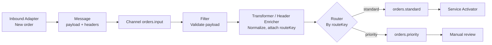

# Messages consist of payload and headers

## 1. Message is the unit of exchange in Spring Integration

In the **message-driven integration** model, components typically exchange data using *messages* rather than directly calling each other's methods. A component receives a message from a **MessageChannel**, performs a piece of work (transformation, filtering, routing, business processing, etc.), and can then send the message to the next channel. Thanks to this organization, Router, Filter, Transformer, Splitter, Aggregator, and Gateway collaborate without needing to know the internal implementation details of each step.

In the **Message system** chapter of the **SPRING_INTEGRATION_PATTERN** module, understanding payload and headers is the foundation for implementing Enterprise Integration Patterns with Spring Integration in a loosely coupled and extensible way. The examples below connect the Message concept with Router, Filter, Transformer, Splitter, Aggregator, and Gateway patterns, as well as retry, error channels, correlation, and how to test and observe each processing branch.

In Spring Framework, the central structure is the `org.springframework.messaging.Message<T>` interface:

```java
public interface Message<T> {
    T getPayload();
    MessageHeaders getHeaders();
}
```

A Message consists of exactly two main parts:

- **Payload**: the primary data the flow needs to process, such as an order, event, text, bytes, or a DTO object.
- **Headers**: a collection of metadata describing the message and its processing context, such as an identifier key, event type, correlation ID, routing information, or reply/error target channels.

An illustrative example of an order message (the JSON representation is only for easy visualization, not a mandatory serialization format of Spring Integration):

```json
{
  "payload": {
    "orderId": "ORD-001",
    "amountVnd": 450000
  },
  "headers": {
    "id": "6dbfb14d-12ec-44cb-8ec5-689c1bd11401",
    "timestamp": 1795200000000,
    "tenantId": "store-hcm",
    "eventType": "order.created",
    "traceId": "trace-9f0"
  }
}
```

In an actual message, `headers` is `MessageHeaders` (values have Java types, not only strings), and payload can be any valid object. Two messages with the same payload can still carry different metadata and therefore go through **different processing branches**.

## 2. Payload: the business content of a message

Payload answers the question: **“What data is the system processing?”**

Some common payload types:

| Payload | Example | Common usage |
| --- | --- | --- |
| `String` | Unparsed CSV or JSON content | Reading files, receiving raw data, parsing |
| `byte[]` | File content or binary data | File/HTTP/broker adapters |
| `record` or DTO | `OrderCreated(orderId, amountVnd)` | Service Activator, strongly typed business logic |
| `Map<String, Object>` | Data from flexible sources | Integration with evolving schemas |
| Collection | List of orders | Splitter breaks a message into multiple parts |

Example using a Java `record` to represent an event:

```java
record OrderCreated(String orderId, long amountVnd) {}
```

`Message<OrderCreated>` allows processing code to know the payload type at compile time. A handler can retrieve the object with `getPayload()` without parsing all headers. However, **`Message<T>` does not automatically validate the payload**; checking for an empty `orderId`, negative amount, schema, and business rules remains the responsibility of the flow.

In default message implementations, the payload cannot be `null`. When wanting to express “no result,” you need to choose a convention suitable for the endpoint (for example, a terminal handler returning no reply), rather than assuming `MessageBuilder.withPayload(null)` is valid.

**Separating payload from metadata:** `amountVnd` and `orderId` are business data and belong in the payload. `tenantId` or `traceId` can be placed in headers if they are truly shared processing context. If an attribute determines the lasting meaning of the event, consider including it in the payload schema so external systems do not lose it.

## 3. Headers: context for processing and flow orchestration

`MessageHeaders` is a map of **header name → value**, accessible via `message.getHeaders()`. A header does not necessarily have to be present in every message; reading an optional header requires a default value or handling when missing.

| Header / group | Meaning | Practical notes |
| --- | --- | --- |
| `id` | Identifier of a **message instance** | Not identical to a business key; may change when creating a new message |
| `timestamp` | Time metadata was attached to the message, usually in epoch milliseconds | Does not itself prove when the business event occurred |
| `replyChannel` | Target receiving the response of some request-reply flows | Can be a channel or a channel name depending on context |
| `errorChannel` | Target receiving errors in endpoints supporting the ErrorMessage mechanism | Does not guarantee every exception automatically goes to this channel |
| `contentType` | Hint about the content type, e.g. `application/json` | Useful when format conversion is involved |
| `correlationId`, `sequenceNumber`, `sequenceSize` | Metadata commonly used when splitting/aggregating parts of a message | May be created or managed by Splitter/Aggregator; correlation strategy must be understood |
| Custom headers: `tenantId`, `routeKey`, `traceId` | Application-specific context | Define meaning, data type, and propagation rules across boundaries |

Constants for system headers are provided by `MessageHeaders`, `IntegrationMessageHeaderAccessor`, or related classes, depending on the header type. Do not hardcode a name if the framework already provides a suitable constant; the literal names in the table are meant to help recognize them when reading logs.

### 3.1. Message ID differs from business ID

Three concepts to distinguish:

- **Message ID**: instance identifier of the envelope created in Spring Messaging.
- **Business ID / event ID**: a stable key, such as `orderId` or `eventId`, tied to a business operation/event.
- **Correlation ID**: a key linking multiple messages belonging to the same request, processing batch, or group to be aggregated.

For example, order `ORD-001` retried after a timeout may produce a **new message ID**, but must still preserve the same `orderId` or `eventId`. To avoid double charging, consumers must rely on a stable idempotency key, **not on the newly generated message ID**.

### 3.2. Routing headers do not replace business content

A `routeKey` such as `priority` or `standard` helps a Router choose the target channel. With the same `OrderCreated` payload, a message with `routeKey=priority` might go through a manual review branch, while another goes through an automated branch.

However, if the processing branch is determined solely by business conditions (for example `amountVnd >= 1_000_000`), have a clear and testable rule for computing the header. Routing metadata should not accidentally become an out-of-sync duplicate of the payload.

## 4. Creating and reading Messages with MessageBuilder

Spring Messaging provides `org.springframework.messaging.support.MessageBuilder` to create messages. The Java snippet below is self-contained for creating a message and adding metadata:

```java
import org.springframework.messaging.Message;
import org.springframework.messaging.support.MessageBuilder;

public class MessageExample {
    record OrderCreated(String orderId, long amountVnd) {}

    public static void main(String[] args) {
        Message<OrderCreated> original = MessageBuilder
                .withPayload(new OrderCreated("ORD-001", 450_000L))
                .setHeader("tenantId", "store-hcm")
                .setHeader("eventType", "order.created")
                .setHeader("traceId", "trace-9f0")
                .build();

        OrderCreated order = original.getPayload();
        String tenant = original.getHeaders().get("tenantId", String.class);

        System.out.println(order.orderId());    // ORD-001
        System.out.println(order.amountVnd()); // 450000
        System.out.println(tenant);             // store-hcm
        System.out.println(original.getHeaders().getId());

        Message<OrderCreated> enriched = MessageBuilder
                .fromMessage(original)
                .setHeader("routeKey", "standard")
                .build();

        System.out.println(enriched.getHeaders().get("routeKey"));
        System.out.println(original.getHeaders().get("routeKey")); // null
    }
}
```

Here:

1. `withPayload(...)` sets the business data.
2. `setHeader(...)` adds context information; the framework creates/provides system headers according to the message builder's mechanism.
3. `getPayload()` retrieves the order object; `getHeaders().get(name, type)` retrieves a typed header value.
4. `fromMessage(original)` starts from the old message, allowing necessary information to be preserved while adding metadata, and `build()` returns a message.

**Understanding immutability properly:** you should not mutate `MessageHeaders` of an already created message directly; build a new message with the builder when you need to change headers. However, if the payload is a mutable object, the message **does not automatically deep-copy or make the payload immutable**. Two messages can reference the same payload and observe mutations to that object. Prefer immutable payloads (such as `record`s containing only immutable fields or similarly designed DTOs) when passing across multiple flows.

## 5. How does a Message travel through Channels and Endpoints?

In Spring Integration, `MessageChannel` is where messages are **transferred**, while an endpoint/handler is where messages are **processed**. A simple flow might look like this:



Example handler in Java DSL: a flow receives an `OrderCreated` payload, filters out invalid amounts, and forwards valid orders to `InvoiceService`. This snippet illustrates how a handler receives a **strongly typed mapped payload** along with **message headers**:

```java
import org.springframework.context.annotation.Bean;
import org.springframework.context.annotation.Configuration;
import org.springframework.integration.config.EnableIntegration;
import org.springframework.integration.dsl.IntegrationFlow;

record OrderCreated(String orderId, long amountVnd) {}

interface InvoiceService {
    void createInvoice(String tenantId, OrderCreated order);
}

@Configuration
@EnableIntegration
class OrderFlowConfig {
    @Bean
    IntegrationFlow orderFlow(InvoiceService invoiceService) {
        return IntegrationFlow.from("orders.input")
                .filter(OrderCreated.class, order -> order.amountVnd() > 0)
                .handle(OrderCreated.class, (order, headers) -> {
                    String tenantId = (String) headers.get("tenantId");
                    if (tenantId == null || tenantId.isBlank()) {
                        throw new IllegalArgumentException("Missing tenantId");
                    }
                    invoiceService.createInvoice(tenantId, order);
                    return null; // Done processing, no reply produced.
                })
                .get();
    }
}
```

To run this configuration, the application needs Spring Integration Java DSL, an `InvoiceService` bean, and a producer sending `Message<OrderCreated>` to the `orders.input` channel. The Filter in the example can discard messages that do not meet the condition; **policy-based discarding** differs from **business errors**. When you need observability for rejections, configure a discard channel or a separate validation branch instead of letting messages disappear without a trace.

**An important point:** not every component preserves all headers after processing or when a message leaves the JVM. A Transformer often creates a new payload; the framework attempts to forward appropriate headers according to each endpoint's mechanism, but some headers may be dropped, replaced, or unserializable. For information critical to the flow, verify it at the exact boundary the message crosses.

## 6. Payload and headers in EIP patterns

| EIP Pattern | Commonly read from payload | Commonly read/written via headers | Example |
| --- | --- | --- | --- |
| **Filter** | Amount, status, schema | `tenantId`, message classification | Block negative orders or wrong tenant |
| **Router** | Attributes for branching | `routeKey`, `eventType` | Choose `priority` / `standard` branch |
| **Transformer** | Source object to convert | Context, content type, trace | Convert order DTO to invoice payload |
| **Splitter** | List of items | Correlation and sequence metadata | Split an order into messages per line item |
| **Aggregator** | Parts to combine | `correlationId`, `sequenceNumber`, `sequenceSize` | Aggregate line-item processing results |
| **Gateway** | Business request and reply | `replyChannel`, `errorChannel`, correlation | Invoke flow from a service interface |
| **Service Activator** | Data for business invocation | Tenant, trace, processing policy | Save to database or call external API |

### 6.1. Splitter and Aggregator need correlation

Suppose the payload contains a list of three line items:

```text
Message<Order>
  payload: Order(ORD-001, [Item-A, Item-B, Item-C])
  headers: {tenantId: "store-hcm", traceId: "trace-9f0"}
```

After the Splitter splits it, each child message has a payload corresponding to each `Item`. To aggregate the results, the child messages need a mechanism to recognize that they belong to **the same group**:

```text
Message<Item-A>  correlationId=GROUP-01  sequenceNumber=1  sequenceSize=3
Message<Item-B>  correlationId=GROUP-01  sequenceNumber=2  sequenceSize=3
Message<Item-C>  correlationId=GROUP-01  sequenceNumber=3  sequenceSize=3
```

The example above illustrates the *meaning* of the metadata; the actual correlation ID value may be supplied by the framework or configured by the application. An Aggregator must have a **correlation strategy** to identify the group and a **release strategy** to determine when enough elements have arrived. If an item fails or times out, you must decide whether to wait, return partial results, re-emit, or route the group to an error branch. Looking only at `sequenceSize` while ignoring duplicates, missing items, or timeouts can leave a group stuck indefinitely.

### 6.2. Gateway, replyChannel, and errorChannel

For request-reply, the `replyChannel` header can direct where to return the result; `errorChannel` can be used to send an `ErrorMessage` when an error occurs in endpoints that support it. This is **flow control** information, distinct from `orderId` or `amountVnd` in the payload.

Do not assume that attaching `errorChannel` will catch every exception or automatically retry the message. In a synchronous handler, an exception may propagate back to the caller; in an asynchronous flow, errors may be published through the configured error channel mechanism. Retry, error storage, and transactions must be designed independently according to the characteristics of the endpoint.

## 7. Rules for designing reliable headers

### 7.1. Distinguish “orchestration metadata” from business data

A quick way to decide:

- If changing an attribute **changes the business event that receivers need to understand**, the attribute is usually part of the payload.
- If the attribute is used for **orchestration, tracing, or technical processing**, it usually fits in headers.
- If data needs to travel across different brokers, services, and programming languages, you must **standardize the schema** (payload and required headers) into a published integration contract.

For example, `orderId` must be in the payload of `OrderCreated` because it is a business identifier. `traceId` can be in a header because it is used to correlate logs. `tenantId` depends on the contract: if downstream systems need the tenant to authenticate, route, or store data accurately, ensure that header is propagated and validated at the ingress, never blindly trusting metadata sent by external clients.

### 7.2. Preserving information across system boundaries

When a message travels through Kafka, RabbitMQ, JMS, HTTP, or files, adapters/serializers have their own rules regarding headers. You cannot expect every Java value in `MessageHeaders` (especially `MessageChannel` objects) to be transmitted intact over the network.

At integration boundaries, clearly define:

1. Which headers need to be preserved (`eventId`, `correlationId`, `traceId`, `tenantId`, etc.).
2. Allowed data types (usually preferring standardized strings/numbers/bytes).
3. Which headers are generated or remapped by the receiving side.
4. Which headers must be validated and not trusted from untrusted sources.
5. Naming conventions to avoid colliding with system headers.

Do not put access tokens, passwords, sensitive personal data, or large payloads in headers without a specific design reason and protective measures. Headers frequently appear in logs, middleware, observability tools, and broker metadata.

### 7.3. A Message does not guarantee delivery or transactions by itself

`Message<T>` only describes the data being sent. It is the **channel, endpoint, broker, message store, ACK/NACK, retry, idempotency, and transaction manager** that determine durability and recovery behavior. For example, a message with an `eventId` header does not automatically prevent duplicate processing; the consumer must use that key in an atomic check/record operation.

## 8. Testing Message and header propagation

At the unit test level, you can verify the payload, custom headers, and metadata of a newly created message without running the entire application:

```java
import org.junit.jupiter.api.Test;
import org.springframework.messaging.Message;
import org.springframework.messaging.support.MessageBuilder;

import static org.junit.jupiter.api.Assertions.*;

class MessageContractTest {
    record OrderCreated(String orderId, long amountVnd) {}

    @Test
    void messageHasPayloadAndContextHeaders() {
        Message<OrderCreated> message = MessageBuilder
                .withPayload(new OrderCreated("ORD-001", 450_000L))
                .setHeader("tenantId", "store-hcm")
                .setHeader("traceId", "trace-9f0")
                .build();

        assertEquals("ORD-001", message.getPayload().orderId());
        assertEquals(450_000L, message.getPayload().amountVnd());
        assertEquals("store-hcm",
                message.getHeaders().get("tenantId", String.class));
        assertNotNull(message.getHeaders().getId());

        Message<OrderCreated> updated = MessageBuilder
                .fromMessage(message)
                .setHeader("routeKey", "standard")
                .build();

        assertEquals("standard", updated.getHeaders().get("routeKey"));
        assertNull(message.getHeaders().get("routeKey"));
    }
}
```

When testing actual flows, add these scenarios:

| Scenario | What to verify |
| --- | --- |
| Valid `routeKey` header | Message goes to the right target channel |
| Required header missing | Flow rejects with a trace or returns an error per policy |
| Payload changed type by Transformer | Committed headers are still preserved properly |
| Splitter creates multiple parts | Correlation/sequence is sufficient for Aggregator to group accurately |
| Message passes through broker and returns | Selected headers survive serialization and mapping |
| Retry recreates the envelope | `eventId` remains stable, avoiding duplicate business side effects |
| Multiple messages with same tenant and trace | No context leakage between concurrent requests |

You should test both payload values and headers *critical to the flow's contract*. Merely asserting that a handler was “called once” is not enough to catch bugs like a lost `tenantId` or a mismatched `correlationId`.

## 9. Hands-on exercise and self-assessment

**Exercise:** Design a flow to process the `OrderCreated` event with a payload containing `orderId`, `amountVnd`; and headers containing `tenantId`, `traceId`, `eventId`.

1. Use `MessageBuilder` to create two messages carrying the same payload but with different `routeKey` values.
2. Use a Filter to discard orders with invalid amounts; clearly record which messages were discarded.
3. Use a Router to send `priority` and `standard` to their two corresponding channels.
4. Add a Transformer to create an invoice payload; verify that required headers are still propagated as designed.
5. Simulate sending the same `eventId` a second time; explain why you cannot rely solely on `MessageHeaders.ID` to prevent duplicate invoice creation.

When finished, ask yourself: **What does the payload carry? What do headers carry? When does the message ID change? Which messages does the correlation ID link? Which headers must cross application boundaries and why?**

A maintainable Spring Integration flow typically has a **payload that clearly describes the business data** and **headers that describe the processing context with a concrete contract**. Properly separating these two components enables Router, Filter, Transformer, Splitter, Aggregator, Gateway, and retry/error-channel branches to work consistently, remain easy to test, and stay observable as the system scales.
