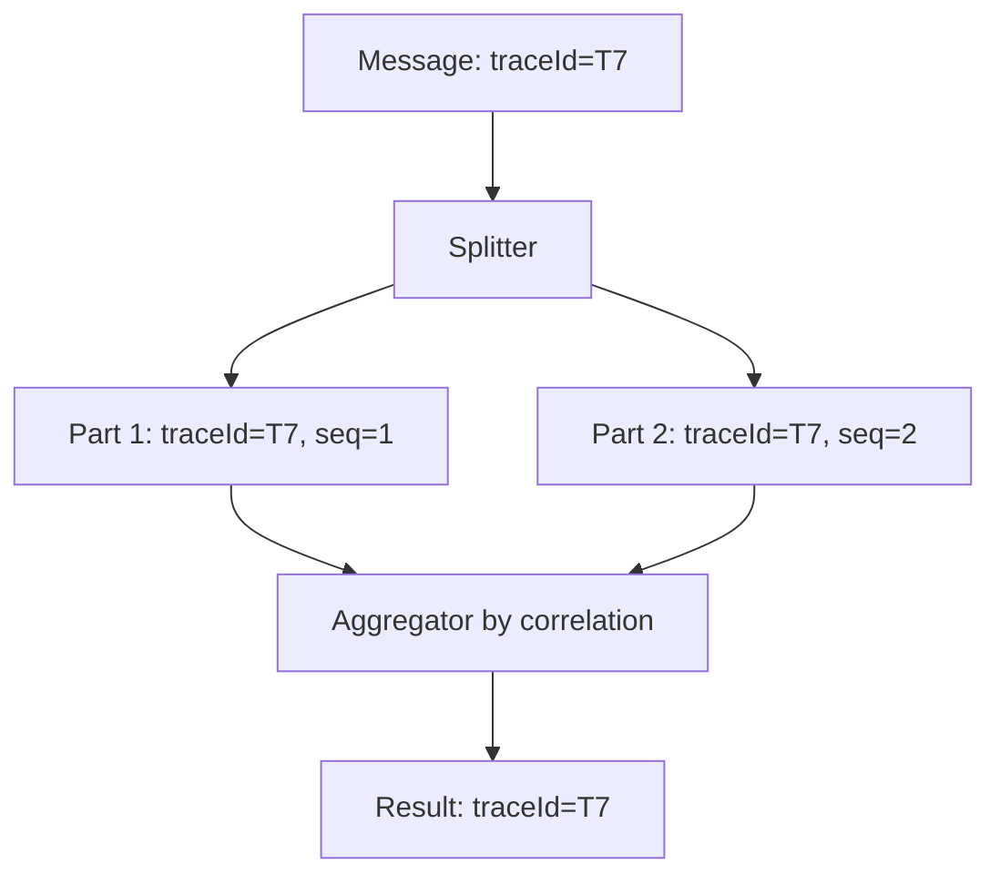

# Header propagation across endpoints in Spring Integration

## Lesson objectives

In Spring Integration's **Message system**, a message has not only business data (`payload`) but also **headers** carrying processing context. When implementing Enterprise Integration Patterns, preserving the right headers across endpoints keeps Router, Filter, Transformer, Splitter, Aggregator, Gateway, retry, and error-channel branches consistent, testable, and observable.

After this lesson, you will be able to:

- Explain when a header is preserved, added, replaced, or needs to be mapped to another protocol.
- Propagate headers such as `traceId`, `tenantId`, and `correlationId` across multiple endpoints without relying on thread-local state.
- Write an `IntegrationFlow` with a header enricher, transformer, and service activator, and test headers at the output.
- Identify common context-loss points in Splitter/Aggregator, handlers returning `Message<?>`, gateways, and HTTP/Kafka/AMQP adapters.
- Choose an explicit header policy to avoid propagating sensitive data or internal control headers by mistake.

## 1. Message and the meaning of header propagation

A Spring `Message<T>` has two main parts:

| Component | Role | Example |
| --- | --- | --- |
| `payload` | Content to be processed, which may change type via a Transformer | `OrderRequest`, JSON, `String` |
| `headers` | Metadata used for routing, correlation, and processing observability | `traceId`, `tenantId`, `contentType` |

`MessageHeaders` is essentially a set of name/value pairs represented in an **immutable** fashion. When wanting to change headers, we usually create a new message with `MessageBuilder` or let a Spring Integration endpoint produce a reply message. The creation of a new message **does not mean** every header must change.

Distinguish two groups of headers:

1. **Application-defined business or observability headers:** `traceId`, `tenantId`, `sourceSystem`, `orderType`. The application decides which headers must survive until the end of the flow.
2. **Messaging infrastructure-managed headers:** `id`, `timestamp`, `replyChannel`, `errorChannel`, plus grouping headers such as `correlationId`, `sequenceNumber`, `sequenceSize`. Their meaning and lifecycle depend on the endpoint.

**Do not use the message `id` in place of a business trace identifier.** `id` and `timestamp` are framework-generated/managed metadata and may change when new messages are created. If you need a key spanning multiple endpoints or services, use a dedicated header such as `traceId`, or the distributed tracing mechanism configured for the application.

Desired example:

```text
HTTP request
  payload = " order-42 "
  traceId = "trace-7"
  tenantId = "tenant-a"
        |
        v
Inbound adapter -> Header enricher -> Transformer -> Router -> Service activator
        |                  |                 |                  |
        |                  + sourceSystem    + payload changes  + processes business logic
        |                    = "checkout"      to "order-42"      but still needs
        |                                                         traceId/tenantId
        v
Outbound adapter -> HTTP/Kafka/... (maps permitted headers to target protocol)
```

Here, `traceId` and `tenantId` form the **context contract** of the flow: endpoints that need them must receive the same validated values. It is not necessary to copy every internal header externally.

## 2. How do headers travel through each type of endpoint?

| Point in flow | Typical behavior | What to control |
| --- | --- | --- |
| `DirectChannel`, `ExecutorChannel`, `QueueChannel` | Channel transports `Message<?>`; the channel itself does not rewrite business headers. | Interceptors, message stores, serialization, and thread switching can affect context outside the message. |
| Header enricher | Creates/adds/adjusts headers according to configuration. | Header name, value source, overwrite policy, and trustworthiness of input data. |
| Transformer | Usually transforms `payload`; when returning a plain payload, request headers are normally copied to the reply by Spring Integration. | When constructing `Message<?>` manually, control which headers are kept; do not assume all return types follow the exact same rule. |
| Filter | Matching messages proceed; rejected messages can be dropped or sent to `discardChannel`. | Do not expect a filtered-out message to reach the next endpoint. |
| Router | Routes messages to one or more channels by header/payload. | Branches may have different header-handling policies; if fanning out, consider correlation. |
| Service activator / Gateway | Handler receives payload/headers and produces a result; gateway converts method arguments into a message and replies to the caller. | Reply creation rules, internal `replyChannel`, and headers explicitly forwarded by the application. |
| Splitter | Splits one message into multiple child messages, often attaching `correlationId`, `sequenceNumber`, `sequenceSize` when sequence is enabled. | Ensure each part retains `traceId`; do not infer relationships from each part's `id`. |
| Aggregator | Groups messages by correlation and release strategy, then emits one result. | Conflicting headers among parts require an explicit merge policy. |
| HTTP/Kafka/AMQP/JMS adapter | Converts internal messages to protocol objects and vice versa. | Only headers supported or configured in the header mapper/serializer cross the boundary. |

### 2.1. Channels do not substitute for context propagation

In `DirectChannel`, handlers usually execute synchronously on the calling thread. `ExecutorChannel` hands processing off to an executor; values stored in `ThreadLocal` or MDC on the calling thread do not automatically follow the message. If downstream endpoints need `tenantId` or a correlation key, put the needed info **in message headers**, and configure tracing/MDC propagation separately if logs across threads must be linked.

With persistent channels or broker transit, headers must also have data types compatible with storage/serialization. A `MessageChannel` object inside `replyChannel` is an in-process orchestration detail; you cannot assume that object works in another process.

### 2.2. Plain payload vs. handler-constructed message

These two styles have different semantics:

```java
// Handler returns payload: Spring Integration can build the reply Message
// and copy appropriate request headers to the reply.
String normalize(String value) {
    return value.trim();
}

// Handler explicitly constructs Message: application code itself must state
// which headers to keep and which headers to add.
Message<String> normalizeExplicitly(Message<String> request) {
    return MessageBuilder.withPayload(request.getPayload().trim())
        .copyHeaders(request.getHeaders())
        .setHeader("processingStage", "normalized")
        .build();
}
```

`MessageBuilder` in the example above is `org.springframework.messaging.support.MessageBuilder`. Do not try to force `id`/`timestamp` to remain unchanged when creating a new message; use a stable `traceId` to correlate steps. How Spring Integration merges request/reply headers also depends on endpoint type, configuration, and reply type, so **test actual output headers** rather than relying on a single blanket rule for all handlers.

If a handler needs to change the payload type from `Order` to `OrderResult`, you can also use `MessageBuilder.withPayload(result).copyHeaders(request.getHeaders()).build()`. Copy selectively when the message will cross a trust boundary.

## 3. Java DSL example: headers flowing through a pipeline

Suppose a checkout application receives an order ID, needs `tenantId` to choose the processing context, and `traceId` for troubleshooting. The flow's responsibilities:

1. Receive `Message<String>` on `orders.in`.
2. Add header `sourceSystem=web-checkout`.
3. Normalize payload using a Transformer.
4. Use a Service Activator to check `tenantId` and return the uppercased payload.
5. Emit the reply to `orders.out`, preserving `traceId` and `tenantId`.

```java
import java.util.Locale;

import org.springframework.context.annotation.Bean;
import org.springframework.context.annotation.Configuration;
import org.springframework.integration.channel.DirectChannel;
import org.springframework.integration.channel.QueueChannel;
import org.springframework.integration.config.EnableIntegration;
import org.springframework.integration.dsl.IntegrationFlow;
import org.springframework.messaging.MessageChannel;
import org.springframework.messaging.PollableChannel;

@Configuration
@EnableIntegration
public class HeaderPropagationConfig {

    @Bean("orders.in")
    MessageChannel ordersIn() {
        return new DirectChannel();
    }

    @Bean("orders.out")
    PollableChannel ordersOut() {
        return new QueueChannel();
    }

    @Bean
    IntegrationFlow orderFlow() {
        return IntegrationFlow.from("orders.in")
            .enrichHeaders(headers ->
                headers.header("sourceSystem", "web-checkout"))
            .transform(String.class, String::trim)
            .handle(String.class, (payload, headers) -> {
                String tenantId = (String) headers.get("tenantId");
                if (tenantId == null || tenantId.isBlank()) {
                    throw new IllegalArgumentException("Missing tenantId");
                }

                // Able to read headers from the message after Transformer.
                String traceId = (String) headers.get("traceId");
                if (traceId == null || traceId.isBlank()) {
                    throw new IllegalArgumentException("Missing traceId");
                }

                return payload.toUpperCase(Locale.ROOT);
            })
            .channel("orders.out")
            .get();
    }
}
```

This snippet uses Spring Integration Java DSL; a typical Spring Boot project needs the Spring Integration dependency and Spring test libraries. `QueueChannel` is chosen at the output so the example can read the result directly. In a real system, the output could be a service activator, outbound adapter, or another flow.

Integration test example:

```java
import static org.assertj.core.api.Assertions.assertThat;

import org.junit.jupiter.api.Test;
import org.springframework.beans.factory.annotation.Autowired;
import org.springframework.beans.factory.annotation.Qualifier;
import org.springframework.messaging.Message;
import org.springframework.messaging.MessageChannel;
import org.springframework.messaging.PollableChannel;
import org.springframework.messaging.support.MessageBuilder;
import org.springframework.test.context.junit.jupiter.SpringJUnitConfig;

@SpringJUnitConfig(HeaderPropagationConfig.class)
class HeaderPropagationTest {

    @Autowired
    @Qualifier("orders.in")
    MessageChannel input;

    @Autowired
    @Qualifier("orders.out")
    PollableChannel output;

    @Test
    void preservesBusinessHeadersAcrossEndpoints() {
        Message<String> request = MessageBuilder.withPayload("  order-42  ")
            .setHeader("traceId", "trace-7")
            .setHeader("tenantId", "tenant-a")
            .build();

        assertThat(input.send(request)).isTrue();

        Message<?> result = output.receive(2_000);
        assertThat(result).isNotNull();
        assertThat(result.getPayload()).isEqualTo("ORDER-42");
        assertThat(result.getHeaders().get("traceId")).isEqualTo("trace-7");
        assertThat(result.getHeaders().get("tenantId")).isEqualTo("tenant-a");
        assertThat(result.getHeaders().get("sourceSystem"))
            .isEqualTo("web-checkout");
    }
}
```

This test confirms the key contract: the payload changed across two processing endpoints, while the three required headers remain readable at the output. It does **not** assert that `id`/`timestamp` headers are immutable, as that is not a business requirement.

### When using Gateway

`@MessagingGateway` lets you declare headers from method parameters:

```java
@MessagingGateway
interface OrderGateway {

    @Gateway(requestChannel = "orders.in", replyChannel = "orders.out")
    String submit(
        String orderId,
        @Header("traceId") String traceId,
        @Header("tenantId") String tenantId
    );
}
```

The annotations in the example come from `org.springframework.integration.annotation.Gateway`, `org.springframework.integration.annotation.MessagingGateway`, and `org.springframework.messaging.handler.annotation.Header`. To use this interface as a gateway bean, configure `@IntegrationComponentScan` on a configuration class or register the gateway equivalently. The gateway builds a request message from the method signature; caller-supplied headers enter the flow. `replyChannel` here is the gateway's reply coordination channel. Do not export this internal channel object as an HTTP/Kafka header.

## 4. Header enrichment: creating, preserving, and replacing intentionally

A header enricher is useful when a step needs to add metadata without altering the payload:

```java
.enrichHeaders(h -> h
    .header("sourceSystem", "checkout")
    .headerFunction("receivedFrom", message ->
        message.getHeaders().getOrDefault("sourceSystem", "unknown")))
```

Here, `headerFunction` reads the current message to compute another header. Before relying on it in business logic, explicitly decide whether a header may already exist and whether overwriting is permitted. For instance, `tenantId` taken from an external user must be **validated/cross-checked** against the authenticated identity; merely adding a header does not automatically make the value trustworthy.

A maintainable division of responsibilities:

- **At ingress:** recognize or generate `traceId`, validate `tenantId`, normalize header names.
- **Inside the flow:** keep headers stable; add markers like `processingStage` only when truly needed.
- **At egress:** map to the target protocol's header names and strip disallowed headers.

Header names are case-sensitive at the Java map level; over HTTP, HTTP header naming rules differ. When integrating across technologies, agree on a mapping table such as `traceId` (internal) ↔ `X-Trace-Id` (HTTP) and test both directions.

## 5. Router, Splitter, and Aggregator: context across branches

A Router usually only needs to read a header, such as `region` or `orderType`, to pick a channel. If a router sends a message to multiple branches, each branch may transform data differently. Treat `traceId` as the log-linking key for all branches and use an independent group identifier if results will be aggregated.



When `applySequence` is enabled, Splitter can attach `correlationId`, `sequenceNumber`, and `sequenceSize` to help the Aggregator determine group and ordering. Configuration and splitter type govern which metadata is generated; do not assume every fan-out step automatically produces all these headers. Some message sets may not know the total count upfront, so the release strategy must be tailored rather than blindly relying on `sequenceSize`.

**Conflict scenario:** two child messages share `correlationId` yet carry `sourceSystem=api` and `sourceSystem=batch` respectively. The Aggregator cannot preserve both under a single key without a rule. You can choose the header from the original message, from group metadata, or build a list of sources. This decision belongs to the business contract and should be written into a custom `MessageGroupProcessor` or corresponding result-building logic.

Some practical rules:

- Keep `traceId` shared across all messages belonging to the same request journey; use `correlationId` to group messages for a specific task.
- Keep `tenantId` consistent within a group; if they differ, treat it as a data error or separate groups by tenant.
- Do not expect the Aggregator to automatically resolve conflicting same-named headers with different values.
- Test a complete group, an incomplete group, and a group with conflicting headers.

## 6. Boundaries with HTTP, Kafka, AMQP, and JMS

Header propagation inside an `IntegrationFlow` differs from transmitting headers over the network. Inbound adapters construct Spring messages from external requests/records; outbound adapters must translate headers into forms accepted by the target protocol. Adapters usually have a **header mapper** mechanism, selected header lists, and specific type conversion rules.

| Boundary | Points to watch |
| --- | --- |
| HTTP | Map only allowed request/response headers; normalize `X-Trace-Id` ↔ `traceId`; validate client-supplied data. |
| Kafka | Record headers are byte data; need type conversion and mapping strategies aligned with the Spring Kafka/Spring Integration version in use. |
| AMQP | Distinguish application headers from message properties; broker and converter may constrain value types. |
| JMS | Headers/properties follow JMS naming and data type rules; arbitrary objects from internal messages cannot be copied freely. |

Example contract across two services:

```text
Service A                               Service B
----------------------------            -----------------------------
internal header: traceId = T7           inbound mapping:
outbound HTTP mapping:                  X-Trace-Id -> traceId
traceId -> X-Trace-Id      ---------->  continues processing with traceId = T7
```

Do not automatically export headers such as `replyChannel`, `errorChannel`, credentials, tokens, or arbitrary Java objects. For sensitive headers, enforce allowlists and per-connection security policies. Test at the **receiving side** because a header existing on the message before the outbound adapter does not prove it arrived.

## 7. Retry, error channel, and flow observability

When a handler fails, Spring Integration can send the failure to `errorChannel` as an `ErrorMessage` wrapping a `Throwable`. In many cases, the cause is a `MessagingException` with `failedMessage`, from which you can retrieve headers of the failing message:

```java
void inspectError(ErrorMessage error) {
    Throwable cause = error.getPayload();
    if (cause instanceof MessagingException messagingException) {
        Message<?> failed = messagingException.getFailedMessage();
        if (failed != null) {
            Object traceId = failed.getHeaders().get("traceId");
            // Log traceId according to the application's logging policy.
        }
    }
}
```

The example requires importing `org.springframework.messaging.support.ErrorMessage`, `org.springframework.messaging.MessagingException`, and `org.springframework.messaging.Message`. Not every error carries a `failedMessage`; check for `null` and understand how the adapter/flow emits errors.

When retry is enabled, a task may be reprocessed multiple times. `traceId` should generally remain stable for the same request, while `attempt` or retry counts should be recorded under explicit rules. If a message is rebuilt or redelivered from a broker, `id` may change; logs need a durable correlation key to link attempts. To connect with MDC/tracing across `ExecutorChannel`, configure tracing context propagation or restore MDC from headers inside handlers.

## 8. Common errors and diagnostics

| Symptom | Causes to check | Resolution |
| --- | --- | --- |
| `traceId` disappears after custom handler | Handler constructs `Message<?>` without preserving needed headers; or endpoint has unexpected reply rules. | Check return type and use `MessageBuilder`/appropriate header mapper; add assertions at the output. |
| Header exists before outbound adapter but missing at receiver | Mapper disallows header name or converter does not support the value type. | Review mapper configuration, switch to serializable types, and test at the consumer. |
| Router picks wrong branch | Inconsistent header name, wrong data type, or unvalidated value. | Inspect headers at router input and test each routing value. |
| Aggregator does not release | Correlation/release strategy mismatches sequence, missing items, or timeout. | Check `correlationId`, `sequenceNumber`, `sequenceSize`, and group store. |
| Logs lose per-request info after `ExecutorChannel` | Relying on MDC/`ThreadLocal` without propagating context across threads. | Carry correlation keys in message headers and configure an MDC/tracing bridge. |
| Exception handler does not see `traceId` in `ErrorMessage` headers | Error was wrapped, original message is inside `failedMessage`, or adapter generates a different error. | Inspect the exception chain and `failedMessage` safely. |

When debugging, prefer **selective** logging of business headers (`traceId`, `tenantId` if permitted, `correlationId`) at checkpoints. Do not dump all headers to logs as that can expose sensitive data or unreadable internal objects.

## 9. Design checklist and exercises

Before putting a flow into production, answer:

1. Which headers are contractual and must travel end-to-end? Which are used in only one branch?
2. Has the ingress created or validated business headers?
3. Which handlers return a plain payload, and which construct `Message<?>` manually? Are there propagation tests at those boundaries?
4. If Splitter/Aggregator creates or merges messages, how are correlation/release and conflicting headers handled?
5. If crossing a broker or HTTP, does the adapter map names, types, direction, and allowlist properly?
6. During retries or asynchronous failures, can the correlation key of the failing message be traced?

**Exercise 1 — Tracing through Transformer:** Run `HeaderPropagationTest` in Section 3, add header `priority=HIGH` to the request, and verify its value at `orders.out`. Next, write a custom handler returning `Message<?>` and observe the outcome with and without `copyHeaders(...)`.

**Exercise 2 — Branching:** Add a Router based on the `orderType` header to send `STANDARD` and `EXPRESS` to two different flows. Use a shared `traceId`, verify both branches receive the required headers, and verify unsupported types are rejected per design.

**Exercise 3 — Split/Aggregate:** Use a Splitter to divide an order into line items, then an Aggregator to combine results. Verify `correlationId`/sequence, `tenantId`, and the case where one child message carries a different `tenantId`.

**Exercise 4 — Network boundary:** Design a `traceId` ↔ `X-Trace-Id` mapping for an HTTP outbound/inbound pair, then write a test verifying the header reaches the receiving service. Ensure orchestration headers like `replyChannel` are not exported externally.

### Key takeaway

**Header propagation is part of the integration contract.** With Spring Integration, many endpoints assist with metadata forwarding, yet the final contract must be expressed through code, header mapper configuration, and boundary tests. Keeping `traceId` end-to-end, isolating `correlationId` for message groups, and selectively filtering which headers may leave the process makes systems loosely coupled, observable, and extensible.
