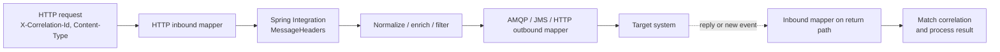

# Header mapping across systems

## 1. The problem to solve

In an integration system, the same message may pass through an HTTP API, Spring Integration, RabbitMQ (AMQP), JMS, or Kafka. Each protocol has **a different representation of metadata**. HTTP uses name/value header fields; AMQP has both standard properties (`correlationId`, `replyTo`, `contentType`) and an application header table; JMS has standard headers and message properties; in Spring Integration, metadata resides in `MessageHeaders`.

**Header mapping** is the process of selecting, renaming, type-converting, and controlling which metadata is brought from an external protocol into `MessageHeaders`, as well as from `MessageHeaders` out to the target protocol. The payload holds the primary business data; headers provide context for routing, correlation, tracing, error handling, or format negotiation.

For example, a service receiving orders over HTTP needs to keep the customer's trace ID, yet must never automatically forward the customer's `Authorization` header to a broker or partner API. Simply copying all headers can leak sensitive information, carry data types unsupported by the broker, or corrupt correlation between requests and replies.

In the **SPRING_INTEGRATION_PATTERN** module, header mapping is part of implementing **Enterprise Integration Patterns (EIP)**: helping Router, Filter, Transformer, Splitter, Aggregator, Gateway, retry, and error-channel flows interact while limiting coupling to protocols. After this lesson, you will be able to:

- Distinguish business headers, internal control headers, and transport headers.
- Design a bidirectional mapping rule set, clearly identifying which data sources are trustworthy.
- Use `DefaultHttpHeaderMapper`, `Header Enricher`, and `Header Filter` in Spring Integration.
- Inspect data passing over HTTP, AMQP/JMS and detect mismatches in correlation, data types, and security.

## 2. Map of how headers travel



Clearly separate **three naming layers**:

| Layer | Example | Meaning |
| --- | --- | --- |
| HTTP headers | `X-Correlation-Id`, `Content-Type`, `traceparent` | Metadata per HTTP contract; HTTP header names are case-insensitive. |
| Normalized headers inside the flow | `appCorrelationId`, `tenantId`, `contentType` | Names with stable meaning within the application, transport-independent. |
| Adapter headers or properties | `amqp_correlationId`, `jms_correlationId`, Kafka key | Specific metadata that an adapter converts into properties or headers of the target protocol. |

There is no general rule that two headers containing the word "correlation" are synonymous. For example, the `correlationId` used by a Spring Integration Aggregator to group messages has **different semantics** from AMQP `correlationId` or `JMSCorrelationID` used in a broker's request/reply mechanism. Name them explicitly and convert them intentionally.

### At which boundary does mapping occur?

In Spring Integration, `HeaderMapper<T>` has two core operations:

- `toHeaders(T)`: reads metadata **from the external protocol** and builds a map for Spring Integration `MessageHeaders`.
- `fromHeaders(MessageHeaders, T)`: exports headers **from Spring Integration** into the metadata object of the target protocol.

For an **HTTP outbound gateway**, the request is exported via `fromHeaders`, and the HTTP response is imported via `toHeaders`. For an **HTTP inbound gateway**, the directions are reversed. Therefore, `inbound/outbound` on a mapper must be understood according to **adapter direction**, not merely method names.

| Endpoint type | Reading metadata step | Writing metadata step |
| --- | --- | --- |
| HTTP inbound gateway | HTTP request → `MessageHeaders` | Reply `MessageHeaders` → HTTP response |
| HTTP outbound gateway | HTTP response → `MessageHeaders` | Request `MessageHeaders` → HTTP request |
| AMQP/JMS inbound | Broker message → `MessageHeaders` | May export reply via broker if it is a gateway |
| AMQP/JMS outbound | Reads reply from broker if any | `MessageHeaders` → broker message |

`MessageHeaders` is a read-only structure for callers. To add or remove headers, construct an output message via `MessageBuilder` or use endpoints such as `Header Enricher` and `Header Filter`; do not call `put()` directly on `MessageHeaders`. The two system headers `id` and `timestamp` are read-only and must not be used as durable business identifiers across systems.

## 3. Designing the mapping contract before configuring adapters

Suppose an application receives orders, processes them internally, and calls a partner API. Desired policy:

| At source | Suggested internal name | At destination | Policy |
| --- | --- | --- | --- |
| HTTP `X-Correlation-Id` | `appCorrelationId` | HTTP `X-Correlation-Id` or AMQP `amqp_correlationId` if matching use case | Validate length/format; keep across retries; do not substitute `MessageHeaders.ID`. |
| HTTP `X-Tenant-Id` | `tenantId` | HTTP `X-Tenant-Id` | Forward only authenticated/authorized values; do not trust self-declared client values. |
| HTTP `Content-Type` | `contentType` or unified format value | Transport content-type property | Must match the payload produced by the converter. |
| W3C `traceparent` | Trace context | `traceparent` | Propagate only over trusted paths, per tracing configuration and header limits. |
| HTTP `Authorization`, `Cookie` | Do not store as transit metadata | Do not forward | Handle authentication at the edge; issue separate credentials for downstream if needed. |
| AMQP `amqp_receivedExchange`, `amqp_deliveryTag` | Local adapter metadata | Do not forward to HTTP or another broker | Meaningful only within the current consumer context. |
| `replyChannel`, `errorChannel` | Internal flow control | Do not map to public headers | Used by Spring Integration to route replies/errors to the right channels. |

The rows above are an **illustrative contract**, not a built-in automatic table in Spring Integration. For instance, `appCorrelationId → X-Correlation-Id` is a rename you explicitly configure with a Header Enricher; configuring header names in `DefaultHttpHeaderMapper` mainly selects which headers pass through rather than automatically treating arbitrary business names as aliases.

An easy-to-read example:

```text
HTTP inbound
  X-Correlation-Id: req-204
  X-Tenant-Id:       tenant-7
  Authorization:     Bearer <token>

Internal MessageHeaders (after validation, normalization)
  appCorrelationId: req-204
  tenantId:         tenant-7
  contentType:      application/json
  id:               <UUID of this specific message>

HTTP outbound to partner
  X-Correlation-Id: req-204
  X-Tenant-Id:       tenant-7
  Content-Type:      application/json

HTTP inbound Authorization is not copied outward.
```

**Design workflow**: identify producers/consumers → build a table of required and forbidden headers → decide data types → create internal names → define per-direction rules (request/reply) → test at adapter boundaries. Using an allowlist policy is usually safer and easier to evolve than using wildcards for all headers.

## 4. Mapping HTTP with Spring Integration Java DSL

Spring Integration HTTP uses `DefaultHttpHeaderMapper` to convert between `HttpHeaders` and `MessageHeaders`. By default, standard HTTP headers are supported. When providing a `mappedRequestHeaders` or `mappedResponseHeaders` list, that list **replaces the default selection** in the corresponding direction; to retain the standard header group, you can use the special patterns `HTTP_REQUEST_HEADERS` or `HTTP_RESPONSE_HEADERS`. The `*` wildcard allows pattern matching on names; across security boundaries, list names explicitly.

Example of a flow receiving already-validated business messages on the `validatedOrders` channel. The message already has `appCorrelationId` and `tenantId` from a prior processing step. The flow removes unnecessary headers, sets HTTP names per contract, and calls the partner API:

```java
import org.springframework.context.annotation.Bean;
import org.springframework.context.annotation.Configuration;
import org.springframework.http.HttpMethod;
import org.springframework.integration.dsl.IntegrationFlow;
import org.springframework.integration.http.dsl.Http;

@Configuration
public class PartnerHeaderMappingConfiguration {

    @Bean
    public IntegrationFlow sendOrdersToPartner() {
        return IntegrationFlow.from("validatedOrders")
            .headerFilter(
                "Authorization", "Cookie",
                "amqp_receivedExchange", "amqp_deliveryTag",
                "X-Correlation-Id", "X-Tenant-Id")
            .enrichHeaders(headers -> headers
                .headerFunction(
                    "X-Correlation-Id",
                    m -> m.getHeaders().get("appCorrelationId"),
                    true)
                .headerFunction(
                    "X-Tenant-Id",
                    m -> m.getHeaders().get("tenantId"),
                    true))
            .handle(Http.outboundGateway("https://partner.example/api/orders")
                .httpMethod(HttpMethod.POST)
                .expectedResponseType(String.class)
                .mappedRequestHeaders(
                    "Content-Type", "Accept",
                    "X-Correlation-Id", "X-Tenant-Id")
                .mappedResponseHeaders(
                    "Content-Type", "X-Partner-Request-Id"))
            .channel("partnerReplies")
            .get();
    }
}
```

Reading the flow:

1. `headerFilter(...)` removes headers received from clients and some AMQP metadata meaningful only at the source.
2. `enrichHeaders(...)` creates HTTP header names from verified internal metadata. The `true` argument forces overwriting if the target header already exists; avoid using unverified external values.
3. `mappedRequestHeaders(...)` is the allowlist for the **outgoing HTTP request**. `mappedResponseHeaders(...)` selects metadata from the **incoming HTTP response**, such as `X-Partner-Request-Id` for correlating partner logs.
4. `outboundGateway` waits for a reply and forwards the message to the `partnerReplies` channel. If no reply is needed, `outboundChannelAdapter` is more appropriate.

The example assumes the payload has already been converted to JSON and has a suitable `Content-Type` before reaching the HTTP handler; selecting headers does not replace message converter configuration. The address `partner.example` is a placeholder that must be replaced with the real endpoint. Spring Integration HTTP dependencies must match the compatible version line of the application.

You can control the mapper via a bean when you want reuse or deeper customization:

```java
import org.springframework.context.annotation.Bean;
import org.springframework.integration.http.support.DefaultHttpHeaderMapper;

@Bean
public DefaultHttpHeaderMapper partnerHttpHeaderMapper() {
    DefaultHttpHeaderMapper mapper = DefaultHttpHeaderMapper.outboundMapper();
    mapper.setOutboundHeaderNames(
        "Content-Type", "Accept", "X-Correlation-Id", "X-Tenant-Id");
    mapper.setInboundHeaderNames(
        "Content-Type", "X-Partner-Request-Id");
    return mapper;
}
```

When using this approach, pass the mapper to the endpoint via `.headerMapper(partnerHttpHeaderMapper())` **instead of** the two `mappedRequestHeaders/mappedResponseHeaders` calls in the previous example. Do not configure both ways simultaneously, as that causes confusion over which rules take effect.

### Choosing the right direction and understanding patterns

- `DefaultHttpHeaderMapper.inboundMapper()` is for adapters receiving HTTP requests and sending HTTP responses.
- `DefaultHttpHeaderMapper.outboundMapper()` is for adapters sending HTTP requests and reading HTTP responses.
- `setOutboundHeaderNames(...)` picks names to write **from `MessageHeaders` to HTTP**; `setInboundHeaderNames(...)` picks names to read **from HTTP into `MessageHeaders`**.
- Patterns like `X-*` or `*` broaden matching; they can accidentally carry sensitive headers or headers belonging to other systems. Do not select everything just to make a demo run quickly.
- Custom header names are not automatically prefixed with `X-` in modern Spring Integration versions; if a target system requires legacy naming, specify the contract explicitly or customize the mapper.

## 5. Crossing RabbitMQ/AMQP, JMS, and Kafka

Header mapper is a shared concept, but **the format and constraints of each transport differ**.

| Transport | APIs/concepts to know | Common issues |
| --- | --- | --- |
| HTTP | `DefaultHttpHeaderMapper`, `HttpHeaders`; separate request and response mapping | Names are case-insensitive, one name can have multiple values; do not arbitrarily coerce every header to one string. |
| RabbitMQ/AMQP | `DefaultAmqpHeaderMapper`, `AmqpHeaders`; standard properties and custom headers table | Broker-originated headers, especially `x-*`, should not be forwarded arbitrarily to another broker/queue. |
| JMS | `DefaultJmsHeaderMapper`; `JMSCorrelationID`, `JMSReplyTo`, message properties | Custom properties generally must be simple types permitted by JMS; do not pass arbitrary application objects. |
| Kafka | Kafka record headers, record key, and serializer/deserializer; Spring Kafka provides its own mapper | Headers on the wire are byte arrays, requiring encoding/type conventions. Kafka key is not always equivalent to correlation id. |

**AMQP:** `DefaultAmqpHeaderMapper` maps AMQP properties to headers prefixed with `amqp_` in Spring Integration. Modern versions can carry user-defined headers as well, with protective exceptions for `x-*`. If `*` is used carelessly, headers such as `x-received-from` may cycle back into federation and cause the broker to treat the message as looped. When bridging two brokers, review header lists on both sides, including broker-generated headers. Exclusion patterns with `!` are supported in AMQP mapper configuration.

**JMS:** `jms_correlationId` maps to `JMSCorrelationID` at the JMS layer, whereas Spring Integration's `correlationId` is typically used to group message parts for Aggregator/Resequencer. Keep the two names distinct, converting only when both systems share the same correlation purpose. QoS attributes such as delivery mode, priority, and TTL have dedicated mechanisms on the JMS producer; copying headers does not guarantee every QoS property changes automatically.

**Kafka:** Kafka header values have a binary representation. If system A sends `trace-id` in UTF-8 while system B decodes it in another format, metadata can become corrupted even though the name is right. Agree on schema, encoding, size, and missing-value handling. Do not expect HTTP or AMQP mappers to understand Kafka headers automatically.

For example, bridging a payment command from HTTP to AMQP requires deciding upfront: `appCorrelationId` is the business trace ID, `amqp_correlationId` is set only when AMQP request/reply correlation is needed; `contentType` follows the actual payload format; HTTP `Authorization` is stripped. Retries preserve `appCorrelationId` while potentially creating new broker deliveries. Each delivery or message transformation does not mean a new business request occurred.

## 6. Four easily confused issues

### 6.1. Type conversion and header naming

`MessageHeaders` can hold arbitrary Java objects, whereas HTTP transmits text, JMS restricts property types, and Kafka headers are bytes. For instance, a `UUID` should be explicitly converted to a string in an HTTP contract; timestamps should standardize on ISO-8601 or epoch; multi-valued lists must be handled properly instead of calling `toString()` on a `List`.

HTTP header names are case-insensitive per protocol, yet you should not rely on that to use inconsistent keys in internal `MessageHeaders`; pick one consistent naming standard. For single-valued headers, use `getFirst(...)` on the HTTP side; for headers permitting multiple values, retain the full list per contract.

### 6.2. Framework metadata vs. business correlation

`id`/`timestamp` are framework-managed metadata and can change when a message is recreated. `replyChannel` and `errorChannel` are in-process routing control details; do not serialize channel objects over the network. `correlationId`, `sequenceNumber`, and `sequenceSize` are meaningful when using Splitter/Aggregator; only pass them through a broker if there is a contract to reconstruct groups/sequences on the receiving side.

To recognize the same order across multiple retries, define a stable `eventId` or `businessMessageId` at the application layer. Do not assume the Spring message UUID is an external idempotency key.

### 6.3. Trust boundaries and sensitive information

Headers from an HTTP client are **untrusted data** until validated. A client can send `X-Tenant-Id` or `X-Role` itself; never use them directly for authorization. Headers containing bearer tokens, cookies, personal information, or confidential content must follow data policies and not be forwarded automatically to partners.

Minimum rules:

1. Allow only headers needed by consumers (allowlist).
2. Validate format and length of `correlation-id`/`traceparent`, rejecting values containing invalid characters.
3. Replace critical values with metadata produced by authenticated application logic.
4. Minimize logging sensitive header values; logging header names and approved trace IDs suffices in many cases.
5. Separate credentials used to call partners from credentials sent by clients to the API.

### 6.4. Bidirectional mapping does not mean symmetric copying

Headers sent **outbound** should not necessarily be accepted **inbound from outside**. For example, you send your application's `X-Correlation-Id` to a partner, yet when receiving a reply you must still verify correlation against the prior request; do not blindly let `X-Correlation-Id` in the response overwrite internal IDs. HTTP requests and responses have different standard headers; broker inbound messages also carry metadata meant only for consumers. Therefore, maintain four distinct rule sets: HTTP inbound request, HTTP inbound reply, outbound request, and outbound reply.

## 7. Testing mapping rules without making network calls

You can unit-test `DefaultHttpHeaderMapper` directly as a metadata transformation function. The JUnit 5 + AssertJ example below verifies the HTTP outbound allowlist and confirms `Authorization` is blocked:

```java
import static org.assertj.core.api.Assertions.assertThat;

import java.util.HashMap;
import java.util.Map;

import org.junit.jupiter.api.Test;
import org.springframework.http.HttpHeaders;
import org.springframework.integration.http.support.DefaultHttpHeaderMapper;
import org.springframework.messaging.MessageHeaders;

class PartnerHeaderMapperTest {

    @Test
    void onlyApprovedHeadersAreSentToHttp() {
        DefaultHttpHeaderMapper mapper =
            DefaultHttpHeaderMapper.outboundMapper();
        mapper.setOutboundHeaderNames(
            "X-Correlation-Id", "X-Tenant-Id");

        Map<String, Object> data = new HashMap<>();
        data.put("X-Correlation-Id", "req-204");
        data.put("X-Tenant-Id", "tenant-7");
        data.put("Authorization", "Bearer top-secret");
        data.put("amqp_deliveryTag", 48L);

        HttpHeaders httpHeaders = new HttpHeaders();
        mapper.fromHeaders(new MessageHeaders(data), httpHeaders);

        assertThat(httpHeaders.getFirst("X-Correlation-Id"))
            .isEqualTo("req-204");
        assertThat(httpHeaders.getFirst("X-Tenant-Id"))
            .isEqualTo("tenant-7");
        assertThat(httpHeaders.containsKey("Authorization")).isFalse();
        assertThat(httpHeaders.containsKey("amqp_deliveryTag")).isFalse();
    }

    @Test
    void inboundHttpMappingIgnoresUnapprovedClientHeaders() {
        DefaultHttpHeaderMapper mapper =
            DefaultHttpHeaderMapper.inboundMapper();
        mapper.setInboundHeaderNames("X-Correlation-Id");

        HttpHeaders request = new HttpHeaders();
        request.add("X-Correlation-Id", "req-205");
        request.add("Authorization", "Bearer untrusted");

        Map<String, Object> mapped = mapper.toHeaders(request);

        assertThat(mapped).containsKey("X-Correlation-Id");
        assertThat(mapped).doesNotContainKey("Authorization");
    }
}
```

These are **illustrative unit tests**, not a replacement for integration testing with actual adapters. When testing end-to-end, additionally verify using a mock HTTP server or test broker:

| Case | Expected outcome |
| --- | --- |
| Valid request containing correlation and authenticated tenant | Target headers have the exact name, type, and value per contract. |
| `Authorization` or `Cookie` present at source | Destination does not receive these values. |
| Missing `appCorrelationId` | Flow handles missing header per policy (e.g., reject, generate ID at trusted edge and log); never silently pick a random message ID. |
| Retry with same `eventId` | Idempotency value stays the same; delivery metadata may change. |
| Partner response contains `X-Partner-Request-Id` | Reply message receives that metadata; trusted request data is not overwritten arbitrarily. |
| Oversized, multi-valued, or misencoded header | Clear validation/limits exist; do not push ambiguous errors to the broker. |
| Aggregator uses `correlationId` and `sequenceNumber` | Regroups only messages belonging to the same group. |

When testing traces, inject a synthetic request ID (e.g. `req-204`) at the edge and observe it at every point in the flow and the target endpoint. Do not claim the mapper works just because the payload arrived: payload success does not prove correlation, tenant, or metadata are right.

## 8. Common errors and narrowing down causes

| Symptom | Possible cause | How to check |
| --- | --- | --- |
| Application header disappears from HTTP request | `mappedRequestHeaders` overrides the default set and omits the corresponding header | Check the **outbound request** allowlist; inspect names in `MessageHeaders` right before the HTTP handler. |
| Response header missing in the flow | Placed it in `mappedRequestHeaders` instead of `mappedResponseHeaders` | Check response-direction mapping configuration; use a mock HTTP response with fixed values. |
| Target system receives strange header data types | Java object passed through transport without a consistent converter | Check wire types: strings, numbers, bytes, and encoding. |
| Aggregator correlation is wrong | Conflating internal `correlationId` with AMQP/JMS correlation | Use separate names for business IDs, converting names only under an explicit contract. |
| Messages loop or get dropped in AMQP federation | Forwarding `x-*`/broker metadata across multiple hops | Block received broker headers, allowing only required application headers. |
| Tenant or permissions change across a hop | Trusting client-sent headers, or allowing responses to overwrite internal values | Verify from authenticated identity; overwrite with trusted metadata. |
| Trace ID exists yet logs do not link | One hop generates an unlinked ID or drops trace context | Inspect header names, values, and formats at each boundary; check tracing config. |

An effective debugging technique is to capture **names and types** of allowed headers at three checkpoints: after the inbound adapter, before the outbound adapter, and at the target consumer. In production, apply redaction before logging.

## 9. Hands-on exercises

**Exercise 1 — HTTP to HTTP.** Build a flow sending JSON to a mock server. The internal message carries `appCorrelationId` and `tenantId`, and intentionally includes `Authorization` and `Cookie`. Apply Header Filter + Enricher + `mappedRequestHeaders` so the mock server receives only `X-Correlation-Id`, `X-Tenant-Id`, and necessary HTTP headers. Write assertions proving the two sensitive headers are not forwarded.

**Exercise 2 — HTTP to AMQP.** Design a mapping table for `traceparent`, `appCorrelationId`, `contentType`, `amqp_receivedRoutingKey`, and `amqp_deliveryTag`. Explain which headers stay as-is, which must be type-converted or renamed, and which must be stripped before publishing to another broker. Test a retry scenario and state which ID is used for idempotency.

**Exercise 3 — Request/reply and Aggregator.** A message is split into three parts and sent over a broker; consumers reply per part. Design metadata so the Aggregator receives all three parts in the right group without confusing them with broker correlation IDs. Describe behavior when a reply is missing, duplicated, or arrives out of order.

A satisfactory solution must present the **per-direction header contract**, the corresponding configuration code, boundary assertion tests, and the rationale for why certain headers should not cross onto another transport.

## References

- [Spring Integration — Message and MessageHeaders](https://docs.spring.io/spring-integration/reference/message.html)
- [Spring Integration — HTTP Header Mappings](https://docs.spring.io/spring-integration/reference/http/header-mapping.html)
- [Spring Integration — HTTP Java configuration](https://docs.spring.io/spring-integration/reference/http/java-config.html)
- [Spring Integration — Content Enricher](https://docs.spring.io/spring-integration/reference/content-enrichment.html)
- [Spring Integration — Transformer / Header Filter](https://docs.spring.io/spring-integration/reference/transformer.html)
- [Spring Integration — AMQP Message Headers](https://docs.spring.io/spring-integration/reference/amqp/message-headers.html)
- [Spring Integration — JMS Support](https://docs.spring.io/spring-integration/reference/jms.html)

APIs, mapper properties, and converters depend on the Spring Integration/Spring Framework version; when applying to a project, consult the documentation matching the running version.
