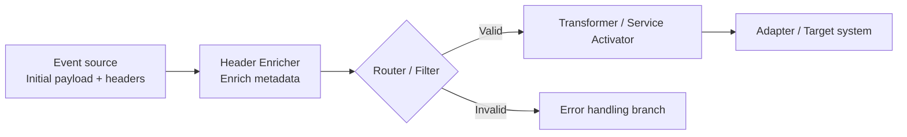

# Header Enricher and metadata enrichment in Spring Integration

> **Chapter:** Message system  
> **Topic:** Enterprise Integration Patterns (EIP) with Spring Integration  
> **Objective:** Learn how to add, normalize, and control a message's metadata using Header Enricher, so Router, Filter, Gateway, retry, error channels, and flow tracing have sufficient context while keeping business logic loosely coupled.

## 1. Why does a message need metadata?

In an integration system, the business data portion typically answers **“what happened?”**, while metadata answers **“where did the data come from, which context does it belong to, and how should it be processed?”**.

For example, the payment service emits an order-placed event:

```json
{
  "orderId": "ORD-2048",
  "amount": 1250000,
  "currency": "VND"
}
```

This data by itself does not specify the receiving channel, originating system, trace ID, or when it entered the integration flow. A processing flow may need to add:

| Header | Example | Meaning in the flow |
| --- | --- | --- |
| `sourceSystem` | `checkout-api` | Identifies originating system for auditing or adapter selection |
| `tenantId` | `tenant-a` | Identifies customer scope; must come from an authenticated source |
| `businessKey` | `ORD-2048` | Lookup and reconciliation by business key |
| `receivedAt` | `2026-11-21T03:15:00Z` | Records ingestion timestamp at the flow boundary |
| `traceId` | `7e45...` | Links logs and traces across components |
| `schemaVersion` | `v2` | Hints at the suitable processor or payload decoding strategy |

If every Router, Filter, or handler had to infer such information from the payload on its own, coupling between components would increase. **Header Enricher** adds metadata at an intentional point before the message moves forward.

## 2. Position of Header Enricher in the Message model

A Spring `Message<T>` has two main parts:

- **Payload**: the data to process, such as `OrderCreated`, JSON, or a text string.
- **Headers**: a set of named attributes, such as `sourceSystem`, `tenantId`, `replyChannel`, or `errorChannel`.

Typical flow diagram:



Header Enricher performs **Message Enrichment on the headers portion**: it reads an incoming message, computes or assigns some headers, and emits the output message. In principle, the payload remains the original business data.

Remember that Spring's `MessageHeaders` is a structure that **cannot be mutated directly**. When changing headers, the framework builds an output message/headers via the message-building mechanism; do not call `put()` to alter the header map of the received message.

### How does Header Enricher differ from neighboring EIPs?

| Pattern/component | Primary responsibility | Example |
| --- | --- | --- |
| **Header Enricher** | Adds or computes metadata | Attaches `sourceSystem=checkout-api` |
| **Transformer** | Transforms payload shape or content | `OrderCreated` → `PaymentCommand` |
| **Content Enricher** | Enriches business data, often from an external source | Fetches additional customer profile into payload |
| **Router** | Picks channel/branch based on conditions | Reads `region` to route to regional channel |
| **Filter** | Allows or discards messages | Discards messages with unsupported `schemaVersion` |
| **Header Filter** | Removes headers that should not continue | Strips internal headers before sending externally |

Header Enricher **does not automatically authenticate** metadata, does not replace authorization, and does not guarantee headers survive HTTP, Kafka, AMQP, or another system. Mapping headers across transport boundaries must be configured on the corresponding adapters.

## 3. Ways to enrich metadata

A header can come from several sources:

1. **Static value:** `sourceSystem=checkout-api` for all messages traversing that branch.
2. **Payload:** extracting `orderId` as `businessKey` for log lookup or reconciliation.
3. **Existing headers:** normalizing a header coming from a gateway or source adapter.
4. **Processing context:** ingestion timestamp, processing stage name, contract version.
5. **External service:** only when truly necessary; I/O operations must weigh timeouts, retries, and potential slowing of the entire flow.

Not all metadata is suitable to generate automatically. For example, `tenantId` and user identity must come from an **authenticated trusted context**, not from an arbitrary client-submitted field treated as an access grant.

### Three decisions before adding a header

- **Data source:** who is responsible for creating and verifying the value?
- **Lifecycle:** should the header persist through every step or be stripped at system boundaries?
- **Conflict rule:** when the header already exists, keep the old value or replace it with the new value?

Clarifying these three points avoids overwriting gateway metadata, breaking correlation context, or accidentally leaking internal details.

## 4. Implementing Header Enricher with Java DSL

Suppose the input is an `OrderCreated` order event. We want to add source system, business key, and receive timestamp before forwarding to the `ordersOutput` channel.

```java
import java.math.BigDecimal;
import java.time.Instant;

import org.springframework.context.annotation.Bean;
import org.springframework.context.annotation.Configuration;
import org.springframework.integration.config.EnableIntegration;
import org.springframework.integration.channel.DirectChannel;
import org.springframework.integration.channel.QueueChannel;
import org.springframework.integration.dsl.IntegrationFlow;

@Configuration
@EnableIntegration
public class OrderFlowConfig {

    public record OrderCreated(String orderId, BigDecimal amount) {}

    @Bean
    public DirectChannel ordersInput() {
        return new DirectChannel();
    }

    @Bean
    public QueueChannel ordersOutput() {
        return new QueueChannel();
    }

    @Bean
    public IntegrationFlow enrichOrdersFlow(
            DirectChannel ordersInput,
            QueueChannel ordersOutput) {

        return IntegrationFlow.from(ordersInput)
            .enrichHeaders(headers -> headers
                .header("sourceSystem", "checkout-api")
                .headerFunction("businessKey", message ->
                    ((OrderCreated) message.getPayload()).orderId())
                .headerFunction("receivedAt", message ->
                    Instant.now().toString())
            )
            .channel(ordersOutput)
            .get();
    }
}
```

In the example:

- `IntegrationFlow.from(ordersInput)` reads messages from the input channel.
- `enrichHeaders(...)` configures the Header Enricher as an independent step in the flow.
- `header("sourceSystem", "checkout-api")` adds static metadata.
- `headerFunction("businessKey", ...)` extracts the order ID from the payload; avoid placing an entire large business object into a header.
- `headerFunction("receivedAt", ...)` computes a dynamic value as the message passes through the enricher.
- `channel(ordersOutput)` sends the header-enriched message to the next channel.

**Architectural significance:** downstream can read `businessKey` and `sourceSystem` without knowing the specific structure of each inbound adapter. The payload remains `OrderCreated`.

In a real application, inject a `Clock` to control time in tests, and extract header names into shared constants if multiple flows require the same metadata contract.

### Reading metadata in the next step

```java
import org.springframework.messaging.Message;

public void process(Message<OrderFlowConfig.OrderCreated> message) {
    OrderFlowConfig.OrderCreated order = message.getPayload();

    String sourceSystem =
        message.getHeaders().get("sourceSystem", String.class);
    String businessKey =
        message.getHeaders().get("businessKey", String.class);

    // Use sourceSystem/businessKey for logging, routing, or auditing.
    // Core business processing still uses order.
}
```

`get("name", String.class)` reads the value in the expected type, yet you still need a clear convention on data types and missing-header handling. Do not assume every adapter preserves original Java types once the message undergoes serialization.

## 5. Static headers, dynamic headers, and SpEL

In addition to Java functions, Java DSL supports expressions for deriving values from messages. Choose the simplest way to express the rule.

```java
.enrichHeaders(headers -> headers
    // Assign a static value
    .header("channelName", "online")

    // Compute from payload using Java
    .headerFunction("businessKey",
        message -> ((OrderCreated) message.getPayload()).orderId())

    // Compute via Spring Expression Language (SpEL)
    .headerExpression("priorityLabel",
        "headers['priority'] != null ? headers['priority'] : 'NORMAL'")
)
```

In SpEL, `payload` typically represents the input payload and `headers` allows access to existing headers. For instance, `headers['priority']` reads the `priority` header value. When expressions grow complex, require multiple conditional branches, or interact with services, moving the logic into a named, separately tested component is easier to maintain.

Header values should be simple and have a clear contract: `String`, numbers, booleans, ISO-8601 timestamps, or types compatible with the transport medium. Avoid storing objects holding connections, unclosed resources, or oversized secondary payloads in headers.

## 6. Already-existing headers: keep or overwrite?

Conflicts are common when messages traverse multiple gateways and flows. Suppose a source sends `sourceSystem=mobile-app`, while the Header Enricher plans to attach `sourceSystem=checkout-api`. The two values carry different meanings; overwriting arbitrarily will corrupt auditing.

Design-wise, there are two policies:

| Policy | Expected behavior | Use when |
| --- | --- | --- |
| **Add only if missing** | If `sourceSystem` exists, keep it; add default only if absent | Preserving verified source information |
| **Intentional overwrite** | Flow resets the header to a controlled value | Normalizing metadata at a trust boundary |

Header Enricher provides **overwrite** settings globally or per header, depending on the configuration style/Spring Integration version. Verify which overwrite rule applies to your flow rather than guessing from a single run.

When building messages manually with Spring Messaging, the meaning of both policies is clear:

```java
Message<?> keepExisting = MessageBuilder
    .fromMessage(incoming)
    .setHeaderIfAbsent("sourceSystem", "checkout-api")
    .build();

Message<?> replaceExisting = MessageBuilder
    .fromMessage(incoming)
    .setHeader("sourceSystem", "trusted-gateway")
    .build();
```

The snippet above only **illustrates the policy** using `MessageBuilder`; in the flow being studied, implement the rule in the Header Enricher so metadata enrichment stays centralized.

For headers affecting access rights, such as `tenantId`, the sensible processing order is **authenticate → normalize metadata → enforce tenant boundary → process business logic**. Do not use Header Enricher to “legitimize” an unverified value.

## 7. Interaction with Router, Splitter, Aggregator, and Gateway

### Router / Filter

Once `region` is present, a Router can route messages to region-specific handlers; a Filter can check a normalized `schemaVersion` or `sourceSystem`. A flow with a stable metadata contract reduces the need to inspect payloads in multiple places.

Example of a logical rule:

```text
input
  → enrichHeaders(region, schemaVersion)
  → filter(schemaVersion is within supported set)
  → route(region)
  → region-specific processing
```

Note that Filter is only an acceptance condition. If you must report business errors or return responses to the caller, design appropriate discard channels, exceptions, and reply paths.

### Splitter / Aggregator and correlation

When splitting one message into multiple child messages, Spring Integration uses headers for grouping and ordering, typically `correlationId`, `sequenceNumber`, and `sequenceSize` (the framework's standard names/constants). The Aggregator relies on this information to identify which messages belong to the same group and when the group can complete.

**Do not arbitrarily overwrite correlation or sequence headers generated by the Splitter/framework.** If you need to attach a business transaction ID, place a separate header such as `businessKey` or `externalCorrelationKey` and keep it distinct from the Aggregator's technical metadata. If you need to customize grouping behavior, explicitly configure correlation/release strategies on the Aggregator.

### Messaging Gateway / protocol boundaries

A Gateway can receive metadata from HTTP, a message broker, or a Java call, then place it on the message. A Header Enricher placed after the gateway is the right place to normalize trustworthy fields for downstream branches.

When exporting to another transport, only certain headers can be mapped. Check the corresponding header mapper and serialization rules for HTTP/Kafka/AMQP; do not rely on headers automatically traveling intact across all systems.

## 8. Errors, retries, and observability

A Header Enricher can also fail: wrong payload type, missing required metadata, invalid SpEL expression, or timeout in a metadata lookup service.

For example, `((OrderCreated) message.getPayload())` will fail if the flow receives a payload of an unexpected type. Therefore:

- Validate or convert payload types at the ingress boundary.
- For required metadata, define clearly whether missing values raise an error, take another branch, or are discarded.
- For logic involving I/O, apply suitable timeouts and retry policies; avoid calling external services per message merely to decorate headers.
- Handle exceptions via endpoint/flow error mechanisms and an appropriate `errorChannel`; do not assume every exception automatically routes to an error channel across all synchronous channel types.

A log sequence can use `businessKey` and `traceId`:

```text
received   sourceSystem=checkout-api businessKey=ORD-2048 traceId=7e45...
validated  sourceSystem=checkout-api businessKey=ORD-2048 traceId=7e45...
published  sourceSystem=checkout-api businessKey=ORD-2048 traceId=7e45...
```

If the system already uses Micrometer Observation or OpenTelemetry, prioritize the tracing system's propagation and conventions rather than inventing an incompatible custom trace ID. Use IDs to link events, yet never put access tokens, passwords, sensitive personal data, or full payloads into headers/logs.

## 9. Testing Header Enricher behavior

The test snippet below uses the `OrderFlowConfig` configuration from Section 4. It verifies that Header Enricher adds new metadata, preserves existing headers, and leaves the payload unchanged.

```java
import static org.junit.jupiter.api.Assertions.*;

import java.math.BigDecimal;

import org.junit.jupiter.api.Test;
import org.springframework.beans.factory.annotation.Autowired;
import org.springframework.messaging.Message;
import org.springframework.messaging.support.MessageBuilder;
import org.springframework.integration.channel.DirectChannel;
import org.springframework.integration.channel.QueueChannel;
import org.springframework.test.context.junit.jupiter.SpringJUnitConfig;

@SpringJUnitConfig(OrderFlowConfig.class)
class OrderFlowTest {

    @Autowired
    DirectChannel ordersInput;

    @Autowired
    QueueChannel ordersOutput;

    @Test
    void enrichesHeadersWithoutChangingPayload() {
        var order = new OrderFlowConfig.OrderCreated(
            "ORD-2048", new BigDecimal("1250000"));

        Message<?> incoming = MessageBuilder
            .withPayload(order)
            .setHeader("tenantId", "tenant-a")
            .build();

        assertTrue(ordersInput.send(incoming));

        Message<?> outgoing = ordersOutput.receive(1_000);
        assertNotNull(outgoing);

        assertSame(order, outgoing.getPayload());
        assertEquals("tenant-a",
            outgoing.getHeaders().get("tenantId"));
        assertEquals("checkout-api",
            outgoing.getHeaders().get("sourceSystem"));
        assertEquals("ORD-2048",
            outgoing.getHeaders().get("businessKey"));
        assertNotNull(outgoing.getHeaders().get("receivedAt"));
    }
}
```

Tests should be expanded to match the real contract: empty metadata, wrong payload type, conflicting headers, untrusted values, ordering within the flow, and propagation across a broker. For timestamps, inject a `Clock` so you can assert exact values instead of depending on the test runner's system clock.

For flows crossing HTTP/Kafka/AMQP, add integration tests verifying the receiving side actually sees the required headers. Testing at a `QueueChannel` only proves behavior **within the same Spring Integration application**.

## 10. Common design mistakes

| Symptom | Possible cause | How to fix |
| --- | --- | --- |
| Header lost after publishing | Adapter does not map that header, or value type cannot be serialized | Define whitelist/mapper and supported header types |
| Audit reports wrong source system | Enricher overwrites an already verified `sourceSystem` header | Define header ownership and overwrite strategy |
| Aggregator merges wrongly or never completes | Correlation/sequence headers modified improperly | Keep Splitter-generated metadata; adjust strategy at Aggregator if needed |
| Flow becomes slow | Header function performs synchronous I/O or heavy computation | Move complex enrichment to a dedicated step; configure timeouts/caching |
| Tenant data mixed up | Trusting client-supplied `tenantId` | Extract tenant from authenticated principal/source and enforce downstream |
| Flaky tests | Using `Instant.now()` and comparing fixed time strings | Inject `Clock`, validate format, or use fixed timestamps |
| Logs contain sensitive data | Logging entire `headers` map | Log only approved fields and redact sensitive data |

## 11. Guided hands-on exercise

Suppose an application receives messages from two sources `web` and `mobile`. Each source emits `OrderCreated`, but metadata formatting is inconsistent.

**Exercise requirements:**

1. Place a Header Enricher after the inbound adapter; keep the `OrderCreated` payload.
2. Attach `schemaVersion=v1` for messages missing this field.
3. Derive `businessKey` from `orderId` for logging and reconciliation.
4. Preserve the `sourceSystem` authenticated at the gateway; do not let a branch overwrite the source name on its own.
5. Configure a Router based on a normalized `region` header; route unsupported values to an explicit handling branch.
6. Write tests for existing headers, missing headers, wrong payload type, and messages traversing an external transport.

You can use this table as verification criteria:

| Input | Expected result |
| --- | --- |
| Trusted `sourceSystem=mobile` present | Still `mobile` downstream |
| Missing `schemaVersion` | Enriched with `v1` |
| Payload has `orderId=ORD-2048` | Has `businessKey=ORD-2048` |
| Normalized `region=VN` present | Router sends to VN regional branch |
| Unsupported `region` header | Error/discard branch handles per contract |
| Published over broker | Required headers still exist at receiving app after mapping |

**Self-check question:** Should a `customerName` value live in the payload or in a header? If it is core business data of the order, it usually belongs in the payload. Create metadata only when there is a clear operational/routing need and processing that data there is permitted.

## 12. Principles for real-world projects

Header Enricher shines when every header has a **stable name, clear meaning, defined owner, consistent data type, and explicit lifecycle policy**. Place enrichment near the boundary where metadata is generated or verified; avoid duplicating header-enrichment logic across multiple handlers.

Design in sequence: **identify required metadata → verify trusted sources → enrich at Header Enricher → route/process → verify propagation → observe and test**. That way, Router, Filter, Transformer, Splitter, Aggregator, and Gateway can exchange messages with complete context while the payload stays focused on business data.

### Quick recap

- **Header Enricher adds metadata; Transformer transforms payload.**
- **Message headers are immutable at the message level; use message-building mechanisms to modify them.**
- **Overwrite rules, correlation, security, and cross-transport mapping are part of the integration contract.**
- **Test both newly added metadata and metadata that must be preserved, especially at system boundaries.**
