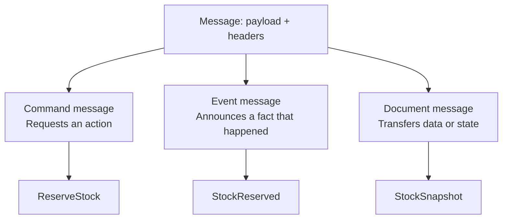
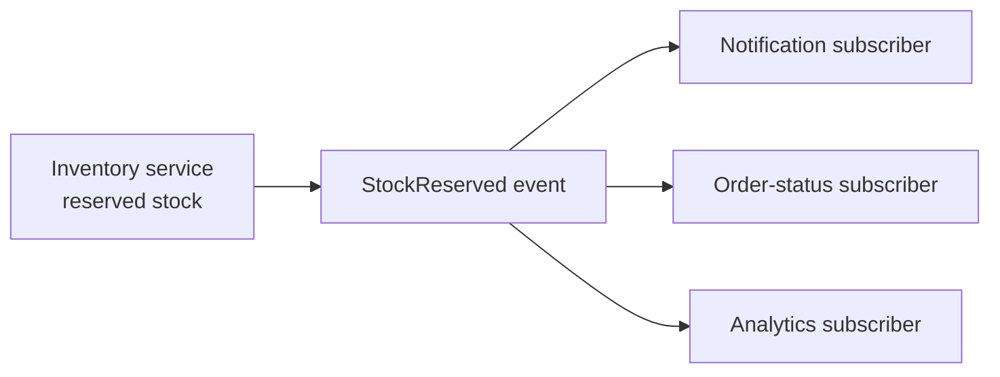
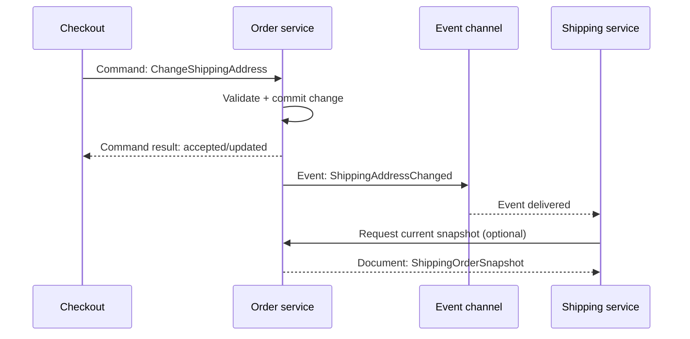

# Distinguishing messages from commands, events, and documents

> **Chapter:** Message system  
> **Module:** `SPRING_INTEGRATION_PATTERN` — implementing Enterprise Integration Patterns (EIP) with Spring Integration to build loosely coupled, extensible, testable, and observable message flows. This lesson clarifies the meaning of **message** and the three intent-based message types **command, event, document** before using Gateway, Filter, Transformer, Router, Splitter, Aggregator, retry, error channels, and correlation.

## 1. Learning objectives

After this lesson, you can:

1. Distinguish a **message** (unit of exchange through a messaging system) from a **command message**, **event message**, and **document message** (message types classified by *intent*).
2. Look at a message's name and content to tell whether it **requests an action**, **announces something that happened**, or **transfers data**.
3. Choose the right message type for order, warehouse, and data sync integration; avoid confusing **command received** with **business action completed**.
4. Understand how each type affects **routing, request–reply, pub/sub, schema, idempotency, correlation, retry, errors, and testing**.
5. Illustrate these choices with Spring Integration's `Message<T>`, `MessageBuilder`, and `IntegrationFlow`.

## 2. Same envelope, different intents

In enterprise integration, a **message** is a unit of data sent from one component to another over a channel or messaging protocol. A message can carry business data, routing information, and metadata so the receiver understands, processes, or replies to it.

**Command Message**, **Event Message**, and **Document Message** are three EIP patterns describing the *communicative intent* of a message:

- **Command:** “Please perform action X.”
- **Event:** “Fact X has happened.”
- **Document:** “Here is data/state X that another party needs to use.”

These are **not four peer object types**. `Message<T>` is the wrapper/carrier (envelope). **A command, event, or document is typically carried inside a message**, such as `Message<ReserveStockCommand>` or `Message<OrderPlacedEvent>`.



The diagram depicts **usage roles of a message**, not Java inheritance. Depending on context, a payload may contain both state data and event info; to classify it, inspect **the communication contract agreed upon by sender and receiver**, not just how many fields appear in JSON.

## 3. Message: the envelope and exchange contract

In Spring Integration, `org.springframework.messaging.Message<T>` has two main components:

| Component | Meaning | Example |
| --- | --- | --- |
| **Payload** | Content the receiver needs to process | `ReserveStockCommand`, `StockReservedEvent`, `StockSnapshot` |
| **Headers** | Metadata for routing, correlation, replies, tracing, or policies | `id`, `timestamp`, `messageKind`, `correlationId`, `replyChannel`, `errorChannel` |

A message is sent to a **Message Channel** and received by an endpoint for processing. The channel itself **does not decide** whether the message is a command or an event. For example, `DirectChannel`, `QueueChannel`, and `PublishSubscribeChannel` describe delivery/distribution mechanics; business intent is determined by **payload and contract**.

```java
import org.springframework.messaging.Message;
import org.springframework.messaging.support.MessageBuilder;

record ReserveStock(String commandId, String orderId,
                    String sku, int quantity) {}

Message<ReserveStock> message = MessageBuilder
    .withPayload(new ReserveStock("cmd-901", "ORD-501", "SKU-A", 2))
    .setHeader("messageKind", "COMMAND")
    .setHeader("correlationId", "ORD-501")
    .setHeader("sourceSystem", "order-service")
    .build();

System.out.println(message.getPayload().quantity()); // 2
System.out.println(message.getHeaders().get("messageKind")); // COMMAND
```

`messageKind` is a **convention defined by this example**, not a mandatory standard Spring Integration header. You can classify by payload class, schema/type name, or header; stay consistent with the contract and **never trust an externally declared header without validating payload and authorization**. Spring may add system headers like `id` and `timestamp`; a message `id` **does not replace** a business ID or idempotency key.

## 4. Command Message — requesting an action

A **Command** expresses *the intent for another system to perform a task*. The issuer usually knows the **responsibility** it wants the receiver to fulfill, such as reserving stock, granting permissions, or creating a shipment.

Example:

```json
{
  "type": "ReserveStock",
  "commandId": "cmd-901",
  "orderId": "ORD-501",
  "sku": "SKU-A",
  "quantity": 2
}
```

### 4.1. Signs of a command

- **Names are usually imperative/action-oriented:** `ReserveStock`, `CreateShipment`, `ApproveInvoice`, `CancelOrder`.
- **Expected action:** the receiver must check preconditions and execute or reject it.
- **Responsible target:** usually **one logical handler** or one owning service; multiple instances may compete for scaling, yet that does not mean executing the command multiple times.
- **Outcomes to distinguish:** accepted for ingestion, accepted by business rules, completed, rejected, or failed.
- **Side-effect risk:** retrying the same shipment-creation or payment-capture command can duplicate actions without safeguards.

A command can be sent synchronously via a Gateway and receive a request–reply result; it can also be sent asynchronously to a queue and receive results via another message. **Commands are not synchronous by default**, and a successful `send()` does not guarantee the action has been executed.

### 4.2. Designing safe commands

Suppose `ReserveStock` reaches the warehouse twice due to a network glitch and retry. The warehouse needs **idempotency**, typically keyed by a stable identifier such as `commandId` or `(orderId, operation, sku)` per business rules. A duplicate command can return the same result instead of reserving stock a second time.

Clearly define:

1. **Precondition:** is enough stock available? Is the sender authorized to reserve?
2. **Outcome:** succeeded (`StockReserved`), rejected by business rules (`InsufficientStock`), or technical failure (`InventoryUnavailable`)?
3. **Reliability:** timeouts, retry limits, backoff, deadlines, and redelivered message handling.
4. **Ownership:** which service owns inventory state? Never broadcast commands to multiple destinations that independently execute the same side effect.

**Note:** When using commands over messaging, a **reply message** can carry the outcome directly. Having the receiver additionally emit `StockReserved` as an **event** is a separate architectural choice, often used when other services also need to know stock reservation completed.

## 5. Event Message — announcing something that happened

An **Event** describes a **fact that has already occurred** to which interested parties may react. It reflects a truth within the publishing system's context: an order was placed, stock was reserved, payment was confirmed.

Example:

```json
{
  "type": "StockReserved",
  "eventId": "evt-310",
  "orderId": "ORD-501",
  "sku": "SKU-A",
  "quantity": 2,
  "occurredAt": "2026-11-21T03:30:00Z"
}
```

### 5.1. Signs of an event

- **Names usually indicate past facts:** `OrderPlaced`, `StockReserved`, `ShipmentDispatched`.
- **Does not command subscribers:** an event reports state/occurrence so listeners **decide on their own** how to react according to their responsibilities.
- **Can have 0, 1, or many subscribers:** reporting, sending emails, updating read models, or triggering another workflow.
- **Order and timing matter:** include `eventId`, entity ID, occurrence timestamp, and version/sequence when needed.
- **Can be redelivered:** downstream must account for at-least-once delivery, duplicates, out-of-order arrival, and replayability.



Events should not be named like commands to disguise a request such as “send an email immediately.” If the order system **requires** the email service to perform an action under a specific contract and response, a **command sent to the email service** may fit better; if it merely announces an order was just placed, `OrderPlaced` is the right event.

### 5.2. Publish only what has truly happened

Do not publish `StockReserved` **before** the stock-reservation transaction commits. If the database update succeeds yet event publishing fails, other services may miss the update. This is the **dual write** problem (two state-changing operations that must stay consistent). Consider a **transactional outbox**: write business state and an outbox record in the same transaction, then publish the outbox with retries. Receivers still need idempotency because the outbox can publish duplicates.

**An Event Message does not automatically mean event sourcing:** event sourcing is a strategy for storing state as an event log, whereas an event message is simply a notification message. Not every system that publishes events needs event sourcing.

### 5.3. Events can carry rich data and still be events

`CustomerAddressChanged` might contain only `customerId` and version; subscribers query details when needed. An event might also include the new address to reduce query calls (an **event-carried state transfer** style). Even though the payload partially resembles a document, its *intent* is still stating **the address just changed**, not merely handing over a dataset without event context.

Deciding how much data to include balances schema coupling, access permissions, message size, latency, and replay needs. Avoid placing unnecessary personal data in widely published events.

## 6. Document Message — transferring a data structure

A **Document Message** is an EIP pattern used to **transfer information/data between applications**. The focus is on the *delivered content* rather than requesting an action or announcing a fact that just happened.

Example sending an inventory snapshot during data synchronization:

```json
{
  "type": "StockSnapshot",
  "snapshotId": "snap-20261121-01",
  "warehouse": "HCM-01",
  "capturedAt": "2026-11-21T03:35:00Z",
  "items": [
    { "sku": "SKU-A", "available": 42 },
    { "sku": "SKU-B", "available": 17 }
  ]
}
```

### 6.1. Signs of a document

- **Content is structured data:** customer record, catalog, invoice list, inventory snapshot, shipping manifest.
- **Can be a snapshot or delta:** explicitly define *full snapshot* vs. *partial update*; the two cannot be substituted arbitrarily.
- **May trigger no immediate action:** consumers receive it to store, compare, validate, import, or use as computation input per contract.
- **Requires schema and freshness management:** `schemaVersion`, `capturedAt`, snapshot ID, checksum, or pagination when appropriate.
- **Size and security concerns:** large catalogs may require batching; sensitive info requires restricted access and retention policies.

Do not assume “long JSON” automatically means document. Commands and events can carry multi-field payloads too. Ask: *Am I asking the other party to do something? Am I announcing something that just happened? Or am I just transferring a dataset for the other party to use?*

For example, **`SendStockSnapshot`** is a *command* name requesting a snapshot export; the `StockSnapshot` returned or transferred is a *document*. The **`StockSnapshotPublished`** event, in turn, announces that publishing occurred. All three serve three distinct contracts.

### 6.2. Transferring a document does not mean state sync succeeded

When a consumer receives a snapshot, it still must handle version, `capturedAt`, source validation, data persistence, and replies if the contract requires them. An older snapshot arriving after a newer snapshot can overwrite state incorrectly. Therefore, state-carrying documents should enforce **version/sequence** rules, **freshness** checks, and behavior on redelivery of the same document.

## 7. Quick comparison table by communicative intent

| Criterion | Message (general concept) | Command Message | Event Message | Document Message |
| --- | --- | --- | --- | --- |
| **Nature** | Unit of exchange: payload + metadata | Request to perform an action | Notification of a past fact | Transfer of data/state |
| **Primary question** | “What message is being sent?” | “What should be done?” | “What happened?” | “What data is this?” |
| **Temporal meaning** | Depends on payload | Desired action in the future | Fact that already happened in the past | Content valid at a defined time/version |
| **Receivers** | Decided by routing and contract | Usually one logical owner of the action | Potentially many subscribers | One or more parties needing data |
| **Typical name** | `Message<T>` | `ReserveStock` | `StockReserved` | `StockSnapshot` |
| **Outcomes to examine** | Delivery/routing | Accepted, succeeded, rejected, failed | Subscribers received/processed, replay, order | Received and applied with right schema/version |
| **Prominent risks** | Loss, duplication, wrong header/payload | Duplicate side effects on retry | Duplicates/out-of-order and publishing before commit | Stale data, overwrites, large or sensitive payloads |

**Do not choose message type solely by transport.** HTTP, Kafka, RabbitMQ, or `DirectChannel` can each carry commands, events, or documents; channel type only governs delivery mechanics and execution guarantees.

## 8. One scenario, three different message types

Suppose a user updates the shipping address of order `ORD-501`.

1. The order service sends the **command** `ChangeShippingAddress(orderId, newAddress)` to the service responsible for updates, with `commandId` to prevent duplicate side effects.
2. After saving the change successfully, the service emits the **event** `ShippingAddressChanged(orderId, version, occurredAt)` so shipping and audit systems know the update occurred.
3. When the shipping system needs to reconcile full order details, it receives the **document** `ShippingOrderSnapshot(orderId, shippingAddress, items, version)`.



In the diagram, the **Request current snapshot** call is a *request/command-like interaction*, while the **returned snapshot** is a *document*. Shipping receiving the event **does not automatically** prove it updated all data; each step needs its corresponding outcome/acknowledgment.

### Common unclear designs

| Unclear design | Why it is risky | Better expression |
| --- | --- | --- |
| Emitting `OrderCreated` before order save succeeds | Subscribers trust a fact that may not have happened | Commit/outbox before publishing event |
| Using `CreateShipment` as an “event” sent to all subscribers | Multiple parties execute the action, creating duplicate shipments | Command with a clear owner; `ShipmentCreated` event after success |
| Sending a snapshot without a version | Late old snapshot can overwrite newer state | Version/sequence + update policy |
| Named `UpdateCustomer` yet actually only carries a profile | Consumer unsure whether to execute or just ingest data | Clarify whether it is an update command or a customer document |
| Using only `messageId` for business dedup | Same command can be retried with a new message ID | Stable business key/`commandId` |

## 9. Spring Integration: routing by message type

Spring Integration provides EIPs such as **Message Channel**, **Gateway**, **Filter**, **Transformer**, **Router**, and **Service Activator**; messages pass through each endpoint and may change payload/headers per processing step. There are no mandatory built-in classes named `CommandMessage`, `EventMessage`, or `DocumentMessage`: you define your **business schema/contract**.

The example below uses the application header `messageKind` to route three message types into three channels. The code uses Java 17+, Spring Integration Java DSL, and assumes Spring has the appropriate integration dependencies/configuration. The handlers below only print content to illustrate the flow, without real business processing.

```java
import org.springframework.context.annotation.Bean;
import org.springframework.context.annotation.Configuration;
import org.springframework.integration.config.EnableIntegration;
import org.springframework.integration.dsl.IntegrationFlow;

@Configuration
@EnableIntegration
class BusinessMessageFlows {

    @Bean
    IntegrationFlow classifyIncomingMessages() {
        return IntegrationFlow.from("business.inbound")
            .route("headers['messageKind']", spec -> spec
                .channelMapping("COMMAND", "commands.inbound")
                .channelMapping("EVENT", "events.inbound")
                .channelMapping("DOCUMENT", "documents.inbound")
                .defaultOutputChannel("messages.invalid"))
            .get();
    }

    @Bean
    IntegrationFlow commandHandling() {
        return IntegrationFlow.from("commands.inbound")
            .handle(msg -> System.out.println("COMMAND: " + msg.getPayload()))
            .get();
    }

    @Bean
    IntegrationFlow eventHandling() {
        return IntegrationFlow.from("events.inbound")
            .handle(msg -> System.out.println("EVENT: " + msg.getPayload()))
            .get();
    }

    @Bean
    IntegrationFlow documentHandling() {
        return IntegrationFlow.from("documents.inbound")
            .handle(msg -> System.out.println("DOCUMENT: " + msg.getPayload()))
            .get();
    }

    @Bean
    IntegrationFlow invalidMessages() {
        return IntegrationFlow.from("messages.invalid")
            .handle(msg -> System.err.println("UNKNOWN KIND: " + msg.getPayload()))
            .get();
    }
}
```

Example sending a message into the flow:

```java
import org.springframework.messaging.Message;
import org.springframework.messaging.MessageChannel;
import org.springframework.messaging.support.MessageBuilder;

// Retrieve business.inbound from Spring ApplicationContext.
MessageChannel inbound = context.getBean("business.inbound", MessageChannel.class);

Message<ReserveStock> cmd = MessageBuilder
    .withPayload(new ReserveStock("cmd-901", "ORD-501", "SKU-A", 2))
    .setHeader("messageKind", "COMMAND")
    .setHeader("correlationId", "ORD-501")
    .build();

inbound.send(cmd); // Prints: COMMAND: ReserveStock[...]
```

### 9.1. Understanding the example accurately

1. **Router classifies messages:** the `messageKind` header determines the channel. This is an illustrative choice; production may route by payload class, validated event type, or schema registry.
2. **Command reaches one handler:** a real handler must check authorization, preconditions, and idempotency before executing side effects. Console output does not suffice to declare a command completed.
3. **Event reaching one handler is only a demo:** if you want multiple independent subscribers, configure publish–subscribe or event-broker infrastructure and suitable error/delivery mechanisms. *A channel named `events.inbound` does not automatically become fan-out*.
4. **Document reaches consumer:** the consumer must verify integrity, data freshness, and schema/version before applying.
5. **Invalid kind:** the example routes to `messages.invalid` to avoid silently dropping it; real systems need structured logging, alerting, or a quarantine flow if payloads are untrusted.

### 9.2. Role of other EIPs with the three message types

| EIP / mechanism | Applied to command | Applied to event | Applied to document |
| --- | --- | --- | --- |
| **Gateway** | Sends request and may wait for reply | Can be the entry point bringing events into a flow | Requests/receives documents per contract |
| **Filter** | Checks acceptance preconditions | Filters events subscribers care about | Filters data by schema/source |
| **Transformer** | Converts input into internal command form | Normalizes event type/version | Converts document structure or format |
| **Router** | Picks the logical owner of the action | Picks interested subscriber groups | Picks consumer or ingestion pipeline |
| **Splitter / Aggregator** | Splits/collects sub-tasks and results | Analyzes/collects event sequences by key | Batches records and aggregates processing results |
| **Retry / error channel** | Watch side effects and idempotency | Watch redelivery and subscriber failures | Watch schema/version errors, duplicate/stale data |

A flow may combine many EIPs, yet **should not alter command/event/document semantics just to make routing easier**. Separate interfaces and schemas by business contract, then choose EIPs to serve that contract.

## 10. Correlation, IDs, and replies are not the same

In multi-step systems, these identifiers commonly appear:

| Identifier | What is it used for? | Example |
| --- | --- | --- |
| `messageId` | Distinguishes a message object / delivery unit | UUID generated by messaging |
| `commandId` | Distinguishes an action request, supporting idempotency | `cmd-901` |
| `eventId` | Distinguishes an occurred event, supporting dedup/replay | `evt-310` |
| `documentId` / `snapshotId` | Identifies a document or snapshot version | `snap-20261121-01` |
| `correlationId` | Links messages belonging to the same workflow or group | `ORD-501` |
| `causationId` | States which message/command/event caused the current event | `cmd-901` produced `evt-310` |

The names above (apart from system headers like `id`) are **contract conventions**, not guaranteed uniformly out of the box across every system by Spring Integration. Correlation **links relationships** rather than preventing duplicates by itself; idempotency requires a business key and consistent processing state.

In request–reply, `replyChannel` and timeouts answer **for that invocation**. Meanwhile, an event emitted after a command may travel via a broker and arrive later; correlation mechanisms (`commandId`, `correlationId`) are needed if the caller wants to track the final outcome. **Timing out does not mean the command was not executed.**

## 11. Choosing message types to design the right reliability

### 11.1. Command: controlling side effects

With `ChargePayment`, a timed-out call cannot prove the card was not charged. When retrying, use a stable idempotency key and look up state before triggering side effects. Classify errors: auth/validation errors should generally not be retried automatically, whereas transient network errors can have bounded retries with backoff.

### 11.2. Event: tolerating duplicate and out-of-order delivery

With `OrderPaid`, a consumer might receive duplicates, or `OrderCancelled` might arrive earlier due to differing transport/subscription paths. Consumers should store processed `eventId`s, compare aggregate versions when needed, define replay behavior, and handle overly stale events. If strict ordering per `orderId` is mandatory, choose partitioning/routing and appropriate ordering guarantees rather than assuming every broker preserves order by default.

### 11.3. Document: data arrives intact yet may be stale

With `ProductCatalogSnapshot`, a valid payload might still be yesterday's snapshot. Check `schemaVersion`, snapshot version/timestamp, completeness, and authorization. For large datasets, consider batching, streaming, or sending a reference to a trusted data store instead of stuffing everything into one message.

### 11.4. Error channels and retries are mechanisms, not message intent

Spring Integration can use an **error channel** to route error messages depending on processing context (especially across asynchronous boundaries); exceptions in synchronous flows can often propagate back to the caller. **Retries** should sit where recovery is possible, with attempt limits and backoff; do not blindly apply retries to every command/event/document. “Having an error channel” does not replace business policies when a command is rejected, an event cannot be processed, or a document violates schema.

## 12. Testing to avoid confusing intent

Testing an EIP flow requires observing **messages entering/exiting channels**, payload/headers, processing branches, handler invocation counts, and error paths—not just asserting that a method returned normally.

| Scenario | What to verify |
| --- | --- |
| Send `ReserveStock` with `messageKind=COMMAND` | Only command handler receives it; `commandId` is preserved per contract |
| Send `StockReserved` with `messageKind=EVENT` | Enters event flow; does not re-trigger stock reservation command |
| Send `StockSnapshot` with `messageKind=DOCUMENT` | Reaches document flow; validates version/snapshot before applying |
| Missing or wrong `messageKind` header | Message is rejected / takes invalid branch per design; never hits the wrong handler |
| Command with duplicate `commandId` | Side effect executes at most once business-wise per idempotency policy |
| Event with duplicate `eventId` | Subscriber handles/dedups per contract; does not corrupt projection |
| Older document version arrives after newer version | Consumer does not overwrite newer data arbitrarily |
| Handler throws exception or adapter times out | Error takes the right path, has bounded retry/timeout, keeps correlation intact |
| Event has multiple subscribers | One failing subscriber does not lose outcomes for others if architecture requires isolation |

With Spring Integration, use Spring Test/JUnit, fake services, test channels, and observation hooks to verify each branch. Tests across asynchronous boundaries need bounded wait conditions rather than arbitrary `sleep` intervals.

## 13. Practice exercise

An ordering system has four requirements:

1. Ask the warehouse to **reserve 3 items** for `ORD-701`.
2. After the warehouse succeeds, announce that **stock has been reserved** to email and order-tracking systems.
3. Every night, send an **inventory catalog snapshot** for the reporting system to reconcile.
4. A user queries order status and needs a **response** containing the current order record.

**Determine** the message type at each step; suitable payload names; one or multiple logical receivers; IDs for deduplication; and which boundaries need request–reply, publish–subscribe, retry, or correlation.

**Suggested solution:**

- (1) **Command** `ReserveStock` to the inventory owner; `commandId` and idempotency protect side effects. Results may be received directly or asynchronously.
- (2) **Event** `StockReserved` after commit; carries `eventId`, `orderId`, timestamp/version. Multiple subscribers may care, without re-invoking the reservation action.
- (3) **Document** `InventorySnapshot` with `snapshotId`, `capturedAt`, schema version, and update rules. Can use Splitter if data is split into batches.
- (4) The **request/query** asking to read status is a request message; the **response containing order status** can be modeled as a document. Do not call this response an event just because it carries a JSON payload.

## 14. Summary

**A Message is the vehicle carrying content and metadata; command, event, and document describe the communicative intent of the carried content.** Commands request an action, events announce a past fact, and documents transfer data or state. They may share `Message<T>`, traverse Spring Integration Channels, and pass through Routers/Transformers, yet their **success contracts, duplication risks, ordering, and testing strategies differ**.

When designing a Spring Integration flow, ask in order: **(1) What does the sender want? (2) Who is responsible and how many parties must receive it? (3) When is it considered successful? (4) What correlation, idempotency, versioning, retry, and error paths are needed?** Answering those questions before selecting Gateway, Router, Filter, Transformer, Splitter, or Aggregator yields clearer, looser-coupled, and more observable flows.

**Further reading:** Gregor Hohpe & Bobby Woolf, *Enterprise Integration Patterns* (Command Message, Document Message, Event Message); official Spring Integration documentation on Message, Message Channels, Gateways, Routers, Transformers, and Error Handling.
