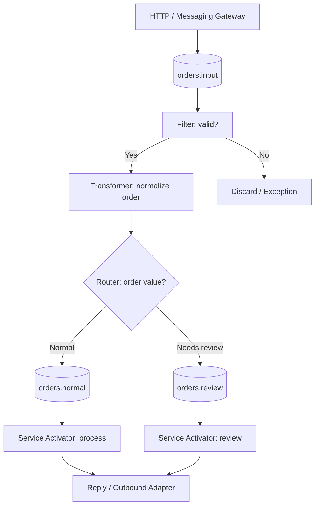
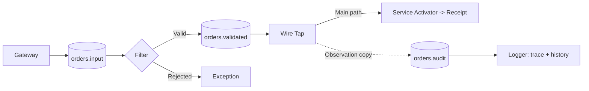
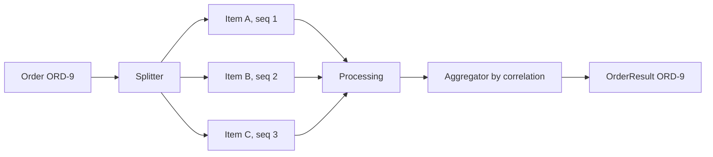

# Message history and flow traceability

## 1. Why trace an integration flow?

In Spring Integration, a message can pass through many `MessageChannel`s and endpoints: a `Gateway` ingests it, a `Filter` validates it, a `Transformer` converts its format, a `Router` selects a branch, a `Splitter` breaks it into child messages, and an `Aggregator` collects the results. When processing fails or a result arrives at the wrong destination, a single Java method's stack trace is usually insufficient to answer: **which components did the message traverse, where did it branch, and at which step did the failure occur?**

For example, a system receives orders and routes them by value:



Suppose an order that should have gone to `orders.review` went to `orders.normal` instead. To find the root cause, you need to know the **transaction identifier**, **the hops traversed**, **the value used for routing**, and **timestamps**. Spring Integration has a **Message History** mechanism that helps record a message's path; however, to investigate effectively and trace across multiple services, you must combine history with logging, correlation, metrics, and distributed tracing.

**Lesson objectives:**

1. Understand what `Message History` is, where it lives, and what it does not contain.
2. Distinguish message ID, business ID, correlation ID, and trace ID.
3. Enable history in Spring Integration and read it in the right context.
4. Observe Router/Filter/Transformer, Splitter/Aggregator, Gateway, retry, and error-flow branches.
5. Design traceability from synchronous in-JVM flows to asynchronous or broker-backed flows, and write tests for common scenarios.

## 2. What is Message History?

### 2.1. History is attached to the message

In Spring Messaging, `Message<T>` has a **payload** and **headers**. Spring Integration can record tracked processing hops into a history header, typically accessed via `MessageHistory.HEADER_NAME` (header key `history`). Instead of storing full data at every step, history describes **the message's journey through components configured for tracking**.

A history record can contain details such as:

| Field / info | Meaning |
|---|---|
| `name` | Name or ID of the component traversed. |
| `type` | Component type, such as an instrumented endpoint or channel. |
| `timestamp` | Time the component was recorded. |
| Entry order | Order of points recorded in the message's history at the moment of observation. |

An illustrative example of the semantics, **not a fixed framework output**:

```text
messageId = 6cc7... (current message ID)
traceId   = order-trace-9a10 (custom header)
history   = [
  {name=orders.input,       type=channel, timestamp=...},
  {name=validateOrder,      type=filter,  timestamp=...},
  {name=orders.validated,   type=channel, timestamp=...},
  {name=routeOrder,         type=router,  timestamp=...},
  {name=orders.review,      type=channel, timestamp=...}
]
```

The order and presence of each component depend on the **version, tracking configuration, and where history is read**. Do not rely on the example above to assume every `channel` or endpoint always appears, or always has a human-readable name. Proactively give stable names to important components and inspect actual records.

### 2.2. History is not a complete business audit log

`Message History` primarily serves **in-flow traversal**. It does **not automatically** guarantee the following capabilities:

- Storing payload contents before/after every `Transformer`.
- Storing Router condition expressions, Filter predicate outcomes, or the business reason behind a decision.
- Storing exceptions, retry counts, transaction states, or queue wait times in a standardized log schema.
- Persisting durably across restarts, across brokers, or across multiple JVM boundaries.
- Creating an end-to-end distributed trace with parent/child spans and cross-service trace context.

Therefore, **message history is a scoped technical trail**, not a substitute for an audit log, tracing backend, or message store. Having history does not mean the system guarantees delivery, idempotency, or exactly-once processing.

### 2.3. Identifiers that are easily confused

| Identifier | Primarily answers | Lifecycle and source |
|---|---|---|
| **Message ID** (`id`) | *Which specific message is this?* | Metadata of a single `Message`; may change when new messages are created during transformation or processing. |
| **Business ID** (`orderId`, `paymentId`) | *Which business entity is this?* | Defined by the domain; multiple messages can carry the same business ID. |
| **Correlation ID** (`correlationId`) | *Which messages belong to the same unit of work?* | Needed for Splitter/Aggregator, complex request–reply, or parallel processing; created by framework/component/application per scenario. |
| **Trace ID** (`traceId`) | *Which operations belong to the same observed journey?* | Belongs to the tracing system or header convention; must be propagated appropriately across steps/services. |
| **Span ID** | *Where does a specific operation sit in the trace?* | Managed by distributed tracing; each span has duration and parent/child relationships. |

For example, `orderId=ORD-1001` may appear in the order-ingestion message, inventory-call message, billing message, and reply message. If you use the first step's message ID to link all logs, steps creating new messages will break the chain. When tracing, combine **business ID** and **trace/correlation ID**, never relying on a single `id`.

## 3. Enabling Message History in Spring Integration

### 3.1. Basic configuration

In a Java application using Spring Integration (e.g., Spring Boot 3.x, Spring Integration 6.x), enable tracking with the `@EnableMessageHistory` annotation in a Spring configuration:

```java
import org.springframework.context.annotation.Configuration;
import org.springframework.integration.config.EnableIntegration;
import org.springframework.integration.config.EnableMessageHistory;

@Configuration
@EnableIntegration
@EnableMessageHistory
public class MessageHistoryConfiguration {
}
```

`@EnableMessageHistory` instructs Spring Integration infrastructure to record history for tracked components; it does **not** create a persistent log store on its own. For large systems, review scoping capabilities, measure overhead, and establish policies to enable it only in environments or windows needing diagnostics. Optional APIs to filter components may differ across versions; this example uses only the basic annotation form.

### 3.2. Reading the header at a processing point

At the end or at an observation point in the flow, you can read the history header using Spring Integration's API:

```java
import org.springframework.integration.history.MessageHistory;
import org.springframework.messaging.Message;

void inspect(Message<?> message) {
    Object history = message.getHeaders().get(MessageHistory.HEADER_NAME);
    Object traceId = message.getHeaders().get("traceId");
    Object businessId = message.getHeaders().get("orderId");

    System.out.println("traceId=" + traceId);
    System.out.println("orderId=" + businessId);
    System.out.println("history=" + history);
}
```

The example uses `System.out` so learners can see the values—it is **not** a production logging recommendation. In real systems, use a structured logger, log only necessary fields, and never log entire payloads or tokens/PII. `history` can be `null` if tracking is not enabled, the message has not yet crossed a tracked component, or metadata was lost at a transfer boundary.

### 3.3. Why observed history differs depending on location

Suppose a flow consists of `Filter -> Transformer -> Router -> Service Activator`. If you place a log point **before the Router**, the record obviously does not yet reflect components processed **after the Router**. If there is a `Wire Tap` early in the flow, the tap branch receives the message at that moment, not a “future snapshot” of every step that will run later.

This is a critical rule to avoid false conclusions: **reading history at a point lets you infer only the hops recorded before or at that moment**. If you need to know the branch after a Router, place observation points right after the branches or at the endpoints that actually handle each branch, rather than placing a tap only on the input channel.

## 4. Hands-on example: Gateway, Filter, History, and Wire Tap

### 4.1. Business requirements

We build a small flow:

1. Caller invokes `OrderGateway.submit(order, traceId)` in request–reply mode.
2. `Filter` rejects orders with an invalid `total`.
3. Valid messages pass through `orders.validated`.
4. `Wire Tap` copies an observation stream to `orders.audit`.
5. `Service Activator` returns a `Receipt` to the caller.

The goal is **not** to log everything into history, but to illustrate how to inspect history on an observation branch without altering the main path's business payload.



### 4.2. Illustrative Java DSL

The example targets Java 17+, `spring-boot-starter-integration`, and Spring Integration 6.x. Keep types in the same package; when turning them into application sources, move `public` top-level types into separate Java files. The imports below apply to a single configuration example file:

```java
import java.math.BigDecimal;

import org.slf4j.Logger;
import org.slf4j.LoggerFactory;
import org.springframework.context.annotation.Bean;
import org.springframework.context.annotation.Configuration;
import org.springframework.integration.annotation.Gateway;
import org.springframework.integration.annotation.IntegrationComponentScan;
import org.springframework.integration.annotation.MessagingGateway;
import org.springframework.integration.channel.DirectChannel;
import org.springframework.integration.config.EnableIntegration;
import org.springframework.integration.config.EnableMessageHistory;
import org.springframework.integration.dsl.IntegrationFlow;
import org.springframework.integration.history.MessageHistory;
import org.springframework.messaging.MessageChannel;
import org.springframework.messaging.handler.annotation.Header;

record Order(String id, BigDecimal total) {}
record Receipt(String orderId, String status) {}

@MessagingGateway
interface OrderGateway {
    @Gateway(requestChannel = "orders.input")
    Receipt submit(Order order, @Header("traceId") String traceId);
}

@Configuration
@EnableIntegration
@EnableMessageHistory
@IntegrationComponentScan
class OrderTraceFlowConfiguration {
    private static final Logger log =
            LoggerFactory.getLogger(OrderTraceFlowConfiguration.class);

    @Bean(name = "orders.input")
    MessageChannel inputChannel() {
        return new DirectChannel();
    }

    @Bean(name = "orders.validated")
    MessageChannel validatedChannel() {
        return new DirectChannel();
    }

    @Bean(name = "orders.audit")
    MessageChannel auditChannel() {
        return new DirectChannel();
    }

    @Bean
    IntegrationFlow orderFlow() {
        return IntegrationFlow.from("orders.input")
                .filter(Order.class,
                        order -> order.total() != null
                                && order.total().signum() > 0,
                        spec -> spec.throwExceptionOnRejection(true))
                .channel("orders.validated")
                .wireTap("orders.audit")
                .handle(Order.class, (order, headers) ->
                        new Receipt(order.id(), "ACCEPTED"))
                .get();
    }

    @Bean
    IntegrationFlow auditFlow() {
        return IntegrationFlow.from("orders.audit")
                .handle(message -> {
                    Object payload = message.getPayload();
                    String orderId = payload instanceof Order order
                            ? order.id() : "unknown";

                    log.info("traceId={} orderId={} messageId={} history={}",
                            message.getHeaders().get("traceId"),
                            orderId,
                            message.getHeaders().getId(),
                            message.getHeaders().get(MessageHistory.HEADER_NAME));
                })
                .get();
    }
}
```

The caller invokes the `OrderGateway` bean registered by Spring:

```java
Receipt result = orderGateway.submit(
        new Order("ORD-1001", new BigDecimal("350000")),
        "trace-order-1001");

// result.orderId() = "ORD-1001"
// result.status()  = "ACCEPTED"
```

**Design explanation:**

- `@EnableMessageHistory` enables history recording within the configuration scope.
- `@IntegrationComponentScan` enables discovering `@MessagingGateway` in the scanned package.
- The `traceId` header supplied by the caller is an **application convention**, not automatically a standard OpenTelemetry trace ID.
- `orders.input`, `orders.validated`, and `orders.audit` are meaningful channel names that aid log reading and traceability.
- `Wire Tap` copies the message to the observation flow. Using `DirectChannel` for `orders.audit` runs the audit branch **synchronously** with sending; in this simple example it can affect main-path latency and errors. Production should consider decoupling threads, bounding resources, and setting failure policies for the observation branch.
- `history` is logged at the **tap position**, so it does not represent processing after the tap. To see the handler returning `Receipt` or the final Router branch, add observation points at those positions.

**Security note:** Even history containing only component names and timestamps can reveal internal business workflows. Restrict log access permissions, retention periods, and log volume before enabling tracking system-wide.

## 5. Tracing common EIP branches

### 5.1. Filter: did it proceed or get discarded?

`Filter` has two business outcome paths: **accept** or **reject**. If you place a tap **after the Filter**, rejected messages will **not** reach that tap. Therefore, not seeing a message in downstream logs is insufficient to conclude it was lost in transit.

To observe accurately, you can:

- Log or increment metrics at the Filter's input.
- Place logs on both the **accepted path** and the configured **discard/rejection path**.
- Record rejection reasons using **controlled reason codes**, such as `INVALID_AMOUNT`, rather than logging the full payload.
- For request–reply gateways, explicitly decide whether rejection throws an exception or returns a failure reply; avoid dropping the message and leaving the caller to time out.

Example business event table (not default history contents):

| Event | `traceId` | `orderId` | `step` | `outcome` |
|---|---|---|---|---|
| `ORDER_RECEIVED` | `trace-123` | `ORD-1` | `input` | `RECEIVED` |
| `ORDER_VALIDATED` | `trace-123` | `ORD-1` | `filter` | `ACCEPTED` |
| `ORDER_ROUTED` | `trace-123` | `ORD-1` | `router` | `REVIEW` |

For invalid orders, emit an `ORDER_REJECTED` event instead of trying to infer rejection from **the absence** of `ORDER_ROUTED`.

### 5.2. Router: which branch did the message actually take?

A `Content-Based Router` reads payload/headers, computes a routing key, and forwards the message to the mapped channel. **Message History** can help confirm some recorded components; however, to confirm the **business decision**, emit events at the Router or target branches with `routeKey`, `destination`, `traceId`, and `businessId`.

```text
traceId=trace-123 orderId=ORD-1 event=ROUTE_DECIDED key=review
traceId=trace-123 orderId=ORD-1 event=BRANCH_ENTERED channel=orders.review
```

Those two lines differ in nature: the first states **where the Router decided to send**, while the second proves **an endpoint on the target branch received it**. When a subscriber is missing, mapping is wrong, or downstream fails, the two events may not appear as expected. Comparing them pinpoints where the route broke.

### 5.3. Transformer: messages can change ID and payload type

A `Transformer` may produce a new payload, a new `Message<?>`, or let infrastructure construct the reply message. Therefore, do not design traceability assuming the input message ID always stays identical across every step. On the other hand, most Spring Integration message-processing operations have mechanisms to propagate appropriate headers, yet **not every way of creating a new message or crossing an adapter boundary preserves all headers**.

Example intentionally preserving metadata when **manually building** a new message:

```java
import org.springframework.messaging.Message;
import org.springframework.messaging.support.MessageBuilder;

Message<NormalizedOrder> normalize(Message<Order> input) {
    Order old = input.getPayload();
    NormalizedOrder normalized = new NormalizedOrder(old.id(), old.total());

    return MessageBuilder.withPayload(normalized)
            .copyHeaders(input.getHeaders())
            .build();
}
```

The example assumes `NormalizedOrder` is a DTO already defined in the application. When copying headers, still evaluate **which headers to keep and which must never cross a trust boundary**; `replyChannel` may be an internal object reference, unsuitable for transmission to another system. Do not treat `copyHeaders` by default as a safe way to export metadata externally.

### 5.4. Splitter / Aggregator: one journey spawning multiple messages

This is the most important case for understanding the difference between **message ID** and **correlation**.



When splitting an order into line items:

```text
Business ID = ORD-9
Trace ID    = trace-ORD-9
  child-1: messageId=m-1, correlation=group-9, sequence=1/3
  child-2: messageId=m-2, correlation=group-9, sequence=2/3
  child-3: messageId=m-3, correlation=group-9, sequence=3/3
Aggregator -> output messageId=m-4, businessId=ORD-9
```

The values above are only **illustrative identifier examples**. In practice, Splitter can generate the correlation ID from the original message and set sequence headers per configuration, while the Aggregator's output can have headers combined under a chosen policy.

For complete traceability, record **group key**, **sequence**, **expected total parts if known**, **received part count**, **release reason**, and **timeout/expiry**. Not all of this must live in `history`; dedicated logs and metrics are usually needed. If one part fails, do not assume the Aggregator automatically knows whether to wait, skip, or return partial results: define a release strategy, message store, and expiry policy.

### 5.5. Gateway and outbound adapter: system boundaries

`Gateway` supports a request–reply contract, while `Adapter` usually sends or receives unidirectionally. When a request goes to another system and returns, the originating JVM's history **does not automatically become system-wide history**. To stitch the path together, propagate and restore tracing context or a correlation key per the integration contract, such as via HTTP headers or broker message headers.

| Boundary | What to propagate/record explicitly |
|---|---|
| Within the same flow/JVM | Component/channel names, business ID, `traceId`, `MessageHistory` if enabled. |
| Across `ExecutorChannel` or poller | Correlation context inside the message; do not rely on MDC/thread-local auto-propagating. |
| Over HTTP | Trace context following the system's chosen standard, plus needed business/correlation IDs. |
| Over Kafka/RabbitMQ/JMS | Appropriate header mapping, serialization rules, event ID, key, idempotency/retry. |
| Request–reply across multiple systems | Request correlation, timeout, reply destination, remote errors, and late-reply handling. |

## 6. How do History, Wire Tap, logging, metrics, and distributed tracing differ?

| Tool | What it observes | Strengths | Limitations |
|---|---|---|---|
| **Message History** | Sequence of tracked components on the message. | Easy to inspect the path inside Spring Integration. | Header overhead, local scope, does not persist durably or log decisions by itself. |
| **Wire Tap** | A copy of the message at the tap location. | Keeps business endpoints decoupled from observation logic. | Tap placement dictates visible data; tap branch may affect flow depending on configuration. |
| **Structured logging** | Events, business outcomes, `traceId`, `routeKey`, exception codes. | Searchable and cross-referenceable for business decisions. | Needs consistent schema, watch PII/volume; does not automatically infer span relationships. |
| **Metrics** | Counters, timers, error rates, queue depth. | High-level view of throughput and bottlenecks. | Does not explain the full journey of an individual message. |
| **Distributed tracing** | Traces/spans and causal relationships across processes/services. | Latency analysis, cross-service paths. | Requires instrumentation and propagation; sampled, does not replace business logs. |
| **Audit/event store** | Selected business events, stored under retention/access controls. | Business investigation and compliance. | Requires dedicated schema, integrity, and retention policy design. |

An operationally observable Spring Integration application usually combines **multiple complementary layers**. For example: metrics report rising timeout rates on the `orders.review` branch, tracing pinpoints latency in outbound HTTP, structured logs identify the specific `orderId` and show the Router chose `review`, and Message History shows which tracked internal endpoints the message traversed before calling out.

### 6.1. Linking logs with a unified schema

An event log format should have stable fields:

```json
{
  "event": "INTEGRATION_STEP_COMPLETED",
  "service": "spring-integration-pattern-demo",
  "traceId": "8c4b...",
  "spanId": "4d7a...",
  "businessId": "ORD-1001",
  "messageId": "6cc7...",
  "component": "orders.review.handler",
  "channel": "orders.review",
  "outcome": "SUCCESS",
  "durationMs": 42
}
```

The values above illustrate log organization, **not** that Spring Integration emits this exact JSON out of the box. `spanId` should only be logged when a tracing system actually provides it; `durationMs` must be measured rather than computed from two timestamps with differing semantics.

Standardize naming conventions: `traceId` tracks the journey, `businessId` tracks the business entity, and `messageId` tracks the technical message. Using consistent names/types across all branches makes querying far easier than having every endpoint invent a different key.

### 6.2. MDC and thread-boundary issues

SLF4J's MDC is a **thread-bound** context, convenient when logging a synchronous chain. However, when crossing an `ExecutorChannel`, poller, or other asynchronous boundary, the consuming thread may not carry the original MDC.

**The proper design approach** is to carry trace/correlation context in the message or via configured context propagation, then repopulate MDC at the appropriate processing point (and clean up afterward). Do not treat calling `MDC.put("traceId", ...)` once in an HTTP controller as automatically covering every thread and broker.

When using Micrometer Observation, OpenTelemetry, or Spring tracing, enable instrumentation and propagation matching the actual adapters/transports; `@EnableMessageHistory` does **not** substitute for that. In multi-service environments, prefer standard trace contexts such as W3C Trace Context for supported transports.

## 7. Retry and error channels: how to trace failures?

An exception occurring after a Filter, Transformer, or inside an outbound Gateway can be observed differently depending on **synchronous vs. asynchronous flows**.

### 7.1. Synchronous flows

With `DirectChannel`, handler errors usually propagate back along the call stack. A synchronous `@MessagingGateway` can throw the exception back to the caller. Log an event with `traceId`, `businessId`, step name, error type, and retry state, then handle the exception per the API contract.

```text
traceId=trace-456 event=ORDER_RECEIVED  step=orders.input
traceId=trace-456 event=ORDER_VALIDATED step=filter result=ACCEPTED
traceId=trace-456 event=OUTBOUND_FAILED  step=inventoryGateway
                   attempt=2 errorCode=INVENTORY_TIMEOUT
```

In a retry model, **a message can traverse a processing segment multiple times**. Thus history may record repeated entries, or fail to reflect the configured attempt count accurately. Use explicit **attempt/retry metadata** rather than counting entries in history to infer retry counts.

### 7.2. Asynchronous flows and `ErrorMessage`

When errors are routed through an error flow, `ErrorMessage` carries error details (payload is a `Throwable`); for Spring Messaging errors, `MessagingException` may provide `failedMessage` to trace back to the original message. Yet **you cannot assume** every error carries full `failedMessage`, history, and trace context—especially errors before message creation, transport errors, or errors wrapped externally.

An error flow can be structured as:

```text
Async Endpoint -> Exception
                  |
                  v
              ErrorMessage -> errorChannel -> Error Handler
                                                  |
                                                  +-> structured log
                                                  +-> metrics / alert
                                                  +-> recovery / dead-letter
```

Note that `errorChannel` is an error-handling mechanism within **supporting contexts**, not a guarantee that every exception on every thread automatically lands on a single shared channel. Distinguish Spring Integration error handling from an external broker's retry/DLQ/acknowledgment mechanisms.

### 7.3. Idempotency and tracing duplicate processing

In **at-least-once** systems, the same business event can be delivered multiple times. Using each delivery's `messageId` as the unique key misses business-level duplication. Choose a stable `eventId` or idempotency key per the source contract, while logging `deliveryAttempt`, `traceId`, and the deduplication outcome.

Example:

```text
eventId=EVT-99 delivery=1 outcome=TIMEOUT
eventId=EVT-99 delivery=2 outcome=SUCCESS
eventId=EVT-99 delivery=3 outcome=SKIPPED_DUPLICATE
```

Traceability must answer not only **how many times it was received** but also **how many times side effects occurred**. That cannot be deduced from a single message's history alone.

## 8. Testing traceability, not just business logic

### 8.1. Suggested test matrix

| Scenario | Business outcome | Traceability evidence required |
|---|---|---|
| Valid order | Returns `Receipt(ACCEPTED)` | `traceId` present, logs/observations on accepted branch; history contains tracked hops. |
| Order rejected by Filter | Exception or rejection reply per contract | `REJECTED` event with reason; do not infer from missing downstream logs. |
| Router selects `review` | Reaches review endpoint | `ROUTE_DECIDED` and `BRANCH_ENTERED` events match. |
| Transformer creates new payload | Data normalized properly | Trace/business IDs remain to link before and after transformation; do not require same message ID. |
| Splitter emits 3, Aggregator receives 3 | Emits one aggregated result | Same group key, sequence/received count present, release succeeded. |
| Missing one child message | Timeout/partial/failure per policy | Group timeout log, missing count, expiry event; never hang silently forever. |
| Async/outbound failure + retry | Clear recovery or failure | Attempt count, error code, trace context inside error flow. |

### 8.2. Extensible test example

With `OrderTraceFlowConfiguration` above, testing request–reply and the filter path:

```java
import java.math.BigDecimal;
import org.junit.jupiter.api.Test;
import org.springframework.beans.factory.annotation.Autowired;
import org.springframework.messaging.MessagingException;
import org.springframework.test.context.junit.jupiter.SpringJUnitConfig;

import static org.junit.jupiter.api.Assertions.assertEquals;
import static org.junit.jupiter.api.Assertions.assertThrows;

@SpringJUnitConfig(OrderTraceFlowConfiguration.class)
class OrderTraceFlowTest {
    @Autowired
    private OrderGateway gateway;

    @Test
    void validOrderReturnsReceipt() {
        Receipt receipt = gateway.submit(
                new Order("ORD-101", new BigDecimal("200000")),
                "trace-ord-101");

        assertEquals("ORD-101", receipt.orderId());
        assertEquals("ACCEPTED", receipt.status());
    }

    @Test
    void invalidOrderIsRejected() {
        assertThrows(MessagingException.class, () ->
                gateway.submit(
                        new Order("ORD-102", BigDecimal.ZERO),
                        "trace-ord-102"));
    }
}
```

These two tests **do not yet prove** history or logging works properly. To genuinely test history, attach an observable `MessageHandler` on the `orders.audit` channel in a **dedicated test configuration** or inject an inspectable collector:

1. Send a message with a known `traceId`.
2. Wait for/receive the message observed by the audit point (synchronous in the example using `DirectChannel`).
3. Verify the `MessageHistory.HEADER_NAME` header is **non-empty** when tracking is enabled; do not hardcode exact assertions on the full sequence of component names since the framework may add/change recorded entries by configuration/version.
4. Verify `traceId` and `orderId` match across the input message, audit event, and final endpoint reply/log.
5. Test disabling history or passing the message across a boundary preserving only a subset of headers; verify `null` is handled gracefully without breaking the business flow.

For asynchronous branches, avoid fixed `Thread.sleep(...)` guesses; use latches, probes, or await mechanisms with **timeouts**. For Broker/HTTP tests, verify propagation with an actual consumer or mock server receiving the headers—do not guess from configuration alone.

## 9. Step-by-step incident investigation workflow

Suppose an alert reports “order `ORD-2001` did not receive a reply.” A systematic diagnostic workflow:

1. **Identify the request:** find `orderId`, timestamp, request source, and `traceId` if available; avoid relying solely on a single log's message ID.
2. **Confirm ingress:** is there a `RECEIVED` log at the inbound gateway/adapter? If not, check transport or request ID before suspecting the Router.
3. **Find the last confirmed step:** compare recorded events/channels; Message History on observed messages helps verify traversed components.
4. **Check decision points:** did Filter reject or accept? Which key did Router compute, and which channel did it map to? Is there a subscriber/consumer on the target channel?
5. **Inspect async/remote boundaries:** is there queue backlog, retry, outbound timeout, or lost propagation breaking the trace?
6. **If Splitter/Aggregator is involved:** locate group key, missing parts, release/expiry, and message store state.
7. **Check error flow:** synchronous exception, `errorChannel`, recovery, broker DLQ, retry attempts, dead-letter reason.
8. **Recover safely:** verify idempotency and side effects before replaying/retrying; afterward add tests and metrics where observability was missing.

An investigation query usually starts from **business ID + time window**, pivots to trace ID to follow the journey, and then inspects per-message component history. If the system lacks a trace ID yet, logging business ID at ingress/egress points is the minimum viable fallback; never try to derive a trace ID from `hash(payload)` or an IP address.

## 10. Operational recommendations and design pitfalls to avoid

| Pitfall | Why it causes problems | Better practice |
|---|---|---|
| Enabling Message History and treating it as a durable audit log | History lives on the message and does not become persistent storage by itself. | Maintain a dedicated log/audit system with explicit retention. |
| Logging full payloads and headers for every message | Risks exposing PII, credentials, or internal details; log volume spikes. | Pick safe fields, redact/mask, restrict access and retention. |
| Using a single message ID to link the entire flow | Transformers, Splitters, and Aggregators can create new messages. | Combine trace ID, correlation/group key, and business ID. |
| Placing one tap at flow start and expecting to see the final Router branch | A tap observes the message only up to the point where it sits. | Place observation points on each branch or at final handling endpoints. |
| Running the audit branch synchronously without managing errors/latency | Synchronous `Wire Tap` can impact the business flow. | Define failure policies, decouple execution when appropriate, bound resources. |
| Assuming MDC auto-propagates across all executors and brokers | Thread-local is not cross-thread/cross-process context propagation. | Carry trace context in messages/transports and restore in consumers. |
| Assuming adding more logs gives distributed tracing | Logs lack distributed span trees/latency correlation by themselves. | Enable instrumentation and propagation matching actual transports/stack. |
| Retrying infinitely “so messages aren't lost” | Causes repeated load, duplicate side effects, and out-of-order processing. | Bounded retries/backoff, idempotency, DLQ/recovery, and attempt tracking. |
| Logging full message history at every hop in production | Rapidly increases CPU, allocations, and log volume. | Enable selectively, tune sampling/log levels, measure impact, collect only when needed. |

## 11. Hands-on exercises

1. **Observe the baseline path:** enable `@EnableMessageHistory` on the sample flow and print the `history` field in `orders.audit`. Move the tap from before the Filter to after the Filter and explain why the records differ.
2. **Trace the Router:** add a `Content-Based Router`: orders over 10 million go to `orders.review`, others to `orders.normal`. Log `ROUTE_DECIDED` and `BRANCH_ENTERED`; write a test for the exact boundary of 10 million.
3. **Trace transformations:** add a transformer converting `Order` to `ValidatedOrder`, preserving `traceId` without assuming message ID remains unchanged. Test both when code constructs `Message` manually.
4. **Split/aggregate:** split an order with three items, simulate one slow branch and one failing branch. Log correlation key, sequence, retry attempts, release reason, and expired groups; specify the policy when fewer than three parts arrive.
5. **Across async boundaries:** switch a `DirectChannel` to `ExecutorChannel`; compare thread logs before/after and verify `traceId` remains in the message even when MDC differs. Add timeouts to tests instead of fixed `sleep` calls.
6. **Error path:** make a handler throw an exception, configure error/recovery per endpoint type, ensure error events carry the same business/trace context, and avoid logging sensitive info.

**Self-check questions:** If two messages share the same `correlationId` yet have different `MessageHeaders.ID` values, is that a bug? **No.** They may be two parts of the same task or two messages in a request–reply exchange. If `Message History` shows a message passed through a Router yet no logs appear on the target branch, is that enough to conclude the Router is wrong? **Not yet.** Cross-check the routing decision, channel mapping, subscribers, errors/timeouts, and observation point placement.

**Conclusion:** `Message History` provides a trail of *which tracked Spring Integration components a message traversed*. To reliably trace an Enterprise Integration Patterns flow, add **properly scoped identifiers**, **Filter/Router decision logs**, **Splitter/Aggregator correlation**, **retry/error context**, **metrics**, and **distributed tracing** when crossing JVM boundaries. This design pinpoints failures accurately, enables testing every branch, and keeps integration systems loosely coupled and extensible.
