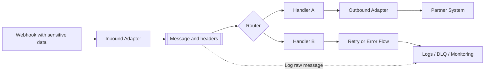
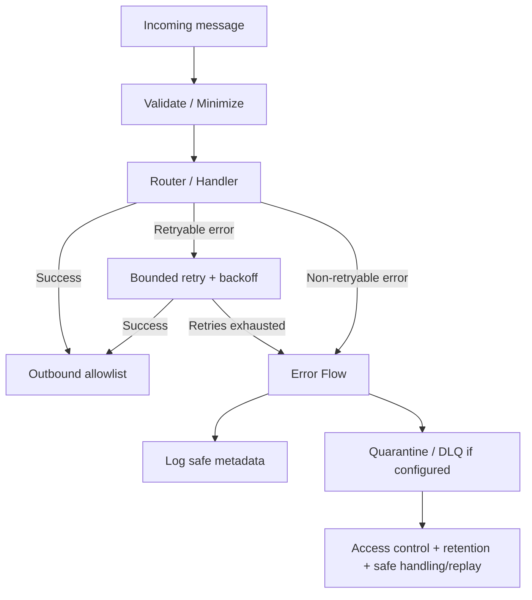

# Do not put sensitive data in headers or logs

In an integration system, a message does not merely travel from sender to receiver. It can also pass through **Message Channels**, Routers, Filters, Transformers, Splitters, Aggregators, Gateways, HTTP/Kafka/RabbitMQ adapters, retry flows, and **error channels**. Each point has the potential to read, copy, forward, or record part of the message. Consequently, sensitive information accidentally placed in headers or logs can spread to far more systems than intended.

An important principle when learning **`SPRING_INTEGRATION_PATTERN`** is: **do not place secrets or personal data in `MessageHeaders` or logs unless the flow truly needs them; strictly avoid logging access keys, passwords, tokens, and sensitive payloads**. If a protocol requires an authentication header, manage it **right at the secure communication boundary** rather than copying it indiscriminately into internal message headers or headers forwarded to other systems.

This lesson belongs to the **Message system** chapter, focusing on data boundaries of `Message`, `headers`, logging, and observability. The techniques below relate directly to Spring Integration's Router, Filter, Transformer, Splitter, Aggregator, Gateway, retry, error channels, and correlation.

## 1. Learning objectives

After this lesson, you can:

1. Distinguish internal `MessageHeaders` from HTTP headers, Kafka headers, and data placed in payloads.
2. Explain why headers and logs are not safe default places to store sensitive data.
3. Design headers using an **allowlist** rather than copying all inbound metadata.
4. Write logs for operational observability without exposing business contents or authentication secrets.
5. Recognize leakage risks through error flows, retries, DLQs, tracing, and correlation.
6. Write checks ensuring sensitive data never crosses unauthorized boundaries.

## 2. The problem: headers and logs often travel farther than you think

Suppose an application receives a payment-update webhook with the following content:

```json
{
  "eventId": "evt-901",
  "orderId": "ord-1024",
  "paymentStatus": "SUCCESS",
  "customerEmail": "customer@example.invalid",
  "sessionToken": "<SECRET-DO-NOT-LOG>"
}
```

This is purely illustrative data, not real information. In a good design, having both `customerEmail` and `sessionToken` in a payment-update event **already warrants reconsideration**: receivers may not need them. A common mistake is copying these two fields into headers so every handler can access them, then logging the raw `Message<?>` whenever debugging.

```java
// DO NOT DO THIS: illustrates a security mistake only.
Message<?> message = /* incoming message */ null;

// logger.info("Received: {}", message); // May print both payload and headers.
// logger.error("Failed message: {}", message); // Easily leaks info on errors.
// MessageBuilder.fromMessage(message)
//     .setHeader("customerEmail", "...")
//     .setHeader("authorization", "Bearer ...");
```

That information may end up in:

- application logs, centralized logs, incident analytics, or alerts;
- error data (`ErrorMessage`, exceptions wrapping failed messages) and retry paths;
- headers mapped by adapters onto external protocols;
- message copies in publish–subscribe branches or Splitter outputs;
- messages retained in queues, message stores, or dead-letter queues;
- trace attributes, baggage, MDC, or snapshots captured for technical support.

Not every flow automatically copies every header to every destination. **Actual behavior depends on the endpoint, adapter, header mapper, and configuration**, so verify at every boundary. Still, the more places a value is visible, the wider the risk exposure.



**The best control point sits as close to ingress as possible**, and must be **re-verified before egress**. Stripping data only at the very end of the flow may be too late: intermediate steps may have already logged or broadcast it.

## 3. What counts as “sensitive data”?

Sensitivity depends on the system and processing purpose. The table below helps determine which fields should be blocked, minimized, or specially protected.

| Data category | Examples | Principle |
| --- | --- | --- |
| **Authentication secrets** | Passwords, access/refresh tokens, API keys, session cookies, private keys, client secrets. | **Never log**; avoid putting in message headers; store in a secret manager or adapter auth mechanism when needed. |
| **Personally identifiable information** | Emails, phone numbers, addresses, ID numbers, medical records. | Collect/forward only for an explicit purpose; avoid in headers and logs; restrict who/what can read it. |
| **Sensitive financial data** | Card numbers, security codes, account info, detailed transaction data. | Never log details; apply domain-appropriate standards and controls, preferring safely managed reference IDs or tokenization. |
| **Confidential business data** | Internal pricing, contracts, strategic inventory, partner customer data. | Route only to authorized destinations; never put in shared tags/headers for “easy debugging.” |
| **Identity-linkable metadata** | `orderId`, `userId`, IP, device ID, customer-linked correlation ID. | Not harmless by default. Use opaque identifiers, minimize detail, enforce retention limits, and restrict access. |
| **Routine technical metadata** | `eventType`, schema version, processing step name, standardized error code. | Usually safer for headers/logs **provided it does not accidentally encode sensitive data**. |

Do not treat “hashed” or “partially masked” as automatically safe. Unkeyed hashes of emails/phone numbers are vulnerable to dictionary attacks; pseudonymous IDs can still link back to real profiles. Collecting only the minimum required data is always safer than collecting broadly and trying to mask it later.

## 4. Distinguish header types before setting policy

In Spring integration, the word **header** can refer to different concepts:

| Header type | Where it lives | Examples | Risks |
| --- | --- | --- | --- |
| **Spring Messaging `MessageHeaders`** | Metadata alongside the `Message<?>` payload in the JVM or across flows/adapters. | `id`, `timestamp`, `replyChannel`, `errorChannel`, `correlationId`, custom headers. | Handlers/endpoints can read it; some headers may be forwarded/stored/logged depending on configuration. |
| **HTTP request/response headers** | HTTP protocol boundary. | `Authorization`, `Cookie`, `Content-Type`, `X-Request-ID`. | Tokens/cookies can leak via access logs, proxies, tracing, or copying into internal messages. |
| **Broker/transport headers** | Metadata mapped onto Kafka/RabbitMQ/JMS or other transports. | Event type, correlation key, selected application headers. | May be stored alongside the record/message and accessed by consumers, ops tools, or replay readers. |
| **MDC/trace attributes/baggage** | Diagnostic/logging/tracing context. | `traceId`, `spanId`, `tenant`, custom baggage. | Replicated into logs, trace backends, or propagated to other services; must control cardinality and access. |

**An exception to understand properly:** HTTP commonly needs `Authorization` or cookies to authenticate at the **edge**. The rule “do not put sensitive data in headers” in this lesson **does not require removing legitimate HTTP authentication**. It requires not pulling that token/cookie into internal `MessageHeaders`, forwarding it to unrelated partners, or writing it to logs. When calling external services, let a securely configured connector attach the required credentials just in time rather than carrying tokens through the entire integration flow.

### 4.1. MessageHeaders is not a secret vault

In Spring Messaging, `Message<T>` has `getPayload()` and `getHeaders()`. `MessageHeaders` provides metadata for routing, correlation, replies, and processing. Even though the API lets you set custom values, **being able to write a field into a header does not mean it belongs there**.

Two common design mistakes are:

1. **Convenience access:** “Attach `customerEmail` to a header so any Router/Handler can read it.” This multiplies places holding personal data; if customer lookup is needed, consider a controlled reference key or a dedicated business service.
2. **Convenience authentication:** “Attach `accessToken` to a header so any adapter can use it.” This can accidentally pass System A's credentials to System B. Choose credentials per **target destination and permissions** at the corresponding adapter.

### 4.2. Headers can be mapped across adapters

Inbound/outbound adapters typically have rules converting between transport metadata and internal `MessageHeaders`. Header mappers, allow/block patterns, and configuration options vary by protocol, version, and adapter.

For example, **HTTP `Authorization` on an inbound request** should not become an application header forwarded to Kafka or an ERP. At ingress, authenticate and determine identity/permissions per security design. Then pass only the **authorized outcome** (or a safe reference) into the integration layer. At egress, explicitly map only headers required by the receiver's contract.

Therefore, inspect **both sides of an adapter**: what data is imported into the message, and what data from the message is exported to the transport.

## 5. Safe pattern: minimize payloads and allowlist headers

Instead of taking an inbound `Message<?>` and forwarding all its headers, create a **new outbound message** from an approved data contract.

### 5.1. Java example: creating a new message with allowed headers

Suppose an internal layer has customer info and a session token for an earlier business reason. The partner receiving order status **needs only the status and an approved reference code**.

```java
import java.util.UUID;
import org.springframework.messaging.Message;
import org.springframework.messaging.support.MessageBuilder;

// Simplified records to illustrate building an outbound contract.
record InternalOrderEvent(
    String partnerOrderRef,
    String status,
    String customerEmail,
    String accessToken,
    UUID correlationId
) {}

record PartnerOrderEvent(String partnerOrderRef, String status) {}

final class PartnerMessageFactory {

    Message<PartnerOrderEvent> create(InternalOrderEvent input) {
        PartnerOrderEvent publicPayload = new PartnerOrderEvent(
            input.partnerOrderRef(),
            input.status()
        );

        return MessageBuilder.withPayload(publicPayload)
            .setHeader("eventType", "order.status.changed")
            .setHeader("correlationId", input.correlationId().toString())
            .build();
    }
}
```

Conditions for this example to be truly safe:

- `partnerOrderRef` **has been approved by the sharing contract**; never assume internal order IDs are automatically public.
- `correlationId` is an opaque UUID, **not derived directly from email/phone/token**; it is still metadata that must be managed because it can link traces.
- `customerEmail` and `accessToken` do not appear in `PartnerOrderEvent` or outbound headers.
- `MessageBuilder` creates a brand-new message rather than copying **all** headers from the received message. Technical headers like message `id`/`timestamp` are still supplied by the framework.
- If credentials are needed to call an ERP, the HTTP/AMQP/Kafka component at the **outbound boundary** manages separate credentials tailored to that target system.

> **Allowlist is safer than denylist:** If you only remove `authorization` yet forget `x-api-key`, `cookie`, `sessionToken`, or a new header added by another team, secrets can still slip through. At critical trust boundaries, **reconstruct only explicitly allowed fields**.

### 5.2. When you must forward an existing message

Spring Messaging allows `MessageBuilder.fromMessage(original)` to create a message based on an existing one, then modify or remove headers. This technique is useful for internal processing, yet **is not a primary control at security boundaries** because unforeseen headers could remain.

```java
// Only a supplemental measure for an already data-classified flow.
Message<?> sanitized = MessageBuilder.fromMessage(original)
    .removeHeader("authorization")
    .removeHeader("cookie")
    .removeHeader("x-api-key")
    .build();
```

The snippet above **is insufficient to prove safety**: `customerEmail`, `sessionToken`, other custom headers, or a sensitive payload could still exist. At outbound boundaries, prefer the **new payload + allowed headers only** pattern shown in the previous section. If an adapter supports header-mapping lists, configure and verify them there as well.

## 6. Safe logging: record *operational events*, not *secret contents*

Logs are useful when answering “which step did the message pass through, did it succeed or fail, and how long did it take?”. Answering those questions rarely requires printing entire payloads/headers.

### 6.1. Dos and don'ts examples

```java
// DO NOT: the object may contain PII, tokens, or contract data.
// log.info("message={}", message);
// log.debug("headers={}", message.getHeaders());
// log.error("payload={}", message.getPayload());

// DO: event type is an approved constant, correlation ID is an opaque UUID.
log.info(
    "integration_event type={} component={} outcome={} correlationId={}",
    "order.status.changed", "orderRouter", "accepted", correlationId
);
```

In the safe example, `log` is an SLF4J logger and `correlationId` is a UUID generated/validated by the application. The snippet illustrates logging logic, not a standalone runnable class. **Never pass unvalidated input** into `component`, `eventType`, or error codes: it could contain sensitive data, control characters, or cause unbounded metric label cardinality.

### 6.2. What should you log?

| Useful for operations | Avoid in default logs |
| --- | --- |
| Predefined event code (`order.status.changed`). | Unfiltered JSON/XML contents, `Message.toString()`. |
| Stable endpoint/flow or branch name. | Tokens, passwords, cookies, API keys, private keys. |
| Processing outcome (`accepted`, `discarded`, `retry_scheduled`, `failed`). | Emails, phone numbers, addresses, raw payment info. |
| **Standardized** error code (`TIMEOUT`, `BAD_SCHEMA`). | Arbitrary exception messages that may contain URL tokens or request bodies. |
| Duration, retry count, queue depth, Aggregator item count. | Full copies of partner requests/responses. |
| Opaque, access-controlled correlation/trace ID. | Sensitive business IDs in every log line or metric tag. |

One way to structure a log entry:

```text
event_type=order.status.changed
component=ordersRouter
branch=priority
outcome=accepted
correlation_id=8dfd1939-6cab-4c6b-abaf-a0649615102e
duration_ms=12
```

No `customerEmail`, token, or payload appears in the log line. The UUID is a synthetic example, not representing a real user. Even opaque IDs still need retention limits and access controls because they can correlate activities.

### 6.3. Masking is not the sole primary strategy

Masking helps for data that must appear in certain logs for security or legal reasons, yet it has significant limitations:

- Data can appear in many representations: JSON, URL queries, HTTP headers, exception strings, nested payloads.
- New tokens, new field names, or encoded/base64 data can bypass filters.
- Library loggers, proxies, and APM tools may capture data **before** the application's masking step.
- Records ingested by a logging platform may be copied, backed up, or shared outside the owning team.

Therefore, the priority order is usually **do not collect → do not put in messages/logs → minimize → mask → encrypt/restrict access/limit retention**. Log filters are just one defense layer, not a substitute for minimizing data at the source.

## 7. Spring Integration: common leak points in a flow

### 7.1. Router and Filter

A Router can classify based on **controlled metadata** such as `eventType`, tenant, or permitted priority levels. Do not attach emails, personal names, or access tokens to headers just to make routing convenient.

A Filter can catch a message **not permitted for processing**, yet a mid-flow Filter **cannot erase logs** or copies created earlier. If the payload carries sensitive data unnecessary for the flow, strip it at inbound mapping or convert to a minimal DTO right at ingress.

### 7.2. Transformer

A Transformer is an appropriate place to convert from an **internal event** to a field-restricted **outbound contract**. However, do not mistake renaming fields for protection. `customerEmail` renamed to `contact` is still an email; a base64-encoded token is still a token.

### 7.3. Splitter and Aggregator

A Splitter can create many child messages; correlation and sequence metadata help assemble groups. If sensitive info is attached to headers, **it risks riding along on every child message**, depending on how the framework/flow constructs messages. Duplication multiplies storage locations and exposure points.

An Aggregator may temporarily store messages/groups in memory or a message store; if durability across restarts is needed, persisting to a database opens an extra **storage boundary** to protect. When emitting results, review which headers are inherited/merged by the active strategy so unnecessary headers do not leak into the output.

**Do not use emails or tokens as correlation IDs.** Generate an opaque key and store the mapping from key to business entity in an access-controlled store. Even an `orderId` can be sensitive if it lets someone infer a customer or transaction.

### 7.4. Gateway and Adapter

Gateways/adapters are where a message crosses a **trust boundary**. For example:

- **Inbound HTTP:** validate headers via security mechanisms and convert needed data into a message; do not copy `Authorization`/`Cookie` into every internal message.
- **Outbound HTTP:** attach credentials for the **right partner** at a secure client/adapter layer; do not reuse the caller's source token without an explicit delegation mechanism.
- **Kafka/RabbitMQ/JMS:** audit header mappings, ACLs, encryption, retention, and message inspection tools; do not assume broker headers are secret simply because they are outside the payload.
- **File/DB adapter:** check data written to files, staging tables, message stores, error tables, and backups.

A header **allowed internally** is not necessarily allowed to cross onto an external transport. Check **per-destination allowlists** instead of sharing one configuration across all partners.

## 8. Error channel, retry, and DLQ: risks when flows fail

An often overlooked detail is that **failure paths can expose more data than happy paths**.

In Spring Integration, errors in some flows can be represented as an `ErrorMessage`; its payload is usually an exception, and some `MessagingException`s can carry `failedMessage`. Depending on the endpoint/configuration, errors in synchronous flows can also be thrown straight back to the caller rather than going through an error channel. Thus both **synchronous and asynchronous error paths** require data policies.

### 8.1. Risky ways to log errors

```java
// DO NOT: logging patterns that can expose failedMessage or payloads.
// log.error("Integration failed: {}", errorMessage);
// log.error("Failure details", exception); // Stack trace/exception message may contain data.
// log.warn("Retrying input: {}", failedMessage);
```

This does not mean **banning stack traces completely**: incident diagnosis may require stack traces in a protected environment. However, before logging an exception/stack trace, verify whether it contains headers, URLs, request bodies, SQL parameters, or partner responses; apply classification, secret scrubbing, access control, and retention. In routine operational logs, prefer **standardized error codes, component names, status, and opaque correlation IDs**.

### 8.2. Error workflows should clearly express boundaries



This diagram is **a target design**, not default behavior Spring Integration adds to every flow automatically. If a DLQ must retain payloads for replay, messages in the DLQ can still **be sensitive**, requiring encryption, access controls, retention/deletion policies, and monitoring. Never solve the problem by dumping the entire payload into logs and deleting it from the DLQ.

### 8.3. Retries multiply data exposure

A message retried five times can produce five log lines containing the same token if using `log.debug("Retrying {}", message)`. Log `attempt`, `retryPolicy`, `reasonCode`, `endpoint`, and an opaque ID—never the raw input on every attempt.

Idempotency is another concern: retries can cause **duplicate side effects**. You need a stable key and an appropriate state-checking store. Never use session tokens or customer personal info as idempotency keys. If using an event ID or transaction ID, classify its sensitivity and protect it in logs/headers as needed.

## 9. Tracing, MDC, metrics, and correlation also need data minimization

A common mistake is **avoiding PII in direct logger calls yet placing PII into trace baggage or MDC**, which the tracing backend then attaches to thousands of spans/logs.

### 9.1. Distinguishing four identifier types

| Identifier | Purpose | Notes |
| --- | --- | --- |
| **Message ID** | Identifies a message at the technical layer. | Can change when rebuilding messages; not a default idempotency key. |
| **Correlation ID** | Connects messages/steps of the same request or group. | Prefer opaque values; never use emails/tokens; may be propagated and persisted. |
| **Business ID** | Identifies a business entity such as an order or account. | Can be sensitive personal/business data; not needed in every log. |
| **Trace/span ID** | Tracks a distributed processing flow. | Should not carry payloads; restrict baggage and attributes holding identifying info. |

With Splitter/Aggregator, Spring Integration can use correlation and sequence headers to manage groups. If adding custom correlation fields, **define who creates them, how long they are kept, and whether adapters export them**. A random ID does not guarantee anonymity if a central system maps it back to a user.

### 9.2. Choosing metric labels properly

Metrics should have labels with **bounded cardinality**, such as `flow=orderRouting`, `branch=priority`, `result=success/error`. Never use `email`, `accessToken`, `orderId`, or per-request UUIDs as **metric labels**: it both leaks information and causes *high cardinality*, increasing cost and load on the monitoring system.

For logs/traces, record an opaque correlation ID only when needed for troubleshooting and backed by appropriate access control. Aggregate metrics usually **do not need** a correlation ID.

## 10. Defense in depth, not just a single header-stripping step

Treat data safety as an end-to-end integration responsibility:

| Control layer | Concrete actions |
| --- | --- |
| **Ingress** | Authenticate/authorize, validate schema, reject unnecessary fields or map to a minimal DTO. |
| **Message contract** | Define payload and `MessageHeaders` allowlists per flow. |
| **Router/Transformer** | Use only suitable metadata; never duplicate secrets; enforce output contracts. |
| **Outbound adapter** | Map only allowed headers; attach destination-specific credentials through secure mechanisms. |
| **Logging/Tracing** | Structured logging, approved event types/error codes, supplemental masking, no raw message logging. |
| **Retry/Error/DLQ** | Never log raw failed messages; enforce access control, appropriate encryption, retention, and controlled replay. |
| **Storage and operations** | ACL/RBAC, encryption in transit/at rest where required, credential rotation, retention limits, and access audits. |
| **Automated testing** | Verify adapter outputs and logs across success/error/retry scenarios. |

### 10.1. Do not forget third-party libraries and debug settings

A team may write safe loggers, yet proxies, HTTP clients, broker clients, or APMs can log full requests/responses when verbose logging is enabled. When deploying:

- Audit request/response logging, interceptors, wire logging, and tracing instrumentation settings.
- Never turn on global DEBUG/TRACE in production without knowing what data will be recorded.
- Never send real payloads containing PII to test environments or broadly shared dashboards without authorization and controls.
- Review which tools can read logs, DLQs, message stores, and traces; grant access on a need-to-know basis.
- When secret exposure is detected, execute an incident response plan including revoking/rotating credentials, restricting access, and remediating affected records; masking new logs alone does not fix old records.

## 11. Testing: proving data does not cross boundaries

Policies are only trustworthy when backed by tests. A minimum test suite covers:

1. **Happy path:** Outbound Message contains only permitted payload and headers.
2. **Messages with extra unexpected headers:** `authorization`, `x-api-key`, `customerEmail`, `sessionToken` do not cross the boundary.
3. **Payloads with sensitive fields:** Mapper constructs the outbound DTO with only contract-approved fields.
4. **Error paths:** Filter rejection, Transformer failure, and outbound timeout do not log raw messages or exception messages containing secrets.
5. **Retry:** N attempts do not produce N records containing payloads/credentials.
6. **Splitter/Aggregator:** Allowed metadata is maintained for correlation; unwanted headers are neither broadcast nor merged back into the output.
7. **Real adapters:** Inspect actual messages sent over HTTP/Kafka/RabbitMQ, not just Java objects prior to the adapter.
8. **Tracing/metrics:** No labels or baggage contain emails, tokens, or sensitive order IDs.

### 11.1. Simple unit test for an outbound mapper

The following JUnit 5 snippet continues `PartnerMessageFactory`, `InternalOrderEvent`, and `PartnerOrderEvent` from above:

```java
import static org.junit.jupiter.api.Assertions.*;

import java.util.UUID;
import org.junit.jupiter.api.Test;
import org.springframework.messaging.Message;

class PartnerMessageFactoryTest {

    @Test
    void outboundDoesNotContainSecrets() {
        UUID correlation = UUID.randomUUID();
        InternalOrderEvent input = new InternalOrderEvent(
            "partner-ref-37", "SUCCESS",
            "customer@example.invalid", "TOP_SECRET_TEST_VALUE", correlation
        );

        Message<PartnerOrderEvent> out =
            new PartnerMessageFactory().create(input);

        assertEquals("partner-ref-37", out.getPayload().partnerOrderRef());
        assertEquals("SUCCESS", out.getPayload().status());
        assertEquals("order.status.changed", out.getHeaders().get("eventType"));
        assertEquals(correlation.toString(), out.getHeaders().get("correlationId"));

        assertFalse(out.getHeaders().containsKey("authorization"));
        assertFalse(out.getHeaders().containsKey("customerEmail"));
        assertFalse(out.getHeaders().containsKey("accessToken"));
        assertFalse(out.toString().contains("TOP_SECRET_TEST_VALUE"));
        assertFalse(out.toString().contains("customer@example.invalid"));
    }
}
```

This is a **unit test for the mapper**, not proof that the entire system is safe: you must add tests for adapters, log appenders, error flows, message stores, and tracing if those components exist in the system. Do not turn a `toString()` assertion into the sole guarantee either: values can still leak via serialization or logging at another step even when `toString()` is masked.

### 11.2. Testing logs and error flows

Use a test appender or the test framework's log-capture mechanism to inject a **synthetic sentinel** like `TOP_SECRET_TEST_VALUE` into a request, then trigger success, schema error, and timeout/retry. After each scenario, verify that value **does not appear** in captured logs, tracing test exporters, or outbound contents. Use fake data—never use production secrets to test for leaks.

At the same time, verify **needed observability still appears**: `eventType`, endpoint, outcome, error code, and permitted correlation ID. Simply turning off all logging might temporarily reduce security exposure, yet leaves operations blind.

## 12. Practice scenarios and self-check questions

### Scenario A — Router needs to identify VIP customers

A team proposes putting `customerEmail` in a header so the Router can query VIP status.

**Approach:** Place the VIP decision in an appropriate business/authorization component and pass the Router **an authorized classification result** (such as a normalized `priorityTier`); or use an opaque reference ID and an authorized lookup service if truly required. Never broadcast emails just for Router convenience.

### Scenario B — HTTP Authorization received at inbound gateway

A security system needs `Authorization: Bearer ...` to authenticate webhooks. Must we strip the HTTP header at the network layer so the request cannot even authenticate?

**No.** Valid authentication headers are processed at the **receiving edge**; this lesson's rule is not to **copy** that token into internal `MessageHeaders`, logs, or unrelated outbound headers. Authentication/authorization decisions can be represented safely under a separate contract.

### Scenario C — Retries produce too many logs

An adapter calling an ERP times out. The system retries three times, each time running `log.warn("retry {}", message)`.

**Issue:** Data may be logged repeatedly, including payload and headers. Replace it with logging `endpoint`, `errorCode=TIMEOUT`, `attempt`, and an opaque `correlationId`; handle exceptions and credentials under separate policies. Also check the case where the ERP already completed the action yet the response was lost before retrying.

### Scenario D — Aggregator receives replies containing an unexpected header

Three child messages from partners have different headers, including `x-session-token`. If the Aggregator emits the result to a fourth partner, can we assume the token is gone?

**No.** Check how the output message/result is built, the header merge strategy, and adapter configuration. Build a new output message with an allowlist at the outbound boundary; test cases with unexpected headers, duplicate headers, and late replies.

### Scenario E — “Hashing the email before logging is fine”

A team wants to log `SHA-256(email)` as the correlation ID and metric label.

**Do not assume so.** Emails have a predictable value space; unsalted hashes can be reversed via lookup tables. Furthermore, a per-user metric label causes high cardinality. Use an opaque, random/properly managed correlation ID; if mapping back to a customer is required, keep the mapping in an access-controlled store with minimal retention per policy.

## 13. Pre-release review checklist

| Check | Desired answer |
| --- | --- |
| Does every step's payload truly need all fields? | No; DTOs/contracts are minimized or have clear justification. |
| Are headers allowlisted for inbound/outbound? | Yes, per specific trust boundary and adapter. |
| Are there tokens, cookies, emails, or passwords in `MessageHeaders`? | No, barring an explicit, controlled, approved exception. |
| Does the logger print raw `Message`, headers, request bodies, or raw exceptions? | Not by default; exceptions are access-controlled and handled safely. |
| Do error flows/retries/DLQs follow the same data policy as the main flow? | Yes, covering storage, encryption, retention, access, and replay. |
| Do correlation/tracing use opaque IDs and minimal metadata? | Yes; no PII/secrets in baggage or metric labels. |
| Are there sentinel tests for success, failure, retry, and outbound? | Yes; verifying both logs and actual adapter output. |
| When a leaked secret is discovered, is there an incident response plan? | Yes: revoke/rotate, restrict access, investigate, and remediate storage. |

## Conclusion

In **Spring Integration**, `MessageHeaders` serves **message orchestration and correlation**, while logs, tracing, and metrics serve **operational observability**. They are **not secret vaults**. Sensitive information put into headers/logs can be copied across Routers, Splitters, Aggregators, Gateways, adapters, retries, error channels, or monitoring systems—sometimes many times over and beyond intended access boundaries.

The practical rule is **minimize data at ingress, construct new outbound contracts via allowlists, never log raw messages, use opaque correlation IDs, manage authentication at boundaries, protect error/DLQ stores, and test both success and failure paths**. The goal is not a system with “no logs,” but an integration flow that is **secure, testable, observable, and troubleshootable** without trading away user or partner secrets.
