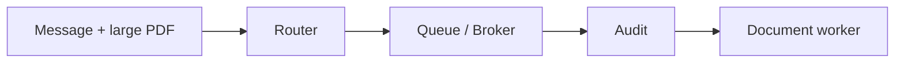
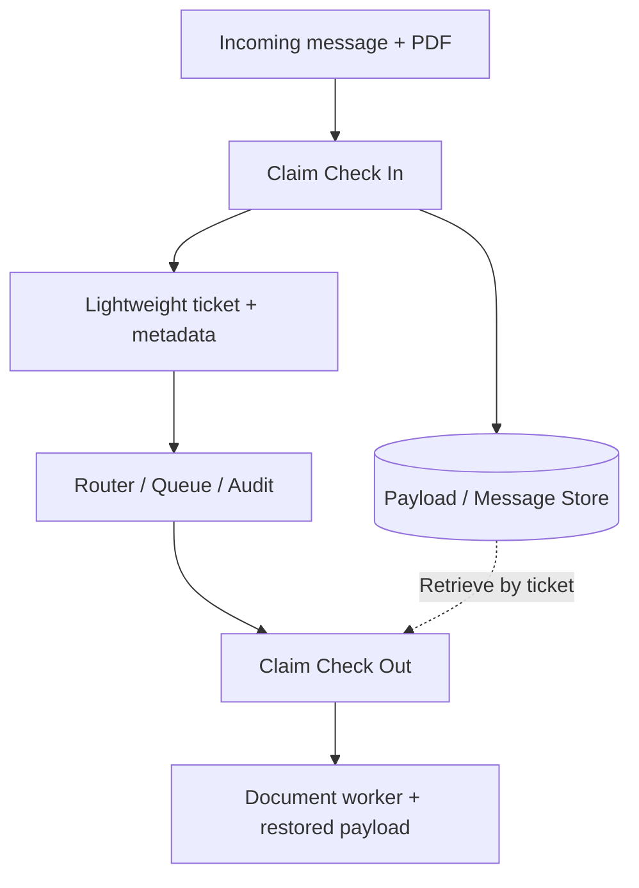
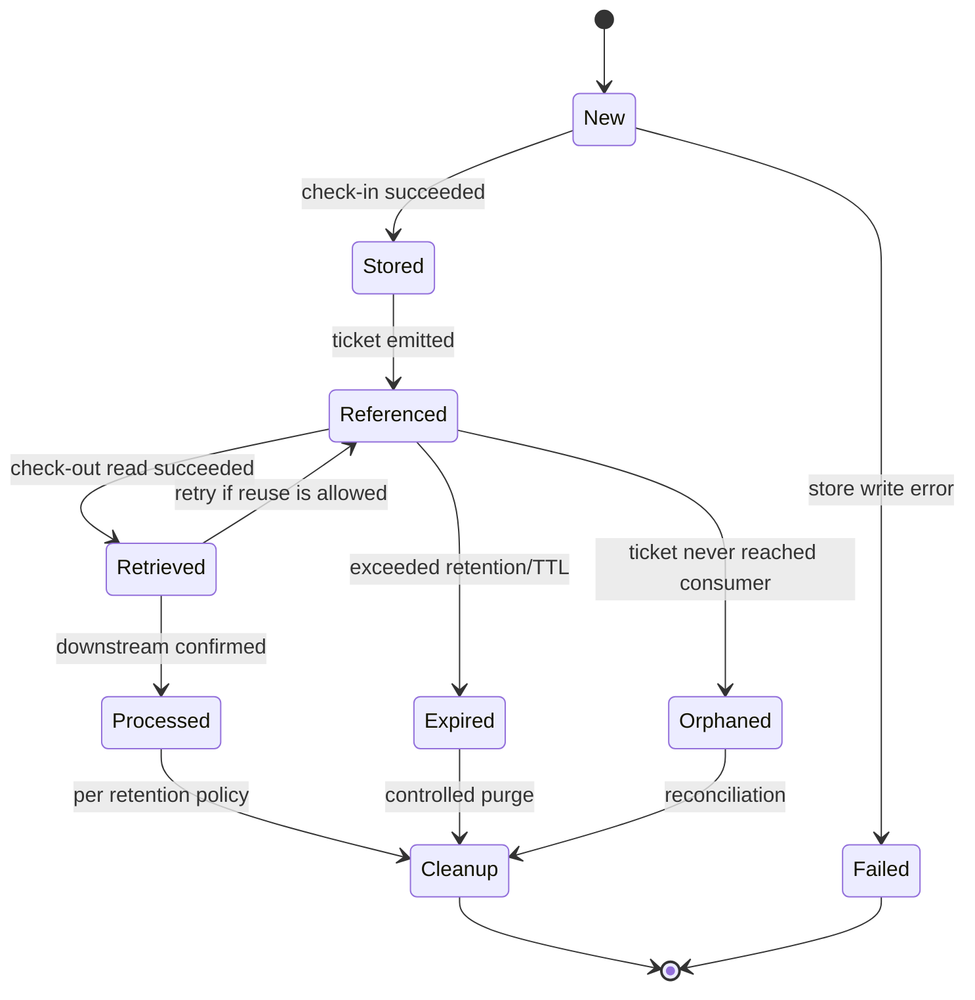
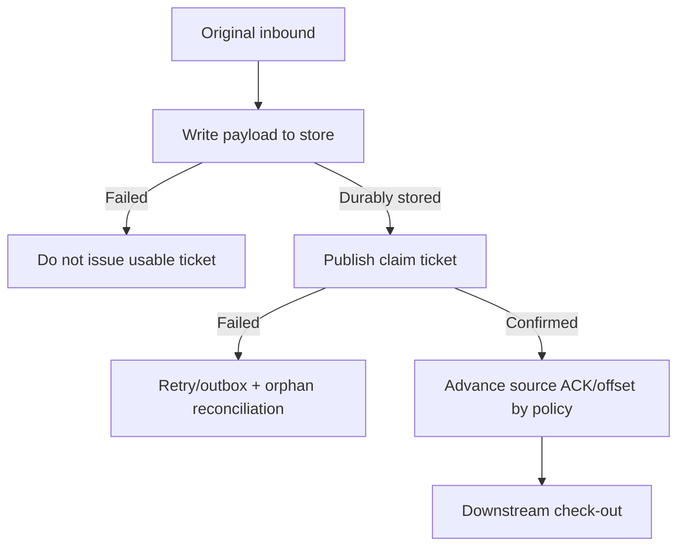
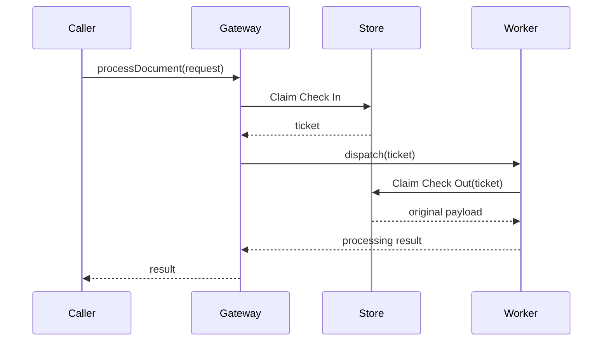
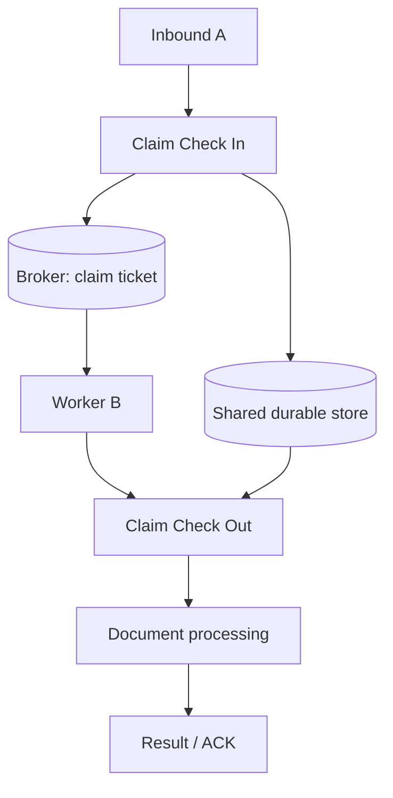
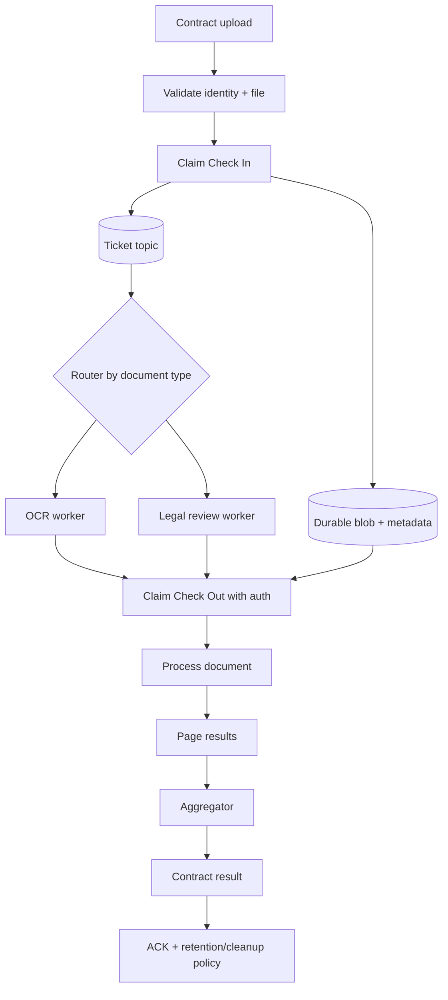

# Claim Check stores payload outside the message

In an integration system, not every message is small. An event may contain a PDF file, an image, an identity document, reconciliation data, or a very large list of transactions. If the entire payload is sent through multiple Routers, Filters, Queues, Gateways, and adapters, each intermediate point may have to hold, copy, serialize, or transmit data that it **does not need to read**. When the data is large or sensitive, doing so increases pressure on memory, network, broker, logs, and data exposure surface.

**Claim Check** is an Enterprise Integration Patterns (EIP) pattern that helps **decouple large data from the orchestration flow**. Instead of passing the entire payload through every step, the application **stores the data in a repository**, replaces the payload in the flow with a **lightweight reference (claim check/ticket)**, and **restores the data** at the step that actually needs it. The model is typically described by two operations: **Claim Check In** and **Claim Check Out**.

The lesson **“Claim Check stores payload outside the message”** belongs to the **Claim check** chapter of the `SPRING_INTEGRATION_PATTERN` module. The goal of this module is to learn how to implement Enterprise Integration Patterns with Spring Integration to build loosely coupled, extensible message flows; practicing Router, Filter, Transformer, Splitter, Aggregator, Gateway, retry, error channel, correlation, and testing/monitoring processing branches.

**After this lesson, you will be able to:**

- Explain why Claim Check is **not** data compression or automatic delivery durability.
- Distinguish between **original payload**, **message envelope**, **claim ticket**, **`MessageStore`**, and external object store.
- Design the lifecycle **check-in → transmit ticket → check-out → process → cleanup** accounting for errors and retries.
- Write a Spring Integration example using `MessageStore`, `@Transformer`, channels, and JUnit 5 to verify restored data.
- Analyze transactions, idempotency, retention/TTL, access permissions, encryption, size limits, and data loss risks.
- Test store failure, non-existent claim, duplicate ticket, expired claim, multiple instances, and recovery after restart.

## 1. The problem: messages too large for intermediate steps' responsibilities

Suppose the system receives a contract verification request:

```text
ContractSubmitted
  contractId = "CTR-101"
  tenantId   = "TENANT-A"
  document   = <4 MiB binary PDF>
  priority   = "NORMAL"
```

The flow needs to perform these steps:

1. Check the document type and tenant permissions.
2. Route according to the contract group.
3. Write an audit log and push the request to a processing queue.
4. Run OCR/validation when it reaches the appropriate worker.
5. Return the result or emit a completion event.

The **Router** only needs `priority`, `tenantId`, and document type; the **Audit handler** only needs the ID and status. Forcing every step to carry a 4 MiB PDF increases cost without adding value to those steps.



With Claim Check:



The strength is that intermediate steps only carry **the reference and necessary metadata**, instead of the original PDF. This **does not guarantee** that the payload will be protected, persisted, or restored properly if the store, access control, and lifecycle are not designed carefully.

### What does Claim Check solve?

| Problem | What Claim Check can help with | What it does not solve on its own |
| --- | --- | --- |
| Large payload passing through many channels/adapters | Transfers payload via a lightweight reference. | Store read/write speed, reload latency, or store capacity exhaustion. |
| Intermediate steps do not need original content | Limits unnecessary data transmission. | Authorization, protecting references, or sensitive logs. |
| Broker limits message size | Moves payload outside the broker and sends only a ticket. | Guaranteeing atomicity between the store and the broker. |
| Payload needs to be kept for later processing | Can use a persistent store. | Retention, TTL, backup, cleanup, transactions. |
| Multiple workers need the same data | Uses a shared store and an appropriate access grant mechanism. | Atomic claim, deduplication, exactly-once side effects. |

**Principle:** Claim Check **changes the shape of data in transit**; it does not replace storage or delivery contracts.

## 2. Concepts and boundaries: check-in, ticket, check-out

A Claim Check flow has three main components:

- **Claim Check In:** receives a message containing large data, writes the payload or entire message to a store, and returns a ticket referencing the stored data.
- **Claim ticket:** a small reference identifier, often accompanied by business metadata so Routers/Filters can process it without opening the payload.
- **Claim Check Out:** receives the ticket, looks up the store, retrieves the payload/message, and passes it to the component that actually needs the content.

```text
Before:
  Message<ContractDocument> {
    payload = large binary content
    headers = { tenantId, traceId, correlationId, ... }
  }

After check-in:
  Message<ClaimTicket> {
    payload = claimId / reference
    headers = { tenantId, contentType, businessRoute, ... }
  }

After check-out:
  Message<ContractDocument> {
    payload = restored content
    headers = contract-aware metadata
  }
```

This is a **conceptual model**. With Spring Integration, Claim Check transformers can use `MessageStore` to store the **message** and return a **reference/ID**, whereas a custom object-store design might store only bytes and selected metadata. Do not assume every Claim Check implementation stores the exact same structure or propagates every header verbatim.

### A ticket is not an “access pass”

The name *claim check* evokes a baggage claim ticket: anyone holding the ticket can demand the item back. In software systems, **merely possessing a ticket must not be treated as sufficient authorization** to read a document. When data is sensitive, check-out must verify the tenant, service identity, access rights, expiration, and scope of use.

Do not let a client pass an arbitrary ID and retrieve content from the store without authorization.

## 3. Should you store the entire Spring Message or only the payload?

There are two variants worth distinguishing.

### 3.1. Store the entire `Message<?>` in `MessageStore`

A Spring message contains `payload` and `headers`. `MessageStore` in Spring Integration provides operations to store/read messages by ID. This is a suitable foundation when using Claim Check with built-in framework components.

```text
MessageStore:
  key = original message ID (UUID)
  value = Spring Message<?> { payload, headers }
```

**Pros:** easy to restore the payload along with saved headers, convenient in internal flows. **Risks:** some headers may be non-serializable objects or unsuitable for persistent storage, such as internal channel references, credentials, or sensitive metadata.

### 3.2. Store payload/bytes in an object store

Another architecture stores data in a separate object storage/DB and sends a ticket containing `objectKey`, `contentType`, `checksum`, `size`, `tenantId`, and a lifetime policy.

```text
Object store:
  key = claims/TENANT-A/opaque-random-key
  value = PDF bytes

Metadata store:
  claimId, tenantId, objectKey, checksum, status, expiresAt
```

**Pros:** suitable for large blobs, supports independent data lifecycle/retention. **Risks:** you must implement mapping, consistency between metadata and bytes, recoverability, authorization, cleanup, and checksums yourself.

| Criterion | `MessageStore` storing message | Object store + metadata |
| --- | --- | --- |
| Storage unit | Entire `Message<?>` or a representation of the message. | Byte payload/object and application-defined metadata. |
| Retrieval ID | Message/reference ID. | Claim ID/object key according to custom contract. |
| Header handling | Must check serializability and propagation. | Stores only selected headers/metadata. |
| Very large blobs | Depends on store/serializer; may not be optimal. | Usually more suitable if designed for blobs. |
| Durability | Depends on the store implementation. | Depends on object store + metadata store. |
| TTL/cleanup | Must have a separate policy. | Can combine object store lifecycle and a scheduler. |
| Atomicity with broker | Not provided automatically. | Not provided automatically either. |

**Note:** Having the `MessageStore` interface in the library does not mean you are using a **persistent** store. An in-memory `SimpleMessageStore` is suitable for demos/tests, but does not satisfy requirements where data must survive restarts.

## 4. Lifecycle of a claim

A claim does not merely have two states: “stored” and “retrieved”. In real systems, you need to know whether it is valid, has been used, has expired, or needs cleanup.



The states in the diagram represent an **application design model**, not a default Spring Integration enum.

| Event | Question to address |
| --- | --- |
| Check-in succeeded | Did the store **write durably** or only keep it in RAM? |
| Ticket emission | Was the ticket delivery to the broker confirmed? |
| Check-out | Single-read or re-readable on retry? |
| Downstream processing | Have side effects/ACK completed? |
| Message redelivery | Reuse the old ticket or create a new claim? |
| Expiration | Which error does an expired ticket return, and can it be recovered? |
| Cleanup | When can deletion happen without losing retry opportunities? |
| Restart | Do the store and metadata survive restarts? |

### Crucial boundary: retrieval differs from processing success

**Successfully reading a claim does not prove the payload was successfully processed.** If check-out deletes the data immediately, and then the document worker fails or the broker redelivers the ticket, the data may **no longer exist for retry**.

Therefore, for critical work, it is often necessary to **keep the data through the processing step** and delete it only after a designed confirmation point; or use a durable outbox/transaction/retention that permits recovery. Single-use semantics may require a **leased/claimed** state and atomic acknowledgment, rather than just `get` followed by `remove`.

## 5. How does Claim Check differ from Transformer, Enricher, and Content Filter?

| Pattern | Primary effect | Example |
| --- | --- | --- |
| **Claim Check** | Stores payload/message and passes a reference; includes a retrieval step. | PDF → ticket → PDF. |
| **Transformer** | Converts representation A into B. | `OrderPlaced` → `PaymentInstruction`. |
| **Content Enricher** | Augments payload data via lookup. | Adds `customerSegment` to an order. |
| **Header Enricher** | Adds metadata for routing/tracing. | Adds `documentType=PDF`. |
| **Filter** | Decides whether a message proceeds. | Accepts only eligible documents. |
| **Router** | Chooses target channel/handler. | `CONTRACT` → legal worker. |
| **Splitter** | Splits one payload into multiple child messages. | Multi-file batch → individual files. |
| **Aggregator** | Combines related messages into a joint result. | OCR results → batch summary. |

Claim Check often uses **Transformer-like endpoints** to turn a large payload into a reference and restore it later, but its **architectural purpose** is to control data size and storage location.

### What does a Router/Filter see in ticket form?

A Router before check-out **no longer has the full original payload to inspect**. It needs sufficient metadata for decisions such as `documentType`, `tenantId`, `priority`, or `businessRoute`.

```text
Large message
    |
    v
Validate trusted metadata
    |
    v
Claim Check In
    |
    v
Ticket + whitelisted routing metadata
    |
    +-- Router: CONTRACT -> legalReview
    +-- Router: INVOICE  -> financeReview
    |
    v
Claim Check Out at worker
```

Do not blindly copy every header onto the ticket. For example, if `replyChannel` is an in-JVM reference, it may be unusable in another process. If `tenantId` was sent by the client without authentication, routing and check-out **must not treat** it as proof of authorization.

## 6. A meaningful ticket contract

In a simple demo, the ticket can be the `UUID` of the stored Spring message. In multi-service systems, there should be an **explicit business envelope** rather than passing around an opaque, unexplained UUID.

```json
{
  "claimId": "opaque-claim-7f2a",
  "eventId": "evt-101",
  "tenantId": "TENANT-A",
  "documentType": "CONTRACT",
  "contentType": "application/pdf",
  "sizeBytes": 4194304,
  "checksumSha256": "<digest>",
  "storageVersion": "v1",
  "expiresAt": "2026-11-22T00:00:00Z"
}
```

This is a **suggested application-defined schema**, not a payload automatically provided by Spring Integration.

| Field | Purpose |
| --- | --- |
| `claimId` | Opaque reference to the data; contains no internal path exposing permissions. |
| `eventId` | Business key for tracing/deduplication across retries. |
| `tenantId` | Ownership context; **must be independently verified** at check-out. |
| `documentType` | Enables Routing without reading the PDF. |
| `contentType` | Declared data type; still must be validated after loading if sensitive. |
| `sizeBytes` | Size limit, memory protection, and resource estimation. |
| `checksumSha256` | Verifies that payload bytes remain intact. |
| `storageVersion` | Supports schema/format evolution of stored data. |
| `expiresAt` | Ticket/claim expiration time; does not replace a cleanup scheduler. |

A ticket **should not contain secrets** or long-lived presigned URLs issued indiscriminately. If a signed URL must be used, restrict its permissions, scope, and lifetime, and avoid logging the URL.

### Business ID is not message ID

`MessageHeaders.id` can change when reconstructing a message after replay. For idempotency when processing contracts, you need a durable `eventId`/`commandId` from the domain contract. You may use the message UUID as an **internal lookup ID in a demo**, but **must not assume it is always stable or safe enough to serve as a public capability token**.

## 7. Spring Integration: Claim Check In/Out and `MessageStore`

Spring Integration provides Claim Check transformers to store messages and restore them by reference. When using these built-in components, understand three points:

1. **Check-in** stores the message in the corresponding `MessageStore` and emits the reference information.
2. **Check-out** uses the reference to read back the message; depending on configuration, it may have a **remove after retrieve** policy.
3. **Store implementation determines durability**: in-memory is only in-memory; JDBC or another persistent store requires configuration aligned with transactions, schema, and serializers.

To clearly illustrate the boundaries and avoid relying on a specific overload across DSL versions, the code below **implements Claim Check logic directly using Spring Integration's `MessageStore` and `@Transformer`**. This is **an application implementation carrying Claim Check semantics**, not a requirement to replace built-in transformers in every project.

### 7.1. Service to store and retrieve messages

```java
import java.util.UUID;

import org.springframework.integration.store.MessageStore;
import org.springframework.messaging.Message;

final class ClaimCheckService {
    private final MessageStore store;

    ClaimCheckService(MessageStore store) {
        this.store = store;
    }

    UUID checkIn(Message<?> original) {
        if (original == null) {
            throw new IllegalArgumentException("MESSAGE_REQUIRED");
        }
        UUID claimId = original.getHeaders().getId();
        if (claimId == null) {
            throw new IllegalArgumentException("MESSAGE_ID_REQUIRED");
        }

        // With a persistent store, this operation must confirm a successful write
        // before the application considers the ticket usable.
        store.addMessage(original);
        return claimId;
    }

    Message<?> checkOut(UUID claimId) {
        if (claimId == null) {
            throw new IllegalArgumentException("CLAIM_ID_REQUIRED");
        }
        Message<?> stored = store.getMessage(claimId);
        if (stored == null) {
            throw new IllegalStateException("CLAIM_NOT_FOUND");
        }
        // Intentionally do NOT remove immediately: downstream may fail and retry.
        return stored;
    }
}
```

`MessageStore` and `Message<?>` are APIs of Spring Integration/Spring Messaging; the `ClaimCheckService` class and error codes are **application-defined**.

**Exact meaning of the example:**

- `checkIn()` **stores the entire Spring message**, not just a file in an external object store.
- The ticket is the UUID of the stored message, serving only an **internal/trusted** model in the demo.
- `checkOut()` returns the stored message. How the **Transformer endpoint** constructs/emits the output message and merges/propagates headers must be tested per version.
- Does not delete on check-out, because a separate deletion/ACK policy is needed.
- `store.addMessage` can fail; the code does not `catch` it and emit a fake ticket.
- Lacks tenant authorization, expiry, checksum, persistent transaction, and anti-replay; **do not use as-is as a public claim service**.

### 7.2. Transformers and channels

```java
import java.util.UUID;

import org.springframework.context.annotation.Bean;
import org.springframework.context.annotation.Configuration;
import org.springframework.integration.annotation.Transformer;
import org.springframework.integration.channel.DirectChannel;
import org.springframework.integration.channel.QueueChannel;
import org.springframework.integration.config.EnableIntegration;
import org.springframework.integration.store.MessageStore;
import org.springframework.integration.store.SimpleMessageStore;
import org.springframework.messaging.Message;

@Configuration
@EnableIntegration
class ClaimCheckDemoConfig {

    @Bean
    MessageStore claimMessageStore() {
        return new SimpleMessageStore();
    }

    @Bean
    ClaimCheckService claimCheckService(MessageStore claimMessageStore) {
        return new ClaimCheckService(claimMessageStore);
    }

    @Bean
    ClaimCheckEndpoints claimCheckEndpoints(ClaimCheckService service) {
        return new ClaimCheckEndpoints(service);
    }

    @Bean
    DirectChannel largeInput() {
        return new DirectChannel();
    }

    @Bean
    QueueChannel lightweightTickets() {
        return new QueueChannel();
    }

    @Bean
    DirectChannel ticketsToRestore() {
        return new DirectChannel();
    }

    @Bean
    QueueChannel restoredMessages() {
        return new QueueChannel();
    }
}

final class ClaimCheckEndpoints {
    private final ClaimCheckService service;

    ClaimCheckEndpoints(ClaimCheckService service) {
        this.service = service;
    }

    @Transformer(inputChannel = "largeInput",
                 outputChannel = "lightweightTickets")
    public UUID checkIn(Message<byte[]> original) {
        return service.checkIn(original);
    }

    @Transformer(inputChannel = "ticketsToRestore",
                 outputChannel = "restoredMessages")
    public Message<?> checkOut(UUID ticket) {
        return service.checkOut(ticket);
    }
}
```

The configuration above illustrates **two independent endpoints**:

- One endpoint receives a large `Message<byte[]>` and produces a `Message<UUID>` ticket.
- The other endpoint receives the UUID ticket, looks up the original message, and emits the restored content.
- Between the two endpoints, a Router/broker/audit can route the **ticket** to the right worker; the demo keeps the two channels separate so tests control when check-out occurs.
- `QueueChannel` only serves as an **in-JVM message buffer for testing**; it is not a broker or durable queue.
- `SimpleMessageStore` is **in-memory**. A process restart can lose claims, even if the ticket has already been sent.
- `@Transformer` is handled by Spring Integration infrastructure; output payload and header propagation must be verified with an integration test.

Do not register a competing flow consuming `largeInput` or `ticketsToRestore` if the goal is for each message to have a single check-in/out path. Depending on the Spring Integration version, built-in Claim Check transformers/Java DSL can be used instead of the illustrative wrapper.

## 8. Sending a ticket instead of sending large data

With the flow in section 7, a producer can send a byte array and read the UUID from `lightweightTickets`.

```java
import java.nio.charset.StandardCharsets;

import org.springframework.messaging.MessageChannel;
import org.springframework.messaging.support.MessageBuilder;

void publishDocument(MessageChannel largeInput) {
    byte[] bytes = "PDF-BYTES-FOR-DEMO"
            .getBytes(StandardCharsets.UTF_8);

    largeInput.send(MessageBuilder.withPayload(bytes)
            .setHeader("eventId", "evt-101")
            .setHeader("tenantId", "TENANT-A")
            .setHeader("documentType", "CONTRACT")
            .setHeader("traceId", "trace-101")
            .build());
}
```

**Note:** the bytes here are just sample data, **not a valid PDF**. The demo does not validate PDF format or scan for malicious content.

After check-in, the output message's payload is a **UUID ticket**. Within the same JVM, valid metadata may be propagated by the framework according to transformer semantics; when crossing an adapter/broker, you must inspect the exact **header mapper** and the fields that need to be preserved.

### Can a Router use payload content after check-in?

You cannot expect a Router to read `documentType` by casting a UUID payload to `ContractDocument`. It must rely on **headers or the ticket envelope**. If a business requirement must inspect PDF content to decide routing, you can:

1. Extract verified metadata **before check-in**, then route by metadata.
2. Temporarily check out at the decision point that actually needs the content.
3. Separate a lightweight `DocumentClassification` and store/pass it alongside the ticket.

Do not turn a payload into a ticket and silently leave downstream still expecting the old payload type.

## 9. Integration test: check-in, get ticket, check-out exact payload

Unit testing `ClaimCheckService` only proves store operations. An integration test must verify that the **Spring Transformer endpoint receives the message, emits the UUID, and then restores the byte payload**.

```java
import static org.junit.jupiter.api.Assertions.assertArrayEquals;
import static org.junit.jupiter.api.Assertions.assertEquals;
import static org.junit.jupiter.api.Assertions.assertNotNull;
import static org.junit.jupiter.api.Assertions.assertNull;
import static org.junit.jupiter.api.Assertions.assertTrue;

import java.util.UUID;

import org.junit.jupiter.api.Test;
import org.springframework.beans.factory.annotation.Autowired;
import org.springframework.beans.factory.annotation.Qualifier;
import org.springframework.integration.channel.QueueChannel;
import org.springframework.integration.store.MessageStore;
import org.springframework.messaging.Message;
import org.springframework.messaging.MessageChannel;
import org.springframework.messaging.support.MessageBuilder;
import org.springframework.test.annotation.DirtiesContext;
import org.springframework.test.context.junit.jupiter.SpringJUnitConfig;

@SpringJUnitConfig(ClaimCheckDemoConfig.class)
@DirtiesContext(classMode = DirtiesContext.ClassMode.AFTER_EACH_TEST_METHOD)
class ClaimCheckFlowTest {

    @Autowired @Qualifier("largeInput")
    MessageChannel input;

    @Autowired @Qualifier("lightweightTickets")
    QueueChannel tickets;

    @Autowired @Qualifier("ticketsToRestore")
    MessageChannel restoreInput;

    @Autowired @Qualifier("restoredMessages")
    QueueChannel restored;

    @Autowired
    MessageStore store;

    @Test
    void parksLargePayloadThenRestoresItByTicket() {
        byte[] payload = new byte[8192];
        for (int i = 0; i < payload.length; i++) {
            payload[i] = (byte) (i % 251);
        }

        Message<byte[]> original = MessageBuilder
                .withPayload(payload)
                .setHeader("eventId", "evt-101")
                .setHeader("traceId", "trace-101")
                .build();

        assertTrue(input.send(original));

        Message<?> ticketMessage = tickets.receive(1_000);
        assertNotNull(ticketMessage);
        assertTrue(ticketMessage.getPayload() instanceof UUID);

        UUID claimId = (UUID) ticketMessage.getPayload();
        assertNotNull(store.getMessage(claimId));

        assertTrue(restoreInput.send(
                MessageBuilder.withPayload(claimId).build()));

        Message<?> recovered = restored.receive(1_000);
        assertNotNull(recovered);
        assertTrue(recovered.getPayload() instanceof byte[]);

        assertArrayEquals(payload, (byte[]) recovered.getPayload());
        assertEquals("evt-101", recovered.getHeaders().get("eventId"));

        // This custom service version does NOT remove immediately on check-out.
        assertNotNull(store.getMessage(claimId));
        assertNull(tickets.receive(0));
        assertNull(restored.receive(0));
    }
}
```

`@DirtiesContext` isolates the store/queues between tests but can slow down the test suite. In a synchronous flow to `QueueChannel`, demo results can be received with `receive(timeout)`. When passing through an executor/broker, do not assume both results arrive immediately or in the same temporal order as the example.

**Regarding headers:** the test checks `eventId` set by the application. You should not mechanically assert that Spring `MessageHeaders.id`, timestamp, or `replyChannel` reference must remain immutable across every Transformer and adapter. Those are technical lifecycle metadata and may be regenerated. Assert the headers that actually belong to the implemented flow's **contract**.

### Unit test for a non-existent claim

```java
import static org.junit.jupiter.api.Assertions.assertThrows;

import java.util.UUID;

import org.junit.jupiter.api.Test;
import org.springframework.integration.store.SimpleMessageStore;

class ClaimCheckServiceTest {

    @Test
    void unknownClaimIsNotSilentlyReturnedAsNull() {
        ClaimCheckService service =
                new ClaimCheckService(new SimpleMessageStore());

        assertThrows(IllegalStateException.class,
                () -> service.checkOut(UUID.randomUUID()));
    }
}
```

A missing ticket needs clear classification: `NOT_FOUND`, `EXPIRED`, `ALREADY_CONSUMED`, `WRONG_TENANT`, `STORE_UNAVAILABLE` are not synonymous states. In the demo `getMessage() == null` is mapped to `CLAIM_NOT_FOUND`; production may need metadata/tombstones to distinguish them.

## 10. Mutable payload and integrity after check-in

In the example, the payload is `byte[]`, which is **mutable**. `SimpleMessageStore` keeps the object in memory according to its implementation; do not assume `addMessage(original)` creates an **independent copy** of every byte.

Dangerous example:

```java
byte[] payload = readIncomingBytes();
Message<byte[]> message = MessageBuilder.withPayload(payload).build();

store.addMessage(message);

// If the shared array is modified elsewhere, the retrieved content may
// no longer match check-in for stores keeping the same reference.
payload[0] = 0;
```

To ensure a data snapshot, you can:

- Copy mutable data before saving to an internal store.
- Use immutable DTOs or a serializer that creates an independent blob.
- With an object store, write an immutable object version and store `checksumSha256`.
- Verify data on check-out using checksum/size, not just trusting the ticket.
- Do not use **the same mutable object** as input for multiple subscribers that could mutate content concurrently.

**Claim Check is a reference-storage pattern**; it does not automatically create an immutable snapshot or detect data corruption.

## 11. Which MessageStore to use in which environment?

| Storage option | Suitable for | Notes |
| --- | --- | --- |
| In-memory `SimpleMessageStore` | Demos, single-JVM testing. | Lost on restart; consumes RAM, unsuitable for durable large blobs. |
| Persistent `MessageStore` based on JDBC/appropriate infrastructure | Flows needing claims to survive restarts. | Serializer, transactions, schema, retention, locks, and DB load. |
| Object storage + metadata DB | Large files/images/PDFs, multiple workers or services. | Access permissions, object keys, checksums, metadata consistency, cleanup. |
| Redis/cache with TTL | Ephemeral data where acceptable loss is tolerated. | TTL/eviction, memory pressure, recoverability, and expiry policy. |
| File/shared storage | Simple systems, large rarely changing data. | Path traversal, filesystem permissions, atomic writes, multi-host mounts, cleanup. |

Not every option in the table is a direct implementation of the `MessageStore` interface. **Object storage and Redis cache may require a custom adapter/application repository**. Distinguish between **the byte store** and **the claim metadata table**; consistency of both must be managed.

### When should you avoid storing blobs in a message store?

If the file is very large or already exists in a document service, rewriting the entire file into a database message store can create **two copies**, wasting storage and time. A ticket pointing to an access-controlled object may make more sense. However, if the document service can delete/overwrite content independently, you need **object versioning/immutable keys/retention** so check-out reads the exact version.

### Evaluating the threshold for using Claim Check

There is no universal size threshold for every project. You need to measure payload size, message frequency, broker limits, memory, serialization/deserialization time, number of hops the payload traverses, bandwidth, and store latency. If the payload is only a few hundred bytes and the flow has one handler, adding a store lookup can make the architecture **more complex and slower** without meaningful benefit.

## 12. Atomicity between check-in and ticket emission

This is the boundary prone to data loss when crossing a broker:

```text
(1) Write payload to store
(2) Publish ticket to broker
(3) ACK/commit original message
```

There are two different failure directions:

**Store succeeds, ticket publication fails:** the data remains in the store, but no one receives the ticket. This is an **orphan claim**; it requires ticket send retry, outbox, reconciliation, and cleanup after a safe window.

**Ticket publication succeeds, but payload is not durably stored:** the consumer receives the ticket, but check-out cannot find the data. This is a **dangling reference** error; it can render the event unprocessable.



The order above is a **design goal**, not a built-in distributed transaction of Spring Integration. There is no automatic atomic commit across an object store, broker, and source offset simply because they sit in the same `IntegrationFlow`.

### Outbox and idempotency

If you need to guarantee that a ticket is eventually published once the payload is stored, you can:

1. Save claim metadata/payload or reference within a transaction.
2. Save an **outbox event** `ClaimReady(claimId, eventId)` in the same transaction when infrastructure allows.
3. Have a publisher read the outbox and publish the ticket to the broker.
4. Have the consumer use `eventId/claimId` to deduplicate if the ticket is redelivered.
5. Have a reconciler find claims no longer linked to active tickets and handle them in a controlled manner.

The exact mechanism depends on storage/broker and transaction design. If the payload lives in a separate object store, you still must handle the **gap** between object upload and metadata commit; an outbox does not automatically turn two systems into a single transaction.

## 13. Check-out: multi-read or remove once?

There are at least three policies:

| Policy | Description | When suitable | Risks |
| --- | --- | --- | --- |
| **Read without remove** | Read data, keep claim for retry. | At-least-once, consumer may crash. | Requires TTL/cleanup so the store does not bloat. |
| **Remove on retrieval** | Delete after reading; ticket cannot be used later. | Certain single-shot workflows with acceptable risk or suitable transactions. | Downstream failure right after retrieval can cause data loss. |
| **Lease/ack/remove** | Claim is marked in-progress; deleted after ACK. | Critical tasks needing safe redelivery. | Requires state machine, locking, and recovery when lease expires. |

A Claim Check Out configuration may support **removing the message from the store after retrieval**; however, that **does not mean** “business processing succeeded”. Do not enable remove-on-retrieve merely to save storage when retry/redelivery is still required.

### Race condition between two consumers

If two workers hold the same ticket and check out concurrently:

```text
Worker A: get(claim-101) -> payload
Worker B: get(claim-101) -> payload
Worker A: process -> success
Worker B: process -> duplicate side effect
```

If business logic allows only one worker to process it, you need **atomic claim/lease**, partition/group affinity, or worker-level idempotency. `getMessage()` on a store does not automatically guarantee exclusivity.

### Notes on deletion

If the system uses `store.removeMessage(claimId)`, execute it only according to a confirmed policy, not before downstream ACK. Treat **duplicate deletion** as an expected outcome under retries, have audits/metrics, and do not turn a cleanup operation into a business side effect executed twice.

## 14. TTL, retention, and cleanup

Claim Check introduces another data store. Without cleanup, the store will accumulate large payloads indefinitely even after all messages have been processed.

Timelines to distinguish:

- **Ticket expiry:** the point after which check-out is no longer permitted.
- **Payload retention:** how long data must be kept for retries, audits, or business policy.
- **Processing deadline:** by when the request must be processed.
- **Backup retention:** backups may outlive data in the primary store.
- **Legal hold/retention policy:** cases where data must not be auto-deleted on technical TTL.

Example:

```text
Claim created:          T0
Normal processing SLA:  T0 + 5 min
Ticket valid until:     T0 + 1 hour
Payload retained until: T0 + 24 hours
Cleanup eligible:       processing confirmed AND retention satisfied
```

This is a **policy example**, not a default configuration. An expired claim does not mean the payload vanishes on its own; you need a scheduler, object-store lifecycle rule, or cleanup job with appropriate permissions.

### Orphan reconciliation

A background process should be able to detect:

1. Payloads stored whose ticket was never confirmed published.
2. Tickets processed whose retention has ended, yet payloads still exist.
3. Expired tickets with pending jobs; requiring recovery/quarantine rather than blind deletion.
4. Claim metadata pointing to non-existent objects.
5. Existing objects whose claim metadata was lost.
6. Claims whose access was revoked, needing check-out invalidation even before TTL expires.

**Deleting solely by creation time** can lose data for slow jobs or jobs undergoing retry. Cleanup must consider **processing status and retention rules**.

## 15. Security: a claim ticket is a path to data

Claim Check can **reduce the amount of sensitive data moving across branches**, while simultaneously creating a **centralized data access point**. If a ticket is guessed, leaked via logs, or lacks permission checks, the data store can be read unauthorizedly.

Necessary measures:

1. **Unpredictable/opaque IDs:** do not use simple auto-incrementing integers as public claim IDs. A random UUID is a starting point, but **does not replace authorization**.
2. **Tenant scope:** a claim must have a verified owner/tenant; check-out authenticates the caller and validates tenant permissions.
3. **Least privilege:** a service should only have read access to the namespaces/claims it needs; workers must not list the entire bucket.
4. **Encryption:** use TLS in transit, encryption at rest as required; manage keys/rotation and access logging.
5. **Content validation:** check actual data type, size, checksum, and scan for malicious content when needed; do not blindly trust client-sent `contentType`.
6. **Audit:** log `CLAIM_CREATED`, `CLAIM_READ`, `CLAIM_DENIED`, `CLAIM_EXPIRED`, `CLAIM_DELETED` events with appropriate IDs, without logging the payload.
7. **Rate limiting:** throttle check-out to prevent brute force/enumeration and excessive downloads.
8. **Revocation:** provide a way to invalidate a ticket/claim before expiry when permissions or data are revoked.
9. **Secret handling:** avoid embedding bearer tokens or long-lived presigned URLs in headers propagated across multiple services.
10. **Data minimization:** tickets passing through Router/Audit should contain only strictly necessary metadata, without unnecessarily copying PII.

### Do not trust headers supplied by external sources

An HTTP client can set `tenantId=TENANT-A` in JSON/headers; that **does not prove** they are tenant A. After authentication, the application must establish a trusted context for check-in and check-out. A ticket belonging to tenant A must not be retrieved simply because a subsequent message contains the string `TENANT-A`.

## 16. Headers, correlation, and request–reply when payload is restored

When storing/parking a Spring `Message<?>`, you may encounter technical headers:

| Metadata | Purpose | Considerations |
| --- | --- | --- |
| `id`, `timestamp` | Lifecycle of a Spring message. | Can change when creating a new message; do not use as a durable event ID. |
| `replyChannel` | Gateway reply path. | Internal reference may not be serializable or meaningful across processes. |
| `errorChannel` | Per-endpoint error handling metadata. | Do not treat as a claim audit queue. |
| `correlationId` | Message grouping for Splitter/Aggregator or processing run. | Preserve/reconstruct per contract if results must be aggregated. |
| `sequenceNumber`, `sequenceSize` | Position and count of split elements. | Do not replace with check-out attempt count. |
| `traceId` | Tracing and observability. | Needs propagation across executors/brokers; do not use for authorization. |
| `eventId`, `tenantId` from contract | Business identity and ownership. | Should be stored in trusted metadata/ticket envelope when needed. |

### Gateway waiting for reply after check-out



The diagram illustrates the logical flow. Claim Check **does not automatically turn a long-running asynchronous flow into a durable Gateway request–reply**. If the caller times out before the worker finishes, you need a status query/completion event or a recovery policy. `replyChannel` may be valid within the JVM, but should not be assumed to be an address that can traverse every broker.

### Splitter and Aggregator

If a Splitter produces multiple child messages and each is Claim Checked In, you must preserve **group/run ID and sequence** outside the store or in reliable metadata. Upon check-out, results must route back to the right Aggregator. If one ticket is lost or expires, the Aggregator may miss a result and wait until timeout.

**Do not use `claimId` in place of `correlationId` when each item in the same batch has its own ticket**: different claims can still belong to the same group that needs aggregation.

## 17. Retry, duplicates, and idempotency

Suppose a ticket is published to Kafka and a consumer processes it:

```text
Ticket T-101
   |
   v
Check-out
   |
   v
Document worker
   |
   v
Persist result
   |
   v
ACK source
```

If the worker has saved the result but crashes before ACK, Kafka may **redeliver ticket T-101**. At that point:

- The claim still needs to exist or have a recovery path.
- The worker must recognize that the result for `eventId` has already been processed so it does not perform side effects again.
- If the claim was deleted on the first check-out, retry may report `CLAIM_NOT_FOUND` even though the work completed.
- If another consumer receives the redelivered ticket, the same authorization checks as the first attempt are required.

### Idempotency keys

A key such as `(eventId, documentProcessingVersion)` or `(commandId, operation)` is more suitable than a message UUID that exists only for a single transit. If an event is legitimately allowed to be reprocessed under a **new algorithm version**, distinguish `processingRunId`/`version` to avoid blocking it erroneously.

Do not rely on **claim ID** as the sole idempotency key if the same business event can create multiple claims due to producer retries. You need a deduplication policy **before or right at check-in**: for the same `eventId`, reuse the old claim or create a new claim with its own state?

### Claim does not equal exactly once

`MessageStore` can store a message, yet at-least-once delivery, result writes, source offsets, and cleanup remain independent operations. Claim Check **does not automatically provide end-to-end exactly-once processing**. If strong guarantees are required, design transactions, idempotent consumers, outbox, and reconciliation to fit your infrastructure.

## 18. Error handling: distinguishing store, ticket, and downstream

An error matrix helps avoid catching all exceptions and returning `null`:

| Error | Location | Appropriate response |
| --- | --- | --- |
| `CLAIM_STORE_UNAVAILABLE` | Check-in failed to save. | Do not emit a usable ticket; bounded retry, error channel/recovery. |
| `CLAIM_NOT_FOUND` | Check-out could not find ID. | Distinguish never-created, deleted, wrong ticket; audit/quarantine. |
| `CLAIM_EXPIRED` | Ticket past expiration. | Do not bypass TTL automatically; controlled recovery/reissue. |
| `CLAIM_FORBIDDEN` | Caller lacks permission. | Fail closed, do not leak payload; security audit. |
| `CLAIM_CHECKSUM_MISMATCH` | Data altered/corrupted. | Quarantine, investigate corruption, do not send downstream. |
| `CLAIM_SIZE_LIMIT` | Payload exceeds threshold. | Reject before issuing ticket; protect memory/load. |
| `CLAIM_DESERIALIZATION_FAILED` | Incompatible schema/serializer. | Versioning/migration/recovery; do not drop message. |
| `TICKET_PUBLISH_FAILED` | Store wrote successfully, but broker failed. | Outbox/retry, orphan reconciliation. |
| `DOWNSTREAM_FAILED` | Worker read payload, but processing failed. | Retry per error nature; retain claim until recovery finishes. |
| `CLEANUP_FAILED` | Expired deletion did not succeed. | Retry cleanup, alert on retention and storage growth. |

### Error channel does not automatically save the claim

Exceptions in a synchronous channel/endpoint may propagate to the caller; with a poller or asynchronous executor, errors may be turned into an `ErrorMessage` via the configured error handler/`errorChannel`. **Do not assume** every check-out error automatically lands in a DLQ or includes the original payload in the error message.

If check-in fails before saving, retries need to keep the inbound message at the source. If the ticket reached the broker and then check-out fails, there must be a separate **retry/dead-letter/quarantine policy** for the ticket and an appropriate payload lookup mechanism.

## 19. Observability and operating Claim Check

A system may appear to be “processing tickets” while the store grows continuously because cleanup is missing or check-out fails silently. You should monitor **both the claim lifecycle control plane and the business processing data plane**.

| Illustrative metric | Purpose |
| --- | --- |
| `claim_check_in_total{outcome}` | Count of successful/failed claim saves. |
| `claim_check_out_total{outcome}` | Count of claims retrieved, denied, missing, or expired. |
| `claim_store_write_duration_seconds` | Latency of writing large data. |
| `claim_store_read_duration_seconds` | Latency of downloading payload. |
| `claim_payload_bytes` | Payload size distribution. |
| `claim_active_count` | Number of claims still referenced/readable. |
| `claim_orphan_count` | Claims saved without a valid ticket reaching a consumer. |
| `claim_expired_pending_count` | Expired claims whose jobs have not finished processing. |
| `claim_cleanup_total{outcome}` | Count of successful/failed deletions. |
| `claim_checksum_failure_total` | Count of integrity violations detected. |

These names are **application-defined instrumentation examples**, not a guarantee that Spring Integration or Micrometer automatically generates those exact names. Do not attach unbounded `claimId`, `eventId`, URLs, or `tenantId` as metric labels due to high cardinality and data exposure risks.

Logs can record:

```text
eventId=evt-101 claimId=claim-7f2a
operation=CHECK_IN outcome=STORED sizeBytes=4194304
storageClass=blob-store-v1 traceId=trace-101

eventId=evt-101 claimId=claim-7f2a
operation=CHECK_OUT outcome=RESTORED
consumer=document-worker-3 traceId=trace-101
```

Do not log file contents, raw payloads, secrets, signed URLs, or token strings that could be used directly to retrieve a document. For tickets that act like bearer access tokens, **do not log the full ticket**; use a fingerprint/separate audit ID.

### Alerts worth having

- **Rising orphan claims:** ticket publish failures or flows halting after saving.
- **Rising check-out NOT_FOUND:** tickets emitted before durable store write, TTL too short, or store data loss.
- **Monotonically growing payload bytes:** missing cleanup or misconfigured retention.
- **Rising store latency:** broker delivers tickets quickly, but workers wait too long to download files.
- **Checksum failures:** integrity errors or corruption; prioritize investigation.
- **Cross-tenant denied attempts:** misconfigured permissions or unauthorized claim access attempts.

## 20. Testing beyond the happy path

After basic integration tests, a flow should run the following cases before production:

| Case | What must be proven |
| --- | --- |
| Large payload check-in succeeds | Small ticket, store holds exact data, readback verifies bytes/size. |
| Message with many headers | Only necessary metadata is kept/forwarded properly; no sensitive headers leaked. |
| Store write timeout | No valid ticket emitted without a durable write. |
| Ticket publish fails after store | Retry/outbox/reconciliation exists; no unbounded orphans. |
| Non-existent claim ID | Reports reason/routes to recovery; does not return `null` payload as success. |
| Expired claim | Fails closed or controlled reissue, clear audit trail. |
| Wrong tenant | Cannot read data even when knowing the ticket. |
| Ticket used twice | Conforms to multi-use or single-use/lease policy. |
| Worker fails after check-out | Payload is not deleted before recovery/ACK. |
| Broker redelivers same ticket | Downstream is idempotent; no duplicate side effects. |
| Two tickets with same `eventId` | Deduplication/claim reuse per contract; no duplicate processing. |
| Tampered document | Checksum mismatch is detected and processing is blocked. |
| Malformed/non-serializable data | Error recovery exists; no invalid data produced. |
| JVM restart with in-memory store | Test proves **claim loss** is a limitation; do not mistake it for durability. |
| JVM restart with persistent store | Messages/metadata restore cleanly with compatible serializers. |
| Multi-instance check-out | Shared store/access control/locking work properly. |
| Cleanup and late retry | Data is not deleted before allowed deadline/recovery window. |
| Splitter/Aggregator | Correlation/sequence is not lost across check-in/out. |
| Gateway timeout | Caller timeout is not mistaken for successful cleanup. |
| High load | Store I/O, heap, backpressure, queues, and retention stay within operational limits. |

**Testing `store.addMessage()` and `store.getMessage()` once does not prove durable infrastructure**. If survival across restarts or multiple replicas is required, test against the actual corresponding store and transport; do not extrapolate from an in-memory `SimpleMessageStore`.

## 21. Multi-instance architecture and storage implications



If process A stores the payload in **JVM A's private** `SimpleMessageStore`, worker B cannot locate the data using only the UUID ticket. To support multiple instances, you must:

1. Use a **shared durable store** or route consumers to the proper owner with clear lifecycle constraints.
2. Ensure both publisher and consumer have compatible serializer/schema configurations.
3. Restrict service permissions; do not let worker B read every object simply because it connects to a shared store.
4. Consider locality/latency when large files must be downloaded over the network.
5. Design retries and recovery when the store is unavailable while tickets remain in the broker.
6. Manage namespaces, TTL, quotas, and per-tenant quotas to prevent one tenant from exhausting storage.

**Using the same channel name in two JVMs does not mean the two JVMs share a `MessageStore` or memory.** Channels and stores each have their own process/infrastructure boundaries.

## 22. Case study: processing large contract dossiers

**Context:** A platform receives tens of thousands of contracts per day, each potentially a large PDF. An inbound service places the document into a repository and sends a ticket over Kafka. Verification and OCR services run across multiple instances. After OCR, the system uses a Splitter to split pages and an Aggregator to combine results. Requirements include zero document loss during broker redelivery, retention limits on personal data, and the ability to revoke retrieval access.



### Items to design

1. **Ticket contract:** includes `claimId`, `eventId`, `tenantId`, document type, checksum, size, expiry, storage version; define which fields must be verified.
2. **Storage location:** choose between `MessageStore` or object store for PDFs, explaining trade-offs in capacity, serializers, and retrieval latency.
3. **Transaction order:** decide when tickets may be emitted and source committed; handle orphan claims if publishing fails.
4. **Access permissions:** do OCR workers and legal-review workers have the same permissions? If not, check-out needs operation-level authorization.
5. **Idempotency identity:** do two duplicate uploads with the same `eventId` create one claim or two? If the broker redelivers a ticket, does the worker run OCR a second time?
6. **TTL/retention:** distinguish how long a ticket can be checked out, when to delete the payload after processing, and data archival obligations.
7. **Failures:** simulate store timeout, missing claim, checksum mismatch, broker redelivery, and cleanup failure.
8. **Multiple instances:** shared store or affinity; verify any worker can restore a valid claim.
9. **Splitter/Aggregator:** when splitting pages, preserve `contractId`, `processingRunId`, correlation, sequence; a single failed page must not stall the group indefinitely.
10. **Observability:** measure active claims, orphan count, check-out failures, checksum failures, expiry backlog, storage utilization, and processing completion.
11. **Security:** handle files containing PII, malware scanning, encryption, read audits, token revocation, and tenant isolation.
12. **Runbook:** define recovery steps when a ticket remains in Kafka after the object has expired; who is authorized to reissue/replay and who approves deletion.

### Self-assessment questions

**Question 1:** After check-in, intermediate steps receive only a UUID. Has the original data been deleted from the system? **No.** It resides in the store and has its own lifecycle.

**Question 2:** `SimpleMessageStore` stores a PDF in RAM and the ticket is sent to Kafka. After a JVM restart, can another worker retrieve the PDF? **Do not assume so.** An in-memory store is neither durable nor shared across instances.

**Question 3:** Check-out returns successfully; should the claim be deleted immediately before the worker produces a result? **Not by default.** You must account for retries/redeliveries and the downstream confirmation point.

**Question 4:** Knowing tenant A's `claimId`—is that sufficient permission to download tenant A's PDF? **No.** Check-out requires independent authentication and authorization checks.

**Question 5:** Does `MessageHeaders.id` automatically serve as a stable business ID for the document across all replays? **No.** You need a durable `eventId`/`documentId` from the contract.

**Question 6:** Does Claim Check automatically guarantee zero message loss between the object store and the broker? **No.** You need transactions/outbox, retries, reconciliation, and idempotency.

## Summary

- **Claim Check** stores the payload or entire `Message<?>` in a store, emits a **lightweight reference ticket**, and **checks it out** when the consumer needs the content. Its primary purpose is to avoid carrying large payloads through steps that do not need them.
- **Spring Integration's `MessageStore`** helps store/read messages; an **in-memory** store suits only demos, while durability across restarts and multiple instances requires appropriate infrastructure/stores.
- **A ticket is not itself an access right**. Check-out must verify tenant/permissions, expiry, integrity, and reuse policy; sensitive payloads need encryption, retention, and auditing.
- **Check-in, ticket publish, source ACK, check-out, downstream success, and cleanup are distinct milestones**. Claim Check does not create distributed transactions or exactly-once processing; retries, outbox, idempotency, and reconciliation are required at boundaries.
- **Do not delete the claim immediately upon reading** if downstream can still fail; choose read-only, remove-on-retrieval, or lease/ack based on processing and durability contracts.
- **Correlation, reply, and sequence headers** must be intentionally preserved/reconstructed across Transformers, Splitter/Aggregator, Gateways, and brokers; do not use a claim ID to replace all business IDs.
- Test **payload readback, missing/expired claims, store/publish errors, duplicate tickets, concurrency, restarts, multi-instance, security, and cleanup**; monitor claim age/count and orphans to prevent lost or unboundedly accumulating data.
