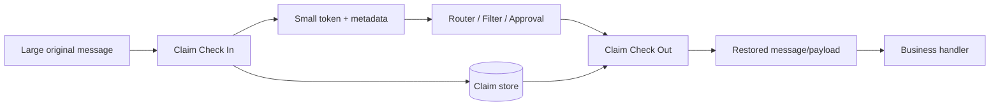
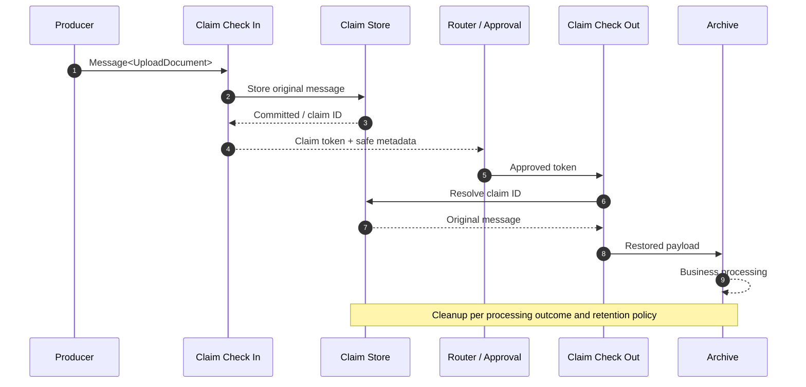
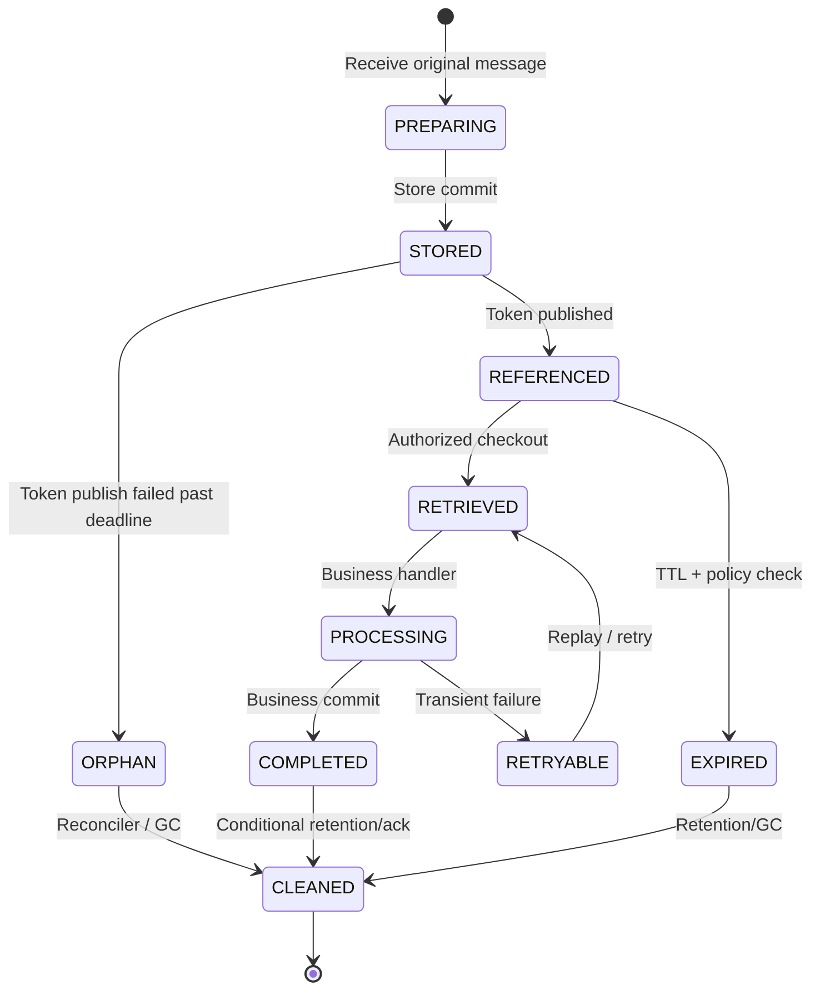
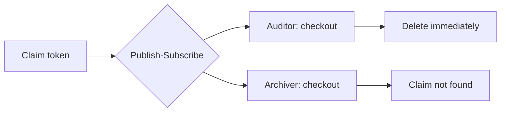
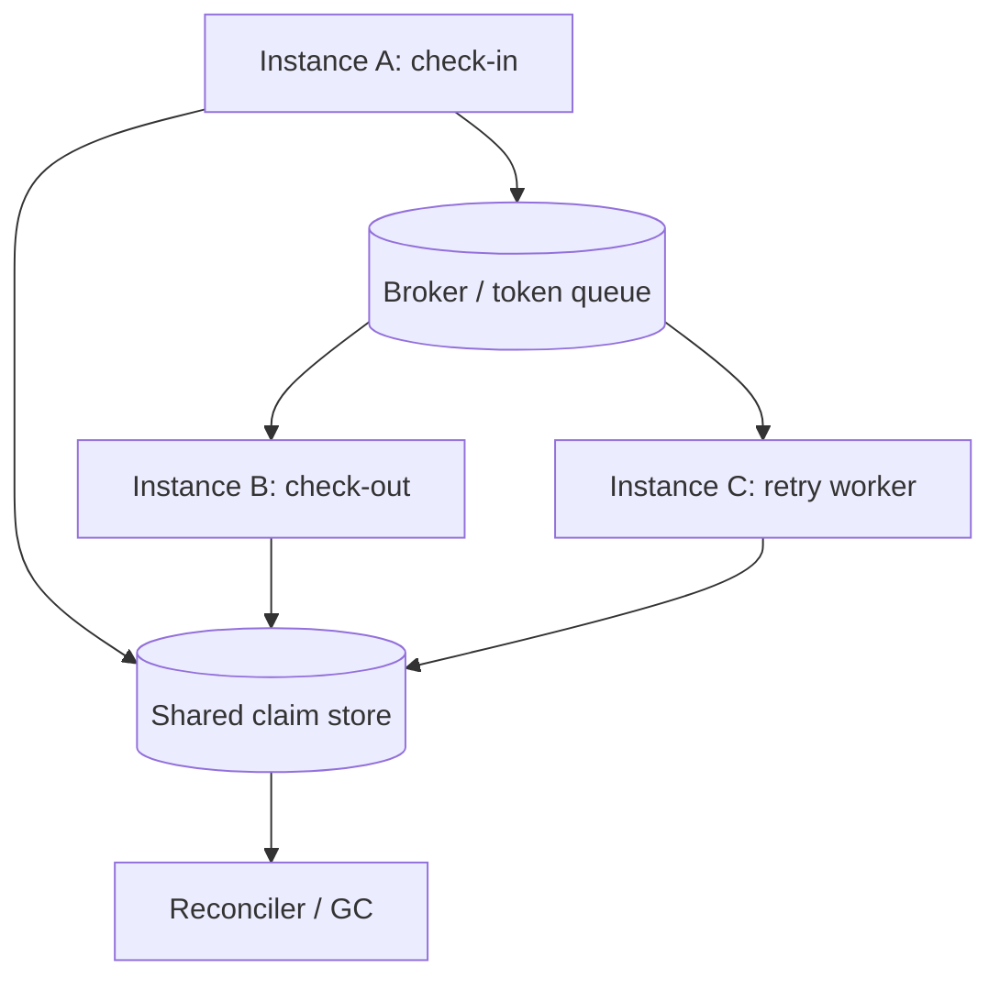
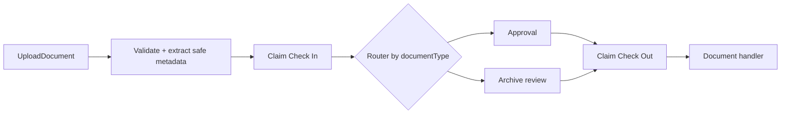

# Claim store and data lifecycle

A dossier-intake system processes requests carrying large attachments, numerous sensitive fields, and business metadata. Several downstream steps only need `requestId`, `documentType`, and approval status, yet every transfer of the message through a Router, Filter, queue, or Gateway has to carry all of the original data. This increases transmission cost, memory consumption, log volume, and data exposure risk.

**Claim Check** is a pattern in **Enterprise Integration Patterns (EIP)** designed to solve that problem: **store the original message or payload in a repository**, emit a small **claim check/token** representing the stored data, and use the token to **retrieve** the data when needed. In Spring Integration, this concept is tied to **Claim Check In/Out Transformers** and the **`MessageStore`** infrastructure. The hardest part in production is not generating tokens, but managing the **claim store and data lifecycle**: where to store, how long to keep, who is allowed to restore, when to delete, and how to recover if a step or instance fails?

The lesson **“Claim store and data lifecycle”** belongs to the **Claim check** chapter of the `SPRING_INTEGRATION_PATTERN` module, serving the goal of learning loosely coupled, extensible, and testable messaging patterns with Spring Integration. We will design clear storage and lifecycles; distinguish retrieval from consumption, TTL from business completion; handle retry, error channel, Router, Filter, Transformer, Splitter, Aggregator, Gateway, and correlation; build Java DSL and JUnit 5 examples; and examine security, consistency, and observability.

> **Principle:** **A claim check is a reference to stored data, not proof of authorization to read the data.** Saving successfully does not mean the token was durably delivered; retrieving successfully does not mean the business action finished; deleting a token too early can break retries, while never deleting can cause accumulation and violate retention policies.

## 1. What problem does Claim Check solve?

Consider a dossier processing flow:

```text
Original message:
  requestId = DOC-101
  tenantId = ACME
  payload = large PDF + forms + sensitive data

Intermediate steps:
  permission check → classification → approval → storage destination selection

Final step:
  retrieve PDF/forms to archive document or publish result
```

If the entire PDF travels with the message at every step, each endpoint bears unnecessary data. With Claim Check:



**Achievable benefits:**

- **Reduce message size** passing through channels that process only metadata.
- **Isolate large/sensitive data** from branches that do not need to inspect full content.
- **Avoid repeated payload serialization** along the message path when store/transport are properly designed.
- **Retrieve data intentionally** at the step that genuinely needs it.
- **Centralize retention policies and access control** in a well-defined infrastructure.

**Costs incurred:** a new stateful store, lookup I/O, risk of lost/missing tokens, transaction boundaries, and cleanup/retention work. Claim Check **does not automatically grant the system durability, exactly-once, or authorization**.

### 1.1. When should you avoid Claim Check?

It may be unnecessary if:

- Payloads are small, branching is minimal, and every handler needs the full data.
- Store lookups cost more than transferring the payload directly.
- Data can safely traverse the broker within reasonable size limits.
- You actually only need a **projection/Transformer** to trim fields, without retaining the original for later retrieval.
- There is no operational support for store management, backups, TTL, orphan handling, or access control.

**Do not turn every message into a reference** if doing so merely adds round trips and a database dependency to every step.

## 2. Terms to distinguish

| Concept | Example | Responsibility |
| --- | --- | --- |
| **Original message** | `Message<UploadDocument>` with metadata. | Data to restore or use later. |
| **Claim store** | `MessageStore`, JDBC store, or indexed blob storage. | Stores and retrieves the original by key. |
| **Claim ID / token** | A random UUID. | Reference to the saved record. |
| **Claim metadata** | `tenantId`, `createdAt`, `expiresAt`, `schemaVersion`. | Supports verification, TTL management, and operations. |
| **Check-in** | `store.addMessage(original)`. | Writes data and emits token per contract. |
| **Check-out / restore** | Look up message by ID. | Restores the parked content. |
| **Consume / finalize** | Business processing finishes and records result. | Proves cleanup eligibility under policy. |
| **Cleanup / expiration** | Delete expired or unreferenced data. | Manages lifecycle, cost, and privacy. |
| **Correlation ID** | `requestId` of a request–reply flow. | Links steps/traces; not necessarily the claim ID itself. |
| **Idempotency key** | `(requestId, operation)`. | Prevents duplicate side effects; distinct from claim token. |

### 2.1. Claim ID is not business ID

```text
requestId       = DOC-101
originalMessageId = 99d8... (UUID)
claimId         = 99d8... or a store/app-assigned key
correlationId   = corr-abc
idempotencyKey  = DOC-101:ARCHIVE
```

In a design using `MessageStore`, the **UUID of the original message** can itself serve as the retrieval key. However, **a claim ID does not inherently encode `requestId`, tenant, or access permissions**. If retries recreate the message with a new ID, **multiple distinct claims can be produced for the same business request**.

### 2.2. Claim token is not an encrypted payload

A token is only a **reference**. It does not make the payload safe if anyone holding the token can retrieve it. Even an unpredictable token does not replace:

- caller authentication;
- authorization by tenant/owner/purpose;
- expiration limits;
- access auditing;
- encryption at rest and in transit.

Do not confuse **carrying no sensitive data in the small message** with **no sensitive data remaining in the system**: the data still lives in the claim store.

## 3. Two-track architecture: metadata moves forward, payload stays in the store

A request only needs to carry **documentType** and **riskScore** through classification steps, while ultimately the Archive service needs to read the original document.



At each boundary, define **what has succeeded**:

1. Has check-in saved the original **successfully and readably**?
2. Has the token been **durably sent** to the next channel?
3. Does the token target the right **tenant/route**?
4. Has check-out returned a **valid, version-matched** original?
5. Has the business handler **committed**, or merely started processing?
6. May the claim be deleted under **retention, replay, and audit policies**?

Do not conclude step (6) merely because step (4) succeeded.

### 3.1. Two design styles

**Store the entire `Message<?>`:** suited when you need to restore both the payload and essential headers; Spring Integration `MessageStore` supports this model.

**Store blob/payload and metadata separately:** suited for large files or streamable data. The token can point to an object key in object storage and a record in a database. This is an **application design following Claim Check**, which does not imply every `MessageStore` natively supports streaming huge blobs.

| Storage approach | Advantages | Trade-offs |
| --- | --- | --- |
| `MessageStore` holding message | Natural integration with Spring Integration; retrieval by message ID. | Serializes payload/headers; size/serializer limits and DB cost. |
| Metadata database + object storage | Fits large payloads; supports encryption/streaming and object-level TTL. | Requires compensating transactions, integrity hashes, orphan cleanup, token→object mapping. |
| In-memory cache | Simple, fast in tests. | Not durable across restarts; not automatically shared across JVMs. |

## 4. Claim store in Spring Integration

**`MessageStore`** is the abstraction for storing, retrieving, and removing **`Message<?>`**. Implementations differ in durability, transactions, serialization, and multi-instance sharing.

### 4.1. `MessageStore` vs `MessageGroupStore`

| Abstraction | Purpose | Example |
| --- | --- | --- |
| **`MessageStore`** | Store/retrieve **a single message by ID**. | Claim Check In/Out. |
| **`MessageGroupStore`** | Manage **groups of messages** with correlation and group lifecycle. | Aggregator, Resequencer. |

A concrete implementation may support multiple roles, but the two **contracts** are not synonymous. Claim Check typically needs **key-based lookup**; Aggregator needs **group membership, release, expiry, and locking**.

### 4.2. Questions when choosing an implementation

1. Must the data survive a **JVM restart**?
2. Will **multiple instances** perform check-in/check-out concurrently?
3. Does the payload need **serialization** over JDBC/Redis/Mongo/object storage?
4. Can a claim be **read multiple times**?
5. Are **transactions** with the broker and database required?
6. Are appropriate retention/TTL and cleanup jobs in place?
7. What level of **backup/restore**, encryption, and auditing does the system need?
8. When the repository is temporarily unavailable, should the flow **fail closed**, retry, or send the token to a DLQ?

### 4.3. `SimpleMessageStore` is only for local examples

```java
import org.springframework.context.annotation.Bean;
import org.springframework.integration.store.MessageStore;
import org.springframework.integration.store.SimpleMessageStore;

@Bean
MessageStore claimMessageStore() {
    return new SimpleMessageStore();
}
```

`SimpleMessageStore` keeps state **in JVM memory** and helps test local flows. It does not inherently provide:

- persistence across restarts;
- replication across pods;
- transactional cleanup with brokers;
- business TTL and orphan collection;
- access auditing or per-tenant authorization.

If a token is forwarded to a consumer **in another JVM**, an in-memory store on the producer **is not a shared data source**. The consumer may receive the claim ID without having the original message.

### 4.4. Persistent store

For multi-instance deployments, you can choose a persistent `MessageStore` implementation supported by Spring Integration in your stack—such as a JDBC-backed store or another datastore—**after verifying version, schema, and transactional characteristics**.

```text
Instance A: Claim Check In  ──┐
                              ├── Shared persistent claim store
Instance B: Claim Check Out ──┘
```

**A shared store is necessary, not sufficient.** You must govern concurrent reads/writes, payload migrations, serialization schemas, access permissions, and retention durations. Do not assume a replicated database automatically turns check-in → publish token → check-out → delete into an end-to-end transaction.

## 5. Claim Check lifecycle: from storage to cleanup

A business design should express an **explicit lifecycle**. The states below are an **application-defined model**, not a default enum provided by `MessageStore`:



**Key point:** `RETRIEVED` must not automatically be treated as `COMPLETED`. The handler has retrieved the payload, yet may fail before writing the DB, replying to the Gateway, or acking the broker.

### 5.1. Lifecycle as a decision table

| Logical state | What can be proven | What is not yet guaranteed |
| --- | --- | --- |
| **PREPARING** | Preparing payload/token. | Data is durably saved. |
| **STORED** | Store confirmed the write. | Token reached downstream. |
| **REFERENCED** | Reference emitted per transport contract. | Consumer has processed it. |
| **RETRIEVED** | Original has been read back. | Business action has committed. |
| **PROCESSING** | Handler is executing work. | Success, idempotency, or ack. |
| **COMPLETED** | Business outcome is confirmed. | Data may be deleted immediately if retention rules apply. |
| **EXPIRED** | Exceeded TTL or defined deadline. | No consumer still needs replay. |
| **CLEANED** | Claim content deleted/unretrievable per policy. | All caches/backups purged instantaneously. |

If using a pure `MessageStore`, these business states must be **stored in separate application metadata/repositories or workflow stores**; do not infer from a message's disappearance from the store that it succeeded.

## 6. Check-in, check-out, and deletion decisions

### 6.1. Check-in

Inbound flow:

```text
Original Message<UploadDocument>
        |
        v
  Claim Check In
        |
        +--> save Message by key
        |
        +--> emit small Claim ID
```

So that a token never points to unsaved data, the logical order must be **store successfully → expose token**. Still, a crash can happen after storing but before publishing the token, producing an **orphan**.

### 6.2. Check-out is not necessarily consumption

When Consumer A reads a claim and Consumer B still needs the same data:

```text
token T -> Auditor reads
        -> Archiver reads
        -> Retry handler needs to re-read on error
```

If the first read **simultaneously deletes** the original, remaining readers and retries will encounter `claim not found`. Choose one of these contracts:

- **Read many / delete later:** multiple authorized readers can retrieve; cleanup follows status/TTL.
- **One-time claim:** only one consumer is granted processing rights; first retrieval carries consumption semantics. Requires designing **atomicity** and failure recovery.
- **Reference counting / leases:** delete only when all required consumers finish; must handle expired leases and dead consumers.

In Spring Integration, Claim Check Out can be configured to **retain or remove the message from the store** depending on the API/version. **Do not assume check-out always deletes or always keeps**; verify `remove-message`/the corresponding option in your version and test the desired behavior.

### 6.3. When to delete?

Deletion should depend on **business completion and retention policy**, for example:

```text
Store original
    → publish token
    → downstream restore
    → validate / archive / commit business record
    → confirm success / ack
    → mark claim complete
    → cleanup after retention window
```

If the consumer crashes **after retrieving but before committing**, a delete-on-read mechanism can prevent retries from **reading the original again**. Therefore, read-then-delete is not a safe default for flows that retry.

## 7. Java example: step-by-step `MessageStore` operations

Before integrating with the DSL, understand the store–retrieve–delete operations at the store layer. The example uses `SimpleMessageStore` **purely for illustration and testing**, without authorization, TTL, or persistence.

### 7.1. Minimal facade for internal claims

```java
// LocalClaimService.java
import java.util.UUID;
import org.springframework.integration.store.MessageStore;
import org.springframework.messaging.Message;

public final class LocalClaimService {

    private final MessageStore store;

    public LocalClaimService(MessageStore store) {
        this.store = store;
    }

    public UUID checkIn(Message<?> original) {
        UUID id = original.getHeaders().getId();
        if (id == null) {
            throw new IllegalArgumentException("Message ID is required");
        }
        store.addMessage(original);
        return id;
    }

    public Message<?> restore(UUID id) {
        Message<?> original = store.getMessage(id);
        if (original == null) {
            throw new IllegalStateException("Claim not found: " + id);
        }
        return original;
    }

    // Call only after the caller verifies business completion
    // and retention policy in a real system.
    public void cleanupAfterCompletion(UUID id) {
        store.removeMessage(id);
    }
}
```

Explanation:

1. `checkIn(...)` takes an original message with an ID, puts it into `MessageStore`, and returns the ID as the claim.
2. `restore(...)` **does not delete** the message; it only reads the stored copy.
3. `cleanupAfterCompletion(...)` is a separate step called **after the application determines cleanup criteria are met**.
4. A `not found` error is distinguished from valid original data by returning an exception rather than `null`; valid message payloads should not be conflated with null.

**This is a local facade, not a security boundary.** When used over an API or across tenants, do not pass a raw UUID from a request straight into `restore` without checking **claim ownership, purpose, expiry, and status** in a trusted record. Concurrency between cleanup and restore must also be designed.

### 7.2. JUnit 5: read multiple times before deleting

```java
import static org.junit.jupiter.api.Assertions.*;

import java.util.UUID;
import org.junit.jupiter.api.Test;
import org.springframework.integration.store.SimpleMessageStore;
import org.springframework.messaging.Message;
import org.springframework.messaging.support.MessageBuilder;

class LocalClaimServiceTest {

    @Test
    void keepsMessageUntilExplicitCleanup() {
        LocalClaimService claims =
            new LocalClaimService(new SimpleMessageStore());

        byte[] document = new byte[] {1, 2, 3, 4};
        Message<byte[]> original = MessageBuilder
            .withPayload(document)
            .setHeader("documentType", "PDF")
            .build();

        UUID token = claims.checkIn(original);

        Message<?> first = claims.restore(token);
        Message<?> second = claims.restore(token);

        assertEquals(original.getHeaders().getId(), token);
        assertArrayEquals(document, (byte[]) first.getPayload());
        assertArrayEquals(document, (byte[]) second.getPayload());
        assertEquals("PDF", first.getHeaders().get("documentType"));

        claims.cleanupAfterCompletion(token);
        assertThrows(IllegalStateException.class,
            () -> claims.restore(token));
    }

    @Test
    void unknownClaimIsNotAnEmptyDocument() {
        LocalClaimService claims =
            new LocalClaimService(new SimpleMessageStore());

        UUID missing = UUID.randomUUID();
        assertThrows(IllegalStateException.class,
            () -> claims.restore(missing));
    }
}
```

These tests verify only **local store behavior**: multiple retrievals succeed and data is gone after cleanup. They **do not prove** JDBC transactions, crash/restart survival, TTL, multi-tenant security, or business handler idempotency.

### 7.3. Data may be inspected without yet being processed

In practice, tests should include this scenario:

```text
restore(token) → handler begins archiving
handler throws IOException → not marked completed
retry(token) → still restores original
handler archives successfully → mark completed → cleanup
```

If the token were deleted during the first restore step, this retry scenario would fail.

## 8. Spring Integration Java DSL example with Claim Check Transformers

Spring Integration has dedicated endpoints/transformers for **Claim Check In** and **Claim Check Out**. You can envision two independent flows sharing **the same `MessageStore`**:

```java
// ClaimCheckFlowConfiguration.java
import org.springframework.context.annotation.Bean;
import org.springframework.context.annotation.Configuration;
import org.springframework.integration.channel.QueueChannel;
import org.springframework.integration.config.EnableIntegration;
import org.springframework.integration.dsl.IntegrationFlow;
import org.springframework.integration.store.MessageStore;
import org.springframework.integration.store.SimpleMessageStore;
import org.springframework.integration.transformer.ClaimCheckInTransformer;
import org.springframework.integration.transformer.ClaimCheckOutTransformer;

@Configuration
@EnableIntegration
public class ClaimCheckFlowConfiguration {

    @Bean
    MessageStore claimMessageStore() {
        return new SimpleMessageStore(); // ONLY for local demos/tests.
    }

    @Bean("claims.tokens")
    QueueChannel claimTokens() {
        return new QueueChannel(16);
    }

    @Bean("claims.restored")
    QueueChannel restoredClaims() {
        return new QueueChannel(16);
    }

    @Bean
    IntegrationFlow checkInFlow(MessageStore store) {
        return IntegrationFlow.from("documents.in")
            .transform(new ClaimCheckInTransformer(store))
            .channel("claims.tokens")
            .get();
    }

    @Bean
    IntegrationFlow checkOutFlow(MessageStore store) {
        return IntegrationFlow.from("claims.restore.in")
            .transform(new ClaimCheckOutTransformer(store))
            .channel("claims.restored")
            .get();
    }
}
```

**Intent of the example:**

- `ClaimCheckInTransformer` stores the original message and produces a small representation carrying the claim reference.
- `ClaimCheckOutTransformer` resolves the reference from the **same store** to restore the data.
- `claims.tokens` and `claims.restored` are `QueueChannel`s for testing; they have no built-in consumer, durability, or cleanup.
- The two flows separate their inputs so learners can observe when check-in and check-out happen.

**Note on API and lifecycle:** Constructor signatures, DSL overloads, and transformer `removeMessage` semantics can vary across Spring Integration versions. Check the API and test against your actual dependency before deploying to a live module. The example intentionally **does not assume a default post-check-out deletion behavior**; if business rules require cleanup, configure it explicitly and test retries.

### 8.1. Do not pass a token into a different store that shares no state

```text
Instance A:
   checkIn → SimpleMessageStore A → token X

Instance B:
   token X → checkOut → SimpleMessageStore B → NOT FOUND
```

Two stores in two separate JVMs **do not automatically share messages** even if they have the same bean name. For multiple instances, you need a **shared durable store** or an architecture ensuring tokens route back to the owning node under controlled guarantees. Sticky sessions alone are usually insufficient for systems with retries/restarts and do not replace persistence.

### 8.2. Claim Check does not build lifecycle management records on its own

Dedicated Claim Check transformers provide store–reference–restore operations. If you need `tenantId`, `expiresAt`, `status`, `referenceCount`, `lastAccessAt`, or auditing, the application must implement **separate metadata/indexing** or use a store with suitable mechanisms. Do not expect the transformer to automatically build a complete workflow approval, token authorization, or retention policy system.

## 9. Token metadata and safe retrieval

A production token generally should not be just a bare, contextless string. You can use an application-defined record:

```java
import java.time.Instant;
import java.util.UUID;

// Illustrative DTO for an internal claim reference.
public record ClaimReference(
    UUID claimId,
    String tenantId,
    String purpose,
    Instant expiresAt,
    String schemaVersion
) {}
```

**This is not the default return type of `ClaimCheckInTransformer`.** To emit such a record, you need a corresponding application service/Transformer and authoritative server-side metadata storage.

### 9.1. Which fields from a token must not be trusted?

If a caller can modify the payload/token, caller-supplied `tenantId`, `purpose`, and `expiresAt` fields **cannot serve as proof of authorization**. Upon check-out:

1. Authenticate the current identity.
2. Look up the **server-side claim record** by validated ID.
3. Verify owner/tenant/purpose/expiry/status from the **protected** record.
4. Check that the request is on a valid **generation/version** if replay occurs.
5. Fetch content from the store using the authorized key.
6. Record audits/metrics per data policy.

If tokens traverse public brokers, you can use opaque random tokens/hashed lookups, signatures, or properly designed capability tokens; however, **signed tokens are still subject to expiration, permissions, and revocation**.

### 9.2. Data transmission security

| Boundary | What to protect |
| --- | --- |
| Token in broker/headers | Avoid exposing claim IDs, restrict producer/consumer ACLs, encrypt transport. |
| Claim store | Encryption at rest, access permissions, audit, backup/retention. |
| Check-out API | AuthN/AuthZ, rate limiting, tenant/purpose verification. |
| Error channel/DLQ | Do not dump sensitive content raw; enforce retention and read ACLs. |
| Logs/traces | Minimal metadata, opaque IDs; avoid printing retrievable tokens if risk is high. |

**Do not log raw claim IDs in public logs** if the system uses the ID itself as an accessible reference; use a **separate opaque correlation ref** for investigation.

## 10. TTL, expiration, and data deletion

An often-overlooked question: **“How long will a claim remain in the store if nobody checks it out?”**

### 10.1. TTL does not mean business completion

```text
Claim stored at 10:00
expiresAt = 11:00
Consumer has not processed yet due to broker backlog
11:01 token is finally delivered
→ claim may already be cleaned up; consumer cannot restore
```

If TTL is shorter than transport delay/retry/backlog, **dangling tokens** occur. If kept forever, **orphans, storage costs, and data-deletion compliance violations** arise.

Set retention based on:

- acceptable **queue/broker backlog** duration;
- business execution deadline;
- retry count and backoff delay;
- replay/reconciliation window;
- audit and legal retention periods (if applicable);
- user-requested data deletion policies.

No single default TTL fits all services.

### 10.2. Cleanup must have guards

Do not run a cron job that blindly executes:

```text
DELETE every claim older than 1 hour
```

without checking claims in progress, pending retries, or required retention. A sounder policy:

```text
eligibleForCleanup =
    state in {COMPLETED, EXPIRED, ORPHAN}
    AND retentionWindowElapsed
    AND noActiveLease
    AND noRequiredConsumerRemaining
    AND noLegalHold
```

This is **business pseudocode**, not a built-in `MessageStore` method. The application must implement metadata, scanning/reconciliation, and corresponding guards.

### 10.3. One claim with multiple readers

If Claim Check is used before **Publish–Subscribe** or a Recipient List, one token can reach multiple consumers. If consumer A deletes the data after reading, consumer B can fail:



Solutions include **read-many** with cleanup after all outcomes finish; bounded **reference counting/leases**; or **creating separate claims per recipient** if isolation is required. This is a **data lifecycle** choice, not purely a routing option.

## 11. Orphans and dangling references

There are two symmetrical errors:

- **Orphan claim:** data is stored, yet **no valid token** will ever point to it.
- **Dangling token:** token is emitted, yet the data **does not exist/has expired/has not committed** in the store.

### 11.1. Failure windows

| Failure moment | Condition | Consequence |
| --- | --- | --- |
| Crash **before store commit** | No claim yet. | Must retry request/check-in from source. |
| Crash **after store commit, before token publish** | Data exists, no token. | **Orphan claim** without reconciliation. |
| Token published **before store commit** | Token may arrive early. | **Dangling token** or read-before-commit. |
| Crash **after token publish, before input ack** | Source may redeliver original. | Creates duplicate claim or re-emits token. |
| Check-out succeeds and deletes, handler has not committed | Data lost on retry. | Cannot recover subsequent attempts. |
| Handler commits then crashes before marking completed | Claim remains and source retries. | Risk of **duplicate side effects**. |
| Cleanup runs concurrently with check-out | Reader may receive not found. | Requires lease/transaction/locking policy. |

### 11.2. Transactional outbox and reconciliation

If check-in and token publishing span **two systems** (e.g., JDBC + Kafka/RabbitMQ), do not promise an end-to-end atomic transaction just because each operation succeeds individually.

A viable architecture:

1. Within the same database transaction, save **claim metadata** and an **outbox event** referencing the ready claim.
2. An independent publisher reads the outbox and publishes the token to the broker.
3. Mark the outbox entry published only upon appropriate confirmation, accepting the possibility of duplicate publishing.
4. Consumer processes **idempotently** by business/request/generation key.
5. A reconciler detects claims saved too long without publishing or tokens left unfinished.

If blob data resides in object storage, storing metadata/outbox in the DB **does not automatically make blob upload part of the DB transaction**. You may need `PENDING_UPLOAD`/`READY` states, integrity checks, staged objects, and cleanup when uploads fail.

### 11.3. Do not delete orphans too early

A claim without a confirmed token after 30 seconds might just be a **publisher retrying**, not a permanent orphan. The reconciler should check **state, retry window, lastAttempt, and owner/lease**, not merely a simple timestamp.

## 12. Multiple instances and shared stores

In Kubernetes or multi-JVM environments:



You must address:

1. **Consistency/visibility:** B must observe records committed by A.
2. **Serialization compatibility:** A/B may run different code versions.
3. **Concurrency:** if B and C check out simultaneously, only one may finalize if business rules require.
4. **Durable lifecycle metadata:** status, owner, expiry, generation, and leases survive restarts.
5. **Capacity:** the store handles peak claim counts and payload sizes.
6. **Partition/network failure:** if a token arrives while the store is temporarily unavailable, retry appropriately instead of assuming the data is lost.
7. **Permission isolation:** a consumer must not retrieve another tenant's claim.

### 12.1. Availability of tokens and data

With eventually consistent infrastructure, **receiving a write ack does not always mean read replicas see it immediately**. A consumer reading from an unsynchronized replica may hit temporary `not found`. The design needs suitable read consistency or bounded retries right after check-in; however, **do not retry forever** for genuinely non-existent tokens.

### 12.2. Single-read and contention

An API performing **get then remove** in two independent operations can race:

```text
B: get(token) -> payload
C: get(token) -> payload
B: remove(token)
C: remove(token) -> no-op/not found
Both B and C obtained the payload and both may cause side effects
```

If **only one worker may process**, you must use **atomic claim/lease/compare-and-set state** in the repository, transactions, or reliable locking, plus idempotency at the target service. Simply removing from `MessageStore` is insufficient to guarantee one-time execution.

## 13. Schema, serialization, and data size

### 13.1. Storing Java objects can complicate upgrades

```text
Version A stores Message<OldDocumentDto>
Version B reads and deserializes into NewDocumentDto
```

If using class-dependent Java serialization, after a deployment, consumer B may fail to decode A's messages. Therefore:

- Maintain an explicit **schema version**.
- Consider durable, contract-driven formats (JSON/Avro/Protobuf or appropriate types).
- Keep a compatibility/migration window.
- Test reading **old claims** during rolling deployments.
- Define incompatibility handling: quarantine/migration, not immediate deletion.

**Spring Integration does not automatically make your DTOs compatible across versions** just because they are stored in `MessageStore`.

### 13.2. Do not send large blobs by keeping byte[] in every header

Claim Check is useful when **the token is small** and the large payload is stored off the message path. Do not accidentally copy the same blob into a header like `originalPayload` or error metadata, leaving the token message just as large.

### 13.3. Integrity and object storage

When a claim points to an external file/blob:

```text
Claim record:
  id = UUID
  objectKey = safe internal key
  expectedSize = 16 MB
  checksum = SHA-256(...)
  schemaVersion = 2
  tenantId = internal owner ID
```

This is an **illustrative schema**. When restoring, verify **object existence and matching size/hash when required by contract**, and never trust caller-supplied object keys to read arbitrarily. Do not use raw object paths as tokens if doing so exposes bucket structure or tenant data.

## 14. Gateway request–reply and timeouts

A `@MessagingGateway` can provide a Java facade for dossier processing:

```java
import org.springframework.integration.annotation.MessagingGateway;

@MessagingGateway(defaultRequestChannel = "documents.in")
interface DocumentGateway {
    DocumentReceipt submit(UploadDocument document);
}

// DocumentReceipt and UploadDocument are application-defined DTOs.
// Actual flows must produce a reply matching the contract.
```

**The example in section 8 does not produce a `DocumentReceipt`.** It only demos saving tokens to a queue and restoring from another queue. For a Gateway to return a result, you must design a **reply path**, business handler after restore, and timeout behavior.

### 14.1. Three distinct timeouts

| Timeout | Boundary |
| --- | --- |
| **Claim store I/O timeout** | Saving, reading, or deleting a claim in database/object storage. |
| **Channel send timeout** | Handing off token/message to a channel with appropriate capacity/semantics. |
| **Gateway reply timeout** | Caller stops waiting for the business result. |

Caller expiration does not prove the claim was cleaned up or that the business handler did nothing. If the caller retries after a timeout, the system could create **two claims for the same business request**. You need idempotency and a status-query API rather than blindly re-executing the entire request.

### 14.2. Token delayed on broker

If the claim expires before the consumer receives the token, check-out fails. In operations, measure:

```text
claimAgeAtCheckout
brokerQueueLag
claimRetentionWindow
retryWindow
gatewayDeadline
```

Each interval serves a different role. Increasing the Gateway timeout does not extend data lifetime in the store if TTL/GC still deletes early.

## 15. Impact on Router, Filter, Transformer, Splitter/Aggregator

### 15.1. Router should route only on verified metadata

After check-in, the payload may be only a claim ID. If a Router previously evaluated `payload.documentType`, that expression is **no longer valid** for the token message. You need to:

- Compute routing metadata **before check-in** and attach necessary safe metadata alongside the token.
- Or use a lightweight service to look up metadata by claim ID.
- Avoid forcing the Router to restore **the entire blob** when it only needs one attribute.



### 15.2. Filter dropping tokens can create orphan claims

```text
Check-in already stored original
      |
      v
Filter: eligible?
  true  → token continues
  false → drop
```

If the Filter drops a token without a cleanup flow, **the payload remains in the store**. Choose a policy:

1. **Filter before check-in** if only available metadata is needed and rejected payloads need not be saved.
2. On `false`, route the token to a **discard channel with a handler releasing the claim** per retention.
3. Keep the claim in quarantine if investigation is needed, with explicit TTL/auditing.

**Filter returning `false` does not automatically clean `MessageStore`** and does not equate to an error. Test the discard path so orphans are not created.

### 15.3. Transformer can drop the claim ID or metadata

If a Transformer turns a token into a new DTO without preserving the claim ID, downstream cannot restore the original. Do not rely on **implicit header propagation** across every adapter. Design explicit fields, validate schemas, and copy **only necessary/allowed metadata**.

### 15.4. Splitter and Aggregator

For a large multi-part document, there are two distinct architectures:

**A. Split first, claim each part:**

```text
Large batch → Splitter → Claim Check In each part
           → parallel handlers → restore each part
           → Aggregator
```

Each part gets its own claim, requiring correlation/sequence and cleanup per claim. The Aggregator needs **all outcomes including REJECTED parts**, not just awareness that some tokens were emitted.

**B. Claim whole batch, pass element references:**

```text
Large batch → Claim Check In whole batch
            → emit (claimId, partIndex) references
            → handlers restore/read required sections
            → Aggregator
```

Handlers can read the same original; requires **read-many**, range access if storage supports it, and cleanup only when **all required parts have completed**.

**Note:** `sequenceNumber`, `sequenceSize`, and `correlationId` serve the Splitter/Aggregator group lifecycle and **do not replace the claim ID**. One claim can represent the whole batch while multiple parts carry the same claim ID and different sequence numbers.

### 15.5. Recipient List and Publish–Subscribe

Broadcasting a token to multiple recipients does not guarantee all recipients have finished checking out. If one reader deletes the claim immediately, others fail. You need **completed recipients/leases/reference counting**, or controlled claim copies if single-read is mandatory.

### 15.6. Scatter–Gather and Resequencer

Scatter–Gather dispatches a token to multiple services and collects varied outcomes. Gather should release based on the **required set of roles/recipients**, not merely token count; Resequencer uses sequence metadata to emit **parts in order**. The Claim Store only holds original data and **does not decide when a group completes or output ordering**.

## 16. Retry, error channel, and missing claims

| Situation | Classification | Action |
| --- | --- | --- |
| Store write failed | Check-in technical error. | Bounded retry; do not emit unsaved token. |
| Token publish failed after write | Orphan candidate. | Outbox/reconcile; avoid deleting while retries remain. |
| Check-out cannot find ID | Missing/expired claim. | Distinguish eventual visibility, expiration, invalid token, and lost data. |
| Store read timeout | Transient infrastructure error. | Retry/backoff within deadline; do not assume data was deleted. |
| Token belongs to another tenant | Authorization violation. | Reject, audit; do not return payload. |
| Old schema fails deserialization | Compatibility error. | Quarantine/migration; keep data per retention. |
| Business handler fails after restore | Processing failure. | Retry using token if claim remains; protect idempotency. |
| Cleanup failed | Retention/GC issue. | Reconcile/alert; do not mask business outcome. |
| Claim deleted before second consumer reads | Lifecycle race. | Adjust read-many/lease/reference counting. |

### 16.1. Error channel is not a claim store

An `ErrorMessage` may carry the failed message and exception, but **it is not a replacement original-data store for `MessageStore`**. In synchronous flows, exceptions may propagate back to the caller; in pollers/async adapters, errors may route to `errorChannel` as configured.

Do not put large raw documents or sensitive profiles directly onto an error channel/DLQ just to debug a claim ID. A minimal error event should describe:

```text
event=claim_checkout_failed
reason=CLAIM_NOT_FOUND
claim_ref=<masked-reference>
tenant_ref=<opaque-tenant-ref>
stage=CHECKOUT
retryable=false
correlation_ref=<opaque-trace-ref>
```

This is an **illustrative format**, not a default framework log. The `retryable` value must be decided after distinguishing the actual failure (e.g., read replica lag or store timeout may be retryable).

### 16.2. Retry at the right boundary

If check-out fails due to a database timeout, you can retry the **lookup**; there is no need to recreate a claim from the original (as the original may no longer be in context). If archiving already committed yet replying failed, retrying **the entire flow** can archive twice; idempotency by business ID is required.

**Do not treat check-in, restore, and business handling as one atomic operation** unless an actual transaction spans those corresponding boundaries.

## 17. Testing data lifecycle beyond the happy path

### 17.1. Mandatory test matrix

| Scenario | What must be proven |
| --- | --- |
| Check-in succeeds | Claim ID points to exact original payload and needed headers. |
| Token passes Router/Filter | Routing metadata remains present; original is not carried unintentionally. |
| Check-out succeeds | Data restores with expected format/schema/tenant. |
| Two restores before cleanup | Read-many is allowed and consistent if designed that way. |
| Check-out after cleanup | Returns missing/expired per contract; does not return fake data. |
| Unknown claim ID | Does not fetch wrong data or default to an empty payload. |
| Check-in succeeds, token publish fails | Orphan is detected and handled safely. |
| Token arrives before store visibility | Consumer retries boundedly without losing message. |
| Crash after restore, before business commit | Retries can still read the claim when policy requires. |
| Crash after business commit, before ack | No duplicate side effects executed. |
| Two consumers check out concurrently | Read-many/one-time semantics follow contract. |
| TTL expires during broker backlog | No premature deletion, or explicit pending/failure path exists. |
| Rolling deployment | Old-schema data remains readable or is quarantined. |
| One instance dies | Shared store and metadata remain recoverable. |
| Unauthorized consumer | Cannot retrieve another tenant's claim. |
| GC runs concurrently with check-out | No race drops an actively valid claim. |
| Large claims and peak load | Store maintains quotas, backpressure, latency, and recoverability. |

### 17.2. Test both contracts: keep and delete

In unit tests, do not only verify `store.getMessage(id) != null` right after check-in. Test:

```text
Given: claim saved, retention allows repeated reads.
When:  restore #1 then restore #2.
Then:  both return the original.
When:  mark completed and clean up.
Then:  subsequent restore returns not found/expired per contract.
```

For one-time claims, add tests with **two competing consumers** and failure injection between “claim ownership” and “business commit”. A unit test calling `getMessage()` then `removeMessage()` sequentially **does not prove one-time atomicity**.

### 17.3. Multi-instance and persistent store integration test

A realistic lab should set up:

1. Two independent application contexts/processes connected to a shared store.
2. Instance A checks in and publishes a token.
3. Instance B checks out and verifies valid payload and headers.
4. Restart A/B; verify the claim still exists if not yet cleaned up.
5. Simulate token redelivery with the same `requestId`.
6. Verify the business handler causes no duplicate side effects.
7. Simulate GC/expiry while a consumer holds an active lease.
8. Verify audits/metrics leak no data.

**Do not use two `SimpleMessageStore` beans in the same JVM to simulate shared durability**: those two beans only verify local API behavior and can remain completely independent.

## 18. Observability: measuring stored data and token health

A system measuring only message throughput will not notice **claims stored but no longer used** piling up. Measure the full lifecycle:

| Suggested metric | Meaning |
| --- | --- |
| `claim_checkin_total` | Count of originals saved. |
| `claim_checkout_total` | Count of retrievals. |
| `claim_checkout_not_found_total` | Missing/expired/dangling claims. |
| `claim_store_write_failures_total` | Data save failures. |
| `claim_store_read_failures_total` | Data read failures. |
| `claim_store_latency` by operation | p95/p99 of write/read/delete. |
| `claim_store_bytes` and `claim_store_records` | Storage volume and outstanding claims. |
| `claim_age_seconds` | Age of living claims. |
| `claim_orphans_detected_total` | Claims without valid tokens. |
| `claim_reconciliation_failures_total` | Reconciliation/GC failures. |
| `claim_expired_total` | Records expired by policy. |
| `claim_cleanup_total` | Completed cleanups. |
| `claim_active_leases` | Claims validly held by consumers. |
| `claim_access_denied_total` | Check-outs rejected due to policy/permissions. |
| `claim_schema_failures_total` | Deserialization/compatibility errors. |

These are **suggested metric names**, not automatically emitted when declaring a Claim Check Transformer. Do not use per-message `claimId` or `requestId` as high-cardinality **metric labels**. Logs/traces may use opaque IDs with access control.

### 18.1. Lifecycle log examples

```text
event=claim_checked_in
claim_ref=opaque-claim-reference
storage_tier=shared-store
payload_bytes=1048576
outcome=STORED
```

```text
event=claim_cleanup
claim_ref=opaque-claim-reference
reason=BUSINESS_COMPLETED
retention_elapsed=true
outcome=DELETED
```

Do not log PDF contents, raw retrieval tokens, or headers containing secrets. Security events need audit records separated from public application logs with appropriate retention.

### 18.2. Diagnosing un-restorable tokens

1. Does the token have the right format/type and generation?
2. Did the prior check-in **commit**, or only start writing?
3. Is the consumer reading from the **same shared store**?
4. Is there store/read-replica visibility lag or a network error?
5. Has the claim **expired or been GC'd**?
6. Did another consumer use **remove-on-read** earlier?
7. Was the token altered or metadata dropped in a Transformer/adapter?
8. Does the caller hold proper tenant/purpose permissions?
9. Can the payload/schema deserialize on the new version?
10. Is there an orphan/dangling state due to a crash between storing and publishing the token?

**Do not keep retrying a claim legitimately deleted upon retention expiration**, and do not mark a claim “expired” when it is merely temporarily unreadable during a database outage.

## 19. Common misconceptions

### Misconception 1 — “Claim Check is payload compression”

**False.** It moves **the original into a store** and passes a **small reference**, without compressing or encrypting data by default.

### Misconception 2 — “A UUID token means anyone holding it is allowed to read”

**False.** A token is a reference, not proof of authorization. Owner/tenant/purpose/expiry checks from a trusted source are required.

### Misconception 3 — “With `SimpleMessageStore`, multiple pods read from the same store”

**False.** An in-memory store lives only inside one JVM. A shared/persistent store is required if tokens cross processes.

### Misconception 4 — “Retrieving the message means it can be deleted immediately”

**Not always true.** The business handler may not have committed yet; caller retries or a second recipient may need to read again.

### Misconception 5 — “The store automatically cleans up all orphans”

**Not by default.** Claim Check Transformers do not provide a full GC workflow governed by business TTL/leases/retention.

### Misconception 6 — “A one-hour TTL is enough because Gateway timeout is 30 seconds”

**False.** Broker backlog, retries, replays, pending workflows, and audits can outlast Gateway timeouts.

### Misconception 7 — “A persistent broker means no persistent claim store is needed”

**False.** The broker only holds tokens; if the original is lost after a restart, tokens become dangling references.

### Misconception 8 — “Deleting after the first check-out works for fan-out too”

**False.** Multiple recipients may need to retrieve concurrently. Use read-many, leases/reference counting, or per-recipient claims.

### Misconception 9 — “Having a claim ID gives us correlation/idempotency”

**False.** Claim ID identifies stored data; request/group correlation and per-operation idempotency are separate contracts.

### Misconception 10 — “If lookup fails, the original message is definitely lost”

**Not necessarily.** The store/read replica may be temporarily unavailable. Distinguish true not-found from timeouts/visibility lag.

### Misconception 11 — “Stored data schemas never change across deployments”

**False.** Rolling deployments can change DTOs/serializers. Versioning and migration are required.

### Misconception 12 — “Data deleted from the store is deleted from all backups”

**Not automatically.** Backups, replicas, audits, object versioning, and legal holds have separate retention. Deletion policies and verification are needed per system.

## 20. Practice exercises

**Exercise 1 — Design a claim store.** Given an average 16 MB payload, three pods, and a broker queue, compare `SimpleMessageStore`, shared JDBC store, and object storage + metadata DB; state throughput, cost, security, and crash recovery.

**Exercise 2 — Java practice.** Run `LocalClaimServiceTest`. Add tests for multiple restores, post-completion cleanup, and not-found. Explain why this does not yet prove access control.

**Exercise 3 — Cross-JVM retrieval.** Use an appropriate shared persistent store in a lab; A checks in and B checks out. Restart A before B checks out; verify the original remains available.

**Exercise 4 — Orphans.** Simulate store write succeeding while token publish fails. Design an outbox/reconciler to detect, retry, and clean up on time.

**Exercise 5 — Dangling tokens.** Simulate a token reaching a consumer while the record is not yet visible or has expired. Define distinctions among transient errors, invalid claims, and expired claims.

**Exercise 6 — Premature deletion.** Consumer restores successfully, then archiving fails. Compare delete-on-read versus delete-after-business-completion; propose retries/idempotency.

**Exercise 7 — Fan-out.** Auditor and Archiver both receive one claim token. Design reference counting/leases or retention so neither consumer loses data for the other.

**Exercise 8 — Filter creating orphans.** Place a Filter after Claim Check In and feed `eligible=false`. Write a discard handler with policy-based cleanup/quarantine; verify claims do not persist forever.

**Exercise 9 — Splitter/Aggregator.** A five-line batch has one overall claim and five part references. Define correlation, expected results, and when to clean up the claim upon full/partial batch completion.

**Exercise 10 — Schema evolution.** Store a claim with an old DTO version; simulate a new deployment. Establish deserialization, migration, or quarantine rules to avoid data loss.

**Exercise 11 — Tenant isolation.** A client sends a claim ID belonging to another tenant. Design a check-out API verifying owner/purpose from server-side metadata and auditing denials.

**Exercise 12 — Cleanup race.** Run GC and a consumer reading the same claim concurrently. Propose leases/locking/transactions and test that actively used claims are not deleted.

**Exercise 13 — Dashboard.** Build metrics for claim age, records/bytes, orphan detection, not-found, cleanup failures, and access denials; propose alerts when claim age rises abnormally.

## 21. Claim store and lifecycle implementation checklist

| Question | Pass criterion |
| --- | --- |
| Is Claim Check truly needed? | Large/sensitive payload and steps exist that do not need the original. |
| What does check-in store? | Clear choice of payload vs `Message<?>`, allowed headers, and schema version. |
| How are tokens issued? | Opaque, sufficient entropy, contract-stable, never used as auth. |
| Does the store meet durability needs? | Shared/persistent across multiple JVMs/restarts, with backup/recovery. |
| Is the token published after store commit? | Write ordering and failure policy defined; outbox/reconcile when needed. |
| Does server-side lifecycle metadata exist? | Tracks owner, purpose, status, createdAt, expiresAt, generation. |
| Does check-out enforce access control? | AuthN/AuthZ and tenant/purpose/status/expiry validation. |
| Are read-many/one-time semantics clear? | Know when deletion is allowed; concurrent readers tested. |
| Is deletion tied to business completion? | Never delete on restore if retries/fan-out still need data. |
| Are TTL/retention and GC guards in place? | Account for backlog, retries, replays, leases, legal holds, and orphans. |
| Is there orphan/dangling-token handling? | Outbox, reconciliation, error/quarantine paths, and metrics. |
| Is there idempotency after restore? | No duplicate side effects on source redelivery or Gateway retry. |
| Have rolling deployments been tested? | Schema/serializer versions compatible or migrated. |
| Is blob integrity verified? | Hash/size, paths, and ACLs match contract. |
| Are Filter/Router/Transformer interactions checked? | Tokens/headers not lost; Filter discards leave no orphans. |
| Are Splitter/Aggregator/Scatter-Gather covered? | Correlation and required recipients/parts finish before cleanup. |
| Are timeout/error flows designed? | Distinguish store I/O, token send, Gateway reply, business handler. |
| Are PII and secrets protected? | Encryption, masking, data minimization, audits, DLQ read ACLs. |
| Is storage and claim-age observability active? | Track records/bytes/age, not-found, orphans, deletes, failures. |
| Have failure-injection tests been run? | Crashes, retries, racing readers/GC, expiry, wrong tenant, and outages. |

## Conclusion

**The claim store and data lifecycle** determine whether Claim Check actually makes an integration system **lighter, safer, and more resilient**. With Spring Integration, Claim Check In saves the original message/payload and emits a small reference; Claim Check Out uses that reference to restore the data. Yet **`MessageStore` is only part of the solution**: the application must also define **ownership, durability, serialization, business state, TTL, read-many/one-time semantics, and cleanup**.

A trustworthy design **saves successfully before emitting tokens**, retains data long enough for retries/replays, **does not equate restore with completion**, detects orphans/dangling references, protects tokens with real access controls, and tests crashes/races between steps. When combined properly with Router, Filter, Transformer, Splitter, Aggregator, Gateway, retry, error channel, and correlation, Claim Check lets you **pass a small reference through branches that do not need raw data while still governing the full lifecycle of the referenced data**.
