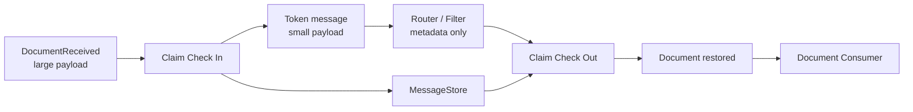
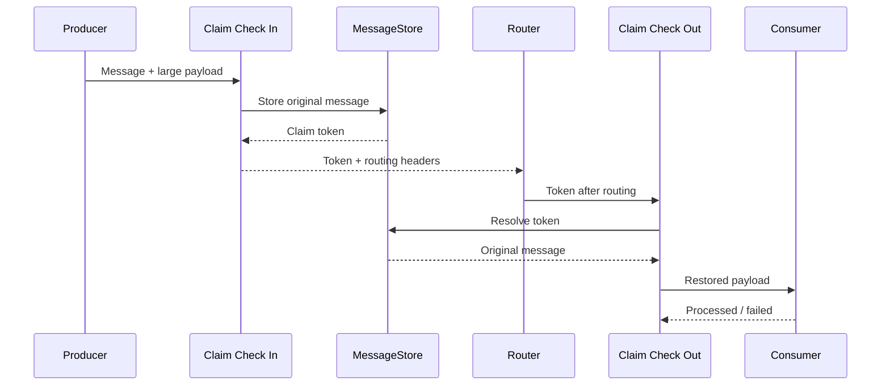
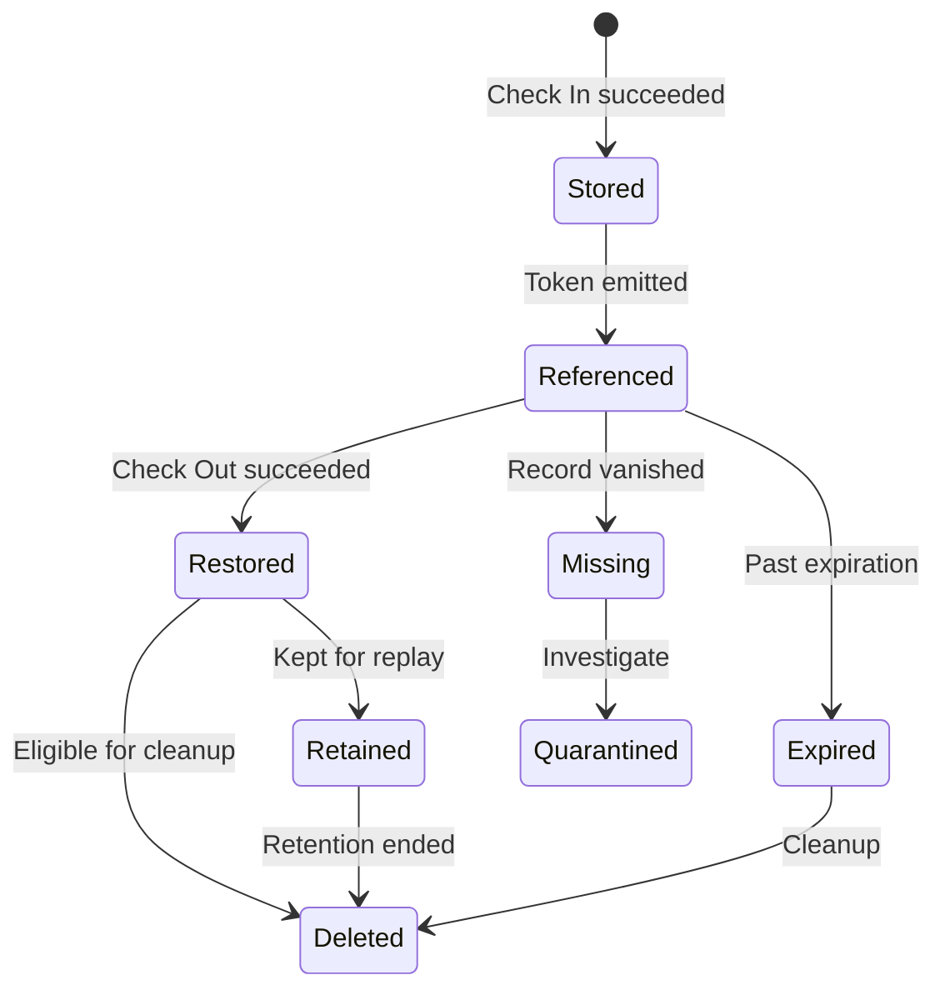
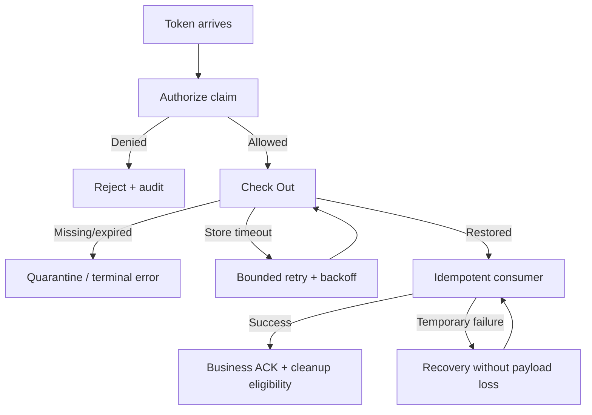
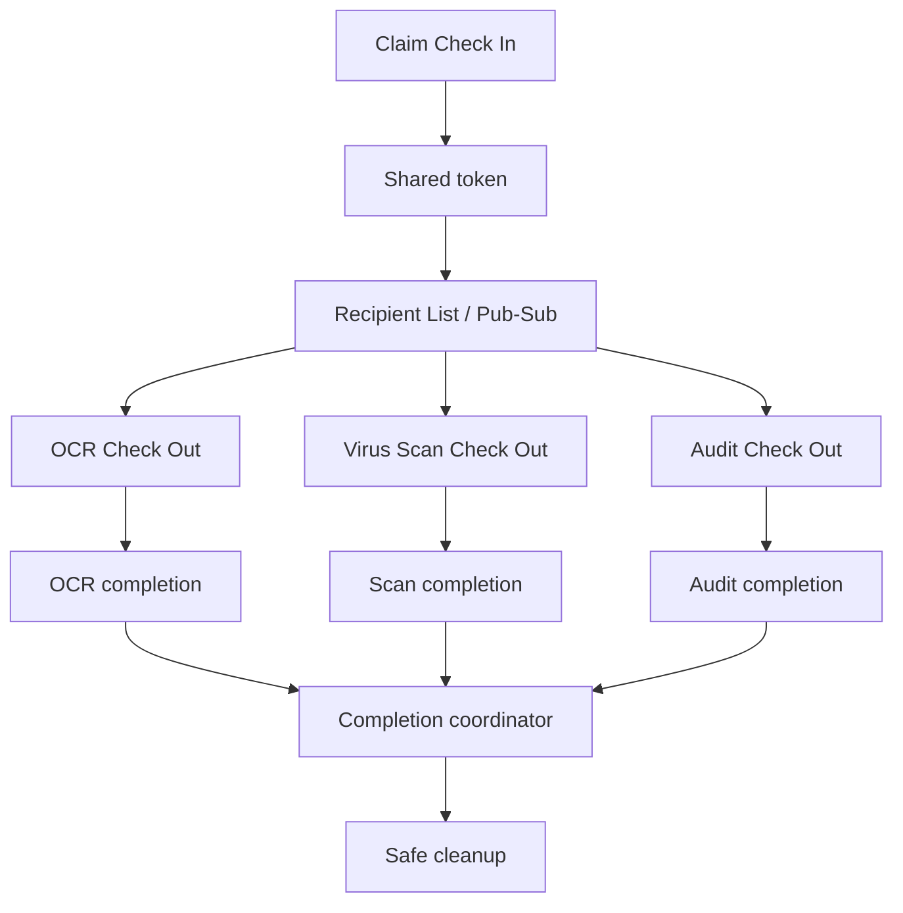

# Checking payloads in and out

## 1. Context: oversized messages passing through an integration flow

A document-processing system receives documents tens of megabytes long. The workflow requires checking customer information, reviewing metadata, routing to the right department, and finally passing the document content to a consumer for analysis. If **the entire large payload** is passed through every channel, queue, broker, Gateway, and intermediate step, the system can experience:

- High memory consumption and increased garbage collector pressure when many messages sit in queues simultaneously.
- High latency and network overhead when serializing or transferring payloads across multiple hops.
- Exceeding a broker/transport's message size limit.
- Data leaks if logging, tracing, or auditing records sensitive bodies where only metadata is needed.
- Harder orchestration because Routers and Filters usually only need IDs, status, and document type, not the entire content.

**Claim Check** is an *Enterprise Integration Pattern (EIP)* that addresses this problem by decoupling **large payloads** from the orchestration message flow. The **Check In** step saves the message or payload in a reliable store and replaces it with a small **claim check token**. Intermediate steps forward the token. When a consumer actually needs the content, the **Check Out** step uses the token to retrieve the payload.

In the **Claim check** chapter of the **SPRING_INTEGRATION_PATTERN** module, learners implement Enterprise Integration Patterns with Spring Integration to build loosely coupled, extensible message flows; practicing Router, Filter, Transformer, Splitter, Aggregator, Gateway, retry, error channel, and correlation while testing and observing processing branches. Claim Check is especially useful when orchestration steps do not need heavy data.



> **Lesson focus:** Check In and Check Out are stateful operations involving **data lifecycle, storage, identity, access control, and error handling**. They are not merely replacing a payload with a String and using that String to query a database.

## 2. Claim Check terminology and contracts

| Concept | Meaning |
| --- | --- |
| **Original message** | Initial message, consisting of business payload and metadata to preserve |
| **Check In** | Putting a message/payload into a store and receiving a lookup key |
| **Claim check token** | Small value representing the stored content; used as the payload of the orchestration message |
| **MessageStore** | Store keeping messages by ID, in-memory or persistent depending on implementation |
| **Check Out** | Using a token to retrieve the original message/payload |
| **Restore point** | Position in the flow where a downstream step genuinely needs the original content |
| **Claim lifecycle** | States of creation, usage, deletion eligibility, expiration, recovery, and cleanup |
| **Stale / missing token** | Token no longer pointing to available data or invalid |
| **Token authorization** | Checking that the caller is permitted to retrieve the corresponding content, beyond merely knowing the token |

### 2.1. Two worlds: business message and reference message

Example original message:

```text
Message<DocumentPayload>
  payload:
    tenantId   = tenant-hcm
    documentId = DOC-105
    content    = "<multi-MB document>"
  headers:
    eventId    = evt-doc-105
    traceId    = trace-105
    documentType = INVOICE
```

After Check In, in **conceptual model** terms:

```text
Message<ClaimToken>
  payload:
    token = "<opaque-id>"
  headers:
    eventId    = evt-doc-105
    traceId    = trace-105
    documentType = INVOICE

MessageStore[opaque-id] -> original message / original data
```

After Check Out:

```text
Message<DocumentPayload>
  payload:
    tenantId   = tenant-hcm
    documentId = DOC-105
    content    = "<original document>"
  headers:
    restored / propagated metadata per actual contract
```

This is a mental model, **not a guarantee that every header will always be restored identically** across all configurations and protocol adapters. Spring Integration provides Claim Check transformers and message header handling mechanisms; you must test on the actual flow in use, especially when an intermediate step modifies headers, builds a new message, or crosses a broker.

### 2.2. A token is not encrypted content

A claim check token is typically an ID or lookup key. It:

- Does not contain the raw document content.
- Is not encrypted by default like a ciphertext blob.
- Does not by itself prove the token holder has permission to read the document.
- Can leak via logs, traces, URLs, or queues if uncontrolled.
- May have expired or been deleted before Check Out.

**Treat a token as data-access capability information.** In multi-tenant systems, bind the tenant, check authorization before restoring, bound its lifetime, and avoid predictable IDs when tokens cross untrusted boundaries.

## 3. Detailed Check In → orchestration → Check Out flow

A typical workflow:

1. **Ingress receives the original message.** The message carries document ID, event ID, and a heavy payload.
2. **Check In to store.** The store must confirm a successful write according to the durability contract.
3. **Emit claim check token.** Forward the token downstream only when the data is properly saved and available.
4. **Route/Filter/Gateway on the token.** Lightweight steps read required metadata to make decisions without demanding the large body.
5. **Check Out at the consumer needing the body.** Use the token to retrieve the message/payload.
6. **Consumer processes content.** Requires idempotency, retries, and transactions matching business behavior.
7. **Store cleanup.** Delete or retain data per policy; do not delete prematurely just because a token was seen.



**Check In** should be placed **before** hops that are costly for large payloads. **Check Out** should be placed **immediately before** the first step that genuinely needs the body; restoring right after Check In saves virtually nothing in between.

### 3.1. When do Router and Filter work without restoring?

A Router picks branches by `documentType`, tenant, or priority from metadata. A Filter drops a request due to business status or missing permissions. Neither needs the full document content.

However, do not stuff too much metadata into headers: if a header holds a large Map or mutable object, the token is small while the whole message stays heavy. Keep only minimal orchestration data, and ensure that metadata was verified or produced by a trusted component.

### 3.2. Distinguishing Check Out from arbitrary reload from source

Claim Check does not necessarily mean always reloading the **current version** of a document from an arbitrary API. If check-in stored a snapshot for exact replay, check-out must return **the exact content bound to that token**. Storing only a document ID and calling the source system later means content may have changed or been deleted: that is a *reference lookup* design with different semantics.

Policy must answer: does the token point to an **immutable snapshot**, a **specific version**, or the **latest record**? For signed documents or auditable transactions, maintain versions/checksums and explainability of which content was processed.

## 4. When should Check In/Check Out be used?

| Situation | Is Claim Check suitable? | Reason |
| --- | --- | --- |
| Large PDF/image/binary across multiple orchestration steps | Usually yes | Reduces bytes transferred between hops |
| Header-only routing before body reading | Yes | Router does not handle heavy payloads |
| One document needed by multiple consumers | Possibly | Needs multi-read/retention rules and reference counting |
| Small data, few hops, immediate processing | Usually unnecessary | Store I/O and cleanup add complexity |
| System requiring ultra-low latency | Depends | Each Check In/Out adds store I/O |
| Multi-GB blobs | Variant usable | Consider object storage instead of storing huge objects in MessageStore |
| Atomic transactions required across DB, broker, object storage | Not solved automatically | Needs outbox/inbox, transactions, or sagas |
| Multi-tenant with confidential data | Possible, needs secure design | Token authorization, encryption, isolation |
| Input is a single-read stream | Needs care | Check In must persist full content before emitting token |

Claim Check saves payload transport cost across hops; **it does not make the data smaller at the source**. It shifts cost from network/message broker to storage: measure throughput, latency, disk I/O, and cleanup capacity.

## 5. Spring Integration's MessageStore and two kinds of tokens

Spring Integration implements the Claim Check EIP with a pair of transformers: **Claim Check-In Transformer** and **Claim Check-Out Transformer**. They can use a `MessageStore` to save the original message and retrieve it by ID. In Java DSL, this pattern is typically wired via `claimCheckIn(...)` and `claimCheckOut(...)`.

Distinguish between:

1. **Framework internal token:** the storage/retrieval key understood by Claim Check transformers and `MessageStore`. Do not assume the Java type is always `String` or `UUID` without verifying the API/version.
2. **System public token:** when exposed over web APIs, emails, tenant boundaries, or untrusted clients, you usually need an additional layer of signed/encrypted opaque tokens or a mapping table with authorization, rather than exposing raw `MessageStore` IDs directly.

Do not cast token payloads blindly or embed them straight into URLs without defining security and formatting requirements. The Java examples below intentionally use `Message<?>` to illustrate the lifecycle without relying on a concrete token type.

### 5.1. In-memory store is for exercises only

`SimpleMessageStore` is convenient for running examples right inside a single Spring context. It keeps messages in memory, therefore:

- Restarts lose unpersisted content.
- Check Out in another JVM cannot see the first JVM's memory store.
- Large payloads and many groups can drive up heap usage steeply.
- It does not inherently provide retention, auditing, encryption, or backups.
- In-memory queue channels can drop unprocessed tokens on restart.

For production systems, choose a persistent store capable of storing payloads/headers, or use object/blob storage with an appropriate token-mapping mechanism. If two instances must check in and check out the same token, they must use **a mutually accessible storage region** with defined durability and access permissions.

### 5.2. MessageStore is not synonymous with object storage

A Spring Integration `MessageStore` stores `Message` objects. An object store can keep large binaries with metadata in a separate table. Depending on data and provider, blob storage with signed/reference keys can offer better throughput and cost for very large files. **Claim Check is a pattern; it does not force every product to use the same storage technology.**

For a persistent implementation, account for:

- Serialization/deserialization of payloads and header values.
- Schema versions of Java classes across new deployments.
- Storage size, transactions, encryption-at-rest, and backups.
- Migration capabilities and orphan-record reconciliation.
- Access permissions across services and tenants.
- Token lookup latency, high availability, and store error rates.

## 6. Input document model for Java examples

We use Java 17+ and an immutable text-based payload for illustration. Real content may be megabytes; in tests, a short string suffices to verify logic.

```java
record DocumentPayload(
        String tenantId,
        String documentId,
        String content) {
    DocumentPayload {
        if (tenantId == null || tenantId.isBlank()
                || documentId == null || documentId.isBlank()
                || content == null || content.isEmpty()) {
            throw new IllegalArgumentException("Invalid document payload");
        }
    }
}
```

`String` is an immutable value type. If you change `content` to `byte[]`, a record **does not automatically protect the array**: you must clone on construction and in the accessor, or use an immutable binary abstraction. Otherwise, a caller could mutate bytes of a message sitting in the store, causing check-out to restore different content than what was checked in.

A producer can prepare the original message:

```java
import org.springframework.messaging.Message;
import org.springframework.messaging.support.MessageBuilder;

var doc = new DocumentPayload(
        "tenant-hcm", "DOC-105", "Sample document content");

Message<DocumentPayload> original =
        MessageBuilder.withPayload(doc)
                .setHeader("eventId", "evt-doc-105")
                .setHeader("traceId", "trace-105")
                .setHeader("documentType", "INVOICE")
                .setHeader("tenantId", "tenant-hcm")
                .build();
```

**Important:** `tenantId` in headers must come from authenticated/validated ingress; never trust an arbitrary client-supplied string if a token could lead to another tenant's data.

## 7. Java DSL: separating Check In and Check Out into two clear stages

We create two independent flows to observe the token:

- `documents.in → Claim Check In → documents.tokens`.
- `documents.checkout → Claim Check Out → documents.restored`.

In this exercise, `documents.tokens` and `documents.restored` are in-memory `QueueChannel`s to keep unit/integration tests easy to read. This is **not** a durable broker design or a production setup.

### 7.1. Complete Spring Integration configuration

```java
import org.springframework.context.annotation.Bean;
import org.springframework.context.annotation.Configuration;
import org.springframework.integration.channel.DirectChannel;
import org.springframework.integration.channel.QueueChannel;
import org.springframework.integration.config.EnableIntegration;
import org.springframework.integration.dsl.IntegrationFlow;
import org.springframework.integration.store.MessageStore;
import org.springframework.integration.store.SimpleMessageStore;
import org.springframework.messaging.MessageChannel;
import org.springframework.messaging.PollableChannel;

@Configuration
@EnableIntegration
class ClaimCheckFlowConfiguration {

    @Bean("claimCheck.store")
    MessageStore claimCheckMessageStore() {
        // Demo only: data lives only on the JVM heap.
        return new SimpleMessageStore();
    }

    @Bean("documents.in")
    MessageChannel documentIngress() {
        return new DirectChannel();
    }

    @Bean("documents.tokens")
    PollableChannel tokenQueue() {
        return new QueueChannel();
    }

    @Bean("documents.checkout")
    MessageChannel checkoutRequests() {
        return new DirectChannel();
    }

    @Bean("documents.restored")
    PollableChannel restoredQueue() {
        return new QueueChannel();
    }

    @Bean
    IntegrationFlow checkInDocuments(MessageStore claimCheckMessageStore) {
        return IntegrationFlow.from("documents.in")
                .claimCheckIn(claimCheckMessageStore)
                .channel("documents.tokens")
                .get();
    }

    @Bean
    IntegrationFlow checkOutDocuments(MessageStore claimCheckMessageStore) {
        return IntegrationFlow.from("documents.checkout")
                .claimCheckOut(claimCheckMessageStore)
                .channel("documents.restored")
                .get();
    }
}
```

**How to read the flow:**

1. Producer sends `Message<DocumentPayload>` to `documents.in`.
2. `claimCheckIn(store)` stores the original message and emits a message whose payload is the claim token.
3. The test or an orchestration step reads the token message from `documents.tokens`.
4. When restoration is needed, it sends the token message into `documents.checkout`.
5. `claimCheckOut(store)` queries `MessageStore` and emits the restored payload to `documents.restored`.
6. The test/consumer receives the message containing the document content.

The example uses Spring Integration's Java DSL API; overload names and options per version should be verified against your project's dependencies during Content QA/compile checks. The crux is that **both Check In and Check Out must share the same logical store**, even if in production the two stages run in different processes.

### 7.2. Why use two different input channels?

If `documents.tokens` were wired straight into Check Out, the token would be restored immediately. That works for simple end-to-end tests, yet fails to demonstrate the benefit of **passing the token through intermediate steps**.

In this exercise, we intentionally separate the token output channel and the restore input channel so you can insert Router/Filter/Gateway/audit steps in between or simulate sending the token across a broker.

### 7.3. Limitations of QueueChannel in the example

`QueueChannel` holds messages in an in-memory queue; `receive(0)` reads without waiting. When the JVM stops, unprocessed messages can be lost. Like `SimpleMessageStore`, this is convenient for demos, **not a guarantee of durable delivery**.

If production requires retaining tokens across service restarts, use a durable message source with explicit ACK/retry. If tokens survive while payloads in `MessageStore` are non-durable, **orphan tokens** appear: downstream holds valid IDs with no data left to restore.

## 8. End-to-end test: send large payload, receive token, restore payload

This JUnit 5 + Spring Test example uses the exact configuration from section 7. The test does not assume the claim token is a `String` or `UUID`; it verifies the payload was replaced by a reference and then returned with exact content.

```java
import org.junit.jupiter.api.Test;
import org.springframework.beans.factory.annotation.Autowired;
import org.springframework.beans.factory.annotation.Qualifier;
import org.springframework.messaging.Message;
import org.springframework.messaging.MessageChannel;
import org.springframework.messaging.PollableChannel;
import org.springframework.messaging.support.MessageBuilder;
import org.springframework.test.context.junit.jupiter.SpringJUnitConfig;

import static org.junit.jupiter.api.Assertions.*;

@SpringJUnitConfig(classes = ClaimCheckFlowConfiguration.class)
class ClaimCheckFlowTest {

    @Autowired
    @Qualifier("documents.in")
    MessageChannel ingress;

    @Autowired
    @Qualifier("documents.tokens")
    PollableChannel tokenQueue;

    @Autowired
    @Qualifier("documents.checkout")
    MessageChannel checkout;

    @Autowired
    @Qualifier("documents.restored")
    PollableChannel restoredQueue;

    @Test
    void checkInCreatesTokenAndCheckOutRestoresPayload() {
        var payload = new DocumentPayload(
                "tenant-hcm", "DOC-105", "Sample document content");

        var original = MessageBuilder.withPayload(payload)
                .setHeader("eventId", "evt-doc-105")
                .setHeader("tenantId", "tenant-hcm")
                .setHeader("traceId", "trace-105")
                .build();

        assertTrue(ingress.send(original));

        Message<?> claim = tokenQueue.receive(0);
        assertNotNull(claim);

        Object token = claim.getPayload();
        assertNotNull(token);
        assertNotEquals(payload, token);

        // From here the token can pass through Router/Filter,
        // without turning the token into the document payload.
        assertTrue(checkout.send(claim));

        Message<?> restored = restoredQueue.receive(0);
        assertNotNull(restored);
        assertEquals(payload, restored.getPayload());

        // This is the contract to verify on actual output;
        // if an adapter/transformer alters headers, adjust the flow intentionally.
        assertEquals("evt-doc-105",
                restored.getHeaders().get("eventId"));
        assertEquals("tenant-hcm",
                restored.getHeaders().get("tenantId"));
    }
}
```

Because `DirectChannel` runs synchronously and `QueueChannel` stores in the same context, `receive(0)` works immediately here. With executors/brokers, tests need an await/latch with a timeout. **`send()==true` does not always prove business processing succeeded** when part of downstream is asynchronous.

### 8.1. A green test does not prove a safe production flow

The test above only verifies an in-JVM round trip; it does not prove:

- `MessageStore` survives restarts.
- Tokens are not lost during broker retry/ACK.
- Check Out validates the right tenant and authorization.
- Large data actually reduces bytes transferred between two services.
- Two consumers using the same token can restore per the chosen semantics.
- Payloads/headers serialize cleanly with a persistent provider.
- Original data is cleaned up per retention policy.

Those are separate testing layers and cannot be inferred from one functional unit test.

## 9. Token lifecycle and when to delete data

A claim check should be managed as a **reference with a lifecycle**. In application design terms, it can be modeled as:



This diagram is an **application-designed model**, not a claim that all these states exist out of the box in Spring Integration. Whether Check Out operates in **read-and-delete** or **read-and-keep** mode must be determined by the transformer, configuration, and API version in use. Do not infer that retrieving the payload means the processor completed the business action.

### 9.1. Deleting claims too early breaks retries

```text
t0: Check In stores DOC-105 -> token T105
t1: Broker delivers T105 to consumer
t2: Check Out retrieves payload and deletes from store
t3: Consumer calls OCR -> timeout/crash
t4: Broker redelivers T105
t5: Check Out fails because data was already deleted
```

With a **one-shot/destructive retrieval** design, Check Out can succeed while the consumer still fails. If retries are needed after downstream failures, you can:

- Use **non-destructive retrieval** if the framework/store supports it during the retry window.
- Delete the claim only after reliable business confirmation and completion of all involved consumers.
- Allow replay within a bounded retention window.
- Separate **payload storage state** from **processed state** in an inbox/idempotency store.
- In fan-out, prevent the first consumer from purging data that subsequent consumers still need.

Keeping claims too long also has costs: higher storage usage, sensitive data lingering past necessity, and leaked tokens remaining usable longer. Therefore, cleanup policies must balance **retryability** against **data retention limits**.

### 9.2. Lifecycle metadata to manage

| Information | Question to answer |
| --- | --- |
| `createdAt` / `expiresAt` | When was the claim created / when does it expire? |
| `tenantId` / `owner` | Who owns the claim? |
| `documentId` / `revision` | Which specific version is this content? |
| `checksum` | Was the data corrupted or altered? |
| `claimStatus` | Active, consumed, expired, or revoked? |
| `lastReadAt` | Who accessed it and when? |
| `processingStatus` | Which consumers have succeeded? |
| `deletionStatus` | Have store data and copies actually been deleted? |

These are fields of an **application-layer claim registry**, not the default contract of `MessageStore`.

### 9.3. Single-use vs multi-use differences

| Usage mode | Advantages | Risks to handle |
| --- | --- | --- |
| Single-use token | Minimizes window during which token stays valid | Consumer failing after read may not be able to retry |
| Multi-read within TTL | Multiple consumers/replays read same snapshot | ACLs, auditing, deleting at the right time |
| Shared payload + reference count | Shares file across multiple branches | Synchronizing per-branch completion |
| Replay from old claim version | Easy investigation/reconciliation | Retention, compliance, revision policy |

Claim Check does not decide on behalf of business logic whether **a second read is allowed**. Allowing a second read differs from **allowing a second execution of side effects**.

## 10. Check In/Check Out failures and how to classify them

A pipeline has at least three independent states: the payload record in the store, the token in transit via messaging, and the consumer's processing result.

| Situation | Consequence | Action |
| --- | --- | --- |
| Check In store timeout, not written | No claim exists | Bounded retry; do not emit token before successful save |
| Store wrote, token publish failed | **Orphan payload** | Reconciliation, cleanup, or outbox |
| Token arrives before store record is visible | Check Out temporarily misses it | Ensure commit/visibility; retry only if truly caused by consistency lag |
| Invalid/forged token | Cannot resolve claim | Reject, security audit |
| Expired/deleted token | Claim no longer exists | Terminal failure/quarantine per policy |
| Store temporarily offline | Infrastructure Check Out error | Timeouts, backoff, circuit breaker |
| Payload missing bytes or checksum mismatch | Untrusted content | Reject, reconcile, never pass corrupted content downstream |
| Check Out succeeded, consumer fails | Redelivery may occur | Keep restoration capability or alternative recovery |
| Consumer committed but ACK lost | Duplicate delivery | Idempotent consumer |
| Two consumers read same token | Early deletion/contention | Multi-read policy or completion coordinator |
| Token sits in DLQ past TTL | Replay cannot recover | Align TTL with retry/retention window |
| Routing header lost across adapter | Wrong tenant/route | Validation and header propagation tests |

**Distinguish missing-claim errors from unreachable-store errors.** For a non-existent forged ID, infinite retries will never make data appear. For read-after-write lag in distributed storage, a short retry can help if policy allows.

### 10.1. Placing retries at the right layer



Retries in the HTTP client, check-out transformer, broker adapter, and business consumer have **different scopes**. If every layer retries multiple times, load on the store can spike. Choose one primary strategy and control total attempts, backoff, and deadlines.

### 10.2. Error channel is not a payload store

With `DirectChannel`, synchronous errors may propagate back to the sender. With pollers/executors/brokers, errors may route through an error handler or `errorChannel` per configuration. However:

- `ErrorMessage` does not turn a channel into a persistent store.
- Do not log original bodies inside error handlers if data is sensitive.
- A dead-letter queue carrying only tokens **cannot preserve payloads** if `MessageStore` already cleaned them up.
- Authorization errors must not be masked as “not found” without proper auditing.
- Unrecoverable data/configuration errors must be separated from retryable transient errors.

## 11. MessageStore, broker, and transaction boundaries

Three operations in a workflow usually do not sit inside a single transaction:

```text
A. Save original message
B. Publish claim token
C. Read payload and commit business side effect
```

Potential gaps:

1. **A commits, B fails:** data is saved, yet no token moves forward.
2. **B becomes visible before A commits:** consumer receives the token before the payload can be looked up.
3. **C commits, ACK fails:** broker redelivers the token even though the consumer already processed it.
4. **Check Out deletes claim, C fails:** payload is gone for retries.
5. **Cleanup and replay race:** one worker deletes the claim right as another worker restores it.

You cannot claim end-to-end exactly-once simply because you used `MessageStore` or `@Transactional` on one service. When the store, broker, and business database are independent, coordinate **durability, transactions/outbox, idempotency, and recovery**.

### 11.1. Choosing assurance levels

| Need | Solution |
| --- | --- |
| Single-JVM demo | SimpleMessageStore and QueueChannel |
| Survive restarts | Persistent store + durable token delivery |
| Avoid orphan records | Reconciliation/cleanup, outbox where suitable |
| Multi-instance execution | Shared storage, namespaces, locking/visibility |
| Prevent duplicate side effects | Inbox/idempotency key + transaction |
| Exact data replay | Immutable snapshot + version/checksum |
| Multi-GB files | Object storage + reference registry |
| Store outage | Circuit breaker, backpressure, bounded retries |

A transactional outbox can coordinate recording a publish intent alongside business data **when a single database transaction is feasible**. It does not automatically extend into a distributed transaction across object storage, brokers, and external APIs. Outbox publishers can also redeliver, so downstream still needs idempotency.

### 11.2. Business ID is not storage token

```text
eventId      = evt-doc-105
documentId   = DOC-105
claimToken   = opaque-reference-T105
messageId    = framework-generated-message-id
```

The same `eventId` may be redelivered by a broker and pass through Check In a second time, producing **two different claim tokens** for the same event. To avoid duplicate storage, use a stable business key, fingerprint/checksum, and an intentional reuse policy.

Do not use `MessageHeaders.ID` as a business idempotency key, and do not treat a token as proof that OCR or payment workflows have finished.

## 12. Multiple consumers sharing one claim

A document may go through OCR, virus scanning, and auditing. All three branches need the body, yet we want to store only one snapshot.



If OCR's Check Out deleted the payload, Scan/Audit would fail. Multi-consumer contracts can choose:

- **Shared read** within the retention window: everyone reads the same immutable snapshot.
- **Separate claims** per branch when permissions or revisions differ.
- **Completion coordinator / reference counting:** know exactly which branches finished before cleaning up.
- **Durable status events:** each branch emits a completion event afterward; do not equate a single lookup with business completion.

### 12.1. Avoid reading different revisions

If a token points to *snapshot v7*, every branch should read v7. If the token only points to `documentId` and fetches “latest” from the source, one branch might read v7 while another reads v8. When auditing is required, store `revision` and `checksum` rather than silently fetching the current record.

If a document is intentionally edited, create a new claim/version linked to the prior one. Do not reuse an old token to mask new content without an explicit update event.

## 13. Token authorization and tenant isolation

Claim Check **reduces payload sprawl**, yet tokens do not inherently provide authentication or authorization. If a token is passed to a frontend or public API, the restore backend must verify **whether the requester is permitted to read that specific claim**.

| Protection layer | Action required |
| --- | --- |
| Ingress | Authenticate producer and origin tenant |
| Token | Opaque, hard to guess, explicit lifetime |
| Claim registry | Bind tenant, owner, scope, revision, status |
| Check Out | Check principal/tenant/permissions before restoring |
| Storage | Encryption at rest, transport encryption, ACLs |
| Logs | Do not log sensitive bodies/tokens indiscriminately |
| Retention | Purge data, copies, and backups per policy |
| Replay | Replay permissions, rate limits, audits |
| Monitoring | Alert on access denied, enumeration, and anomalous lookups |

### 13.1. Anti-pattern: treating the token as full access permission

```text
GET /restore?token=T105
  -> store.get(T105)
  -> return original document
```

If the API does not authenticate the caller, anyone holding the token can retrieve the content. A safer contract:

```text
Principal:       authenticated tenant-hcm + document scopes
Request:         external claim reference
Claim registry:  tenant-hcm, DOC-105, revision=7, active
Authorization:   principal may read this revision
Internal token:  resolve only after authorization
Audit:           who, when, purpose, result
```

Do not expose internal `MessageStore` keys directly as bearer credentials by default. A mapping layer from public token → claim record → store key allows managing scopes, rotation, expiration, and permissions independently of Spring Integration's implementation.

### 13.2. Token messages can still contain sensitive data

Remaining headers may hold PII, credentials, or non-serializable Java objects. Check In does not automatically sanitize them. Review:

- Is `tenantId` authenticated at ingress or self-asserted by the client?
- Do `eventId`/`traceId` expose personal information?
- Do headers contain raw document fragments, access tokens, or secret claim tokens?
- Are JVM-bound header objects like `replyChannel` being sent over a broker?
- Are tokens or document IDs being put into high-cardinality metric labels?

Use small, immutable, normalized metadata, and restrict which headers are permitted to cross transport boundaries.

## 14. Performance and trade-offs of Claim Check

Claim Check offloads intermediate hops, yet increases data store write/read operations.

```text
Without Claim Check:
  ingress -> hop1(body) -> hop2(body) -> hop3(body) -> consumer

With Claim Check:
  ingress -> store(body)
          -> hop1(token) -> hop2(token) -> hop3(token)
          -> checkout reads body -> consumer
```

Given body size `S` and `N` network hops, sending the body across every hop incurs transfer cost scaling with `N × S` (simplified model), whereas tokens are typically much smaller. However, the store must write at least once and read at least once; if storage is slow, overall latency can **increase**.

### 14.1. Metrics to benchmark

- P50/P95/P99 latency of Check In and Check Out.
- Total bytes written/read vs token bytes on the broker.
- Active, orphan, expired claims, and cleanup backlog counts.
- Store heap/disk/connection pool usage and queue depth.
- Missing claim errors, store timeouts, and retry counts.
- Time from Check In to consumer business completion.
- Serialization/deserialization cost by schema and version.
- Performance with 1 MB, 10 MB, and 100 MB payloads under realistic concurrency.

These metrics are **application instrumentation suggestions**, not automatically exported by Spring Integration under specific names.

### 14.2. Consider object storage for very large files

For PDFs/images/binaries from hundreds of MB to GB, you can:
1. Upload content to object storage via streaming/chunking.
2. Save a claim registry holding object key, revision, checksum, tenant, and expiry.
3. Send the small token through the EIP flow.
4. Have authorized consumers fetch the object by key/version.
5. Clean up orphaned and expired objects per lifecycle policy.

The pattern remains Check In/Check Out. Yet when using an object store, do not assume the framework's Java `MessageStore` is optimal for holding entire BLOBs. Also avoid materializing all bytes on the heap when streaming is possible.

## 15. Combining Claim Check with other patterns

### 15.1. Router and Filter

A Router needing only `documentType` can route tokens without downloading the body. However, if a Filter drops a token, the data in the store may linger indefinitely:

```text
Original -> Check In -> Filter rejects token
                              |
                              +-> token discarded
                              +-> stored payload still exists?
```

You need a cleanup policy for rejected, quarantined, and dead-lettered branches. Do not delete the claim immediately if other branches still use the token.

### 15.2. Splitter and Aggregator

- **Check In before Splitter:** fits when subtasks only need metadata/references and load the body on demand.
- **Splitter before Check In:** each chunk gets its own claim, fitting independent processing of large content.
- **Status-aggregating Aggregator:** no body restoration needed if only aggregating OCR/scan/approval statuses.
- **Content-aggregating Aggregator:** must restore/merge with controlled ordering, versioning, and checksums, not merely combine tokens.

Correlation should follow `batchId` or business workflow identity; do not confuse a claim token with a group key.

### 15.3. Gateway and long-running flows

A Gateway has a finite request–reply timeout. If Check Out reads storage slowly, the caller may time out while the backend is still processing. For long workflows:
- Return a tracking/workflow ID and process asynchronously.
- Distinguish restore timeouts from business consumer timeouts.
- Keep tokens valid throughout the entire retry/DLQ window.
- Provide a status-query endpoint rather than forcing clients to wait on huge bodies.

## 16. Testing beyond the happy path

| Scenario | Verification |
| --- | --- |
| Check In/Out in JVM | Payload restores accurately |
| Small token message | Body does not traverse middle hops |
| Two concurrent claims | Documents are not swapped |
| Token never existed | Error classified properly |
| Expired token | Not reused; recovery policy exists |
| Store timeout | Bounded retry + backoff |
| Store commits, token publish fails | Reconciliation/orphan cleanup |
| Token published before store visible | No race condition |
| Consumer fails after Check Out | Can restore/retry per policy |
| Consumer commits but ACK lost | Idempotency prevents duplicate side effects |
| One token, multiple consumers | Not deleted prematurely |
| Wrong-tenant token | Authorization denied |
| Restart after Check In | Persistent store still resolves it |
| DLQ waits longer than TTL | Explicit replay/expiry policy exists |
| Java schema change | Persistent payload remains readable or migrates |
| Payload bytes mutated | Stored snapshot is protected |
| Revision changes | Check Out restores exact snapshot/version |
| Sensitive data | Body/token not leaked in logs |
| 1–100 MB load | Memory/latency/backpressure measured |

### 16.1. Application errors should carry diagnosable codes

Example business error codes (not default framework exception names):

```text
CLAIM_NOT_FOUND
CLAIM_EXPIRED
CLAIM_ACCESS_DENIED
CLAIM_STORE_UNAVAILABLE
CLAIM_CORRUPTED
CLAIM_VERSION_UNSUPPORTED
CLAIM_ALREADY_CONSUMED
```

Map store/transformer errors to retry/quarantine policies. A `CLAIM_NOT_FOUND` need not be retried blindly; a `CLAIM_STORE_UNAVAILABLE` can be retried within a deadline.

### 16.2. Testing persistence across restarts

1. Start context A with a persistent store and Check In.
2. Record the token and verify commit.
3. Stop context A.
4. Start context B connected to **the same persistent store**.
5. Check Out using the pre-restart token.
6. Verify payload, checksum, version, and required headers.
7. Test store unavailability and expiration.
8. Do not use `SimpleMessageStore` to prove recovery across restarts.

For load tests, use synthetic data rather than real documents, comparing hashes instead of logging entire byte arrays.

## 17. Common design mistakes

1. **Treating a claim token as an encrypted payload** instead of a storage reference.
2. **Using `SimpleMessageStore` across multiple JVMs** and expecting shared data.
3. **Emitting tokens before the store finishes writing**, causing missing claims.
4. **Deleting claims right after Check Out before consumer completion**, breaking retries.
5. **Failing to clean up data when tokens are Filter-dropped or publish fails**, creating orphans.
6. **Using tokens to decide whether an event was processed**, confusing storage/caching with idempotency.
7. **Skipping tenant/authorization checks** before restoring.
8. **Putting bodies or secrets into headers** while believing the payload was hidden.
9. **Setting TTL shorter than retry/DLQ duration**, causing replays to fail.
10. **Not versioning snapshots**, so retries read newer document versions.
11. **Assuming every `MessageStore` is durable/encrypted/audited**.
12. **Using one-shot tokens while broadcasting to multiple consumers**.
13. **Lacking storage quotas/cleanup**, growing memory or disk without bound.
14. **Storing mutable `byte[]` and sharing references**, causing bodies to change.
15. **Testing only successful Check In/Out**, skipping restarts/missing claims/store outages.
16. **Assuming Claim Check always reduces latency**; in reality it depends on storage/transport.
17. **Exposing tokens in logs/URLs without scope or expiry**.
18. **Confusing event ID, message ID, document ID, and claim token**.

## 18. Practice exercise and self-assessment

**Exercise:** A system processes `ContractSubmitted` carrying `tenantId`, `contractId`, `eventId`, `documentBytes`, and `documentType`. Legal only needs metadata to route; the post-approval analysis service needs the body.

1. Create a payload using defensive copying for `byte[]` or an immutable binary type.
2. Configure a Check In flow saving the message and emitting a token to a dedicated channel.
3. Use a Router/Filter on verified metadata without checking out the body.
4. Configure a Check Out flow only at the consumer needing the document.
5. Verify the checksum before Check In matches the checksum after Check Out.
6. Test a forged or expired token and define the error policy.
7. Make the consumer crash after Check Out; design a retry plan without losing the payload.
8. Replace `SimpleMessageStore` with a persistent store and test restarts.
9. Have OCR and virus scanner share a claim; define when cleanup is allowed.
10. Simulate a Filter dropping tokens and build an orphan-record cleanup mechanism.
11. Design token authorization scoped by tenant/contract.
12. Simulate ACK loss after consumer success; guarantee idempotency by `(tenantId,eventId,consumerName)`.
13. Design a TTL covering retries, DLQ, and manual replay windows.
14. Instrument metrics for check-in/out latency, active claims, orphan count, and cleanup lag.
15. Compare `MessageStore` and object storage for 100 MB files.
16. Write an integration test proving the Router receives only tokens and Check Out restores the exact payload.

**Self-assessment:** What does Check In store? What does a token represent? Should Check Out delete the claim immediately? When two consumers share a token, how do you stop the first consumer from deleting the second consumer's data? Does a valid token prove access permission? Why can a token remain in a DLQ while its payload is already gone? Does Claim Check automatically guarantee exactly-once?

**Checking payloads in and out** are the two core operations of Claim Check, enabling orchestration steps to carry small references rather than large payloads. In Spring Integration, Claim Check transformers and `MessageStore` support this mechanism; correctness in real environments still depends on **durability, transaction boundaries, token authorization, deletion timing, retries, idempotency, and cleanup**. Test the full token lifecycle—especially across restarts, post-Check-Out failures, and multiple consumers—so traffic optimization never turns into document loss or data leaks.
