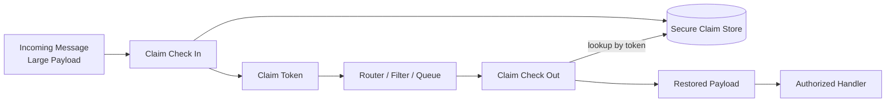
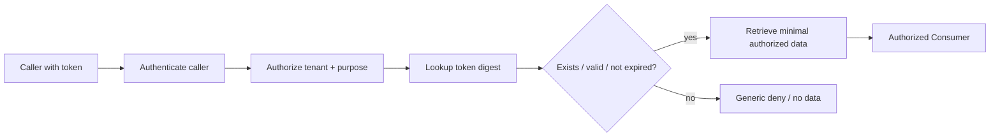
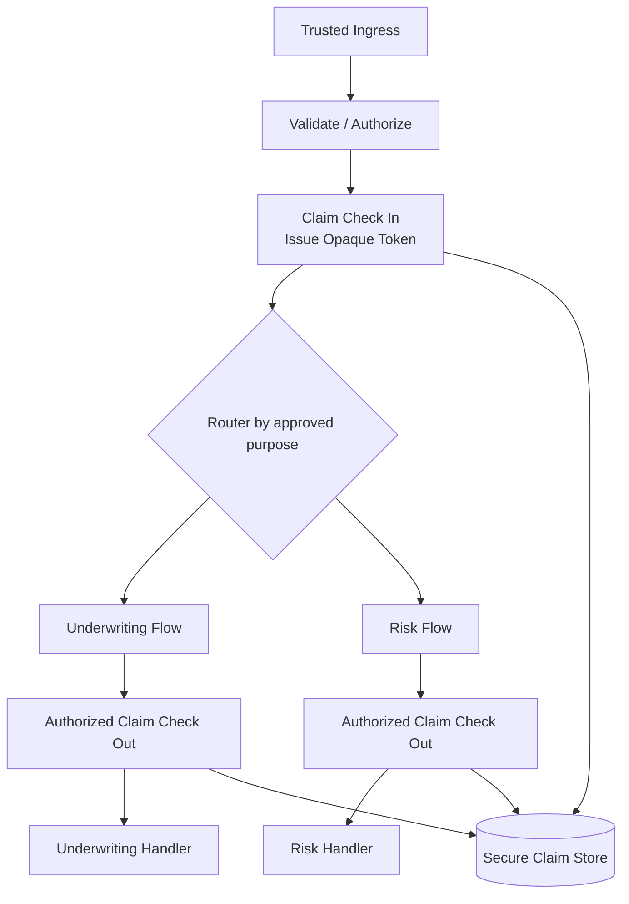
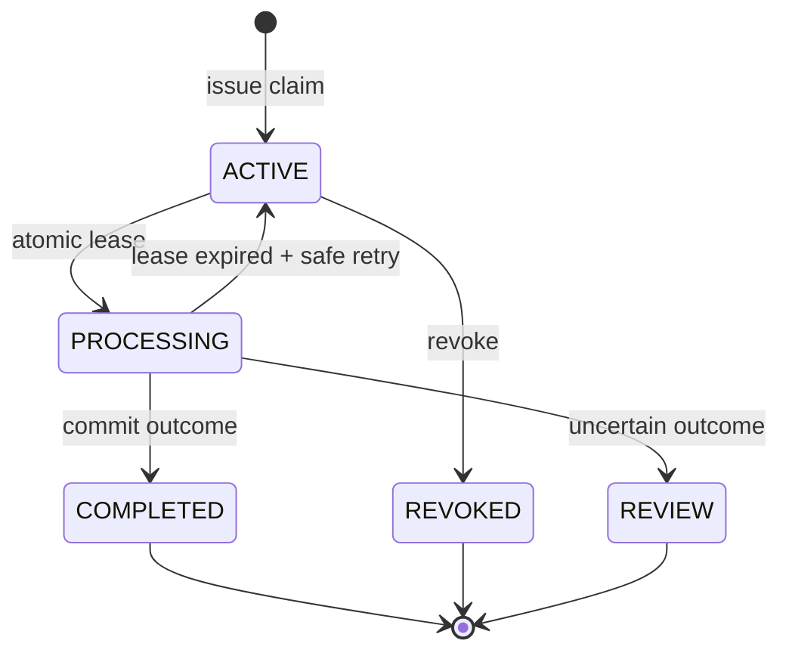
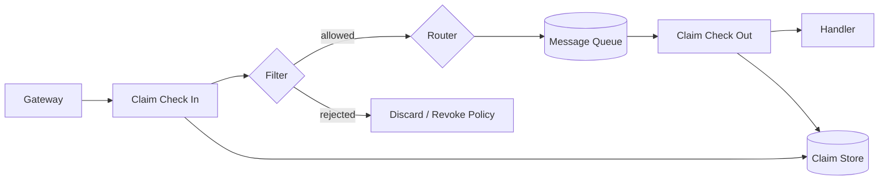
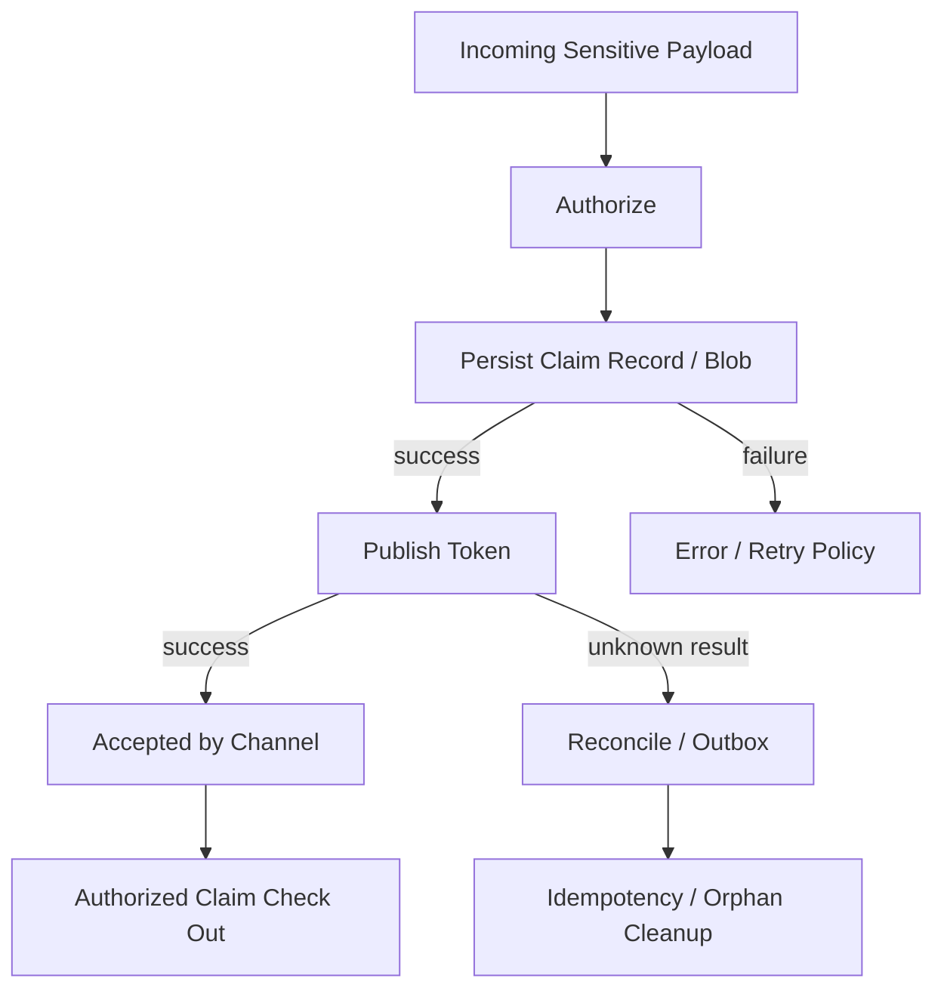
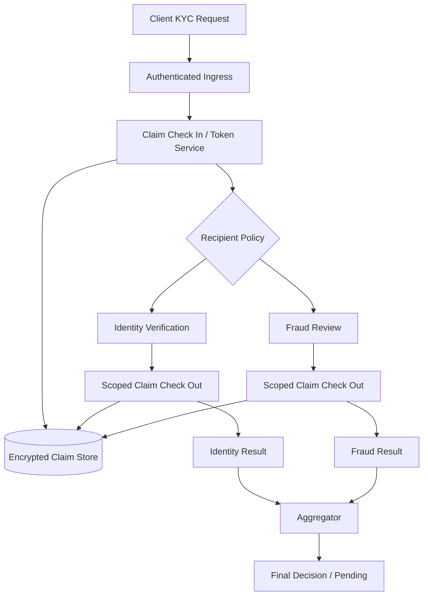

# Unpredictable claim tokens

In Enterprise Integration Patterns (EIP), **Claim Check** reduces load on the message flow by **moving large or sensitive data into a dedicated repository** and forwarding a concise reference value. Downstream components use that reference to retrieve the data only when genuinely needed.

For example, an insurance claim processing request has a multi-megabyte payload: document images, personal data, and verified attributes. Not every Router, Filter, or subscriber needs the entire content. The system can store the dossier in a secure repository, then pass a **claim token** across channels. When reaching a branch authorized to process it, that component redeems the token to restore the needed data.

However, if the token is an incrementing integer, filename, `orderId`, or easily deduced value, an attacker can guess another token to retrieve someone else's data. **Claim tokens must be cryptographically unpredictable**, while also having explicit permission scopes, expiration times, revocation mechanisms, observability, and retry handling.

The lesson **“Unpredictable claim tokens”** belongs to the **Claim check** chapter, **SPRING_INTEGRATION_PATTERN** module. The module aims at learning how to implement Enterprise Integration Patterns with Spring Integration to build loosely coupled, extensible message flows; practicing Router, Filter, Transformer, Splitter, Aggregator, Gateway, retry, error channel, correlation, and testing.

After this lesson, you will be able to explain why a Claim Check reference must have sufficiently high entropy, generate tokens with `SecureRandom`, distinguish tokens from business identifiers, design storage and permission verification, implement a sample flow using Spring Integration Java DSL, and test against token guessing, cross-tenant use, expiration, reuse, or replay.

## 1. What steps does Claim Check follow?

The idea of Claim Check: keep large or unnecessary payloads in a safe place, while the integration flow only passes a **claim check** to retrieve the data later.



Typical progression:

1. **Receive original data.** An inbound adapter or Gateway receives a message whose payload needs protection or is too large to send across every channel.
2. **Validate and authorize.** Verify tenant, data type, size, schema, and permission to store/restore.
3. **Claim Check In.** Write the payload or document into a trusted store, generate an unpredictable token, and store the token → data mapping.
4. **Forward token.** Router/Filter/transport steps carry only the reference plus minimal approved metadata.
5. **Claim Check Out.** An authorized consumer receives the token, queries the store, checks policy/expiration, and retrieves the data.
6. **Complete/revoke.** Record processing state and delete/revoke the claim according to the defined lifecycle.

Crucial point: **Claim Check is a data orchestration pattern**; replacing the payload with a short string does not automatically grant security guarantees. Token design, storage location, authorization, and expiration determine whether data can be accessed unauthorizedly.

### Example before and after Claim Check In

Original message:

```json
{
  "requestId": "req-101",
  "tenantId": "tenant-a",
  "document": {
    "type": "INSURANCE_CLAIM",
    "attachments": ["...large binary data..."],
    "personalData": "...sensitive data..."
  }
}
```

Message after issuing the claim:

```json
{
  "requestId": "req-101",
  "tenantId": "tenant-a",
  "claimType": "INSURANCE_CLAIM",
  "claimToken": "<opaque-secret-token>",
  "expiresAt": "2026-11-21T05:30:00Z"
}
```

This is an **illustrative data contract**, not Spring Integration's default output structure. Tokens must be generated securely; `expiresAt` on the message only tells receivers the expected deadline, while **the server/claim store must verify the true expiration itself**, never trusting a client-supplied expiry.

## 2. Why is an unpredictable token a security requirement?

Suppose a system issues tokens from a database sequence:

```text
claimToken=1000001
claimToken=1000002
claimToken=1000003
```

Someone obtaining token `1000002` can guess `1000001` and `1000003`. If Claim Check Out only checks whether the token exists, that is an **Insecure Direct Object Reference** (*IDOR*) vulnerability.

Another variant:

```text
claimToken="tenant-a/ORD-101/document.pdf"
```

The token embeds tenant name, order number, file path, or ID-generation rules. Attackers can discover the storage layout and probe variants.

**An unpredictable token** means someone who has not seen the token cannot practically compute another valid token solely from observed tokens or public business data.

Even so, this **does not mean** a token is safe once leaked. A bearer-style token lets whoever possesses it exercise its granted rights unless the system enforces additional checks.

### Some token sources you should not use directly

| Generation method | Problem |
| --- | --- |
| Database auto-increment ID | Next value can be guessed |
| `orderId`, `customerId`, or `filePath` | Business identifiers, easily leaked or deduced |
| `System.currentTimeMillis()` | Highly predictable |
| `Math.random()` or `java.util.Random` | Not a cryptographic random generator |
| Unsalted/unkeyed SHA-256 hash of `orderId` | Input can be guessed and re-hashed |
| Time-based or name-based UUID versions | Must not be treated as equivalent to a secret random token |
| Signed-only JWT with readable contents | A signature does not make a token unpredictable or confidential |
| Randomly generated token logged publicly | Leakage renders entropy ineffective |
| Sufficiently random token looked up without permission checks | Token holder can read out-of-scope data |

A sequential ID **can still be used as an internal database key**, but should not be exposed externally as **the secret authorizing data restoration**. You can store records with a sequential internal key and map separately via a random secret token.

## 3. Entropy: measuring token unpredictability

**Entropy** of a random token indicates the size of the space of possible values, provided the generator and distribution are truly sound.

If a token consists of `b` independent random bits, the number of possible values is:

\[
2^b
\]

Examples:

| Token | Theoretical entropy | Remarks |
| --- | ---: | --- |
| Six-digit code | Under 20 bits | Unsuitable as a bearer claim token for sensitive data without special protections |
| 16 cryptographic random bytes | 128 bits | Strong baseline when generated and used properly |
| 24 cryptographic random bytes | 192 bits | Wide safety margin |
| 32 cryptographic random bytes | 256 bits | Suitable for high-sensitivity opaque tokens |
| Hash of sequential ID | Adds no entropy | Hashing does not create randomness from predictable input |
| Standard UUID v4 | ~122 random bits | May fit some contexts; not every UUID is v4 |

**Displayed string length does not equal bits of entropy.** A 64-character hex string derived from a counter remains guessable. Conversely, 32 bytes from a CSPRNG encoded as unpadded Base64URL yield a 43-character string still carrying 256 bits of randomness.

Length selection should depend on threat model, token lifetime, issuance volume, operational constraints, and security policy. For examples in this lesson, we use **32 bytes from `SecureRandom`** to establish a clear contract.

### Tokens must be generated by a CSPRNG

A **CSPRNG** (*cryptographically secure pseudorandom number generator*) is designed so an observer cannot predict subsequent outputs from previously observed outputs under proper operating conditions.

In Java, `java.security.SecureRandom` is the appropriate API to generate cryptographic random bytes. Do not use `Math.random()`, `Random`, or homegrown mixes of timestamp and PID and treat them as security tokens.

**Do not** write your own random number generator. Using standard APIs and maintaining a secure lifecycle matters far more than inventing a token scheme.

## 4. Generating opaque claim tokens with Java SecureRandom

Example implementing a URL-safe token containing no tenant ID, order number, or deducible information.

```java
import java.security.SecureRandom;
import java.util.Base64;
import java.util.Objects;

final class SecureClaimTokenGenerator {
    private static final int TOKEN_BYTES = 32;

    private final SecureRandom random;

    SecureClaimTokenGenerator() {
        this(new SecureRandom());
    }

    SecureClaimTokenGenerator(SecureRandom random) {
        this.random = Objects.requireNonNull(random);
    }

    String generate() {
        byte[] raw = new byte[TOKEN_BYTES];
        random.nextBytes(raw);

        return Base64.getUrlEncoder()
            .withoutPadding()
            .encodeToString(raw);
    }
}
```

With 32 random bytes, an unpadded Base64URL token normally has **43 characters** from letters, digits, `-`, and `_`. Example:

```text
PJuP4tZZ5nZQmdYmeU_4QNPwzN_ydqRzJU0X3OeP3Js
```

The string above is **purely to illustrate format** and must never be used as a real secret; real tokens must be generated at runtime.

### Why Base64URL?

Base64URL uses characters better suited for headers, JSON, and many transport channels. It is **only encoding**, not secret encryption. Anyone seeing the Base64URL token sees the entire value used for lookup.

**Do not confuse**:

- Encoding: converting byte representation into characters.
- Hash: producing a one-way value for indexing/comparison.
- Encryption: protecting content using a secret key.
- Randomness: making tokens unpredictable.
- Authorization: deciding whether an actor is allowed to use the token.

Each mechanism solves a distinct requirement.

### When issuing tokens in a distributed system

Each instance's CSPRNG can generate tokens independently. Collision probability with high-entropy tokens is tiny, yet production code should still **handle duplicate inserts** via a unique constraint in the claim store and regenerate, rather than assuming the database will never reject a duplicate key.

Do not use a fixed seed to “synchronize” tokens across instances. Each request's token must be fresh secret data generated independently by a secure random source.

## 5. A token is a reference, not automatic access permission

Even when a token has 256 bits of randomness, the architecture must decide **who is allowed to claim it**.

Two common models exist:

1. **Bearer capability:** anyone holding a valid token can use it within the scope granted to that token.
2. **Opaque reference + authorization:** the token is a reference; Claim Check Out additionally checks tenant, principal, role, purpose, and workflow state.

For personal, financial, or multi-tenant data, **opaque reference + explicit authorization** is usually more appropriate. If using bearer capabilities, understand the impact of token leakage and strictly bound its permissions.



Steps in the diagram can be reordered internally to minimize leaks, but **claim content must never be released before permission checks**. Not-found/expired/wrong-tenant responses should be designed so they do not help outsiders enumerate data.

### A token is not a user identity

A token may be forwarded across multiple endpoints. Do not use the presence of a token to assume the user has been authenticated or the tenant was properly selected.

If the token sits inside an internal message emitted by a trusted Gateway, protect **the channel accessing that message**. If exposed via API, authenticate the actor and restrict redemption rights.

### Bind tokens to a purpose

A token issued to **analyze a dossier** must not be usable to **delete the dossier**. The claim store can hold metadata:

```text
tokenDigest
tenantId
claimType
purpose
subject/businessKey
createdAt
expiresAt
state = ACTIVE / REVOKED / CONSUMED / EXPIRED
payloadReference
```

These fields are a **suggested business contract**, not a default Spring Integration schema. Operations `resolve`, `consume`, `revoke`, and `purge` carry different semantics and must be designed separately.

## 6. Threat model: token guessing is only one attack vector

To design Claim Check securely, ask what an attacker can do:

| Attack vector | What can happen | Defense |
| --- | --- | --- |
| **Enumeration** | Probing tokens `1001,1002...` to view data | CSPRNG and opaque tokens, generic errors, rate limiting |
| **IDOR** | Fetching another tenant's claim with a valid token | Check tenant/actor/purpose at Claim Check Out |
| **Token leakage** | Token appears in logs, URLs, traces, tickets | Never log raw tokens, limit propagation and lifetime |
| **Replay** | Reusing token after work is already done | Consume/revoke policies, idempotency, terminal states |
| **Online brute force** | Sending many random tokens to an endpoint | Rate limits, quotas, anomaly detection, generic responses |
| **Cache poisoning** | Tampered token mapping or payload | Write to trusted store, integrity/ownership checks |
| **Cross-tenant collision** | Internal keys fail to isolate tenants, mixing data | Scope/index/policies by tenant |
| **Stale claim** | Token remains valid after data access was revoked | TTL, revocation, and source-state checks |
| **TOCTOU** | Permissions/expiry change between lookup and use | Check at side-effect boundary, proper transactions/leases |
| **Exfiltration via route** | Token sent to an unauthorized channel/recipient | Router allowlists, per-consumer permissions |
| **Oversized object** | Claim Out fetches huge payload, exhausting memory | Size caps, streaming, and backpressure |
| **Storage compromise** | Attacker reads database storing tokens/payloads | Hash tokens, encrypt data, key management and store ACLs |

**Unpredictable tokens are one layer of defense, not the whole security architecture.** If SSRF, SQL injection, or broken authorization exists at the claim-reading endpoint, high entropy alone will not save the data.

## 7. Avoid storing plaintext tokens when possible

If the claim store is compromised and stores tokens verbatim, an attacker can harvest unexpired tokens and redeem them. One way to reduce risk is storing only a **digest of the token** for lookup.

Example:

```text
Client/internal message sees:
  claimToken = 32 random bytes encoded as Base64URL

Claim store key:
  tokenDigest = SHA-256(claimToken in its canonical representation)

Claim store value:
  tenant, purpose, expiry, payload reference, status
```

The original token is still issued to the authorized recipient; the store does not need to keep the plaintext token in a directly usable column.

### 7.1. Hashing function for lookup keys

```java
import java.nio.charset.StandardCharsets;
import java.security.MessageDigest;
import java.security.NoSuchAlgorithmException;
import java.util.HexFormat;

final class ClaimTokenDigest {

    static String sha256Hex(String token) {
        try {
            MessageDigest sha =
                MessageDigest.getInstance("SHA-256");

            byte[] digest = sha.digest(
                token.getBytes(StandardCharsets.US_ASCII));

            return HexFormat.of().formatHex(digest);
        } catch (NoSuchAlgorithmException e) {
            throw new IllegalStateException(
                "SHA-256 unavailable", e);
        }
    }
}
```

In this example, tokens are generated in a single canonical encoding; if an endpoint accepts multiple equivalent representations, **normalize/validate before hashing** to avoid inconsistent behavior.

### Why hashing random tokens differs from hashing passwords

Tokens have high entropy and are randomly generated, so using a fast cryptographic hash for indexing can be appropriate within a defined threat model. Human-chosen passwords have much lower entropy and therefore require dedicated password-hashing algorithms such as Argon2/bcrypt/scrypt.

If you need to prevent offline token verification even when a database dump leaks, consider **HMAC with a server secret** as the lookup key—though you must manage key rotation, access permissions, and recovery handling. **HMAC does not replace random token generation.**

### Hashing tokens does not encrypt payloads

If a claim payload holds sensitive documents, storing a token digest **does not protect payload content** when an attacker has read access to the document table. You need appropriate encryption, database/storage ACLs, key management, tenant partitioning, and retention policies.

## 8. An auditable Claim Store structure

A minimal claim store can store:

| Field | Function |
| --- | --- |
| `tokenDigest` | Opaque lookup key with unique constraint |
| `tenantId` | Data ownership scope |
| `purpose` | Approved usage permission for the claim |
| `claimType` | Type/schema of stored payload |
| `payloadReference` or blob | Actual data location |
| `schemaVersion` | Restoration contract |
| `createdAt` | Claim issuance timestamp |
| `expiresAt` | Validity deadline |
| `state` | ACTIVE/REVOKED/CONSUMED/EXPIRED |
| `businessEventId` | Correlation and idempotency |
| `version` | Optimistic concurrency control |
| `lastAccessAt`/audit metadata | Access tracking per retention policy |

Example record:

```json
{
  "tokenDigest": "sha256:<hex-digest>",
  "tenantId": "tenant-a",
  "purpose": "PROCESS_INSURANCE_DOCUMENT",
  "claimType": "INSURANCE_CLAIM",
  "payloadReference": "private-store://document/record-101",
  "schemaVersion": 2,
  "createdAt": "2026-11-21T05:00:00Z",
  "expiresAt": "2026-11-21T05:30:00Z",
  "state": "ACTIVE",
  "businessEventId": "evt-101"
}
```

This is an **illustrative format**: do not log URIs like this in public logs or issue them as client tokens. `payloadReference` must point somewhere only the Claim Store layer is authorized to read.

### Separating internal keys from emitted tokens

A record may have a sequential `claimId` in the database. That **does not compromise secrecy** provided `claimId` is never used as a bearer token and the system resolves claims solely by token digest plus permission checks. Separating internal identity from secret tokens makes the model easier to govern.

## 9. Java pattern: issuing claims with unpredictable tokens

Let's build a pure-Java example illustrating a **secure claim/check-out contract**. This is an application layer placed beneath Spring Integration endpoints, without assuming built-in transformers automatically provide this exact entropy or authorization policy.

### 9.1. Payload, trusted principal, and claim record

```java
import java.time.Instant;
import java.util.Arrays;

record SensitiveDocument(
    String documentId,
    String schemaVersion,
    byte[] content
) {
    SensitiveDocument {
        if (documentId == null || documentId.isBlank()
                || content == null || content.length == 0) {
            throw new IllegalArgumentException(
                "Invalid document");
        }
        content = Arrays.copyOf(content, content.length);
    }

    @Override
    public byte[] content() {
        return Arrays.copyOf(content, content.length);
    }
}

record VerifiedActor(
    String actorId,
    String tenantId,
    boolean canProcessDocuments
) {}

record ClaimTicket(
    String token,
    String claimType,
    Instant expiresAt
) {}

record StoredClaim(
    String tokenDigest,
    String tenantId,
    String purpose,
    String businessEventId,
    SensitiveDocument payload,
    Instant expiresAt,
    String state
) {}
```

`VerifiedActor` must be constructed from a **verified security context**, never blindly from a client-sent tenant string. The `record` itself does not verify identity; the ingress/Gateway layer must do that.

In production, payloads are usually saved in an object store/database rather than keeping byte arrays inline in a row. The example uses a byte array to highlight the boundary between sensitive data and tokens.

### 9.2. Repository API with unique insert

```java
import java.util.Optional;

interface SecureClaimRepository {

    // Atomic insert-if-absent on tokenDigest,
    // typically backed by a UNIQUE INDEX/constraint.
    boolean insertIfAbsent(StoredClaim claim);

    Optional<StoredClaim> findByDigest(String tokenDigest);

    // Revoke token and transition state with concurrency control
    // at the database/transaction implementation layer.
    boolean revoke(String tokenDigest, String tenantId);
}
```

The interface is the contract; there must be a bean backed by real storage. A `ConcurrentHashMap` works in tests, but **must not be treated as a durable store or sufficient for multi-instance deployments**.

For multi-instance applications, `insertIfAbsent` must be **atomic in the shared store**, not a separate `if (!exists) insert` sequence prone to races.

### 9.3. Claim service generates token, writes store, then returns to caller

```java
import java.time.Clock;
import java.time.Duration;
import java.time.Instant;
import java.util.Objects;

final class SecureClaimService {
    private static final Duration TTL =
        Duration.ofMinutes(30);

    private final SecureClaimRepository repository;
    private final SecureClaimTokenGenerator generator;
    private final Clock clock;

    SecureClaimService(
            SecureClaimRepository repository,
            SecureClaimTokenGenerator generator,
            Clock clock) {
        this.repository = Objects.requireNonNull(repository);
        this.generator = Objects.requireNonNull(generator);
        this.clock = Objects.requireNonNull(clock);
    }

    ClaimTicket issue(
            SensitiveDocument document,
            VerifiedActor actor,
            String businessEventId) {
        requireAuthorized(actor);

        if (document == null
                || businessEventId == null
                || businessEventId.isBlank()) {
            throw new IllegalArgumentException(
                "Invalid claim request");
        }

        Instant expiresAt = Instant.now(clock).plus(TTL);

        // Bound retry attempts in case of collision.
        for (int attempt = 0; attempt < 4; attempt++) {
            String token = generator.generate();
            String digest =
                ClaimTokenDigest.sha256Hex(token);

            StoredClaim claim = new StoredClaim(
                digest,
                actor.tenantId(),
                "PROCESS_INSURANCE_DOCUMENT",
                businessEventId,
                document,
                expiresAt,
                "ACTIVE"
            );

            if (repository.insertIfAbsent(claim)) {
                // Emit token only after the store confirms the write.
                return new ClaimTicket(
                    token, "INSURANCE_CLAIM", expiresAt);
            }
        }

        throw new IllegalStateException(
            "Could not issue unique claim token");
    }

    SensitiveDocument resolve(
            String token,
            VerifiedActor actor) {
        requireAuthorized(actor);
        validateTokenFormat(token);

        String digest =
            ClaimTokenDigest.sha256Hex(token);

        StoredClaim claim = repository
            .findByDigest(digest)
            .orElseThrow(ClaimDeniedException::new);

        // Do not reveal whether failure is due to bad token, wrong tenant,
        // expiration, or revocation.
        if (!actor.tenantId().equals(claim.tenantId())
                || !"PROCESS_INSURANCE_DOCUMENT"
                        .equals(claim.purpose())
                || !"ACTIVE".equals(claim.state())
                || !Instant.now(clock).isBefore(
                    claim.expiresAt())) {
            throw new ClaimDeniedException();
        }

        return claim.payload();
    }

    private static void requireAuthorized(
            VerifiedActor actor) {
        if (actor == null
                || actor.actorId() == null
                || actor.actorId().isBlank()
                || actor.tenantId() == null
                || actor.tenantId().isBlank()
                || !actor.canProcessDocuments()) {
            throw new ClaimDeniedException();
        }
    }

    private static void validateTokenFormat(String token) {
        // 32 CSPRNG bytes -> 43 unpadded Base64URL characters.
        if (token == null
                || !token.matches("[A-Za-z0-9_-]{43}")) {
            throw new ClaimDeniedException();
        }
    }
}

final class ClaimDeniedException extends RuntimeException {
    ClaimDeniedException() {
        super("Claim unavailable");
    }
}
```

Guarantees visible in the code:

1. `SecureRandom` creates unpredictable tokens.
2. The store receives the **digest** of the token, avoiding plaintext token storage.
3. `insertIfAbsent` avoids returning an unsaved token or overwriting someone else's record.
4. `tenantId` and processing permissions are verified on both **issue and resolve**.
5. The store verifies `expiresAt` on resolve without trusting caller-supplied time.
6. `ClaimDeniedException` uses a generic message, avoiding disclosing whether a token belongs to another tenant.
7. `Clock` is injected so expiration can be tested without `Thread.sleep`.

### Limitations that must be stated clearly

This is **not yet a complete production Claim Service**:

- `SecureClaimRepository` lacks a database/transaction implementation.
- `VerifiedActor` must originate from a real security context; passing a dummy record does not create authentication.
- `resolve` illustrates **multi-read within TTL**, not one-time claim or atomic consumption.
- Payload size limits, encryption, rate limiting, monitoring, key rotation, and per-document permissions are absent.
- There is no automatic revocation when an actor's permissions change, beyond current authentication policies reflecting updated rights.
- If a token is issued twice for the same business event due to retries, the service may create **two valid claim records**, so idempotent issuance is needed if workflows require a single claim.
- When a record stays ACTIVE until TTL expires, a purge job is needed; **logical expiration does not delete physical data**.
- `document.content()` may contain sensitive data resident in memory during processing; real systems must control lifecycles and prevent logging.

Do not copy this example into a real system and claim end-to-end exactly-once or complete data protection.

## 10. Why shouldn't tokens be derived from framework message IDs?

Spring Integration offers the **Claim Check In/Out** pattern and `MessageStore` to save/restore messages. When using built-in transformers/endpoints, the claim check typically represents a **reference to a stored message**. However, **do not assume every framework-generated reference/ID is a bearer secret meeting application entropy, TTL, tenant isolation, and one-time-use policies**.

If a claim token must cross boundaries exposed to attack, evaluate:

- Was the emitted ID **designed to be a secret**, or merely an identifier key?
- Is the ID generation mechanism verified to be **unpredictable**?
- Does the Claim Check Out layer authenticate/authorize and check purpose?
- Can tokens be **expired/revoked**?
- Does the store save plaintext tokens or only digests/indexes?
- Could the token leak into logs, traces, or unauthorized queues?
- When messages are replayed, do Claim Check In records multiply?

**The safe solution is not arbitrarily patching `MessageStore` internals.** You can wrap the Claim Check pattern with an opaque claim-service/token layer and an application-controlled repository, or prove that the chosen framework component satisfies all constraints under your concrete configuration.

### Claim Check In and Out are not encrypt/decrypt

- **Claim Check In:** stores message/payload and emits a reference.
- **Claim Check Out:** retrieves message/payload from the store by reference.
- **Encryption:** protects content at rest or in transit.
- **Authentication/authorization:** verifies who may use the reference.
- **Retention:** defines when data must be deleted.

A Claim Check In component can be implemented correctly from a messaging standpoint while still **lacking application-level security controls**. Do not equate messaging pattern correctness with a secure dossier storage system.

## 11. Spring Integration Java DSL: integrating Claim Service with flows

We integrate `SecureClaimService` into two processing steps:

- **Issue flow:** receives sensitive data from an authenticated caller, saves to store, returns `ClaimTicket`.
- **Resolve flow:** receives token plus authenticated context, returns `SensitiveDocument` if authorized and unexpired.

The example uses `transform` to implement the Claim Check pattern with a service. That is **an application implementation with Spring Integration**, not a claim that `transform` generates tokens or enforces permissions by itself. Framework-dedicated Claim Check In/Out components may be used when their contracts and security policies fit.

### 11.1. Request contracts for Gateway

```java
record IssueClaimCommand(
    SensitiveDocument document,
    VerifiedActor verifiedActor,
    String businessEventId
) {}

record ResolveClaimCommand(
    String claimToken,
    VerifiedActor verifiedActor
) {}
```

These commands are designed for **internal post-authentication flows**. In a real REST controller, never accept a client-supplied `verifiedActor` in JSON and treat it as authenticated. The controller must derive identity/tenant/permissions from a trusted security system before creating the command.

### 11.2. Gateway and flows

```java
import org.springframework.context.annotation.Bean;
import org.springframework.context.annotation.Configuration;
import org.springframework.integration.annotation.Gateway;
import org.springframework.integration.annotation.IntegrationComponentScan;
import org.springframework.integration.annotation.MessagingGateway;
import org.springframework.integration.channel.DirectChannel;
import org.springframework.integration.config.EnableIntegration;
import org.springframework.integration.dsl.IntegrationFlow;
import org.springframework.messaging.MessageChannel;

@MessagingGateway
interface SecureClaimGateway {
    @Gateway(requestChannel = "claims.issue")
    ClaimTicket issue(IssueClaimCommand command);

    @Gateway(requestChannel = "claims.resolve")
    SensitiveDocument resolve(ResolveClaimCommand command);
}

@Configuration
@EnableIntegration
@IntegrationComponentScan
class SecureClaimIntegrationConfiguration {

    @Bean("claims.issue")
    MessageChannel issueChannel() {
        return new DirectChannel();
    }

    @Bean("claims.resolve")
    MessageChannel resolveChannel() {
        return new DirectChannel();
    }

    @Bean
    SecureClaimTokenGenerator secureClaimTokenGenerator() {
        return new SecureClaimTokenGenerator();
    }

    @Bean
    SecureClaimService secureClaimService(
            SecureClaimRepository repository,
            SecureClaimTokenGenerator generator) {
        return new SecureClaimService(
            repository, generator, java.time.Clock.systemUTC());
    }

    @Bean
    IntegrationFlow issueClaimFlow(SecureClaimService claims) {
        return IntegrationFlow.from("claims.issue")
            .transform(IssueClaimCommand.class, command ->
                claims.issue(
                    command.document(),
                    command.verifiedActor(),
                    command.businessEventId()))
            .get();
    }

    @Bean
    IntegrationFlow resolveClaimFlow(SecureClaimService claims) {
        return IntegrationFlow.from("claims.resolve")
            .transform(ResolveClaimCommand.class, command ->
                claims.resolve(
                    command.claimToken(),
                    command.verifiedActor()))
            .get();
    }
}
```

The configuration assumes the Spring Integration DSL dependency, a real `SecureClaimRepository` bean implementation, the defined DTOs/services, and Gateway registration via `@IntegrationComponentScan`.

With `DirectChannel`, exceptions generally propagate back to the Gateway caller. To avoid leaking information, the API layer must map `ClaimDeniedException` to a generic policy-compliant response; never return stack traces or details like “token belongs to another tenant”.

**Important:** If the application needs to forward the token across Router/Queue/broker between the two flows, an intermediate component must emit `ClaimTicket` or an envelope carrying the token onto an authorized channel. The example above illustrates two independent internal request–reply Gateways to focus on token security and correctness.

### 11.3. Combining with Router and Filter

A realistic flow might look like:



If both branches need the data, **one-time consume** cannot be applied naively: the first branch redeeming successfully would break the second branch. Instead, use a **scoped multi-use** contract, issue separate tokens per recipient, or have one authenticated step read and distribute only minimally required data.

### 11.4. Header propagation across Claim Check

When replacing payload with token and later restoring payload, headers like `businessEventId`, `correlationId`, `replyChannel`, and `errorChannel` may matter downstream.

Do not copy every header across trust boundaries. Keep **accurate, permitted** metadata, and understand that framework components may synthesize or merge headers per configuration. If constructing `Message<?>` manually, test propagation and never trust client-supplied control headers.

## 12. TTL, expiration, and claim revocation

An unpredictable token that **lives forever** still raises risk if leaked in the future. Lifetime should follow **job lifecycle**.

Examples:

| Job status | Claim token | Policy |
| --- | --- | --- |
| Pending processing | ACTIVE | Only authorized recipients may resolve |
| Completed | CONSUMED/REVOKED or usage expired | Do not continue issuing tokens |
| Past deadline | EXPIRED | Deny resolve; purge data per retention |
| Customer revokes consent | REVOKED | Do not wait for TTL |
| Valid audit investigation | Do not re-expose old token publicly | Access via separate authorized audit workflow |
| Broker redelivery | May receive old token again | Retry/idempotency policy must be defined |

**TTL is both a security and operational choice**; no single expiration fits every claim. A dossier used for 30 minutes can pick a shorter TTL than a document workflow taking several hours.

### Logical expiration vs physical deletion

Once `now >= expiresAt`, Claim Check Out must deny access per policy. Stored data may still linger until a purge job runs. Distinguish:

1. **Access expiry:** can no longer be redeemed.
2. **Record purge:** deletes the token → payload mapping.
3. **Payload deletion:** deletes actual blobs and copies/backups per valid retention.
4. **Audit retention:** may keep minimal metadata without keeping tokens/raw payloads.

Do not expose payload paths so users can delete directly. Purges must be server-authorized and recoverable if a step fails.

## 13. Consume-once: preventing replay while handling crashes

Many systems want tokens to be used **only once**. The goal is blocking replays after a claim succeeds.

An easy-to-break approach:

```text
1. SELECT claim WHERE tokenDigest = X AND state = ACTIVE
2. Return payload
3. UPDATE claim SET state = CONSUMED
```

Two concurrent requests can both read `ACTIVE` before either updates it. Both receive the data.

You need an **atomic claim/lease/transition** in the store, e.g. transactional compare-and-set:

```sql
UPDATE claims
SET state = 'CONSUMED'
WHERE token_digest = :digest
  AND tenant_id = :tenant
  AND purpose = :purpose
  AND state = 'ACTIVE'
  AND expires_at > :now;
```

Proceed only if the updated row count matches expectations and permissions were checked. The SQL above **only illustrates the transition condition**; it neither returns the payload nor proves tenant/actor authentication, and must be paired with transactions/locking or a consistent retrieval step.

### Consume before or after side effects?

There are two opposing issues:

- **Consume before calling downstream:** blocks replay, yet if the process crashes before processing, the token is spent and work may get stuck.
- **Consume after downstream succeeds:** easier to retry, yet if downstream commits side effects and the ack is lost, the token remains ACTIVE and risks reprocessing.

For critical workflows, use a **lease/processing state + idempotency key + outcome store/outbox** model rather than treating consume-once as an exactly-once silver bullet.



This is an **illustrative application state machine**. Spring Integration Claim Check does not include all these states automatically.

## 14. Retry, redelivery, and idempotent issuance

A message traversing a broker may be reprocessed due to lost acks or restarts. If every Claim Check In run creates a brand-new token, one business event can spawn multiple claim records:

```text
evt-101 attempt 1 -> claimToken A -> broker publish timeout
evt-101 attempt 2 -> claimToken B -> event duplicated
```

Both token A and B could be valid during TTL. That complicates reconciliation and multiplies copies of sensitive data.

### When should the same token be re-emitted?

Do not blindly adopt “same event always returns the old token,” because keeping plaintext tokens around to return conflicts with digest-only storage policies. Choose one of these approaches:

- **Idempotent command/outbox:** record the confirmed claim issuance result in a secure store, delivering it to recipients via a suitable workflow transaction.
- **Authorized durable token envelope:** keep the token encrypted under strict ACLs until publishing is confirmed; never write plaintext tokens to logs.
- **Per-attempt claim with clear generation/version:** revoke the old claim once a new attempt is accepted.
- **Avoid repeating Claim Check In:** save one claim before the retry stage and retry **downstream steps** using the existing claim ticket.

No single choice fits every system. Ensure retries never allow **unauthorized document read/writes**, duplicate business side effects, and can trace relationships among tokens issued for the same event.

### Correlation does not replace claim tokens

`businessEventId` or `correlationId` is metadata for linking work and deduplicating. They can be logged/displayed. **A claim token is a secret/capability** and must not be used as an ID in normal metrics or logs.

Distinguish clearly:

| Value | Role | Safe to log? |
| --- | --- | --- |
| `businessEventId` | Correlation and idempotency | Controlled |
| `correlationId`/`traceId` | Tracing across endpoints | Controlled |
| Internal `claimId` | Store record key | Per internal policy only |
| `claimToken` | Secret authorizing claim lookup | **Never log verbatim** |
| `tokenDigest` | Token lookup index | Restricted; avoid as public lookup key |
| `payloadReference` | Locates data inside store | Share only with authorized components |

## 15. Tokens through Gateway, Router, Filter, and channels

In Spring Integration, a flow can pass through many components:



Because tokens are secrets, design every stage:

- **Gateway:** caller already authenticated; never accept `VerifiedActor` from client JSON.
- **Claim Check In:** verify write permission, emit token only after store confirms insert.
- **Filter:** drop/reject tokens outside policy without logging tokens upon discard.
- **Router:** select destinations from trusted metadata; never embed internal channel names in tokens.
- **Queue/broker:** protect topic/queue read ACLs, TLS, encryption, retention, and subscriber visibility.
- **Claim Check Out:** validate token format, tenant, purpose, expiry, state, and actor permissions.
- **Handler:** re-verify domain authorization at side-effect boundaries when needed.
- **Error channel:** handle exceptions per configuration without putting plaintext tokens into public error messages.

### If a Filter discards a claim token, what happens to the payload?

A Filter discard does not automatically revoke the token or delete the stored payload. If discard means “no longer needed,” an authorized recovery/cleanup branch must revoke the claim. If other recipients still use the same token, immediate revocation breaks them: **token lifecycle must fit the fan-out model**.

### What if a Router uses the token as a routing key?

Random tokens carry no business meaning; never parse or classify routes from token strings. Route using server-issued `claimType`, `purpose`, or metadata while keeping the token strictly a reference. Never pack sensitive data inside a token so a Router can “conveniently read it”.

## 16. Never leak tokens via URLs, logs, metrics, or traces

A 256-bit token is still unsafe if it lands in an unprivileged log collector.

### Common leak points

- **URL query parameters**, e.g. `?claimToken=...`: can enter access logs, browser history, Referer headers, or analytics.
- **HTTP access logs**: middleware recording request headers/bodies.
- **Exception messages**: `throw new RuntimeException("Invalid " + token)`.
- **Distributed tracing**: span attributes holding raw tokens.
- **Message broker monitoring UI**: dashboards displaying queue payloads.
- **Support tickets/chat**: users pasting full tokens into support replies.
- **Metric labels**: `claimToken` has extreme cardinality and leaks data.
- **Debug dumps**: DTO `toString()` printing token fields.
- **Client storage**: local storage is unsuitable for sensitive secrets in many threat models.

**There is no trick like “hash the token in logs” that solves everything.** A stable digest still enables unintended correlation and leaks metadata. Log only strictly permitted fields per policy.

### Safer log format

```json
{
  "event": "claim_resolve_denied",
  "claimType": "INSURANCE_CLAIM",
  "reasonCategory": "INVALID_OR_UNAVAILABLE",
  "tenantScope": "tenant-a",
  "requestId": "req-101",
  "outcome": "DENIED"
}
```

Never put `claimToken` or raw payload/document contents into logs. If investigation of a claim is required, use a **separate system-issued audit ID** and an access-controlled audit store rather than turning tokens into public lookup tools.

### Transmitting tokens over the network

Use TLS and contract-compliant headers/bodies; limit lifetimes and recipients. When tokens travel between services, mTLS or service authentication identifies which services may redeem them. Still, **TLS only protects transit**; it does not stop a receiving service from logging the token.

## 17. Avoid leaking information via error responses and timing

If an endpoint returns:

```text
token does not exist
token exists but belongs to tenant-b
token belongs to tenant-a but expired
```

an attacker can use differing responses to probe valid records. Return a unified public error—such as `Claim unavailable` or an HTTP status matching the API contract—while internal audits classify the exact cause under restricted permissions.

**Never promise that changing error text eliminates all side channels.** Response times, body sizes, and rate limits can also reveal information. When required by your threat model, control timing/responses and monitor anomalous queries. To stop online brute force, always enforce rate limits and attempt caps at the API boundary.

### Do not turn every store error into “invalid token”

If the database is down, returning “claim does not exist” masks operational outages. The API layer may expose **limited public detail**, while internals must distinguish:

- Invalid/expired/revoked token.
- Unauthorized actor.
- Store timeout/unavailable.
- Corrupt payload/schema mismatch.
- Processing outcome unknown.

**An infrastructure failure must not automatically trigger a new token request.** Doing so can generate redundant claims while the source is failing.

## 18. Security testing: unpredictability is only one criterion

A test asserting only that a token “looks long and weird” is insufficient. Verify the **generation source**, format, uniqueness within test scope, and usage policies.

### 18.1. Unit testing the generator with Java/JUnit 5

```java
import static org.junit.jupiter.api.Assertions.*;
import java.util.HashSet;
import java.util.Set;
import org.junit.jupiter.api.Test;

class SecureClaimTokenGeneratorTest {

    @Test
    void tokenHasExpectedOpaqueUrlSafeFormat() {
        SecureClaimTokenGenerator generator =
            new SecureClaimTokenGenerator();

        String token = generator.generate();

        assertEquals(43, token.length());
        assertTrue(token.matches("[A-Za-z0-9_-]{43}"));
        assertFalse(token.contains("tenant-a"));
    }

    @Test
    void generatedTokensAreDistinctInSmallSample() {
        SecureClaimTokenGenerator generator =
            new SecureClaimTokenGenerator();
        Set<String> tokens = new HashSet<>();

        for (int i = 0; i < 1_000; i++) {
            assertTrue(tokens.add(generator.generate()));
        }
    }
}
```

**Test limitation:** 1,000 distinct tokens is not a cryptographic proof of entropy. Design assurance comes from using `SecureRandom` and the defined random byte count; tests catch obvious implementation bugs like returning constants, wrong formatting, or accidental token reuse.

**Never use `new SecureRandom(seedFixed)` in production** to make tests deterministic and accidentally leave it in place. To test collision handling, inject a fake generator in a dedicated test rather than replacing the production random source.

### 18.2. Claim Check Out test matrix

| Scenario | Expected outcome |
| --- | --- |
| Valid token, matching tenant, matching purpose, unexpired | Returns exact document |
| Token altered by one character | Rejected, no payload returned |
| Non-existent token | Rejected with generic response |
| Token belonging to another tenant | Rejected, no content leaked |
| Actor lacks permissions | Rejected even with valid token |
| Expired token | Rejected even if row not yet purged |
| Revoked token | Rejected |
| Store unavailable | Infrastructure error/retry policy; not faked as bad token |
| Corrupt payload | Corrupted content not returned; audit/repair policy |
| Two concurrent redemptions under one-time policy | Only one atomic transition allowed |
| Broker replay of issuance | No unintended duplicate tokens/side effects |
| Token logged by exception | Tests/inspections must detect and block |
| Token on metric label | Disallowed |
| Claim fan-out to two subscribers | Each branch redeems per designed rights/mechanism |
| Token expires between lookup and processing | Clear TOCTOU policy |
| Very large claim | Size limits, streaming/backpressure |
| Claim already completed when message arrives late | Appropriate terminal state and audit |

### 18.3. Testing time with Clock

```java
import static org.junit.jupiter.api.Assertions.*;
import java.time.Clock;
import java.time.Duration;
import java.time.Instant;
import java.time.ZoneOffset;
import org.junit.jupiter.api.Test;

class ClaimExpiryPolicyTest {

    @Test
    void expiryDecisionUsesServerTime() {
        Instant issuedAt =
            Instant.parse("2026-11-21T05:00:00Z");
        Instant expiresAt =
            issuedAt.plus(Duration.ofMinutes(30));

        Clock validTime = Clock.fixed(
            issuedAt.plusSeconds(60), ZoneOffset.UTC);
        Clock expiredTime = Clock.fixed(
            issuedAt.plus(Duration.ofMinutes(31)),
            ZoneOffset.UTC);

        assertTrue(Instant.now(validTime).isBefore(expiresAt));
        assertFalse(Instant.now(expiredTime).isBefore(expiresAt));
    }
}
```

This is a **test illustrating the time condition**, not a full integration test of the repository/service. To test `SecureClaimService` properly, use a test-only fake/in-memory repository, inject `Clock`, and invoke `resolve` before/after expiration while asserting expected behavior.

### 18.4. Spring Integration integration test

With `SecureClaimGateway` and a test repository:

1. Call `issue` with an authenticated actor in the fixture.
2. Assert token matches expected format and record is stored by digest.
3. Assert the stored record **contains no plaintext token** per repository design.
4. Call `resolve` with the same actor/tenant; assert original data.
5. Call `resolve` with another tenant; assert rejection.
6. Mutate one character of the token; assert rejection.
7. Advance `Clock` past deadline; assert rejection.
8. Simulate repository error; assert error path distinguishes infrastructure failure from claim denial.
9. If one-time policy applies, run two concurrent calls and verify atomic transition.
10. Verify logs, error channel, and broker transport do not emit tokens where disallowed.

**Do not test only the plain-Java service and assume Gateway, headers, and error channel work properly.** Test at the Spring Integration boundary whenever the system actually uses request–reply or async channels.

## 19. Observing Claim Check without leaking secrets

A solid design still needs metrics and audits to track whether claims are issued, resolved, expired, or revoked.

Suggested metrics:

```text
claim_issue_total{claim_type="insurance",result="success"}
claim_issue_total{claim_type="insurance",result="store_error"}
claim_resolve_total{claim_type="insurance",result="success"}
claim_resolve_total{claim_type="insurance",result="denied"}
claim_resolve_total{claim_type="insurance",result="store_error"}
claim_expire_total{claim_type="insurance"}
claim_revoke_total{claim_type="insurance"}
claim_store_bytes{claim_type="insurance"}
claim_resolve_duration_seconds{claim_type="insurance"}
```

These are **illustrative metric names** that an application can instrument, not a full set of default Spring Integration metrics. Never use tokens, digests, document IDs, or request IDs as metric labels due to cardinality and sensitivity.

An audit record might contain:

```json
{
  "auditId": "audit-9088",
  "event": "claim_resolved",
  "businessEventId": "evt-101",
  "claimType": "INSURANCE_CLAIM",
  "actorId": "processor-7",
  "tenantId": "tenant-a",
  "result": "SUCCESS",
  "timestamp": "2026-11-21T05:05:00Z"
}
```

This sample contains neither the token nor the original sensitive data. `actorId`/`tenantId` may still be protected data; apply masking/retention and access control per policy.

### Alerts

Monitor for:

- Sudden spikes in denied resolutions.
- An actor/service repeatedly sending malformed tokens.
- Long-lived backlog of ACTIVE claims.
- Rising store error rates or resolve latency.
- Purge backlogs and divergence between expired metadata and undeleted payloads.
- Abnormally high ratio of multiple claims issued for one business event.
- Wrong-purpose or cross-tenant access attempts.
- Total stored blob bytes and data retention age.

Do not rely on `claim_issue_success` alone to conclude data was processed downstream: successful issuance only means **the claim was created and stored**.

## 20. Claim tokens across message brokers and external systems

When a token travels over Kafka, JMS, AMQP, or HTTP, it becomes a **secret in motion across transports**. Even though the main payload lives in the Claim Store, the token can leak if too many readers subscribe to the queue/topic.

Verify:

- TLS/mTLS and access permissions among producers, brokers, and consumers.
- Topic/queue ACLs by service/tenant or business scope.
- Broker retention: expired tokens may linger in retained messages.
- DLQs and replays: tokens may expire while awaiting reprocessing; need a valid recovery flow.
- Message headers: do not place tokens in headers logged publicly or unintentionally mapped to HTTP.
- Schema/version: consumers know what claim type the token represents and its expiration rules.
- Fan-out conditions: which claim is each subscriber authorized to read?
- Correlation and idempotency: use dedicated IDs; never treat tokens as business keys.

**Avoid putting tokens into URLs** if the protocol supports better-protected headers or bodies. If a system must use link-style URLs, evaluate browser history, Referer headers, access logs, token lifetime, and true permission scope.

### Claim Check is not only for large payloads

It can also curb spreading sensitive data to branches that should not access it. Still, it **does not automatically make a system privacy/compliance-ready**: a service holding a token with overly broad permissions can still read data if authorization is weak.

## 21. Interaction with Splitter, Aggregator, and Scatter-Gather

### 21.1. Splitter

If a large message has 20 parts yet each worker only needs one segment, consider **one claim per part** or a shared claim supporting scoped partial reads. A single shared token for the whole payload may grant overly broad access to individual workers.

If Splitter runs after Claim Check In, the token-carrying message does not automatically yield 20 parts unless you design an additional manifest/index. If Splitter runs before Claim Check In, it can generate 20 tokens and noticeably increase record volume. Choose based on needed data, size, and per-recipient permissions.

### 21.2. Aggregator

An Aggregator can gather **processing results** from multiple parts without fetching the entire original payload. However, if the Aggregator must restore data from claims, ensure tokens are not revoked/expired before group release.

If a group times out while parts remain unprocessed, you need a token retention or authorized reissue policy for retries. **Group timeouts do not automatically extend claim TTL.**

### 21.3. Scatter-Gather and Publish-Subscribe

When a token is broadcast to multiple subscribers, each branch may need to claim the data. That affects:

- **One-time vs multi-use:** a shared one-time token fails if three subscribers all need to read.
- **Least privilege:** subscriber A may only need one field; granting a token to the whole document is too broad.
- **Independent failures:** one subscriber must not revoke a shared token while another branch is still running.
- **Late replies:** if the gatherer times out, the claim may still need to stay alive to handle late results.
- **Observability:** track per-subscriber claim access without logging tokens.

If branches need different subsets of data, issue **per-recipient/scoped tokens** rather than distributing a single overly broad bearer token.

## 22. Error channel, retry, and consistency with the claim store

A Claim Check In involves at least two actions: **writing data** and **emitting the token**. If writing succeeds while token publication fails, an **orphan claim** can arise. If the token is published before data is durably stored, consumers may fail to resolve it.



Key strategies:

- **Save first, emit second**; never emit a token without stored data.
- Across a separate database and broker, use a **transactional outbox** or suitable recovery workflow; never promise atomicity across two independent systems by fiat.
- Run **orphan cleanup** for claims saved yet never referenced.
- Retry publication idempotently without minting new tokens recklessly.
- On error channels, carry the business event ID and reason code, **never putting plaintext tokens into exceptions/logs**.
- If Claim Check Out sees a valid token while the blob is not yet ready, classify it as an infrastructure/consistency error rather than declaring the token invalid.
- When a side effect executed yet the ack was lost, use idempotency/reconciliation before calling downstream again.

### Distinguishing errors from rejections

| Situation | Classification | Handling |
| --- | --- | --- |
| Malformed token | Invalid token | Reject, rate limit |
| Unauthorized actor | Authorization denied | Reject, audit |
| Expired token | Expired | Reject; valid workflow may request reissue |
| Record does not exist | Unknown token | Generic rejection |
| Claim Store unreachable | Infrastructure failure | Retry/backoff/error path |
| Payload schema invalid | Data contract failure | Quarantine/repair per policy |
| Downstream timeout after side effect | Outcome unknown | Reconcile/idempotency |
| Claim discarded by Filter | Business/process decision | Revoke/retain per lifecycle; do not treat as store error |

**Error channel** receives an `ErrorMessage` when an endpoint's error-handling mechanism publishes it per configuration. With `DirectChannel`, exceptions may bubble back to the caller. Having an `errorChannel` alone does not guarantee every claim-service error routes there.

## 23. When to use Claim Check, and when not to

Claim Check is useful when:

- Payloads are large and many steps need only metadata.
- Sensitive data should not traverse the whole pipeline.
- Multiple workers can fetch authorized data right when needed.
- Data storage with dedicated lifecycle/retention must be decoupled from message transport.
- Broker message size/quota limits reject direct payloads.

However, it adds costs:

- One extra store write and at least one store read.
- Claim Store becomes a critical dependency.
- Must manage token secrets, TTLs, revocation, concurrency, and privacy.
- Retry/redelivery becomes more complex.
- If the store is unavailable, workflows cannot restore data.
- Permissions must be checked at both issuance and resolution.

If payloads are tiny, every recipient is authorized to read them, and message volume is modest, switching to Claim Check may bring negligible benefit. If payloads require streaming, consider partial/range or stream APIs rather than loading entire objects into RAM.

**Do not adopt Claim Check merely because tokens look “safer” than payloads.** You need a concrete threat model and architectural justification.

## 24. Exercise: claim tokens for customer KYC dossiers

A multi-tenant KYC dossier system receives document photos and identity details from clients. Data must go through two branches: **Identity Verification** and **Fraud Review**. Each branch needs only a subset of attributes; the system must audit all retrievals and support retries if one branch is slow.

Requirements:

1. Tokens contain no customer ID, tenant ID, filename, or deducible timestamp.
2. Tokens remain unpredictable even if an attacker has observed several prior tokens.
3. Only services authorized for the matching tenant and purpose can redeem them.
4. Clients cannot pass a self-asserted `VerifiedActor` to gain permissions.
5. Tokens expire and can be revoked when a dossier is deleted.
6. Tokens must never be logged in Gateway, Router, error channels, or tracing.
7. Broker redelivery must not accidentally create unwanted duplicate claim records.
8. A slow Identity Verification branch must not deprive Fraud Review of shared claim access without an explicit policy.
9. If Claim Store fails, the system must not mask it with “token not found,” impeding investigation.
10. Metrics/audits are needed by request ID and outcome, without using tokens as metric labels.



Answer these questions:

1. Which Java API generates the token, and which encoding should be used?
2. Should the lookup key be stored as plaintext token, SHA-256 digest, or HMAC? Choose based on the threat model.
3. If service A holds a valid token belonging to tenant B, what blocks retrieval?
4. If a shared one-time token is used for both subscribers, what happens? What solution fits better?
5. A token expires while Fraud Review is still processing: auto-extend TTL or use an authorized renew/lease workflow?
6. If two redemptions race, how do you guarantee atomic state transition?
7. If the record is written yet token publishing fails, how do you find orphan claims and recover?
8. If the system restarts between two steps, which states must be persisted durably?
9. How do you prevent tokens from appearing in access logs, DLQs, or metrics?
10. If clients need progress tracking, should they use the secret token or a separate public request ID?
11. Which test proves cross-tenant access is denied even when the token actually exists?
12. If a token leaks, how do you revoke it and determine impact scope via audits?

**Completion criteria:** design includes CSPRNG, opaque tokens, tenant/purpose authorization, expiry/revocation, durable and secure storage, idempotency/recovery, tests against enumeration/IDOR/replay, and observability without exposing tokens.

## 25. Pre-production checklist for claim tokens

- [ ] Tokens are generated by a **CSPRNG**, not counters, timestamps, or business identifiers.
- [ ] Length and entropy match the threat model; 32 random bytes is a strong baseline example.
- [ ] Tokens use Base64URL/suitable encoding without confusing encoding with encryption.
- [ ] Claim Store enforces unique constraints and handles token collisions.
- [ ] Plaintext tokens are neither stored nor logged unless strictly required.
- [ ] Token digest/HMAC and payload encryption are chosen separately for their protection goals.
- [ ] Callers are authenticated; tenant/purpose/actor permissions are checked on issue and resolve.
- [ ] Client-supplied tenant/role values in payloads/headers are never trusted.
- [ ] TTL, access expiry, revocation, purging, and retention are explicitly defined.
- [ ] If one-time use is required, state transitions are atomic with crash recovery.
- [ ] Broker retries/redeliveries and idempotent issuance are designed.
- [ ] Tokens never leak unintentionally into URLs/logs/errors/metrics/traces.
- [ ] Claim Store and blob store have proper ACLs and encryption.
- [ ] Claim tokens are never confused with business event IDs or correlation IDs.
- [ ] Router/Filter/fan-out share tokens strictly within authorized scopes.
- [ ] Error handling distinguishes invalid claims from store outages and unknown downstream outcomes.
- [ ] Timeouts, rate limits, quotas, payload size limits, and backpressure are configured.
- [ ] Audits/metrics cover issue/resolve/revoke/expire without exposing secrets.
- [ ] Tests verify cross-tenant access, altered tokens, expiry, revocation, concurrent consumption, and replay.
- [ ] Framework/DSL implementation is verified against the exact Spring Integration version in use.

## Key takeaways

**Unpredictable claim tokens** are a vital element of secure Claim Check. In Java, use `SecureRandom` to create high-entropy opaque tokens—such as 32 random bytes encoded as Base64URL—instead of sequential IDs, filenames, timestamps, or hashes of predictable IDs.

However, **unpredictability does not equal authorization**. Claim Check Out must check tenant, actor, purpose, state, and expiration; the store needs secure storage, revocation/purging, retry/idempotency, and appropriate one-time or fan-out handling. When wiring tokens through Spring Integration Gateways, Routers, Filters, Splitters/Aggregators, or brokers, shield tokens from logs, traces, and out-of-scope propagation, and thoroughly test error paths.

A sound Claim Check system does more than transmit lighter messages: it **enables restoring the exact data, to the right component, at the right time, using a reference that is unpredictable yet controllable and revocable**.
