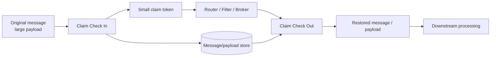
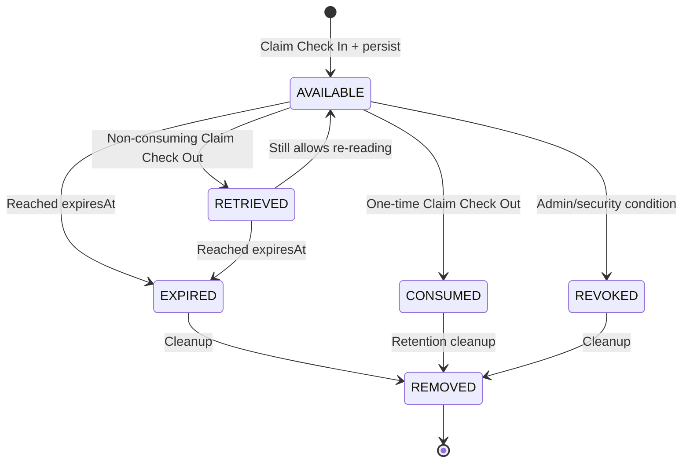
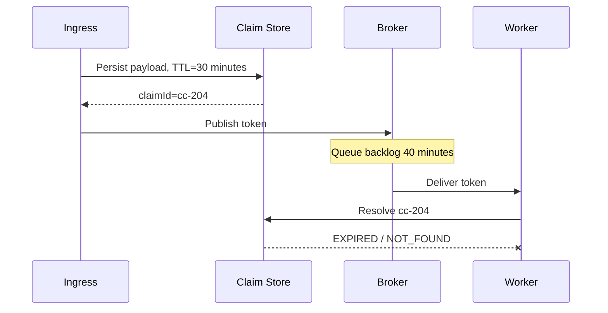
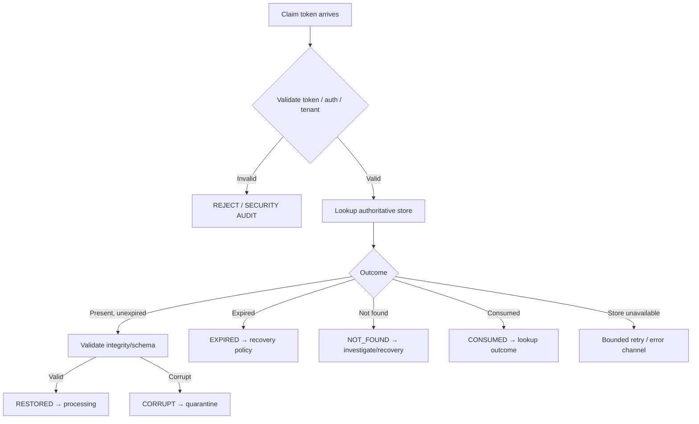
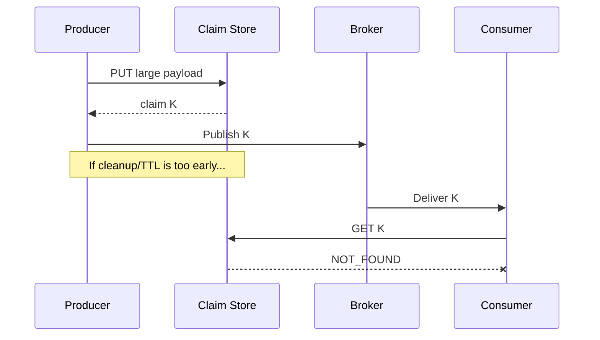
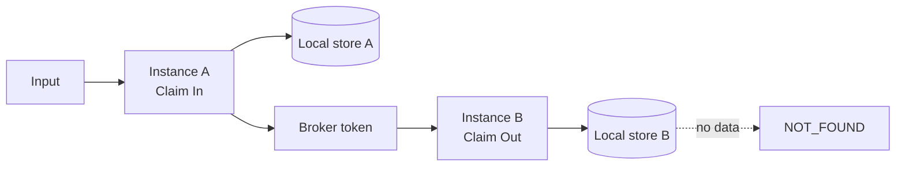
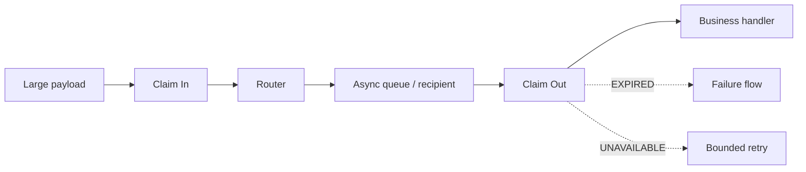

# Expired or missing claims

## 1. The problem: holding a claim ticket when the data is gone

An order-dossier processing system receives messages containing large documents. Rather than sending the entire payload through multiple channels and adapters, the application saves the payload in a store and passes a **claim check**—a small reference used to retrieve the data later.

Example:

```text
09:00  Receive OrderDocument(orderId=O-204, 12 MB)
09:00  Claim Check In:
       store content in repository with claimId=cc-204
       expiresAt=09:30
09:01  Forward claimId through Router/Filter/queue steps
09:31  Claim Check Out:
       fetch content using claimId=cc-204
       → failed: claim expired or does not exist
```

This failure is unlike a JSON parse error or channel send error: the message still contains a seemingly valid claim check, yet **the reference cannot be restored into the original data**.

In practice, the same “cannot find claim” symptom can stem from very different causes:

- The claim **expired at the business level** even though it still sits in the store.
- The claim expired and was **physically deleted** by a cleanup job.
- The claim was never created or the ID was transmitted wrongly.
- The claim was already **consumed/removed** during an earlier Claim Check Out.
- The claim was saved in instance A's memory, while the request landed on instance B.
- The store is temporarily unavailable, timed out, or threw a query error.
- The consumer used the wrong tenant/namespace and lacks permission to fetch the data.
- The token was forged, has an outdated version, or points to a corrupted record.

A sound solution must **classify the cause, define recovery behavior, and avoid losing data on retry**. Merely writing `if (value == null) return null` masks numerous bugs.

The lesson **“Expired or missing claims”** belongs to the **Claim check** chapter, **SPRING_INTEGRATION_PATTERN** module. This module teaches implementing Enterprise Integration Patterns with Spring Integration to build loosely coupled, extensible message flows; practicing Router, Filter, Transformer, Splitter, Aggregator, Gateway, retry, error channel, correlation, and testing/observing branches.

After this lesson, you will be able to:

1. Explain a claim's lifecycle and the meaning of expiration.
2. Distinguish `EXPIRED`, `NOT_FOUND`, `CONSUMED`, `UNAVAILABLE`, and `ACCESS_DENIED`.
3. Design TTL, retention, backup, and recovery aligned with message lifespan.
4. Write a Spring Integration Java DSL example for claim storage and restoration with explicit error handling.
5. Use JUnit to test expiration with a fake clock instead of `Thread.sleep()`.
6. Protect claims per tenant without confusing a claim ID with authentication or an idempotency key.
7. Analyze crash windows, retries, replays, shared storage, and one-time claim mechanics.

## 2. Recap of the Claim Check EIP

In Enterprise Integration Patterns, **Claim Check** enables sending a small message carrying a *claim ticket* instead of continuing to pass large or sensitive data through the whole process.



**Claim Check In** stores the original in a repository and emits a reference. **Claim Check Out** uses that reference to read the original or restore required content per contract.

Spring Integration provides related components such as `ClaimCheckInTransformer`, `ClaimCheckOutTransformer`, and `MessageStore`. Specific store usage, whether retrieval deletes the message, and DSL/XML options must be checked against the Spring Integration version in use.

**Never assume:**

- Claim Check grants TTL automatically to every store.
- Memory inside one JVM is accessible from another instance.
- Claim Check Out always returns data whenever a token is well-formed.
- Successful Claim Check Out means downstream committed the business transaction.
- Keeping only the token can restore the original once the store is lost.
- Configuring `MessageStore` solves all tenant permissions and idempotency automatically.

Claim Check lightens **message transport**, yet shifts durability responsibility from message transport to **the reference store**.

## 3. A claim has its own lifecycle apart from the message

Instead of thinking only “saved” or “not saved,” model the lifecycle:



This is a **recommended business model**, not a state machine auto-created by Spring Integration. A basic `MessageStore` may only have or lack a record, knowing nothing about `EXPIRED` and `CONSUMED`.

Distinguish four timestamps:

| Timestamp | Example | Meaning |
| --- | --- | --- |
| `createdAt` | 09:00 | Store accepted the data record |
| `expiresAt` | 09:30 | After this point, claiming is no longer **permitted** per contract |
| `consumedAt` | 09:05 | Retrieved/consumed under one-time semantics, if applicable |
| `deletedAt` | 10:00 | Record **physically** deleted from store |

A claim can be **expired yet not deleted** if cleanup runs in batches. Conversely, once cleanup deletes the record, a subsequent lookup sees only non-existence. You cannot reliably distinguish historically between “expired” and “never existed” without keeping suitable metadata/tombstones.

### Expiry boundary rule

If the contract specifies `expiresAt` as an *exclusive* bound, then:

\[
\text{active} \iff now < expiresAt
\]

At exact `now=expiresAt`, the claim is already expired. Never let one API use `now > expiresAt` while another uses `now >= expiresAt`; that produces inconsistent boundary behavior.

## 4. Five cases that look like “cannot retrieve claim”

| Internal state | Cause | Should retry with same token? | Appropriate handling path |
| --- | --- | --- | --- |
| **EXPIRED** | Exceeded TTL/policy; record may remain | Usually no, unless authorized renewal/reissue exists | Failure/recovery workflow; never bypass TTL |
| **NOT_FOUND** | ID never created, deleted, wrong namespace, state lost | Retry only if evidence of write visibility lag exists; otherwise investigate | Check correlation, store, backups, and retry budget |
| **ALREADY_CONSUMED** | One-time claim already redeemed | Should not re-read by default | Return recorded outcome or recover by operation ID |
| **STORE_UNAVAILABLE** | DB/Redis/store timeout, connection error | Bounded retry with backoff and deadline | Error flow, alerts, circuit breaker; do not label NOT_FOUND |
| **ACCESS_DENIED** | Wrong tenant/permission, invalid token | Do not retry blindly; re-verify permissions | Deny access, security audit, leak no data |

Additionally:

- **CORRUPT/SCHEMA_MISMATCH:** record exists, yet bytes fail decoding, checksum fails, or schema is too old.
- **REVOKED:** access rights revoked before expiration.
- **IN_PROGRESS:** another worker is claiming/restoring; not yet conclusively consumed.

**Important:** for untrusted callers, you may need to return the same generic response for `NOT_FOUND` and `ACCESS_DENIED` to avoid **disclosing that a claim exists in another tenant**. Internally, still audit the true cause under restricted access.

### Do not turn store timeouts into null

A dangerous bug:

```java
// Anti-pattern: infrastructure failure turned into "no data".
try {
    return store.get(claimId);
} catch (Exception ex) {
    return null;
}
```

When the store is temporarily down, the flow receives `null` and might synthesize default data or drop the message. That turns a recoverable outage into **silent message loss**.

Distinguish **true not-found** from **lookup inability** via typed exceptions/error results.

## 5. Questions to answer before designing TTL

A 30-minute TTL sounds ample when normal processing takes 10 seconds. Yet messages can face:

- Queue backlogs during peak hours.
- Broker redeliveries after lost ACKs.
- Worker downtime or rolling deployments.
- Waiting for manual approval.
- Landing in a DLQ and being replayed by an operator days later.
- Waiting for an Aggregator/Saga to finish another branch.
- A Gateway timing out while remote work continues running.

Example:



The broker path still worked: the token was not lost. However, **the original data lost recoverability** because the store's lifecycle was shorter than the message's lifecycle.

### Thinking formula for claim lifespan

A safe retention level should be designed according to:

\[
T_{\text{claim-retention}} \ge
T_{\text{queue-delay}} + T_{\text{processing}} +
T_{\text{retry/recovery-margin}}
\]

This is only an **estimation model**, not a fixed SLA formula. If retries can extend past normal processing or DLQs are replayed after 30 days, include that replay window. In some systems, only **persisting until business completion confirmation + audit retention** fits; a short standalone TTL is wrong.

| Item to estimate | Question |
| --- | --- |
| Queue delay | What is the longest queue backlog possible? |
| Workflow deadline | How long can the slowest branch/Saga/Gateway wait? |
| Retries | Attempt count, backoff, intervals between attempts? |
| DLQ | After how long may operators replay? |
| Recovery guarantees | Can the payload be recovered from the source or another snapshot? |
| Capacity/cost | Can the system afford longer storage? |
| Privacy | Are there data deletion deadlines or storage restrictions? |
| Consumption policy | Single-use or multi-use claim; how many recipients share it? |

Do not extend all claims indefinitely just to dodge expiry errors. Combine **bounded retention + explicit recovery + access control**.

## 6. Logical TTL differs from physical cleanup

There are two layers:

1. **Logical expiration:** reading a claim must check its expiry; if `expiresAt` has passed, return `EXPIRED` even if the data still sits in the database.
2. **Physical cleanup:** a job deletes bytes/rows/files or objects once eligible, reclaiming capacity.

If you rely solely on an hourly cleanup job, an expired claim can remain readable for up to an extra hour. If you check logical expiry without cleanup, the store grows forever.

State table:

| Metadata | Data present? | Safe lookup |
| --- | --- | --- |
| `ACTIVE, expiresAt > now` | Yes | Allow if authorized |
| `ACTIVE, expiresAt <= now` | Yes | Reject `EXPIRED` |
| Expired and cleaned up | No | `NOT_FOUND`, or `EXPIRED` if tombstone exists |
| `CONSUMED` | Yes/no | Disallow re-read in one-time mode |
| `REVOKED` | Yes/no | Deny access |
| Row exists, bytes missing | Incomplete | `CORRUPT/MISSING_BLOB`; do not assume processed |

A **tombstone** is a metadata record without payload that retains the reason/identifier to recognize that a claim once existed and was consumed/expired. It helps deduplication/auditing, yet carries its own retention, security, and cost.

### Redis/Cache TTL differs from business TTL

A Redis key can disappear automatically when its TTL expires. From the client side, `GET` returning null does not prove whether:

- The key never existed.
- The key expired.
- The key was deleted by an admin.
- The key changed namespace.
- The store changed state due to failover or eviction.

If you need to distinguish states, persist appropriate metadata/tombstones in a store with the needed durability or emit separate audit events. **Never infer root cause from null alone.**

## 7. One-time claims and multi-read claims are two different contracts

**Multi-read claims** allow restoring the payload multiple times within a validity window. Suitable when:

- Multiple recipients are authorized to read the same data.
- Workers may retry processing after lookup.
- Downstream needs to re-fetch data for reconciliation.

**One-time claims** allow consuming a claim only once. Suitable when single-issuance semantics or restricted reuse are required, though crash/retry handling demands great care.

```text
Claim Check In → token K

Worker A retrieves token K, then crashes before business commit.
Worker B retries token K.

Multi-read: can read K again if unexpired.
One-time: K may already be CONSUMED → cannot read again.
```

A naive “GET then immediately DELETE” implementation does not guarantee end-to-end safety. It can create a state where **the payload is deleted before the side effect needing that payload commits**.

### One-time consumption must tie to the commit point

If exact single consumption is required, model it as:

```text
AVAILABLE → CLAIMED/LEASED → COMPLETED
                       └── timeout/recovery → AVAILABLE or RETRYABLE
```

Or use one transaction containing **marking consumed and the business update** when the same database supports both. If downstream is an HTTP API on another system, a local transaction does not cover the remote side effect; you need **idempotency keys, outbox, and lookup/compensation workflows**.

**Do not assume Claim Check Out deletes records in every configuration.** Keeping or deleting data after retrieval depends on transformer options, store, and architecture. Check your exact configuration and test concretely.

## 8. Designing tokens and metadata

A claim ID should be strictly an **opaque reference**; it should not contain the whole payload. Yet to enforce expiration and auditing, keep metadata on the server.

Example record:

```json
{
  "claimId": "cc8e1059-55d5-4f3d-88ec-222223818252",
  "tenantId": "tenant-A",
  "documentType": "ORDER_ATTACHMENT",
  "schemaVersion": "attachment-v2",
  "createdAt": "2026-11-21T09:00:00Z",
  "expiresAt": "2026-11-21T09:30:00Z",
  "state": "AVAILABLE",
  "payloadLocation": "private://claim-store/...",
  "payloadChecksum": "sha256:<hash>",
  "storageVersion": 4
}
```

The data above is an **application-layer illustrative schema**, not a built-in Spring Integration record.

Key attributes:

| Attribute | Why it is needed |
| --- | --- |
| `claimId` | Access the record unpredictably |
| `tenantId` | Prevent cross-tenant access |
| `createdAt/expiresAt` | Enforce retention/expiry |
| `state` | Distinguish available, consumed, revoked |
| `schemaVersion` | Decode payload with the right version |
| `checksum` | Verify byte integrity when needed |
| `payloadLocation` | Separate metadata from large blobs |
| `storageVersion` | Optimistic locking/CAS across multiple workers |
| `claimPolicyVersion` | Explain why a given TTL/consume policy was chosen |

### Claim ID is not an access license

A hard-to-guess random UUID lowers collision/guessing odds, yet **cannot replace authentication and authorization**. Holding a token does not automatically entitle someone to retrieve another tenant's data.

At the boundary, derive the tenant from authenticated identity and check scope and permissions before reading the payload. When returning errors externally, you can merge `NOT_FOUND`/`ACCESS_DENIED` to prevent enumeration; internal audits must distinguish them.

**Do not put claim IDs into public URLs or logs in ways that expose access rights.** A token can turn into a *bearer reference* if service authorization checks are lax.

## 9. Architecture for handling failed Claim Check Out



A solid flow has more than a single `catch(Exception)`. It answers:

1. Was the claim successfully created before the token was emitted?
2. Does the token match the right namespace/store and authenticated tenant?
3. Is the lookup failure **permanent** or **transient**?
4. Does a valid recoverable copy/snapshot exist?
5. If already consumed, did **the prior processing outcome** commit?
6. Should the caller receive an error, HOLD, DLQ, or a new reference?
7. What events can observability record without leaking payloads?

## 10. Java example: in-memory claim store with explicit TTL

To illustrate testable semantics, we implement a **minimal application repository** and connect it with Spring Integration Java DSL in section 11.

The example does not replace built-in `ClaimCheckInTransformer`/`ClaimCheckOutTransformer` APIs; it clarifies what a plain `MessageStore` does not provide automatically: **error classification, clock-based TTL checks, tenant isolation, and token policies**.

### 10.1. Model

```java
import java.time.Instant;
import java.util.UUID;

record OrderDocument(
        String tenantId,
        String orderId,
        String content) {}

record ClaimTicket(
        UUID claimId,
        String tenantId,
        Instant expiresAt) {}

enum ClaimFailure {
    INVALID_INPUT,
    NOT_FOUND,
    EXPIRED,
    ACCESS_DENIED,
    STORE_UNAVAILABLE
}

final class ClaimLookupException extends RuntimeException {

    private final ClaimFailure reason;

    ClaimLookupException(ClaimFailure reason) {
        super("Claim lookup failed: " + reason);
        this.reason = reason;
    }

    ClaimFailure reason() {
        return reason;
    }
}
```

**Note:** this is an illustrative error taxonomy; in public APIs you may need to map `ACCESS_DENIED` to a generic `not available` response. Do not disclose the existence of another tenant's claim to unauthorized callers.

### 10.2. Repository

```java
import java.time.Duration;
import java.time.Instant;
import java.util.Objects;
import java.util.UUID;
import java.util.concurrent.ConcurrentHashMap;
import java.util.concurrent.ConcurrentMap;
import java.util.function.Supplier;

record SavedClaim(
        OrderDocument body,
        String ownerTenant,
        Instant expiresAt) {}

final class InMemoryClaimRepository {

    private final ConcurrentMap<UUID, SavedClaim> records =
        new ConcurrentHashMap<>();

    private final Supplier<Instant> now;

    InMemoryClaimRepository(Supplier<Instant> now) {
        this.now = Objects.requireNonNull(now);
    }

    ClaimTicket put(
            OrderDocument document,
            String authenticatedTenant,
            Duration ttl) {

        if (document == null
                || blank(document.tenantId())
                || blank(document.orderId())
                || document.content() == null
                || blank(authenticatedTenant)
                || ttl == null
                || ttl.isZero()
                || ttl.isNegative()) {
            throw new ClaimLookupException(
                ClaimFailure.INVALID_INPUT);
        }

        if (!authenticatedTenant.equals(document.tenantId())) {
            throw new ClaimLookupException(
                ClaimFailure.ACCESS_DENIED);
        }

        Instant expiresAt = now.get().plus(ttl);
        UUID claimId = UUID.randomUUID();

        records.put(
            claimId,
            new SavedClaim(
                document, authenticatedTenant, expiresAt));

        return new ClaimTicket(
            claimId, authenticatedTenant, expiresAt);
    }

    OrderDocument restore(
            ClaimTicket ticket,
            String authenticatedTenant) {

        if (ticket == null
                || ticket.claimId() == null
                || ticket.expiresAt() == null
                || blank(authenticatedTenant)) {
            throw new ClaimLookupException(
                ClaimFailure.INVALID_INPUT);
        }

        SavedClaim saved = records.get(ticket.claimId());

        // External errors may combine NOT_FOUND/ACCESS_DENIED.
        // Never leak info about another tenant's claim.
        if (saved == null) {
            throw new ClaimLookupException(
                ClaimFailure.NOT_FOUND);
        }

        if (!authenticatedTenant.equals(saved.ownerTenant())
                || !authenticatedTenant.equals(ticket.tenantId())) {
            throw new ClaimLookupException(
                ClaimFailure.ACCESS_DENIED);
        }

        // ExpiresAt in the token is not authoritative:
        // read the true expiration from the store.
        if (!ticket.expiresAt().equals(saved.expiresAt())) {
            throw new ClaimLookupException(
                ClaimFailure.INVALID_INPUT);
        }

        if (!now.get().isBefore(saved.expiresAt())) {
            throw new ClaimLookupException(
                ClaimFailure.EXPIRED);
        }

        return saved.body(); // MULTI-READ; does not delete claim.
    }

    // Cleanup job for illustration only:
    // after deleting the record, lookup yields only NOT_FOUND.
    void purgeExpired() {
        Instant instant = now.get();
        records.entrySet().removeIf(entry ->
            !instant.isBefore(entry.getValue().expiresAt()));
    }

    private static boolean blank(String value) {
        return value == null || value.isBlank();
    }
}
```

**What does this code guarantee?**

- The ticket carries only ID, tenant, and expiry, not the large content.
- On `put()`, the repository verifies the payload's tenant matches the authenticated tenant.
- On `restore()`, the repository fetches the payload by ID and checks owner and true store expiry.
- Claims at exact `expiresAt` are rejected.
- Before purging, the repository distinguishes `EXPIRED` from `NOT_FOUND`.
- Once purged, the repository alone cannot tell whether the ID ever existed.
- The same ticket can restore multiple times before expiry because this is **multi-read**.

**What does this code not guarantee?**

- Not durable across restarts; the Map loses data.
- Does not share state across multiple instances.
- Performs no encryption, checksums, schema migration, or auditing.
- Has no real authentication: `authenticatedTenant` must be passed by an already-authenticated internal caller.
- Has no transaction with publishing the claim token.
- Has no one-time consumption or duplicate-write lock.
- Does not implement `STORE_UNAVAILABLE` because a local Map has no remote connection; when swapping in JDBC/Redis, classify infrastructure failures.
- Must not be used as-is for personal/financial data or zero-loss flows.

In a real application, keep a `ClaimRepository` interface so an adapter can plug in database/object storage with durable metadata. **Business expiry policy must live in one clear place**, not scattered across Routers/Gateways.

## 11. Spring Integration Java DSL: Claim In and Claim Out with error handling

To show the connection with Spring Integration, the following configuration uses **Service Activators** as the claim and restore endpoints backed by one repository. It illustrates how the pattern operates; for standard needs you can use the framework's built-in Claim Check transformers.

```java
import java.time.Duration;
import java.time.Instant;
import java.util.Map;

import org.springframework.context.annotation.Bean;
import org.springframework.context.annotation.Configuration;
import org.springframework.integration.channel.DirectChannel;
import org.springframework.integration.channel.QueueChannel;
import org.springframework.integration.config.EnableIntegration;
import org.springframework.integration.dsl.IntegrationFlow;

@Configuration
@EnableIntegration
public class ClaimExpiryFlowConfig {

    @Bean
    InMemoryClaimRepository claimRepository() {
        return new InMemoryClaimRepository(Instant::now);
    }

    @Bean("claim.original.in")
    DirectChannel claimOriginalInput() {
        return new DirectChannel();
    }

    @Bean("claim.ticket.out")
    QueueChannel claimTicketOutput() {
        return new QueueChannel();
    }

    @Bean("claim.restore.in")
    DirectChannel claimRestoreInput() {
        return new DirectChannel();
    }

    @Bean("claim.restored.out")
    QueueChannel claimRestoredOutput() {
        return new QueueChannel();
    }

    @Bean
    IntegrationFlow createClaim(InMemoryClaimRepository repo) {
        return IntegrationFlow.from("claim.original.in")
            .handle(OrderDocument.class,
                (document, headers) -> repo.put(
                    document,
                    trustedTenant(headers),
                    Duration.ofMinutes(30)))
            .channel("claim.ticket.out")
            .get();
    }

    @Bean
    IntegrationFlow restoreClaim(InMemoryClaimRepository repo) {
        return IntegrationFlow.from("claim.restore.in")
            .handle(ClaimTicket.class,
                (ticket, headers) -> repo.restore(
                    ticket,
                    trustedTenant(headers)))
            .channel("claim.restored.out")
            .get();
    }

    static String trustedTenant(Map<String, Object> headers) {
        Object tenant = headers.get("verifiedTenantId");

        if (!(tenant instanceof String value)
                || value.isBlank()) {
            throw new ClaimLookupException(
                ClaimFailure.ACCESS_DENIED);
        }

        return value;
    }
}
```

**Explanation:**

1. Flow `createClaim` receives `OrderDocument`, requires the server-side `verifiedTenantId` header, saves data, and returns `ClaimTicket`.
2. The ticket goes to `claim.ticket.out`. In a real system, the token can proceed to a Router, Filter, or broker.
3. Flow `restoreClaim` receives the ticket, verifies the authenticated tenant, and calls the repository.
4. If lookup succeeds, the original payload goes to `claim.restored.out`.
5. If the claim does not exist, expired, or lacks permission, the repository throws an exception; on a synchronous `DirectChannel`, the error propagates back to the sender.
6. `QueueChannel` only facilitates checking results in tests; it is not a durable broker.

**Never treat `verifiedTenantId` as safe merely because of its name.** The example assumes the header was set by **trusted ingress** after authentication, forbidding clients from supplying or overwriting it. Production must enforce this at the adapter/security boundary and test header spoofing.

### When using built-in Claim Check Transformers

Spring Integration includes Claim Check In/Out components that work with `MessageStore`. In that form, tokens and messages are transformed by the framework rather than an application-defined `ClaimTicket`.

Whether built-in or custom:

- If the store returns missing messages, define a `NOT_FOUND` policy.
- If TTL is desired, know which store owns expiration, where metadata lives, and how cleanup runs.
- If retrieval can delete records, understand exact semantics under retries and duplicates.
- When deleting tokens/messages, know which producer/consumer has ACKed or committed.
- Verify business headers, correlation, and tenant permissions across the Claim In/Out boundary.

**Do not assume `MessageStore` provides all APIs/semantics of a claim ledger with expiry, consumed state, and authorization.** If those states are needed, implement them in the application layer or choose suitable storage.

## 12. JUnit: testing expiration with a fake clock

Tests do not need a Spring context to verify TTL logic. Use `AtomicReference<Instant>` as a deterministic mutable clock in unit tests.

```java
import static org.assertj.core.api.Assertions.assertThat;
import static org.assertj.core.api.Assertions.assertThatThrownBy;

import java.time.Duration;
import java.time.Instant;
import java.util.UUID;
import java.util.concurrent.atomic.AtomicReference;

import org.junit.jupiter.api.Test;

class InMemoryClaimRepositoryTest {

    private final AtomicReference<Instant> clock =
        new AtomicReference<>(
            Instant.parse("2026-11-21T09:00:00Z"));

    private final InMemoryClaimRepository repo =
        new InMemoryClaimRepository(clock::get);

    private OrderDocument document() {
        return new OrderDocument(
            "tenant-A", "O-204", "large document data");
    }

    @Test
    void activeClaimRestoresOriginalDocument() {
        ClaimTicket ticket = repo.put(
            document(), "tenant-A", Duration.ofMinutes(30));

        assertThat(repo.restore(ticket, "tenant-A"))
            .isEqualTo(document());

        // Multi-read: second read still succeeds.
        assertThat(repo.restore(ticket, "tenant-A"))
            .isEqualTo(document());
    }

    @Test
    void claimExpiresAtExactBoundaryWithoutSleeping() {
        ClaimTicket ticket = repo.put(
            document(), "tenant-A", Duration.ofMinutes(30));

        clock.set(Instant.parse("2026-11-21T09:30:00Z"));

        assertThatThrownBy(() ->
            repo.restore(ticket, "tenant-A"))
            .isInstanceOf(ClaimLookupException.class)
            .satisfies(ex -> assertThat(
                ((ClaimLookupException) ex).reason())
                    .isEqualTo(ClaimFailure.EXPIRED));
    }

    @Test
    void purgedExpiredClaimBecomesNotFound() {
        ClaimTicket ticket = repo.put(
            document(), "tenant-A", Duration.ofSeconds(10));

        clock.set(Instant.parse("2026-11-21T09:00:11Z"));
        repo.purgeExpired();

        assertThatThrownBy(() ->
            repo.restore(ticket, "tenant-A"))
            .isInstanceOf(ClaimLookupException.class)
            .satisfies(ex -> assertThat(
                ((ClaimLookupException) ex).reason())
                    .isEqualTo(ClaimFailure.NOT_FOUND));
    }

    @Test
    void neverStoredClaimIsNotFound() {
        ClaimTicket ticket = new ClaimTicket(
            UUID.randomUUID(),
            "tenant-A",
            Instant.parse("2026-11-21T09:30:00Z"));

        assertThatThrownBy(() ->
            repo.restore(ticket, "tenant-A"))
            .isInstanceOf(ClaimLookupException.class)
            .satisfies(ex -> assertThat(
                ((ClaimLookupException) ex).reason())
                    .isEqualTo(ClaimFailure.NOT_FOUND));
    }

    @Test
    void cannotRestoreClaimForAnotherTenant() {
        ClaimTicket ticket = repo.put(
            document(), "tenant-A", Duration.ofMinutes(30));

        assertThatThrownBy(() ->
            repo.restore(ticket, "tenant-B"))
            .isInstanceOf(ClaimLookupException.class)
            .satisfies(ex -> assertThat(
                ((ClaimLookupException) ex).reason())
                    .isEqualTo(ClaimFailure.ACCESS_DENIED));
    }

    @Test
    void forgedExpiryDoesNotExtendStoredClaim() {
        ClaimTicket original = repo.put(
            document(), "tenant-A", Duration.ofMinutes(30));

        ClaimTicket forged = new ClaimTicket(
            original.claimId(),
            original.tenantId(),
            original.expiresAt().plus(Duration.ofDays(1)));

        assertThatThrownBy(() ->
            repo.restore(forged, "tenant-A"))
            .isInstanceOf(ClaimLookupException.class)
            .satisfies(ex -> assertThat(
                ((ClaimLookupException) ex).reason())
                    .isEqualTo(ClaimFailure.INVALID_INPUT));
    }
}
```

**What the tests prove:**

- Within expiry: payload can be restored.
- At exact expiration instant: `EXPIRED`.
- After cleanup: metadata gone, `NOT_FOUND`.
- Unsaved ID: `NOT_FOUND`.
- Wrong tenant: access denied.
- Cannot extend expiry just by altering the timestamp inside the token.

These tests do **not** simulate real Redis/JDBC, transactions, transport, or crashes. With real stores, add integration tests for connection failures, failovers, cleanup races, and retention.

## 13. Integration test: Claim In → Claim Out

To verify Spring Integration wiring, use `MessageChannel` and `QueueChannel` with the configuration from section 11.

```java
import static org.assertj.core.api.Assertions.assertThat;
import static org.assertj.core.api.Assertions.assertThatThrownBy;

import java.time.Instant;
import java.util.UUID;

import org.junit.jupiter.api.Test;
import org.springframework.beans.factory.annotation.Autowired;
import org.springframework.beans.factory.annotation.Qualifier;
import org.springframework.integration.channel.QueueChannel;
import org.springframework.messaging.Message;
import org.springframework.messaging.MessageChannel;
import org.springframework.messaging.support.MessageBuilder;
import org.springframework.test.context.junit.jupiter.SpringJUnitConfig;

@SpringJUnitConfig(ClaimExpiryFlowConfig.class)
class ClaimExpiryFlowTest {

    @Autowired
    @Qualifier("claim.original.in")
    MessageChannel originalInput;

    @Autowired
    @Qualifier("claim.ticket.out")
    QueueChannel tickets;

    @Autowired
    @Qualifier("claim.restore.in")
    MessageChannel restoreInput;

    @Autowired
    @Qualifier("claim.restored.out")
    QueueChannel restored;

    @Test
    void storesTokenThenRestoresPayloadWithinSameTenant() {
        OrderDocument original = new OrderDocument(
            "tenant-A", "O-204", "large payload");

        assertThat(originalInput.send(
            MessageBuilder.withPayload(original)
                .setHeader("verifiedTenantId", "tenant-A")
                .setHeader("requestId", "req-204")
                .build())).isTrue();

        Message<?> tokenMessage = tickets.receive(1_000);
        assertThat(tokenMessage).isNotNull();
        assertThat(tokenMessage.getPayload())
            .isInstanceOf(ClaimTicket.class);
        ClaimTicket token =
            (ClaimTicket) tokenMessage.getPayload();

        assertThat(restoreInput.send(
            MessageBuilder.withPayload(token)
                .setHeader("verifiedTenantId", "tenant-A")
                .setHeader("requestId", "req-204")
                .build())).isTrue();

        Message<?> result = restored.receive(1_000);
        assertThat(result).isNotNull();
        assertThat(result.getPayload()).isEqualTo(original);
        assertThat(result.getHeaders().get("requestId"))
            .isEqualTo("req-204");
        assertThat(restored.receive(0)).isNull();
    }

    @Test
    void missingTokenDoesNotProduceFakePayload() {
        ClaimTicket unknown = new ClaimTicket(
            UUID.randomUUID(), "tenant-A",
            Instant.now().plusSeconds(600));

        assertThatThrownBy(() -> restoreInput.send(
            MessageBuilder.withPayload(unknown)
                .setHeader("verifiedTenantId", "tenant-A")
                .build()))
            .isInstanceOf(RuntimeException.class);

        assertThat(restored.receive(0)).isNull();
    }
}
```

**Limitation:** The Spring context test assumes messages flow synchronously over `DirectChannel` and the repository uses a Map. When replaced with a poller, executor, or broker, exceptions generally do not return to the sender in the same way; verify the exact error flow, deadlines, and message store state. The test also does not simulate an expired claim inside the Spring context; the unit test with a fake clock already verified that logical boundary.

### A common pitfall when testing queues

If a context or output queue is shared across multiple tests without draining it completely, later tests can observe leftover messages. Use distinct token IDs, drain outputs, and isolate fixtures when needed; never rely on test execution order.

## 14. Recovering an expired claim: what should be done?

When receiving `EXPIRED`, no single action fits every system. Policy depends on data origin and side-effect state.

### Option A — Reject and record a traceable failure

If the payload is sensitive data accessible for only 30 minutes, it must not be re-read after expiry. The flow should:

1. Reject the restore.
2. Record a failure event with safely masked/encrypted `requestId`/`claimId` and reason.
3. Notify the caller or route to manual review.
4. Never fabricate an empty/default payload and send it downstream.

**Important:** never auto-extend a token merely because a message is retried. Extensions must be authorized by policy and permissions.

### Option B — Regenerate from an authoritative source

If original data is durably preserved in another system and regeneration is valid:

1. Verify request/order ID and tenant permissions.
2. Fetch **the exact required version of the data**.
3. Create a new claim with a new ID; link `previousClaimId → newClaimId`.
4. Replay the workflow based on saved checkpoints/decisions without recklessly re-running already-committed side effects.
5. Audit the reissue action and reason.

For example, **locked** pricing data must not be replaced by current prices simply because the claim expired. Any refetch must preserve “as-of” semantics when required by the workflow.

### Option C — Retry restore when the true error is store unavailable

If the database lookup timed out rather than being `EXPIRED`, use **bounded retry with backoff/jitter and a deadline**. Cap attempts so you do not trigger a retry storm on an overloaded store.

Once lookup confirms the claim is expired, repeating the same token at the same real time **will not make it work again**. Infinite retries only add load.

### Option D — Reconcile an already-consumed claim

If a one-time claim returns `ALREADY_CONSUMED`, the first step is not minting a new claim. Check **the outcome of the prior consumption**:

- Did the consumer commit the business transaction?
- Is there a persisted result/outbox/idempotency key?
- Can the previous result be returned to the caller?
- If claimed without committing, is there a valid lease timeout/recovery?

Reissuing without checking side effects can cause payments or data writes to execute twice.

## 15. When a claim is lost before the token is processed

A workflow can create a token and publish it to a broker like this:



There are distinct failure windows:

**Crash window 1 — store has not committed yet, token already published.** The consumer holds a token while the claim does not durably exist. Never design publish-before-commit without proper visibility/retry guarantees.

**Crash window 2 — store committed, token publish failed.** The payload becomes an **orphan claim**, taking up space with no consumer. Cleanup/orphan detection is needed.

**Crash window 3 — claim expires between validation and restore.** If timestamp checks and payload retrieval happen in separate non-atomic steps, a race with cleanup occurs. Perform lookup and validity checks within the right transaction/operation boundary.

**Crash window 4 — restore succeeds, downstream fails.** With a deleted one-time claim, retries have no payload left. With a multi-read claim, it can be re-read while valid, yet downstream idempotency is still required.

### Durable handoff and outbox

One design writes **claim metadata + outbox task** in the same transaction when both share a database. An outbox publisher sends the token to the broker post-commit and retries publishing on failure.

**Transactional outbox does not create end-to-end exactly-once:** the publisher may emit the token multiple times, so consumers still need idempotency. If payloads sit in object storage while metadata/outbox sit in another DB, you need staging/compensation rather than assuming one transaction spans everything.

## 16. Multi-instance: a claim must not live “on another machine”

A common bug in horizontally scaled environments:

```text
Node A: Claim Check In → SimpleMessageStore in A's RAM.
Node B: Claim Check Out → SimpleMessageStore in B's RAM.
Same UUID token, yet B has no data.

Result: NOT_FOUND, even though A's PUT succeeded.
```



There are three main strategies:

1. **Shared durable store:** instances share a protected, transactionally consistent store.
2. **Co-location/affinity:** tokens and restores pin to the same stateful worker, with a recovery plan if that worker dies.
3. **External claim service:** a dedicated service owns the lifecycle/store; workers call a well-defined API contract.

For important data with retries/restarts, a shared durable store or persistent claim service is usually preferable to local memory.

**Do not use Redis as an unexamined default.** Redis has eviction, TTL, and failover/durability semantics, and usually does not share transactions with your business database; understand its risks relative to zero-claim-loss requirements.

## 17. Claim Check and Spring Integration's MessageStore

Spring Integration provides the `MessageStore` API to store/retrieve `Message<?>`. Claim Check In/Out components collaborate with that store. Distinguish:

| Concept | Role | Common pitfall |
| --- | --- | --- |
| `MessageStore` | Store/retrieve messages by ID | Picking in-memory store for workflows needing restarts |
| `ClaimCheckInTransformer` | Store message and emit claim reference | Assuming token publishing is atomic with the store |
| `ClaimCheckOutTransformer` | Restore message from reference | Not defining behavior when reference is missing |
| Application claim metadata/ledger | Manage TTL, tenant, consumed/revoked/recovery | Assuming built-in store provides these states automatically |
| `MessageGroupStore` | Store grouped messages for Aggregator/Resequencer | Confusing group timeout with individual claim expiry |

**Note:** depending on implementation, a store may implement both `MessageStore` and `MessageGroupStore`, yet **single-message and group semantics differ**. Do not configure a group timeout/reaper and assume every claim check automatically shares that TTL.

### What should you verify in real configurations?

- Where are claim IDs generated, and are they stable across retries?
- Is the store in-memory, JDBC, Redis, or another backend?
- Does retrieval delete the message (one-time) or keep it?
- When a message is absent, what error does the transformer/endpoint raise in your version?
- Is TTL enforced in the store or by an external cleanup job?
- Is the claim durably written before the token is sent?
- Are IDs/headers/tenants preserved across Routers, Transformers, and brokers/adapters?
- For large payloads, are all headers serialized? Which headers are non-serializable or forbidden to persist?
- Who is authorized to read a specific tenant's claim?
- Are payload size, store capacity, and active claim counts bounded?

Answers must be verified against actual configurations and integration tests in your codebase, not inferred from pattern names.

## 18. Retry, Gateway, Router, and error channel

Claim Check can sit in several positions:



At each position:

- **Router** can branch using small claim metadata, yet must not require payload-only fields before restoration.
- **Filter** can filter on claim metadata or load payload per contract; avoid restoring multiple times without controlling one-time semantics.
- **Recipient List** can send the same token to multiple recipients; if consumed when the first recipient restores, later recipients hit `NOT_FOUND`. For fan-out, use multi-read, per-recipient copies/tokens, or reference counting.
- **Splitter** can split payloads before Claim In or keep one claim for the whole object, depending on purpose. When splitting into parts, never reuse one one-time token across all parts if each part must restore independently.
- **Aggregator** may wait on multiple claim tokens; TTL must exceed the longest possible group wait. Group timeout does not auto-extend claims.
- **Gateway** may hit reply timeout while a token waits; define clear deadlines and recovery.
- **Retry/Error Channel** must separate `EXPIRED` from `STORE_UNAVAILABLE`. Retrying permanent errors is pointless; transient errors allow bounded retries.

### Not every exception goes to the global errorChannel

On a synchronous `DirectChannel`, restore exceptions may bubble back to the sender wrapped in a framework exception. With pollers/executors/broker adapters, errors may be handled on worker threads, error channels, or adapter-specific recovery paths per configuration.

In real code, test **where errors surface** and preserve request ID/claim ID safely for investigation. Do not assume every error automatically appears on the same channel.

## 19. Classifying retryable vs permanent failures

| Case | Retry same token? | Notes |
| --- | --- | --- |
| Store network timeout | Yes, bounded | Respect deadlines and circuit breakers |
| Database pool temporarily exhausted | Yes, bounded | Avoid retry storms |
| Read replica lags behind new record | Possible, brief and conditional | Requires consistency contract |
| Malformed token | No | Invalid input/security event |
| Wrong tenant | No | Deny, security audit |
| TTL expired | No, unless reissue workflow | Retrying does not turn back time |
| Already consumed once | No in one-time mode | Check outcome/checkpoint |
| ID never existed | Usually no | Investigate publish/store atomicity |
| Object bytes lost | Do not retry forever | Backup/recovery or terminal failure |
| Old schema cannot decode | Not as a network retry | Migration/compatibility path |
| Record admin-revoked | No | Authorization decision |
| Cleanup raced with restore | May need reconciliation | Fix atomicity/race condition |

**Principle:** retry only when the next attempt has a **reasonable basis** for a different outcome without violating permissions/TTL. A fail-closed policy can HOLD the message rather than running on fake data.

### Why never synthesize a default payload?

A mistake:

```java
// Never turn a missing claim into "valid" business data.
OrderDocument doc = store.get(id);
if (doc == null) {
    doc = new OrderDocument("tenant-A", "unknown", "");
}
sendToPayment(doc);
```

For financial, identity, reconciliation, or control data, **absence is an error state**, not a default value. Only truly optional auxiliary fields can be skipped, whereas Claim Check usually holds **core payloads**, not optional display attributes.

## 20. Distinguishing expired claims from request deadlines

A request can involve multiple clocks and deadlines:

| Deadline | Meaning |
| --- | --- |
| `claim.expiresAt` | When data can no longer be restored |
| `gateway.replyTimeout` | How long the caller waits for a response |
| `broker.visibilityTimeout/ackDeadline` | When transport may redeliver |
| `worker.processingDeadline` | How long a worker may keep processing |
| `workflow.deadline` | Until when the overall process remains valid |
| `DLQ.retention` | How long failed messages remain replayable |

Deadlines **do not synchronize automatically**. A 10-second Gateway timeout does not mean the claim may be deleted after 10 seconds. Conversely, an expired workflow may require revoking the claim even if storage TTL remains long.

A sound design attaches `claimPolicyVersion` and `workflowId` to metadata and defines who can extend, revoke, or clean up.

## 21. Extending claims: when is it valid?

Extensions may be needed when queue backlogs spike, yet token extension must be designed cautiously:

- Only a designated service/role may extend.
- Decide whether only unexpired claims can be extended or expired ones may be recovered.
- Cap maximum total lifetime.
- Keep `oldExpiresAt/newExpiresAt` history and reason.
- If multiple instances restore concurrently, do updates need CAS/versioning?
- If tokens embed expiry, does updating the store invalidate old tokens?
- Is extending sensitive data forbidden past legal retention limits?
- Once a workflow completes, should data still be retained?

In the repository example, `expiresAt` on the token must match store metadata. Hence **you cannot extend a claim simply by editing the ticket's timestamp**. A real extension API updates metadata with proper authorization/versioning, possibly issuing a new ticket, and audits the change.

Another option is **not relying on a fixed TTL as the sole trigger**, cleaning up only after confirmed workflow completion, expired retry windows, and met retention. This fits high-durability data at higher storage cost.

## 22. Claim security: ID existence does not grant read access

In many systems, a claim token looks like a UUID. If an API allows `GET` content solely by UUID, the token becomes a **bearer capability**: anyone holding it can fetch the payload.

To prevent data leaks:

1. **Authenticate** actors/services at every Claim Check Out.
2. **Authorize** by tenant, resource, purpose, expiry, and data type.
3. Never trust client-modified `tenantId` in tokens/headers; verify against server-side records and identity.
4. Use unpredictable tokens; never use sequential `orderId`s as claim IDs.
5. Avoid logging raw tokens in logs, URLs, or broad dashboards.
6. Rate-limit lookups and monitor enumeration/forbidden attempts.
7. Encrypt payloads at rest and in transit; restrict store ACLs.
8. Verify checksums/schemas/versions before trusting restored data.
9. Enforce sensitivity-appropriate audits and retention; delete on time.
10. In multi-tenant setups, never use a shared local cache keyed without the tenant.
11. When a token is invalid, never reveal whether a claim with that ID exists in another tenant.

**Never store sensitive claim payloads in a store shared by services lacking read permission.** Design ACLs and tenant isolation from claim creation.

## 23. Observability: do not log just “claim not found”

Suggested structured event:

```text
event=claim_restore_failed
requestId=req-204
workflow=order-processing
claimRefHash=<redacted-or-hash>
tenantScope=tenant-A
failureType=EXPIRED
claimAgeSeconds=1860
storeType=jdbc
lookupLatencyMs=12
retryable=false
```

This is an **application-suggested schema**, not auto-generated by Spring Integration. Never put raw payloads, secret tokens, emails, card numbers, or PII into metric labels.

Metrics:

| Suggested metric | Meaning |
| --- | --- |
| `claim.created.total` | New claims created |
| `claim.restore.success.total` | Successful restores |
| `claim.restore.failed.total{reason}` | Classified EXPIRED/NOT_FOUND/CONSUMED/UNAVAILABLE |
| `claim.active.count` | Currently valid claims |
| `claim.expired.count` | Expired claims awaiting cleanup |
| `claim.storage.bytes` | Stored payload bytes |
| `claim.lookup.duration` | Lookup latency |
| `claim.cleanup.deleted.total` | Claims cleaned up |
| `claim.orphan.count` | Claims lacking active workflows/tokens |
| `claim.reissue.total{reason}` | Legitimately reissued claims |
| `claim.restore.unauthorized.total` | Unauthorized access attempts |
| `claim.downstream.redelivery.total` | Reprocessed events post-restore |

These metrics are only suggested names. Avoid unbounded-cardinality `claimId`/`orderId` metric labels. When tracing a specific claim, use access-controlled logs/traces.

### Symptoms and root causes

| Symptom | Possible cause | Investigation |
| --- | --- | --- |
| Claim expires while broker still holds token | TTL shorter than queue backlog/retries | Compare created/expire times vs queue age |
| NOT_FOUND appears on only one instance | Local in-memory store | Check store scope and routing |
| Spike in NOT_FOUND after deployment | Restart wiped local store or namespace/schema changed | Check persistence/migrations |
| Token restores twice but second fails | One-time consume/remove | Verify consume config and idempotency |
| Claim record exists yet restore returns EXPIRED | Logical expiry elapsed | Check `expiresAt` and clocks |
| Expired claim still restores | Physical cleanup only, no TTL check | Add logical expiry guard |
| Store timeout reported as NOT_FOUND | Exception swallowed/converted to null | Separate exceptions from results |
| Retries fail to fix expired claim | Retrying same token does not reissue | Use recovery/reissue workflow |
| Redis key vanishes before TTL | Eviction/failover/durability | Check store operational policies |
| Consume succeeds yet business did not commit | One-time delete before business transaction | Use leases/checkpoints/recovery |
| Wrong tenant's data restored | Unverified tenant header or missing key scope | Check authorization and namespaces |
| Object has metadata without bytes | Cleanup/replication race or corrupt blob | Check consistency, checksums, backups |
| Gateway times out while claim still lives | Two independent deadlines | Clean up after workflow completion |

## 24. Safe handling when replay is needed

A message in a DLQ may hold only a claim ID:

```text
DLQ record:
  requestId=req-204
  payload=ClaimTicket(claimId=K, expiresAt=09:30)
```

An operator replays it days later. If the claim was purged, **the DLQ has no original data**. Therefore, before deploying Claim Check on a DLQ-backed flow, decide:

- Does the DLQ keep only a reference or an encrypted snapshot?
- Can the origin safely reload **the exact version**?
- Does claim retention cover the DLQ replay window?
- If unrecoverable, what is the recovery policy?
- Is there an audit of who reissued/replayed and when?
- Could replay re-trigger an already-committed side effect?

**An expired claim is not a valid excuse to silently mint a new token pointing to current live data.** If the business event requires the point-in-time state, keep a snapshot/version or explicitly transition to an audited re-evaluation workflow.

### When data is huge and storage is costly

You can use two-tier storage:

1. **Hot store:** low-latency ready data for fast processing windows.
2. **Durable archive:** encrypted, tightly permissioned archive for long-term recovery.

Tokens/metadata must know which tier is authoritative per state and how to restore when the hot store misses. Never fall back to the archive if permissions/regulations forbid it or deletion was requested.

## 25. Failure tests often skipped

| Test case | Expected |
| --- | --- |
| Claim exists, unexpired | Restores exact payload |
| At exact `expiresAt` | Rejects EXPIRED |
| One nanosecond before expiry | Still active per contract |
| Expired but not yet cleaned up | EXPIRED |
| Expired and cleaned up | NOT_FOUND if no tombstone |
| Claim ID never existed | NOT_FOUND |
| Claim belongs to another tenant | Internal ACCESS_DENIED, masked external response |
| Ticket has tampered `expiresAt` | Rejects, does not extend |
| Store timeout | STORE_UNAVAILABLE, not converted to NOT_FOUND |
| Corrupted payload/bad checksum | CORRUPT and quarantined |
| Revoked claim | Disallows restore |
| One-time claim already consumed | ALREADY_CONSUMED or existing result |
| Retry after consume but before commit | Recovery/lease per contract |
| Token published before store commit | Consumer may miss; enforce atomicity |
| In-memory store restart | Loses claim; model and evaluate SLA |
| Two instances using local stores | Lookup on other instance fails |
| Multi-read with Recipient List | Every authorized recipient can restore |
| One-time token fanned out | Reject design or issue per-recipient tokens |
| DLQ replay after expiry | Failure/reissue policy; no silent data loss |
| Cleanup runs concurrently with restore | Proper atomicity/locking |
| Old schema version | Controlled decode/migration |
| Gateway timeout while claim persists | Lifecycles not confused |
| Claim store hits quota | Recoverable claim-in rejection; no fake token emitted |

### Infrastructure fault testing

When using real JDBC/Redis/object stores, inject faults:

- Connection drops mid-write.
- Write commits yet response to client is lost.
- Lookup times out while record exists.
- Read replica lag.
- Cleanup runs while worker restores.
- Failover between claim-in and claim-out.
- Token delivered twice.
- Downstream commits then crashes before ack.

The goal is not guaranteeing **duplicates never happen**, but guaranteeing **recovery neither loses payloads nor duplicates side effects** per the chosen SLA.

## 26. Practice exercises

### Exercise 1 — Logical TTL and cleanup

Use `InMemoryClaimRepository` and a fake clock. Create a 30-minute TTL claim; restore at 29:59, at exact 30:00, and after cleanup. Record the three outcomes and explain why `EXPIRED` can turn into `NOT_FOUND` after physical deletion.

### Exercise 2 — Claim In/Out with Java DSL

Run `ClaimExpiryFlowConfig` with `verifiedTenantId` provided by test/trusted adapter. Send `OrderDocument`, receive `ClaimTicket`, then restore. Assert payload and `requestId`. Try a never-created token and confirm no default payload proceeds downstream.

### Exercise 3 — Distinguishing permanent and transient failures

Design an error flow with branches for `EXPIRED`, `NOT_FOUND`, `STORE_UNAVAILABLE`, and `ACCESS_DENIED`. For store timeouts, perform bounded retries; for expired claims, route to recovery/manual review. Write a test proving expired claims do not cause retry loops.

### Exercise 4 — One-time claim after crash

A worker restores a one-time claim, deletes the claim, then crashes before database commit. The broker redelivers the token. Analyze why data was lost and design leases/transactions/checkpoints or persisted outcomes for recovery.

### Exercise 5 — Recipient List and multi-read

A token is sent to Audit, CRM, and Notification. Assume every recipient needs the payload. Explain why Claim Check Out deleting the token at the first recipient is wrong; propose multi-read with per-recipient permissions or per-target tokens. Add idempotency by `(eventId, recipientId)`.

### Exercise 6 — Recovering after local store loss

Run two instances, each using its own Map. Claim-in on instance A, then claim-out on B. Observe `NOT_FOUND`. Switch to a shared durable store or a claim service; test retries/restarts and tenant permissions.

### Exercise 7 — DLQ replay after many days

The broker retains failed messages for 7 days, operators may replay after 30 days, yet claim TTL is only 30 minutes. Design suitable retention, archiving, or recovery. Explain trade-offs in storage, security, and data deletion rights.

### Exercise 8 — Forged token

A client alters `tenantId` and `expiresAt` in `ClaimTicket`. Write negative tests ensuring other tenants' data cannot be read and expiry cannot be self-extended. Design a boundary accepting trusted identity instead of client headers.

### Exercise 9 — Outbox and orphan claims

Simulate two crash windows: (a) payload store succeeds while broker publish fails; (b) broker publish succeeds while store has not committed. Propose outbox/cleanup or staging states and monitor unused claims.

### Exercise 10 — Dashboard and runbook

Define metrics by reason, claim age, queue age, lookup rate, store errors, and orphan count. Create a runbook for rising `NOT_FOUND` after deployment; inspect store scope, migrations, cleanup, token namespaces, and tenant mapping.

**Completion criteria:** learners distinguish **non-existent**, **expired**, **consumed**, and **store error**; know exactly **when to retry and when to perform controlled reissue**; and prove Claim Check does not strip payloads of recoverability due to misconfigured TTL/cleanup.

## 27. Pre-production checklist

- [ ] Identified which data enters Claim Check and why it is not sent directly.
- [ ] Claim IDs are sufficiently random/opaque and do not replace authentication.
- [ ] Tokens and metadata are created under an explicit transaction/visibility contract.
- [ ] Tenant/resource permissions are checked at Claim In and Claim Out.
- [ ] Multi-read or one-time semantics chosen with matching retry/crash tests.
- [ ] Shared/durable store used whenever multiple instances or restarts exist.
- [ ] TTL/retention aligns with queues, backoffs, workflows, and DLQ replays.
- [ ] Logical expiration is checked rather than relying solely on cleanup jobs.
- [ ] Cleanup never deletes claims still needed for recovery.
- [ ] Failures classified into NOT_FOUND, EXPIRED, CONSUMED, UNAVAILABLE, DENIED, and CORRUPT.
- [ ] Store timeouts are never swallowed into null or NOT_FOUND.
- [ ] Bounded retries/backoff for transient errors; no infinite retries on expiry.
- [ ] Authorized, audited recovery/reissue exists when claims genuinely vanish or expire.
- [ ] Idempotency and checkpoints/outbox protect downstream side effects.
- [ ] Policies exist for late restore/replay, tombstones, and metadata cleanup.
- [ ] Tests cover multi-tenant, forged tokens, concurrency, and schema migrations.
- [ ] Alerts exist for expired/not-found rates, queue lag, and store capacity.
- [ ] Sensitive raw payloads/tokens are never logged; ACLs/encryption/retention fit sensitivity.
- [ ] Aggregator group timeout is not confused with claim TTL.
- [ ] Actual Spring Integration and store APIs/semantics verified.

## 28. Summary

**Expired or missing claims** are failures specific to Claim Check: a token-bearing message still traverses the system, yet the payload it represents may no longer be authorized or recoverable.

To handle them properly, separate:

- **EXPIRED:** expired per contract, even if the record still exists.
- **NOT_FOUND:** no record at the lookup target; may stem from never being saved, deletion, wrong namespace, or state loss.
- **ALREADY_CONSUMED:** one-time claim already used; verify business outcome.
- **STORE_UNAVAILABLE:** store is failing; bounded retry, never equate with absent data.
- **ACCESS_DENIED:** unauthorized read; handle per security policy without revealing claim existence.

A sound architecture pairs **TTLs tied to the entire message lifecycle**, **durable storage**, **logical expiration**, **authorization**, **controlled recovery**, and **idempotent downstream**. Claim Check offloads payloads on the wire, yet without these contracts it merely shifts data-loss risk from the broker to the claim store.

**Never issue a token that outlives the storage ability of what it points to—and never delete data before the workflow truly no longer needs it.**

## References

- [Spring Integration Reference — Claim Check](https://docs.spring.io/spring-integration/reference/claim-check.html)
- [Spring Integration Reference — Message Store](https://docs.spring.io/spring-integration/reference/message-store.html)
- [Spring Integration Reference — Message Transformation](https://docs.spring.io/spring-integration/reference/transformer.html)
- [Spring Integration Reference — Java DSL](https://docs.spring.io/spring-integration/reference/dsl.html)
- [Spring Integration Reference — Error Handling](https://docs.spring.io/spring-integration/reference/error-handling.html)
- [Spring Integration Reference — Message Channels](https://docs.spring.io/spring-integration/reference/channel.html)
- [Spring Integration Reference — Idempotent Receiver](https://docs.spring.io/spring-integration/reference/handler-advice/idempotent-receiver.html)
- [Enterprise Integration Patterns — Claim Check](https://www.enterpriseintegrationpatterns.com/patterns/messaging/StoreInLibrary.html)
- [Enterprise Integration Patterns — Idempotent Receiver](https://www.enterpriseintegrationpatterns.com/patterns/messaging/IdempotentReceiver.html)

Examples use Java 17+ (records), Spring Integration Java DSL, and JUnit 5 to illustrate concepts. When integrating into real projects, verify framework APIs/overloads, storage semantics, transactions, TTL, authorization, and transport/ACKs against your actual dependencies. This lesson belongs to STEP 4 NEW; compilation, system test execution, and specialized Content QA are separate phases.
