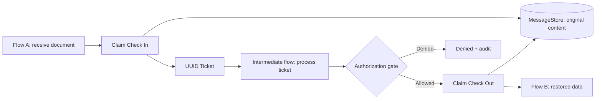
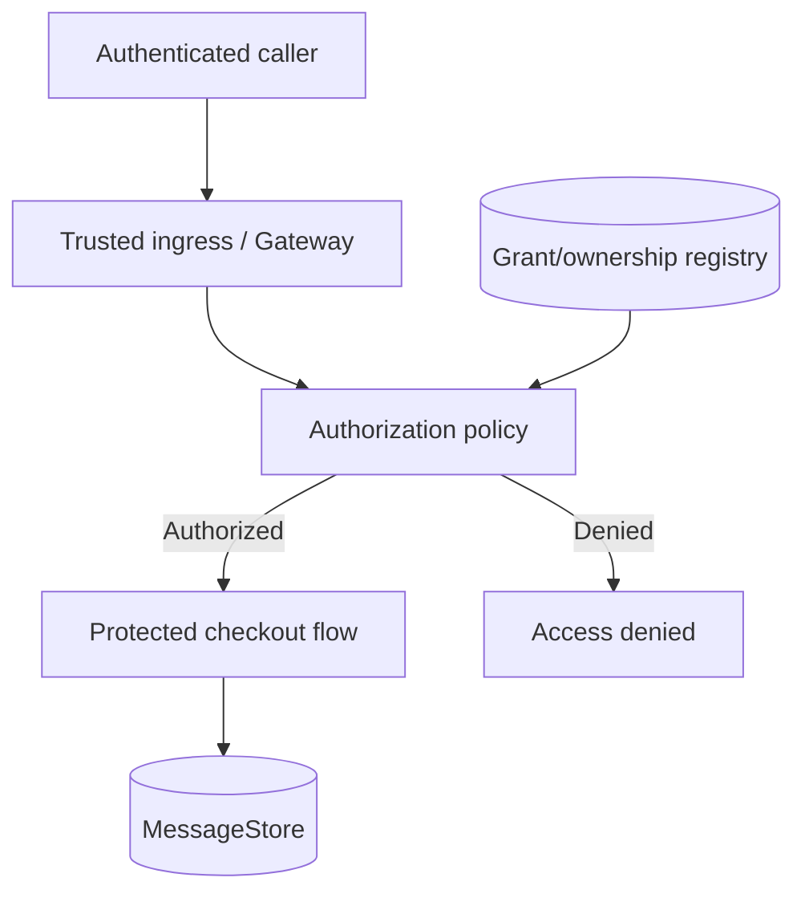
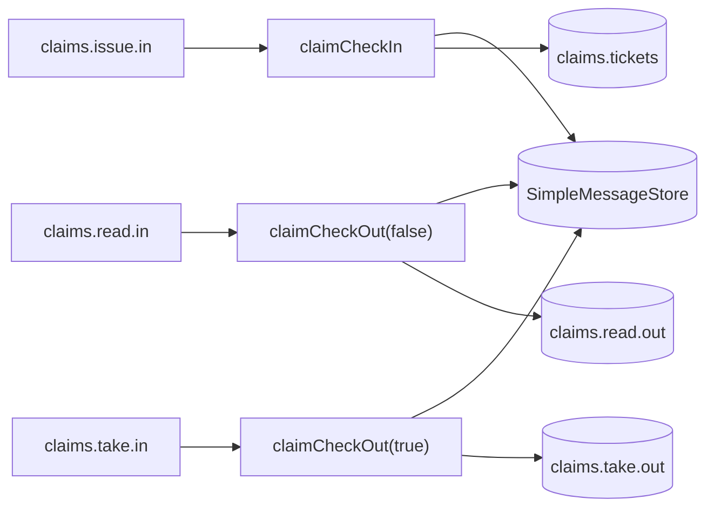
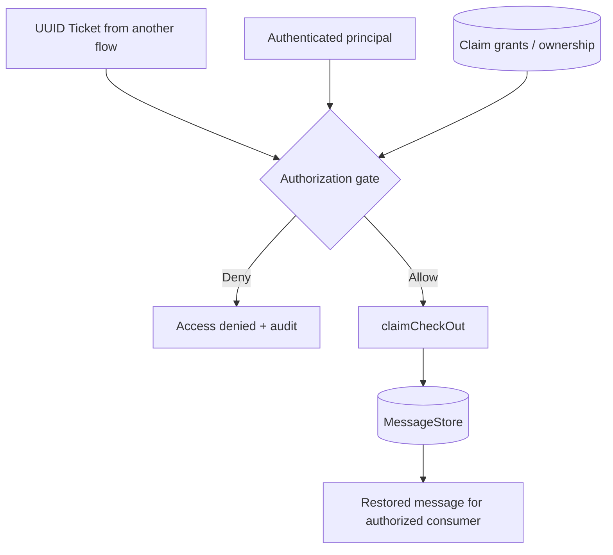
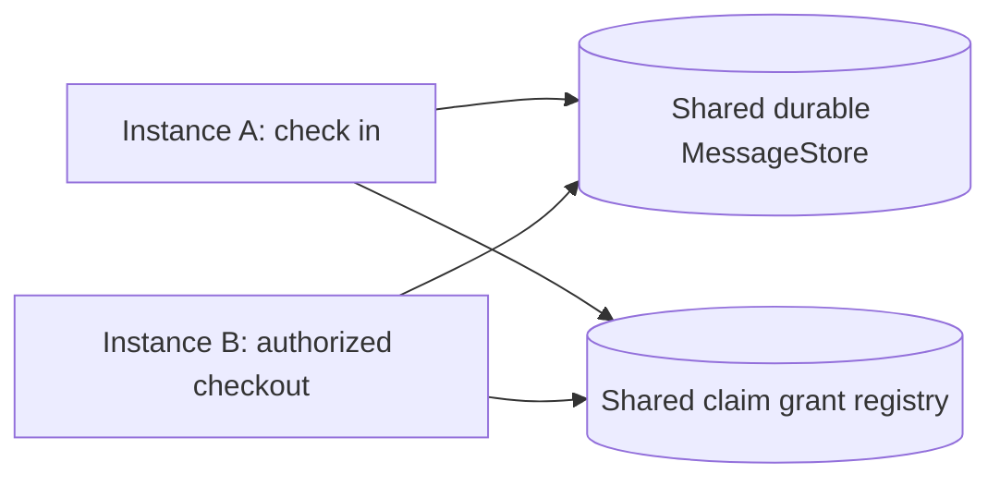
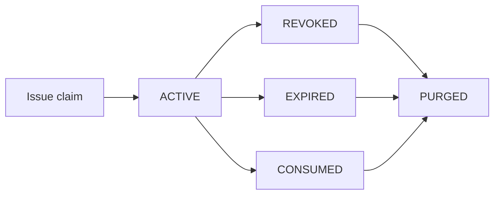
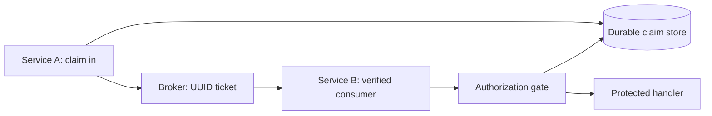

# Cross-flow claim access permissions in Spring Integration

## Lesson objectives

A system receives order dossiers accompanied by sensitive documents. The intake flow must check the order ID, route across multiple processing steps, record business logs, and emit status; intermediate steps **do not need to read the entire document**. Only the authorized review flow needs to restore the original data.

If the sensitive payload remains on every message, an unrelated handler, a debug log, or an outbound adapter can accidentally access and spread the data. The **Claim Check** pattern solves **data movement**: store the original message in a `MessageStore` and pass a reference token instead of the large/sensitive payload.

However, the critical question of this lesson is: **which flow is permitted to use that reference token to retrieve the original message?** In Spring Integration, `ClaimCheckInTransformer` and `ClaimCheckOutTransformer` provide store/restore operations; they **do not automatically build an authorization model by tenant, actor, business purpose, or flow name**. Access rights must be enforced at boundaries invoking checkout and accessing `MessageStore`.

This lesson belongs to the **Claim check** chapter, **SPRING_INTEGRATION_PATTERN** module, where we practice Enterprise Integration Patterns with Spring Integration: Router, Filter, Transformer, Splitter, Aggregator, Gateway, retry, error channel, correlation, and observing processing branches to build loosely coupled, extensible message flows.

After this lesson, you will be able to:

1. Explain the `claim-check-in → ticket → claim-check-out` flow and what is stored in `MessageStore`.
2. Distinguish **holding a ticket** from **being authorized to read data**, avoiding treating a UUID as an authentication mechanism.
3. Design access permissions by **tenant, actor, purpose, flow name, workflow/generation, and expiration**.
4. Configure two Java DSL flows sharing a `MessageStore` and understand `removeMessage=false/true`.
5. Place an **authorization gate before checkout**, never trusting client-supplied `tenantId`, `role`, or `allowedFlow`.
6. Write JUnit tests for cross-flow storage/restoration and unit tests denying cross-tenant, wrong-purpose, or expired access.
7. Design one-time/multi-read claim permissions, revocation, TTL, retention, auditing, retries, and data protection.
8. Identify risks of concurrency, multiple instances, crashes between checkout and commit, token leakage via logs, and serialization across brokers.

---

## 1. What is Claim Check used for?

Suppose a producer sends:

```text
Message<Document>
  payload:
    documentId = DOC-42
    tenantId   = tenant-a
    rawContent = [large/sensitive content]
  headers:
    traceId    = trace-42
```

After **check-in**:

```text
MessageStore:
  UUID id-123 -> original Message<Document>

Forwarding message:
  payload = UUID id-123
  headers = required flow metadata
```

After an authorized flow performs **check-out**:

```text
payload UUID id-123
    |
    v
MessageStore.getMessage(id-123)
    |
    v
Restored Message<Document>
```



**Primary benefit:** steps that only need to know a document and a reference exist do not have to carry large/sensitive payloads across every endpoint.

**Security boundary:** if an unprotected flow can read `MessageStore` directly or call `claimCheckOut` with a valid ticket, replacing the payload with a UUID **does not prevent unauthorized access**.

### Core components

| Component | Role | Does not guarantee automatically |
| --- | --- | --- |
| `ClaimCheckInTransformer` | Stores original message, emits claim ticket ID | Read permissions per user/flow |
| `ClaimCheckOutTransformer` | Uses ticket to fetch message from store | Tenant isolation, purpose binding, authorization |
| `MessageStore` | Stores and looks up messages by ID | RBAC/ABAC policies per business context |
| `Claim ticket` | Reference ID to stored message | Owner identity or granted rights |
| Authorization gate | Checks actor, tenant, flow, purpose, expiry | Store durability and end-to-end transactions |
| Audit/claim ledger | Records who granted access, who read, when revoked | Does not replace runtime authentication/authorization |

## 2. What does “access permissions across flows” mean?

Let's name three+ flows:

- `ingress-flow`: receives documents and emits claim tickets.
- `metadata-flow`: processes order metadata/status; **must not read original payload**.
- `settlement-flow`: reconciles orders; allowed to read the document within a time limit.
- `analytics-flow`: may only use order IDs and aggregate status; **must not check out sensitive content**.

### Minimal permission matrix

| Flow | Receive ticket | Read original message | Update claim metadata | Delete claim |
| --- | --- | --- | --- | --- |
| `ingress-flow` | Yes, after check-in | Only when business logic needs it | Register ownership/ACL | Per controlled lifecycle |
| `metadata-flow` | Yes | **No** | No | No |
| `settlement-flow` | Yes, for granted requests | **Yes**, if matching tenant/workflow and unexpired | May record consumed state | Only if policy permits |
| `analytics-flow` | May receive minimized ID | **No** | No | No |
| Admin retention job | Does not need business payload | Not via normal path | Manage retention | Yes, per policy/audit |

These permissions are an **application policy example**, not a default mechanism provided by Spring Integration.

### Separating two planes

**Data plane**: where business messages traverse `MessageChannel`, Routers, Transformers, and handlers.

**Control/security plane**: where actors are authenticated, grants are issued/revoked, tickets are authorized, audits are written, and expirations are enforced.



Access permissions should bind to the caller's **authenticated context**, not to an arbitrary message header.

## 3. Is a claim ticket an access token?

Spring Integration uses the stored message's ID (currently represented as a UUID) as the **claim check**. The base mechanism enables lookup by ID.

Do not conflate three concepts:

| Concept | Question answered | Example |
| --- | --- | --- |
| **Lookup key** | Where is the data stored? | Claim UUID |
| **Authentication** | Who is performing the operation? | Authenticated service principal |
| **Authorization** | Is this principal allowed to read this claim? | Tenant, permission, flow/purpose, expiry |

A UUID is hard to guess under proper conditions, yet **does not replace authentication and authorization**. A ticket leaked into logs, URLs, queues, emails, or traces can be redeemed at checkout if the endpoint lacks a gate.

### Design principles

1. **Tickets are context-sensitive data.** Never expose publicly when unnecessary.
2. **All checkout entry points must be controlled.** An internal channel is not always a security boundary if multiple adapters/beans can send to it.
3. **Never let clients self-declare allowed flows.** Flow identity/purpose must come from server-side routes or authorized components.
4. **Never treat self-asserted message headers as a principal.** `headers['tenantId']` or `headers['role']` are data, not credentials.
5. **Never authorize by matching a UUID against a simple list string.** Check ownership, tenant, scope, expiration, and state.
6. **Never expose raw `MessageStore` in a shared service without policy.** Any code holding a store reference can call `getMessage(UUID)`.

## 4. How Spring Integration stores and restores claims

Per the official documentation:

- Incoming Claim Check Transformer takes a `Message<?>`, saves it in `MessageStore`, and emits a message whose **payload is the ID**.
- Outgoing Claim Check Transformer takes the ticket, looks it up by ID, and restores the stored content.
- When `removeMessage=false` (default), the message remains in the store after checkout.
- When `removeMessage=true`, checkout also removes the message from the store so the ticket cannot be claimed again via this mechanism.

Java DSL APIs include:

```java
.claimCheckIn(messageStore)

.claimCheckOut(messageStore)

.claimCheckOut(messageStore, false) // Can be read multiple times.

.claimCheckOut(messageStore, true)  // Retrieve and delete on checkout.
```

`MessageStore` provides operations:

```java
Message<?> stored = messageStore.getMessage(ticket);
Message<?> removed = messageStore.removeMessage(ticket);
```

Here `ticket` has type `java.util.UUID`.

**Warning:** `MessageStore` does not require passing a principal or tenant when calling `getMessage(UUID)`. A checkout executed in an unprotected flow can retrieve the stored message **using only the ticket**.

### Why is the same store required?

Flow A checking into `storeA` while Flow B checks out from `storeB` cannot restore the claim if the two stores do not share data and corresponding IDs.

There are three cases:

| Deployment | Outcome |
| --- | --- |
| Two flows in the same Spring context, same `MessageStore` bean | Can check in and check out |
| Two separate app instances, separate in-memory stores | **Cannot** see each other's claims |
| Two instances sharing a compatible persistent/shared store | Can restore, **if** permission mapping, serializers, and transactions are right |

**Sharing a store enables lookup; it does not create access permissions.** Multiple trusted flows do not imply equal permissions; an authorization gate is still required.

## 5. Java DSL demo: two flows sharing a MessageStore

Start with a technical example separating check-in and check-out flows to observe framework semantics. This example **does not protect access rights on its own**; use it only in tests or already-protected internal zones.

### Diagram



### Complete configuration

```java
import org.springframework.context.annotation.Bean;
import org.springframework.context.annotation.Configuration;
import org.springframework.integration.channel.DirectChannel;
import org.springframework.integration.channel.QueueChannel;
import org.springframework.integration.config.EnableIntegration;
import org.springframework.integration.dsl.IntegrationFlow;
import org.springframework.integration.store.MessageStore;
import org.springframework.integration.store.SimpleMessageStore;
import org.springframework.messaging.MessageChannel;
import org.springframework.messaging.PollableChannel;

@Configuration
@EnableIntegration
public class CrossFlowClaimCheckConfig {

    public record SensitiveDocument(
        String documentId,
        String tenantId,
        String content
    ) {}

    @Bean("claimStore")
    MessageStore claimStore() {
        // In-memory for demos/tests only.
        return new SimpleMessageStore();
    }

    @Bean("claims.issue.in")
    MessageChannel issueInput() {
        return new DirectChannel();
    }

    @Bean("claims.tickets")
    PollableChannel ticketOutput() {
        return new QueueChannel();
    }

    @Bean("claims.read.in")
    MessageChannel readInput() {
        return new DirectChannel();
    }

    @Bean("claims.read.out")
    PollableChannel readOutput() {
        return new QueueChannel();
    }

    @Bean("claims.take.in")
    MessageChannel takeInput() {
        return new DirectChannel();
    }

    @Bean("claims.take.out")
    PollableChannel takeOutput() {
        return new QueueChannel();
    }

    @Bean
    IntegrationFlow checkInFlow(MessageStore claimStore) {
        return IntegrationFlow.from("claims.issue.in")
            .claimCheckIn(claimStore)
            .channel("claims.tickets")
            .get();
    }

    @Bean
    IntegrationFlow repeatableReadFlow(MessageStore claimStore) {
        return IntegrationFlow.from("claims.read.in")
            .claimCheckOut(claimStore, false)
            .channel("claims.read.out")
            .get();
    }

    @Bean
    IntegrationFlow claimOnceFlow(MessageStore claimStore) {
        return IntegrationFlow.from("claims.take.in")
            .claimCheckOut(claimStore, true)
            .channel("claims.take.out")
            .get();
    }
}
```

### What permissions does each flow have in the demo?

- `checkInFlow` stores the message and emits a ticket.
- `repeatableReadFlow` restores the message via ticket **without deleting**.
- `claimOnceFlow` restores the message via ticket and **deletes** it from the store.
- **None of the flows in the demo check permissions.** This must be added before use in multi-tenant, multi-service, or multi-trust-zone environments.

In a real application, never expose `claims.read.in` or `claims.take.in` directly over HTTP, inbound broker adapters, or a control bus without an authorization gate. A channel not being public does not prove every handler/service able to send to it is trusted.

## 6. Technical test: store in flow A, read in flow B

Use JUnit 5, Spring Test, and AssertJ to verify **retrieval across two distinct flows** sharing `MessageStore`.

```java
import static org.assertj.core.api.Assertions.assertThat;

import java.util.UUID;

import org.junit.jupiter.api.Test;
import org.springframework.beans.factory.annotation.Autowired;
import org.springframework.beans.factory.annotation.Qualifier;
import org.springframework.integration.store.MessageStore;
import org.springframework.messaging.Message;
import org.springframework.messaging.MessageChannel;
import org.springframework.messaging.PollableChannel;
import org.springframework.messaging.support.MessageBuilder;
import org.springframework.test.context.junit.jupiter.SpringJUnitConfig;

@SpringJUnitConfig(CrossFlowClaimCheckConfig.class)
class CrossFlowClaimCheckTest {

    @Autowired
    @Qualifier("claims.issue.in")
    MessageChannel issueInput;

    @Autowired
    @Qualifier("claims.tickets")
    PollableChannel tickets;

    @Autowired
    @Qualifier("claims.read.in")
    MessageChannel readInput;

    @Autowired
    @Qualifier("claims.read.out")
    PollableChannel readOutput;

    @Autowired
    @Qualifier("claims.take.in")
    MessageChannel takeInput;

    @Autowired
    @Qualifier("claims.take.out")
    PollableChannel takeOutput;

    @Autowired
    @Qualifier("claimStore")
    MessageStore claimStore;

    private UUID issue(String documentId) {
        var payload =
            new CrossFlowClaimCheckConfig.SensitiveDocument(
                documentId, "tenant-a", "private-" + documentId);

        assertThat(issueInput.send(
            MessageBuilder.withPayload(payload)
                .setHeader("traceId", "trace-" + documentId)
                .build()
        )).isTrue();

        Message<?> ticketMessage = tickets.receive(2_000);
        assertThat(ticketMessage).isNotNull();
        assertThat(ticketMessage.getPayload())
            .isInstanceOf(UUID.class);
        return (UUID) ticketMessage.getPayload();
    }

    @Test
    void claimCanTravelBetweenFlowsUsingSharedStore() {
        UUID ticket = issue("DOC-A");

        assertThat(claimStore.getMessage(ticket)).isNotNull();

        assertThat(readInput.send(
            MessageBuilder.withPayload(ticket).build()
        )).isTrue();

        Message<?> restored = readOutput.receive(2_000);
        assertThat(restored).isNotNull();
        assertThat(restored.getPayload())
            .isEqualTo(
                new CrossFlowClaimCheckConfig.SensitiveDocument(
                    "DOC-A", "tenant-a", "private-DOC-A"));

        // removeMessage=false: data remains in MessageStore.
        assertThat(claimStore.getMessage(ticket)).isNotNull();
        assertThat(readOutput.receive(0)).isNull();
    }

    @Test
    void readWithoutRemovalCanBeRepeated() {
        UUID ticket = issue("DOC-B");

        for (int i = 0; i < 2; i++) {
            assertThat(readInput.send(
                MessageBuilder.withPayload(ticket).build()
            )).isTrue();
            assertThat(readOutput.receive(2_000)).isNotNull();
        }

        assertThat(claimStore.getMessage(ticket)).isNotNull();
        assertThat(readOutput.receive(0)).isNull();
    }

    @Test
    void claimOnceRemovesStoredMessage() {
        UUID ticket = issue("DOC-C");

        assertThat(takeInput.send(
            MessageBuilder.withPayload(ticket).build()
        )).isTrue();

        Message<?> restored = takeOutput.receive(2_000);
        assertThat(restored).isNotNull();
        assertThat(restored.getPayload())
            .isInstanceOf(
                CrossFlowClaimCheckConfig.SensitiveDocument.class);

        assertThat(claimStore.getMessage(ticket)).isNull();
        assertThat(takeOutput.receive(0)).isNull();
    }
}
```

**Test scope:** these tests prove check-in/check-out share the store and show the difference between multi-read and read-then-delete. They **do not yet prove authorization**. Security tests in a later section add a dedicated gate.

**Execution path:** `DirectChannel` processes synchronously and writes results into a `QueueChannel` with no background consumer. `receive(0)` fits this test; with executors/brokers, await conditionally. Tests mint fresh tickets per case to avoid depending on deleted claim state.

## 7. Adding authorization: access policy must sit before checkout

A secure flow must verify the following **before calling** `MessageStore.getMessage` or `claimCheckOut`:

- **Actor:** which user or service principal is requesting the claim?
- **Tenant:** which tenant owns the claim? Does the actor belong to that tenant?
- **Purpose/consumer flow:** is this flow allowed to use the claim for the declared work?
- **Workflow/generation:** does the claim belong to the active transaction instance?
- **Expiry/revocation:** is the claim unexpired and unrevoked?
- **Permission:** does the actor hold permission to read sensitive content of that class?
- **Replay policy:** multi-use or single-use ticket? Is read count capped?



**Key principle:** never fetch the sensitive payload first and only then decide whether the actor is permitted. A “get then filter” approach widens the set of components that touch sensitive data.

### Grants are application business data

Spring Integration does not automatically add a `claim_acl` table or define `allowedFlows`. The application can store metadata:

```text
claimId = <UUID>
tenantId = tenant-a
workflowId = WORK-42
allowedConsumers = {settlement}
expiresAt = 2026-12-01T00:00:00Z
state = ACTIVE
```

Grants must be created from an **authenticated source** at check-in time, and tickets must be published only after metadata/ownership saves succeed. If saving the claim succeeds while issuing the grant fails, coordinate cleanup or retries so no orphaned data remains.

## 8. Example of a testable pure-Java gate

To focus on permissions, we write a standalone gate. This example keeps grants in a `ConcurrentHashMap` **strictly for learning and unit tests**; production must use a durable registry with transactions/locking and restart recovery.

```java
import java.time.Clock;
import java.time.Instant;
import java.util.Map;
import java.util.Set;
import java.util.UUID;
import java.util.concurrent.ConcurrentHashMap;

public final class ClaimAccessGate {

    public record VerifiedActor(
        String subject,
        String tenantId,
        Set<String> permissions
    ) {
        public VerifiedActor {
            permissions = Set.copyOf(permissions);
        }
    }

    public record ClaimGrant(
        UUID claimId,
        String tenantId,
        String workflowId,
        Set<String> allowedConsumers,
        Instant expiresAt
    ) {
        public ClaimGrant {
            allowedConsumers = Set.copyOf(allowedConsumers);
        }
    }

    private final Map<UUID, ClaimGrant> grants =
        new ConcurrentHashMap<>();

    private final Clock clock;

    public ClaimAccessGate(Clock clock) {
        this.clock = clock;
    }

    // Only a trusted issuer may call this method.
    public void register(ClaimGrant grant) {
        grants.put(grant.claimId(), grant);
    }

    public UUID requireAllowed(
        UUID ticket,
        VerifiedActor actor,
        String consumerFlow,
        String workflowId
    ) {
        ClaimGrant grant =
            ticket == null ? null : grants.get(ticket);

        boolean allowed = actor != null
            && grant != null
            && actor.permissions().contains("claim:read")
            && actor.tenantId() != null
            && actor.tenantId().equals(grant.tenantId())
            && consumerFlow != null
            && grant.allowedConsumers().contains(consumerFlow)
            && workflowId != null
            && workflowId.equals(grant.workflowId())
            && clock.instant().isBefore(grant.expiresAt());

        if (!allowed) {
            // Same generic error to avoid leaking whether the claim exists.
            throw new SecurityException("CLAIM_ACCESS_DENIED");
        }

        return ticket;
    }

    public void revoke(UUID ticket) {
        grants.remove(ticket);
    }
}
```

Explanation:

1. `VerifiedActor` is an object **constructed after authentication**, not an arbitrary client-submitted DTO.
2. `ClaimGrant` specifies tenant, workflow, allowed consumers, and expiry.
3. `requireAllowed` returns **the original ticket**, letting a flow pass that ticket to built-in checkout **after** the gate.
4. A generic error message avoids disclosing “ticket exists but belongs to another tenant” to a rejected actor.
5. `revoke` causes the gate to deny future accesses **while they pass through the gate**; it cannot retract payload copies already retrieved earlier by an authorized consumer.

**Demo limitations:** `ConcurrentHashMap` is not durable across restarts, lacks atomic one-time consumption, writes no audits, and does not stop components that read `MessageStore` directly. Production must enforce permissions at every entry point, especially store reads and checkout channels.

### Do not trust actors from inbound headers

The following code is a **counter-example**:

```java
// DO NOT apply at an untrusted boundary:
String tenant = (String) message.getHeaders().get("tenantId");
String role = (String) message.getHeaders().get("role");

// Wrong: clients can send whatever tenantId/role they want.
```

At an API Gateway or inbound adapter, the application must authenticate the client and **construct `VerifiedActor` from a trusted principal**. For instance, with Spring Security, boundary services can read `Authentication` from a verified security context (if propagated properly across threads/async boundaries). Never infer `ROLE_ADMIN` from a JSON header.

### Identity across async boundaries

Thread-local `SecurityContextHolder` **does not automatically follow** Kafka consumer threads, pollers, or executors in every setup. For async processing, authenticate **service identity** at the receiving point or pass a **signed/verified context** per protocol with purpose, expiry, and replay policy. Never grab a producer's principal on an old thread based on an unverified assumption.

## 9. Wiring the gate into Java DSL before `claimCheckOut`

The intentional integration is:

```text
Input ticket
  -> resolve authenticated actor from trusted identity provider
  -> requireAllowed(ticket, actor, "settlement", workflowId)
  -> ClaimCheckOutTransformer
  -> settlement-only handler
```

Java DSL **excerpt**, assuming channel beans, `ClaimAccessGate`, `VerifiedIdentityProvider`, and `MessageStore` exist:

```java
import java.util.UUID;

import org.springframework.context.annotation.Configuration;
import org.springframework.context.annotation.Bean;
import org.springframework.integration.dsl.IntegrationFlow;
import org.springframework.integration.store.MessageStore;

interface VerifiedIdentityProvider {
    ClaimAccessGate.VerifiedActor currentActor();
}

@Configuration
class SecureClaimFlowExcerpt {

    @Bean
    IntegrationFlow settlementClaimRestoreFlow(
        MessageStore claimStore,
        ClaimAccessGate gate,
        VerifiedIdentityProvider identities
    ) {
        return IntegrationFlow.from("claims.secure.read.in")
            .handle(UUID.class, (ticket, headers) -> {
                // Actor from trusted server context, not payload.
                var actor = identities.currentActor();

                // Request-provided workflowId is matched against
                // the server-side stored grant.
                String workflowId =
                    (String) headers.get("workflowId");

                return gate.requireAllowed(
                    ticket, actor, "settlement", workflowId);
            })
            .claimCheckOut(claimStore, false)
            .channel("claims.secure.read.out")
            .get();
    }
}
```

`"settlement"` is a **server-side constant** representing the active consumer, not a client-supplied `headers['allowedFlow']`. If an analytics flow uses this ticket, the gate must run again with `consumerFlow="analytics"` and typically deny it.

**Do not merely add a gate to one flow while leaving an unprotected `claims.read.in` flow open.** Close or restrict all bypass paths like the technical example in section 5; only authorized services should hold references to the raw store.

### Note on `workflowId`

In the snippet, `workflowId` may come from an ingress-supplied header. Matching against the grant prevents workflow mix-ups, yet **does not prove the header sender owns the workflow**. The authenticated actor and server-side grant policy grant authority; if the contract requires per-actor ownership as well, store and compare the permitted `subject`/service principal.

### Safer production strategy

For multi-tenant systems, wrap `MessageStore` behind a service exposing only:

```java
Message<?> readAuthorized(
    UUID ticket,
    VerifiedActor actor,
    String consumer,
    String workflow
);
```

That service verifies permissions, TTL, and revocation and reads the message inside a controlled transaction/snapshot. Flows **must not inject the raw store themselves**. If using built-in `claimCheckOut`, access gates must ensure no path bypasses the gate; for stricter demands, a custom checkout service helps achieve atomic authorization.

## 10. Unit test: same ticket, different permissions

Tests must prove the gate denies **even when the actor knows the real ticket**.

```java
import static org.assertj.core.api.Assertions.assertThat;
import static org.assertj.core.api.Assertions.assertThatThrownBy;

import java.time.Clock;
import java.time.Instant;
import java.time.ZoneOffset;
import java.util.Set;
import java.util.UUID;

import org.junit.jupiter.api.Test;

class ClaimAccessGateTest {

    private static final Instant NOW =
        Instant.parse("2026-11-21T05:00:00Z");

    private final ClaimAccessGate gate =
        new ClaimAccessGate(
            Clock.fixed(NOW, ZoneOffset.UTC));

    private final UUID ticket = UUID.randomUUID();

    private void grantUntil(Instant expiry) {
        gate.register(new ClaimAccessGate.ClaimGrant(
            ticket, "tenant-a", "WORK-42",
            Set.of("settlement"), expiry));
    }

    private ClaimAccessGate.VerifiedActor actor(
        String tenant,
        String... permissions
    ) {
        return new ClaimAccessGate.VerifiedActor(
            "service-123", tenant, Set.of(permissions));
    }

    @Test
    void sameTenantAuthorizedFlowMayRead() {
        grantUntil(NOW.plusSeconds(300));

        UUID result = gate.requireAllowed(
            ticket,
            actor("tenant-a", "claim:read"),
            "settlement",
            "WORK-42");

        assertThat(result).isEqualTo(ticket);
    }

    @Test
    void leakedTicketDoesNotGrantOtherTenant() {
        grantUntil(NOW.plusSeconds(300));

        assertThatThrownBy(() ->
            gate.requireAllowed(
                ticket,
                actor("tenant-b", "claim:read"),
                "settlement", "WORK-42"))
            .isInstanceOf(SecurityException.class)
            .hasMessage("CLAIM_ACCESS_DENIED");
    }

    @Test
    void analyticsCannotReadSettlementClaim() {
        grantUntil(NOW.plusSeconds(300));

        assertThatThrownBy(() ->
            gate.requireAllowed(
                ticket,
                actor("tenant-a", "claim:read"),
                "analytics", "WORK-42"))
            .isInstanceOf(SecurityException.class);
    }

    @Test
    void missingPermissionIsDenied() {
        grantUntil(NOW.plusSeconds(300));

        assertThatThrownBy(() ->
            gate.requireAllowed(
                ticket,
                actor("tenant-a"), // Lacks claim:read.
                "settlement", "WORK-42"))
            .isInstanceOf(SecurityException.class);
    }

    @Test
    void wrongWorkflowAndExpiredGrantAreDenied() {
        grantUntil(NOW.plusSeconds(300));

        assertThatThrownBy(() ->
            gate.requireAllowed(
                ticket,
                actor("tenant-a", "claim:read"),
                "settlement", "WORK-99"))
            .isInstanceOf(SecurityException.class);

        grantUntil(NOW.minusSeconds(1));

        assertThatThrownBy(() ->
            gate.requireAllowed(
                ticket,
                actor("tenant-a", "claim:read"),
                "settlement", "WORK-42"))
            .isInstanceOf(SecurityException.class);
    }

    @Test
    void revokedTicketIsDeniedEvenBeforeExpiry() {
        grantUntil(NOW.plusSeconds(300));
        gate.revoke(ticket);

        assertThatThrownBy(() ->
            gate.requireAllowed(
                ticket,
                actor("tenant-a", "claim:read"),
                "settlement", "WORK-42"))
            .isInstanceOf(SecurityException.class);
    }
}
```

**Scope:** unit tests verify the gate's allow/deny logic. To prove the flow is genuinely secure, write **integration/security tests** at the message ingress gate: confirm unauthenticated requests are blocked before issuing tickets, denied requests never touch the store, and no unprotected checkout endpoint exists.

## 11. Testing “never touch the store when denied”

Checking only “the client received no payload” is insufficient. An insecure flow could read the sensitive document, log it, and only then reject the response.

A good test verifies the order:

```text
Unauthorized ticket
  -> gate DENY
  -> do not call MessageStore.getMessage
  -> do not call MessageStore.removeMessage
  -> do not emit restored message
```

With a mocked `MessageStore` (Mockito, if the project includes the dependency), we can test the logic of a **store-wrapping service**:

```java
import static org.assertj.core.api.Assertions.assertThatThrownBy;
import static org.mockito.Mockito.*;

import java.time.Clock;
import java.util.UUID;

import org.junit.jupiter.api.Test;
import org.springframework.integration.store.MessageStore;

class AuthorizedClaimReaderTest {

    @Test
    void denialHappensBeforeStoreLookup() {
        MessageStore store = mock(MessageStore.class);
        ClaimAccessGate gate =
            new ClaimAccessGate(Clock.systemUTC());

        UUID ticket = UUID.randomUUID();
        var actor = new ClaimAccessGate.VerifiedActor(
            "actor-x", "tenant-b",
            java.util.Set.of("claim:read"));

        // Register no grant for ticket: gate must deny.

        AuthorizedClaimReader reader =
            new AuthorizedClaimReader(store, gate);

        assertThatThrownBy(() ->
            reader.read(ticket, actor, "settlement", "WORK-42"))
            .isInstanceOf(SecurityException.class);

        verifyNoInteractions(store);
    }
}

// Sample claim-reading service with pre-check.
final class AuthorizedClaimReader {

    private final MessageStore store;
    private final ClaimAccessGate gate;

    AuthorizedClaimReader(
        MessageStore store, ClaimAccessGate gate
    ) {
        this.store = store;
        this.gate = gate;
    }

    org.springframework.messaging.Message<?> read(
        UUID ticket,
        ClaimAccessGate.VerifiedActor actor,
        String flow,
        String workflow
    ) {
        UUID allowed = gate.requireAllowed(
            ticket, actor, flow, workflow);

        var message = store.getMessage(allowed);
        if (message == null) {
            // Never reveal whether the ID exists outside the store.
            throw new IllegalStateException(
                "CLAIM_UNAVAILABLE");
        }
        return message;
    }
}
```

**This is a supplementary example**, not a flow auto-registered via `@Bean`. Mockito is required to run the test. When strong security is required, authorization and store access must be designed transactionally/atomically to handle races with revocation and expiry, rather than merely calling two methods sequentially and declaring them one transaction.

## 12. Check out once or multiple times: read permission is not read count

Spring Integration supports:

```java
.claimCheckOut(store, false) // keep message after checkout
.claimCheckOut(store, true)  // delete message on checkout
```

### Multi-read model

```text
Ticket T -> settlement-flow reads (allowed)
Ticket T -> settlement-flow reads again (allowed)
Ticket T -> analytics-flow denied (not allowed)
```

`removeMessage=false` lets data remain in the store, yet **read permission must still be checked on every read**. “Readable once” does not mean readable forever, since grants can expire or be revoked.

### Claim-once model

```text
Ticket T -> settlement-flow checkout(remove=true)
         -> message deleted from MessageStore

Ticket T -> next checkout -> no message left
```

`removeMessage=true` helps curb retention and prevent re-claiming via the built-in transformer. Yet:

- It **does not mean** the business action ran exactly once.
- It **does not mean** only valid actors can claim; a gate is still required.
- If checkout deletes the message **before the downstream handler commits**, a crash can lose the document from the store before the work finishes.
- If multiple flows need the same content, the first flow checking out and deleting blocks all remaining flows.

Therefore, for critical transactions, use **non-deleting read → idempotent processing → separate acknowledgment/cleanup** instead of deleting at checkout. Design retention and transactions so sensitive data is not kept forever.

### Claim-once differs from “exclusive lease”

A lease typically includes owner, expiration, token, and renewal/release capability. Built-in `removeMessage=true` specifies only **deleting the message on checkout**; it does not create a distributed lease or automatically recoverable exclusive ownership.

If flows A and B both hold a ticket and you must guarantee **only one worker processes it** in a cluster, use claim/lease/lock mechanics or database transactions plus idempotency at side-effect boundaries.

## 13. Multiple flows permitted to share a claim

Sometimes both `settlement-flow` and `fraud-review-flow` need to read the same document, while `analytics-flow` remains forbidden.

Illustrative grant:

```text
Claim T:
  allowedConsumers = {settlement, fraud-review}
  allowedPurposes  = {reconcile, investigate}
  tenantId         = tenant-a
  expiresAt        = ...
```

Each restoration must check **consumer and purpose**. If you do not want two flows holding two copies of the content, consider:

- `removeMessage=false` permitting multiple valid checkouts.
- Capping max read counts or per-consumer deadlines.
- Auditing every data retrieval.
- Preventing one authorized flow from re-issuing the ticket to another flow.
- For strict control, using per-consumer grants or server-issued derived tokens with separate scopes/TTLs.

You cannot use `removeMessage=true` with one shared ticket and expect all consumers to retrieve it; the first retrieval deletes the shared data.

### Permissions do not live solely in channel names

A handler may subscribe to `claims.secure.read.in`; another bean in the same process can still reference that channel if technically accessible. **Bean/channel names are not security boundaries.**

When teams/apps have differing trust levels, prefer isolating permissions at the service API/repository/DB level and allowing only authenticated adapters to invoke checkout. Within the same process, enforce module boundaries and do not expose raw stores, while recognizing the limit: code running with the same process privileges can often bypass application policies if it can obtain the store bean.

## 14. Tenant isolation and multiple instances

### Multi-tenant isolation

A `UUID` ticket does not reveal which tenant owns it under the `MessageStore.getMessage(UUID)` API. If a multi-tenant system shares a store, adopt one of these models:

1. **Shared store + grant registry** checking tenant on every read.
2. **Per-tenant stores/namespaces** routing to the store from a trusted tenant identity.
3. **Claim access service** owning the entire store, accepting tickets and principals, checking policy before returning data.

In all three, never let clients choose the target tenant merely via query parameters or headers.

### Multiple instances



If instance A uses a local `SimpleMessageStore`, instance B with a separate store will not find the ticket. Use `JdbcMessageStore` or an appropriate persistent/distributed store when flows span multiple processes, alongside a shared grant registry, compatible serializers, encryption, transactions, and DB permissions.

**There is no protection if `MessageStore` is shared while the ACL registry sits locally in one JVM.** On restarts or traffic shifts across replicas, permission metadata can vanish or diverge.

### Direct database access

Even when the application has a gate, a service with direct read privileges on the `MessageStore` DB table can bypass flow-level authorization. Restrict DB/service accounts, network ACLs, encryption, and backup/observability access.

## 15. Revocation, expiration, and cleanup

A claim should have an explicit lifecycle:

```text
ISSUED
   |
   +--> ACTIVE (lookup permitted per grant)
   |
   +--> REVOKED (gate denies)
   |
   +--> EXPIRED (past deadline)
   |
   +--> CONSUMED (if one-time)
   |
   +--> PURGED (payload/metadata deleted per retention)
```



State transitions are **application-defined**; Spring Integration does not auto-create `ClaimGrant.state` or manage the full lifecycle above.

### Two places to clean up

1. **`MessageStore`:** the original message containing sensitive data.
2. **Grant/metadata store:** permissions, ownership, expiry, audits, consumed/revoked states.

Deleting only the grant without deleting the message leaves sensitive data in `MessageStore` readable by anything bypassing the gate. Deleting only the message without cleaning the grant causes checkouts to fail continuously while metadata accumulates.

### Does TTL enable itself automatically?

`SimpleMessageStore` is not a claim-dedicated TTL store. Do not assume IDs auto-expire or messages auto-delete according to `expiresAt` in a registry. Design a scoped job that deletes only eligible claims, respects active workflows, and audits cleanup.

With persistent stores, retention must account for backups, replicas, transaction logs, and data protection rules. Application-level deletion does not automatically mean instantaneous physical erasure from every copy.

### Revoking after a read already happened

Revocation blocks **new reads** provided all paths go through the gate. It does not retract content already copied into memory, caches, or downstream systems by a valid flow. That is why data minimization, TTL, auditing, and cascading deletion policies are needed when legally or operationally mandated.

## 16. Concurrency, races, and the gap between authorization and checkout

Example of two nearby actions:

```text
T1 actor A allowed by gate
T2 admin revokes claim T
T3 actor A calls MessageStore.getMessage(T)
```

If permission checks and message reads are **two operations without a shared transaction/lock**, actor A can read after the revocation was saved. Options to handle this:

- **Snapshot semantics:** allow requests that already passed the gate to finish; audit this policy.
- **Strict revocation:** verify and read under the same transaction/lock or proper version/fencing mechanism.
- **Short-lived authorization grants:** shrink the risk window, though not a substitute for transactions if strict guarantees are required.

For sensitive data access, **specify the revocation contract explicitly**, rather than merely putting a “Revoke” button in a UI.

### Concurrent deletion

Two workers might execute `claimCheckOut(store, true)` on one ticket simultaneously. Whether one worker gets the data, both get it, or one fails depends on store implementation, serialization, and concurrency. Do not treat `remove=true` as a **strongly guaranteed transactional distributed lock** without verifying your exact store's mechanics.

If exactly-one claimant is required, implement atomic consumption in a database or dedicated claim-lease/claim table, paired with idempotency at the business step.

## 17. Retries and idempotency

Suppose:

```text
T1 check out document, remove=true
T2 settlement handler writes DB successfully
T3 response lost due to network
T4 caller retries same ticket
T5 data no longer in MessageStore
```

The caller may get an error on retry even though the business action committed. Conversely, with `remove=false`, retry can re-fetch the same document and execute side effects a second time.

The solution must govern **the business process**, not only ticket state:

- Attach stable `workflowId`/`documentId`/`commandId`.
- Consumers check an idempotency key before writing DB/calling services.
- Record `PROCESSING/SUCCEEDED/FAILED` status in a business store.
- On retry, return the committed result for the same command ID.
- Use a transactional outbox when updating DB and emitting events together.
- Time claim cleanup only after the workflow reaches a terminal state.

### State model example

```text
claimId = T
workflowId = WORK-42
processedResultId = RES-42

Business ledger:
  WORK-42 -> SUCCEEDED / RES-42

Retry WORK-42:
  -> return RES-42, do not run settlement a second time
```

This is an **effectively-once business effect** model built on state storage/idempotency, not an exactly-once guarantee provided by `ClaimCheckOutTransformer` itself.

## 18. Claim Check with Router, Filter, Gateway, and Aggregator

### Filter before checkout

```text
Incoming ticket
  -> Authenticate actor
  -> Authorize ticket + purpose + tenant
  -> ClaimCheckOut
  -> Handler
```

**Do not reverse this**:

```text
Incoming ticket
  -> ClaimCheckOut
  -> Filter unauthorized payload
```

Because data reading already happened before permissions were verified.

### Router picks a flow but does not grant permissions

A Router may pick `settlement-flow` or `analytics-flow` from headers. That **does not automatically grant permission** to the chosen flow. If headers are client-set, an attacker could select a higher-privilege branch. Enforce policy deciding which branches may invoke checkout.

### Request-reply Gateway

A Gateway can call protected checkout and have a handler return the business result. If the claim is denied, return a contract-defined error/response rather than hanging indefinitely. If expired or deleted, distinguish errors internally for observability while avoiding revealing to outsiders that a claim exists in another tenant.

### Splitter/Aggregator

When splitting a batch into multiple parts, you can issue one claim per part or one claim for the whole batch. The choice depends on who must read original data and how often:

- **One claim for the whole batch:** reduces entries yet does not naturally restrict per-part permissions.
- **One claim per part:** eases least-privilege per line/branch yet increases storage/cleanup.
- **Multi-reader claim:** if multiple branches read the same data, never use `remove=true` before all valid branches finish.
- **Correlated outcomes:** preserve `correlationId`/`sequenceNumber` where Aggregator needs them; never treat a claim UUID as the batch's shared correlation ID.

### Transformers and header propagation

Check-in/out are specialized Transformers. Still, never assume “content is hidden” means all headers are safe:

- Ticket messages may still carry some inbound headers depending on message/adapter creation.
- Headers with PII, tokens, `replyChannel`, or `errorChannel` need data-minimization policies.
- Upon restoration, clearly handle which metadata belongs to the original message vs the current checkout request.
- When logging, log only business status, trace, and masked ticket fingerprint—never sensitive payloads.

## 19. Broker boundaries and remote systems

A UUID ticket can cross Kafka/AMQP/JMS/HTTP, yet the flow on the other side can check out only if:

1. It has **authorized access** to the store holding the message.
2. Corresponding grant/ownership metadata exists.
3. Compatible ticket formatting is used.
4. Service-to-service authentication and purpose-based authorization exist.
5. Expiry/retry policies exist for delayed messages.
6. Compatible serializers/header mappers exist.
7. Handling exists when the claim was deleted before the message arrived.



If flow B **has no permission to read the store**, passing the ticket over the broker does not let it read—and that can be **the right design**: the broker only moves metadata without reading content.

### Never send Channel objects onto brokers

`replyChannel` and `errorChannel` in internal flows may be non-serializable objects. Use broker-compatible reply destinations, header mappers, and correlation. Do not copy all headers simply because the payload shrank to a UUID.

### Preventing ticket leaks

- Avoid putting tickets in URL query strings if servers, proxies, or analytics log queries.
- Never treat a UUID as strong enough secret to skip authentication.
- Limit lifetimes and usage counts when needed.
- Use TLS between services.
- Rate-limit and audit failed checkouts.
- Never record raw tickets in metric tags; high cardinality and ID leakage.

## 20. MessageStore, sensitive data, and operational cost

### Choosing a store

| Store | Suitable for | Risks/work required |
| --- | --- | --- |
| `SimpleMessageStore` | Single-JVM demos/tests | Lost on restart; RAM/retention |
| `JdbcMessageStore` | Survive restarts and share across instances | Schema, serializers, transactions, encryption, backups |
| External store supporting `MessageStore` | Suitable distributed architectures | Network, consistency, permissions, cleanup, migrations |
| Encrypted object storage + claim metadata service | Extra-large payloads | This is a **custom design**, not automatic built-in `MessageStore` |

By default, `MessageStore` stores **the message**, not just a byte array payload. Therefore, serialization, header persistability, and stored data types must be controlled.

### Do not turn claims into a “forever dump”

If each check-in stores 10 MB and the app checks in repeatedly without cleanup, storage/RAM grows rapidly. You must have:

- Payload size caps.
- TTL/retention and audited cleanup schedules.
- Metrics for active claim count and storage size.
- Alerts on lookup errors or cleanup failures.
- Policies for backups, encryption at rest, and key rotation.
- Access controls over who can view payloads in dashboards/logs.

### Lost store or broken serializer

If a claim ID sits in a queue yet the original message vanished on restart, checkout cannot restore data. If a payload uses a Java type incompatible across deployments, reading from a durable store can fail deserialization. Use versioning, migrations, or long-term supported serializer formats.

Do not equate receiving a ticket with a guarantee that checkout will succeed indefinitely.

## 21. Concrete security checklist for cross-flow claims

| Question | Required evidence |
| --- | --- |
| Who issued the ticket? | Authenticated issuer service/identity |
| Who owns the claim? | Tenant/workflow/actor or service owner in grant ledger |
| Which flows are permitted? | Server-side consumer flow allowlist |
| What is the access purpose? | Purpose not derived from client claims |
| Is the claim expired? | Clock, expiry, and revocation checked on every access |
| Can checkout be bypassed? | No unprotected endpoints or raw store paths remain |
| Is cross-tenant access blocked? | Negative cross-tenant integration tests |
| Is it single-use? | Atomic consume policy, not just a boolean remove flag |
| Where does data go after reading? | Downstream permissions and data minimization |
| Is access audited? | Actor, purpose, timestamp, outcome without logging payload |
| Multi-instance ready? | Shared grants/store, consistency, locks, and transactions |
| Crash/retry safe? | Idempotency, state recovery, timely cleanup |
| TTL/retention active? | Cleanup jobs for both payloads and grants, backup policy |
| Infrastructure secured? | TLS, DB ACLs, encryption, least privilege |

## 22. Observability and auditing

Separate **claim operations** from **authorization outcomes**.

| Suggested metric | Meaning |
| --- | --- |
| `claim_issued_total{source}` | Claims created |
| `claim_checkout_attempt_total{consumer}` | Claim retrieval attempts |
| `claim_checkout_allowed_total{consumer}` | Attempts allowed by gate |
| `claim_checkout_denied_total{reason}` | Attempts denied by internal reason |
| `claim_checkout_not_found_total` | Deleted/expired tickets or missing store entries |
| `claim_checkout_removed_total` | Messages deleted via claim-once |
| `claim_revoked_total` | Revoked claims |
| `claim_expired_total` | Expired claims |
| `claim_store_size_bytes` | Storage volume (if measurable) |
| `claim_active_count` | Active claims |
| `claim_restore_latency` | Store read duration |
| `claim_orphan_cleanup_total` | Claims without grants/workflows cleaned up |

These are **application-definable metric names**, not default names guaranteed by Spring Integration. Never use raw tickets, `documentId`, or `userId` as high-cardinality metric labels.

### Suggested audit logs

```text
traceId=trace-42 event=claim_issued
actor=ingress-service tenant=tenant-a
workflow=WORK-42 claimRef=<redacted>

traceId=trace-43 event=claim_access_denied
actor=analytics-service consumer=analytics
reason=NOT_ALLOWED claimRef=<redacted>

traceId=trace-44 event=claim_retrieved
actor=settlement-service consumer=settlement
workflow=WORK-42 result=SUCCESS claimRef=<redacted>
```

In external error responses returned to clients, use a unified error code like `CLAIM_ACCESS_DENIED` to reduce information leakage. Detailed reasons such as `TENANT_MISMATCH`, `EXPIRED`, or `REVOKED` belong only in properly access-controlled audit channels.

## 23. Troubleshooting table

| Symptom | Cause to investigate | Remediation |
| --- | --- | --- |
| Flow B cannot restore claim | Different store, message deleted, wrong ticket type | Check shared store, UUID, retention |
| Tenant B reads Tenant A's data | Checkout lacks gate or trusts forged headers | Block all raw store reads, server-side auth |
| Claim ticket appears in logs | Logging payload after check-in | Redact tickets and minimize logged data |
| Checked out once then data is gone | `removeMessage=true` | Use multi-read or post-commit cleanup |
| Analytics knows ticket and fetches payload | Ticket used like a password without principal | AuthN/AuthZ + consumer allowlist |
| Revoke does not stop in-flight request | Non-atomic permission check and store read | Transactions/locks/fencing or snapshot semantics |
| Service B misses claims after deploy | In-memory store on another instance or restart | Persistent/shared store and grant registry |
| Claim stays in store after expiry | Only expired grant without purging payload | Clean up both data and metadata |
| Claim reads fail intermittently | Race with cleanup/claim-once or store error | Transactions, classified retries, audits |
| Same ticket triggers side effect twice | `remove=false` and consumer lacks idempotency | Business command ID + unique constraint |
| Crash after reading loses data | `remove=true` before downstream commit | Read-ack pattern and replay ledger |
| Sensitive payload appears in headers | Claim Check shrinks payload; headers still carry data | Boundary header allowlists/filters |
| `replyChannel` header fails serialization | Message carrying channel object across broker | Header mapper/reply destination |
| Cannot migrate store | Java serializer/schema changed | Versioning and migration |
| Hard to tell who read a claim | Missing actor/purpose audit | Controlled access logs without content |

## 24. Practice exercises

### Exercise 1 — Two flows sharing MessageStore

Using `CrossFlowClaimCheckConfig`, check in a `SensitiveDocument` and pass the ticket to the read flow. Confirm the content restores while the ticket remains in the store when `removeMessage=false`.

### Exercise 2 — Claim once

Create a new ticket and send it to `claimCheckOut(store, true)`. Verify the message is received the first time and `store.getMessage(ticket)==null` afterward. Explain why this does not guarantee exactly-once business processing.

### Exercise 3 — Per-tenant authorization

Create a `tenant-a` grant for ticket T and an authenticated actor belonging to `tenant-b`. Assert the gate denies even though the actor knows the exact ticket. Ensure rejected requests never reach the store.

### Exercise 4 — Allowed flow vs forbidden flow

Grant `allowedConsumers={settlement}`. Invoke the same ticket from `settlement-flow` and `analytics-flow`. Verify only the authorized flow can read and denied cases share the same generic error message.

### Exercise 5 — Revocation/expiration

Set a grant to expire after 5 minutes using `Clock.fixed` or `Clock.offset` in tests. Verify reads succeed before expiry, fail at exact expiry, and revocation blocks subsequent requests.

### Exercise 6 — Never touch MessageStore when denied

Using a mock `MessageStore`, send an unauthorized request. Verify `getMessage/removeMessage` are never called when the gate denies. Separate pure gate tests from channel integration tests.

### Exercise 7 — Multiple flows authorized to read

Grant both `settlement` and `fraud-review` read access to T, while `analytics` has none. Use `removeMessage=false` and record audits. Then test `remove=true` to observe contention and loss of the second read.

### Exercise 8 — Preserving permissions across a broker

Simulate Flow A publishing tickets over Kafka/AMQP and Flow B using a shared store. Identify where service identity is authenticated and how to prevent clients from spoofing `requestId`, `claimId`, and tenant/grant.

### Exercise 9 — Retrying after checkout

Simulate a crash between checkout and downstream commit. Compare `removeMessage=true` vs `false`; design read-ack, idempotency keys, and cleanup only after the business ledger records `SUCCEEDED`.

### Exercise 10 — Multiple instances and cleanup

Two instances share `JdbcMessageStore` and a grant ledger. Write tests/reviews for claim reads, concurrent revocation, restarts, and retention jobs. Describe desired transaction/consistency properties.

### Exercise 11 — Safe headers

Send input with `traceId`, `tenantId`, and a header containing secret data. Compare the message after check-in, after checkout, and across an outbound adapter. Define header allowlists at each boundary to avoid leaking metadata.

### Exercise 12 — Security observability

Add metrics for issued/allowed/denied/expired/not-found; record audits while masking tickets. Verify dashboards contain no raw UUIDs, document contents, tokens, or personal data.

## 25. Pre-production checklist

1. Is Claim Check hiding **payloads**, or has the app truly engineered protection for **read permissions**?
2. Are tickets treated as sensitive data across logs, HTTP, brokers, and traces?
3. Is it clear **which flows** have checkout rights and for **which purposes**?
4. Does every request resolve a **trusted principal** rather than trusting client-sent headers?
5. Do grants bind tenant, workflow/generation, consumer, expiry, and state?
6. Does the flow place a gate before checkout and block **all bypass paths** to the raw store?
7. After checkout, can only appropriate handlers access the payload?
8. When multiple flows need content, is the `removeMessage` policy appropriate?
9. If single-use claims are used, are races and pre-commit crashes handled?
10. When revocation exists, is the contract for concurrent in-flight requests defined?
11. When expiration exists, are both payloads and grants cleaned up accordingly?
12. Do multi-instance setups share a durable `MessageStore` and shared grant registry?
13. Do DBs/backups/serializers enforce encryption, retention, and least privilege?
14. Is every read/denial audited without exposing payloads, tickets, or tokens?
15. Do integration tests cover unauthorized cross-tenant, wrong flow, expiry, missing IDs, and rollbacks?
16. Do retries and downstream side effects carry business idempotency keys?
17. Does the Gateway return clear error responses when claims are denied or absent from the store?
18. Do header mappers avoid leaking `replyChannel`, `errorChannel`, and sensitive metadata?
19. Are size limits, quotas, and store capacity alerts configured?
20. Is there a migration plan and handling for claims surviving deployments/restarts?

### Key takeaways

**Claim Check decouples transporting messages from carrying their full content.** `ClaimCheckInTransformer` stores messages in `MessageStore` and mints ticket IDs; `ClaimCheckOutTransformer` uses IDs to restore data. Yet **knowing a ticket does not mean being allowed to read**. Spring Integration does not auto-create ACLs/tenant isolation across flows; applications must place authorization gates before checkout and restrict direct store access.

A sound design for **cross-flow claim access permissions** requires at once: **trusted principals, tenant/workflow ownership, authorized purposes, expiration and revocation, single/multi-read policies, auditing, and retention**. When retries, crashes, brokers, or multiple instances enter the picture, add **transactions/idempotency**; `removeMessage=true` does not replace those mechanisms.

### References

- [Spring Integration Reference — Claim Check](https://docs.spring.io/spring-integration/reference/claim-check.html)
- [Spring Integration API — BaseIntegrationFlowDefinition (claimCheckIn/Out)](https://docs.spring.io/spring-integration/api/org/springframework/integration/dsl/BaseIntegrationFlowDefinition.html)
- [Spring Integration API — MessageStore](https://docs.spring.io/spring-integration/api/org/springframework/integration/store/MessageStore.html)
- [Spring Integration API — ClaimCheckInTransformer](https://docs.spring.io/spring-integration/api/org/springframework/integration/transformer/ClaimCheckInTransformer.html)
- [Spring Integration API — ClaimCheckOutTransformer](https://docs.spring.io/spring-integration/api/org/springframework/integration/transformer/ClaimCheckOutTransformer.html)
