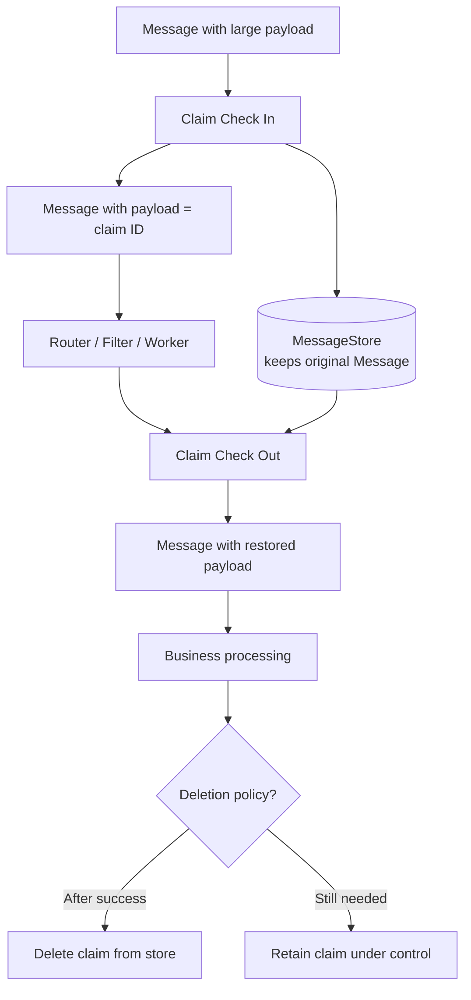
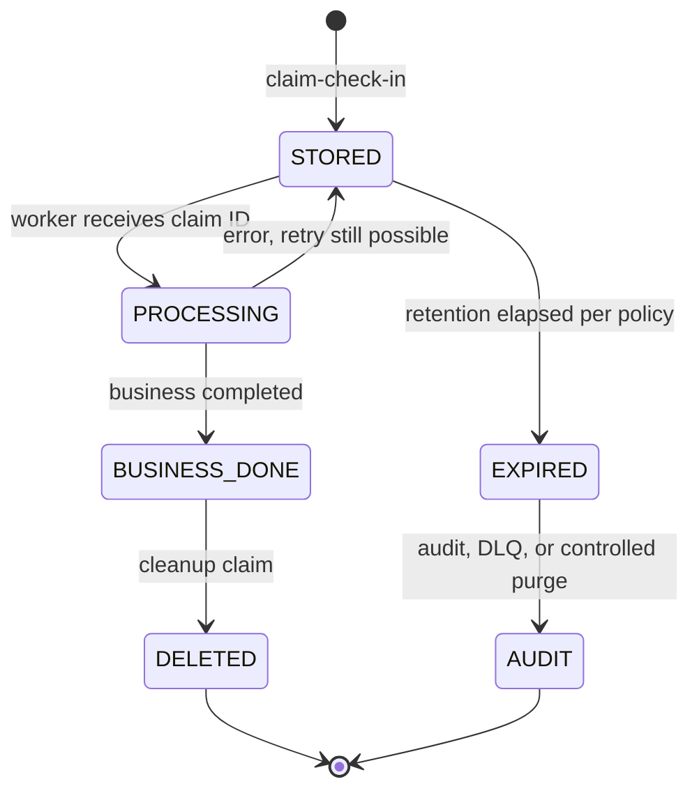
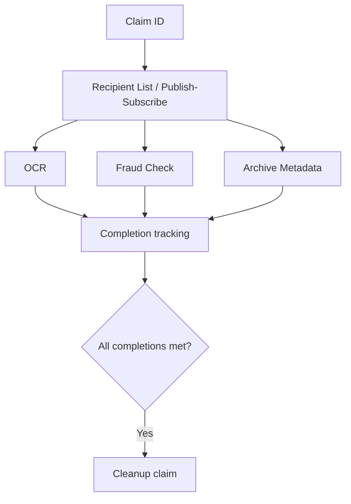

# Deleting a claim after processing

A `Message` with a large payload may contain a PDF document, image data, a multi-record batch, or sensitive business information. Meanwhile, intermediate steps like Router, Filter, or Service Activator sometimes only need a reference ID rather than carrying the entire payload. **Claim Check** is an Enterprise Integration Patterns (EIP) pattern that parks a `Message` in a `MessageStore`, replaces the in-flight payload with a **claim check** (reference ID), and restores the `Message` when needed.

Once the data has been used, the system must answer a critical question: **when is it safe to delete the claim from the store?** Deleting too early prevents retries or other consumers from retrieving the payload; deleting too late increases memory, storage cost, data retention duration, and data exposure risk. The right policy depends on whether the claim is single-use or multi-use, what “processing finished” means, which operations a transaction covers, and whether messages may be replayed.

This lesson belongs to the **Claim check** chapter of the `SPRING_INTEGRATION_PATTERN` module. The module focuses on practicing Spring Integration with Router, Filter, Transformer, Splitter, Aggregator, Gateway, retry, error channel, and correlation to build loosely coupled, extensible, testable, and observable flows. The focus of this lesson is **safely deleting claims after use, distinguishing default behavior from claim-once, designing retry/cleanup, and observing data lifecycles inside `MessageStore`**.

## 1. Claim Check lifecycle: park, issue ticket, retrieve, and clean up

Consider a `Message` carrying a 5 MiB payload. The flow only needs metadata to select a processing path; there is no need to carry 5 MiB across every hop.



A Claim Check has two sides:

1. **Incoming Claim Check Transformer**: takes the original `Message`, saves it in the store, and produces a new `Message` whose payload is the reference ID.
2. **Outgoing Claim Check Transformer**: takes that ID, looks up the stored `Message`, and restores the payload for downstream use. Depending on configuration, it **keeps or deletes** the stored `Message`.

`MessageStore` is a strategy for storing `Message`s, not an arbitrary payload copier with an identical format everywhere. Spring Integration supports implementations such as `SimpleMessageStore` (RAM) and `JdbcMessageStore` (JDBC) suited to different durability levels.

### 1.1. Claim ID is not the original payload

Example:

```text
Original Message:
  payload     = byte[5 MiB]
  eventId     = evt-1001
  documentId  = DOC-1001

After claim-check-in:
  payload     = reference UUID, e.g. 8a4f...
  store[UUID] = original Message

After claim-check-out:
  payload     = restored byte[5 MiB]
```

This ID is **not an arbitrary file path**, not an order ID, and does not carry the original data itself. It is a lookup key in the corresponding store. Spring Integration currently uses UUID-shaped identifiers for claim checks; do not depend on a UUID's printed form as a long-term transport contract without normalizing.

### 1.2. No claim stays stored forever for free

If you store 100,000 Messages per day averaging 200 KiB without deletion or retention, payloads alone consume roughly 19 GiB/day (excluding headers, serialization, and metadata). With `SimpleMessageStore`, accumulated heap data can trigger `OutOfMemoryError`; with JDBC, tables, indexes, and backup costs grow without bound.

## 2. Default policy: checkout does not auto-delete

In Spring Integration, the `removeMessage` option on **Claim Check Out** means:

| Configuration | Behavior | Suitable when |
| --- | --- | --- |
| `claimCheckOut(store)` | Restores `Message` yet **does not delete** from store by default | May need multiple retrievals or deletion after business success |
| `claimCheckOut(store, false)` | Explicitly retains claim after checkout | Retries, inspection, or controlled multi-read |
| `claimCheckOut(store, true)` | **Deletes `Message` from store during checkout** | Claim-once; used once and this deletion point is acceptable |

In XML configuration, the matching attribute is `remove-message="true"` or `remove-message="false"` (default false). In Java DSL, the `claimCheckOut(MessageStore, boolean)` overload passes the policy straight to the transformer.

**Crucial point:** `removeMessage=true` means **delete during the claim-check-out step**; it **does not mean wait until all downstream business handlers finish and commit the database before deleting**. If downstream still has steps that can fail, `removeMessage=true` can be too early.

### 2.1. “Claim once” differs from “processed exactly once”

“Can only be claimed once” is a policy of **the Message store**. It does not prove:

- The business handler executed side effects successfully.
- The business database committed.
- Downstream consumers ACKed.
- The inbound broker will not redeliver.
- Two instances had no read/delete race depending on store configuration.

Therefore, never use `removeMessage=true` as proof of end-to-end exactly-once guarantees.

## 3. “After processing” needs an explicit completion milestone

Distinguish these milestones:

```text
t0: Claim Check In stores Message
t1: Worker receives claim ID
t2: Claim Check Out restores data
t3: Business handler begins processing
t4: Business database transaction COMMITS
t5: Outcome durably recorded / downstream receives it
t6: Claim deleted from MessageStore
t7: Input broker ACK
```

These milestones **do not sit inside one automatic transaction**; the appropriate order varies by architecture. Deleting at `t2` is claim-once; deleting after `t4` or `t5` is a **different** business policy.

| What is the system doing? | When should deletion be considered? |
| --- | --- |
| Reading data once and returning a synchronous result | After checkout, if no retries are needed and reuse does not matter |
| Updating a business database | After successful commit, or in the same transaction genuinely covering both state and deletion |
| Sending a command to another broker | After durable dispatch confirmation, or via an appropriate outbox |
| Multiple independent consumers needing the same payload | Once all required consumers complete or retention ends |
| Async workflow running for hours | After workflow completion plus deadline/retention policy |
| Processing that may fail and retry using claim ID | Keep claim until success or transition to a recoverable error flow |

**Do not treat `input.send()` returning `true` as proof of business completion.** Across many channel types, that result only confirms the `Message` was accepted/handed off within the current scope.

## 4. Safe deletion sequence for a single consumer

A workflow can be described as:



This is an **illustrative business state machine**, not a built-in lifecycle enum in Spring Integration. The key invariant is never transitioning to `DELETED` while the business operation can still roll back.

### 4.1. Success path

```text
claim ID -> fetch payload -> process business logic
         -> confirm completion/commit
         -> delete claim
```

### 4.2. Retryable failure path

```text
claim ID -> fetch payload -> processing fails
         -> rollback/record failure
         -> DO NOT delete claim
         -> retry with same claim ID (bounded)
```

### 4.3. Permanent failure path

```text
claim ID -> data violates contract, unprocessable
         -> record cause + investigable record
         -> decide DLQ/quarantine/retention
         -> delete claim once retrieval is no longer needed
```

Do not keep invalid data in RAM forever; neither should you delete the sole copy before recording enough diagnostic info if business or retention rules require it.

## 5. Java DSL config: Claim Check In and two Checkout modes

A Java 17+ example using Spring Integration DSL and `SimpleMessageStore`. We create **one check-in path** and two separate check-out paths to illustrate:

- `inspectClaimInput`: restores payload while **keeping the claim**.
- `claimOnceInput`: restores payload and **deletes the claim at checkout**.

```java
package example.integration;

import org.springframework.beans.factory.annotation.Qualifier;
import org.springframework.context.annotation.Bean;
import org.springframework.context.annotation.Configuration;
import org.springframework.integration.channel.DirectChannel;
import org.springframework.integration.channel.QueueChannel;
import org.springframework.integration.config.EnableIntegration;
import org.springframework.integration.dsl.IntegrationFlow;
import org.springframework.integration.store.MessageStore;
import org.springframework.integration.store.SimpleMessageStore;
import org.springframework.messaging.MessageChannel;
import org.springframework.messaging.PollableChannel;

@Configuration
@EnableIntegration
public class ClaimCleanupConfiguration {

    @Bean
    public MessageStore claimStore() {
        // Demo: RAM storage, does not survive JVM restarts.
        return new SimpleMessageStore();
    }

    @Bean
    public MessageChannel incomingDocuments() {
        return new DirectChannel();
    }

    @Bean
    public PollableChannel claimTickets() {
        return new QueueChannel(20);
    }

    @Bean
    public MessageChannel inspectClaimInput() {
        return new DirectChannel();
    }

    @Bean
    public PollableChannel inspectedDocuments() {
        return new QueueChannel(20);
    }

    @Bean
    public MessageChannel claimOnceInput() {
        return new DirectChannel();
    }

    @Bean
    public PollableChannel claimedOnceDocuments() {
        return new QueueChannel(20);
    }

    @Bean
    public IntegrationFlow checkIn(
            @Qualifier("claimStore") MessageStore store) {
        return IntegrationFlow.from("incomingDocuments")
                .claimCheckIn(store)
                .channel("claimTickets")
                .get();
    }

    @Bean
    public IntegrationFlow inspectWithoutRemoval(
            @Qualifier("claimStore") MessageStore store) {
        return IntegrationFlow.from("inspectClaimInput")
                .claimCheckOut(store, false)
                .channel("inspectedDocuments")
                .get();
    }

    @Bean
    public IntegrationFlow checkoutAndRemove(
            @Qualifier("claimStore") MessageStore store) {
        return IntegrationFlow.from("claimOnceInput")
                .claimCheckOut(store, true)
                .channel("claimedOnceDocuments")
                .get();
    }
}
```

### Explaining each route

1. `incomingDocuments` receives the original `Message`.
2. `.claimCheckIn(store)` saves the `Message` in `claimStore` and sends the claim ID as the payload to `claimTickets`.
3. `.claimCheckOut(store, false)` retrieves the payload without removing the claim from the store.
4. `.claimCheckOut(store, true)` retrieves the payload and removes the claim from the store with **claim-once** semantics.
5. `QueueChannel(20)` is only an in-RAM output queue. It **does not cap the number of claims in `SimpleMessageStore`** and does not make data durable.

The two checkout paths are separated so learners can compare them; a real system needs **one clear policy per claim type**, avoiding multiple endpoints independently deleting a claim still used elsewhere.

### 5.1. When to use the `claimOnceInput` path?

Suitable when **merely receiving the data back completes its usage** or downstream accepts losing claim retrievability after checkout. Unsuitable if a subsequent database update can roll back while retries hold only the claim ID.

### 5.2. Why not add `removeMessage=true` to every flow?

`removeMessage=true` frees storage right at **checkout** without understanding subsequent business steps. For `Message`s traversing Routers, Gateways, or brokers, callbacks/ACKs/commits from other systems do not automatically drive deletion inside the Transformer.

## 6. Demo: create claim, read multiple times, then delete

The following snippet uses the configuration from section 5 to observe retention and deletion behavior:

```java
package example.integration;

import java.nio.charset.StandardCharsets;
import java.util.UUID;

import org.springframework.context.annotation.AnnotationConfigApplicationContext;
import org.springframework.messaging.Message;
import org.springframework.messaging.MessageChannel;
import org.springframework.messaging.PollableChannel;
import org.springframework.messaging.support.MessageBuilder;
import org.springframework.integration.store.MessageStore;

public class ClaimCleanupDemo {

    public static void main(String[] args) {
        try (var context = new AnnotationConfigApplicationContext(
                ClaimCleanupConfiguration.class)) {

            MessageChannel input =
                    context.getBean("incomingDocuments", MessageChannel.class);
            PollableChannel tickets =
                    context.getBean("claimTickets", PollableChannel.class);
            MessageChannel inspect =
                    context.getBean("inspectClaimInput", MessageChannel.class);
            PollableChannel inspected =
                    context.getBean("inspectedDocuments", PollableChannel.class);
            MessageChannel takeOnce =
                    context.getBean("claimOnceInput", MessageChannel.class);
            PollableChannel taken =
                    context.getBean("claimedOnceDocuments", PollableChannel.class);
            MessageStore store =
                    context.getBean("claimStore", MessageStore.class);

            byte[] document =
                    "DOCUMENT CONTENT".getBytes(StandardCharsets.UTF_8);
            input.send(MessageBuilder.withPayload(document)
                    .setHeader("documentId", "DOC-1001")
                    .setHeader("eventId", "evt-1001")
                    .build());

            Message<?> ticket = tickets.receive(0);
            if (ticket == null) {
                throw new IllegalStateException("No claim ticket");
            }
            UUID claimId = (UUID) ticket.getPayload();
            System.out.println(store.getMessage(claimId) != null); // true

            // Read without deleting.
            inspect.send(MessageBuilder.withPayload(claimId).build());
            Message<?> firstRead = inspected.receive(0);
            if (firstRead == null) {
                throw new IllegalStateException("No retrieved document");
            }
            System.out.println(new String(
                    (byte[]) firstRead.getPayload(),
                    StandardCharsets.UTF_8));
            System.out.println(store.getMessage(claimId) != null); // true

            // Claim once: after checkout, entry is gone from store.
            takeOnce.send(MessageBuilder.withPayload(claimId).build());
            Message<?> claimed = taken.receive(0);
            if (claimed == null) {
                throw new IllegalStateException("No claimed document");
            }
            System.out.println(new String(
                    (byte[]) claimed.getPayload(),
                    StandardCharsets.UTF_8));
            System.out.println(store.getMessage(claimId) == null); // true
        }
    }
}
```

This is a **direct illustration of store behavior**, not proof that downstream processing committed. `Claim Check Out` on the second path deletes the entry during retrieval; if a subsequent handler fails, the claim ID can no longer restore the original data.

Moreover, successful checkout does not necessarily preserve every header across another transport. If downstream needs `eventId`, `tenantId`, or `correlationId`, test metadata actually traversing the endpoints/adapters in your architecture.

## 7. Deleting truly after business success: managing the lifecycle yourself

When the requirement is **delete only after processing succeeds**, separate reading from cleanup:

```text
Fetch original Message by claim ID (without deleting)
    ↓
Execute business operation idempotently
    ↓
Confirm completion/commit
    ↓
Delete Message from store
```

The following example shows a service running synchronously with `MessageStore`. It does not use `claimCheckOut(store, true)` because that option deletes **before the service knows whether downstream business logic succeeded**.

```java
package example.integration;

import java.util.UUID;

import org.springframework.integration.store.MessageStore;
import org.springframework.messaging.Message;

public final class ProcessThenDeleteClaim {

    @FunctionalInterface
    public interface DocumentProcessor {
        void process(byte[] document);
    }

    private final MessageStore store;
    private final DocumentProcessor processor;

    public ProcessThenDeleteClaim(
            MessageStore store, DocumentProcessor processor) {
        this.store = store;
        this.processor = processor;
    }

    public void handle(UUID claimId) {
        Message<?> stored = store.getMessage(claimId);
        if (stored == null) {
            throw new IllegalArgumentException(
                    "Unknown or already removed claim");
        }
        if (!(stored.getPayload() instanceof byte[] document)) {
            throw new IllegalArgumentException(
                    "Claim payload is not a document");
        }

        // If exception thrown: removeMessage() is not reached.
        // If inside a DB transaction: success here must match
        // a verifiable durable completion milestone.
        processor.process(document);

        // Delete only after processor returns success per contract.
        store.removeMessage(claimId);
    }
}
```

**Important warning:** this service illustrates **operation ordering**, not an exactly-once protocol or distributed lock:

- If `processor.process()` merely *enqueues* an async job and returns, business work is not yet complete.
- If the processor participates in an open transaction, returning from the method does not prove the transaction has **committed**.
- If two consumers call `handle()` concurrently with the same claim, both may read the payload before the first deletes it. You need locks/claim ownership/idempotency per design.
- If the process crashes **after business commit but before removal**, the claim remains and a retry may run the business logic again. Consumers must be idempotent or check a completion table.

### 7.1. When to use `claimCheckOut(store, false)`?

It is a solid choice when using the standard transformer to restore the `Message` in-flow while **retaining the claim** until a downstream service confirms completion. In that case, preserve the claim ID across checkout—for instance via a business header or separate state record—so the exact entry can be cleaned up.

**Do not assume the ID remains in the payload after checkout.** The payload is restored back to the original data; manual cleanup needs a way to correlate back to the claim ID.

## 8. Delete in the same transaction or after commit?

Depending on the case, two common design approaches exist.

### 8.1. Same database transaction

If business logic and `JdbcMessageStore` genuinely share **the same DataSource and transaction manager**, you can perform business processing and claim deletion in **one DB transaction**:

```text
BEGIN JDBC transaction
  SELECT/validate claim
  UPDATE business records
  DELETE claim entry
COMMIT
```

On rollback, DB changes participating in the transaction roll back together. This guarantee applies **within the scope of the database transaction**, and does not automatically encompass Kafka offsets, HTTP calls, emails, or other brokers.

Conditions for this approach to be valid:

1. Business records and Message Store truly reside in DB resources managed by the same transaction manager.
2. All reads/updates/deletes use the connection participating in that transaction.
3. No async boundary drops the transaction context.
4. Concurrency is controlled so two consumers cannot process the same claim simultaneously.
5. Outputs outside the database are handled separately, e.g., via a transactional outbox when needed.

### 8.2. Delete after transaction commit

Some systems choose to **wait for DB commit before deleting**. This avoids deleting a claim when the DB rolls back, yet opens a window:

```text
Business DB COMMIT succeeds
           ↓
Application crashes
           ↓
Claim still remains and may be retried
```

Thus, post-commit deletion requires **idempotency by business event/operation** or a completion marker so retries recognize the work already finished. “Delete after commit” and “never process twice” are two separate requirements.

### 8.3. Transactions do not span threads or brokers automatically

If a flow shifts from `DirectChannel` to `ExecutorChannel`, processing on the worker thread does not automatically belong to the transaction started on the producer thread. Likewise, `@Transactional` on a service cannot roll back an already-sent HTTP request or a command already accepted by another broker.

To delete accurately after *durable completion*, first define **exactly which source confirms completion**.

## 9. Failure-window matrix when deleting claims

Suppose the original `Message` is stored in `JdbcMessageStore` and a consumer receives a claim ID from a broker:

| Failure point | Claim still present? | Business possibly complete? | Risk/policy |
| --- | --- | --- | --- |
| Crash before checkout | Usually yes if committed | No | Broker redelivers and reprocesses |
| Checkout with `remove=false`, error before processing | Yes | No | Safer retries possible |
| Checkout with `remove=true`, handler fails | Deleted at checkout (if committed) | No | Retries carrying only claim ID may fail |
| Business committed, crash before cleanup | Yes | Yes | Duplicate processing possible; needs idempotency |
| Claim deleted, crash before broker ACK | Gone | Possibly yes or no, depending on transaction | Broker redelivery cannot rely on claim ID alone |
| Broker ACK before business commit/delete | May remain | Uncertain | Risk of losing work if commit fails |
| Cleanup succeeded, output broker unconfirmed | Gone | Downstream receipt uncertain | Requires durable output or outbox |

This matrix is an **architectural analysis**, not a claim that all adapters share identical ACK and transaction mechanics. Depending on broker, `MessageStore`, and transaction manager, an uncommitted “delete” may still roll back.

**Principle:** never delete the sole copy of a document that a retry may need before another data source exists to recover that work.

## 10. Idempotency and redelivery: deleting the claim is not enough

At-least-once delivery means the same work may execute more than once. Example:

```text
claimId      = 2ca7...
eventId      = evt-1001
operation    = IMPORT_DOCUMENT

Attempt 1: import completes, claim not deleted yet
Attempt 2: broker redelivers claimId
```

If the handler only checks whether the claim still exists, it may import a second time. Use a **business idempotency key**, such as:

```text
idempotencyKey = tenantId + ":" + eventId + ":" + operation
```

One approach:

1. Upon receiving the claim ID, check the completion record by idempotency key.
2. If already complete, skip side effects; perform any missing cleanup if permitted.
3. If incomplete, acquire claim ownership/lock per design and execute business logic.
4. Durably record completion outcome.
5. Delete the claim when eligible.
6. Acknowledge input per transport policy.

`MessageHeaders.ID` or claim ID helps trace a `Message`, yet a recreated `Message`'s ID on retry may differ. Idempotency keys must rest on **work semantics**, not solely on `Message` object identity.

## 11. Multiple consumers needing the payload: do not delete on first read

Suppose the same claim fans out to three branches:



If OCR runs `claimCheckOut(store, true)` first, the other two branches cannot retrieve the payload. With multiple consumers:

- Use **non-deleting reads** or give each branch its own copy/claim per design.
- Define the set of required consumers and deadlines.
- Track completion by `claimId + consumerType` or a stable workflow ID.
- Handle duplicate completions and consumer restarts.
- Delete only when required branches no longer depend on the claim.

### 11.1. Reference counting is not simply counting callbacks

Three “done” callbacks do not prove three distinct branches finished: one branch may retry and emit its callback twice. Completion tracking should track **the set of completed branch names** and request key, not just an unconstrained counter.

### 11.2. Dynamic fan-out after emission

If a Recipient List dynamically selects consumers, cleanup conditions must know **which recipients were actually selected**. Do not hardcode waiting for 3 branches if this request went to 2, nor delete at 2 if another request needed 4.

## 12. Cleanup when a claim is never checked out

Not every claim reaches business success. Some IDs become **orphans** when:

- Producer saves the `Message` yet crashes before sending the claim ID.
- Router/Filter drops the claim ID without a cleanup workflow.
- Consumer dies and retry sources disappear.
- Gateway times out and caller abandons the request while data sits in the store.
- A branch waits on a condition that never completes.
- User cancels the task.

Thus you need a **retention/expiration** policy for unredeemed claims.

| Claim category | Suggested policy | Considerations |
| --- | --- | --- |
| In progress | Keep until completion or deadline | Avoid deleting while workers are active |
| Completed | Delete promptly per completion marker | Ensure no other consumers still need payload |
| Retryable error | Keep until retry budget exhausted | Maintain recovery data and retry schedule |
| Unrecoverable error | Quarantine/DLQ/audit then purge | Comply with investigation contract |
| Unclaimed | TTL + periodic cleanup | Distinguish orphans from legitimately slow jobs |
| Legal retention data | Store for mandated duration with access ACLs | Prevent normal cleanup from deleting early |

**TTL is not automatically enforced for every `MessageStore`.** `SimpleMessageStore` and JDBC stores should not be assumed to have complete expiration policies just because an app saves a timestamp header. You must configure/implement and test a cleanup mechanism.

### 12.1. Cleanup logic can start like this

```text
for each claim with lifecycle state and timestamp:
    if completed AND no required consumer pending:
        delete claim
    else if expired AND not active AND recovery record exists:
        move to audit/quarantine as required
        delete claim according to retention policy
    else:
        retain
```

This is **policy pseudocode**, not a built-in enumeration API on `MessageStore`. Implementing it typically requires a **business metadata table** or tracking store queryable by state and claim age; do not rely on scanning every `MessageStore` key if the implementation does not support it.

## 13. Manual deletion via `MessageStore.removeMessage(...)`

Spring Integration provides message retrieval/deletion through the `MessageStore` abstraction. Once an ID is known and eligible for cleanup, a service can call:

```java
Message<?> original = store.getMessage(claimId);
if (original == null) {
    // May never have existed, already deleted, or wrong store.
    // Decide handling based on completion/audit record.
    return;
}

// Only when policy permits deletion:
store.removeMessage(claimId);
```

This assumes `claimId` is a `UUID`, `store` is a `MessageStore`, and `Message<?>` is from Spring Messaging. It does **not** prove check-then-delete is atomic across multiple consumers.

### 13.1. Repeated deletion (idempotent cleanup)

Cleanup may be re-invoked by scheduler retries. If the claim is already gone, that may be a **successful prior cleanup** or a reference error; distinguish via completion records:

```text
Claim absent from store + completion record exists
    -> cleanup already done; no further deletion needed

Claim absent from store + no completion record
    -> investigate missing claim / wrong store / retention race
```

Never report “processed successfully” simply because the claim is missing. Absence of the original `Message` does not prove business execution occurred.

### 13.2. Deletion racing with reads

If worker A is reading while worker B cleans up based on TTL, both may execute concurrently. Real systems need **claim ownership/leases**, `PROCESSING` states, transactional locks, or equivalent coordination to prevent deleting active work.

An expired lease does not necessarily prove a worker stopped; if the worker was merely slow, letting another worker reprocess can cause duplicate side effects. Use tokens/versions/fencing or idempotency when high reliability is needed.

## 14. `SimpleMessageStore` vs `JdbcMessageStore`

| Characteristic | `SimpleMessageStore` | `JdbcMessageStore` |
| --- | --- | --- |
| Storage location | JVM RAM | Relational database |
| Across restarts | No, if solely in-process | Yes, for committed data with compatible schema |
| Cleanup | Frees heap/retained objects | Reduces DB rows/size and retention footprint |
| Database transactions | Does not create DB transactions | Can participate in appropriate transactions |
| Multiple replicas | Each JVM holds separate state unless coordinated | Can share one database with proper keys/transactions |
| Large data | Grows heap quickly | Depends on DB/I/O, serialization, and storage |
| Default TTL policy | Not complete out of the box | Not complete out of the box |

Example **replacement configuration** for the `claimStore()` bean in section 5:

```java
package example.integration;

import javax.sql.DataSource;

import org.springframework.context.annotation.Bean;
import org.springframework.context.annotation.Configuration;
import org.springframework.integration.jdbc.store.JdbcMessageStore;
import org.springframework.integration.store.MessageStore;

@Configuration
public class JdbcClaimStoreConfiguration {

    // Replaces the in-memory claimStore() bean;
    // do not register both with the same name in one context.
    @Bean
    public MessageStore claimStore(DataSource dataSource) {
        return new JdbcMessageStore(dataSource);
    }
}
```

This requires the Spring Integration JDBC module, a Message Store schema compatible with your dependency version, `DataSource` config, transaction manager, serialization, and database migrations. This snippet **does not create the database or provide TTL/cleanup automatically**.

### 14.1. Persistence protects committed claims, not end-to-end flows

A durably stored claim can still get lost from a workflow perspective if:

- The claim ID was not handed to the consumer before the producer crashed.
- The claim ID went into an unrecoverable in-memory queue.
- The claim was deleted before business outputs were durably persisted.
- Serialization broke compatibility after a deployment.
- A consumer queried the wrong database/namespace/region.

Therefore, design **the durable reference path** and **cleanup policy** together; simply swapping `SimpleMessageStore` for JDBC does not solve everything.

## 15. Security and permission to delete claims

A claim ID is a **pointer to data**. If anyone knowing the ID can pull payloads from the store without checks, the claim check becomes an easily abused capability token.

Countermeasures:

1. **Authorize by tenant/user/operation** at lookup boundaries, rather than relying solely on UUID unpredictability.
2. **Never log claim IDs alongside sensitive data** in public log channels.
3. **Encrypt data at rest and in transit** when payloads require it.
4. **Restrict delete rights**: only authorized workers/cleanup services may delete.
5. **Audit reads/deletions** with business ID, actor, reason, and status.
6. **Keep retention to the minimum necessary**, especially for personal data.
7. **Never reuse claim IDs** for different data after deletion.

Deleting a row from JDBC or an object from RAM **does not mean immediate physical erasure from backups, snapshots, replicas, logs, or storage media**. For legal data-deletion mandates, implement dedicated backup/retention workflows and verify erasure within infrastructure capabilities.

## 16. JUnit 5: verifying claim retention and deletion on checkout

To properly test Spring Integration mechanics, route tests through **real channels** instead of only calling `store.removeMessage(...)` directly.

```java
package example.integration;

import static org.junit.jupiter.api.Assertions.*;

import java.nio.charset.StandardCharsets;
import java.util.UUID;

import org.junit.jupiter.api.Test;
import org.springframework.context.annotation.AnnotationConfigApplicationContext;
import org.springframework.integration.store.MessageStore;
import org.springframework.messaging.Message;
import org.springframework.messaging.MessageChannel;
import org.springframework.messaging.PollableChannel;
import org.springframework.messaging.support.MessageBuilder;

class ClaimCleanupIntegrationTest {

    @Test
    void checkoutWithRemoveFalseKeepsClaimThenRemoveTrueDeletesIt() {
        try (var context = new AnnotationConfigApplicationContext(
                ClaimCleanupConfiguration.class)) {

            MessageChannel input =
                    context.getBean("incomingDocuments", MessageChannel.class);
            PollableChannel tickets =
                    context.getBean("claimTickets", PollableChannel.class);
            MessageChannel inspect =
                    context.getBean("inspectClaimInput", MessageChannel.class);
            PollableChannel inspected =
                    context.getBean("inspectedDocuments", PollableChannel.class);
            MessageChannel takeOnce =
                    context.getBean("claimOnceInput", MessageChannel.class);
            PollableChannel taken =
                    context.getBean("claimedOnceDocuments", PollableChannel.class);
            MessageStore store =
                    context.getBean("claimStore", MessageStore.class);

            byte[] content =
                    "some document".getBytes(StandardCharsets.UTF_8);
            assertTrue(input.send(
                    MessageBuilder.withPayload(content).build()));

            Message<?> ticket = tickets.receive(0);
            assertNotNull(ticket);
            UUID claimId = (UUID) ticket.getPayload();
            assertNotNull(store.getMessage(claimId));

            assertTrue(inspect.send(
                    MessageBuilder.withPayload(claimId).build()));
            Message<?> readOnly = inspected.receive(0);
            assertNotNull(readOnly);
            assertArrayEquals(content, (byte[]) readOnly.getPayload());
            assertNotNull(store.getMessage(claimId));

            assertTrue(takeOnce.send(
                    MessageBuilder.withPayload(claimId).build()));
            Message<?> restored = taken.receive(0);
            assertNotNull(restored);
            assertArrayEquals(content, (byte[]) restored.getPayload());
            assertNull(store.getMessage(claimId));
            assertNull(taken.receive(0));
        }
    }
}
```

**This test verifies checkout and store behavior**, not downstream commits. Because the config uses `DirectChannel` and queues with no competing consumer, `receive(0)` sees messages right after `send()`. For async flows, use bounded timeouts and inspect appropriate error channels or durable destinations.

### 16.1. After deletion, calling checkout with the same ID again

The behavior to test is that **no valid original `Message` is restored a second time**. Depending on version and endpoint, a missing claim can trigger an exception or transformation failure; do not hardcode a specific exception type without checking your exact dependency.

Do not interpret “claim is gone” as “business side effects ran exactly once.” That is a separate assertion.

## 17. JUnit 5: business failures must not delete the claim

The second test focuses on `ProcessThenDeleteClaim` from section 7. It verifies that when the processor fails, the claim remains for retries; when the processor succeeds, the claim is cleaned up.

```java
package example.integration;

import static org.junit.jupiter.api.Assertions.*;

import java.nio.charset.StandardCharsets;
import java.util.UUID;
import java.util.concurrent.atomic.AtomicInteger;

import org.junit.jupiter.api.Test;
import org.springframework.context.annotation.AnnotationConfigApplicationContext;
import org.springframework.integration.store.MessageStore;
import org.springframework.messaging.Message;
import org.springframework.messaging.MessageChannel;
import org.springframework.messaging.PollableChannel;
import org.springframework.messaging.support.MessageBuilder;

class ProcessThenDeleteClaimTest {

    @Test
    void failedProcessingKeepsClaimForRetryAndSuccessRemovesIt() {
        try (var context = new AnnotationConfigApplicationContext(
                ClaimCleanupConfiguration.class)) {

            MessageChannel input =
                    context.getBean("incomingDocuments", MessageChannel.class);
            PollableChannel tickets =
                    context.getBean("claimTickets", PollableChannel.class);
            MessageStore store =
                    context.getBean("claimStore", MessageStore.class);

            byte[] content = "payload".getBytes(StandardCharsets.UTF_8);
            input.send(MessageBuilder.withPayload(content).build());
            Message<?> ticket = tickets.receive(0);
            assertNotNull(ticket);
            UUID claimId = (UUID) ticket.getPayload();

            AtomicInteger attempts = new AtomicInteger();
            ProcessThenDeleteClaim service = new ProcessThenDeleteClaim(
                    store,
                    document -> {
                        assertArrayEquals(content, document);
                        if (attempts.incrementAndGet() == 1) {
                            throw new IllegalStateException("transient failure");
                        }
                    });

            assertThrows(
                    IllegalStateException.class,
                    () -> service.handle(claimId));
            assertNotNull(store.getMessage(claimId));

            assertDoesNotThrow(() -> service.handle(claimId));
            assertNull(store.getMessage(claimId));
            assertEquals(2, attempts.get());
        }
    }
}
```

The test proves **deletion occurs only after the demo callback returns without error**. It does not simulate database transactions, crashes, HTTP/broker ACKs, or multiple consumers; those guarantees need dedicated tests on real infrastructure or equivalent integration environments.

## 18. Testing transactions, restarts, and concurrency

A supplementary test suite should cover:

| Case | How to construct scenario | Expectation |
| --- | --- | --- |
| **One-time checkout** | Send claim ID to `remove=true` path | Store no longer holds entry after successful checkout |
| **Retained checkout** | Send claim ID to `remove=false` path | Store still holds entry |
| **Business handler fails** | Processor throws exception before completion | Claim remains if policy requires retries |
| **DB rollback** | Same JDBC transaction: process and delete then throw | Both DB operations participating in transaction roll back together |
| **Crash after commit before delete** | Kill consumer inside failure window | Claim remains, yet idempotency prevents duplicate side effects |
| **Crash after delete before broker ACK** | Broker redelivers old ID | Classify missing claim via completion record |
| **Two consumers with same ID** | Run concurrently | No duplicate side effects outside contract |
| **Claim shared across three branches** | One branch finishes early | Not deleted while remaining branches need payload |
| **Orphan claim** | Check-in without checkout | TTL/quarantine/cleanup per policy |
| **Restart with JDBC store** | Share same DB across two application contexts | Committed claims remain retrievable before cleanup |
| **Payload schema change** | Store in old version, read in new version | Serializer/compatibility or recoverable error |
| **Tenant mismatch** | Tenant B consumer attempts A's claim | Rejected per access-control policy |

### 18.1. Restart tests must preserve the same database

If Context #1 stores a claim in JDBC and stops, Context #2 must connect to **the same database and schema** to prove persistence across restarts. Recreating a fresh `SimpleMessageStore` and observing missing claims is not a JDBC persistence test.

### 18.2. Verifying true transactions

To prove rollback, business updates and claim deletion must genuinely join the same DB transaction. A test throwing an exception **after the transaction has already committed** cannot prove transaction rollback.

## 19. Observing claim cleanup in production

In operations, two conditions must be caught early:

1. **Claim leakage:** claim counts grow forever because cleanup never runs.
2. **Premature deletion:** claims vanish before consumers can recover or complete business work.

### 19.1. Suggested metrics

| Metric | Meaning |
| --- | --- |
| `claim_check.in.count` | Messages checked in |
| `claim_check.out.count` | Checkout attempts |
| `claim_check.store.entries` | Remaining entries in store |
| `claim_check.store.estimated_bytes` | Stored volume remaining |
| `claim_check.removed.count` | Claims deleted |
| `claim_check.remove.failure` | Cleanup failures |
| `claim_check.oldest_age` | Age of oldest living claim |
| `claim_check.orphan.count` | Claims without valid consumer/completion |
| `claim_check.missing.lookup` | Checkouts failing to find claim |
| `claim_check.retry.count` | Claim processing retries |
| `claim_check.cleanup.lag` | Delay from completion to deletion |
| `claim_check.active.consumers` | Consumers/branches still depending on claim |

These are **metric names an application can instrument**, not default names guaranteed in Micrometer/Actuator. Never attach `claimId`, `eventId`, or `documentId` as metric labels due to huge cardinality; keep them in access-controlled logs/traces.

### 19.2. Structured logs

```json
{
  "stage": "claim-cleanup",
  "eventId": "evt-1001",
  "documentId": "DOC-1001",
  "claimReference": "redacted",
  "claimState": "COMPLETED",
  "businessCommitted": true,
  "requiredConsumersRemaining": 0,
  "action": "REMOVE",
  "result": "SUCCESS"
}
```

This is an **illustrative log schema**; Spring Integration does not auto-populate `businessCommitted` or `requiredConsumersRemaining`. Record `businessCommitted=true` only when real evidence shows the transaction committed—not merely because a handler method returned without throwing.

### 19.3. Important alerts

- Check-in rate persistently exceeds checkout/cleanup rate.
- Store size grows faster than business volume.
- Many claims exceed SLA age.
- `missing.lookup` rate spikes after deployment.
- Retries fail because claims were already deleted.
- Cleanup repeatedly fails due to DB, locks, or serializers.
- A branch remains active yet its claim was deleted.

## 20. Common implementation mistakes

| Symptom | Cause | Fix |
| --- | --- | --- |
| Claims keep growing, RAM fills up | Default checkout keeps claims or cleanup missing | Choose `remove=true` when policy fits, or conditional cleanup |
| Consumer retries cannot retrieve payload | `remove=true` deletes too early | Keep claim until business completion |
| Claim deleted then business rolls back | Store outside transaction or deleted at checkout | Design proper DB transaction/after-commit cleanup |
| Business action repeats | Crash after commit before delete/ACK | Idempotency by business key |
| First branch reads, next branch fails | Branches share claim yet one deletes it | Completion tracking or separate claims |
| Duplicate deletion throws unclear errors | Fails to distinguish absent vs completed | Completion records and idempotent cleanup |
| Using JDBC yet claims still vanish | Wrong DB/region, uncommitted, or premature cleanup | Inspect configs and transactions |
| Orphans linger forever | Missing TTL/scheduler | Lifecycle metadata and retention jobs |
| Cleanup deletes while worker runs | No lease/ownership | Locks, leases, explicit completion states |
| Deleted records remain in backups | Lacking infrastructure-wide retention | Dedicated backup/retention/privacy processes |
| Claim ID leaks in logs | Logging full headers/payloads | Redact/mask and control access |
| Deleting entry erases business trail | Storing data only in claim store | Separate completion/audit records with proper retention |
| No visibility into stuck claims | Monitoring only output queues, not store | Entries/bytes/age metrics and alerts |

## 21. Checklist before enabling claim deletion

- **Know what the claim is for:** shrink payloads, decouple systems, or restrict access.
- **Know when deletion happens:** at checkout vs *after business completion*; two distinct points.
- **Define read count:** single-claim or multiple consumers reading.
- **Check default behavior:** `claimCheckOut(store)` keeps the claim; `claimCheckOut(store, true)` deletes at checkout.
- **Preserve claim ID for manual cleanup:** post-checkout payload is restored back to original data.
- **Delete only after durable completion if retries exist:** never rely on a `send()` call or async callback alone.
- **Map transaction boundaries:** `MessageStore`, business DB, input ACK, and output broker.
- **Guard against redelivery:** idempotency by event/operation, not claim ID alone.
- **Control concurrency:** multiple consumers must not delete each other's claims early.
- **Enforce retention/TTL/quarantine:** failed or orphan claims must not live forever.
- **Pick the right store:** RAM for demos, JDBC when restart durability is needed.
- **Ensure security:** read/delete permissions, tenant isolation, encryption, and auditing.
- **Test failure windows:** commit before delete, delete before ACK, rollback, and restarts.
- **Measure cleanup:** entries, bytes, age, missing lookups, deletion failures, and lag.

## 22. Applied exercise

A system sends a large document across three branches:

```text
Claim Check In: store contract PDF, return claimId=C-01

Branch A: OCR, succeeds after 5 seconds
Branch B: Compliance Check, fails transiently then retries
Branch C: Archive Metadata, succeeds after 2 seconds

After 6 seconds:
  A = SUCCESS
  B = RETRYING
  C = SUCCESS
```

Answer these questions:

1. If Branch C uses `claimCheckOut(store, true)` at second 2, what happens when A/B need the document?
2. Should completion be defined by **callback count** or **the set of required branches**?
3. If B retries at second 20, must the claim ID still be retrievable?
4. If B fails permanently, when is deletion allowed and what audit data must be kept?
5. If the business DB committed results yet cleanup failed, which key should retries use to avoid duplicate processing?

A sound design direction: check out **without deleting**, track completion by branches `OCR`, `COMPLIANCE`, `ARCHIVE`, bound retries for B, and clean up only after required branches complete or transition to an approved error/retention workflow. Use a **completion record and stable idempotency key** to handle cases where business work finished yet the claim remains.

## 23. References and example limitations

The `claim-check-in`, `claim-check-out`, and `remove-message`/`removeMessage` APIs and semantics are described in the official documentation:

- [Spring Integration Reference — Claim Check](https://docs.spring.io/spring-integration/reference/claim-check.html)
- [Spring Integration API — BaseIntegrationFlowDefinition, claimCheckIn/claimCheckOut](https://docs.spring.io/spring-integration/docs/6.5.1/api/org/springframework/integration/dsl/BaseIntegrationFlowDefinition.html)

Examples use common Spring Integration 6.x and Java 17+ API styles. When applying to a real project, verify exact dependency versions, run builds/JUnit tests, and test real transactions/adapters. Descriptions of outboxes, retention, leases, and completion tracking represent **application architecture**; they do not appear automatically simply by enabling a Claim Check Transformer.

---

**Safe claim deletion does not mean calling `removeMessage()` as early as possible.** For claim-once scenarios, Spring Integration lets you delete right at checkout with `removeMessage=true`; for flows needing retries or multiple consumers, retain data until a durable processing milestone, coordinate transactions/idempotency, and run cleanup policies for leftover claims. A good solution neither **lets `MessageStore` grow without bound** nor **loses recoverability before work truly finishes**.
