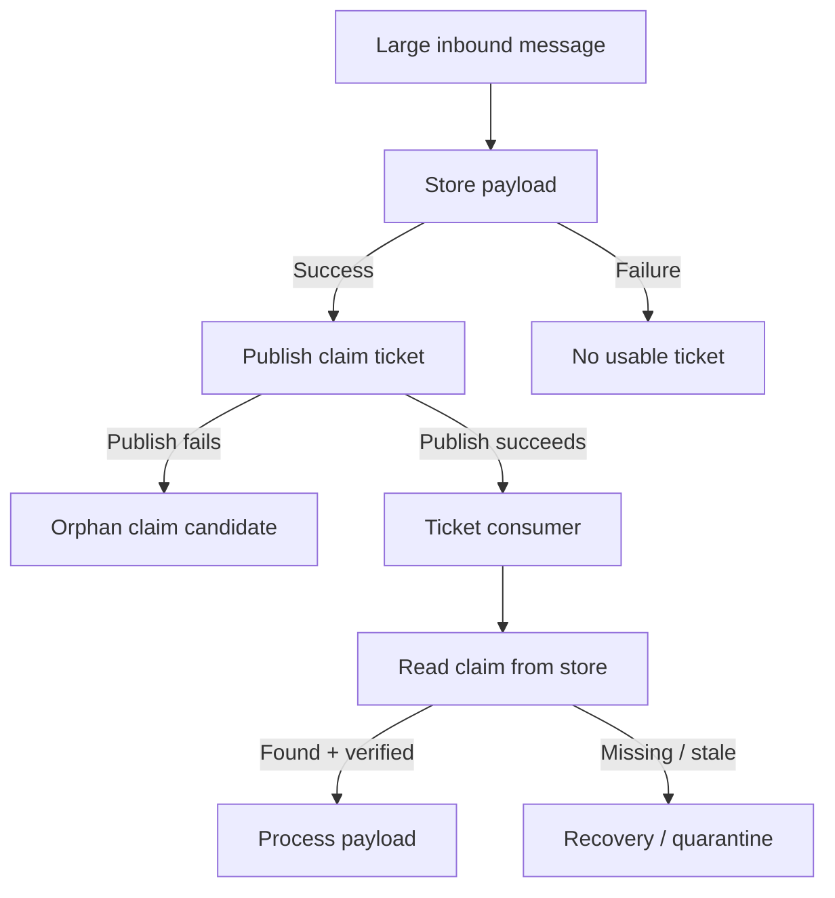
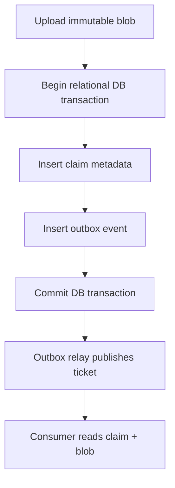
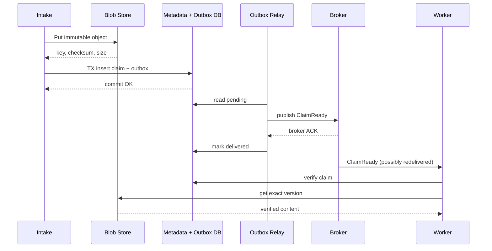
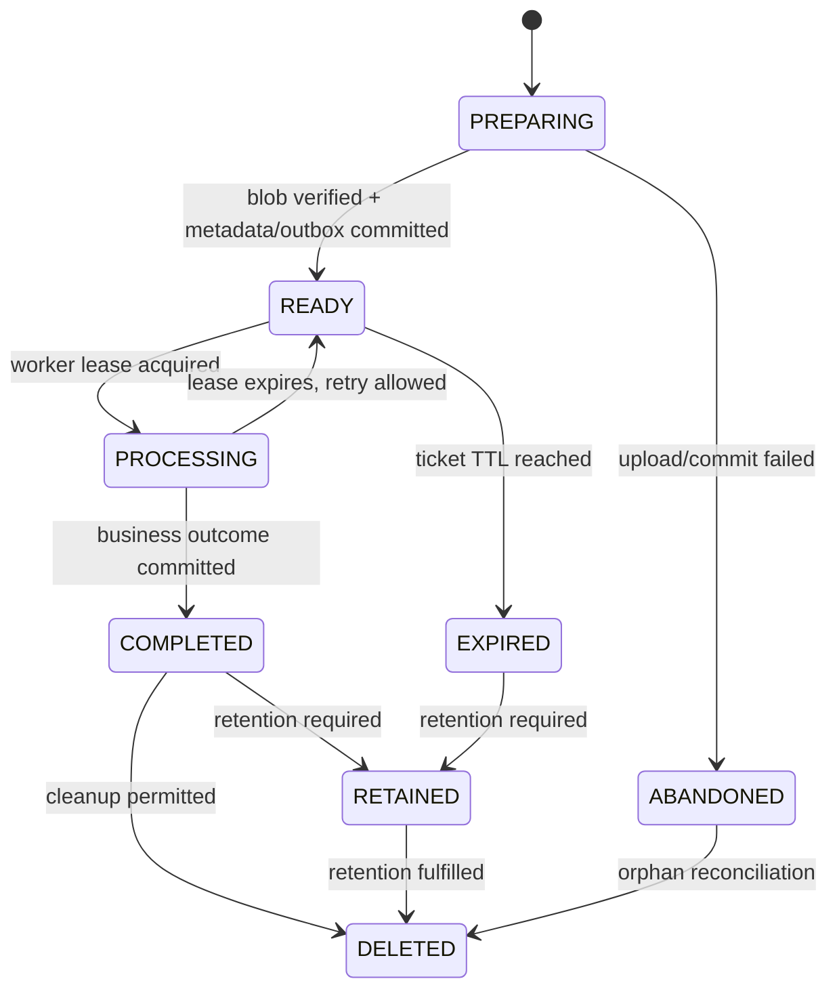
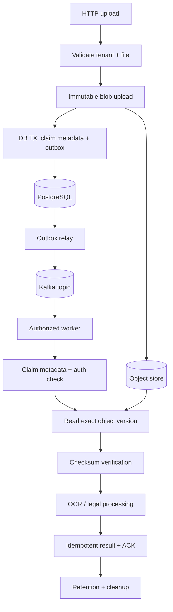

# Consistency between messages and the claim store

A **Claim Check** lets an application park large or sensitive payloads in a dedicated store, then pass a **lightweight reference ticket** across Routers, Filters, Gateways, brokers, or workers. However, replacing a 20 MiB document with a few-dozen-byte `claimId` introduces a new problem: **the message carrying the ticket and the data in the claim store must stay consistent with one another**.

If the broker already received the ticket while the store has not finished saving the payload, workers fail to fetch the document. If the store saves successfully yet the ticket message is never emitted, the document becomes an **orphan claim**. If check-out deletes immediately upon reading and downstream fails, redelivery loses the data needed to retry. If ticket and blob versions drift out of sync, a worker may read the wrong content even though the ID still exists.

The lesson **“Consistency between messages and the claim store”** belongs to the **Claim check** chapter of the `SPRING_INTEGRATION_PATTERN` module. The learning scope covers implementing Enterprise Integration Patterns with Spring Integration to build loosely coupled, extensible message flows; coordinating Router, Filter, Transformer, Splitter, Aggregator, Gateway, retry, error channel, and correlation while testing and observing processing branches.

**Lesson objectives:**

- Define **invariants** for consistency among tickets, metadata, payloads, and processing outcomes.
- Distinguish **orphan claims**, **dangling tickets**, stale data, duplicates, lost ACKs, and premature deletions.
- Understand transaction limits when message brokers, databases, and object stores are **independent systems**.
- Design **Transactional Outbox**, idempotent consumers, claim states, reconciliation, and cleanup.
- Write Java/Spring Integration code illustrating check-in/check-out boundaries and where transactions are needed.
- Test **crash windows**, retries, timeouts, recovery, TTLs, concurrency, and multiple instances.
- Evaluate real durability without falsely claiming Claim Check automatically delivers **end-to-end exactly-once**.

## 1. Why is consistency harder than `put` and `get`?

In a naive model, an application executes:

```text
1. store.put(claimId, payload)
2. broker.publish(ClaimReady(claimId))
3. consumer receives ClaimReady
4. payload = store.get(claimId)
5. process(payload)
```

Each step can succeed or fail **independently**. Java calling two methods sequentially does not create an atomic transaction between them.



A properly operating system must answer:

1. Once a ticket is visible to consumers, **is the payload genuinely ready to be read**?
2. If the app crashes right after saving the payload, **how do we know the ticket was never emitted**?
3. If the broker received the message yet the producer lost the ACK, **can it resend without causing duplicate processing**?
4. If downstream errors after check-out, **does the claim remain long enough to retry**?
5. If a ticket is replayed after the claim expired, **what outcome is returned**?
6. If a document is updated in the store, **does the ticket still point to the exact confirmed version**?

**Consistency here is an end-to-end contract**, not merely a Spring Integration configuration flag.

## 2. Invariants that must hold

Before choosing a database, broker, or DSL, write down what **must always remain true**.

| Code | Invariant | Consequence if violated |
| --- | --- | --- |
| **I1 — No dangling ticket** | A valid ticket is emitted for processing only when a claim is **durably saved and recoverable per contract**. | Consumer receives ticket yet check-out finds no payload. |
| **I2 — Immutable content identity** | A `(claimId, contentVersion)` must point to **immutable content** with verifiable checksum/size. | Worker reads a different document than the one confirmed. |
| **I3 — Idempotent intake** | Receiving the same business event again does not spawn unintended extra processing tasks. | Duplicate claims, duplicate tickets, duplicate side effects. |
| **I4 — Safe retention** | A claim must not be deleted while an **authorized** process/retry/recovery still needs to read it. | Post-redelivery check-out reports missing claim. |
| **I5 — Authorized retrieval** | Check-out must verify caller, tenant, operation, and claim state. | Leaked ticket allows reading another tenant's data. |
| **I6 — Observable recovery** | Failures at any boundary leave enough state to **retry, reconcile, or quarantine**. | Orphan/dangling claims become uninvestigable. |
| **I7 — Versioned decision** | Data requiring replay must bind to its matching schema/policy/content version. | Replay uses newer content or mappings unintentionally. |

**Not every system demands the same guarantee level.** A temporary thumbnail may tolerate loss and regeneration; payment documents or legal evidence usually do not. Even when data loss is acceptable, **the loss contract** must be explicit rather than happening silently via race conditions.

## 3. Participants: message, claim metadata, blob, and outbox

A design can involve four independent pieces of data:

```text
Broker message:
  ClaimReady { claimId, eventId, tenantId, schemaVersion }

Claim metadata row:
  claimId, eventId, tenantId, objectKey, checksum, status, expiresAt

Blob object:
  objectKey -> original bytes

Outbox event:
  outboxId, claimId, eventType=CLAIM_READY, deliveryState
```

- **Broker message**: orchestration signal letting consumers know a claim needs processing.
- **Claim metadata**: ledger of ownership, status, object key, content version, and retention.
- **Blob/object**: actual payload content—either raw large bytes or a serialized Spring `Message<?>`.
- **Outbox event**: publication intent recorded **in the same transaction as metadata** when using a relational database.

Not every architecture uses all four. For instance, `SimpleMessageStore` keeps a Spring message in memory without an outbox for demos; a multi-instance system with brokers and object storage requires stricter coordination.

### Ticket and metadata are not the same thing

A `claimId` is a **lookup key**. Claim metadata defines **what is allowed with that key** and **which content belongs to it**. Never treat a valid UUID as unconditional permission to read a blob.

### Business ID vs technical ID

`eventId`/`commandId` is the business identifier durable across retries. `claimId` identifies the stored resource. Spring Messaging's `MessageHeaders.id` is the identity of one **message instance**, which can be regenerated on replay. Never use a single value for all purposes.

## 4. Failure matrix: gaps between store and broker

Suppose we simply call `store.put` then `broker.publish`.

| Crash/failure point | Claim store | Broker ticket | Consequence | Recovery direction |
| --- | --- | --- | --- | --- |
| Before writing store | Absent | Absent | No claim created yet. | Retry inbound message. |
| Store write failed | Uncertain | Absent | Must not emit usable ticket. | Check write outcome; bounded retry. |
| Store succeeded, crash before publish | Present | Absent | **Orphan claim**. | Outbox/reconciliation, or cleanup after safe window. |
| Explicit publish failure | Present | Absent | Claim not yet delivered. | Retry relay/outbox. |
| Publish succeeded yet producer ACK lost | Present | Present, producer unaware | Republishing may cause duplicates. | At-least-once + idempotent consumers. |
| Ticket appears before payload is ready | Possibly absent/unreadable | Present | **Dangling ticket / visibility gap**. | Block emission until ready; short retry for eventual consistency. |
| Consumer read, crashed before business work | Present or deleted | May redeliver | If deleted, cannot retry. | Read-without-remove, lease/ack, safe retention. |
| Business done, crash before ACK | Present | May redeliver | Side effects may rerun. | Idempotency in business handler. |
| Cleanup before retries finish | Deleted | Old ticket remains | Check-out cannot restore. | State-coupled TTL/retention, DLQ/recovery. |

**Key takeaway:** “At-least-once publish” and “at-least-once consumption” raise eventual delivery odds while **simultaneously permitting duplicates**. Designs must embrace that reality.

## 5. How do orphan claims and dangling tickets differ?

### Orphan claim

An **orphan** is saved payload with no living ticket leading a consumer to process it, or no valid business workflow referencing it.

```text
Object store: claim-101 -> 20 MiB PDF
Broker:       no ClaimReady(claim-101)
```

Orphans can appear after crashes between `put` and `publish`, metadata transaction rollbacks, canceled workflows, or stopped event publishers.

**How to handle:** save state and creation timestamp, scan claims showing no dispatch/processing progress, reconcile outbox/metadata, retry publish if still valid, and clean up only once certain no authorized task remains. Never delete immediately merely because a single broker query didn't see the ticket.

### Dangling ticket

A **dangling** ticket is an in-flight ticket referencing a claim that **does not exist, is unreadable, or is no longer valid**.

```text
Broker:       ClaimReady(claim-102)
Object store: no matching blob
```

Causes include unfinished payload writes, unshared per-instance stores, premature expiry, wrong object keys, corrupted metadata, deleted objects, or races between cleanup and check-out.

**How to handle:** distinguish `NOT_YET_VISIBLE`, `EXPIRED`, `DELETED`, `NOT_FOUND`, `FORBIDDEN`, and `STORE_UNAVAILABLE`. A transient error failing to read newly written data must not be equated with `PERMANENTLY_MISSING`.

| Situation | Retry immediately? | Should quarantine? |
| --- | --- | --- |
| Newly uploaded object, not yet read-visible per contract | Short bounded retry with deadline. | Once past deadline and still unreadable. |
| Store outage | Retry/backoff/circuit breaker. | Once recovery budget exceeded. |
| Claim `EXPIRED` per policy | Never silently bypass expiry. | May review/reissue per permissions. |
| Claim `DELETED` per normal lifecycle | Do not retry same ticket forever. | Record late replay or duplicate. |
| Wrong tenant/permissions | **Never retry to bypass permissions**. | Security audit. |
| Checksum mismatch | Never send corrupted payload downstream. | Quarantine, integrity investigation. |

## 6. Local transactions vs distributed transactions

One database transaction can update two tables—**claims** and **outbox**—atomically. Yet that same transaction **does not automatically make** an S3/object-store upload or Kafka/RabbitMQ publish atomic.



Boundaries:

- **Upload blob before DB commit:** if DB transaction fails, a blob may be **orphaned**; requires garbage collection/reconciliation.
- **Metadata + outbox in same DB transaction:** one commit saves both **claim-ready metadata** and **event publication intent**.
- **Relay publishing to broker:** may send duplicates when ACKs are uncertain; requires stable event IDs and idempotent consumers.
- **Worker reading blob:** must ensure the object key/version is readable per contract and content was not altered.

Some infrastructures have specialized transaction mechanisms, yet **never assume Spring `@Transactional` spans databases, object stores, and brokers together**.

### Why not publish directly inside `@Transactional`?

```java
@Transactional
void createClaimAndPublish() {
    claimRepository.save(...);
    kafkaPublisher.publish(...); // side effect outside DB transaction
}
```

If the broker receives the event and then the database rolls back, the ticket points to uncommitted metadata. If the database commits yet broker publishing fails, metadata lacks a ticket. Placing `@Transactional` on the method **does not eliminate** these gaps.

## 7. Transactional Outbox: a common safe pattern

With metadata and outbox in the same DB transaction, we write:

```text
TX begin
  INSERT claims(... status='READY', object_key='...')
  INSERT outbox_events(... event_type='CLAIM_READY', claim_id='...')
TX commit

Separate relay:
  SELECT pending outbox events
  publish to broker
  mark as published after broker acknowledgement
```

Outbox does not guarantee each message is published **exactly once**; it ensures **the intent to publish is never lost after commit**, allowing the relay to retry until successful.



### Relay failing at the dangerous moment

If the broker ACKs successfully yet the relay crashes **before marking the outbox event delivered**, after restart the relay may publish the same event again. This is **at-least-once behavior by design**, not a bug to be “hidden” by deleting the event before publishing.

Consumers must deduplicate by a stable key such as `outboxEventId`, `claimId + processingVersion`, or `eventId + operation`, per contract.

## 8. Illustrative metadata and outbox schema

Relational database conceptual schema example:

```sql
CREATE TABLE claims (
    claim_id          VARCHAR(64) PRIMARY KEY,
    tenant_id         VARCHAR(80) NOT NULL,
    event_id          VARCHAR(120) NOT NULL,
    operation         VARCHAR(80) NOT NULL,
    object_key        VARCHAR(512) NOT NULL,
    content_version   VARCHAR(80) NOT NULL,
    checksum_sha256   CHAR(64) NOT NULL,
    size_bytes        BIGINT NOT NULL,
    status            VARCHAR(32) NOT NULL,
    created_at        TIMESTAMP NOT NULL,
    expires_at        TIMESTAMP NOT NULL,
    UNIQUE (tenant_id, event_id, operation)
);

CREATE TABLE outbox_events (
    outbox_id         VARCHAR(80) PRIMARY KEY,
    claim_id          VARCHAR(64) NOT NULL,
    event_type        VARCHAR(80) NOT NULL,
    payload_json      TEXT NOT NULL,
    delivery_state    VARCHAR(32) NOT NULL,
    attempts          INTEGER NOT NULL DEFAULT 0,
    next_attempt_at   TIMESTAMP,
    created_at        TIMESTAMP NOT NULL,
    FOREIGN KEY (claim_id) REFERENCES claims(claim_id)
);
```

This is a **design-level schema**, omitting full indexes, constraints, charsets, timezone types, and retry/lease tables for a specific RDBMS.

Choices to clarify:

- `UNIQUE(tenant_id,event_id,operation)` assumes one event has one claim per operation. If business rules allow reprocessing after algorithm changes, add `runId` or `processingVersion`.
- `content_version` should bind to an **immutable object version** or durable revision; never point to a key that can be arbitrarily overwritten.
- `outbox_id` is the emitted event ID; retries of the same event should preserve **the same ID** so consumers can deduplicate.
- `expires_at` describes claim usage/retention rights; it does not auto-delete blobs on time without a cleanup worker.
- `status` needs valid state transitions and **compare-and-set/optimistic locking** when multiple workers update concurrently.

### Avoiding races on duplicate claim inserts

Two consumers of the same `eventId` may both check “not present” and then both insert. `SELECT` before `INSERT` **is insufficient** against races. The DB unique constraint is the true gate; on conflict, reload the record inside a suitable transaction and **compare checksum/tenant/operation**. If the same business key arrives with different content, return `IDEMPOTENCY_CONFLICT` instead of silently reusing old data or overwriting the blob.

## 9. Safe check-in flow when blobs live outside the DB transaction

A pragmatic approach is **uploading the object first**, then writing metadata and outbox in one DB transaction. Two steps can leave orphan blobs, yet **never create a valid ticket pointing to an unfinished object** as long as confirmation ordering is obeyed.

```text
Validate request and tenant
         |
         v
Upload immutable blob to object store
         |
         +-- failure -> no metadata READY, no outbox
         |
         v
Verify upload success + object version/checksum
         |
         v
DB TX: claim metadata READY + outbox PENDING
         |
         +-- rollback -> orphan blob candidate
         |
         v
Outbox relay -> broker ticket
```

**Note on read-after-write:** “upload succeeded” must pair with a contract on **object readability**. If the store has eventual visibility or replication lag, use `UPLOADING`/`VERIFYING` states and emit `CLAIM_READY` only after confirming `GET`/metadata of the exact version succeeds. Never equate an async upload HTTP `202 Accepted` with ready content.

### Why not hold a DB transaction open while uploading a large blob?

A 20 MiB network upload can take seconds or time out. Keeping a DB transaction open throughout increases lock contention, ties up connections, and complicates retries. Separating **blob upload** from a **short metadata+outbox transaction** is usually easier to operate—in exchange for needing orphan reconciliation.

## 10. Java code model: separating blob upload from DB commit

Example in **Java 17+**. The interfaces are application contracts, not built-in Spring Integration classes. The goal is clarifying boundaries rather than wrapping every service in a single `@Transactional`.

### 10.1. Payload, ticket, and blob descriptor

```java
record DocumentSubmission(
        String tenantId,
        String eventId,
        String operation,
        byte[] content
) {}

record StoredBlob(
        String objectKey,
        String contentVersion,
        String checksumSha256,
        long sizeBytes
) {}

record ClaimTicket(
        String claimId,
        String tenantId,
        String eventId,
        String contentVersion
) {}

interface ImmutableBlobStore {
    StoredBlob putVerified(String tenantId, byte[] content);
    byte[] getExactVersion(String objectKey, String version);
}
```

`StoredBlob` is returned only once the blob store meets the **written, immutable, and readable** policies required by the application. A Java interface does not create that guarantee by itself. In real implementations, `putVerified()` must enforce size limits, checksums, object versions, encryption, and per-tenant key rules.

### 10.2. Intake service without a DB transaction spanning the upload

```java
import org.springframework.stereotype.Service;

@Service
class ClaimIntakeService {
    private final ImmutableBlobStore blobStore;
    private final ClaimRecordWriter writer;

    ClaimIntakeService(
            ImmutableBlobStore blobStore,
            ClaimRecordWriter writer) {
        this.blobStore = blobStore;
        this.writer = writer;
    }

    ClaimTicket accept(DocumentSubmission submission) {
        if (submission.tenantId() == null
                || submission.tenantId().isBlank()
                || submission.eventId() == null
                || submission.eventId().isBlank()
                || submission.operation() == null
                || submission.operation().isBlank()
                || submission.content() == null
                || submission.content().length == 0) {
            throw new IllegalArgumentException("INVALID_SUBMISSION");
        }

        // Before this step, ingress must authenticate source/tenant and enforce
        // quotas. Never treat client-sent tenantId as access authorization.
        StoredBlob blob = blobStore.putVerified(
                submission.tenantId(), submission.content());

        // Writer is a SEPARATE bean so @Transactional takes effect
        // through its Spring proxy.
        return writer.commitClaimAndOutbox(submission, blob);
    }
}
```

### 10.3. Writing metadata and outbox in the same DB transaction

```java
import org.springframework.stereotype.Service;
import org.springframework.transaction.annotation.Transactional;

interface ClaimRepository {
    ClaimRow findByBusinessKey(
            String tenantId, String eventId, String operation);
    void insert(ClaimRow row);
}

interface OutboxRepository {
    void insert(OutboxRow event);
}

record ClaimRow(
        String claimId, String tenantId, String eventId,
        String operation, String objectKey, String contentVersion,
        String checksumSha256, long sizeBytes, String status
) {}

record OutboxRow(
        String outboxId, String claimId,
        String eventType, String deliveryState
) {}

@Service
class ClaimRecordWriter {
    private final ClaimRepository claims;
    private final OutboxRepository outbox;

    ClaimRecordWriter(
            ClaimRepository claims, OutboxRepository outbox) {
        this.claims = claims;
        this.outbox = outbox;
    }

    @Transactional
    public ClaimTicket commitClaimAndOutbox(
            DocumentSubmission request, StoredBlob blob) {

        ClaimRow existing = claims.findByBusinessKey(
                request.tenantId(), request.eventId(),
                request.operation());

        if (existing != null) {
            if (!existing.checksumSha256().equals(blob.checksumSha256())
                    || !existing.contentVersion().equals(
                            blob.contentVersion())) {
                throw new IllegalStateException(
                        "IDEMPOTENCY_CONFLICT");
            }
            return new ClaimTicket(
                    existing.claimId(), existing.tenantId(),
                    existing.eventId(), existing.contentVersion());
        }

        String claimId = java.util.UUID.randomUUID().toString();
        ClaimRow row = new ClaimRow(
                claimId,
                request.tenantId(), request.eventId(),
                request.operation(),
                blob.objectKey(), blob.contentVersion(),
                blob.checksumSha256(), blob.sizeBytes(),
                "READY");

        claims.insert(row);
        outbox.insert(new OutboxRow(
                java.util.UUID.randomUUID().toString(),
                claimId, "CLAIM_READY", "PENDING"));

        return new ClaimTicket(
                claimId, request.tenantId(),
                request.eventId(), blob.contentVersion());
    }
}
```

**This is an illustrative skeleton, not a complete production solution.**

- Both repositories must genuinely share **the same transaction manager/database** so `@Transactional` covers both operations.
- Real outboxes need **full event payloads**, retry schedules, leases/locks, unique constraints, and timestamps; `OutboxRow` is trimmed to focus on the atomic boundary.
- `putVerified` runs **before** the transaction, so when an existing claim is detected, a newly uploaded blob may be orphaned; use deduplication/preflight or cleanup. **Never** delete that blob immediately if object keys can be shared.
- Comparing `contentVersion` on idempotent hits works only if the blob store assigns **stable versions for identical content**. For stores minting random versions per upload, compare checksum/size and business request identity, treating the duplicate upload as a temporary copy to reconcile.
- `findByBusinessKey()` followed by `insert()` still has a concurrent race; rely on **DB unique constraints and conflict handling** in real transactions.
- With SHA-256, checksums must be computed/verified during upload/download. Merely having a `checksumSha256` string in a DTO does not verify integrity by itself.

### A small improvement for idempotent intake

Before uploading, you can look up existing claims and **compare input checksums** to reuse an old claim. Still, pre-checking cannot eliminate races; unique constraints and concurrent conflict handling remain necessary. If two flows upload the same blob, use **immutable, tenant-scoped content-addressed keys** with ref-counting/retention rules if sharing is genuinely needed.

## 11. Outbox relay: controlled at-least-once ticket emission

An outbox relay can run on a scheduler, a Spring Integration poller, or a dedicated process. Pseudocode:

```java
// Pseudocode: omits DB row claiming/leasing,
// Kafka/Rabbit connections, retry schedules, and transactions.
void publishPending() {
    for (OutboxEvent event : outboxRepository.claimBatch()) {
        try {
            brokerPublisher.publishAndWaitForAck(
                    event.id(), event.payload());
            outboxRepository.markDelivered(event.id());
        } catch (Exception transientFailure) {
            outboxRepository.scheduleRetry(
                    event.id(), "BROKER_UNAVAILABLE");
        }
    }
}
```

**Mandatory relay order:** mark `DELIVERED` **only after broker acknowledgment** per producer contract. If the relay crashes after broker ACK yet before `markDelivered`, the event may be republished: consumers must support deduplication.

With multiple relay instances, `claimBatch()` needs **leases/locks** or row-selection mechanics preventing two relays from needlessly duplicating sends. Even with locks, duplicates remain possible when ACKs are uncertain.

### Never treat a `QueueChannel` as a durable outbox

`QueueChannel` buffers messages for consumers/pollers within its config; an in-memory queue does not make state survive crashes. An outbox must use storage/transports with **required durable semantics**. You can use a Spring Integration poller to drive the relay, yet **a poller does not turn memory into a transaction log**.

### Is a broker transaction enough?

Even when a broker supports transactions, that does not automatically make commits atomic across a relational DB **and** object storage. Define each transaction's exact boundary and cover uncertain windows with replay/idempotency.

## 12. Spring Integration: separating claim storage and ticket emission flows

In Spring Integration, an inbound flow can call `ClaimIntakeService`. However, when using an outbox, **never emit the ticket directly from the same handler after calling `writer`** and also publish from the outbox: one request would publish twice.

Illustrative wiring:

```java
import org.springframework.context.annotation.Bean;
import org.springframework.context.annotation.Configuration;
import org.springframework.integration.channel.DirectChannel;
import org.springframework.integration.channel.QueueChannel;
import org.springframework.integration.config.EnableIntegration;
import org.springframework.integration.dsl.IntegrationFlow;

@Configuration
@EnableIntegration
class ClaimIntakeFlowConfiguration {

    @Bean
    DirectChannel documentsInbound() {
        return new DirectChannel();
    }

    @Bean
    QueueChannel intakeAcknowledgements() {
        return new QueueChannel();
    }

    @Bean
    IntegrationFlow claimIntakeFlow(ClaimIntakeService intake) {
        return IntegrationFlow.from("documentsInbound")
                .handle(DocumentSubmission.class,
                        (submission, headers) -> intake.accept(submission))
                .channel("intakeAcknowledgements")
                .get();
    }
}
```

After the handler returns, `ClaimTicket` in **`intakeAcknowledgements`** confirms only **metadata + outbox committed** per `ClaimRecordWriter`; it **does not mean the broker received `ClaimReady` or downstream processed the payload**. The outbox relay, in a separate flow/poller, is responsible for publishing events to the broker.

This is an **illustrative configuration**, not compiled/tested in STEP 4. When sharing a Spring transaction across endpoints, inspect adapter transaction boundaries and how exceptions propagate through `DirectChannel` or pollers. If inbound is an HTTP Gateway needing an immediate status, the response can be `ACCEPTED_FOR_PROCESSING` with `claimId`, accurately reflecting what was confirmed; never return `PROCESSED` merely because writing the outbox succeeded.

### What if only `MessageStore` and Claim Check transformers are used?

Spring Integration offers Claim Check In/Out based on `MessageStore`, useful for storing and restoring a message. It **does not automatically create an outbox transaction** with Kafka/AMQP when you chain `.transform(...)` into `.handle(...)` sending to a broker. To ensure consistency when storage and transport are independent, you still need transactions/outbox/idempotency or an accepted recovery policy.

## 13. Check-out: reading the exact claim and exact version

A consumer receiving `ClaimReady(claimId)` must do more than `store.get(claimId)`:

```text
Ticket received
     |
     v
Authenticate service identity
     |
     v
Load metadata by claimId
     |
     v
Validate tenant, operation, state, expiry
     |
     v
Read exact immutable object version
     |
     v
Verify checksum and size
     |
     v
Create restored payload for worker
```

### Payload/version consistency

Suppose metadata records:

```text
claimId        = C-123
objectKey      = TENANT-A/contracts/C-123
contentVersion = object-v8
checksumSha256 = <digest-v8>
```

If another writer overwrites `objectKey` with version 9 during check-out, the worker could receive content mismatched with metadata. Solutions:

- Use **immutable object keys/versions** for a claim.
- Read **the exact content version**, never unconditionally fetching “latest.”
- Verify checksum and size after downloading.
- Disallow mutating a `READY` claim's content without creating a new claim/version.
- When transitioning metadata from `READY` to `DELETED`, ensure no active valid reads/leases remain.

A valid checksum proves downloaded bytes match a trusted digest. It **does not prove** data came from an authorized source; provenance and authorization are separate checks.

### Read-visibility boundary

Not every storage engine shares the same read-consistency contract. Verify **read-after-write behavior** for your exact store, especially behind replicas, CDNs, caches, or async indexes. If an object is not immediately visible, use bounded retries with deadlines and classify `NOT_YET_VISIBLE` rather than assuming permanent `NOT_FOUND`.

## 14. Claim states and deletion lifecycle

A claim can have multiple states:



These states are **an application model**, not an auto-generated Spring Integration enum. In designs where only an outbox exists and blob uploads initially lack metadata rows, `PREPARING`/`ABANDONED` may live in an **upload journal/reconciliation log** instead of the `claims` table.

### Use versioned/CAS states

If a worker is actively processing, a cleanup worker must not delete the payload solely because `expiresAt < now` while the job still holds retry rights. Use **conditional state transitions**:

```sql
-- Sketch: must also account for leases, retention, and transactions.
UPDATE claims
SET status = 'COMPLETED'
WHERE claim_id = :claim_id
  AND status = 'PROCESSING'
  AND processing_owner = :worker_id;
```

This SQL assumes a production schema adds `processing_owner`, `lease_until`, and `version`, omitted from the compact schema in section 8. Use optimistic locking/versions or suitable leases/locks so cleanup and consumers never clobber each other's state.

### Is `get` then `remove` enough?

No. If `remove` runs right after check-out **before downstream side effects are confirmed**, message redelivery cannot recover. For critical operations, read without deleting, or use lease → process → durable ACK → retention-based cleanup. Never equate **payload read** with **work completed**.

## 15. Sources with ACKs/offsets: when to acknowledge?

A pipeline may start from HTTP, file pollers, Kafka, or AMQP. Each source has its own progress protocol.

| Source | Progress milestone to decide |
| --- | --- |
| HTTP/Gateway | When to return `202 Accepted` vs synchronous result? |
| Kafka | When to commit the original message's offset? |
| AMQP/RabbitMQ | When to ACK or requeue the inbound message? |
| JDBC polling | When to mark the row received/processed? |
| Inbound file | When to mark/move the file so it is neither re-read nor lost? |

A reasonable choice with a **durable outbox** is:

```text
Incoming event
    -> upload verified blob
    -> commit metadata + outbox
    -> acknowledge source intake
    -> relay delivers ticket eventually
```

This holds only if **metadata+outbox commit** suffices for the system to finish emitting the ticket after restarts, and the source safely redelivers when commit fails. If the outbox can be lost or retention is too short, ACKing the source here can still lose work.

### Do not confuse source ACK with broker publish ACK

- **Source ACK:** tells the inbound source we accepted/assumed responsibility per contract.
- **Outbox broker ACK:** broker received the event at the producer boundary per broker confirmation semantics.
- **Consumer ACK:** worker reached a processing/state-persistence milestone sufficient to acknowledge the ticket message.
- **Business completion:** actual business work finished.

These milestones do not substitute for each other. A flow can publish a ticket successfully while workers never manage to check it out due to missing permissions.

## 16. Retry/redelivery and idempotency: correctness beyond “try again”

Ticket messages can arrive repeatedly because of:

1. Relay uncertainty over whether the broker received the event.
2. Broker redelivery after consumer crashes before ACK.
3. Manual operator replays.
4. Producer resending the same request on HTTP timeout.
5. Worker retrying after failing to save results.
6. Job lease expiry causing another worker to pick it up.

Idempotency keys should **bind to the business unit**, e.g. `(tenantId, eventId, operation, processingVersion)`. Using `MessageHeaders.id` or each newly generated `claimId` as the sole key misses repeated requests for the same business work.

### Inbox/processed-event state

A consumer can record in the DB:

```text
consumer_inbox:
  (consumerName, outboxEventId) -> processedAt, outcome

business_result:
  (tenantId, eventId, operation, version) -> outcome
```

The inbox deduplicates **event deliveries**, while the unique business result prevents **duplicate business side effects** even when a ticket arrives via a different outbox event. Where stricter transactionality is required, write business state and inbox markers in **the same transaction** when sharing a database; if side effects hit an external API, use idempotency tokens/state reconciliation on that external service.

### Safe retries do not always mean eventual success

- `STORE_UNAVAILABLE`: retry with backoff/circuit breaker.
- `BLOB_NOT_YET_VISIBLE`: bounded retry within visibility SLA.
- `CLAIM_FORBIDDEN`: never retry to bypass permissions.
- `CHECKSUM_MISMATCH`: quarantine, investigate integrity.
- `CLAIM_EXPIRED`: requires authorized reissue/recovery, never ignore TTL.
- `DUPLICATE_DONE`: return existing outcome without re-running side effects.

Data errors usually **do not heal** by resending the same payload thousands of times.

## 17. Retrying when a claim has expired or been deleted

Suppose a broker redelivers a ticket after 26 hours while claim TTL is only 24 hours:

```text
T0       ClaimReady(C-500)
T0+1h    First worker failed
T0+24h   Cleanup deletes payload
T0+26h   Broker redelivers ticket
```

If the system demands a 48-hour retry window, that TTL policy **conflicts**. Enforce the constraint:

```text
claim retention >= max(
  broker redelivery window,
  durable retry window,
  manual-review/replay window
) + operational safety margin
```

This is a **design principle**, not a formula covering every legal retention rule. When legal deletion mandates apply, retention may have to be **shortened**, and the system needs an intentional outcome for un-replayable tickets.

### Cleanup is its own business transaction

Cleanup may involve:

1. Verifying the claim is completed/expired with no valid active lease.
2. Transitioning state to `DELETE_PENDING` or writing a tombstone.
3. Deleting the object; retrying if the object store errors.
4. Recording `DELETED`, keeping a minimal tombstone to distinguish late replays from never-existed claims.
5. Purging metadata/tombstones post-retention when permitted.

Because database and object store are independent, **deleting blob then updating DB** also has a crash window. Use idempotent cleanup retries and reconciliation for both divergence directions.

## 18. Reconciliation: fixing drift after crashes rather than relying on luck

A periodic or event-driven **reconciliation job** cross-checks claims, outbox, and object store to spot divergence:

| Finding | Likely cause | Remediation |
| --- | --- | --- |
| Object exists without claim row past grace period | Upload succeeded, DB commit failed. | Check for in-flight uploads; clean up orphan if safe. |
| `READY` claim has `PENDING` outbox too long | Relay failing or stuck. | Retry relay, alert, fix backoff/locks. |
| Outbox `DELIVERED` without consumer progress | Consumer error, broker backlog, or message lost per contract. | Inspect topic/queue, dead-letter, and inbox state. |
| Claim row exists yet object key/version missing | Object deleted, upload/visibility failure. | Quarantine, restore backup if allowed, emit no more tickets. |
| `PROCESSING` claim lease overdue | Worker crashed or lost heartbeat. | Reassign after verification/idempotency checks. |
| `COMPLETED` claim past retention yet object remains | Cleanup failed/not run. | Retry cleanup and audit lingering data. |
| Ticket arrives for `DELETED` claim | Late redelivery/replay. | Return `EXPIRED/ALREADY_DONE` per contract; never recreate blindly. |

**Grace periods** must exceed valid upload durations and expected transaction delays. Scanning and deleting too early lets the reconciler delete an **in-flight** upload. For shared/deduplicated blobs, check reference counts or referencing claims before deleting.

### Never “fix” drift by skipping checks

If claim metadata says checksum A while the blob returns checksum B, never simply overwrite metadata to B so the system keeps running. That could be corruption or unauthorized tampering. Isolate the claim, inspect versions, and verify trusted sources before intervening.

## 19. Security and multi-tenant consistency

Consistency is not just about data existing: **the right claim must be read by the right principal**.

Suppose two tenants both use `eventId=evt-900`. If the unique key is only `eventId`, the system could return tenant A's claim to tenant B due to an idempotency lookup collision. Keys and authorization must be **tenant-scoped**.

- `tenantId` must come from a **trusted authentication context**, never only a client-asserted header.
- `objectKey` or namespaces must be scoped with dedicated access policies.
- `claimId` should be opaque/unpredictable, yet **not bearer authorization**.
- `requestRunId`, `operation`, and content version must be verified at check-out.
- Metadata read from caches must still obey tenant isolation and revoked/deleted states.
- Enforce size/quota caps and limits on unfinished claims to prevent resource exhaustion.
- Logs may carry claim IDs at controlled levels; if the ID acts as a bearer token, log only a fingerprint/separate audit ID.

### Correlation, headers, and replay

`correlationId`, `sequenceNumber`, and `sequenceSize` help Splitter/Aggregator assemble child messages properly. `replyChannel` helps Gateways receive results. Claim tickets **do not replace** these metadata fields.

When check-out returns a stored Spring `Message<?>`, header propagation depends on endpoints/adapters. When crossing brokers or JVMs, use an **application envelope** and explicit mapping rather than serializing raw `MessageChannel` objects or `ThreadLocal` contexts.

### Sensitive content must not enter outbox events

Outboxes should hold **only tickets and permitted outbound metadata**. Storing raw PDFs, PII, or sensitive tokens inside outbox `payload_json` defeats Claim Check's goal of shrinking data propagation.

## 20. Unit tests: proving invariants of a simple coordinator

A unit test without a Spring context can model **saved blobs** and **committed metadata/outbox** using two fakes. The aim is catching “ticket emitted despite claim failing to save.”

### 20.1. Contracts and fake writer

```java
import java.util.ArrayList;
import java.util.List;

interface ClaimStoragePort {
    String writeVerified(byte[] bytes);
}

interface ClaimMetadataOutboxPort {
    void commitClaimAndEvent(String claimId, String objectKey);
}

final class ClaimInCoordinator {
    private final ClaimStoragePort storage;
    private final ClaimMetadataOutboxPort writer;

    ClaimInCoordinator(
            ClaimStoragePort storage,
            ClaimMetadataOutboxPort writer) {
        this.storage = storage;
        this.writer = writer;
    }

    String saveAndQueue(byte[] bytes) {
        String objectKey = storage.writeVerified(bytes);
        String claimId = java.util.UUID.randomUUID().toString();
        writer.commitClaimAndEvent(claimId, objectKey);
        return claimId; // Return only after commit completes.
    }
}

final class RecordingOutbox implements ClaimMetadataOutboxPort {
    final List<String> committedClaimIds = new ArrayList<>();
    boolean fail;

    @Override
    public void commitClaimAndEvent(
            String claimId, String objectKey) {
        if (fail) {
            throw new IllegalStateException("DB_COMMIT_FAILED");
        }
        committedClaimIds.add(claimId);
    }
}
```

`RecordingOutbox` only **records in memory** for unit-test observation; it does not simulate real DB atomic commits. Database integration tests are needed whenever transactional guarantees are required.

### 20.2. Testing failed writes emit no ticket

```java
import static org.junit.jupiter.api.Assertions.*;

import org.junit.jupiter.api.Test;

class ClaimInCoordinatorTest {

    @Test
    void failedBlobWriteMustNotCommitOutboxOrReturnTicket() {
        RecordingOutbox outbox = new RecordingOutbox();

        ClaimStoragePort brokenStore = bytes -> {
            throw new IllegalStateException("STORE_UNAVAILABLE");
        };

        ClaimInCoordinator coordinator =
                new ClaimInCoordinator(brokenStore, outbox);

        assertThrows(IllegalStateException.class,
                () -> coordinator.saveAndQueue(new byte[]{1, 2, 3}));
        assertTrue(outbox.committedClaimIds.isEmpty());
    }

    @Test
    void failedMetadataCommitLeavesNoPublishableOutboxEvent() {
        RecordingOutbox outbox = new RecordingOutbox();
        outbox.fail = true;

        ClaimStoragePort storedBlob = bytes -> "objects/verified-1";
        ClaimInCoordinator coordinator =
                new ClaimInCoordinator(storedBlob, outbox);

        assertThrows(IllegalStateException.class,
                () -> coordinator.saveAndQueue(new byte[]{1, 2, 3}));
        assertTrue(outbox.committedClaimIds.isEmpty());

        // A blob may remain in the store: orphan reconciliation
        // must handle it; this test does not casually delete fake blobs.
    }

    @Test
    void successfulWriteAndCommitReturnClaimReference() {
        RecordingOutbox outbox = new RecordingOutbox();
        ClaimInCoordinator coordinator = new ClaimInCoordinator(
                bytes -> "objects/verified-1", outbox);

        String claimId = coordinator.saveAndQueue(
                new byte[]{1, 2, 3});

        assertNotNull(claimId);
        assertEquals(List.of(claimId), outbox.committedClaimIds);
    }
}
```

These tests verify the coordinator's **ordering and failure reactions**. They do **not** prove outbox durability, real DB atomic commits, or broker ACKs. Never mistake an in-memory fake PASS for an end-to-end guarantee.

## 21. Integration tests with Spring Integration: proving boundaries are not bypassed

With `ClaimIntakeFlowConfiguration` from section 12, Spring Test can check that the handler returns `ClaimTicket` **after `intake.accept` completes**, and service exceptions never turn into a success ticket.

```java
import static org.junit.jupiter.api.Assertions.*;

import org.junit.jupiter.api.Test;
import org.springframework.beans.factory.annotation.Autowired;
import org.springframework.beans.factory.annotation.Qualifier;
import org.springframework.integration.channel.QueueChannel;
import org.springframework.messaging.Message;
import org.springframework.messaging.MessageChannel;
import org.springframework.messaging.support.MessageBuilder;
import org.springframework.test.context.junit.jupiter.SpringJUnitConfig;

@SpringJUnitConfig({
        ClaimIntakeFlowConfiguration.class,
        ClaimIntakeFlowTest.TestConfig.class
})
class ClaimIntakeFlowTest {

    @org.springframework.context.annotation.Configuration
    static class TestConfig {
        @org.springframework.context.annotation.Bean
        ImmutableBlobStore blobStore() {
            return new ImmutableBlobStore() {
                @Override
                public StoredBlob putVerified(
                        String tenantId, byte[] bytes) {
                    return new StoredBlob(
                            "objects/verified-1", "v1", "demo-digest",
                            bytes.length);
                }

                @Override
                public byte[] getExactVersion(
                        String objectKey, String version) {
                    throw new UnsupportedOperationException();
                }
            };
        }

        @org.springframework.context.annotation.Bean
        ClaimRecordWriter claimRecordWriter(
                ClaimRepository claims, OutboxRepository outbox) {
            return new ClaimRecordWriter(claims, outbox);
        }

        // Add ClaimRepository/OutboxRepository beans and a matching
        // transaction manager in real tests; this example intentionally shows
        // only the adapter stub to highlight dependency boundaries.
    }

    @Autowired @Qualifier("documentsInbound")
    MessageChannel input;

    @Autowired @Qualifier("intakeAcknowledgements")
    QueueChannel output;

    @Test
    void validatesAcknowledgementContract() {
        DocumentSubmission doc = new DocumentSubmission(
                "TENANT-A", "evt-100", "OCR", new byte[]{1, 2, 3});

        // With complete repository + transaction fixtures:
        // input.send(MessageBuilder.withPayload(doc).build());
        // Message<?> ack = output.receive(1000);
        // assertNotNull(ack);
        // assertTrue(ack.getPayload() instanceof ClaimTicket);
        //
        // And assert claims/outbox commit together,
        // with no direct broker publish here.
    }
}
```

**Warning about the test above:** this is a **test skeleton** lacking repository beans and a transaction manager, so it **cannot run as-is**. It merely marks the integration test boundary. In real projects, use `@TestConfiguration`/Testcontainers or a test database to wire all dependencies, write executable assertions, and test failures/rollbacks. Never treat a skeleton as QA-certified or compiled.

### What should a proper test verify?

- Valid message enters the channel, writer commits metadata/outbox, and **only afterward** does the acknowledgment payload appear.
- `blobStore.putVerified()` throws → zero READY metadata or outbox events exist.
- Outbox insert fails → entire metadata/outbox transaction rolls back.
- Source ACK/reply emitted post-commit → does not claim processing completed.
- Same `eventId` arrives again → single business claim/outbox exists per contract.
- Different checksum under same business key → `IDEMPOTENCY_CONFLICT`.

You must **test with real database transactions** to prove atomicity, not just mock `ClaimRepository`.

## 22. Failure injection: testing critical crash windows

Strong reliability tests intentionally halt the application **right in the gap between two milestones**:

| Injection point | Expected outcome |
| --- | --- |
| Crash before upload | No READY claim; input can retry. |
| Crash after upload, before DB commit | Orphan blob detected and handled after grace period. |
| DB rollback after inserting metadata, before outbox | No READY claim exists without an outbox event. |
| Crash right after DB commit | Relay after restart finds PENDING outbox and emits ticket. |
| Broker gets ticket yet publisher loses ACK | Relay may publish duplicate; consumer is idempotent. |
| Consumer receives ticket before blob is read-visible | Bounded retry; never assume permanently missing right away. |
| Crash right after check-out, before business commit | Claim remains for redelivery/lease recovery. |
| Business committed yet consumer ACK lost | Reprocessing creates no duplicate side effects. |
| Object cleanup succeeded yet metadata update failed | Reconciler brings metadata/tombstones back to consistent state. |
| TTL expires while worker holds valid lease | Cleanup does not wrongly delete actively needed data. |
| Two workers check out same ticket | Single-use/lease contract or idempotency enforced properly. |
| Cross-tenant ticket reuse | Retrieval denied, zero payload leaked. |

You cannot simulate every crash type simply with `throw new RuntimeException()` inside one JVM. For restart-recovery guarantees, test real containers/processes and restore state from persistent stores/brokers. Before production, run at least one **chaos/restart test** targeting each transaction boundary.

## 23. Observability and consistency alerts

Consistency bugs often **do not surface right away**: the broker keeps running, yet some tickets never restore or the object store silently accumulates orphans.

| Illustrative metric | Operational question |
| --- | --- |
| `claim_ready_total` | How many claims committed metadata + outbox successfully? |
| `claim_outbox_pending` | How many events await publishing? For how long? |
| `claim_outbox_publish_retry_total` | Are broker ACK/publish errors rising? |
| `claim_blob_orphan_total` | How many blobs lack valid claim metadata? |
| `claim_dangling_ticket_total` | How many tickets fail to fetch claims/blobs? |
| `claim_checkout_total{outcome}` | Check-out successes, missing, forbidden, expired? |
| `claim_checksum_failure_total` | Any corruption or version mismatches? |
| `claim_processing_lease_expired_total` | How many workers lost leases before ACK? |
| `claim_cleanup_pending` | How many eligible claims await cleanup? |
| `claim_oldest_pending_age_seconds` | Age of the oldest pending claim/outbox? |

These names are **illustrative application-definable metrics**, not exact names Spring Integration promises to emit automatically. Metric labels should stay bounded—such as `outcome`, `errorCode`, `flow`, `storageClass`; never use claim IDs, event IDs, signed URLs, or payloads as labels due to high cardinality and data leak risks.

An audit log/event sequence might look like:

```text
eventId=evt-100 claimAuditId=public-audit-100
stage=BLOB_STORED status=OK checksum=verified

eventId=evt-100 claimAuditId=public-audit-100
stage=METADATA_OUTBOX_COMMITTED status=READY

eventId=evt-100 claimAuditId=public-audit-100
stage=TICKET_PUBLISHED status=ACKED

eventId=evt-100 claimAuditId=public-audit-100
stage=PROCESSING status=COMPLETED
```

If `claimId` is designed like a bearer capability token, **never log it directly**. Use an audit ID carrying no retrieval rights, a policy-compliant truncated checksum digest, and protected trace contexts.

### Two invariants to monitor

```text
READY claims without a publishable outbox event
    -> should be zero under the chosen DB transaction design

DELIVERED ticket references whose verified blob is unavailable
    -> should be investigated; not silently accepted
```

Measurements must align with consistency guarantees, outbox latency, and valid transitional states. Never falsely alert on an uncommitted upload as “dangling” while it sits properly in a designed `PREPARING` state.

## 24. Practice scenario: processing large contracts over Kafka

**Context:** A platform ingests contract PDFs from multiple tenants. The intake service uploads payloads to an object store, writes claim metadata to PostgreSQL, and publishes `ClaimReady` over Kafka. OCR and legal-check workers run multiple replicas and must survive crashes. Files contain personal data, so only authorized workers may check out.



### Design requirements

1. **Business contract:** choose `eventId`, `documentId`, `tenantId`, `processingVersion`; define when two uploads represent the same business action.
2. **Object identity:** store immutable object key, SHA-256 checksum, size, content version; specify rules for content updates/reissues.
3. **Commit boundary:** explain why metadata and outbox must share one DB transaction, while pre-transaction blob uploads can create orphans.
4. **Outbox relay:** design poller, batch claiming, retry/backoff, broker ACK, post-publish crashes, and stable event IDs.
5. **Source acknowledgment:** decide the HTTP `202`/Kafka source offset commit point based on durable persistence.
6. **Check-out:** authenticate principal/tenant, validate claim state, TTL, content version, and checksum; distinguish missing from temporarily unavailable.
7. **Idempotency:** two duplicate tickets must not produce two OCR charges or two signature outcomes.
8. **Recovery:** specify behavior when workers die after check-out and after business commit before ACK.
9. **Cleanup:** TTL must span valid recovery windows; include tombstones, leases, legal holds, and orphan reconciliation.
10. **Split/Aggregate:** if the PDF is split by page via Splitter, preserve document ID, processing run, correlation, and sequence; never use per-page claim IDs as the group ID.
11. **Monitoring:** design dashboards for pending outbox, oldest claim, dangling tickets, orphan blobs, checksum failures, and expiry backlogs.
12. **Security:** enforce worker permissions, encryption at rest/in transit, access audits, claim revocation, and malware scanning.

### Self-assessment questions

**Question 1:** Blob upload succeeded yet DB metadata/outbox commit failed. Should the blob be deleted immediately without checking? **No.** Races or shared objects may exist; reconcile/clean up after a grace period and reference verification.

**Question 2:** Outbox relay receives broker ACK then crashes before marking `DELIVERED`. Can the message be sent again? **Yes.** That is expected at-least-once behavior; consumers must deduplicate.

**Question 3:** Does `@Transactional` wrapping PostgreSQL writes and `kafka.send()` automatically commit both systems atomically? **No.** A DB transaction manager does not manage external side effects by default.

**Question 4:** Check-out succeeded and deleted the claim immediately; worker crashes before saving results. Can redelivery recover? **Likely not.** Retention/lease/ACK policies are needed.

**Question 5:** Should different tenants with the same `eventId` share claim metadata? **No**, unless an explicit authorized sharing contract exists; unique keys, authorization, and object access must be tenant-scoped.

**Question 6:** Does Claim Check solve end-to-end exactly-once using message IDs alone? **No.** You need idempotency, transactions/outbox, per-boundary confirmations, and recovery.

**Question 7:** A ticket points to object `latest` while the blob was updated. Is the original checked-in content still guaranteed? **No.** Immutable object keys/versions and checksums are required.

## Summary

- **Consistency between messages and the claim store** means ensuring every valid ticket points to **the exact stored payload, exact version, proper permissions, and within its allowed lifecycle**, without losing work across crash windows.
- **Orphan claims** are stored data unreferenced by workflows; **dangling tickets** are messages referencing non-existent/unavailable data. The two failures demand different recovery paths.
- **Databases, object stores, and brokers are independent transaction boundaries**. `@Transactional` does not turn them into a single distributed transaction.
- **Transactional Outbox** atomically records claim metadata and publication intent; relays may **emit duplicates** when ACKs are uncertain, so consumers and handlers require idempotency.
- **Check-out must verify metadata, permissions, state, TTL, object version, and checksum** before processing; never treat tickets as authorization proof and never delete payloads right on read while valid retries remain.
- **Source ACK, broker ACK, consumer ACK, and business completion** are independent milestones. Design retention, leases, tombstones, retries, and reconciliation to recover cleanly from restarts, redeliveries, and failed cleanups.
- Test **write failures, DB rollbacks, post-commit crashes, lost publish ACKs, visibility gaps, duplicates, late retries, cross-tenant access, and persistent recovery**; monitor orphans, dangling tickets, outbox backlogs, and claim ages to catch drift before losing data.
