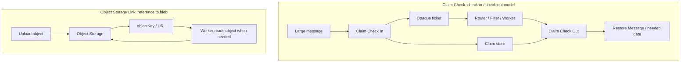
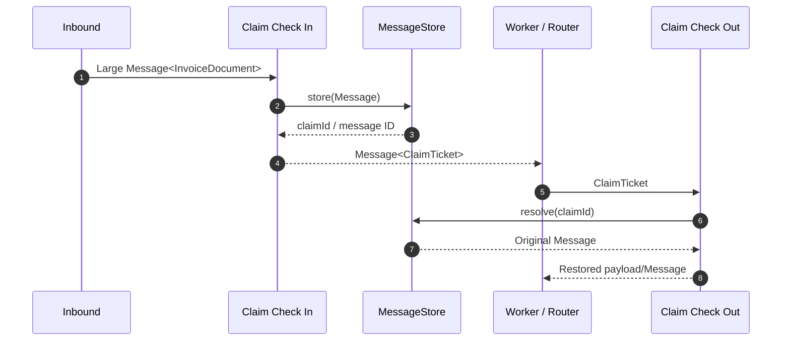
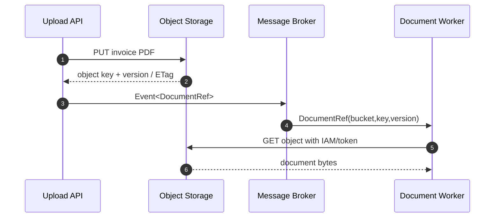
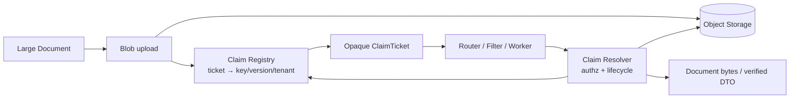
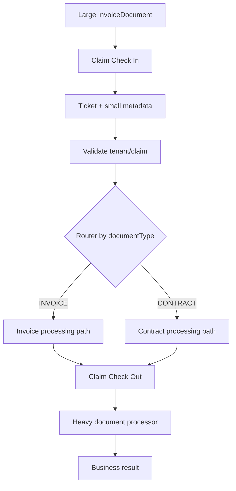
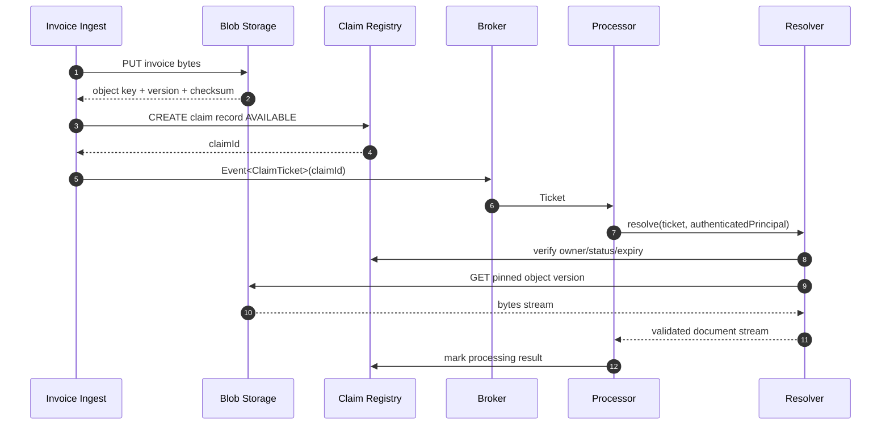
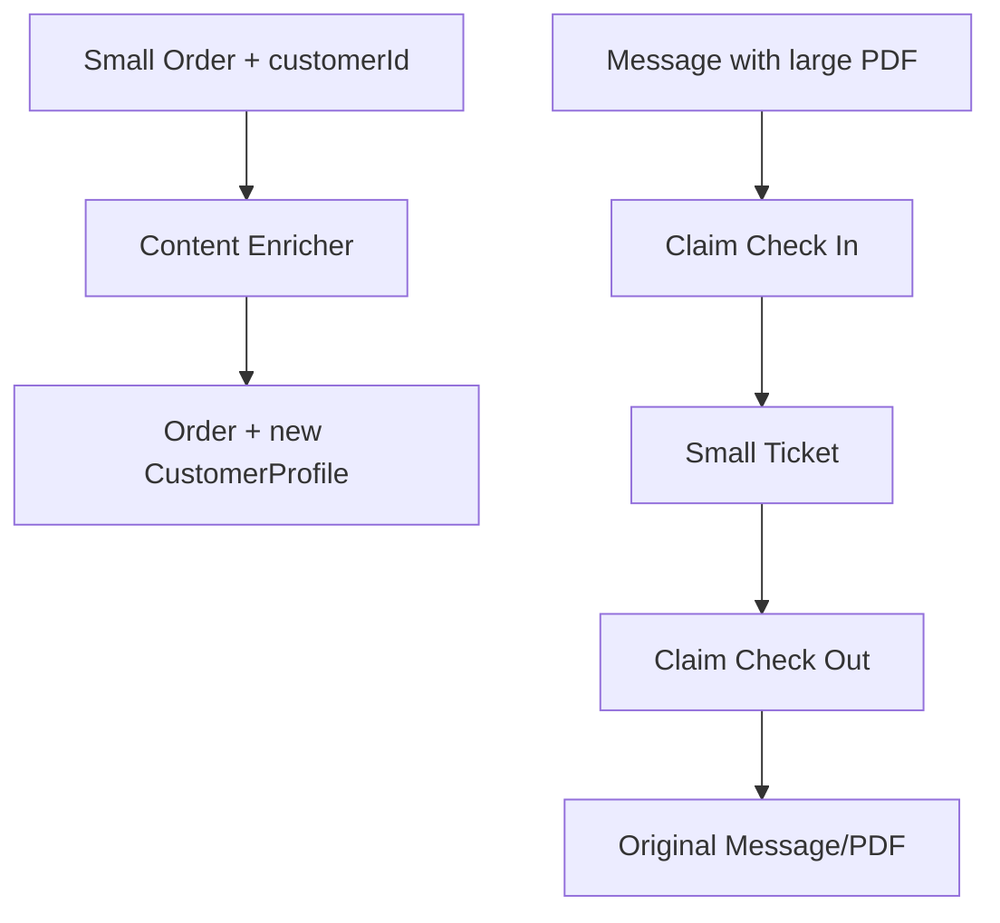
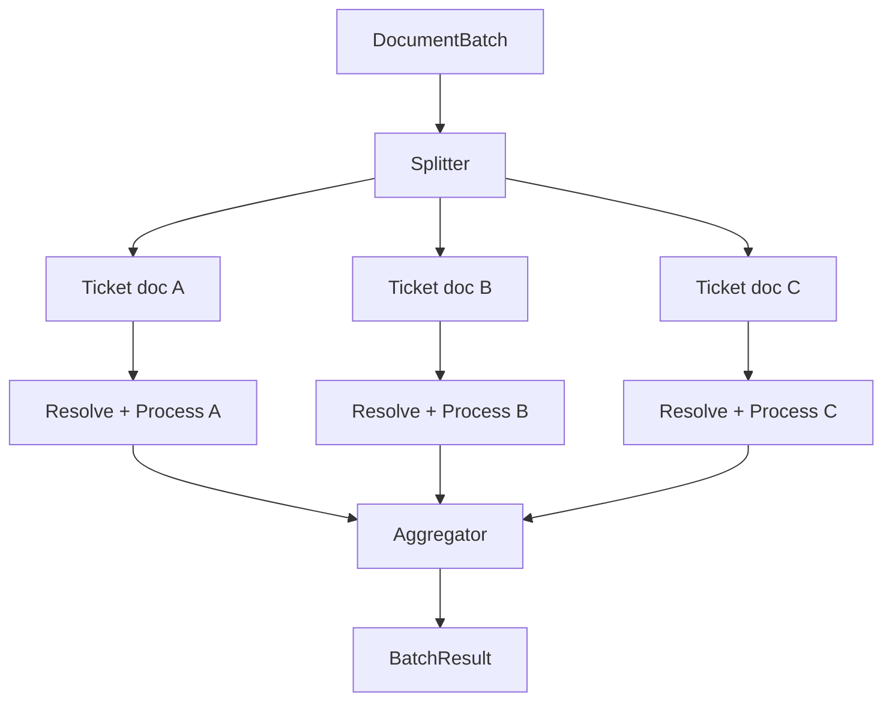
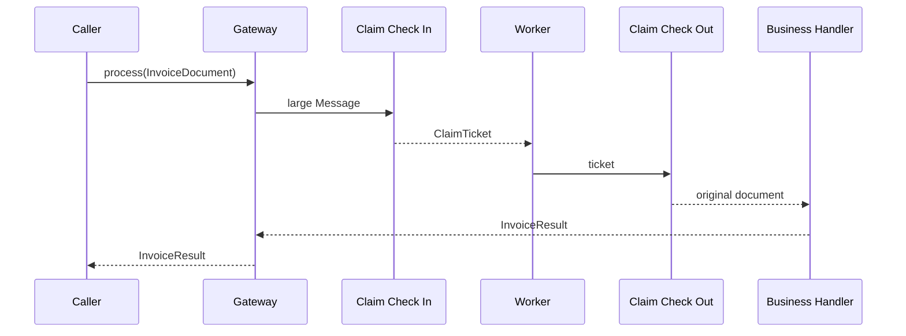

# Distinguishing Claim Check from Object Storage Links in Spring Integration

> **Chapter:** Claim check  
> **Lesson:** Distinguishing claim check from object storage link  
> **Scope:** Enterprise Integration Patterns (EIP) in Spring Integration: decoupling large data from messages, preserving context across Router/Filter/Transformer, restoring payloads, correlation, retry, error channel, and testing.

## 1. Real-world scenario: do not send whole large documents through every channel

An invoice processing system receives 30 MB PDF documents. Documents must pass through format validation, invoice type recognition, routing to an OCR service, and saving results. If every message carries the full 30 MB directly:

- Brokers and networks pay the cost of transmitting a huge payload multiple times.
- Router, Filter, Metrics, and Audit receive unnecessary data.
- Retries may resend 30 MB even when only metadata changed.
- Logs/debugging accidentally expose sensitive document information.
- Message size limits, queue memory, and latency become hard to control.

Two solutions often mentioned are **Claim Check** and **Object Storage Link**. Both can shrink the in-flight message, yet they **are not synonymous**:

- **Claim Check** is an **Enterprise Integration Pattern**: *park the data/Message in a repository, emit a representative token, then use the token to retrieve the data when needed*.
- **Object Storage Link** is a **way of referencing a specific object** in S3, GCS, Azure Blob, or an equivalent store: it may be an object key, URI, or download URL; merely having an address does not create a check-in/check-out workflow.



**Core point:** Claim Check answers **“Who parks it, who holds the token, who is allowed to retrieve it, and when is the data released?”**. An object storage link mainly answers **“Where does the object live and how can it be accessed?”**.

### Learning objectives

After this lesson, you can:

1. Clearly explain the Claim Check Pattern and object storage references.
2. Distinguish **opaque claim tickets**, object keys, URIs, signed URLs, and business IDs.
3. Describe check-in, message stores, check-out, recovery, expiry, and cleanup.
4. Know when to use Spring Integration `MessageStore`, when to use object storage, and when to combine both.
5. Build a Java/Spring Integration example shrinking message size while preserving correlation.
6. Write tests for valid tickets, non-existent tickets, wrong tenants, retries, and single-read retrieval.
7. Identify risks of SSRF, signed URL leakage, lost metadata, stale/expired objects, and cross-tenant access.
8. Design retries, idempotency, transactions, cleanup, and observability for enterprise flows.

## 2. Precise definitions of the two concepts

### 2.1. Claim Check is a pattern with two control points

In EIP, **Claim Check** borrows the baggage-check metaphor: a traveler drops off an item, receives a ticket, and later uses the ticket to reclaim the item.

For messages:

```text
Check-in:
  Message<LargePayload>
      |
      +--> store Message in Claim Store
      |
      v
  Message<ClaimTicket>

Process:
  Message<ClaimTicket> -> Router -> Filter -> small workflow

Check-out:
  Message<ClaimTicket>
      |
      +--> resolve ticket from Claim Store
      |
      v
  Message<LargePayload> restored or merged into context
```

Defining traits:

- An intentional **check-in action**.
- A **claim store** responsible for retaining the parked data.
- A **claim ticket**, typically an opaque key containing no content.
- An explicit **check-out/resolve action**.
- A **lifecycle policy**: when to delete, how long to keep, how many times a ticket can be used.
- When parking a full Spring `Message`, payload and many headers can be preserved — though internal headers must be managed on restoration.

### 2.2. Object Storage Link is a reference to an object

An application can upload a PDF to object storage and send:

```json
{
  "documentId": "DOC-701",
  "bucket": "invoice-documents",
  "objectKey": "tenant-42/invoices/DOC-701/v3.pdf",
  "versionId": "version-3",
  "sha256": "6f4a...example..."
}
```

A worker uses the object key to read the data when needed. This is **claim-to-location** or **payload offloading** using object storage, not necessarily a complete Claim Check:

- No check-in transformer is required.
- No default ticket → Message mapping store exists.
- Original headers are not saved and restored by default.
- There is no built-in “claim out” or revocation action.
- There is no built-in transaction between the message broker and blob upload.
- Who has read permission is not determined by the link format; that depends on IAM, URL tokens, and the application.

**Understand correctly:** A design using object storage **can still implement Claim Check** if the application manages tickets, resolution permissions, retrieval contracts, and lifecycles. Do not conclude “stored in S3 means it is no longer Claim Check.” The distinction is **behavioral pattern**, not disk/store technology.

## 3. Comparison table: pattern vs reference mechanism

| Criterion | Claim Check | Object Storage Link |
| --- | --- | --- |
| Nature | EIP / check-in, ticket, check-out workflow | Address or reference to a blob |
| Focus | Preserving and restoring messages/content | Identifying which object to read |
| Token | Opaque claim ID created by app/store | Bucket + key + version, URI, or signed URL |
| Check-in | Yes, a core step of the pattern | Upload may occur prior to/outside the flow |
| Check-out | Controlled resolve step | Consumer downloads object via SDK/HTTP |
| Preserve original headers | Possible when storing Spring `Message` | Not by default; metadata managed separately |
| Expiry | Governed by claim store/ticket policy | Governed by object lifecycle and/or URL expiration |
| Access rights | Resolver must check authorization | IAM, bucket policy, signed URL, application |
| Single-use | Configurable via remove/consume policies | Links have no inherent one-time semantics |
| Re-retrieval | Depends on ticket and retention | Depends on object existence and permissions |
| Durability | Depends on claim store: RAM, JDBC, Redis,... | Depends on provider/object lifecycle/versioning |
| Bytes on message bus | Ticket is typically small | Link or object reference is typically small |
| Typical errors | Missing/expired/consumed claim | Not found, access denied, URL expired |
| Multi-process contract | Needs shared/persistent resolver/store | Workers share access to object storage |
| Best suited for | Temporarily parking payloads/messages across EIP hops | Storing huge files/blobs or cross-service exchange |

### Quick selection rules

- **Need to temporarily hide an entire `Message` across multiple EIP steps and restore at a defined point?** Claim Check is the natural model.
- **Need to store huge files long-term for multiple systems reading under independent permissions?** Object storage references usually fit better.
- **Need opaque tokens, strict resolve authorization, and huge blobs?** Use **Claim Check backed by object storage**: a claim resolver manages ticket-to-object mappings, metadata, and lifecycles.

## 4. Four identifier types you must not conflate

A secure design separates:

| Type | Example | Role |
| --- | --- | --- |
| Business ID | `documentId=DOC-701` | Identifies the business document |
| Claim ticket | `claimId=cc_73b...` | Lookup key/handle for the claim in the store |
| Object key | `tenant-42/invoices/DOC-701/v3.pdf` | Logical address of the blob inside a bucket |
| Signed URL | `https://...?...signature=...` | Temporary URL carrying scoped/timed access |
| Message ID | UUID in Spring `MessageHeaders.id` | Identifies a single message instance |
| Correlation ID | `businessCorrelationId=invoice:DOC-701` | Traces a workflow/request |

**Never use `documentId` as a claim secret** if outsiders can guess document IDs. An opaque claim ID reduces information leakage, yet the token alone never replaces authorization.

### Signed URL differs from object key

An object key is usually a **logically stable** address, whereas a signed URL embeds time-limited authorization credentials. Example:

```text
objectKey:
  tenant-42/invoices/DOC-701/v3.pdf

signedUrl:
  https://storage.example/.../v3.pdf?signature=...&expires=...
```

Two different signed URLs can point to **the same object**. An expired URL does not mean the object was deleted. Conversely, deleting the object or changing permissions can break an unexpired URL.

Never store a signed URL as a durable business ID, and never log raw URLs containing access tokens.

## 5. Two sequence diagrams: similar small output, different workflows

### 5.1. Claim Check



**Observation:** the token references **a controlled claim store**. Permissions, retention, single-use, and provenance can all be enforced in one service.

### 5.2. Object Storage Link



**Observation:** the worker fetches the blob directly via SDK; there is no separate claim-ticket resolution step. If the application adds a resolver/check-in/check-out, the architecture becomes a **Claim Check variant** backed by object storage.

## 6. When is an object storage link still Claim Check?

A typical hybrid design:



It is Claim Check because:

1. The application performs check-in before issuing a ticket.
2. The ticket is the sole interface for downstream, not a public object key.
3. The resolver verifies tenant, claim status, and access permissions.
4. The resolver selects the object key/version pinned at check-in.
5. Check-out, expiry, retry, and cleanup rules exist.

**Object storage is an implementation detail of the claim store**; it does not change the EIP essence.

### Benefits of the resolver layer

- Swap buckets/providers without altering message contracts.
- Revoke claims via registry state instead of trying to revoke already-circulated URLs.
- Isolate IAM permissions: workers do not need access to entire buckets.
- Audit every resolution while checking tenant/subject/operation.
- Validate hashes, version IDs, content types, and sizes on retrieval.

In exchange, the resolver/registry is another operational component needing HA, security, backups, and failure handling.

## 7. Claim Check in Spring Integration: which store and what gets stored?

Spring Integration offers components for the Claim Check Pattern such as `ClaimCheckInTransformer`, `ClaimCheckOutTransformer`, and the `MessageStore` concept. They decouple message parking/restoration from business handlers.

Conceptually:

```text
ClaimCheckInTransformer:
  original Message -> store original Message -> claim ticket

ClaimCheckOutTransformer:
  claim ticket -> read MessageStore -> original Message
```

A `MessageStore` can store a **Spring `Message`** (payload and headers), unlike object storage which typically stores only raw blob bytes.

### MessageStore is not object storage by default

Examples of storage options:

| Store | Advantage | Limits to manage |
| --- | --- | --- |
| `SimpleMessageStore` | Easy to learn/test in-JVM | State lost on restart; not shared across processes |
| JDBC-backed `MessageStore` | Persistence and shared access when properly configured | Serialization, transactions, cleanup, and DB load |
| Redis-backed `MessageStore` | Fast access, multi-node support as configured | TTL, memory pressure, security/serialization |
| Custom claim registry + object storage | Ideal for huge blobs | Requires custom check-in/check-out code and transaction/recovery |
| Document database / custom store | Flexible envelope and metadata storage | Must guarantee accurate claim-retrieval semantics |

**Never treat `SimpleMessageStore` as persistent storage**, and never treat a database storing Spring `Message`s as suitable for hundreds-of-MB PDFs without analyzing cost.

### Special caution when parking an entire Message

Spring `Message` headers can hold `replyChannel`, `errorChannel`, or internal JVM objects. These values may be non-serializable or invalid after a restart. When storing for cross-process/transport recovery:

- Separate long-lived business metadata from transient infrastructure headers.
- Use serializers/header mappers with allowlists.
- Do not reuse stale reply channels when re-entering a new Gateway.
- Test across restarts, not only inside the same JVM.

## 8. Check-in/check-out can be single-use or multi-use

Two common policies:

### 8.1. Multi-use tickets

```text
Ticket T created
  -> Worker A resolves T
  -> Worker B resolves T
  -> T stays valid until expiry
```

Suited when multiple systems must read the same document and payloads are immutable. Requires versioning and read authorization on every resolution.

### 8.2. Single-use tickets

```text
Ticket T created
  -> Worker A consumes T
  -> claim marked consumed/deleted
  -> Worker B resolves T -> claim gone
```

Suited when limiting read count, yet highly error-prone under **at-least-once delivery**:

1. Worker reads ticket and the claim is deleted.
2. Worker finishes processing yet broker ack fails.
3. Broker redelivers the ticket.
4. Worker has no data left to recover.

Therefore, never assume “delete at checkout” is the safest default. For workflows needing replays, use **read-only resolution + completion/retention policies**, or design **atomic consumption paired with transactional processing** where infrastructure supports it.

### Do not confuse a one-time ticket with an HTTP signed URL

A signed URL with an expiry does not automatically have single-use semantics. Anyone holding the URL can access it repeatedly while valid, depending on provider/config. For single-use enforcement, add server-side authorization/token state or a controlled proxy/resolver.

## 9. Contract of a good ClaimTicket

Instead of emitting raw blobs or URLs, downstream can receive a small DTO:

```java
package example.integration;

import java.time.Instant;
import java.util.UUID;

public record ClaimTicket(
    UUID claimId,
    String tenantId,
    String businessCorrelationId,
    Instant createdAt,
    Instant expiresAt
) {}
```

Contract:

- `claimId` is an opaque key identifying the record in the claim registry/store.
- `tenantId` enables tenant-isolation verification **after authenticating the principal**, rather than trusting the ticket field alone.
- `businessCorrelationId` supports workflow tracing, not access authorization.
- `createdAt` and `expiresAt` support auditing/lifecycles.
- The ticket payload does not need raw object keys, signed URLs, or document data.

**Crucial point:** emitting a system-generated ticket does not make it an **unconditional bearer access token**. Resolution must verify caller/tenant/operation, state, and expiration. If tickets may reach third parties, use unpredictable IDs or signed tokens with appropriate audiences/scopes.

### Claim states

A claim record may have states:

```text
CREATED -> AVAILABLE -> CLAIMED/PROCESSING -> COMPLETED
                      \-> EXPIRED
                      \-> REVOKED
                      \-> FAILED
```

This is an **application-designed** state machine. Spring Integration does not auto-provide all those domain statuses merely because we invoke a Claim Check transformer.

## 10. Java example: storing and retrieving Messages via MessageStore

To understand Claim Check's essence, start with two core operations:

- `checkIn` accepts a `Message<InvoiceDocument>`, saves the message with `MessageStore`, and returns a small ticket.
- `checkOut` verifies permissions/TTL and retrieves the message by claim ID.

This is an **educational implementation** built on Spring Integration's `MessageStore` API, not a complete production authentication mechanism. Spring Integration also provides dedicated Claim Check transformers; writing it explicitly highlights where authorization and lifecycles attach.

### 10.1. Document payload

```java
package example.integration;

import java.util.Objects;

public record InvoiceDocument(
    String documentId,
    byte[] pdfBytes
) {
    public InvoiceDocument {
        Objects.requireNonNull(documentId, "documentId");
        Objects.requireNonNull(pdfBytes, "pdfBytes");
        pdfBytes = pdfBytes.clone();
    }

    @Override
    public byte[] pdfBytes() {
        return pdfBytes.clone();
    }

    public int sizeBytes() {
        return pdfBytes.length;
    }
}
```

Cloning `byte[]` prevents accidental payload mutation after storage. For huge real documents, you do not need to hold all bytes on the heap: use bounded streaming/buffering or store blobs in object storage and pass references into the workflow.

### 10.2. Claim metadata in the registry

```java
package example.integration;

import java.time.Instant;

public record StoredClaimMetadata(
    String tenantId,
    String businessCorrelationId,
    Instant createdAt,
    Instant expiresAt
) {}
```

This metadata is a **server-managed record**, never pulling authorization values directly from a caller-crafted ticket.

### 10.3. Check-in/check-out service

```java
package example.integration;

import java.time.Clock;
import java.time.Duration;
import java.time.Instant;
import java.util.Map;
import java.util.Objects;
import java.util.UUID;
import java.util.concurrent.ConcurrentHashMap;

import org.springframework.integration.store.MessageStore;
import org.springframework.messaging.Message;

public final class ClaimCheckService {

    private final MessageStore store;
    private final Clock clock;
    private final Duration ttl;

    // Demo: in-RAM registry, not shared across multiple JVMs.
    private final Map<UUID, StoredClaimMetadata> metadata =
        new ConcurrentHashMap<>();

    public ClaimCheckService(
            MessageStore store,
            Clock clock,
            Duration ttl) {

        this.store = Objects.requireNonNull(store);
        this.clock = Objects.requireNonNull(clock);
        this.ttl = Objects.requireNonNull(ttl);

        if (ttl.isZero() || ttl.isNegative()) {
            throw new IllegalArgumentException(
                "Claim TTL must be positive");
        }
    }

    public ClaimTicket checkIn(
            Message<InvoiceDocument> original,
            String authenticatedTenantId) {

        requireTenant(authenticatedTenantId);

        UUID claimId = original.getHeaders().getId();
        if (claimId == null) {
            throw new IllegalArgumentException(
                "Message is missing ID");
        }

        // Park the full Message to preserve payload and relevant headers.
        store.addMessage(original);

        Instant now = clock.instant();
        String businessId = String.valueOf(
            original.getHeaders()
                .get("businessCorrelationId"));

        StoredClaimMetadata record = new StoredClaimMetadata(
            authenticatedTenantId,
            businessId,
            now,
            now.plus(ttl));

        metadata.put(claimId, record);

        return new ClaimTicket(
            claimId,
            authenticatedTenantId,
            businessId,
            now,
            record.expiresAt());
    }

    public Message<?> checkOut(
            ClaimTicket ticket,
            String authenticatedTenantId) {

        requireTenant(authenticatedTenantId);

        StoredClaimMetadata record =
            metadata.get(ticket.claimId());

        if (record == null) {
            throw new IllegalStateException(
                "Claim does not exist or has been revoked");
        }

        // Permissions are decided by the stored record and verified principal,
        // not merely by tenantId inside the ticket payload.
        if (!record.tenantId().equals(authenticatedTenantId)) {
            throw new SecurityException(
                "Not authorized to access claim");
        }

        if (!clock.instant().isBefore(record.expiresAt())) {
            throw new IllegalStateException("Claim has expired");
        }

        Message<?> restored = store.getMessage(ticket.claimId());
        if (restored == null) {
            throw new IllegalStateException(
                "Claim metadata exists but payload is missing");
        }

        return restored;
    }

    private static void requireTenant(String tenantId) {
        if (tenantId == null || tenantId.isBlank()) {
            throw new SecurityException(
                "Missing authenticated tenant");
        }
    }
}
```

### Why use the original Message ID as claim ID?

`MessageStore` can store and retrieve messages by Spring `Message` ID. The demo uses `original.getHeaders().getId()` to illustrate a unified lookup key.

This is **not** a mandatory contract for every Claim Check implementation. A production claim registry can generate its own random ticket, map it to one or more message/blob IDs, and store separate metadata. If you want to completely hide internal Spring `Message` IDs, never emit that raw value across trust boundaries.

### Intentional limitations of the demo

1. `metadata` uses an in-RAM `ConcurrentHashMap`. It has **no** durability or multi-node coordination.
2. `store.addMessage` and `metadata.put` are **not atomic**. A crash in between can leave an orphaned message without a record.
3. Payload persistence in `MessageStore` is also not guaranteed when using `SimpleMessageStore`.
4. `checkOut` uses **read-only semantics**; it does not delete claims after reading.
5. No cleanup scheduler, audit store, quotas, encryption key rotation, or retention policy exists yet.
6. `ClaimTicket` could be forged externally. The resolver still checks record/tenant, yet real systems also need principals, permission scopes, and rate limits.
7. Never treat `ticket.tenantId()` as the authority; authorization must come from an authenticated security context/identity.
8. Never let unbounded large claims pile up in RAM in production.

**The lesson here is design responsibility**, not a recommendation to deploy in-RAM maps for real documents.

## 11. JUnit 5: testing check-in, check-out, tenant, and TTL

A test observing only that a ticket was returned does not prove the claim was actually stored. Test both retrieval and failure branches.

### 11.1. Testing with SimpleMessageStore

```java
package example.integration;

import static org.junit.jupiter.api.Assertions.*;

import java.time.Clock;
import java.time.Duration;
import java.time.Instant;
import java.time.ZoneOffset;
import java.util.UUID;

import org.junit.jupiter.api.Test;
import org.springframework.integration.store.SimpleMessageStore;
import org.springframework.messaging.Message;
import org.springframework.messaging.support.MessageBuilder;

class ClaimCheckServiceTest {

    private final Clock fixedClock = Clock.fixed(
        Instant.parse("2026-11-21T02:00:00Z"),
        ZoneOffset.UTC);

    private final SimpleMessageStore store =
        new SimpleMessageStore();

    private final ClaimCheckService claims =
        new ClaimCheckService(
            store, fixedClock, Duration.ofHours(1));

    private Message<InvoiceDocument> invoice() {
        return MessageBuilder.withPayload(
                new InvoiceDocument(
                    "DOC-701", new byte[] {1, 2, 3, 4}))
            .setHeader(
                "businessCorrelationId", "invoice:DOC-701")
            .setHeader("sourceSystem", "billing-api")
            .build();
    }

    @Test
    void restoresOriginalMessageWithTicket() {
        Message<InvoiceDocument> original = invoice();

        ClaimTicket ticket =
            claims.checkIn(original, "tenant-42");

        assertNotNull(ticket.claimId());
        assertEquals("tenant-42", ticket.tenantId());
        assertEquals(
            original.getHeaders().getId(), ticket.claimId());

        Message<?> restored =
            claims.checkOut(ticket, "tenant-42");

        assertInstanceOf(
            InvoiceDocument.class, restored.getPayload());

        InvoiceDocument document =
            (InvoiceDocument) restored.getPayload();

        assertEquals("DOC-701", document.documentId());
        assertArrayEquals(
            new byte[] {1, 2, 3, 4},
            document.pdfBytes());

        assertEquals("invoice:DOC-701",
            restored.getHeaders()
                .get("businessCorrelationId"));
    }

    @Test
    void rejectsCrossTenantResolve() {
        ClaimTicket ticket =
            claims.checkIn(invoice(), "tenant-42");

        assertThrows(SecurityException.class, () ->
            claims.checkOut(ticket, "tenant-99"));
    }

    @Test
    void rejectsUnknownTicket() {
        ClaimTicket fake = new ClaimTicket(
            UUID.randomUUID(),
            "tenant-42",
            "invoice:UNKNOWN",
            fixedClock.instant(),
            fixedClock.instant().plusSeconds(3600));

        assertThrows(IllegalStateException.class, () ->
            claims.checkOut(fake, "tenant-42"));
    }

    @Test
    void repeatedReadWorksWithReadOnlyPolicy() {
        ClaimTicket ticket =
            claims.checkIn(invoice(), "tenant-42");

        assertNotNull(
            claims.checkOut(ticket, "tenant-42"));
        assertNotNull(
            claims.checkOut(ticket, "tenant-42"));
    }
}
```

The tests above demonstrate:

- The original `Message` is kept in `MessageStore`.
- The ticket is a small reference containing no PDF bytes.
- The resolver blocks other tenants from reading the claim.
- Fake tickets without a record fail resolution.
- A read-only claim can be reused multiple times per the chosen policy.

### 11.2. Testing expiration without Thread.sleep

To test TTL, pass a controllable `Clock` in tests or construct a service with a clock advanced past expiry:

```java
// Test idea: pass a mutable Clock via constructor.
// Clock at check-in: 10:00, TTL=1h.
// Clock at check-out: 11:01.
// Expect checkOut to reject with reason CLAIM_EXPIRED.
```

In the demo, `ClaimCheckService` accepts a `Clock` via its constructor so tests can supply a controllable implementation. Never make unit tests wait an actual hour or call `Thread.sleep(...)` to test timeouts.

### 11.3. Persistence testing differs from in-RAM unit tests

Tests using `SimpleMessageStore` **do not prove**:

- Claims survive restarts.
- Check-out works from another pod.
- Transactions span message store and claim registry.
- Large payloads are read/written efficiently.
- Claims are cleaned up on expiration.
- IDs resolve safely after ticket revocation.

Those requirements need integration tests against JDBC/Redis/object storage backing stores and real authorization services.

## 12. Spring Integration Java DSL: using Claim Check in a flow

Spring Integration includes dedicated transformers for Claim Check. The DSL shape typically highlights two points:

```text
largeInput
  -> ClaimCheckIn
  -> lightweight processing (route/filter)
  -> ClaimCheckOut
  -> restoredOutput
```

A configuration illustrating the idea:

```java
import org.springframework.integration.dsl.IntegrationFlow;
import org.springframework.integration.store.MessageStore;

// Exact API/overload must be checked against your Spring Integration version.
// Illustrates check-in and check-out placement inside the same flow.

@Bean
IntegrationFlow compactWorkflow(MessageStore messageStore) {
    return IntegrationFlow.from("largeInput")
        .claimCheckIn(messageStore)
        .channel("ticketProcessing")
        .claimCheckOut(messageStore)
        .channel("restoredOutput")
        .get();
}
```

**This is a pattern-level DSL sketch**, not a standalone runnable configuration: channels must be defined, and exact DSL overloads/options such as remove-on-checkout depend on your Spring Integration version. You can substitute dedicated transformers or service adapters implementing the same contract; verify and test against actual dependencies during QA.

### Essence of the two transformers

- **Claim Check In:** parks the message in `MessageStore` and emits a representative payload/ticket instead of the large message.
- **Ticket processing:** steps needing only the ID run without reading the full payload again.
- **Claim Check Out:** looks up the ticket in the store and restores content for downstream business handlers.

You do not want to check out immediately after check-in. Doing so with no lightweight processing in between only adds I/O and complexity without saving anything meaningful.

### Never restore a stale replyChannel

In request–reply flows, an original message may carry a Gateway's `replyChannel` header from check-in time. If check-out runs hours later or on another pod, that reference may be stale or non-serializable.

Define **the current workflow's reply contract**. In many flows, restore the payload and business headers into a fresh Spring `Message` carrying the active reply channel at processing time, rather than reusing all old infrastructure headers.

## 13. Realistic flow example: check-in before routing, check-out after routing

### Model



**Why does it save resources?**

The Router only needs `documentType`/`documentId` (in the ticket or verified headers). It never needs to read the entire PDF. Only the branch actually processing content checks out.

### But where does filter/routing metadata come from?

If `documentType` only exists inside the PDF, a metadata-extraction step must run before check-in (or trusted metadata must accompany upload). You cannot route on a field absent from the ticket without re-fetching the blob.

```text
Good:
  Validate metadata -> Check-in -> Router(metadata) -> Check-out

Inefficient:
  Check-in -> Router must download blob to learn documentType
           -> Check-out downloads blob again
```

Separate **lightweight routing metadata** from **heavy payloads**, while never blindly trusting client-declared metadata when it impacts permissions or high-risk branches.

## 14. Object storage links: three common representations

An object in storage can be referenced in multiple forms:

### 14.1. Object key + bucket

```java
public record ObjectRef(
    String provider,
    String bucket,
    String objectKey,
    String versionId,
    String sha256,
    long sizeBytes,
    String mediaType
) {}
```

Example:

```json
{
  "provider": "S3",
  "bucket": "invoice-documents",
  "objectKey": "tenant-42/invoices/DOC-701/v3.pdf",
  "versionId": "ver-003",
  "sha256": "sha256-hex-value-from-upload",
  "sizeBytes": 31457280,
  "mediaType": "application/pdf"
}
```

This is a **more stable reference than a short-lived signed URL**, provided bucket/key/version are well-structured. Workers use IAM/SDKs or an authorized proxy to download. The `sha256` value in the example is a placeholder, not an actual checksum.

### 14.2. URI for storage SDKs

```text
s3://invoice-documents/tenant-42/invoices/DOC-701/v3.pdf
gs://invoice-documents/tenant-42/invoices/DOC-701/v3.pdf
```

A URI specifies provider/address; **it does not grant read permission by default**. Consumers still need authentication, authorization, network connectivity, and possibly a separate version ID.

### 14.3. Pre-signed HTTPS URL

```text
https://storage.example.com/.../v3.pdf
  ?X-Signature=...
  &X-Expires=...
```

This form is convenient for browsers or external short-lived downloads, yet carries many limitations:

- The URL embeds sensitive tokens and can be forwarded.
- URL TTL is not object TTL.
- The URL must be scoped tightly to method/content constraints.
- It must never appear in access logs, traces, analytics, or error messages.
- Unsuitable as a durable reference for multi-day workflows.
- If re-download is truly needed after expiry, mint a fresh URL from an authorized object reference.

**Never equate a signed URL with a `ClaimTicket`.** A signed URL usually grants direct object access under signature conditions; a claim ticket is an application-layer resolution key re-verifiable every time.

## 15. Security differences: an object link can become a bearer credential

One of the biggest risks is treating an object URL as “just a path string.”

If a signed URL lets anyone holding it read the file before expiry, leaking that URL equals leaking a **scoped bearer credential**.

### Common leak scenarios

- Logging the full `DocumentRef` payload containing a signed URL.
- Sending the URL onto a message bus with subscribers lacking read rights.
- Embedding the URL in exception messages sent to monitoring systems.
- Capturing the URL in browser analytics or uncontrolled `Referer` headers.
- Copying the URL from customer support tickets and sharing externally.
- Retaining the URL in DBs/logs longer than business need dictates.

### Good practices

1. Never use a signed URL as a domain identity.
2. Prefer storing `bucket + key + version` or opaque tickets.
3. Generate signed URLs **just in time**, with short TTLs and narrow permissions.
4. Never log signed URLs; log claim IDs/hashes or sanitized object identifiers.
5. Check authorization before issuing a signed URL.
6. Match HTTP methods strictly; a read URL must never grant upload/delete rights.
7. Maintain credential rotation/revocation and incident response procedures.

### SSRF and user-supplied URLs

If a worker accepts an arbitrary URL and fetches it with an HTTP client, an attacker can point the worker at internal endpoints or cloud metadata services (SSRF).

Anti-pattern example:

```java
// Never fetch client-supplied URLs directly:
byte[] pdf = httpClient.get(userProvidedUrl);
```

Safer approach:

- Never let clients specify arbitrary fetch URLs.
- Use system-generated object references from a registry.
- If external URLs are mandatory, allowlist domains/schemes/ports, block private/link-local addresses, and control redirects/DNS resolution.
- Cap sizes, timeouts, and content types; validate documents post-download.
- Segment worker network permissions so they cannot reach unrelated internal systems.

### Tenant isolation

`objectKey="tenant-42/..."` is not a security policy merely because of a tenant prefix. Workers must verify the principal is authorized to read that exact object, both in APIs/resolvers and in storage IAM/bucket policies where feasible.

In Claim Check, authorization should rely on the ownership record in the registry and an authenticated principal, never on a self-asserted `ticket.tenantId`.

## 16. Integrity and versioning: reading the exact original object

Suppose an object key is overwritten after a message was emitted:

```text
T0: upload DOC-701/v3.pdf, checksum=A
T1: emit ObjectRef(key=DOC-701/v3.pdf)
T2: object key overwritten, checksum=B
T3: worker downloads key and processes content B
```

The worker may process a different document than what was approved at T0.

### Contract to prevent TOCTOU

A strong reference typically carries:

- Provider/bucket.
- Object key or immutable object ID.
- Object version ID/generation when supported by the provider.
- Content checksum such as SHA-256.
- Expected size.
- Verified media type, not solely client-declared.
- Tenant/owner and provenance in registry.
- Retention/expiry policy.

After downloading, the worker verifies:

```text
downloaded.length == expectedSize
SHA256(downloaded) == expectedHash
downloaded is a valid document of expected type
version/generation matches claim manifest
```

**ETags are not always equivalent to SHA-256** or an independent content hash; ETag behavior varies by provider, multipart upload, and encryption mode. When strong integrity is needed, compute and verify checksums using a well-defined algorithm.

### Immutable object keys or version pinning

For critical data, avoid overwriting actively referenced keys in place. You can:

- Include content hashes/versions inside keys.
- Enable object versioning and pin generations/versions.
- Publish messages only after confirming upload success.
- Check object metadata/checksums at check-in and check-out.

An object storage link helps locate an object, yet **the link itself does not prove the object is the exact unmodified version**.

## 17. Why “Claim Check = store PDF in MessageStore” is not the only option

Another misconception is thinking Claim Check must always store **raw PDF bytes directly** in Spring Integration's `MessageStore`.

In practice, three designs exist:

| Design | What does the claim store hold? | Pros / limitations |
| --- | --- | --- |
| **A. `MessageStore` holding full `Message`** | Spring `Message` with payload and headers | Easy EIP integration, yet huge payloads tax DB/heap |
| **B. Plain object storage ref** | Message carries only `ObjectRef`, no separate claim resolver | Simple and scalable; lacks automatic Claim Check lifecycle |
| **C. Claim registry + blob** | Ticket → object key/version/metadata/permissions | True Claim Check pattern leveraging object storage for huge blobs; adds registry and resolver |

No single option is optimal for every system. Choose based on payload size, consumer count, retention, replay SLA, authorization, versioning, and header-preservation needs.

## 18. Hybrid design: Claim Check registry pointing to object storage

For 30 MB PDFs, storing raw bytes in a DB `MessageStore` creates unnecessary load. A practical design is:

1. Upload the blob to object storage.
2. Create a claim record storing ticket, tenant, object key/version/checksum, and state.
3. Publish the small ticket to the broker.
4. Worker calls an authenticated resolver to exchange the ticket for a blob stream.
5. Worker processes and records completion state.
6. Clean up claim and blob per retention policy; never delete blobs before required retries finish.



### Suggested registry contract

```java
public record ClaimRecord(
    UUID claimId,
    String tenantId,
    String documentId,
    String bucket,
    String objectKey,
    String objectVersion,
    String sha256,
    long sizeBytes,
    String state,
    Instant expiresAt
) {}
```

A production claim store also needs audit/provenance, timestamps, worker leases, retry attempts, policy versions, and business-specific lifecycle fields.

### Distinguishing two check-out modes

**Resolver returns bytes:** when the business handler genuinely needs to read the PDF, the resolver supplies the verified stream/bytes.

**Resolver returns an authorized reference:** when downstream already holds independent object read permissions, the resolver can return an **object reference or short-lived signed URL** after checking authorization. Claim Check still enforces resolution, while bulk data downloads directly from object storage.

Crucially, **a ticket does not mean every worker may read the data**. The resolver decides based on principal, tenant, operation, claim status, and deadline.

### Never broaden permissions during resolution

If a worker is only allowed to “read tenant-42's invoices,” it must never receive signed URLs for every object in the bucket. Enforce least privilege across the resolver, storage policies, and worker IAM roles.

## 19. Distinguish durability, availability, and retention

A system might pair durable object storage with an in-RAM claim registry. When the app restarts:

```text
Blob:             remains in object storage
Claim registry:   lost
Ticket in broker: remains
Worker:           cannot resolve ticket
```

The raw bytes still exist, yet **the workflow can no longer locate or verify them**. Conversely, the registry might remain in the DB while lifecycle rules deleted the blob:

```text
Claim registry: AVAILABLE
Blob storage:   object not found
Worker:         check-out fails
```

Therefore, durability checks must cover **claim records, blobs, and message delivery alike**, rather than merely picking one provider advertised as durable.

### Four lifecycles that can diverge

| Component | Lifecycle | Risk |
| --- | --- | --- |
| Broker message holding ticket | Until ack/retention | Ticket redelivered after claim expires |
| Claim record | Until complete/revoke/expiry/cleanup | Registry lost before workflow finishes |
| Object blob | Follows object lifecycle/retention | Blob deleted while ticket remains usable |
| Signed URL | Follows signature expiry and permissions | URL expires even while claim/blob remain valid |

**Safe contract:** retry and redelivery windows must factor into claim and blob retention decisions. Never schedule an object-deletion job at 1 hour if the broker can retry for 24 hours, unless business rules intentionally accept failure with proper recovery.

## 20. Failures between upload, claim creation, and message publishing

In practice, these three operations rarely share a single ACID transaction:

```text
1. PUT blob
2. INSERT claim record
3. PUBLISH message<ClaimTicket>
```

Crashes can strike at any step.

### Failure matrix

| Failure point | Possible leftover state | Recovery needed |
| --- | --- | --- |
| Upload fails | No blob yet | Retry upload or return ingress error |
| Upload succeeds, claim insert fails | Orphan blob | Orphan cleanup after grace period |
| Claim succeeds, publish fails | Blob + claim exist, no ticket on broker | Outbox/publish retry |
| Publish succeeds, ack fails | Ticket may be resent | Idempotent consumer, dedup |
| Ticket arrives before blob is ready | Consumer hits object not found | Publish post-confirm, bounded retry |
| Worker resolves then crashes | Claim incomplete | Redelivery + idempotent processing |
| Worker completes yet cleanup fails | Blob/claim linger | Cleanup retry without repeating business side effects |

### Transactional Outbox for ticket events

If the system uses a database for the claim registry, it can write **the claim record and outbox event in the same DB transaction** after the blob upload succeeds:

```text
Step A: Upload blob -> get key/version/checksum
Step B: DB transaction:
          INSERT ClaimRecord(status=AVAILABLE)
          INSERT OutboxEvent(type=CLAIM_CREATED, claimId=...)
        COMMIT
Step C: Outbox Publisher -> Broker (with retries)
Step D: Consumer processes ticket idempotently
```

The DB transaction cannot roll back the blob upload. Hence orphan cleanup/compensation is still needed if Step B fails. Yet the outbox prevents claims from being durably saved while their event is lost forever on a single publish failure.

### Not a system-wide exactly-once guarantee

Even with a DB outbox, brokers can redeliver and consumers can crash after committing side effects. You still need consumer idempotency and transactional completion tracking. Claim Check does not deliver exactly-once execution automatically.

## 21. Check-out: non-deleting read or atomic consume?

### Read without deleting

```text
get(claimId) -> payload/reference
claim status stays AVAILABLE/PROCESSING
```

Pros: supports retries/redeliveries; multiple authorized workers can read.

Risks: requires separate completion/cleanup policies; otherwise data lingers longer than intended.

### Read and delete immediately

```text
remove(claimId) -> payload
ticket can no longer resolve
```

Pros: simple when each claim has strictly one synchronous execution with no retries.

Major risk: if the worker crashes after deletion before completing the business handler, there is no way to retrieve the payload with that ticket again.

### Claim lease and mark complete

An advanced approach:

```text
AVAILABLE
   |
   v
PROCESSING(workerId, leaseUntil)
   |
   +--> COMPLETED (business commit succeeded)
   |
   +--> AVAILABLE (lease expired/retry)
   |
   +--> FAILED/QUARANTINED
```

What must be ensured:

- Lease ownership updates atomically in the registry.
- Stale workers must not overwrite outcomes after their lease expires.
- Multiple blob reads may be fine, provided side effects remain idempotent.
- Cleanup runs only after retry rights end or completion succeeds per policy.

This lease mechanism is **application design**, not a default API of Claim Check transformers.

## 22. Claim Check and Content Enricher: both fetch data, different purposes

Both patterns sometimes query a data store, yet their jobs differ.



| Criterion | Claim Check | Content Enricher |
| --- | --- | --- |
| Focus | Park original content and restore it | Supplement missing information |
| Source data | Original message/payload | Auxiliary service/database |
| Retrieval output | Restores prior payload/context | Payload enriched with new data |
| Example | Park PDF file, return ticket | Look up customer tier from customer ID |
| Risks | Missing/expired ticket, store cleanup | Lookup timeouts, stale data, incomplete replies |

A workflow can combine both:

```text
Large Invoice
   -> Claim Check In
   -> Ticket + extracted metadata
   -> Content Enricher: lookup customer policy
   -> Router / Filter
   -> Claim Check Out (if needed)
   -> PDF processing
```

However, if the Enricher must download the entire PDF just to find the customer ID every time, the design forfeits the advantage of lightweight metadata. Extract routing/enrichment fields before parking or at trusted ingest.

## 23. Claim Check and Header Enricher: where does the ID live?

In Spring Integration, a claim ticket may sit in the payload or a header, depending on configuration/pattern.

### Ticket as payload

```text
Message<ClaimTicket>
  payload.claimId = cc-...
  headers.businessCorrelationId = invoice:DOC-701
```

Pros:

- Very clear downstream contract: no PDF bytes remain.
- Easily serializable as an event DTO.
- Workers cannot accidentally hold the large payload in memory once parked.

### Ticket as header

```text
Message<SmallInvoiceMetadata>
  payload.documentType = INVOICE
  headers.claimId = cc-...
```

Pros: Routers/Filters get small metadata to make decisions; when original content is needed, downstream resolves via `claimId`.

Risk: if an adapter strips the `claimId` header, check-out fails. For critical cross-process links, place the claim ID inside a payload envelope or durable schema rather than relying solely on an unmapped custom header.

**Header Enricher does not turn an ID into Claim Check.** It only adds/edits metadata; Claim Check still requires the check-in/store/check-out contract.

## 24. Correlation when large messages are replaced by tickets

A vital rule: **claim ID is not business correlation ID**.

Example:

```text
Original Message:
  businessCorrelationId = invoice:DOC-701
  eventId               = EV-701
  payload               = PDF bytes

After Claim Check In:
  claimId               = 0f5d...
  businessCorrelationId = invoice:DOC-701
  eventId               = EV-701
  payload               = ClaimTicket

After Check Out:
  businessCorrelationId = invoice:DOC-701
  payload               = original PDF/document
```

| ID | Purpose |
| --- | --- |
| `claimId` | Resolve parked content |
| `eventId` | Logical event idempotency/dedup |
| `businessCorrelationId` | Trace business journey |
| `correlationId` | May serve as Splitter/Aggregator group key |
| `MessageHeaders.id` | Identifies one Spring message |
| `traceId` | Distributed tracing |

If a document is parked multiple times, multiple claim IDs may exist for the same `documentId`. If one claim serves two workflows, two distinct business correlation IDs may access the same content object. Never conflate identifiers simply because they share a UUID shape.

### Be careful when check-out restores all headers

If the original message was created before a Splitter assigned `correlationId` and sequence headers, a check-out restoring the original message verbatim can wipe out the active workflow's group headers.

Hence define merge semantics:

- Payload from the claim store.
- Valid business headers from the original record.
- Active correlation/sequence headers from the running flow.
- Reply/error channels from the current request context, not necessarily from the old message.

Custom check-out steps need explicit header precedence rules and tests for nested groups/request–reply. Never call `copyHeaders(...)` blindly when original and current headers carry different meanings.

## 25. Splitter/Aggregator and Claim Check

Suppose a dossier contains multiple documents, each stored in object storage with its own `ClaimTicket`:



Child messages may carry `correlationId`, `sequenceNumber`, and `sequenceSize`. If a custom check-out builds a fresh message and drops them, the Aggregator may never receive a complete group.

### When one claim fails to resolve

If doc B's ticket expired, never silently drop child B. The Aggregator may wait for all three results and never release.

Two sound options per contract:

1. Recovery emits `DocumentResult(docB, FAILED, CLAIM_EXPIRED)` carrying group metadata so the Aggregator gets one result per child.
2. Define explicit group timeout/partial-result policies reporting missing items.

Never shrink `sequenceSize` down to 2 simply because one claim failed; sibling messages still expect 3 and metadata will clash.

### Resequencer has similar needs

If a flow resequences results by `sequenceNumber`, ticket/check-out logic must never overwrite sequence headers with headers from the original document. Test output ordering, not merely PDF download success.

## 26. Gateway request–reply: Claim Check does not return the business reply by itself

A `@MessagingGateway` can submit an invoice processing request and await `InvoiceResult`.



Design points:

- `ClaimTicket` is not itself the business reply.
- Check-out restores content; it does not complete invoice processing.
- The Business Handler produces the meaningful business outcome.
- If a claim expires/disappears, the Gateway needs an appropriate error or review state.
- Never persist an old JVM `replyChannel` as the contract for a workflow running hours later.
- For long-running work, return `ACCEPTED/PENDING` with a request ID instead of holding HTTP/Gateway threads synchronously forever.

### When the Gateway times out

The claim may remain in the store after the caller times out. Define cleanup rules and late-result handling. Never let caller timeout automatically delete data — that can break retries running on workers.

## 27. Performance and cost: a small ticket does not mean zero total cost

Claim Check lightens **intermediate processing hops** while adding storage read/write operations.

Suppose:

- PDF: 30 MB.
- Ticket: a few hundred bytes.
- Message traverses 5 endpoints/network hops.
- Only 1 endpoint actually needs to read the PDF.

With bytes carried on every hop, multiple 30 MB transfers/buffers occur in theory. With claim tickets, intermediate steps touch only metadata; the PDF is written once and read where needed.

Actual costs still include:

- Uploading/PUTting bytes.
- Registry writes, lookups, replication, and logging.
- Downloading/GETting on check-out.
- Storage retention and lifecycle management.
- Network egress across regions/accounts.
- Retries potentially downloading blobs multiple times.
- Worker cache sizing and concurrency.
- Encryption/KMS, checksum, and audit overhead.

### Performance decision table

| Scenario | Approach to consider |
| --- | --- |
| A few KB payload across 1–2 endpoints | Keeping payload inline is usually simpler |
| Tens of MB across many hops | Claim Check or `ObjectRef` is advantageous |
| File already lives in object storage | Use `ObjectRef`; avoid unnecessary re-uploads |
| Need full Spring `Message` restored after an internal segment | Claim Check with `MessageStore` |
| Multiple workers must read the same blob | Object storage + immutable refs/caches, access control |
| Only 1 worker needs the PDF after router decides | Late check-out (late materialization) |
| Data must live for days across pods | Persistent registry/blobs; never in-RAM `SimpleMessageStore` |
| Same file read many times | Consider bounded caches with integrity checks |

**Do not adopt Claim Check reflexively for tiny messages**; it adds latency, state, and failure modes with negligible gain.

## 28. End-to-end testing for the hybrid design

With an object-storage backing store, test beyond unit tests.

### Functional test cases

| Case | Expected outcome |
| --- | --- |
| Upload succeeds, claim AVAILABLE, ticket published | Consumer resolves exact file/version |
| Non-existent ticket | Explicit not-found error code |
| Expired ticket | Claim expired; no link issued |
| Ticket belongs to tenant A, caller is tenant B | Access denied; object location undisclosed |
| Blob deleted prematurely | Recoverable failure/quarantine with correlation |
| Blob overwritten post-upload | Version pin/hash detects mismatch |
| Signed URL expired | Mint new link post-authz or return error |
| Worker receives ticket twice | Idempotent processing |
| Worker crashes after resolve before ack | Redelivery recovers |
| Claim record saved yet publish fails | Outbox republishes message |
| Upload succeeds yet registry fails | Controlled orphan cleanup |
| Two pods resolve concurrently | Store/registry do not rely on one pod's RAM |
| Splitter/Aggregator execution | Group/sequence headers intact |
| Gateway caller times out | Claim not deleted prematurely while worker runs |

### Integration-level assertion example

Assuming fake adapters for the registry and object storage exist:

```java
@Test
void ticketResolvesPinnedObjectForCorrectTenant() {
    // Given: upload with checksum and object version.
    ClaimTicket ticket =
        ingestAndCreateClaim("tenant-42", pdfBytes);

    // When: worker of the right tenant resolves.
    byte[] restored = claimResolver
        .readBytes(ticket, principalFor("tenant-42"));

    // Then: bytes match and claim is audited.
    assertArrayEquals(pdfBytes, restored);
    assertTrue(auditRepository.wasResolved(ticket.claimId()));
}
```

This is a **contract-illustrating test fragment**, not a standalone runnable class: `ingestAndCreateClaim`, `claimResolver`, and fixtures depend on the real implementation.

### Real security tests

- Same ticket with different tenant/principal.
- Ticket revoked while worker prepares to read.
- Signed URL accidentally written to logs or responses.
- Object keys containing anomalous, traversal-like strings.
- External URL injected instead of an authorized object ref.
- Tampered version/hash metadata.
- Malicious archives or PDFs causing zip bombs/DoS in parsers.

Never test only “file downloads fine” while ignoring ownership, quotas, and data retention.

## 29. Practice exercise: large invoices, two solutions, one business contract

**Context:** the `SPRING_INTEGRATION_PATTERN` module ingests electronic invoices, classifies them, and runs OCR. PDFs are 30 MB; Router, Filter, Transformer, and Audit steps need only small metadata. Only the OCR worker needs to read bytes.

### Part A — Claim Check with MessageStore

1. Create `InvoiceDocument(documentId, pdfBytes)` and a message with `businessCorrelationId`.
2. Configure `SimpleMessageStore` for local demos.
3. Perform check-in, returning `ClaimTicket`.
4. Route tickets by verified metadata.
5. Check out to restore `InvoiceDocument` before OCR.
6. Test round-trip of payload and business headers.
7. Test unknown tickets, different tenants, TTL, and repeated reads.
8. Describe `SimpleMessageStore` limits across restarts and multiple nodes.
9. Try a workflow with a Splitter; ensure check-out preserves correlation/sequence.
10. Explain why claims are not deleted before downstream commits.

### Part B — Object storage reference

1. Upload documents to a mock/testcontainer object store or authorized service.
2. Send `ObjectRef(bucket,key,version,sha256,sizeBytes)` instead of raw PDF.
3. Worker authenticates permissions and downloads the object.
4. Verify hash, size, type, and version.
5. Test an expired URL while the object still exists; reissue URL with proper authorization.
6. Test overwritten objects or wrong keys.
7. Test upload/registry/publish failures and orphan blob cleanup.
8. Ensure signed URLs or sensitive details are never logged.

### Part C — Hybrid Claim Check

1. Create a claim registry mapping `claimId → ObjectRef + tenant + status`.
2. Send only opaque tickets to downstream systems.
3. Resolver authenticates principal and claim status before reading the object.
4. Upon processing success, update claim completion separately under retention policies.
5. Use an outbox for publishing ticket events.
6. Test redeliveries, replays, cleanup, and late resolutions.
7. Compare latency, cost, durability, and provider lock-in.

### Comparison verification table

| Scenario | MessageStore Claim Check | Pure ObjectRef | Hybrid Claim Check |
| --- | --- | --- | --- |
| Small payload on message bus | Yes | Yes | Yes |
| Restore full Spring `Message` | Possible | Not by default | Must store envelope/metadata |
| Store 30 MB blobs efficiently | Depends on store | Clear advantage | Clear advantage |
| Tenant authorization in resolver | Must be added | IAM/app layer | Core part of design |
| Object version/hash | Must design if payload external | Required | Registry stores and verifies |
| Single-use ticket | Definable | Not built-in | Definable |
| Multi-pod deployment | Needs shared/persistent store | Workers share storage | Needs shared registry + storage |
| URL expiration | Not intrinsic | Can occur | Resolver can reissue post-authz |
| Retry after consumer crash | Per claim retention | Per object retention | Per registry + blob lifecycle |
| Orphan cleanup | Depends on store implementation | Required | Required for both registry/blob |

### Self-assessment questions

**Question 1.** Does saving a file to S3 and emitting the object key automatically constitute Claim Check?

*Not necessarily. That is payload offloading via object reference. It becomes Claim Check in the EIP sense when check-in, tickets, resolve/check-out, and explicit lifecycles exist.*

**Question 2.** Are `ClaimTicket` and signed URL the same?

*No. A ticket is typically an opaque token resolved via the application; a signed URL is typically time-limited direct object access under signature constraints.*

**Question 3.** Why can deleting a claim right after the first read be dangerous?

*Because the worker can crash before ack/commit; redeliveries will have no data left to restore.*

**Question 4.** What if the object was deleted while the ticket remains?

*Claim metadata exists yet check-out fails. Coordinated lifecycles across registry, blobs, and brokers are needed.*

**Question 5.** Why does holding `documentId` alone not replace access control?

*Business IDs may be guessable or shared across actors. The resolver must verify principal, tenant, operation, and claim status.*

**Question 6.** If check-out restores an old `replyChannel` header, what is the risk?

*Replies may target an expired Gateway/session or an invalid channel object. Enforce current header contracts instead of blind copying.*

## 30. Operational checklist

- **Pattern:** distinguish Claim Check behavior from `ObjectRef`/URL as a locating mechanism.
- **Check-in:** data is stored and confirmed before publishing tickets.
- **Claim ticket:** opaque; never use long-lived signed URLs as identifiers.
- **Storage:** pick `MessageStore` or object storage by size/durability.
- **Registry:** if hybrid, map tickets to key/version, tenant, checksum, and state.
- **Authn/authz:** authenticate callers and verify ownership and operation on resolution.
- **Signed URLs:** short TTL, narrow scope, never logged.
- **SSRF:** never fetch arbitrary user-supplied URLs; use allowlists/registries.
- **Integrity:** pin version/generation and verify size/checksum/type.
- **Headers:** preserve business correlation; drop stale reply/error channels.
- **Idempotency:** consumers and business handlers tolerate redeliveries.
- **Single-use:** use only with safe atomic consumption/retry strategies.
- **Transactions:** outbox for claim+publish; orphan cleanup for blobs.
- **Retention:** claim, blob, and broker redelivery windows align.
- **Cleanup:** defined owner, grace period, audits, and guards against deleting active claims.
- **Multi-node:** shared registry/store; never depend on single-instance RAM.
- **Async:** never block Gateways long-term; return `PENDING` status for long workflows.
- **Error handling:** distinguish unknown/expired/revoked, not found, access denied, corruption, and timeouts.
- **Correlation:** `claimId` differs from business ID, event ID, and group correlation.
- **Performance:** measure PUT/GET latency, object egress, store pressure, and caches.
- **Testing:** round-trip, tenant, expiry, retry, crash, version mismatch, and cross-process.
- **Observability:** metrics for claims created/resolved/expired, failures, orphan cleanup, and bytes offloaded.

## 31. Conclusion

**Claim Check and Object Storage Link are not interchangeable names.** Claim Check is an Enterprise Integration Pattern: temporarily park data, emit a representative ticket, and restore it under a check-out contract. An object storage link is a reference to a file/blob; it reduces payload size on the wire yet does not bring Claim Check's access controls, lifecycle, correlation, or recovery logic.

In Spring Integration, `MessageStore` and Claim Check transformers implement the pattern for messages. For huge files or multi-process flows, object storage is a fitting backing store; you can build a **hybrid Claim Check** using opaque tickets, a claim registry, and an authorized resolver.

To deploy safely, inspect the entire journey: **check-in before publish, resolution permissions, object integrity, versioning, retention, retries, cleanup, idempotency, and restoration headers**. Once those contracts are tested, your EIP system avoids carrying bulky data through every endpoint while retaining clear traceability, recoverability, and access control.
