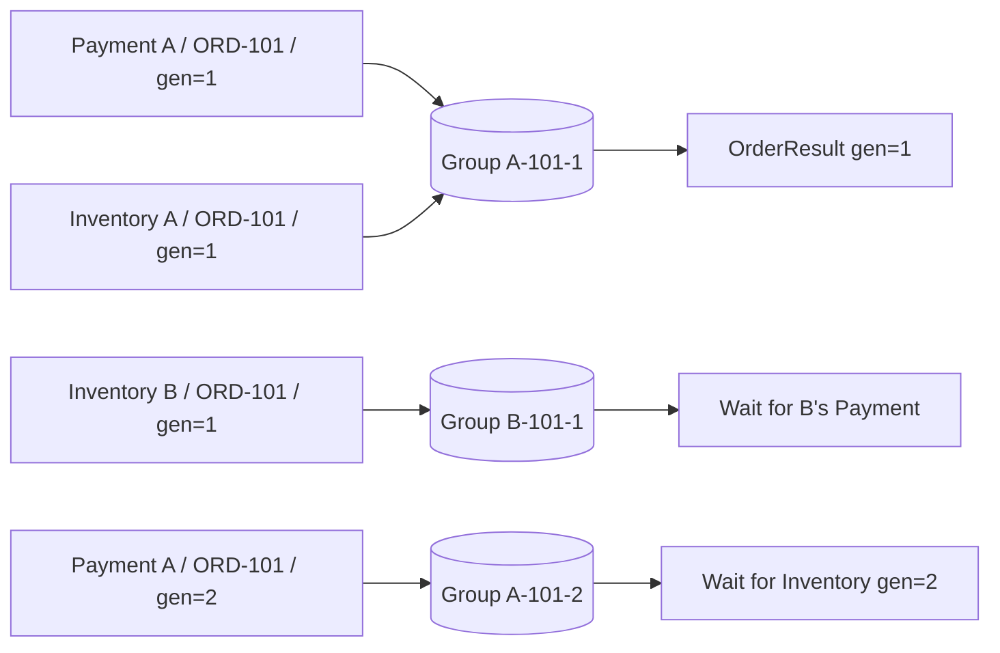
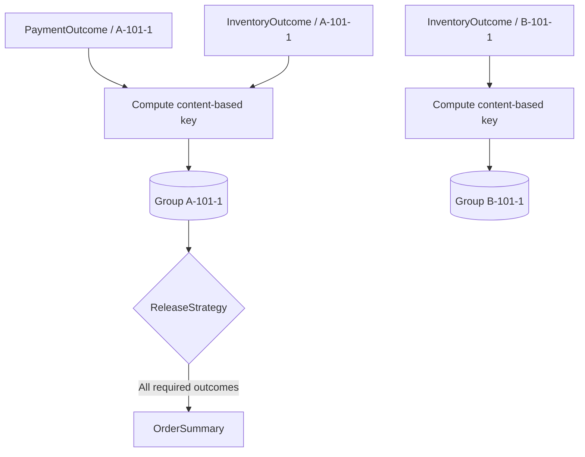
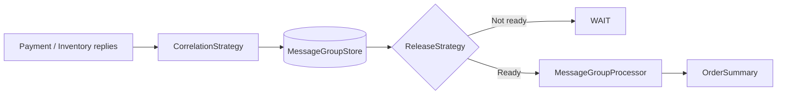
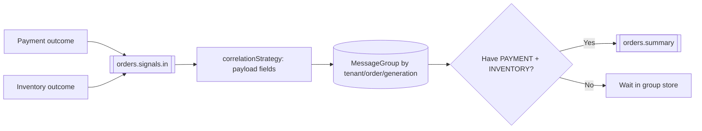
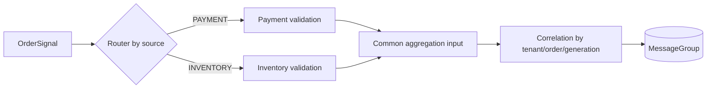
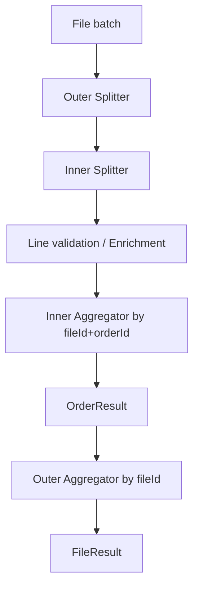
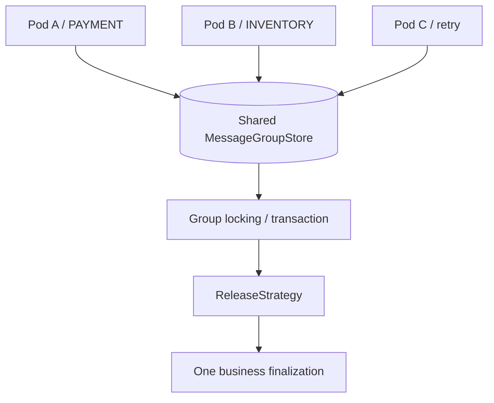

# Correlation Identifier Identifies the Same Flow

In an e-commerce system, after receiving an order, a service sends requests to two branches: **Payment** to check payment and **Inventory** to check stock. Both branches can operate asynchronously, return results at different times, and pass through different instances. When receiving a `PAYMENT=APPROVED` result and an `INVENTORY=AVAILABLE` result, how does the system know **those two messages belong to the same order processing attempt**, rather than two orders with duplicate codes in different tenants or two separate order placements?

That is the problem of **Content-Based Correlation** in the **Enterprise Integration Patterns (EIP)** group. A **Correlation Identifier** helps identify messages related to the same request, workflow, business transaction, or **message group**. Instead of depending on arrival time or the technical ID of each individual message, the system can compute a **correlation key** from meaningful, controlled content fields.

The lesson **“Correlation Identifier Identifies the Same Flow”** belongs to the **Content-based correlation** chapter of the `SPRING_INTEGRATION_PATTERN` module. While learning Spring Integration to build loosely coupled, extensible message flows, we will clarify the **correlation key**, how to derive it from payload/headers, and its relationship with Router, Filter, Transformer, Splitter, Aggregator, Gateway, retry, error channel, and tracing; then implement it with Java DSL, write JUnit 5 tests, and handle duplicate messages, late arrivals, mismatched groups, multiple instances, and security.

> **Key point:** **Correlation Identifier answers “which conversation/processing group does this message belong to?”**. It **does not answer** which channel a message goes to, whether it was processed successfully, whether it is a duplicate, or which position it holds in the group. Those questions belong respectively to **Router, business state, idempotency, and sequence metadata**.

## 1. The Problem When Messages Arrive Out of Order

Suppose the application has two orders with the same display code `ORD-101` in two independent tenants:

| Tenant | Order | Processing Attempt | Branch | Result |
| --- | --- | --- | --- | --- |
| `TENANT-A` | `ORD-101` | `1` | `PAYMENT` | `APPROVED` |
| `TENANT-B` | `ORD-101` | `1` | `INVENTORY` | `AVAILABLE` |
| `TENANT-A` | `ORD-101` | `1` | `INVENTORY` | `AVAILABLE` |
| `TENANT-A` | `ORD-101` | `2` | `PAYMENT` | `DECLINED` |

If the Aggregator only uses `payload.orderId` as the key, all four results can be mixed together. The outcome may look as if `TENANT-A`'s order has been paid and is in stock, while the information actually came from **two different tenants or two different processing generations**.

A good key in this example must distinguish at least:

```text
(tenantId, orderId, generation)
```

**Generation** or `workflowAttemptId` here represents **a distinguishable business execution**. It does not necessarily increment on technical retries: retrying the same step within the same workflow usually keeps the **same generation**, whereas starting a new workflow may use a different generation.



**A wrong correlation key can be more dangerous than having no key:** the system can produce a technically valid yet business-wise wrong result that is hard to detect merely by checking for exceptions.

## 2. What Does “The Same Flow” Mean?

In EIP, “the same flow” here refers to a **conversation scope or business group** defined by the application, not necessarily a thread, an `IntegrationFlow` bean, or a TCP connection.

Examples:

- The same **order and verification attempt**.
- The same **quote request** sent to Pricing, Inventory, and Promotions.
- The same **batch** split by a Splitter into multiple parts.
- The same **payment workflow** consisting of a request, bank response, and notification.
- The same **synchronization run** that may span multiple pods.

Two messages **can belong to the same flow** even if they travel across two topics, two channels, two services, or arrive minutes apart. Conversely, two messages arriving on the **same channel** do not necessarily belong to the same flow.

### 2.1. Scope Must Be Written as a Contract

| Question | Example Decision Needed |
| --- | --- |
| What does one group correspond to? | One order verification attempt. |
| Who issues the ID? | A trusted ingress/workflow service. |
| Which fields form the key? | `tenantId, orderId, generation`. |
| Is the key stable across retries? | Yes, as long as it is the same workflow generation. |
| When is a new key created? | When the business starts a new verification round. |
| When does a group complete/expire? | All required outcomes received or deadline reached. |
| Where do messages arriving after completion go? | Ignore/quarantine/reconcile according to policy. |
| Can the key be spoofed by a client? | Do not accept unauthenticated tenant/group IDs. |

There is no **default correlation scope** suitable for every system. You need to define it before writing SpEL expressions or configuring an Aggregator.

## 3. How Does a Correlation Identifier Differ from Other IDs?

| Identifier | Purpose | Can It Be the Same as Correlation ID? |
| --- | --- | --- |
| **Message ID** | Identifies **one specific message** at the messaging layer. | Can be used to initialize correlation for split parts, but is not stable by default across new messages/replays. |
| **Correlation Identifier** | Identifies **a conversation/message group**. | This is the main concept of this lesson. |
| **Business ID** | Identifies a business entity, such as `orderId`. | Can be **one component** of the key, usually insufficient on its own. |
| **Causation ID** | Indicates which previous message/event directly caused this event. | Different: a causal chain can span multiple groups. |
| **Trace ID / span ID** | Tracks execution and latency across services. | Useful for observability, but not implicitly the group identity. |
| **Idempotency key** | Prevents executing duplicate side effects on retry/redelivery. | May reuse part of a business key, but must be tied to the operation needing deduplication. |
| **Routing key** | Selects the target channel, partition, or consumer. | Not synonymous with correlation. |
| **`sequenceNumber`** | Identifies the order of a part **within a group**. | Cannot identify the group on its own. |
| **`sequenceSize`** | Expected number of parts in the group when known in advance. | Does not identify the group or how many parts succeeded. |
| **Claim Check token** | References data stored in an external store. | Not a correlation ID or authorization by itself. |

### 3.1. Example of Coexisting IDs

```text
messageId       = UUID-8921
tenantId        = TENANT-A
orderId         = ORD-101
generation      = 1
correlationKey  = (TENANT-A, ORD-101, 1)
causationId     = UUID-7100
traceId         = trace-abc
idempotencyKey  = TENANT-A:ORD-101:CAPTURE_PAYMENT
routingKey      = PAYMENT
```

Not every system is required to use these exact fields. The important point is that **each value has a distinct contract**—do not reuse an ID just because “they look similar in the logs.”

### 3.2. Why Can Using `MessageHeaders.ID` Be Wrong?

In Spring Messaging, `MessageHeaders.ID` identifies a single message. If the same order is sent as two new events, they can have **two different message IDs**. If the Aggregator uses message ID as the group key for independent events, it will **never group them** even when `orderId` is identical.

On the other hand, after a standard Splitter, parts can be correlated based on the **original message ID**. This is useful within **a single split**, but does not by itself solve the need to gather replies **from different original messages** according to a business workflow.

## 4. How Does Content-Based Correlation Work?

**Content-Based** means **determining correlation from meaningful content**, typically fields in the payload or normalized business metadata. For example:

```json
{
  "tenantId": "TENANT-A",
  "orderId": "ORD-101",
  "generation": 1,
  "source": "PAYMENT",
  "status": "APPROVED",
  "eventId": "EVT-0101"
}
```

We compute:

```text
groupKey(message) =
    CorrelationKey(
        message.payload.tenantId,
        message.payload.orderId,
        message.payload.generation
    )
```

Two messages with the same `groupKey` are placed into the **same logical group**, regardless of whether:

- They arrive in Payment–Inventory order or Inventory–Payment order.
- They pass through different Routers/Transformers.
- They are processed by workers in different JVMs, **provided** the group store infrastructure supports it.
- They are redelivered within the same generation under a replay policy.

However, computing the same key **is not enough to prove they belong in the same group**. You must validate the tenant, origin, and schema before correlation.



### 4.1. Extract Correlation at Ingress or at the Aggregator?

There are two approaches:

**A. Compute directly from the payload when entering the Aggregator.** `correlationStrategy` reads validated fields from the message. This fits well if all replies keep the same schema.

**B. Compute a correlation key early and put it in a controlled header.** Useful when downstream Transformers change the payload type or when broker adapters need shared metadata. However, the header must be preserved across boundaries, and caller-supplied values must not be trusted.

| Approach | Benefits | Risks |
| --- | --- | --- |
| Payload-based | Relies on the business data contract, independent of technical headers stripped by mappers. | Payload schemas may vary; requires type validation. |
| Header-based | Fast and uniform across different payload types. | Headers can be lost or spoofed; easy to collide with sequence headers generated by other EIP components. |
| Typed group key in the application | Makes tenant/order/generation explicit, avoiding ambiguous string concatenation. | Must ensure serialization and compatibility when using a persistent store. |

## 5. Designing a Safe Correlation Key

### 5.1. Avoid Collision-Prone String Concatenation

An unsafe example:

```java
String key = tenantId + orderId;
```

The two pairs `("AB","C")` and `("A","BC")` both produce `"ABC"`. Even with a delimiter `tenantId + ":" + orderId`, if an ID can contain a colon, you must escape it or use canonical encoding.

One option at the application layer is a **typed key**:

```java
// CorrelationKey.java
import java.io.Serializable;

public record CorrelationKey(
    String tenantId,
    String orderId,
    long generation
) implements Serializable {
    public CorrelationKey {
        if (tenantId == null || tenantId.isBlank()
                || orderId == null || orderId.isBlank()
                || generation < 1) {
            throw new IllegalArgumentException(
                "Invalid correlation identity");
        }
    }
}
```

A `record` provides value-based `equals()`/`hashCode()`, making it convenient as an **in-JVM** group key. With a persistent `MessageGroupStore`, you must verify how the backend serializes/indexes the key, class version constraints, and consistency across multi-instance deployments. You may choose a **canonical String/UUID issued and durably stored** as the group ID if more appropriate.

### 5.2. Normalize Fields Before Creating the Key

Values that can cause group mismatches:

```text
orderId = "ORD-101"
orderId = "ord-101"
orderId = " ORD-101 "
```

If the domain specifies that these strings represent the same order, **normalize them at trusted ingress** and maintain one consistent representation. However, **do not blindly lowercase every ID** if the source system treats uppercase and lowercase as two different IDs.

You should clarify:

- Which fields are required, and can any be null/empty?
- Is the business ID **unique within a tenant** or only within a time window?
- Is the ID case-sensitive or whitespace-sensitive?
- During migrations, do two schema versions produce the **same group key**?
- Is there a requirement to prevent mixing across **tenants, regions, or environments**?

### 5.3. Retries and Generation

`generation` is not the network attempt count:

```text
Workflow gen=1:
  Payment attempt 1 → timeout
  Payment attempt 2 → APPROVED
  Inventory attempt 1 → AVAILABLE
  → same correlation group gen=1

Workflow gen=2:
  User requests order re-verification after editing details
  → new group gen=2
```

If you increment `generation` on every retry, replies from attempt 1 and attempt 2 may be split into **two groups that never complete**. Conversely, if you use only the order code without distinguishing new processing attempts, **a late reply from gen=1 can pollute gen=2**.

## 6. From Correlation Identifier to Message Group

The Aggregator's **Correlation Strategy** decides **which group** a message belongs to. The **Release Strategy** answers whether the group has **all the expected messages/outcomes**. The **MessageGroupProcessor** builds the output once released.



| Component | Question It Solves | If Wrong |
| --- | --- | --- |
| **CorrelationStrategy** | Which group does this reply belong to? | Mixes orders together or splits one order across multiple groups. |
| **MessageGroupStore** | Which messages has the group received so far? | Data loss on restart/concurrency. |
| **ReleaseStrategy** | Have all required outcomes arrived? | Premature release or infinite wait. |
| **MessageGroupProcessor** | What is the complete output—success or failure? | Returns READY even with a REJECTED outcome. |
| **Expiry/late policy** | How are incomplete/expired/late replies handled? | Memory leaks, duplicate finalization, wrong state. |

**A correct correlation key does not by itself determine when a group is done.** Two messages in the same group could just be two Payment replies caused by a retry; if Inventory is also required and has not arrived yet, the group is **not complete**.

## 7. Java Example: Data and Correlation Key

The example uses Java with `record` support, Spring Integration Java DSL, and JUnit 5. The two required roles are `PAYMENT` and `INVENTORY`. We assume events have been authenticated and canonicalized at ingress.

### 7.1. Outcome DTO

```java
// OrderSignal.java
public record OrderSignal(
    String tenantId,
    String orderId,
    long generation,
    String source,
    String status,
    String eventId
) {
    public OrderSignal {
        if (tenantId == null || tenantId.isBlank()
                || orderId == null || orderId.isBlank()
                || generation < 1
                || source == null || source.isBlank()
                || status == null || status.isBlank()
                || eventId == null || eventId.isBlank()) {
            throw new IllegalArgumentException("Invalid OrderSignal");
        }
    }

    public CorrelationKey groupKey() {
        return new CorrelationKey(tenantId, orderId, generation);
    }
}
```

Two independent events can share the same key:

```java
OrderSignal payment = new OrderSignal(
    "TENANT-A", "ORD-101", 1,
    "PAYMENT", "APPROVED", "EVT-P1");

OrderSignal inventory = new OrderSignal(
    "TENANT-A", "ORD-101", 1,
    "INVENTORY", "AVAILABLE", "EVT-I1");

assert payment.groupKey().equals(inventory.groupKey());
```

In a production project, you can use an `enum` for source/status instead of String. This example uses String so learners can easily inspect data on the broker, though you must still **validate against an allowlist** before trusting a role.

### 7.2. Output for a Completed Group

```java
// OrderSummary.java
import java.util.Map;

public record OrderSummary(
    CorrelationKey group,
    String overallStatus,
    Map<String, String> outcomeBySource
) {}
```

In practice, the summary needs source fields, version, timestamp, error reason, and business state defined by the contract. This lesson illustrates the **grouping mechanism**, and does not assume `APPROVED` and `AVAILABLE` are sufficient for real-world payment/fulfillment.

## 8. Release Strategy Only When Two Distinct Outcomes Are Present

Do not use `group.size() >= 2`, because you could receive the same Payment twice. Choose a strategy **based on the set of sources**:

```java
// RequiredSourcesReleaseStrategy.java
import java.util.HashSet;
import java.util.Set;
import org.springframework.integration.aggregator.ReleaseStrategy;
import org.springframework.integration.store.MessageGroup;
import org.springframework.messaging.Message;

public final class RequiredSourcesReleaseStrategy
        implements ReleaseStrategy {
    private static final Set<String> REQUIRED =
        Set.of("PAYMENT", "INVENTORY");

    @Override
    public boolean canRelease(MessageGroup group) {
        if (group.getMessages().isEmpty()) {
            return false;
        }

        Set<String> sources = new HashSet<>();
        CorrelationKey expectedKey = null;

        for (Message<?> m : group.getMessages()) {
            if (!(m.getPayload() instanceof OrderSignal signal)) {
                return false;
            }
            if (!REQUIRED.contains(signal.source())) {
                return false;
            }
            if (expectedKey == null) {
                expectedKey = signal.groupKey();
            } else if (!expectedKey.equals(signal.groupKey())) {
                return false;
            }
            sources.add(signal.source());
        }
        return sources.containsAll(REQUIRED);
    }
}
```

**This condition checks “has a terminal outcome arrived from each required source”**, not whether all succeeded. A `PAYMENT=DECLINED` message can still be a terminal outcome; the group can release once Inventory also sends its outcome, after which the processor produces a `REJECTED` status.

**Important limitations:**

- Two Payment replies with the same `eventId` or same source will not trigger a release.
- The strategy **does not remove duplicates** from the group and does not yet check for conflicts between two outcomes from the same source.
- If a payload/schema is invalid, returning `false` forever can stall the group. **Validate and quarantine before the Aggregator**, along with timeout/expiry.
- Untrusted producers must not be allowed to self-declare `source=INVENTORY`. The role must be bound to an authenticated source.

## 9. Group Processor Builds the Result Instead of Arbitrary Counting

Once the strategy allows release, the processor must handle same-source duplicates and detect conflicting data:

```java
// OrderSummaryProcessor.java
import java.util.HashMap;
import java.util.Map;
import java.util.Set;
import org.springframework.integration.store.MessageGroup;
import org.springframework.messaging.Message;

public final class OrderSummaryProcessor {
    private OrderSummaryProcessor() {}

    public static OrderSummary build(MessageGroup group) {
        Map<String, OrderSignal> bySource = new HashMap<>();
        CorrelationKey key = null;

        for (Message<?> message : group.getMessages()) {
            if (!(message.getPayload() instanceof OrderSignal signal)) {
                throw new IllegalArgumentException("Unexpected payload");
            }
            if (key == null) {
                key = signal.groupKey();
            }
            if (!key.equals(signal.groupKey())) {
                throw new IllegalStateException("Mixed correlation group");
            }

            OrderSignal previous =
                bySource.putIfAbsent(signal.source(), signal);
            if (previous != null
                    && !previous.status().equals(signal.status())) {
                throw new IllegalStateException(
                    "Conflicting outcomes for " + signal.source());
            }
        }

        if (!bySource.keySet().containsAll(
                Set.of("PAYMENT", "INVENTORY"))) {
            throw new IllegalStateException("Missing required outcome");
        }

        String payment = bySource.get("PAYMENT").status();
        String inventory = bySource.get("INVENTORY").status();
        String overall = "APPROVED".equals(payment)
                && "AVAILABLE".equals(inventory)
                    ? "READY" : "REJECTED";

        return new OrderSummary(key, overall, Map.of(
            "PAYMENT", payment,
            "INVENTORY", inventory));
    }
}
```

In a real workflow, **two replies with different `eventId`s but the same status** could be **two valid evaluations** rather than a harmless duplicate. You need a **generation/version** contract, a policy for choosing the final outcome, and deduplication by authenticated `eventId` or `operationId`. The sample processor only treats **conflicting statuses** as a conflict; deeper validation belongs to business logic.

### 9.1. Correct Correlation and Correct Business Outcome Are Two Separate Layers

| Group Contains | Release? | Example Result |
| --- | --- | --- |
| Payment APPROVED | Not yet | Wait for Inventory. |
| Payment APPROVED + Payment APPROVED | Not yet | Same required source. |
| Payment APPROVED + Inventory AVAILABLE | Yes | `READY`. |
| Payment DECLINED + Inventory AVAILABLE | Yes | `REJECTED`. |
| Payment APPROVED + Inventory OUT_OF_STOCK | Yes | `REJECTED`. |
| Payment from Tenant A + Inventory from Tenant B | **Not in the same group** | Each group waits independently. |

A system that merely counts replies can easily return a wrong result on duplicates. A system that groups only by `orderId` can easily mix data across tenants. **Both proper correlation and a proper release strategy are required.**

## 10. Integrating into Spring Integration Java DSL

The flow receives both types of `OrderSignal` over one channel, groups them by a **key computed from the payload**, waits for both sources, and produces an `OrderSummary`. In this demo, the output is a `QueueChannel` for easy testing.

```java
// ContentCorrelationConfiguration.java
import org.springframework.context.annotation.Bean;
import org.springframework.context.annotation.Configuration;
import org.springframework.integration.channel.QueueChannel;
import org.springframework.integration.config.EnableIntegration;
import org.springframework.integration.dsl.IntegrationFlow;

@Configuration
@EnableIntegration
public class ContentCorrelationConfiguration {

    @Bean("orders.summary")
    QueueChannel orderSummaries() {
        return new QueueChannel(16);
    }

    @Bean
    IntegrationFlow correlateOrderOutcomes() {
        return IntegrationFlow.from("orders.signals.in")
            .aggregate(spec -> spec
                .correlationStrategy(message ->
                    ((OrderSignal) message.getPayload()).groupKey())
                .releaseStrategy(new RequiredSourcesReleaseStrategy())
                .outputProcessor(OrderSummaryProcessor::build))
            .channel("orders.summary")
            .get();
    }
}
```

**How to read this configuration:**

1. `orders.signals.in` receives each `Message<OrderSignal>`.
2. `correlationStrategy` **reads the message content** to create `CorrelationKey(tenantId, orderId, generation)`.
3. Messages with equal keys are stored in the same `MessageGroup`.
4. `RequiredSourcesReleaseStrategy` waits for both `PAYMENT` and `INVENTORY` sources.
5. `OrderSummaryProcessor` emits one `OrderSummary` when the group meets the condition.
6. `orders.summary` holds results in a `QueueChannel` for testing; production requires a consumer/adapter and persistence/expiry policies.

**API Note:** The DSL snippet uses common Spring Integration APIs for `aggregate(spec -> ...)`, `correlationStrategy`, `releaseStrategy`, and `outputProcessor`. When integrating into a real project, verify dependencies/versions and test in the actual runtime. This lesson only illustrates correlation logic and **does not claim to have run Gradle or a database**.

### 10.1. This Is Content-Based Correlation, Not a Header-Based Router

`correlationStrategy` returns a **group ID**, not a channel name. If a Router uses `payload.source` to select `payment.in` or `inventory.in`, that is **routing**. When both return to `orders.signals.in` and the Aggregator groups by `payload.orderId` + related fields, that is **correlation**.



### 10.2. What About Using the `correlationId` Header?

Spring Integration can use a correlation header generated by a Splitter or endpoints configured with appropriate sequence settings. However, in this example **we intentionally configure correlationStrategy from the payload**, so we do not depend on the `correlationId` header value.

If a system has both technical headers produced by a Splitter and a business key in the payload, **decide which strategy is authoritative**. Never let one place group by the original message ID and another place group by `orderId` without documenting the two distinct scopes.

## 11. JUnit 5: Two Independent Messages into the Same Group

### 11.1. Happy Path Test

```java
import static org.junit.jupiter.api.Assertions.*;

import org.junit.jupiter.api.Test;
import org.springframework.beans.factory.annotation.Autowired;
import org.springframework.context.ApplicationContext;
import org.springframework.integration.channel.QueueChannel;
import org.springframework.messaging.Message;
import org.springframework.messaging.MessageChannel;
import org.springframework.messaging.support.MessageBuilder;
import org.springframework.test.context.junit.jupiter.SpringJUnitConfig;

@SpringJUnitConfig(ContentCorrelationConfiguration.class)
class ContentCorrelationTest {

    @Autowired ApplicationContext context;

    private void send(OrderSignal signal) {
        MessageChannel input =
            context.getBean("orders.signals.in", MessageChannel.class);
        assertTrue(input.send(
            MessageBuilder.withPayload(signal).build()));
    }

    private QueueChannel output() {
        return context.getBean("orders.summary", QueueChannel.class);
    }

    @Test
    void correlatesPaymentAndInventoryByBusinessContent() {
        send(new OrderSignal(
            "TENANT-A", "ORD-201", 1,
            "INVENTORY", "AVAILABLE", "EVT-I-201"));
        assertNull(output().receive(0));

        send(new OrderSignal(
            "TENANT-A", "ORD-201", 1,
            "PAYMENT", "APPROVED", "EVT-P-201"));

        Message<?> result = output().receive(0);
        assertNotNull(result);
        assertInstanceOf(OrderSummary.class, result.getPayload());

        OrderSummary summary = (OrderSummary) result.getPayload();
        assertEquals(new CorrelationKey(
            "TENANT-A", "ORD-201", 1), summary.group());
        assertEquals("READY", summary.overallStatus());
        assertEquals("APPROVED",
            summary.outcomeBySource().get("PAYMENT"));
        assertEquals("AVAILABLE",
            summary.outcomeBySource().get("INVENTORY"));
        assertNull(output().receive(0));
    }
}
```

**Observation:** Inventory arrives **before** Payment, yet the Aggregator still groups them properly. A single `PAYMENT` event **is not enough**, and the technical message IDs of the two events can differ while still being joined via the content key.

### 11.2. Test Not Mixing Tenants or Generations

Extending the same test class:

```java
@Test
void tenantAndGenerationArePartOfCorrelationScope() {
    send(new OrderSignal(
        "TENANT-A", "ORD-202", 1,
        "PAYMENT", "APPROVED", "EVT-PA-1"));
    send(new OrderSignal(
        "TENANT-B", "ORD-202", 1,
        "INVENTORY", "AVAILABLE", "EVT-IB-1"));
    send(new OrderSignal(
        "TENANT-A", "ORD-202", 2,
        "INVENTORY", "AVAILABLE", "EVT-IA-2"));

    // All three messages belong to three different groups.
    assertNull(output().receive(0));

    send(new OrderSignal(
        "TENANT-A", "ORD-202", 1,
        "INVENTORY", "AVAILABLE", "EVT-IA-1"));

    Message<?> result = output().receive(0);
    assertNotNull(result);
    OrderSummary summary = (OrderSummary) result.getPayload();
    assertEquals(new CorrelationKey(
        "TENANT-A", "ORD-202", 1), summary.group());
    assertNull(output().receive(0));
}
```

This test verifies that **tenant A generation 1** completes only when it receives its corresponding Inventory signal; Inventory from tenant B and generation 2 are not mistakenly used to complete the group. When adding more tests, use a **distinct business key per test** or isolate the context/group store to avoid leftover state from previous tests.

### 11.3. Test Duplicate Before All Sources Arrive

```java
@Test
void twoPaymentRepliesDoNotReplaceInventory() {
    send(new OrderSignal(
        "TENANT-A", "ORD-203", 1,
        "PAYMENT", "APPROVED", "EVT-P203-1"));
    send(new OrderSignal(
        "TENANT-A", "ORD-203", 1,
        "PAYMENT", "APPROVED", "EVT-P203-1"));
    assertNull(output().receive(0));

    send(new OrderSignal(
        "TENANT-A", "ORD-203", 1,
        "INVENTORY", "AVAILABLE", "EVT-I203-1"));
    Message<?> result = output().receive(0);
    assertNotNull(result);
    assertEquals("READY",
        ((OrderSummary) result.getPayload()).overallStatus());
    assertNull(output().receive(0));
}
```

This **tests against premature release when only duplicate Payment replies arrive**. It does not prove consumer idempotency when calling APIs/DBs in handlers upstream of the Aggregator. If the group store or framework deduplicates by technical ID at another layer, you also need to test **two messages with different `MessageHeaders.ID`s** but the same `eventId`.

### 11.4. What These Tests Do Not Prove

The tests above use `QueueChannel` and an in-JVM store:

- They do not test crash/restart or two JVMs concurrently updating a group.
- They do not test Kafka/RabbitMQ header mapping, redelivery, and transactions.
- They do not test timeout/expiry or late replies after release.
- They do not test error paths when the processor encounters conflicting replies.
- They do not test an unauthorized producer attempting to emit the `INVENTORY` role.

Do not use a passing local unit/integration test to claim **end-to-end exactly-once**.

## 12. Header-Based Correlation or Content-Based Correlation?

A system can normalize `CorrelationKey` from content and then attach it to a header:

```java
import org.springframework.integration.IntegrationMessageHeaderAccessor;
import org.springframework.messaging.Message;
import org.springframework.messaging.support.MessageBuilder;

Message<OrderSignal> withInternalCorrelation(OrderSignal signal) {
    return MessageBuilder.withPayload(signal)
        .setHeader(
            IntegrationMessageHeaderAccessor.CORRELATION_ID,
            signal.groupKey())
        .build();
}
```

**Condition:** only the application/trusted ingress may attach group-controlling headers; client-supplied values must be verified. If a Transformer changes the payload into a DTO without `tenantId/orderId`, a header can preserve group identity across steps, but header propagation must be tested.

| Scenario | Generally Suitable Approach |
| --- | --- |
| Reply payload always has `tenantId/orderId/generation` | Correlate directly from the payload. |
| Replies have different payload types | Normalize into an envelope with a group key or use a trusted header. |
| Splitter creates sequence headers for the same input message | Can use the Splitter-generated correlation header if the **scope matches**. |
| Long-running workflow across brokers/multiple services | Use a business correlation ID with clear schema/version/tenant. |
| External client provides `correlationId` | Do not trust directly; verify ownership and prevent tenant mixing. |
| Data enrichment alters `orderId` or identity | Lock in correlation at ingress; do not recompute from uncontrolled mutated fields. |

**Metadata named “correlation” is not guaranteed to carry the right business semantics.** A header name does not replace a group identity contract.

## 13. Correlation Combined with Router, Filter, and Transformer

### 13.1. Router Picks the Path, Correlation Picks the Group



**Router** can return `payment.validation` or `inventory.validation` as destinations. **Aggregator** then groups by business content. If the Router drops a branch without producing a terminal outcome, the group may **wait forever**.

**Never use the routing key `PAYMENT` as a correlation key**: all orders from that branch would be lumped into one group.

### 13.2. Filter Drops an Outcome

If a Filter returns `false` for an “out of stock” Inventory reply, the Aggregator will not receive the Inventory result. However, “out of stock” may be a **terminal outcome** that must enter the group to produce `REJECTED`, **not a message that should vanish**.

```text
Wrong:
  Inventory OUT_OF_STOCK → Filter false → drop
  Payment APPROVED → Aggregator waits for Inventory forever

Correct under a contract requiring both outcomes:
  Inventory OUT_OF_STOCK → OrderSignal(INVENTORY, OUT_OF_STOCK)
  Payment APPROVED → OrderSignal(PAYMENT, APPROVED)
  → Aggregator release → OrderSummary(REJECTED)
```

Only drop via Filter if the group release/expiry logic knows expected outcomes have changed or the business permits a partial result.

### 13.3. Transformer Loses Identity

If a handler does:

```java
Message<String> badTransform(Message<OrderSignal> input) {
    return MessageBuilder.withPayload(
        input.getPayload().status()).build();
}
```

then downstream only sees a status String, **no longer having tenant/order/generation in the payload**, and some metadata may be lost. You must keep an **envelope**, attach a trusted validated header, or use a Transformer/DSL with tested header-copy semantics.

An intentional DTO:

```java
public record GroupedOutcome(
    CorrelationKey group,
    String source,
    String status,
    String eventId
) {}
```

If switching to `GroupedOutcome`, update both the correlation strategy and release strategy to read **the new payload properly**, avoiding `ClassCastException`, SpEL errors, or misgrouping.

## 14. Splitter, Aggregator, and Resequencer

### 14.1. Correlation of a Single Split

Example:

```text
Input Message<List<OrderLine>> ID=UUID-A
    → Splitter:
       line1: correlationId=UUID-A, seq=1/3, size=3
       line2: correlationId=UUID-A, seq=2/3, size=3
       line3: correlationId=UUID-A, seq=3/3, size=3
```

These headers may suffice for an **Aggregator to recombine parts of a single split**, but if the original input is replayed as a different message with ID `UUID-B`, it can create a separate group. To join parts of the same business batch across replays, design a stable business group ID, deduplication, and generation control.

### 14.2. Correlation Is Not Sequencing

| Metadata | Meaning |
| --- | --- |
| `correlationId` | Which group messages belong to. |
| `sequenceNumber` | Which position a message holds in the group. |
| `sequenceSize` | How many parts the group is expected to have when N is known. |

**Resequencer** can use correlation + sequence to emit messages **in order**. **Aggregator** uses correlation + release strategy to **combine multiple messages into one result**. Sharing a group identity **does not automatically establish order**, and having `sequenceNumber` **does not automatically prevent duplicates**.

### 14.3. Nested Splitters

A file contains three orders, each with two lines. There are at least two scopes:

```text
outer group: fileId
inner group: (fileId, orderId)
```

If you only use `orderId` as the key, two different files containing the same order ID can be mixed; if you only use `fileId` for the inner Aggregator, lines from different orders will be grouped together.

Design **distinct keys per layer**, and preserve the outer context across steps:



**A single flat `correlationId` header cannot represent every layer simultaneously.** Separate business keys or a typed correlation context may be needed.

## 15. Gateway and Scatter–Gather

### 15.1. Request–Reply Is More Than Grouping by orderId

A Java Gateway can front a workflow:

```java
import org.springframework.integration.annotation.MessagingGateway;

@MessagingGateway(defaultRequestChannel = "orders.requests.in")
interface OrderGateway {
    OrderReceipt verify(OrderRequest request);
}

// OrderReceipt and OrderRequest are defined by the application.
// Requires a real flow with a reply path and corresponding result types.
```

**The `ContentCorrelationConfiguration` example in Section 10 does not return an `OrderReceipt` to the Gateway**. It only puts `OrderSummary` into a `QueueChannel` for testing. Request–reply requires:

1. The request carries a **correlation scope** issued by ingress.
2. Scatter dispatches work to the required recipients.
3. Each reply carries back the same business key and an authenticated source.
4. Gather/Aggregator groups properly, releases properly, and builds `OrderReceipt`.
5. The reply is routed back to the caller via the **reply channel/request–reply contract**.
6. Timeouts/late replies are handled without sending two responses for an already-completed request.

**A correlation key does not replace the Gateway's `replyChannel`.** A reply with the right business key but missing the reply path or required group processor can still cause the caller to time out.

### 15.2. Scatter–Gather and Required Recipients

When a request is sent to Payment, Inventory, and optionally Promotions, `requiredSources` might be `{PAYMENT, INVENTORY}`—not every subscriber necessarily has to reply. If only Pricing and Inventory were selected for a message, do not wait for Promotions merely because another configuration has such a subscriber in the topology.

Lock in the **selected/required recipient set** per request and include it in **trusted workflow metadata** when policy is dynamic. The release strategy must rely on the actually required set, not guess from `group.size()` or from whichever messages happened to arrive.

## 16. Correlation and Idempotency on Retry or Redelivery

Suppose Payment recorded a charge, but the reply was lost:

```text
T1: Payment processes event EVT-P1, commits side effect.
T2: Reply to Aggregator times out / is lost.
T3: Broker retries event EVT-P1.
T4: Payment risks committing a second time.
T5: Aggregator may receive two Payment replies.
```

**Correlation** ensures the Payment reply groups with Inventory. It **does not prevent Payment from executing the same operation twice**. You need:

- A stable **`eventId`** to detect redelivery of the same message.
- A stable **`operationId`/idempotencyKey** to protect external business side effects.
- A consumer/repository with concurrent-safe deduplication/transactions.
- `RetryAdvice` or bounded transport retries with an error policy.
- A release strategy waiting for **all unique required sources**.
- Completed-group state so stale replies arriving later do not trigger duplicate finalization.

### 16.1. Do Not Use the Correlation Key as the Idempotency Key for the Entire Workflow

If the idempotency key is only `(tenantId, orderId, generation)`, two distinct operations within the same group—such as **reserve inventory** and **capture payment**—could be mistakenly blocked as the same operation. A better idempotency key typically includes:

```text
(tenantId, orderId, generation, operationType, operationId)
```

Depending on the system, `eventId` identifies the specific message, while `operationId` identifies the side effect that must occur only once. This is a **separate contract** requiring persisted state, not just a header.

### 16.2. Duplicates and Conflicting Outcomes

```text
Group A-101-1:
  PAYMENT APPROVED (event P1)
  PAYMENT DECLINED (event P2)
  INVENTORY AVAILABLE (event I1)
```

The group has both roles, but Payment has two conflicting results. The processor must not pick arbitrarily. You need to:

- determine whether the two events belong to the **same operation version**;
- distinguish a retry duplicate from a valid state-update event;
- use domain revision/sequence numbers where possible;
- quarantine or reconcile if indeterminate;
- never emit `READY` just because one of the two Payment replies is APPROVED.

## 17. Missing, Late, and Expired Groups

A group may fail to receive all outcomes because:

- A Filter dropped a message.
- A Router sent a message down a branch that never returns to Gather.
- A handler threw an exception and produced no terminal outcome.
- The network/broker delayed or lost a reply.
- A message was tagged with the wrong correlation key.
- A payload/header lost group fields across a Transformer.
- Two workflow generations were created erroneously or inconsistently.

### 17.1. Group Timeout Differs from Gateway Timeout

| Limit | Meaning |
| --- | --- |
| **Group timeout/expiry** | The message group did not complete under the release strategy within the deadline. |
| **Gateway reply timeout** | The caller timed out waiting for a response. |
| **HTTP/DB client timeout** | A dependency did not respond in time. |
| **Broker TTL/retention** | Message lifetime at the transport layer. |
| **Business deadline** | Total time a workflow is allowed to wait. |

The Gateway can time out **before the group completes**. A late reply can still enter the group afterward unless the application enforces a late-result/completed-group policy.

### 17.2. Partial Results Must Not Pretend to Be Success

If only the Payment outcome has arrived, an illustrative partial result looks like:

```json
{
  "tenantId": "TENANT-A",
  "orderId": "ORD-101",
  "generation": 1,
  "status": "PENDING",
  "receivedSources": ["PAYMENT"],
  "missingSources": ["INVENTORY"],
  "final": false
}
```

This is an **application-designed schema**, not an automatic output generated by the Aggregator on group timeout. If using `sendPartialResultOnExpiry(true)` in a compatible configuration, the **processor must recognize missing sources** to return the right status, alongside group lifecycle/retention handling.

### 17.3. Late Replies and Reopening Groups

Example:

```text
T1: Payment APPROVED → group A-101-1
T2: Group expires → PENDING/FAILED per policy
T3: Inventory AVAILABLE arrives late
```

You must explicitly choose:

1. Ignore the late reply because processing has expired.
2. Quarantine and reconcile.
3. Update status from `PENDING` to `READY` using a versioned business event.
4. Create a new group **only when** it is a new workflow generation.

Without a completed-group/tombstone record or versioned workflow state, a late reply can cause **double finalization**. Accurate correlation only routes it to the right group name; **it does not decide whether a closed group may be reopened**.

## 18. Multiple Instances and Persistent MessageGroupStore

A service has three pods:

```text
Pod A receives PAYMENT for A-101-1
Pod B receives INVENTORY for A-101-1
Pod C receives retry PAYMENT for A-101-1
```

If each pod uses only its own **in-memory MessageGroupStore**, there can be three separate “A-101-1” groups **invisible to one another**, and no pod ever releases even though all events have reached the system.



In production you must decide:

- **Single-owner by correlation/partition key** so a group is handled by one consumer, or a **shared group store** with locking/fencing.
- Persistence across **restarts**, with compatible serializer/schema versions.
- Atomicity of **add part → evaluate release → publish output → commit/ack** to the degree the system can guarantee.
- Recovery and idempotency when crashing mid-step.
- Quotas, TTLs, and cleanup for waiting groups.
- Policy when two pods attempt to release the same group concurrently.

**A shared database does not automatically make the entire flow end-to-end exactly-once.** You must evaluate transaction boundaries separately across the broker, store, downstream DB, and output publishing.

### 18.1. Correlation Keys Must Be Stable Across Rolling Deploys

If version A computes `key = tenantId + ":" + orderId`, while version B computes `key = tenantId + ":" + orderId + ":" + generation`, the same message can land in two different groups during a rollout. This is a **correlation strategy versioning** bug.

When changing the schema/key:

1. Standardize the canonical format and version.
2. Evaluate open groups using the old key.
3. Have a clear migration/drain or parallel-running strategy.
4. Test events emitted by both producer/consumer versions during rollout.
5. Never change the hash/serialization algorithm while ignoring previously persisted groups.

## 19. Security: Correlation ID Is Group-Control Data

An attacker might try sending a message:

```json
{
  "tenantId": "TENANT-B",
  "orderId": "ORD-101",
  "generation": 1,
  "source": "INVENTORY",
  "status": "AVAILABLE",
  "eventId": "FORGED-001"
}
```

If the system blindly trusts payloads from an unauthenticated source, a forged message can help cause the Aggregator to **release a group the caller has no right to access**.

Countermeasures:

1. **AuthN/AuthZ at ingress** before using tenant/order/source as a correlation key.
2. Derive `tenantId` from the authenticated context when appropriate; never accept it blindly from the request.
3. Restrict producer permissions by topic, channel, and `source` type.
4. Validate that `orderId` belongs to the tenant, `generation` is active, and the event schema is valid.
5. Cap the number of open groups, events per group, group age, and payload size.
6. Do not use emails, account numbers, tokens, or PII as correlation IDs when opaque IDs can be used.
7. Do not log full payloads or failed messages containing secrets.
8. Separate read permissions for the group store/DLQ and audit sensitive lookups.
9. In traces/logs, use opaque identifiers, appropriate retention, and masking.

**A syntactically valid key is not necessarily authorized to join a business group.** Group membership must rely on **valid and trusted** data.

## 20. Observability: Track Both Keys and Group State

Measuring only the throughput of `orders.signals.in` does not tell you whether events are entering the **right groups**. Recommended metrics:

| Suggested Metric | Purpose |
| --- | --- |
| `correlation_events_received_total` | Total messages entering the correlation boundary. |
| `correlation_validation_failures_total` | Rejected due to missing/invalid tenant, order, generation, or source. |
| `correlation_groups_open` | Number of waiting groups. |
| `correlation_group_age_seconds` | Detects stalled or overdue groups. |
| `correlation_group_members_total` | Messages in groups, potentially including duplicates. |
| `correlation_distinct_sources` | Count of distinct required sources received. |
| `correlation_missing_sources_total` | Groups that expired missing a required role. |
| `correlation_duplicate_events_total` | Redeliveries/duplicates by defined identity. |
| `correlation_conflicts_total` | Replies from the same role with conflicting content/version. |
| `correlation_completed_groups_total` | Groups released per policy. |
| `correlation_expired_groups_total` | Incomplete groups that exceeded their deadline. |
| `correlation_late_events_total` | Events arriving after completion/expiry. |
| `correlation_processing_errors_total` | Strategy, group store, or output processor failures. |
| `gateway_reply_timeouts_total` | Caller timeouts, distinct from group timeouts. |

These are **suggested metric names**, not all provided out of the box by Spring Integration. Never use per-message `orderId` or `correlationId` as a **metric label**, as high cardinality can overwhelm metrics storage and leak data. Use bounded labels such as `source=PAYMENT`, `outcome=WAITING`.

### 20.1. Structured Logs

```text
event=correlated_signal_received
flow=orderVerification
group_ref=<opaque-reference>
source=PAYMENT
generation=1
event_ref=<opaque-event-reference>
outcome=WAITING_FOR_INVENTORY
```

```text
event=correlation_group_released
flow=orderVerification
group_ref=<opaque-reference>
received_sources=PAYMENT,INVENTORY
release_reason=ALL_REQUIRED_SOURCES
overall_status=READY
```

This is an **application-designed** format. A trace links messages in time, but **`traceId` does not replace `group_ref`** when a workflow spans retries, batches, or multiple separate traces.

### 20.2. Diagnosing a Stalled Aggregator

1. Were all expected messages actually **produced**?
2. Did they pass through the **right channel/broker topic**?
3. Were any messages **dropped by a Filter** or unmatched by a Router?
4. Do `tenantId/orderId/generation` share the exact same canonical representation?
5. Did any source attach the wrong `source` or wrong workflow generation?
6. Did a Transformer/adapter strip correlation fields or headers?
7. Are there duplicate Payment replies while Inventory is still missing?
8. Is the group store **split per pod**, losing state on restart, or hitting locking errors?
9. Are group timeout/expiry and late-result policies running?
10. Did the group release, yet the output channel or reply path failed?

Do not try to fix correlation bugs by increasing timeouts indefinitely: if two messages **were already placed into two different groups**, waiting longer will never make them converge.

## 21. Common Mistakes

### Mistake 1 — “Messages entering the same channel belong to the same workflow”

**Wrong.** One channel receives events from many orders and tenants. You need a group key.

### Mistake 2 — “`orderId` is always a sufficient correlation key”

**Wrong.** An order ID may only be unique within a tenant or reused across generations. Scope must be considered.

### Mistake 3 — “`MessageHeaders.ID` is the business correlation ID”

**Not by default.** Individual message IDs can differ; Splitters follow their own convention for a single split.

### Mistake 4 — “Matching correlation means every event is valid”

**Wrong.** You still must validate source, ownership, generation, event type, and schema.

### Mistake 5 — “Two messages means Payment + Inventory”

**Wrong.** They could be two duplicate Payment messages. Release by required sources/unique outcomes.

### Mistake 6 — “Correlation prevents duplicate charges”

**Wrong.** Idempotency must protect **operation side effects** using durable identities and appropriate transactions/repositories.

### Mistake 7 — “Trace ID is the best group key”

**Not necessarily.** A trace can change on retries or across processes; group identity must follow the business contract.

### Mistake 8 — “Correlation headers survive every adapter”

**Wrong.** Serialization/header mapping can alter or drop fields. Test the actual path end-to-end.

### Mistake 9 — “Filtering out Inventory does not affect the Aggregator”

**Wrong.** The group may miss a required source and wait forever; use terminal outcomes or expiry.

### Mistake 10 — “A persistent broker automatically makes correlation groups durable”

**Wrong.** Broker durability and `MessageGroupStore` persistence are two separate boundaries.

### Mistake 11 — “Gateway timeout means the group has been cancelled”

**Wrong.** The group/handler may still be running; you need late-reply and finalization policies.

### Mistake 12 — “Concatenating any IDs produces a unique correlation key”

**Wrong.** Collisions can happen without escaping/canonicalization; a typed key or standard encoding is safer.

## 22. Practice Exercises

**Exercise 1 — Choosing scope.** Two tenants share the same `orderId` and have two processing generations. Design a safe `CorrelationKey` and explain why using `orderId` alone is wrong.

**Exercise 2 — Reading a trace.** A Payment reply has `messageId=P1` and an Inventory reply has `messageId=I1`, sharing the same business key. Identify the group identity and distinguish it from event/correlation/causation/trace IDs.

**Exercise 3 — Java DSL.** Run `ContentCorrelationConfiguration` with Payment before Inventory, then reverse the order. Verify the same `OrderSummary` is produced regardless of arrival order.

**Exercise 4 — Tenant isolation.** Send Payment for tenant A and Inventory for tenant B with the same `orderId`. Verify the group does not release; then add Inventory for tenant A and verify the correct result.

**Exercise 5 — Generation.** Send Inventory for generation 2 while generation 1 is missing Inventory. Prove that group 1 is not mistakenly released.

**Exercise 6 — Duplicates.** Send two Payment messages with the same `eventId`, then Inventory. The release strategy must not treat two Payments as satisfying two sources.

**Exercise 7 — Conflicting outcomes.** Send Payment APPROVED and then DECLINED in the same group; design a quarantine/error path and ensure `READY` is not emitted erroneously.

**Exercise 8 — Filter and Router.** Build two branches from `OrderSignal`, with one branch dropped by a Filter. Design a terminal rejected outcome so the Aggregator does not wait forever.

**Exercise 9 — Transformer.** Replace the `OrderSignal` payload with another DTO; try using a validated internal correlation header and test header mapping across an adapter.

**Exercise 10 — Nested Splitter.** A file contains three orders, each with two lines. Design outer and inner correlation keys, and explain why a single flat header cannot serve both scopes.

**Exercise 11 — Scatter–Gather.** Payment, Inventory, and optional Promotions: define `requiredSources` per request, the release strategy, and the output processor so it does not wait on a branch that was never sent.

**Exercise 12 — Gateway timeout.** The caller waits only two seconds while Inventory arrives after five seconds. Design a `PENDING`/status query, late-result policy, and idempotency when the caller retries.

**Exercise 13 — Multi-instance.** Two pods receive two outcomes with the same key. Compare separate in-memory stores against a shared persistent `MessageGroupStore`, and propose partitioning/locking.

**Exercise 14 — Security.** A client attempts to claim a different tenant and spoof `source=INVENTORY`. Define validation/authorization at ingress before grouping.

**Exercise 15 — Observability.** Build a dashboard tracking waiting groups, missing sources, duplicates, conflicts, group age, and late replies without putting business IDs into metric labels.

## 23. Pre-Deployment Checklist for Content-Based Correlation

| Question | What to Verify |
| --- | --- |
| Is “the same flow” concretely defined? | Clear scope: order, batch, request, or workflow generation. |
| Does the group key include all needed components? | Tenant/owner, business ID, and generation where applicable. |
| Is the key canonical and collision-free? | Standard type/encoding, validation, and consistent equality. |
| Who creates/issues the correlation? | Trusted ingress or workflow service. |
| Is correlation stable across retries? | Yes, within the same logical workflow; new generation when truly new. |
| Are different ID types kept distinct? | Message, event, causation, trace, routing, idempotency, and claim tokens. |
| Are payloads/headers trustworthy? | Auth, schema, tenant ownership, and source allowlist. |
| Are there multiple message types? | Normalized envelope/headers, tested for type/serialization compatibility. |
| Does the Aggregator have an explicit `correlationStrategy`? | Not confused with routing key or default message ID. |
| Does `ReleaseStrategy` match expected sources? | Prevents duplicates and reflects required outcomes. |
| Does the processor distinguish completion from success? | Emits READY/REJECTED/PENDING or equivalent domain outcomes. |
| Can Filter/Router lose an outcome? | Terminal reject/error outcome or group expiry in place. |
| Are Splitter/Resequencer used? | Sequence metadata matches scope without arbitrarily overwriting business keys. |
| Are there nested groups or dynamic fan-out? | Each level/recipient has its own correlation and release contract. |
| Is there a Gateway request–reply flow? | Defined reply path, deadline, and late-result policy. |
| Can retries/redeliveries cause duplicates? | `eventId`/`operationId` and idempotent handlers in place. |
| Is there group timeout/expiry? | Clear partial/fail/quarantine/cleanup strategy. |
| Is it multi-instance? | Shared store or single-owner by key, with clear locking/recovery. |
| Do rolling deploys change key format? | Versioning and migration/drain for open groups. |
| Are PII/secrets kept out of IDs/logs? | Opaque IDs, masking, access control, no high-cardinality labels. |
| Are negative/failure-injection tests included? | Cross-tenant mixing, wrong generation, duplicates, late arrivals, restarts, and malformed payloads. |

## Conclusion

**Correlation Identifier Identifies the Same Flow** is the foundation for recognizing distributed messages as belonging to the **same business group**. With **Content-Based Correlation**, the group key is derived from trusted content fields such as **tenant, business ID, and workflow generation**, rather than from message arrival order, the channel they pass through, or individual message technical IDs.

In Spring Integration, **CorrelationStrategy** identifies the group, **ReleaseStrategy** decides when enough outcomes have arrived, and **MessageGroupProcessor** produces the result. These three responsibilities must be designed together while remaining distinct from **Router, Filter, Transformer, Splitter, Resequencer, Gateway, retry, error channel, and idempotency**. A system with sound correlation also requires **validation, authorization, group timeouts, durable state, duplicate/late handling, and observability** so it never mixes orders across tenants, concludes prematurely, or repeats side effects when messages are redelivered.
