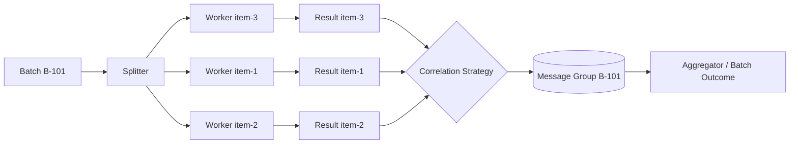
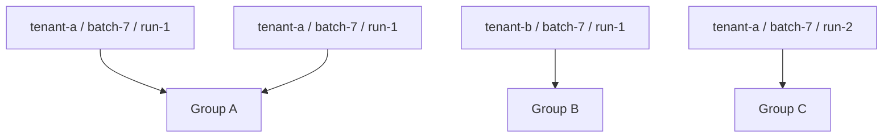
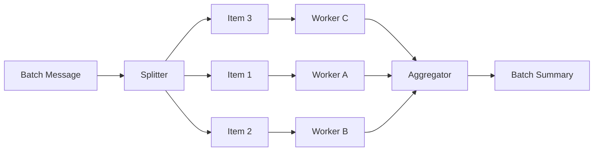
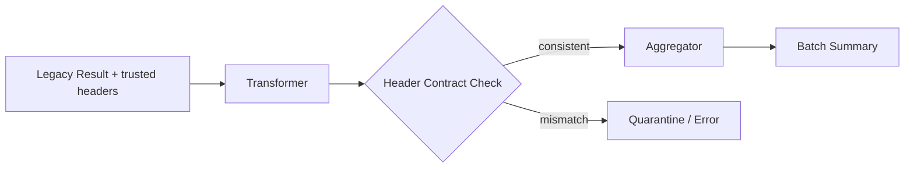
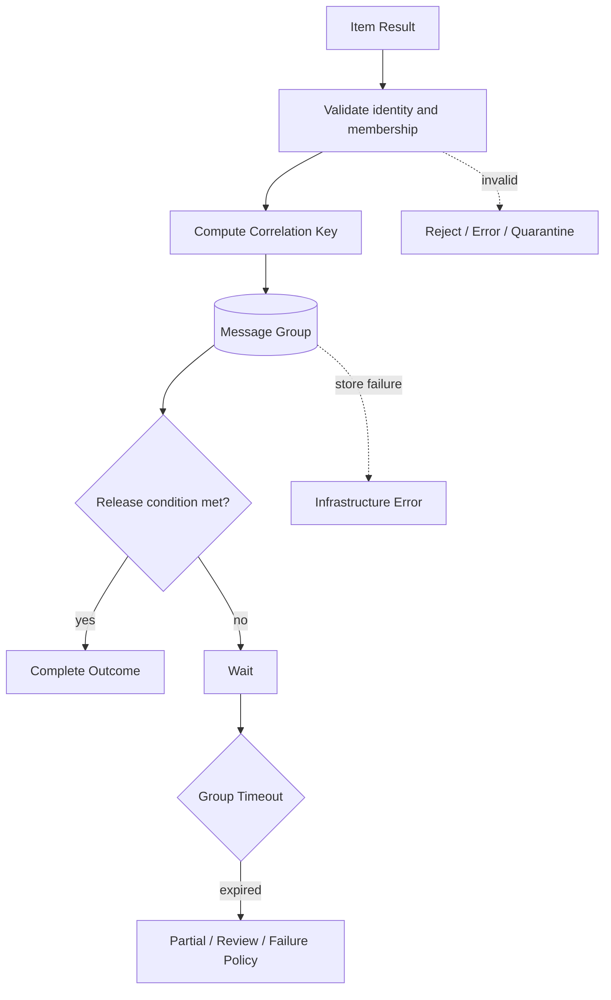
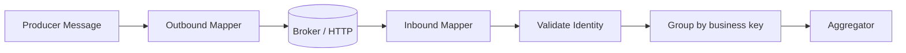
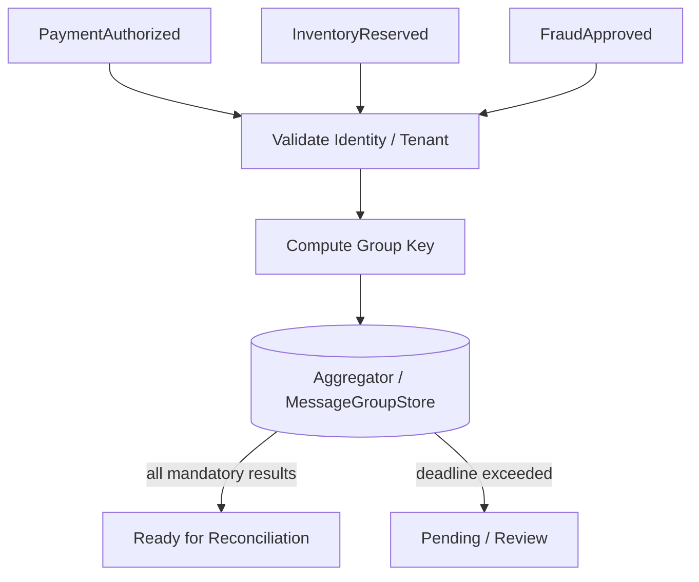

# Correlation Key by Payload or Header

In **Enterprise Integration Patterns (EIP)**, a *Correlation Identifier* links messages that belong to the same conversation or unit of work. **Content-Based Correlation** goes a step further: the system **determines the correlation key from business content** rather than relying solely on pre-populated metadata.

For example, an order with three lines is split by a Splitter, processed in parallel, and gathered by an Aggregator. The three replies can arrive out of order with three different `MessageHeaders.ID` values, yet they must still belong to the **same group**. We can derive the key from `tenantId`, `batchId`, and `generationId` on the payload; or read a **correlation header** produced by a trusted upstream component from those exact fields.

Both approaches can yield the same result if the contract is well managed. However, they carry different risks: payloads can be altered by Transformers; headers can be dropped by adapters, overwritten, or spoofed by clients. A wrong correlation key can **merge data from two tenants**, create groups that never release, emit duplicate outcomes, or stall the Aggregator until timeout.

The lesson **“Correlation Key by Payload or Header”** belongs to the **Content-based correlation** chapter of the **SPRING_INTEGRATION_PATTERN** module. In this module, we learn to implement Enterprise Integration Patterns with Spring Integration to build loosely coupled, extensible message flows—practicing Router, Filter, Transformer, Splitter, Aggregator, Gateway, retry, error channel, and correlation, along with testing and observing processing branches.

**Objectives:** learn how to design group identity, choose between payload-based and header-based keys, implement `correlationStrategy` in Spring Integration Java DSL, prevent spoofing and group mixing, manage keys across transports and retries, and write integration tests for interleaved groups.

## 1. What Question Does a Correlation Key Answer?

Consider a batch `B-101` consisting of three inventory check requests. Workers return results in the order `item-3`, `item-1`, `item-2`. The Aggregator must recognize that they all belong to the same batch.



**Correlation strategy** is the function mapping a message to a **group key**:

\[
K : Message \rightarrow GroupId
\]

Two messages with the same `K(message)` are typically placed into the same **message group** within the corresponding Aggregator/Resequencer and `MessageGroupStore`. Therefore, if the key is too broad, two distinct transactions get merged; if the key is too narrow or changes per send, parts of the same transaction get fragmented into multiple groups.

A sound key must satisfy at least three properties:

1. **Consistent:** all messages of the same unit to be gathered produce the same key.
2. **Distinct:** two units of work that must not be gathered together produce different keys.
3. **Stable over the group lifecycle:** retries, Transformers, broker redeliveries, or restarts do not alter the key.

Correlation does not by itself answer **when a group is complete**, **emission ordering**, or **whether side effects have committed**. Those responsibilities belong to the release strategy, Resequencer, downstream transactions, and idempotency.

## 2. How Content-Based Correlation Differs from a Pre-Existing Correlation ID

A system may use a `correlationId` header supplied upstream. However, when that header is absent or untrusted, a component can **compute the correlation key from the payload**.

```text
Message A payload:
  tenantId     = tenant-a
  batchId      = B-101
  generationId = run-1
  itemId       = item-1

Message B payload:
  tenantId     = tenant-a
  batchId      = B-101
  generationId = run-1
  itemId       = item-2

Derived correlation key for both:
  (tenant-a, B-101, run-1)
```

Note: `itemId` **is not part of the group key** because different items must enter the same group. Yet `itemId` is still required for deduplication and tracking which elements have arrived.

With **content-based correlation**, key extraction can be performed:

- **Directly:** `correlationStrategy` reads `tenantId`, `batchId`, `generationId` from the payload.
- **Indirectly:** an ingress step reads and validates the payload, creates a `businessGroupKey` header, and the Aggregator reads that header.
- **Combined:** the strategy reads the header and cross-checks it against the trusted payload/manifest to prevent drift.

The second approach **can still originate from content**, though once locked in at the boundary, the header acts as coordination metadata. This is convenient when later Transformers reshape the payload while needing to preserve the group key.

## 3. IDs Commonly Confused with a Correlation Key

| Value | What Is It For? | Always Suitable as a Group Key? |
| --- | --- | --- |
| Spring `MessageHeaders.ID` | Identifies a specific message in the framework | **No**: each part gets its own ID, which can change across transforms |
| `businessEventId` | Idempotency and auditing of one event | No if each item/result has its own event ID |
| `itemId` / `lineId` | Identifies an element within a batch | No, because it splits each item into its own group |
| `orderId` | Identifies an order | Only when there are no overlapping processing runs/groups |
| `batchId` | Identifies a batch | Conditionally: must have sufficient uniqueness scope |
| `tenantId` | Tenant isolation | Insufficient; lumps all batches of a tenant into one |
| `generationId` / `runId` | Distinguishes valid execution runs | Usually required when the same batch can be rerun |
| `correlationId` header | Group coordination key per contract | Suitable when reliably generated and preserved |
| `traceId` | Links observability traces/spans | Not by default; one trace may contain multiple groups |
| Kafka partition key | Transport partitioning/ordering | Not automatically synonymous with business group identity |

**A single business request can emit many events**, and a single trace can span multiple batches. Picking a field merely because its name contains “ID” is a frequent cause of hard-to-reproduce misgrouping bugs.

### Example: Using an Overly Broad Order ID

```text
tenant-a / order-42 / run-1 / result-item-1
tenant-a / order-42 / run-2 / result-item-1
```

If the group key is `order-42`, messages from two runs can mix. If run-1 completed while run-2 is running, the system might reach completion using part of run-1 and part of run-2.

A fuller key could be:

```text
tenant-a / order-42 / run-1
tenant-a / order-42 / run-2
```

Add `runId` only when meaningful: if a retry of the **same run** generates a fresh `runId`, messages that belong together will be split apart.

## 4. Payload Key vs Header Key: Comparison Table

| Criterion | Key from Payload | Key from Header |
| --- | --- | --- |
| Data source | Business fields of the payload | Message metadata supplied by producer/adapter |
| Verifiability | Business fields can be inspected directly | Must know who created the header and whether it was altered |
| After Transformer changes payload | Fields needed to compute the key may be lost | Header can survive if propagation is configured properly |
| Across brokers | Payload/envelope usually has an explicit serialization contract | Depends on header mappers and transport schema |
| Spoofing risk | Client payload may be untrusted | Raw client headers can also be spoofed |
| Drift risk | Schema/mapping changes alter the key | Stale header mismatches new payload |
| Reusability | Any endpoint seeing the business payload can recompute it | Endpoints unaware of the payload can still group |
| Required tests | Source fields, normalization, scope, stability | Header presence/type, provenance, propagation, consistency |

**There is no universal default choice.**

- If the payload carries immutable, easily verified business identity and rarely changes shape before the Aggregator, **computing directly from the payload** is usually simpler.
- If multiple Transformers/adapters reshape payloads while all steps belong to one workflow, a **header locked in at trusted ingress** reduces coupling.
- When a system accepts untrusted inputs, the top priority is **validating/canonicalizing the identity source and authorization boundary**, not choosing payload vs header for convenience.

## 5. Keys Must Cover Tenant, Batch, and Execution Scope

In multi-tenant applications, a key based solely on `batchId` is unsafe if another tenant can generate the same batch ID.



In this example:

- `tenant-a/batch-7/run-1` holds multiple items and forms **one group**.
- `tenant-b/batch-7/run-1` is a **different group**, despite sharing the same batch ID.
- `tenant-a/batch-7/run-2` is a **different group**, because it is a distinct valid run.

**Never add tenant only to logs while still using a bare batch ID in the correlation strategy.** Without tenant in the key, `MessageGroupStore` already mixes the data from the start.

### Which Fields Should Not Be in the Key?

Avoid using values that **change during processing**, such as:

- `status=SUCCESS/FAILED`: different parts have different statuses.
- `attemptNumber` when multiple attempts of the **same item within one generation** must resolve to a single final result.
- `processingTimestamp`: each message has its own timestamp.
- `workerId`: the same batch may traverse multiple workers.
- Framework `messageId`: may be regenerated.

If your logic needs to distinguish worker attempts from batch generations, define two separate fields. Overloading an ambiguous `runId` for both causes correlation to shift accidentally on retries.

## 6. Canonicalize the Key Before Use

Whether these representations **mean the same thing** depends on the business contract:

```text
"tenant-A"  vs "tenant-a"
" B-101 "  vs "B-101"
"00123"    vs "123"
"é"        vs "e" + combining accent
```

Depending on the system, you may trim, normalize Unicode, fold case, or **keep exact casing**. Do not blindly apply `toLowerCase()` to tenant IDs if IDs are case-sensitive. For codes with leading zeros, converting to integers can cause two distinct values to collide.

Define explicitly:

1. **Allowed format** and maximum length for each component.
2. **Canonical representation** applied identically on every instance.
3. **Origin**: tenant extracted from security context, batch/generation from trusted sources.
4. **Key rule version** if the format must change while groups are still open.
5. **Collision-free composition** of components.

### Avoid Ambiguous String Concatenation

If you use:

```text
tenantId + ":" + batchId
```

then the pairs `("a:b", "c")` and `("a", "b:c")` yield the exact same string `"a:b:c"`. Instead, use:

- A **record/value object** as the key where the store supports typed keys.
- An **unambiguous encoding** (such as length-prefixed components).
- A **server-issued unique `groupId`** backed by a durable tenant/batch mapping.

The code examples in this lesson restrict components to `[A-Za-z0-9_-]` with `|` forbidden inside parts so string keys cannot collide via delimiters. Production must align with actual ID rules; never silently “repair” invalid data into a different key without recording it.

## 7. Example Data for Content-Based Correlation

Suppose three workers produce results for the same batch.

```java
import java.time.Instant;

record ItemResult(
    String tenantId,
    String batchId,
    String generationId,
    String itemId,
    int expectedCount,
    String status,
    Instant finishedAt
) {
    ItemResult {
        if (expectedCount <= 0 || expectedCount > 10_000
                || status == null
                || status.isBlank()
                || finishedAt == null) {
            throw new IllegalArgumentException(
                "Invalid item result");
        }
    }
}

record BatchSummary(
    String tenantId,
    String batchId,
    String generationId,
    int expectedCount,
    int receivedUniqueCount,
    String status,
    java.util.List<ItemResult> items
) {}
```

`expectedCount` represents the **expected number of item results** in the group. It must come from the batch manifest or a trusted Splitter step. A client-submitted payload alone is not a trusted source for `expectedCount`.

Illustrative statuses: `SUCCESS`, `FAILED`, `SKIPPED`. A `FAILED` item **is still a received reply**, so the release strategy can count it toward the group when the goal is waiting for all items' outcomes rather than only successful ones.

### Example of Two Messages in the Same Group

```json
{
  "tenantId": "tenant-a",
  "batchId": "B-101",
  "generationId": "run-1",
  "itemId": "item-1",
  "expectedCount": 3,
  "status": "SUCCESS"
}
```

```json
{
  "tenantId": "tenant-a",
  "batchId": "B-101",
  "generationId": "run-1",
  "itemId": "item-2",
  "expectedCount": 3,
  "status": "FAILED"
}
```

The two results are grouped together despite differing in status and item ID, because **tenant, batch, and generation** match.

## 8. Building the Group Key from Payload

For illustration, use a string group key whose components allow only alphanumeric characters, `_`, or `-`. Validation rejects delimiters, nulls, or overly long values.

```java
import java.util.regex.Pattern;

final class BusinessGroupKey {

    static final String HEADER = "businessGroupKey";

    private static final Pattern PART =
        Pattern.compile("[A-Za-z0-9_-]{1,64}");

    static String fromPayload(ItemResult item) {
        if (item == null) {
            throw new IllegalArgumentException(
                "Missing item payload");
        }

        String tenant = check(item.tenantId(), "tenantId");
        String batch = check(item.batchId(), "batchId");
        String generation =
            check(item.generationId(), "generationId");

        // No '|' character in any component.
        return tenant + "|" + batch + "|" + generation;
    }

    private static String check(String value, String field) {
        if (value == null
                || !PART.matcher(value).matches()) {
            throw new IllegalArgumentException(
                "Invalid correlation field: " + field);
        }
        return value;
    }

    private BusinessGroupKey() {}
}
```

Example:

```text
fromPayload(ItemResult("tenant-a","B-101","run-1",...))
  -> "tenant-a|B-101|run-1"
```

The code does not generate `generationId` from a timestamp. **A trusted source must decide which generation belongs to the same group**; if each worker invents a generation ID, messages fragment into separate groups.

### Why Not Hash the Entire Payload?

You can hash a canonicalized **identity tuple** to produce a fixed-size key, but **hashing the entire payload** is wrong for correlation in most cases: items have different payloads and thus different hashes; retries can change timestamps and alter the hash; serialization differences can destabilize the key.

If store keys need privacy protection, you can apply HMAC with a server secret over the canonical tuple per your threat model. Still, HMAC does not replace identifying **which exact fields define the business group**.

## 9. Reading the Key from an Existing Header

An upstream step can attach the `businessGroupKey` header when messages pass through trusted ingress. Then the Aggregator does not need to understand the full payload.

```java
import org.springframework.messaging.Message;

final class HeaderGroupKeyStrategy {

    String key(Message<?> message) {
        Object header = message.getHeaders()
            .get(BusinessGroupKey.HEADER);

        if (!(header instanceof String key)
                || key.isBlank()) {
            throw new IllegalArgumentException(
                "Missing trusted businessGroupKey");
        }

        return key;
    }
}
```

This **header-only** version is best suited when the entire path before the Aggregator is controlled. If messages from clients/brokers can set arbitrary headers, this strategy is **not safe enough**.

### Cross-Checking Header Against Payload

When the payload still carries the same business identity, you can use a stronger strategy:

```java
import org.springframework.messaging.Message;

final class VerifiedHeaderGroupKeyStrategy {

    String key(Message<?> message) {
        if (!(message.getPayload() instanceof ItemResult item)) {
            throw new IllegalArgumentException(
                "Unexpected payload type");
        }

        String expected = BusinessGroupKey.fromPayload(item);
        Object actual = message.getHeaders()
            .get(BusinessGroupKey.HEADER);

        if (!(actual instanceof String headerKey)
                || !expected.equals(headerKey)) {
            throw new IllegalArgumentException(
                "Header and payload correlation mismatch");
        }

        return expected;
    }
}
```

This cross-check detects lost headers or headers that contradict the payload. **It does not prove both payload and header are trustworthy**: if an attacker can tamper with both, they will still match. You still need tenant/ownership, membership, and origin authentication at another trust boundary.

## 10. Creating the Correlation Header Once at Trusted Ingress

A straightforward approach is creating a Spring Message from a validated payload:

```java
import org.springframework.messaging.Message;
import org.springframework.messaging.support.MessageBuilder;

final class TrustedCorrelationMessageFactory {

    Message<ItemResult> wrap(ItemResult item) {
        String groupKey =
            BusinessGroupKey.fromPayload(item);

        return MessageBuilder.withPayload(item)
            .setHeader(BusinessGroupKey.HEADER, groupKey)
            .setHeader("businessEventId",
                item.itemId() + "@" + item.generationId())
            .build();
    }
}
```

This is an **illustrative factory**. In production:

- `tenantId` must be verified from an authoritative source, not merely taken from the payload field.
- `itemId + generationId` is only an example of event identity; in practice use a **unique event ID** issued by the source that stays stable across retries.
- If Splitter headers like `correlationId`/`sequenceNumber` are required, define them separately rather than assuming the factory adds everything.
- Across Transformers, verify whether headers are forwarded, altered, or dropped.

### Standard Spring Integration Headers

Patterns such as Splitter/Aggregator commonly use standard headers—including `correlationId`, `sequenceNumber`, and `sequenceSize`—with constants defined in `IntegrationMessageHeaderAccessor`. These are **coordination metadata**, not proof that an actor is authorized to access a group.

With an internal group-key convention, an application header like `businessGroupKey` helps **decouple business identity from correlation metadata that the framework or other EIP components may overwrite**.

Do not overwrite the standard `correlationId` header of an active Scatter-Gather if it belongs to **a different coordination scope**. When nesting Splitters/Aggregators, distinguish the outer group from the inner group.

## 11. Spring Integration Java DSL: Grouping by Payload

The following example uses an Aggregator receiving `ItemResult` messages emitted by workers. It groups by `BusinessGroupKey.fromPayload` and emits a `BatchSummary` when the count of **unique items** reaches `expectedCount`.

### 11.1. Output Processor and Release Strategy

```java
import java.util.ArrayList;
import java.util.LinkedHashMap;
import java.util.List;
import java.util.Map;
import org.springframework.integration.store.MessageGroup;
import org.springframework.messaging.Message;

final class BatchGroupProcessor {

    static boolean complete(MessageGroup group) {
        List<ItemResult> items = items(group);
        if (items.isEmpty()) {
            return false;
        }

        int expected = validatedExpectedCount(items);
        return unique(items).size() == expected;
    }

    BatchSummary summarize(MessageGroup group) {
        List<ItemResult> items = items(group);
        if (items.isEmpty()) {
            throw new IllegalStateException("Empty group");
        }

        int expected = validatedExpectedCount(items);
        Map<String, ItemResult> unique = unique(items);
        List<ItemResult> results =
            new ArrayList<>(unique.values());

        results.sort(java.util.Comparator.comparing(
            ItemResult::itemId));

        ItemResult first = items.get(0);
        boolean complete = results.size() == expected;
        boolean failed = results.stream()
            .anyMatch(item ->
                !"SUCCESS".equals(item.status()));

        String status = !complete
            ? "PARTIAL_TIMEOUT"
            : failed ? "COMPLETE_WITH_FAILURES" : "COMPLETE";

        return new BatchSummary(
            first.tenantId(),
            first.batchId(),
            first.generationId(),
            expected,
            results.size(),
            status,
            List.copyOf(results)
        );
    }

    private static List<ItemResult> items(MessageGroup group) {
        return group.getMessages().stream()
            .map(Message::getPayload)
            .map(value -> (ItemResult) value)
            .toList();
    }

    private static int validatedExpectedCount(
            List<ItemResult> items) {
        ItemResult first = items.get(0);
        int count = first.expectedCount();
        String groupKey =
            BusinessGroupKey.fromPayload(first);

        if (count <= 0 || items.stream().anyMatch(item ->
                item.expectedCount() != count
                || !groupKey.equals(
                    BusinessGroupKey.fromPayload(item)))) {
            throw new IllegalArgumentException(
                "Inconsistent message group contract");
        }

        return count;
    }

    private static Map<String, ItemResult> unique(
            List<ItemResult> items) {
        Map<String, ItemResult> results =
            new LinkedHashMap<>();

        for (ItemResult item : items) {
            if (item.itemId() == null
                    || item.itemId().isBlank()) {
                throw new IllegalArgumentException(
                    "Missing itemId");
            }

            ItemResult previous =
                results.putIfAbsent(item.itemId(), item);

            if (previous != null
                    && !previous.equals(item)) {
                throw new IllegalStateException(
                    "Conflicting duplicate itemId");
            }
        }

        return results;
    }
}
```

The example selects **unique item IDs** rather than relying solely on `group.size()`, because an item can be redelivered by the broker. Two results with the same item ID but different contents are treated as a **conflict requiring a policy**, never picked at random.

Limitations:

- If an input carries an item ID absent from the batch manifest yet still reaches `expectedCount`, this example does not catch it; cross-check against a trusted manifest.
- If the same item has two valid attempts with different outcomes, define a version/attempt policy rather than relying solely on object equality.
- `PARTIAL_TIMEOUT` in the processor is a simplification assuming the processor is invoked only on group completion or expiry. If manual release exists, require an explicit **release reason**.
- If `ItemResult` has differing timestamps across retries, two business-equivalent results may fail `equals`; idempotency needs a semantic key/version, not just full-object equality.

### 11.2. Aggregator Flow Deriving the Correlation Key from Payload

```java
import org.springframework.context.annotation.Bean;
import org.springframework.context.annotation.Configuration;
import org.springframework.integration.channel.DirectChannel;
import org.springframework.integration.channel.QueueChannel;
import org.springframework.integration.config.EnableIntegration;
import org.springframework.integration.dsl.IntegrationFlow;
import org.springframework.messaging.MessageChannel;
import org.springframework.messaging.PollableChannel;

@Configuration
@EnableIntegration
class PayloadCorrelationConfiguration {

    @Bean("items.payload.in")
    MessageChannel inputItems() {
        return new DirectChannel();
    }

    @Bean("items.payload.out")
    PollableChannel outcomes() {
        // Only used as an observable output in tests.
        return new QueueChannel();
    }

    @Bean
    BatchGroupProcessor batchGroupProcessor() {
        return new BatchGroupProcessor();
    }

    @Bean
    IntegrationFlow aggregateByPayload(
            BatchGroupProcessor processor) {
        return IntegrationFlow.from("items.payload.in")
            .aggregate(spec -> spec
                .correlationStrategy(message ->
                    BusinessGroupKey.fromPayload(
                        (ItemResult) message.getPayload()))
                .releaseStrategy(BatchGroupProcessor::complete)
                .outputProcessor(processor::summarize)
                .groupTimeout(10_000L)
                .sendPartialResultOnExpiry(true))
            .channel("items.payload.out")
            .get();
    }
}
```

How to read this flow:

1. `items.payload.in` receives messages with an `ItemResult` payload.
2. `correlationStrategy` reads the **payload**, not `MessageHeaders.ID` or an unrelated header.
3. Messages sharing tenant/batch/generation are placed in the same group.
4. `releaseStrategy` checks the count of **unique item IDs** against `expectedCount`.
5. Once complete, `outputProcessor` emits a `BatchSummary`.
6. `groupTimeout` and `sendPartialResultOnExpiry(true)` demonstrate an expiry policy for incomplete groups; they are **not mandatory** for payload-based correlation.
7. Output is sent to an in-memory `QueueChannel` solely for testing.

**Enable partial results only if the business allows it.** The example sets `PARTIAL_TIMEOUT` to make the state explicit; never treat unresponsive items as failed or completed.

Java DSL APIs should be verified against your actual Spring Integration version. This lesson is at the **STEP 4 authoring** stage and has not executed STEP 6 builds/tests.

## 12. Spring Integration Java DSL: Grouping by Header

If an upstream component already attached `businessGroupKey` per contract, `correlationStrategy` can read/verify the header instead.

### 12.1. Flow with Verified Header

```java
import org.springframework.context.annotation.Bean;
import org.springframework.context.annotation.Configuration;
import org.springframework.integration.channel.DirectChannel;
import org.springframework.integration.channel.QueueChannel;
import org.springframework.integration.config.EnableIntegration;
import org.springframework.integration.dsl.IntegrationFlow;
import org.springframework.messaging.MessageChannel;
import org.springframework.messaging.PollableChannel;

@Configuration
@EnableIntegration
class HeaderCorrelationConfiguration {

    @Bean("items.header.in")
    MessageChannel inputItemsWithHeader() {
        return new DirectChannel();
    }

    @Bean("items.header.out")
    PollableChannel headerOutcomes() {
        return new QueueChannel();
    }

    @Bean
    IntegrationFlow aggregateByVerifiedHeader(
            BatchGroupProcessor processor) {
        VerifiedHeaderGroupKeyStrategy keyStrategy =
            new VerifiedHeaderGroupKeyStrategy();

        return IntegrationFlow.from("items.header.in")
            .aggregate(spec -> spec
                .correlationStrategy(keyStrategy::key)
                .releaseStrategy(BatchGroupProcessor::complete)
                .outputProcessor(processor::summarize)
                .groupTimeout(10_000L)
                .sendPartialResultOnExpiry(true))
            .channel("items.header.out")
            .get();
    }
}
```

**The payload and header flows are two independent implementation options** with distinct inputs and outputs. The example above assumes `BatchGroupProcessor` is registered as a bean in the application context (such as from Section 11's configuration), without registering two competing processor beans.

**Key difference:** in Section 11, each message computes its key directly from the payload; in Section 12, each message must carry the `businessGroupKey` header, and the strategy **verifies** it matches the payload. That catches bugs where a Transformer accidentally keeps an old batch's header instead of silently creating a corrupted group.

### 12.2. When to Read Only the Header Without Reading the Payload?

A service might receive an envelope:

```json
{
  "businessGroupKey": "tenant-a|B-101|run-1",
  "payloadType": "COMPACT_RESULT",
  "payload": {
    "itemId": "item-2",
    "status": "SUCCESS"
  }
}
```

If the payload no longer carries tenant/batch/generation, a header-reading strategy can make sense, **but the receiving boundary must verify the header comes from a trusted source** before accepting it. A JSON field named `businessGroupKey` has no authority on its own. For secure systems, require an authenticated producer, a manifest mapping, or a signed/verified event envelope as dictated by the threat model.

Never strip all identity from the payload and rely on a client-supplied HTTP header when that identity governs authorization or sensitive data grouping.

## 13. Correlation Keys in Splitter and Aggregator

A common processing chain:



Spring Integration's Splitter can attach **correlation/sequence metadata** to split elements, depending on configuration. The Aggregator can use them for grouping and release. However, **if each worker builds a new payload and loses those headers**, a default Aggregator will no longer have enough data to group properly.

There are two approaches:

**Preserve Splitter coordination headers.** When messages stay within the same correlation scope, preserve `correlationId`, `sequenceNumber`, and `sequenceSize` across Transformers and adapters. With a Resequencer in particular, sequence metadata also determines ordering.

**Derive correlation from business content.** When the flow crosses multiple systems or each item has its own schema, use `tenantId + batchId + generationId` as the Aggregator group key and a separate manifest for the expected item count.

The two approaches are not mutually exclusive. You can use a business correlation key for grouping and sequence headers for ordering. What matters is **never mixing the outer group scope with the inner group scope** when Splitters are nested.

### If a Filter Drops an Item After the Splitter

If the Splitter emits N items and a Filter drops one without producing a result, the Aggregator may wait until timeout. Proper correlation **does not conjure up missing elements**.

Consider:

- Filtering before the Splitter when simply excluding obvious entries from the batch.
- Having the discard branch emit `ItemResult(status=SKIPPED)` with the group key/part ID if the business wants a complete result set for the batch.
- Updating the expected manifest in a controlled way if shrinking batch scope is valid.
- Defining timeout/partial/review policies when a branch never replies.

## 14. Correlation Headers Traversing Transformer, Router, and Gateway

Endpoints routinely manipulate both payloads and headers. A Transformer may convert `LegacyItemResult` to `ItemResult`; a Router may dispatch by result type; a Gateway awaits a reply on an internal channel.

### 14.1. Transformer Changes Payload While Correlation Remains Valid

If a transform only converts units or normalizes a payload within the same batch, `businessGroupKey` generally should not change. When a payload gains a new business identity, **recompute or verify** the header rather than leaving a stale header behind.



### 14.2. Router Must Not Group by Unstable Route Names

If a Router picks branches by `status`, items of the same batch may go to different handlers. Afterward, those handlers return results to the original group. Never append the route name to the correlation key if the business expects a single combined outcome.

Conversely, if each route forms an **independent sub-group** with its own Aggregator, the group key may need an added `subWorkflowId`. Decide this at design time—never let routing accidentally dictate group identity.

### 14.3. Gateway replyChannel Differs from Business Correlation Key

`replyChannel` specifies where to deliver a reply in a request–reply exchange; it **does not replace business group identity**. One Gateway can serve many concurrent batches using its own reply routing, while the Aggregator groups by tenant/batch/generation.

Never let an `replyChannel` or `errorChannel` header from an HTTP client control internal routing. Across brokers, internal channel objects are not meant to be arbitrarily serialized either.

## 15. Critical Warning: Trusting Payloads and Headers

**A structured business payload does not automatically mean trustworthy data.** An attacker could send:

```json
{
  "tenantId": "tenant-victim",
  "batchId": "B-101",
  "generationId": "run-1",
  "itemId": "item-fake",
  "expectedCount": 1,
  "status": "SUCCESS"
}
```

If the system blindly uses that payload to create and release a group, the attacker can forge a false summary or pollute a legitimate group.

Likewise, an attacker can set:

```text
businessGroupKey: tenant-victim|B-101|run-1
```

in an HTTP request or broker header they control. Reading a header does not make it any safer.

### What Must the Trust Boundary Do?

1. **Authenticate producer/actor**: who is the caller and which result types may they emit?
2. **Authorize tenant/workflow**: tenant ID comes from trusted principal/claims/mappings, never self-declared input.
3. **Validate correlation fields**: format, canonicalization, ID range, generation.
4. **Validate membership**: does the item ID belong to the created batch manifest?
5. **Validate expected count**: never trust an arbitrary `expectedCount` that could trigger early release.
6. **Validate result provenance**: which worker/service is authorized to report status for this item?
7. **Build trusted headers**: if using headers, construct them from verified identity rather than copying raw client headers.
8. **Bound resources**: cap open groups, messages, group age, and payload size.

In multi-tenant systems, a correlation bug can become a **data leak**, not merely a “misgrouped message bug.” Do not rely solely on warning logs after groups have already been merged.

## 16. What Happens When a Correlation Key Is Wrong?

| Mistake | Example | Consequence |
| --- | --- | --- |
| **Collision** between two groups | Using only `batchId=B-101` for two tenants | Cross-tenant data mixing |
| **Fragmentation** of one group | Each worker generates a new `generationId` | Incomplete groups that time out |
| **Inconsistent normalization** | One node trims, another keeps whitespace | Same batch splits into two keys |
| **Lost header** | Adapter drops `businessGroupKey` | Messages fail to group, error/reject |
| **Stale header** | Transformer changes batch without updating key | Results land in the wrong group |
| **Spoofed expected count** | First message claims count=1 | Premature release |
| **Timestamp/attempt in key** | Retries alter the key | Fragmentation, loss of idempotency |
| **Overly broad key** | Using `tenantId` alone | All batches of a tenant merge together |
| **Overly narrow key** | Adding `itemId` | Every item becomes its own group |
| **Unbounded cardinality** | Every message uses a new random UUID | Store fills up with single-item groups |
| **No terminal state** | Late message arrives after cleanup | Old group reopens uncontrollably |

A very useful observability rule: if group timeout rates spike right after adding a correlation strategy, check **whether the group key is consistent** before increasing timeouts.

## 17. Duplicates and Late Arrivals Are Not Solved by the Key Alone

Two messages sharing a group key **are not guaranteed to be two different items**. Broker redelivery can deliver the same `item-2` multiple times.

```text
Group key = tenant-a|B-101|run-1
Expected unique items = 3

Arrivals:
  item-1
  item-2
  item-2 (duplicate)

Raw group size = 3
Unique item IDs = 2
Still missing = item-3
```

If `releaseStrategy` only checks `group.size() == expectedCount`, it can release prematurely. You need **per-member identity**, membership-aware release, and deduplication at ingress/output.

### Messages Arriving Late After Group Closure

Suppose a group emitted `PARTIAL_TIMEOUT` after receiving only two items, and then `item-3` arrives:

- If `MessageGroupStore` already deleted the group, the late message can open a **new group with the same key**.
- If the group already completed, duplicates can still arrive under at-least-once delivery.
- If the business permits corrections, use `outcomeVersion`/generation and idempotent upserts.
- If corrections are not permitted, use a terminal-state/tombstone record or pre-Aggregator check to discard/quarantine late messages with auditing.

Never assume `expireGroupsUponCompletion` or `groupTimeout` catches every late message. **Group lifecycle and business outcome lifecycle are two separate state layers.**

## 18. Retries, Error Channel, and Group Timeout

A correlation key must remain **stable across valid retries**. Still, a group may fail to complete due to worker errors, Filter discards, or lost messages.



**Distinguish clearly:**

- **Correlation error:** missing ID, malformed key, header/payload mismatch, wrong tenant.
- **Business rejection:** an item discarded by a Filter per business rules.
- **Infrastructure error:** `MessageGroupStore` timeout, queue unavailable.
- **Missing response:** an item still has no result at the deadline.
- **Unknown outcome:** side effects may have occurred, yet the reply was lost.

Do not label all of these `INVALID_CORRELATION_ID`. Each cause requires a different retry/recovery path.

### Does the Error Channel Automatically Catch All Errors?

No. In Spring Integration, failures on a `DirectChannel` can propagate synchronously to the sender; failures in a poller/executor/inbound adapter may be caught and published as `ErrorMessage` depending on configuration. **Having an `errorChannel` bean does not automatically send every exception there.**

When a correlation strategy throws on a bad header, never silently fall back to a constant key like `"unknown"`. Doing so dumps **all broken messages** into one dangerous super-group. Reject/quarantine and record a structured reason per policy.

## 19. Correlation Across Kafka, HTTP, AMQP, or JMS

Inside one JVM, a Spring Message carries payload and headers. Across other transports, metadata is mapped/serialized according to transport rules.



**Never assume the `businessGroupKey` header survives transport intact.** When the key is essential to business logic, define an explicit wire-format contract:

```json
{
  "eventId": "evt-101-2",
  "tenantId": "tenant-a",
  "batchId": "B-101",
  "generationId": "run-1",
  "itemId": "item-2",
  "expectedCount": 3,
  "status": "SUCCESS"
}
```

The consumer can **recompute the key from the verified payload/envelope**. Or the producer emits a group-key header preserved by the mapper and the consumer cross-checks it against the envelope.

Kafka **preserves ordering within a partition** under Kafka's model; it does not create business correlation groups across partitions or handle group timeouts. Partitioning by business key helps locality/ordering, but **a Kafka partition key does not replace an Aggregator release strategy or tenant authorization**.

### When to Put the Key in the Payload vs the Header?

- If the key must survive stably across multiple systems, a **schema-governed envelope/payload** is easier to test.
- If the key is strictly internal to one flow, a header can be convenient.
- If both exist, define one source of truth and **assert they match**.
- Never put secrets inside the key and send it as an exposed header. A key is group-identifying metadata, **not an access token**.

## 20. Stability Across Schema Changes and Version Policies

A subtle bug is **changing the group-key formula while groups are still open**.

Example:

```text
Old key policy:
  groupKey = tenantId + "|" + batchId

New key policy:
  groupKey = tenantId + "|" + batchId + "|" + generationId
```

During a rolling deploy, some instances compute the old key while others compute the new key, splitting one batch into two groups.

Safer rollout practices:

1. **Version the key policy** and wire contract when needed.
2. Switch only after confirming old groups have completed, or maintain an explicit migration/dual-read strategy.
3. Never let two instances running incompatible rules process the same shared store concurrently.
4. Run compatibility tests between old and new versions/schemas.
5. If historical interpretation is needed, store the version alongside group/outcome audits.
6. Never infer generation from the current timestamp when replaying old events.

**A well-formatted key with mismatched semantics is still a correlation bug.** Canonicalization and policy versions are part of the data contract.

## 21. MessageGroupStore, Concurrency, and Recoverability

Aggregator/Resequencer are stateful components. `MessageGroupStore` stores messages by group key along with related metadata.

| Option | Benefits | Limitations |
| --- | --- | --- |
| In-memory store | Simple, fast for tests | Groups are lost on process restart |
| Persistent `MessageGroupStore` | Survives restarts | Requires transactions/locking/reaper/recovery |
| Multi-instance shared store | Multiple nodes share groups | Lock contention, ownership, and throughput limits |
| Event log + rebuild | Reconstructable when replay log exists | Complexity around idempotency, generations, and checkpoints |

**No good group key makes an in-memory store durable.** If waiting messages sit in RAM and the app restarts, they can be lost. Even with a persistent store, if output publishing fails after release, results may be dropped or re-sent; you need output idempotency/outbox/ack policies.

### Impact of High-Cardinality Keys

If an attacker or a bug emits every message with a new `generationId`, the Aggregator creates huge numbers of single-item groups. You need:

- Key/manifest validation before storing.
- Caps on open group count, group age, and group size.
- Timeouts/cleanup and ingress quotas.
- Metrics on group cardinality and timeout ratios.
- Never using unbounded tokens or entire payloads as group keys.
- Auditing invalid identities without logging sensitive data.

## 22. Observability: Seeing Which Group Is Waiting for What

Correlation bugs often throw no exceptions. Messages still reach the channel, yet **each item enters a different group** and all of them time out. Therefore monitor:

| Signal | Meaning |
| --- | --- |
| `group_opened` | Group key created and under which policy |
| `group_item_received` | Which message entered the group |
| `group_item_duplicate` | An item ID was already present |
| `group_membership_mismatch` | Item does not belong to the manifest |
| `group_released` | Complete/partial release and reason |
| `group_timed_out` | Which items were missing and how long the group waited |
| `group_late_arrival` | Message arrived after terminal outcome |
| `correlation_key_mismatch` | Header did not match business identity |
| `group_store_error` | Infrastructure failure rather than invalid key |

Suggested log entry:

```json
{
  "event": "aggregation_group_released",
  "flow": "order-items",
  "tenantScope": "tenant-a",
  "batchId": "B-101",
  "generationId": "run-1",
  "correlationPolicy": "tenant-batch-generation-v1",
  "expectedCount": 3,
  "receivedUniqueCount": 3,
  "releaseReason": "COMPLETE",
  "outcome": "COMPLETE_WITH_FAILURES"
}
```

This is a **recommended logging schema**, not emitted automatically by Spring Integration. Never log entire sensitive payloads just to verify key calculation.

### Bounded-Label Metrics

```text
correlation_messages_total{flow="order-items",result="accepted"}
correlation_messages_total{flow="order-items",result="invalid"}
correlation_key_mismatch_total{flow="order-items"}
correlation_groups_open{flow="order-items"}
correlation_group_releases_total{flow="order-items",reason="complete"}
correlation_group_timeouts_total{flow="order-items"}
correlation_duplicate_items_total{flow="order-items"}
correlation_late_messages_total{flow="order-items"}
```

These are illustrative application-instrumented metrics. **Never put `batchId`, `generationId`, `eventId`, or full group keys into metric labels** due to high cardinality. Keep them in access-controlled logs/traces/audits.

## 23. Testing Key Builders and Header Strategies

Tests must prove keys **match when they should** and **differ when they should**.

### 23.1. Unit Test for Payload-Based Keys

```java
import static org.junit.jupiter.api.Assertions.*;
import java.time.Instant;
import org.junit.jupiter.api.Test;

class BusinessGroupKeyTest {

    private ItemResult item(
            String tenant, String batch,
            String generation, String itemId) {
        return new ItemResult(
            tenant, batch, generation, itemId,
            3, "SUCCESS", Instant.now());
    }

    @Test
    void differentItemsOfOneBatchShareGroupKey() {
        String first = BusinessGroupKey.fromPayload(
            item("tenant-a", "B-101", "run-1", "item-1"));

        String second = BusinessGroupKey.fromPayload(
            item("tenant-a", "B-101", "run-1", "item-2"));

        assertEquals(first, second);
    }

    @Test
    void tenantAndGenerationSeparateGroups() {
        String base = BusinessGroupKey.fromPayload(
            item("tenant-a", "B-101", "run-1", "item-1"));

        String otherTenant = BusinessGroupKey.fromPayload(
            item("tenant-b", "B-101", "run-1", "item-1"));

        String otherRun = BusinessGroupKey.fromPayload(
            item("tenant-a", "B-101", "run-2", "item-1"));

        assertNotEquals(base, otherTenant);
        assertNotEquals(base, otherRun);
    }

    @Test
    void rejectsInvalidKeyPart() {
        assertThrows(IllegalArgumentException.class,
            () -> BusinessGroupKey.fromPayload(
                item("tenant|injected", "B-101",
                    "run-1", "item-1")));
    }
}
```

This unit test checks `BusinessGroupKey` logic, **not whether messages are actually grouped properly by the Aggregator**, since channels, `MessageGroupStore`, release strategies, and timeouts are also involved.

### 23.2. Unit Test for Matching and Mismatched Headers

```java
import static org.junit.jupiter.api.Assertions.*;
import java.time.Instant;
import org.junit.jupiter.api.Test;
import org.springframework.messaging.Message;
import org.springframework.messaging.support.MessageBuilder;

class VerifiedHeaderGroupKeyStrategyTest {

    private final VerifiedHeaderGroupKeyStrategy strategy =
        new VerifiedHeaderGroupKeyStrategy();

    @Test
    void acceptsTrustedMatchingHeader() {
        ItemResult item = new ItemResult(
            "tenant-a", "B-101", "run-1",
            "item-1", 3, "SUCCESS", Instant.now());

        Message<ItemResult> message =
            new TrustedCorrelationMessageFactory().wrap(item);

        assertEquals("tenant-a|B-101|run-1",
            strategy.key(message));
    }

    @Test
    void rejectsHeaderOfAnotherTenant() {
        ItemResult item = new ItemResult(
            "tenant-a", "B-101", "run-1",
            "item-1", 3, "SUCCESS", Instant.now());

        Message<ItemResult> forged =
            MessageBuilder.withPayload(item)
                .setHeader(BusinessGroupKey.HEADER,
                    "tenant-b|B-101|run-1")
                .build();

        assertThrows(IllegalArgumentException.class,
            () -> strategy.key(forged));
    }

    @Test
    void rejectsMissingHeader() {
        ItemResult item = new ItemResult(
            "tenant-a", "B-101", "run-1",
            "item-1", 3, "SUCCESS", Instant.now());

        assertThrows(IllegalArgumentException.class,
            () -> strategy.key(
                MessageBuilder.withPayload(item).build()));
    }
}
```

These tests verify header-payload consistency. **They do not verify producer authentication**, so integration tests with real ingress and authorization checks are still required.

## 24. Integration Test: Two Interleaved Groups Do Not Mix

Using `PayloadCorrelationConfiguration` from Section 11, send two interleaved batches into the same input channel:

```text
arrival:
  tenant-a / B-101 / run-1 / item-2
  tenant-b / B-101 / run-1 / item-1
  tenant-a / B-101 / run-1 / item-1
  tenant-b / B-101 / run-1 / item-2
  tenant-a / B-101 / run-1 / item-3
  tenant-b / B-101 / run-1 / item-3

expected outcomes:
  Group tenant-a -> one BatchSummary with 3 unique items
  Group tenant-b -> one BatchSummary with 3 unique items
```

### Sketch of a Spring/JUnit Integration Test

```java
import static org.junit.jupiter.api.Assertions.*;
import java.time.Instant;
import org.junit.jupiter.api.Test;
import org.springframework.beans.factory.annotation.Autowired;
import org.springframework.beans.factory.annotation.Qualifier;
import org.springframework.boot.test.context.SpringBootTest;
import org.springframework.messaging.Message;
import org.springframework.messaging.MessageChannel;
import org.springframework.messaging.PollableChannel;
import org.springframework.messaging.support.MessageBuilder;

@SpringBootTest
class PayloadCorrelationIntegrationTest {

    @Autowired
    @Qualifier("items.payload.in")
    MessageChannel input;

    @Autowired
    @Qualifier("items.payload.out")
    PollableChannel output;

    void send(String tenant, String itemId) {
        ItemResult result = new ItemResult(
            tenant, "B-101", "run-1",
            itemId, 3, "SUCCESS", Instant.now());

        input.send(MessageBuilder.withPayload(result).build());
    }

    @Test
    void isolatesBatchesOfDifferentTenants() {
        send("tenant-a", "item-2");
        send("tenant-b", "item-1");
        send("tenant-a", "item-1");
        send("tenant-b", "item-2");

        // Neither group has 3 unique items yet.
        assertNull(output.receive(100));

        send("tenant-a", "item-3");
        Message<?> first = output.receive(1_000);
        assertNotNull(first);

        BatchSummary a = (BatchSummary) first.getPayload();
        assertEquals("tenant-a", a.tenantId());
        assertEquals(3, a.receivedUniqueCount());

        send("tenant-b", "item-3");
        Message<?> second = output.receive(1_000);
        assertNotNull(second);

        BatchSummary b = (BatchSummary) second.getPayload();
        assertEquals("tenant-b", b.tenantId());
        assertEquals(3, b.receivedUniqueCount());
        assertNull(output.receive(50));
    }
}
```

This is an **integration test sketch requiring a Spring Boot/test context**, configuration beans, and isolated group store/queues between tests. It does not yet cover persistent stores, restarts, multi-instance locking, or broker header mapping.

### Other Crucial Tests

- **Same tenant, different generation:** two groups never mix.
- **Same group, item retry:** does not release merely from extra duplicate raw messages.
- **Wrong-tenant header:** ingress rejects before reaching the Aggregator.
- **Header lost after Transformer:** header strategy detects missing/mismatched headers.
- **Payload schema change:** group key still computes accurately per contract version.
- **Messages crossing a broker:** outbound/inbound mapping preserves or recovers the required key.
- **Group timeout:** never emits a fake `COMPLETE` when items are missing.
- **Messages arriving after timeout:** enforces terminal-state/late-correction policy properly.
- **Store failure:** never assumes business completion occurred.
- **Multiple instances on the same group:** verify locking/idempotent output.
- **Client claiming `expectedCount=1`:** never releases prematurely when the real manifest expects 3.

Never test only `String.equals` on two keys and conclude the system-wide correlation problem is solved.

## 25. Exercise: Payment Reconciliation Using Payload or Header Keys

A reconciliation service receives three signals per transaction:

- `PaymentAuthorized` from the payment gateway.
- `InventoryReserved` from the warehouse.
- `FraudApproved` from the fraud system.

Each signal carries `tenantId`, `orderId`, `paymentAttemptId`, and `eventId`. Messages arrive over a broker and may arrive out of order, duplicated, or late.



**Requirements:**

1. Never merge messages from two different tenants.
2. Two payment attempts for the same `orderId` with different `paymentAttemptId`s must go to separate groups.
3. Distinct `eventId`s for the three branches must not split them into three groups.
4. A redelivered message from Kafka must not count as a fourth result.
5. Never announce a payment as succeeded when `FraudApproved` is missing.
6. If transformed into a new schema, the group-key header must be preserved or recomputed accurately.
7. After timeout, a late reply must not uncontrollably open a brand-new complete group.
8. Tenant/client identity must be verified from a trusted producer, not merely from caller-supplied JSON.

**Implementation tasks:**

- Design a `GroupIdentity(tenantId, orderId, paymentAttemptId)` and a collision-free format.
- Write a `correlationStrategy` reading from the payload.
- Write an alternative reading from an ingress-created `businessGroupKey` header.
- Explain how to test that both strategies yield identical results when headers are valid.
- Define a manifest of three **required response types**, not just `count=3`.
- Propose a release strategy counting unique response types rather than raw messages.
- Design error/review policies for forged tokens, missing keys, store timeouts, and indeterminate results.
- Design tests with two interleaved `paymentAttemptId`s, duplicates, missing fraud result, and late arrivals.

**Completion criteria:** produce stable keys, prevent cross-tenant/cross-attempt mixing, protect headers/payloads at trust boundaries, enforce idempotency/timeout/late-message policies, and test realistically on the message flow.

## 26. Checklist for Taking Content-Based Correlation to Production

- [ ] Group identity accurately reflects the business unit being gathered.
- [ ] Keys include tenant/workflow/generation where needed to avoid merging valid groups.
- [ ] Message IDs, trace IDs, item IDs, and Kafka partition keys are never confused with group keys.
- [ ] Payload-based, header-based, or verified-header strategy is chosen with clear rationale.
- [ ] Keys are normalized under a stable contract with no delimiter collisions.
- [ ] Raw headers from HTTP/clients/brokers are never trusted unconditionally.
- [ ] Payload identity is authenticated/authorized, not merely format-checked.
- [ ] When both header and payload carry keys, tests verify mismatch detection.
- [ ] Transformers/Routers/Filters do not alter correlation scope unintentionally.
- [ ] Splitters/Aggregators/Resequencers use the proper group and sequence metadata.
- [ ] Expected members and counts come from a trusted manifest.
- [ ] Release strategy counts unique items/responses, not raw message count.
- [ ] Duplicates, conflicts, and late arrivals are handled explicitly.
- [ ] Group timeout and partial/review/cleanup policies are in place.
- [ ] Terminal outcomes/tombstones exist if post-completion messages can arrive.
- [ ] `MessageGroupStore` and output transport meet durability SLOs.
- [ ] Multi-instance deployments enforce locking/ownership/idempotent output with shared stores.
- [ ] Keys traversing brokers are verified with real outbound/inbound mappings.
- [ ] Key policy/schema changes are versioned or explicitly migrated.
- [ ] Metrics exclude full group keys or high-cardinality business IDs.
- [ ] Tests cover two tenants sharing a batch ID, two generations, duplicates, header mismatches, and timeouts.
- [ ] Java DSL has been verified against the application's Spring Integration version.

## Key Takeaways

**Correlation key by payload or header** is a **message-group identity contract** decision. In Spring Integration, an Aggregator or Resequencer uses `correlationStrategy` to decide which messages belong together. When business fields remain stable, computing the key directly from the payload is straightforward and easy to verify. When processing steps alter the payload, a header stamped at a trusted boundary helps preserve identity across endpoints.

Whichever option you choose, **keep the group key consistent within one processing run, isolate tenants and generations, canonicalize without collisions, never trust self-declared client metadata, and check duplicates/membership before releasing**. Combine `MessageGroupStore`, timeouts, idempotency, correlation/sequence headers, tracing, and integration tests so messages belonging to the same work are gathered accurately—**without mixing data, stalling indefinitely, or declaring completion while required results are missing**.
