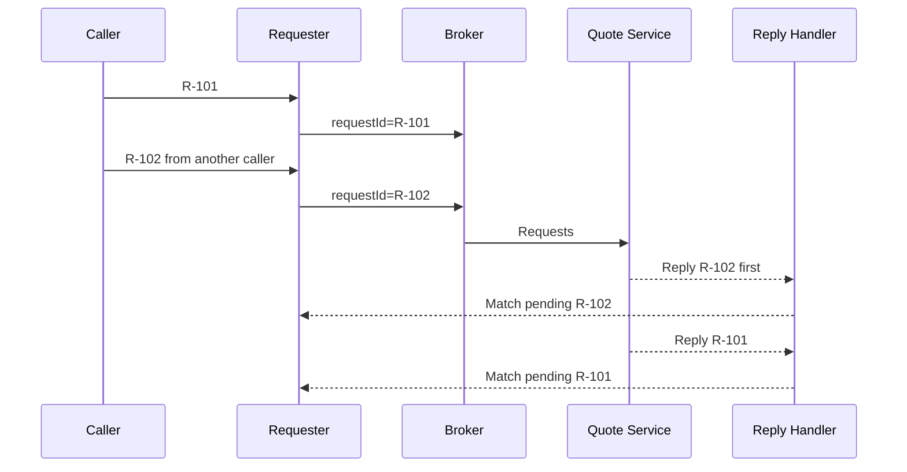
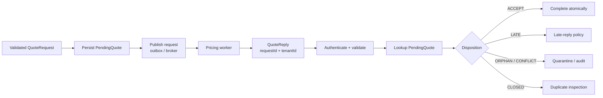
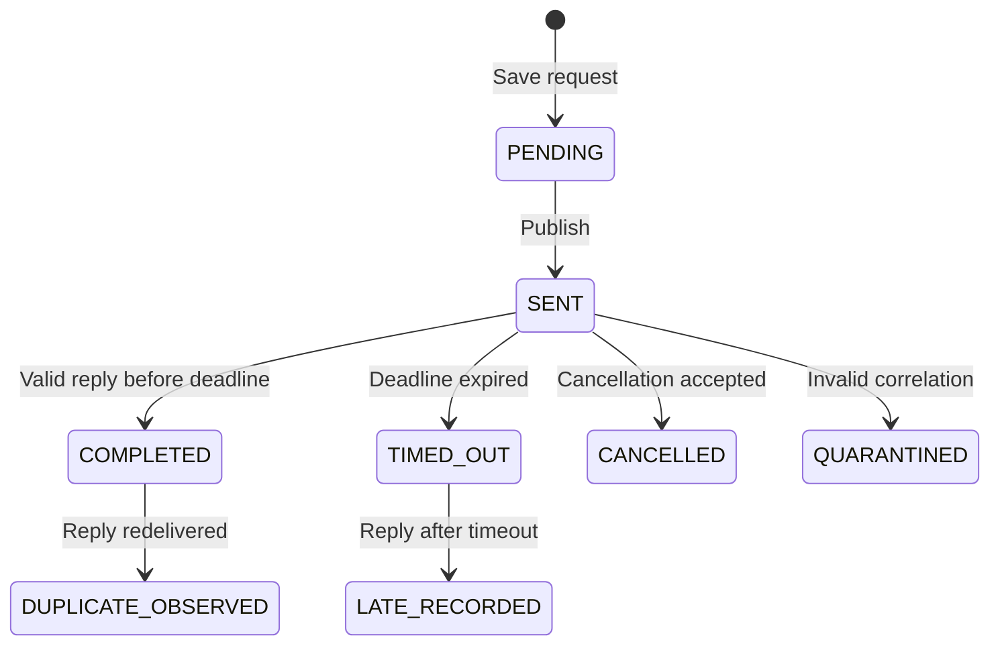
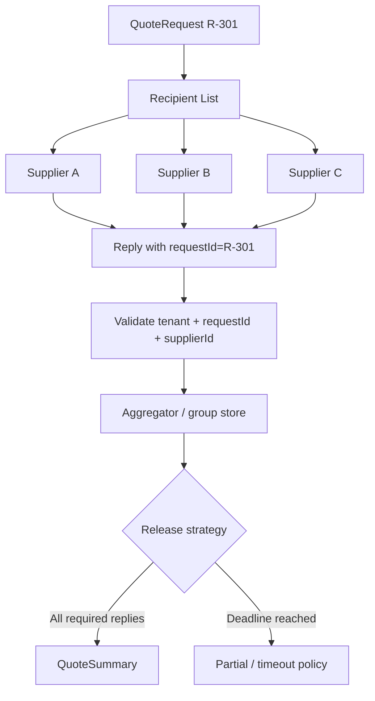

# Correlation Between Request and Reply

## 1. The Problem: Replies Arrive Out of Request Order

A quoting system sends three concurrent requests to an external service:

```text
Requests:
  R-101: tenant-a, SKU-A, quantity=2
  R-102: tenant-b, SKU-A, quantity=5
  R-103: tenant-a, SKU-B, quantity=1

Arriving replies:
  Reply(R-102)
  Reply(R-103)
  Reply(R-101)
```

If matched by arrival order, the caller of R-101 could receive R-102's quote. If matched by SKU, two tenants requesting the same SKU could be mixed up. **Correlation between request and reply** is the mechanism for determining which request a reply belongs to, even under asynchronous processing, reordered arrivals, request retries, or duplicate reply deliveries.

In the **Content-based correlation** chapter of the **SPRING_INTEGRATION_PATTERN** module, we learn to implement Enterprise Integration Patterns with Spring Integration to build loosely coupled, extensible message flows. This topic ties closely to Gateway, Router, Filter, Transformer, Splitter, Aggregator, retry, error channel, and correlation, while also requiring testing and observability across processing branches.



Correlation is **matching and verifying the request–reply relationship**. It does not by itself guarantee a reply arrives before a deadline, create exactly-once semantics, make the broker infallible, or prove a reply sender is authorized merely because an ID matches.

## 2. What Is Content-Based Correlation?

**Content-based correlation** relies on **meaningful values inside business content** to identify relationships between messages. For example, a request:

```json
{
  "tenantId": "tenant-a",
  "requestId": "R-101",
  "sku": "SKU-A",
  "quantity": 2
}
```

And a reply:

```json
{
  "tenantId": "tenant-a",
  "requestId": "R-101",
  "quotedTotalVnd": 50000,
  "pricingVersion": "pricing-v3"
}
```

A `(tenantId, requestId)` pair in the **payload** identifies the corresponding pending request. After validation, a Transformer can copy that key into a **header** for routing/correlation; the origin of the key remains the business content.

### 2.1. Router, Aggregator, and Correlation Are Not Synonymous

| EIP Component | Question Solved |
| --- | --- |
| Content-Based Router | Which processing branch should the message go to? |
| Content-based correlation | Which logical request does this reply belong to? |
| Gateway | Through what API does the caller interact with messaging? |
| Aggregator | Which messages are combined into a shared outcome? |
| Filter | Does the message meet conditions to proceed? |
| MessageStore / pending registry | Where are outstanding requests stored? |

One flow can use both routing and correlation. Yet `productCategory` works for selecting a quoting branch, **not** as the key for matching a reply to a request: many requests share the same category.

### 2.2. Every Reply Needs a Stable Identity

A reply should carry enough metadata for downstream to verify the relationship:
- `tenantId` and `requestId`;
- business fields such as `sku` and `quantity` when cross-checking is needed;
- `pricingVersion`, `schemaVersion`, or workflow revision when results depend on policy;
- a stable `replyId` when deduplicating broker redeliveries of the same reply;
- trusted origin, signature, or transport identity per the chosen security mechanism.

A matching ID is a necessary condition, **not yet** a sufficient condition to accept a reply.

## 3. Distinguishing requestId, correlationId, replyChannel, and Message ID

| Value | Meaning | Can It Replace Business `requestId`? |
| --- | --- | --- |
| `requestId` | Logical request identifier | **Primary key** when stable and unique in scope |
| `tenantId` | Scope and access boundary | Must be combined with `requestId`, never used alone |
| `eventId` | Business event identifier | Depends on contract; not implicitly the same as `requestId` |
| `MessageHeaders.ID` | Framework-generated envelope ID | **Never** a durable business key |
| `IntegrationMessageHeaderAccessor.CORRELATION_ID` | Correlation metadata, often used for message groups | Can be mapped per policy; not automatically equal to `requestId` |
| `MessageHeaders.REPLY_CHANNEL` | Reply destination in internal interactions | **Not** a business key |
| `MessageHeaders.ERROR_CHANNEL` | Error-handling channel | Not a pending request registry |
| `traceId` / `spanId` | Distributed tracing | Insufficient to identify one business request |
| JMS/AMQP correlation metadata | Transport-level correlation | Use per adapter contract; verify mapping |

**Specifically:** `MessageHeaders.ID` can change when an envelope is recreated; `traceId` can be shared across an entire batch; and an internal `replyChannel` can be an in-memory object that cannot cross a broker or survive a restart.

### 3.1. Multi-Tenant Keys

If request IDs are only unique within a tenant, use:

```text
CorrelationKey = (tenantId, requestId)
  tenant-a / R-101
  tenant-b / R-101
```

The two logical requests above **must never collide**. You can include `workflowVersion`, `replyType`, or `requestRevision` if a request has multiple results or versions. Avoid joining strings with unescaped delimiters or letting untrusted callers pick correlation keys referencing another tenant.

### 3.2. Stable ID Across Retries

Distinguish clearly:
- `requestId`: one logical request, kept stable when delivery attempts are retried;
- `deliveryAttempt`: transmission/processing attempt;
- `messageId`: individual envelope;
- `requestRevision`: an intentionally modified version of the request.

If a retry of the same request generates a new `requestId` without a policy, the old reply becomes orphaned and side effects can repeat. Still, keeping `requestId` stable alone does not produce exactly-once: the receiver still needs idempotency.

## 4. Two Request–Reply Models

### 4.1. Synchronous Gateway

The caller invokes a Java method and waits for the return value:

```text
Caller -> QuoteGateway.quote(R-101)
           -> request channel
           -> handler
           -> framework-managed reply channel
       <- QuoteReply(R-101)
```

A Spring Integration Gateway manages a temporary reply channel and matches the reply back to the exact invocation. Business `requestId` in the payload remains useful for auditing/validation, though you do not need to build your own in-JVM pending-futures map to replace a synchronous Gateway's basic behavior.

### 4.2. Asynchronous Request–Reply Across a Broker

```text
Requester:
  persist PendingRequest(tenantId, requestId, deadline)
  publish request
  caller may already have disconnected

Worker:
  consume request, compute result
  publish reply carrying tenantId/requestId

Reply handler:
  authenticate reply
  find PendingRequest by business key
  validate content and status
  complete exactly once at application state boundary
```

Here you cannot rely solely on a temporary in-memory reply channel. The reply may arrive after a restart or land on a different instance. You need a **durable pending registry**, idempotency, timeouts, and a late-reply policy.

### 4.3. Comparison

| Criterion | Synchronous Gateway | Async Reply |
| --- | --- | --- |
| Does the caller wait? | Yes, up to timeout | Possibly not |
| Invocation matching | Managed by framework | Business correlation registry |
| Requester restart | Waiting call is typically lost | Pending state can recover |
| Late reply | Caller is no longer waiting | Can be recorded and handled separately |
| Duplicate reply | Still needs policy when side effects exist | Pending state + deduplication |
| Across brokers | Specific adapters/gateways exist | Well suited for long-running workflows |
| Security | Input authentication still needed | Strict source/tenant enforcement |

## 5. QuoteRequest and QuoteReply Contracts

Use Java 17 records to separate request and reply data. Integer VND totals are purely illustrative and do not replace real-world pricing/currency contracts.

```java
record QuoteRequest(
        String tenantId,
        String requestId,
        String sku,
        int quantity) {
    QuoteRequest {
        if (tenantId == null || tenantId.isBlank()
                || requestId == null || requestId.isBlank()
                || sku == null || sku.isBlank()
                || quantity <= 0) {
            throw new IllegalArgumentException("Invalid request");
        }
    }
}

record QuoteReply(
        String tenantId,
        String requestId,
        String sku,
        int quantity,
        long quotedTotalVnd,
        String pricingVersion) {
    QuoteReply {
        if (tenantId == null || tenantId.isBlank()
                || requestId == null || requestId.isBlank()
                || sku == null || sku.isBlank()
                || quantity <= 0
                || quotedTotalVnd < 0
                || pricingVersion == null || pricingVersion.isBlank()) {
            throw new IllegalArgumentException("Invalid reply");
        }
    }
}
```

Immutable records do not stop sender spoofing, so tenant/source authentication remains a transport-boundary responsibility.

### 5.1. Reply Validation Rules

| Condition | Meaning |
| --- | --- |
| Pending request exists for tenant and ID | Reply is not orphaned |
| Status allows completion | Does not overwrite closed/cancelled requests |
| Tenant matches | Never leaks or updates the wrong tenant |
| SKU/quantity match | Reply answers the original request |
| Valid schema/policy version | Prevents mixing incompatible versions |
| Trusted source service | A matching ID does not prove permission |
| Within deadline | Determines whether the reply is on time or late |
| Reply not yet applied | Prevents emitting completion twice |

## 6. Synchronous Spring Integration Gateway

### 6.1. Pricing Service

```java
import org.springframework.stereotype.Service;

@Service
class QuoteCalculator {
    QuoteReply calculate(QuoteRequest request) {
        long unitPriceVnd = switch (request.sku()) {
            case "SKU-A" -> 25_000L;
            case "SKU-B" -> 10_000L;
            default -> throw new IllegalArgumentException("Unknown SKU");
        };

        return new QuoteReply(
                request.tenantId(),
                request.requestId(),
                request.sku(),
                request.quantity(),
                Math.multiplyExact(unitPriceVnd,
                        (long) request.quantity()),
                "pricing-v3");
    }
}
```

This is a pure demo handler without database or external API calls. Identical input and rules yield identical output.

### 6.2. Gateway Interface

```java
import org.springframework.integration.annotation.Gateway;
import org.springframework.integration.annotation.MessagingGateway;

@MessagingGateway
interface QuoteGateway {
    @Gateway(
            requestChannel = "quotes.requests",
            replyTimeout = 5_000)
    QuoteReply quote(QuoteRequest request);
}
```

Spring creates a Gateway proxy to send requests and await replies per contract. Invocation-level reply correlation is the framework's responsibility. `requestId` in the payload retains its business meaning and is ready if moved to an external service.

### 6.3. IntegrationFlow Receiving and Replying to Requests

```java
import org.springframework.context.annotation.Bean;
import org.springframework.context.annotation.Configuration;
import org.springframework.integration.channel.DirectChannel;
import org.springframework.integration.config.EnableIntegration;
import org.springframework.integration.annotation.IntegrationComponentScan;
import org.springframework.integration.dsl.IntegrationFlow;
import org.springframework.messaging.MessageChannel;

@Configuration
@EnableIntegration
@IntegrationComponentScan
class QuoteGatewayFlow {
    @Bean("quotes.requests")
    MessageChannel quoteRequests() {
        return new DirectChannel();
    }

    @Bean
    IntegrationFlow quoteProcessing(QuoteCalculator calculator) {
        return IntegrationFlow.from("quotes.requests")
                .handle(QuoteRequest.class, (request, headers) ->
                        calculator.calculate(request))
                .get();
    }
}
```

When the handler returns a `QuoteReply`, the message-producing endpoint routes the result along the reply path managed by the Gateway/framework. In an application, configure component scanning so `QuoteCalculator` and the Gateway interface are registered. If a handler returns `null` on a one-way path, do not expect the Gateway to receive a `QuoteReply`.

### 6.4. Illustrative Call

```java
QuoteRequest request = new QuoteRequest(
        "tenant-hcm", "R-101", "SKU-A", 2);

QuoteReply reply = gateway.quote(request);

if (!request.tenantId().equals(reply.tenantId())
        || !request.requestId().equals(reply.requestId())) {
    throw new IllegalStateException("Unexpected reply");
}
assert reply.quotedTotalVnd() == 50_000L;
```

This is additional contract validation. The Gateway already solves matching the **waiting invocation**, yet once the service is replaced by a remote adapter, checking payload contents guards against accepting semantically mismatched replies.

## 7. Timeout Does Not Mean Work Was Cancelled

```text
t0: send R-101
t1: worker starts calling another service
t5: Gateway timeout
t8: worker returns Reply(R-101)
```

When a timeout occurs, the caller may have stopped waiting, yet the worker **may still keep running**. How a late reply is handled depends on the endpoint/transport; never assume it is saved, cancelled, or delivered to the timed-out caller.

Rules to decide:
1. Is `requestId` kept stable across retries?
2. Does the operation have side effects? Is there an idempotency key?
3. How are send, processing, and reply timeouts distinguished?
4. Should late replies be recorded and reconciled?
5. If cancellation exists, can the downstream source actually halt in-flight work?

**Never use a Gateway timeout as proof that a transaction rolled back.** If a client generates a new `requestId` and retries, the external service may execute two requests and emit two replies.

## 8. Async Correlation: Persisting Pending Requests Durably

When a request leaves the JVM over Kafka, RabbitMQ, JMS, or an async API, the reply can arrive after a requester restart, land on a different instance, or arrive after the client's wait window. You need **recoverable pending state**.



### 8.1. State Model



These states belong to the **application**, not automatic states of a Spring Integration Gateway. Persist them in a database, workflow state store, or equivalent mechanism if you need restart/recovery.

### 8.2. Record and Business Key

```java
import java.time.Instant;

enum PendingStatus {
    PENDING, SENT, COMPLETED, TIMED_OUT, CANCELLED, QUARANTINED
}

record QuoteCorrelationKey(
        String tenantId,
        String requestId) {
    QuoteCorrelationKey {
        if (tenantId == null || tenantId.isBlank()
                || requestId == null || requestId.isBlank()) {
            throw new IllegalArgumentException("Invalid correlation key");
        }
    }
}

record PendingQuote(
        QuoteCorrelationKey key,
        String sku,
        int quantity,
        String pricingVersion,
        Instant deadline,
        PendingStatus status) {}
```

A minimal database table:

```sql
CREATE TABLE pending_quotes (
    tenant_id       VARCHAR(80) NOT NULL,
    request_id      VARCHAR(120) NOT NULL,
    sku             VARCHAR(64) NOT NULL,
    quantity        INTEGER NOT NULL,
    pricing_version VARCHAR(40) NOT NULL,
    deadline_at     TIMESTAMP NOT NULL,
    status          VARCHAR(24) NOT NULL,
    PRIMARY KEY (tenant_id, request_id)
);
```

This illustrative table omits response checksum, reply ID, outbox, attempts, and audit columns. In production, add those attributes per contract, standardize on UTC timestamps, and manage schema migrations. The unique primary key on `(tenant_id, request_id)` prevents **two pending records** for the same logical request, though it does not by itself stop the quoting service from executing twice.

### 8.3. Sending Requests and Saving State in the Right Order

A reliable flow typically:

1. Authenticates the caller and extracts `tenantId` from a trusted identity.
2. Validates input/schema and issues or validates a stable `requestId`.
3. Writes `PendingQuote`, deadline, request snapshot, and an **outbox record** in the same transaction when feasible.
4. Commits before publishing the request to the broker (or uses an outbox publisher).
5. The worker consumes the request, processes idempotently, and emits a keyed reply.
6. The reply handler checks key + content + source identity and transitions state to `COMPLETED` **once**.

Never publish a request before pending state is visible if a reply can return very quickly. If publishing fails after pending state is saved, the outbox/reconciliation must be able to retry. Outbox alone does not yield exactly-once: the publisher can still send duplicates, so the worker must deduplicate.

## 9. Verifying Replies by Content in an Independently Testable Way

Isolating a matcher from the broker makes unit testing straightforward. It classifies replies as accepted, late, orphan, or conflict; it **does not execute database UPDATEs itself**.

### 9.1. Pure Matcher by Business Key and Snapshot

```java
import java.time.Instant;
import java.util.Objects;

enum ReplyDisposition {
    ACCEPT,
    ORPHAN,
    CONFLICT,
    LATE,
    ALREADY_COMPLETED,
    CANCELLED_OR_CLOSED
}

final class QuoteReplyMatcher {

    ReplyDisposition classify(
            QuoteReply reply,
            PendingQuote pending,
            Instant now) {
        Objects.requireNonNull(reply, "reply");
        Objects.requireNonNull(now, "now");

        if (pending == null) {
            return ReplyDisposition.ORPHAN;
        }

        var actualKey = new QuoteCorrelationKey(
                reply.tenantId(), reply.requestId());

        if (!actualKey.equals(pending.key())
                || !reply.sku().equals(pending.sku())
                || reply.quantity() != pending.quantity()
                || !reply.pricingVersion()
                        .equals(pending.pricingVersion())) {
            return ReplyDisposition.CONFLICT;
        }

        if (pending.status() == PendingStatus.COMPLETED) {
            return ReplyDisposition.ALREADY_COMPLETED;
        }
        if (pending.status() == PendingStatus.CANCELLED
                || pending.status() == PendingStatus.QUARANTINED) {
            return ReplyDisposition.CANCELLED_OR_CLOSED;
        }

        if (pending.status() == PendingStatus.TIMED_OUT
                || now.isAfter(pending.deadline())) {
            return ReplyDisposition.LATE;
        }

        return ReplyDisposition.ACCEPT;
    }
}
```

**Intentional check order:** If a reply carries the right `requestId` yet a different SKU, the result is `CONFLICT` even when pending is already `COMPLETED`; never ignore signs of spoofing or producer bugs just because status is closed.

`ALREADY_COMPLETED` means **a candidate reply arrived after pending completed**. You cannot declare it an exact duplicate of the saved reply without comparing `replyId`/content hash/outcome against the previously completed reply. A reply with different values under the same key may indicate a serious bug requiring investigation.

### 9.2. Unit Testing the Matcher with a Fixed Time

```java
import java.time.Instant;
import org.junit.jupiter.api.Test;
import static org.junit.jupiter.api.Assertions.*;

class QuoteReplyMatcherTest {
    private final QuoteReplyMatcher matcher = new QuoteReplyMatcher();
    private final Instant now =
            Instant.parse("2026-11-21T04:00:00Z");

    private PendingQuote pending() {
        return new PendingQuote(
                new QuoteCorrelationKey("tenant-a", "R-101"),
                "SKU-A", 2, "pricing-v3",
                now.plusSeconds(30),
                PendingStatus.SENT);
    }

    private QuoteReply reply() {
        return new QuoteReply(
                "tenant-a", "R-101", "SKU-A",
                2, 50_000L, "pricing-v3");
    }

    @Test
    void matchesValidReply() {
        assertEquals(ReplyDisposition.ACCEPT,
                matcher.classify(reply(), pending(), now));
    }

    @Test
    void rejectsCrossTenantAndWrongPayload() {
        var crossTenant = new QuoteReply(
                "tenant-b", "R-101", "SKU-A",
                2, 50_000L, "pricing-v3");
        var wrongQuantity = new QuoteReply(
                "tenant-a", "R-101", "SKU-A",
                7, 50_000L, "pricing-v3");

        assertEquals(ReplyDisposition.CONFLICT,
                matcher.classify(crossTenant, pending(), now));
        assertEquals(ReplyDisposition.CONFLICT,
                matcher.classify(wrongQuantity, pending(), now));
    }

    @Test
    void classifiesOrphanLateAndCompleted() {
        assertEquals(ReplyDisposition.ORPHAN,
                matcher.classify(reply(), null, now));
        assertEquals(ReplyDisposition.LATE,
                matcher.classify(reply(), pending(),
                        now.plusSeconds(31)));

        var completed = new PendingQuote(
                pending().key(), "SKU-A", 2,
                "pricing-v3", now.plusSeconds(30),
                PendingStatus.COMPLETED);
        assertEquals(ReplyDisposition.ALREADY_COMPLETED,
                matcher.classify(reply(), completed, now));
    }
}
```

Do not call `Instant.now()` directly inside deadline-logic unit tests: an injected `Clock` or fixed `Instant` prevents tests from depending on machine speed. In production, synchronize time across server/database/transport and account for clock skew.

## 10. Reply Matching Must Be Safe Against Race Conditions

**A pure matcher is only an evaluation step; it is insufficient under concurrency.** Two workers can concurrently read the same pending record in `SENT` state and both see `ACCEPT`. If both send a completion notification, the caller gets notified twice.

Database updates should enforce an atomic condition:

```sql
UPDATE pending_quotes
SET status = 'COMPLETED'
WHERE tenant_id = :tenantId
  AND request_id = :requestId
  AND status = 'SENT'
  AND deadline_at >= :now;
```

After authenticating the source, matching request content, and saving the reply snapshot, only the worker that **updates exactly one row** may emit completion. When updated row count is 0, re-read state to distinguish `ALREADY_COMPLETED`, `TIMED_OUT`, `CANCELLED`, and not found.

**Note:** If `PENDING` is also allowed to complete because a reply arrived before `SENT` committed, align the policy and state transitions accordingly. The illustrative example requires `SENT` because publishing is explicitly recorded.

### 10.1. Completion Events Can Also Be Sent Twice

Even when the state UPDATE executes once:
1. Worker commits `COMPLETED`.
2. Worker emits the completion event.
3. Worker crashes before broker ACK.
4. Reply is redelivered, or the completion publisher retries.

To avoid losing or duplicating notifications, consider writing an **outbox completion event in the same transaction** that transitions pending state to `COMPLETED`. Downstream callback/webhook consumers still need a stable idempotency key like `(tenantId,requestId,completionType,revision)`.

### 10.2. Timeouts and Replies Racing

```text
t = deadline
  Worker A: timeout scanner -> TIMED_OUT
  Worker B: reply handler   -> COMPLETED
```

Never allow both to commit conflicting final outcomes. Use optimistic locking/versioning or conditional UPDATEs with status/deadline predicates and a single consistent clock source. Every design must define whether a reply arriving **exactly at the deadline** counts as on time or late.

If a reply arrives after the deadline, policy options include:
- Store the late reply for reconciliation;
- Exclude it from the caller response path while writing an audit log;
- Emit a “result available after timeout” event if the contract permits;
- Allow the caller to fetch the result later on demand.

Never revive a `CANCELLED` or `TIMED_OUT` pending request unless the business contract explicitly allows it.

## 11. Spring Integration DSL for the Async Reply Path

Spring Integration can use Java DSL to receive replies from an inbound adapter and dispatch them to a correlation handler.

```java
import org.springframework.context.annotation.Bean;
import org.springframework.context.annotation.Configuration;
import org.springframework.integration.channel.DirectChannel;
import org.springframework.integration.config.EnableIntegration;
import org.springframework.integration.dsl.IntegrationFlow;
import org.springframework.messaging.MessageChannel;

interface QuoteReplyService {
    void onReply(QuoteReply reply);
}

@Configuration
@EnableIntegration
class QuoteReplyInboundFlow {

    @Bean("quotes.replies.in")
    MessageChannel repliesIn() {
        return new DirectChannel();
    }

    @Bean
    IntegrationFlow handleReplies(QuoteReplyService service) {
        return IntegrationFlow.from("quotes.replies.in")
                .handle(QuoteReply.class, (reply, headers) -> {
                    service.onReply(reply);
                    return null; // one-way handler
                })
                .get();
    }
}
```

This is an **asynchronous reply** topology; do not attach it to `QuoteGatewayFlow` in a way that creates two competing handlers on a `DirectChannel`. The inbound adapter (Kafka/Rabbit/HTTP callback) must receive, authenticate, and deserialize `QuoteReply` properly before sending to `quotes.replies.in`; the example does not assume a specific pre-wired adapter.

Inside `QuoteReplyService.onReply`:
1. Verify source identity/authorization at the boundary or via verified context;
2. Look up pending state by `(tenantId,requestId)`;
3. Invoke `QuoteReplyMatcher` and classify;
4. For `ACCEPT`, update state and emit completion via transaction/outbox;
5. For `ORPHAN`/`CONFLICT`/`LATE`, route to controlled audit/quarantine;
6. For `ALREADY_COMPLETED`, verify reply identity/digest without repeating side effects.

**Never rely solely on `MessageHeaders.CORRELATION_ID` if the payload carries a different ID**; define consistency rules and the trusted source. Across broker adapters, header mappers can rename or coerce values; integration tests must prove required data reaches the handler intact.

### 11.1. Using a Router to Classify Replies

An alternative design turns evaluation results into explicit outcomes:

```java
sealed interface ReplyOutcome
        permits AcceptedReply, RejectedReply {}

record AcceptedReply(QuoteReply reply) implements ReplyOutcome {}

record RejectedReply(
        QuoteCorrelationKey key,
        String reasonCode) implements ReplyOutcome {}
```

A Content-Based Router then sends messages to `quotes.accepted` or `quotes.quarantine` based on outcome type. This is a **complementary topology**, not a license for the Router itself to look up pending state and check permissions. Reconciliation policy must still run in a service authorized to read the registry; never place raw PII or sensitive content in reason codes or metrics.

## 12. Using Transport Correlation and Reply-To in a Controlled Way

Transports such as JMS or AMQP have their own `correlationId` and `replyTo` concepts. Frameworks can map parts of these to Spring message headers, though header names, types, and propagation depend on the adapter and protocol.

| Aspect | Internal Spring Integration | Broker / Remote Transport |
| --- | --- | --- |
| Reply destination | `replyChannel` can be a `MessageChannel` object | Transport-specific reply queue/topic/address |
| Correlation key | Business `requestId` or framework correlation | Transport correlation ID with explicit mapping |
| Reply timeout | Gateway timeout, handler timeout | Separate broker/client/app SLAs |
| Restart | Temporary reply channel may be lost | Queues and registries can be durable |
| Error path | `ErrorChannel`/exception per endpoint | DLQ, retries, NACK/ACK per broker |
| Authorization | Bean/application security | Broker auth + application tenant policy |

Never serialize an in-JVM `MessageChannel` Java object as `replyTo` over Kafka/HTTP. Instead, use a contracted destination name or an authenticated, allowlisted callback URL/service ID.

### 12.1. When Can replyTo Be Used?

In internal request–reply communication, `replyTo` decides **where** the reply goes, while correlation key decides **which request** the reply belongs to. They answer two distinct questions:

```text
replyTo       -> destination/channel for replies
correlationId -> logical request/group identity
```

Multiple requests can share one reply queue; each reply then needs a correlation key to match its pending request. A dedicated destination per request simplifies matching at the cost of extra resource management and overhead; it is not always appropriate.

### 12.2. Do Not Use Correlation ID as Proof of Authorization

An attacker might guess or read a `requestId` leaked in logs. Therefore, incoming replies require all of:
- transport/service authentication;
- tenant isolation;
- schema and content validation;
- valid pending state;
- replay/duplicate controls.

A correlation key is an **identifier**, not an authorization token.

## 13. One Request with Multiple Replies: Correlation and Aggregator

Not every request has a single reply. For example, request R-301 requests quotes from three suppliers:

```text
Request R-301 -> Supplier A, Supplier B, Supplier C

Arrivals:
  Reply(B, R-301) at t1
  Reply(A, R-301) at t2
  Reply(C, R-301) at t3

Expected outcome:
  All replies correlate with R-301
  Aggregate according to policy
```

Two distinct layers are needed here:

1. **Correlation**: all three replies with `requestId=R-301` belong to one logical request.
2. **Aggregation**: when enough replies have arrived and how to compute the outcome—such as picking the lowest price in the same currency, or emitting a partial result if one supplier times out.



### 13.1. Do Not Count a Duplicate as the Third Supplier

If the three deliveries are:

```text
Supplier A, request R-301
Supplier B, request R-301
Supplier A, request R-301 (duplicate)
```

then Supplier C's reply has **not** arrived yet. A release strategy using `group.size() == 3` would conclude prematurely. Deduplicate by `(tenantId, requestId, supplierId, replyVersion)` and release based on the verified set of supplier/part identities or completion markers.

### 13.2. Correlation Key Must Include the Right Scope

If the same `requestId` is used for multiple result types (pricing, tax, shipping), you may need a group key:

```text
(tenantId, requestId, replyKind)
```

Do not route a tax reply into an Aggregator waiting for price quotes just because both share `requestId`. Conversely, do not create a new `requestId` per supplier if you want to gather all replies into one logical request; use `supplierId` or a separate `childRequestId` while preserving the parent request identity.

### 13.3. Partial Results Are a Business Decision

When supplier C times out:
- You may return quotes from A/B with `PARTIAL` status if the user accepts partial quotes;
- You may reject the entire request if all quotes are mandatory;
- You may wait for a bounded retry within the deadline;
- You may emit a late-result event under a new version if the contract supports it.

Never take `sequenceSize` from a Splitter and wait forever if a Filter/Router dropped a branch. Accurate correlation alone does not solve liveness and completion policies.

## 14. Testing a Synchronous Gateway

Gateway tests should prove an invocation produces a reply with the right `requestId` and business fields, handles exceptions/timeouts, and never conflates two concurrent requests.

### 14.1. Happy-Path Integration Test

```java
import org.junit.jupiter.api.Test;
import org.springframework.beans.factory.annotation.Autowired;
import org.springframework.test.context.junit.jupiter.SpringJUnitConfig;

import static org.junit.jupiter.api.Assertions.*;

@SpringJUnitConfig(classes = {
        QuoteGatewayFlow.class,
        QuoteCalculator.class
})
class QuoteGatewayIntegrationTest {

    @Autowired
    QuoteGateway gateway;

    @Test
    void quoteReplyMatchesRequestContent() {
        var request = new QuoteRequest(
                "tenant-a", "R-101", "SKU-A", 2);

        QuoteReply reply = gateway.quote(request);

        assertEquals("tenant-a", reply.tenantId());
        assertEquals("R-101", reply.requestId());
        assertEquals("SKU-A", reply.sku());
        assertEquals(2, reply.quantity());
        assertEquals(50_000L, reply.quotedTotalVnd());
        assertEquals("pricing-v3", reply.pricingVersion());
    }

    @Test
    void separateRequestsDoNotShareTheirIdentity() {
        var a = gateway.quote(new QuoteRequest(
                "tenant-a", "R-201", "SKU-A", 2));
        var b = gateway.quote(new QuoteRequest(
                "tenant-b", "R-201", "SKU-B", 1));

        assertEquals("tenant-a", a.tenantId());
        assertEquals("tenant-b", b.tenantId());
        assertEquals("R-201", a.requestId());
        assertEquals("R-201", b.requestId());
        assertNotEquals(a.quotedTotalVnd(), b.quotedTotalVnd());
    }
}
```

The test assumes `@IntegrationComponentScan` on `QuoteGatewayFlow` scans the package containing the Gateway interface (as when these illustrative classes share a package). If your app uses different packages, adjust the base package or Spring context configuration. The goal is to verify the **real Gateway proxy and reply route**, rather than calling `QuoteCalculator.calculate` directly.

### 14.2. Additional Cases Worth Testing

- Handler throws an exception on an invalid SKU; caller receives an error per contract.
- Handler returns no reply or runs slowly; Gateway times out cleanly.
- Two concurrent calls with one slower handler; each caller receives its own reply.
- A downstream Transformer builds a new message and accidentally drops the reply channel: test must catch that the Gateway receives no reply.
- Flow crossing an outbound adapter: test transport header/reply-to mapping rather than relying on `DirectChannel` behavior.
- Caller retries after timeout: keeps logical `requestId` and verifies idempotency when side effects exist.

With async channels, use latches or Awaitility with timeouts rather than asserting immediately after sending. Timeout tests must also verify **backend state** when side effects exist: a caller-side timeout does not prove the backend stopped.

## 15. Testing Async Replies and Multi-Instance Systems

Dedicated tests must prove the registry/matcher accurately pairs pending records and never completes twice.

| Scenario | Expected State |
| --- | --- |
| Valid reply, pending `SENT` | `ACCEPT` then `COMPLETED` exactly once |
| Replies arrive out of order | Each reply matches its `requestId` |
| Two tenants share `requestId` | Pending records never mix |
| Reply has wrong SKU or quantity | `CONFLICT`/quarantine |
| Reply has wrong policy version | `CONFLICT` |
| Unauthenticated reply source | Rejected before lookup/completion |
| Reply with no pending record | `ORPHAN`, audited |
| Reply after deadline | `LATE`, not returned to timed-out caller |
| Reply after `CANCELLED` | `CLOSED`, never revives request |
| Duplicate reply after `COMPLETED` | Deduplicate / verify content digest |
| Two replies with different content, same key | Conflict, never overwrite |
| Two workers complete concurrently | Conditional update succeeds for one worker only |
| Requester restarts before reply | Durable registry still matches |
| Pending persisted, broker publish fails | Outbox/retry publish |
| Completion persisted, callback publish fails | Outbox completion/replay |
| Broker reply with stripped headers | Payload business key still suffices to match |
| Multi-reply from three suppliers | Deduplicate by supplier and release properly |
| One supplier reply missing | Timeout/partial policy |
| Different trace IDs | Match via business correlation, not trace |

### 15.1. Race Between Two Reply Handlers

In an integration test with a real database or transactional test store:

1. Persist pending in `SENT` state with a future deadline.
2. Concurrently dispatch two copies of `Reply(R-101)` on two consumer threads.
3. Both may initially read the pending row; the matcher returns `ACCEPT` for both.
4. Execute the conditional update inside a transaction.
5. Assert only one `UPDATE` reports affected-row count = 1.
6. Assert exactly one completion/outbox event is recorded.
7. If the two replies carry different content, assert the conflict is recorded for investigation.

Do not rely solely on `synchronized` on a single bean to solve races if multiple JVMs process replies. Enforce the condition at the **database/state store with explicit concurrency guarantees**, or partition same-key replies to one worker while still guarding persisted state.

### 15.2. Restart Test

A genuine durability test:
- Context A saves pending state and publishes the request.
- Shut down requester A to simulate a restart.
- Context B connects to the same persistent store.
- Broker delivers `Reply(R-101)` to B.
- B verifies tenant/requestId/version and completes.
- Assert completion is recorded once and recoverable from storage.

Never use an in-memory `ConcurrentHashMap` to claim pending requests survive restarts.

### 15.3. Competing Replies and Timeouts Test

When the deadline passes as a reply arrives, test both outcomes:
- Completion commits before the deadline per policy;
- Timeout commits first and the reply is classified `LATE`.

Tests must verify the final state can never hold **both `TIMED_OUT` and `COMPLETED`** for the same request revision. Use a controllable `Clock` in unit tests and a consistent database time source when testing concurrency.

## 16. Security, Observability, and Error Handling

### 16.1. Correlation Is Not Authorization

A `requestId` in a payload or header **does not prove authorization** of the reply sender. A rogue producer could guess IDs or scrape them from logs. To prevent cross-tenant reply injection:
- Authenticate the replying service via broker credentials, mTLS, signatures, or equivalent;
- Obtain tenant scope from a trusted source and verify it against the pending record;
- Never let clients mutate `tenantId`/`requestId` after authentication without an explicit rule;
- Verify SKU, quantity, version, and content digest per contract;
- Ensure quarantine does not leak full payloads or PII;
- Restrict read access to pending records and completion status to the owning tenant.

### 16.2. Error Channel Differs from Pending Registry

With `DirectChannel`, synchronous errors can propagate back to the sender. With executors/pollers/brokers, errors can flow to handlers and `errorChannel` per configuration. Yet `ErrorMessage` does not automatically:
- Maintain the list of outstanding requests;
- Cancel requests already dispatched to external systems;
- Retry according to idempotency policy;
- Distinguish a late reply due to timeout from an orphan reply due to a wrong ID;
- Guarantee a completion event is published exactly once.

Define dedicated error policies for each stage.

| Error | Cause | Handling |
| --- | --- | --- |
| Invalid request | Missing `tenantId`/`requestId`/schema | Reject at ingress |
| Pending state store unavailable | Infrastructure outage | Bounded retry with backoff |
| Broker publish failed | Transport | Outbox/retry publish |
| Reply key mismatch | Contract/cross-tenant | Quarantine/security audit |
| Duplicate reply | Redelivery | Idempotency and content check |
| Late reply | SLA expired | Late-reply policy |
| Missing reply | Worker lost message or too slow | Timeout/reconciliation |
| Reply handler timeout | DB/remote error | Retry while keeping state atomic |
| Downstream callback error | Consumer/notification | Outbox and idempotent callback |

### 16.3. Metrics and Tracing

Recommended metrics:

| Application Metric | Meaning |
| --- | --- |
| `request.pending.count` | Outstanding requests |
| `request.reply.latency` | Time from request creation to valid reply |
| `request.timeout.count` | Requests exceeding deadline |
| `reply.orphan.count` | Replies with no pending record |
| `reply.late.count` | Replies arriving after deadline |
| `reply.conflict.count` | Mismatched tenant/SKU/version |
| `reply.duplicate.count` | Duplicate replies after completion |
| `reply.correlation.lookup.error` | Registry lookup errors |
| `request.outbox.backlog` | Unpublished request outbox entries |
| `completion.outbox.backlog` | Undelivered completion notifications |
| `callback.retry.count` | Completion callback retries |

These are **suggested metric names**, not provided automatically by Spring Integration under these exact names.

Logs and traces should carry `requestId`/tenant (per security policy), `eventId`, source service, reply status, `traceId`, attempt count, timestamp, and reason code. Avoid using `requestId` or `eventId` as **metric labels** due to high cardinality. One distributed trace can contain multiple child requests, so never substitute `traceId` for the business correlation key.

### 16.4. Trace Spans for Asynchronous Request–Reply

In long-lived flows:
- Record the business `requestId` in controlled event attributes/log context;
- Propagate valid trace context across brokers where appropriate;
- When the reply arrives, start a reply-processing span linked to the appropriate parent context;
- Never spoof the original request's `spanId` as the current span;
- Never rely on trace continuity to decide whether a request is still pending or timed out.

## 17. Common Design Mistakes

1. **Matching replies by arrival order**, even though workers run concurrently.
2. **Using only SKU or message type as the key**, mixing multiple requests with matching content.
3. **Using `MessageHeaders.ID` as the business `requestId`**, which changes on retries.
4. **Using `traceId` as the correlation key**, even though one trace can hold many requests.
5. **Omitting tenant scope**, exposing cross-tenant reply injection risks.
6. **Assuming a `replyChannel` object can cross a broker** without mapping.
7. **Failing to persist pending state durably** when workflows must survive restarts.
8. **Generating a new `requestId` on every retry** of the same logical request without a version policy.
9. **Accepting a reply solely because `requestId` matches**, skipping source auth and payload checks.
10. **Assuming a timeout means the backend cancelled work**, when side effects may finish later.
11. **Treating any reply after `COMPLETED` as a valid duplicate** without comparing content/identity.
12. **Using non-atomic check-then-update**, allowing two workers to emit completion.
13. **Lacking an outbox for completion notifications**, causing lost or duplicated callbacks.
14. **Treating `errorChannel` as a pending registry or durable DLQ**.
15. **Counting deliveries when one request expects multiple replies**, allowing duplicates to complete early.
16. **Ignoring late/orphan replies**, leading to poison queues and unreconciled data.
17. **Building responses from payloads processed under a new version** without tracking revisions.
18. **Copying headers indiscriminately**, accidentally leaking `replyTo` or wrong tenant across transport boundaries.
19. **Skipping concurrent request tests**, testing only one sequential request at a time.
20. **Omitting deadlines/retention** for pending state, causing unbounded backlogs.

## 18. Practice Exercise and Self-Assessment

**Exercise:** Design a request–reply workflow for `ShippingRateRequested` containing `tenantId`, `requestId`, `shipmentId`, `destinationCountry`, and `packageWeight`. Three carriers send asynchronous replies with `providerId`, `quotedPrice`, `currency`, and `quoteVersion`.

1. Define `ShippingRateRequest` and `ShippingRateReply` using immutable records.
2. Set a composite correlation key on `(tenantId,requestId)` plus `providerId` for each child reply.
3. Build a synchronous Gateway simulating internal quoting and test that the caller receives the matching `requestId`.
4. Move to an async broker, persisting `PendingRequest` and its deadline in a database.
5. Publish requests via an outbox or reliable mechanism; never allow replies to race ahead of visible pending state.
6. Write a matcher verifying tenant, shipment ID, version, and source provider.
7. Build an integration flow receiving replies, mapping headers, and classifying accepted/late/orphan/conflict.
8. Use an Aggregator to gather results from all three providers; deduplicate by `providerId` without counting redeliveries.
9. Simulate one provider timing out and specify whether partial quotes may be returned.
10. Ensure two different currencies are never summed without an explicit exchange rate and version.
11. Simulate two replies completing the same pending record concurrently, using a conditional `UPDATE` to prevent double completion.
12. Simulate a requester restart before the reply arrives; prove pending state can still be looked up.
13. Create two tenants with the same `requestId` and verify they never mix.
14. Simulate a reply after the deadline, after cancellation, and a forged reply.
15. Add callback idempotency when completion events are republished.
16. Instrument metrics for pending backlog, reply latency, timeouts, orphans, conflicts, duplicates, and outbox backlog.
17. Explain why `MessageHeaders.REPLY_CHANNEL` and business `requestId` are not equivalent.
18. Write an end-to-end test delivering replies in reverse order and confirm every request still completes accurately.

**Self-Assessment:** Why must `requestId` stay stable across retries? How should identical `requestId`s across two tenants be handled? When a Gateway times out, is the worker guaranteed to have stopped? Why is matching `tenantId`/`requestId` alone insufficient to trust a reply? Why can two workers both seeing `SENT` pending state still cause duplicate completions? When one request expects three replies, how does correlation differ from aggregation?

**Correlation between request and reply** lets a system identify the exact invocation or logical request a response belongs to, regardless of arrival order or delivery count. With Spring Integration, a Gateway handles synchronous request–reply at the messaging layer; asynchronous workflows additionally require a business correlation key, durable pending state, validation, timeout/late-reply policies, and idempotent completion. Keeping message, trace, channel, and business identities distinct enables Gateway, Router, Splitter, Aggregator, and broker flows to behave accurately across retries, restarts, and duplicate deliveries.
