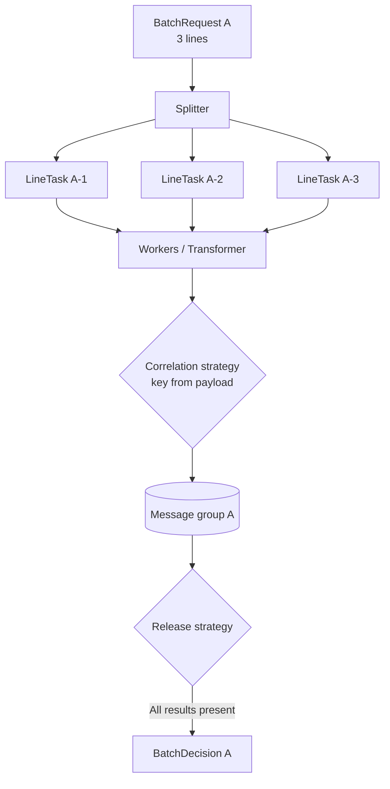
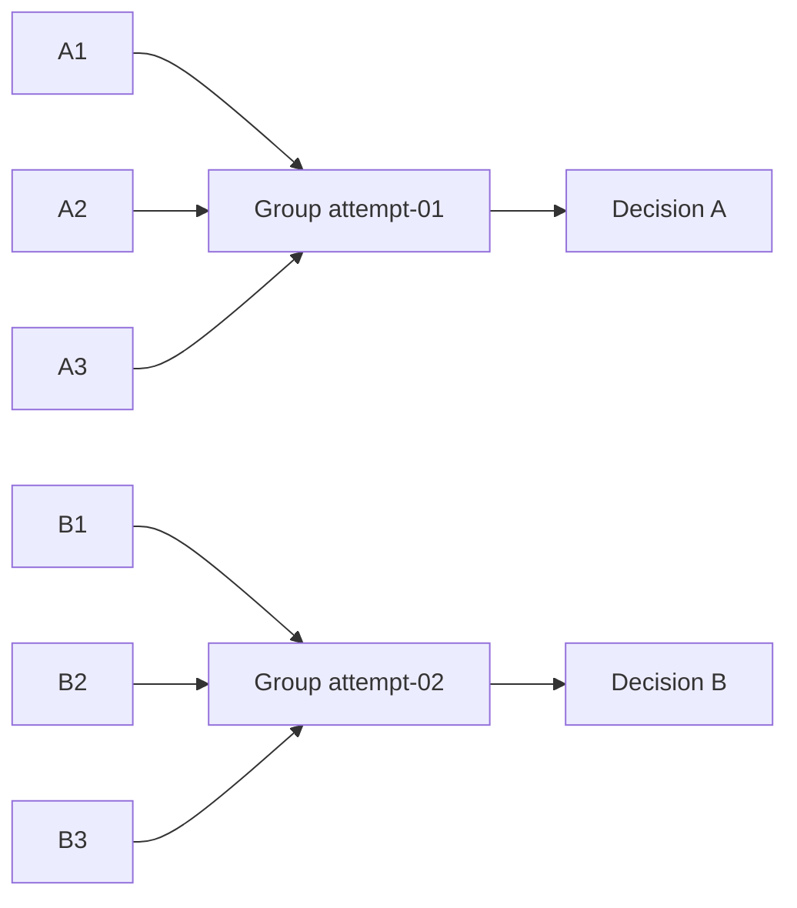
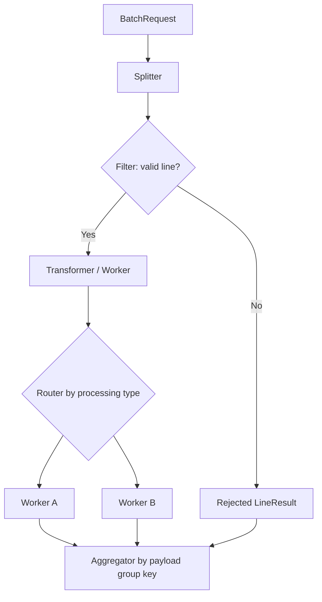
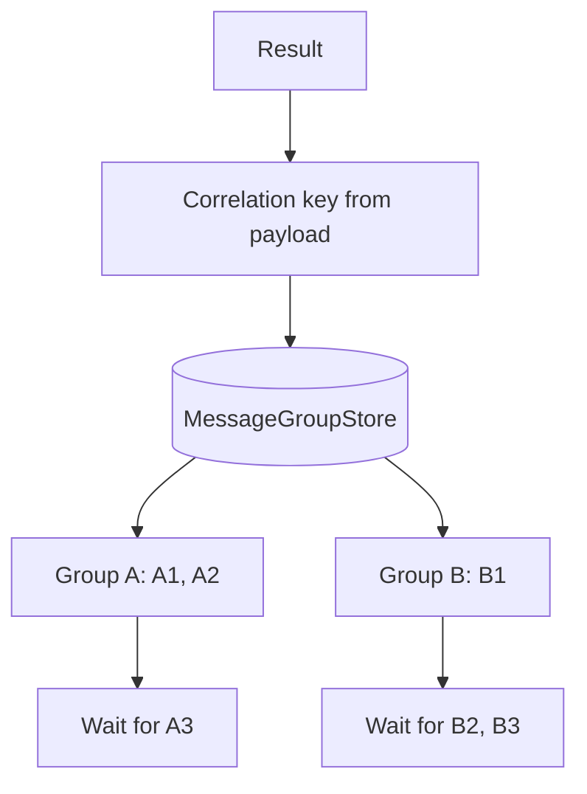
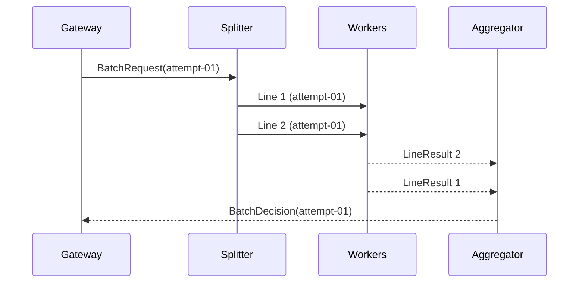

# Correlation Groups for Splitter and Aggregator

An order with multiple lines needs to be split for independent checks and then aggregated into a single result. A **Splitter** produces child messages; an **Aggregator** receives their outcomes and determines which messages belong together. Difficulty arises when messages pass through Routers, Transformers, queues, or asynchronous workers and arrive at the Aggregator in arbitrary order. If correlation info is lost or the wrong group key is chosen, the system can combine results from **two different orders, two tenants, or two processing runs**.

**Content-based correlation** identifies message groups based on **business-meaningful content**, such as `tenantId`, `orderId`, `batchAttemptId`, `documentId`, or a session identifier, rather than relying solely on automatic headers. It is not “convenient string concatenation”: a good correlation key must be scoped accurately, stay stable across processing steps, and be trustworthy enough never to mix data.

The lesson **Correlation Groups for Splitter and Aggregator** belongs to the **Content-based correlation** chapter in the `SPRING_INTEGRATION_PATTERN` module. The module teaches practical Enterprise Integration Patterns with Spring Integration—Router, Filter, Transformer, Splitter, Aggregator, Gateway, retry, error channel, and correlation—to build loosely coupled, extensible, testable, and observable flows. This lesson focuses on **propagating group info across splits, deriving correlation keys from payloads, accurately aggregating interleaved groups, and handling duplicates, missing messages, timeouts, and multi-instance deployments**.

## 1. The Problem: One Order, Multiple Child Results

Suppose a request generates three tasks:

```json
{
  "tenantId": "tenant-7",
  "orderId": "ORD-1001",
  "attemptId": "attempt-01",
  "items": [
    {"lineNumber": 1, "sku": "BOOK-01", "quantity": 2},
    {"lineNumber": 2, "sku": "PEN-02", "quantity": 5},
    {"lineNumber": 3, "sku": "BAG-03", "quantity": 1}
  ]
}
```

The Splitter emits three separate messages. After each line is validated or enriched, the Aggregator receives three results and builds a `BatchDecision`.



Here:

- The **parent message** is a batch containing three lines.
- A **child message** represents one line or task derived from the batch.
- A **group** is one specific batch processing run, not every message sharing the same payload type.
- The **correlation key** decides which group a message belongs to.
- The **release strategy** decides whether the group has enough results to emit a decision.

With only one batch and messages arriving in order, grouping bugs are easy to miss. We must also examine **two batches processed interleaved**.

## 2. Two Processing Runs of the Same Order Are Not the Same Group

Suppose `ORD-1001` is checked twice because the user changed quantities:

```text
Batch A:
  tenantId  = tenant-7
  orderId   = ORD-1001
  attemptId = attempt-01

Batch B:
  tenantId  = tenant-7
  orderId   = ORD-1001
  attemptId = attempt-02
```

Results may arrive as follows:

```text
A1 → B1 → A2 → B2 → B3 → A3
```

If the Aggregator uses **`orderId` as the correlation key**, all results land in one group keyed by `ORD-1001`. They belong to the same **business entity**, but **not the same processing run**.

A better-scoped key:

```text
correlationKey = tenantId + "|" + orderId + "|" + attemptId

Group A: tenant-7|ORD-1001|attempt-01
Group B: tenant-7|ORD-1001|attempt-02
```



Concatenating with `|` in this example is safe only when components **cannot contain the delimiter** or are encoded under an unambiguous rule. With arbitrary data, use a record key with explicit serialization or prefix/length encoding. Never use uncontrolled string concatenation to determine groups in multi-tenant systems.

## 3. Correlation Strategy, Release Strategy, and Aggregation Strategy

These three concerns must remain conceptually separate:

| Question | Component | Example |
| --- | --- | --- |
| Which **group** does this message belong to? | Correlation strategy | `tenantId + orderId + attemptId` |
| Does this group **have enough data**? | Release strategy | All `lineNumber`s from 1 to N present |
| Once complete, **what result is produced**? | Output processor / aggregation strategy | `BatchDecision` |

In Spring Integration, the Aggregator typically uses a `MessageGroupStore` to hold messages not yet ready for release.

```text
Message input
    |
    v
correlationStrategy(message) -> groupKey
    |
    v
MessageGroupStore[groupKey] += message
    |
    v
releaseStrategy(group) -> true/false
    |
    +-- false: keep group, wait for more results
    |
    +-- true: outputProcessor(group) -> BatchDecision
```

**Sharing a correlation key does not mean the group is complete.** For example, group A holding three results `A1`, a duplicate `A1`, and `A2` is still **missing A3**; releasing solely on a count of three messages leads to wrong decisions.

Conversely, knowing `sequenceSize=3` does not tell you **which group** a message belongs to; two independent batches can both have three items.

## 4. Content-Based Correlation Differs from Header-Based Correlation

Spring Integration supports common group metadata:

| Header | Role |
| --- | --- |
| `correlationId` | Identifies a set of related messages |
| `sequenceNumber` | Position of an element within the set |
| `sequenceSize` | Expected number of elements when size is known |

A Splitter typically attaches **sequence headers** to child messages. The Aggregator has default strategies using the correlation header; if the flow preserves them intact, you do not necessarily have to write a custom content-based strategy.

**Content-based correlation is useful when:**

1. Messages come from external sources without a `correlationId` header.
2. Messages cross brokers or adapters that do not preserve certain internal headers.
3. Grouping must follow **business semantics** rather than auto-generated per-message IDs.
4. Results from multiple branches and sources share the same `attemptId`.
5. You need control over tenant, workflow, version, or time-window scope.

**It does not automatically fix bad metadata.** If a producer writes the wrong `attemptId` in the payload, the Aggregator will group wrongly by that exact value. A content-based strategy needs a **trusted input data contract**, validation, and testing.

### 4.1. Do Not Use Message ID as Group Key

Child messages generally have distinct `MessageHeaders.ID`s; if every ID becomes a group key, no group ever gathers enough items.

### 4.2. Do Not Use Sequence Number as Group Key

Messages `A1` and `B1` both have `sequenceNumber=1`, yet belong to different batches. Sequence describes **position within a group**, not **group identity**.

### 4.3. Do Not Assume `traceId` Is a Group Key

A distributed trace can span multiple sub-requests, batches, or retries. Tracing IDs serve observability; their scope may differ from the group scope the Aggregator needs.

## 5. Deciding Which Content May Participate in a Correlation Key

Not every payload field is suitable for a group key.

| Field | Should You Use It? | Reason |
| --- | --- | --- |
| `tenantId` | Usually required in multi-tenant systems | Prevents mixing data across tenants |
| `batchAttemptId` | Very suitable | Identifies one specific processing run |
| `orderId` | Useful, yet insufficient with retries/reprocessing | One order can have multiple attempts |
| `lineNumber` | Never use as **group key** | Lines must share a group, not split it |
| `customerName` | Usually not | Mutable and non-unique |
| `amount` | Usually not | Not a stable identifier |
| Worker-stamped `timestamp` | Dangerous | Differs across child messages |
| `sourceSystem` | Usable as namespace | Scope of origin must be explicit |

A good correlation key has four properties:

- **Stable:** every message of the same attempt yields the same value.
- **Distinct:** two independent attempts never share a key.
- **Canonical:** casing, whitespace, and encoding are defined.
- **Transport-resilient:** reconstructible when messages are serialized and sent through adapters.

### Keys Must Be Locked In at the Right Time

If the system allocates `attemptId` at the first step, embed that value in every child message. Never let individual workers mint new attempt IDs mid-processing, or one batch will splinter into multiple groups.

Do not use fields **that can change after enrichment** as keys; for example, customer tier or shipping address is not the stable identity of an inspection batch.

## 6. Designing Payloads to Reconstruct Groups After a Splitter

To avoid depending solely on headers, design child messages with full context:

```text
BatchRequest:
  tenantId
  orderId
  attemptId
  items[]

LineTask (after Splitter):
  tenantId
  orderId
  attemptId
  expectedLines
  lineNumber
  sku
  quantity

LineResult (after worker):
  tenantId
  orderId
  attemptId
  expectedLines
  lineNumber
  sku
  accepted
```

Each `LineResult` carries the fields needed to identify its **group**, **position**, and **completion condition**.

JSON example:

```json
{
  "tenantId": "tenant-7",
  "orderId": "ORD-1001",
  "attemptId": "attempt-01",
  "expectedLines": 3,
  "lineNumber": 2,
  "sku": "PEN-02",
  "accepted": true
}
```

Advantage: after crossing HTTP, Kafka, AMQP, or another header-mapping system, consumers can still determine the group **provided the payload arrives intact per schema**.

Trade-off: payloads must carry extra business metadata; producers and consumers must agree on schema versions, access permissions, and validation rules.

**Do not stuff every technical metadata field into the payload just because you can.** Keep business correlation explicit; tracing, internal reply channels, or in-JVM Java objects still belong in appropriate envelopes/transports.

## 7. Java 17+ Model: A Batch and Its Related Elements

The example below uses `record`s to represent immutable data. These DTOs reside in one illustrative Java file.

```java
package example.integration;

import java.util.List;
import java.util.Objects;

public final class CorrelationModel {

    private CorrelationModel() {
    }

    public record LineItem(int lineNumber, String sku, int quantity) {
    }

    public record BatchRequest(
            String tenantId,
            String orderId,
            String attemptId,
            List<LineItem> items) {

        public BatchRequest {
            Objects.requireNonNull(tenantId, "tenantId");
            Objects.requireNonNull(orderId, "orderId");
            Objects.requireNonNull(attemptId, "attemptId");
            items = List.copyOf(items);
            if (items.isEmpty() || items.size() > 100) {
                throw new IllegalArgumentException(
                        "Batch size must be between 1 and 100");
            }
        }
    }

    public record LineTask(
            String tenantId,
            String orderId,
            String attemptId,
            int expectedLines,
            LineItem item) {
    }

    public record LineResult(
            String tenantId,
            String orderId,
            String attemptId,
            int expectedLines,
            int lineNumber,
            String sku,
            boolean accepted) {
    }

    public record BatchDecision(
            String tenantId,
            String orderId,
            String attemptId,
            int receivedLines,
            long acceptedLines,
            List<Integer> orderedLineNumbers) {
    }
}
```

The contract requires `LineItem.lineNumber` to form the set **1 through N**, each number appearing once; `tenantId`, `orderId`, and `attemptId` must be valid and contain no group-key delimiters. Detailed validation supports correlation/release and should execute **early at ingress** in a real application.

The 100-item batch cap is an **illustrative policy**, not a default Spring Integration limit.

## 8. Spring Integration: Splitter Preserves Context, Aggregator Groups from Payload

We use three steps:

1. `@Splitter` splits `BatchRequest` into `LineTask`s and **copies group context into each task**.
2. `IntegrationFlow` transforms each `LineTask` into a `LineResult`.
3. `Aggregator` derives the correlation key from `LineResult` itself, not from Message ID or `sequenceNumber`.

### 8.1. Java DSL Configuration and Splitter Endpoint

```java
package example.integration;

import java.util.Comparator;
import java.util.List;
import java.util.Set;
import java.util.stream.Collectors;

import org.springframework.beans.factory.annotation.Qualifier;
import org.springframework.context.annotation.Bean;
import org.springframework.context.annotation.Configuration;
import org.springframework.integration.annotation.Splitter;
import org.springframework.integration.channel.DirectChannel;
import org.springframework.integration.channel.QueueChannel;
import org.springframework.integration.config.EnableIntegration;
import org.springframework.integration.dsl.IntegrationFlow;
import org.springframework.integration.store.MessageGroupStore;
import org.springframework.integration.store.SimpleMessageStore;
import org.springframework.messaging.MessageChannel;
import org.springframework.messaging.PollableChannel;

import example.integration.CorrelationModel.*;

@Configuration
@EnableIntegration
public class ContentCorrelationConfiguration {

    @Bean
    public MessageChannel incomingBatches() {
        return new DirectChannel();
    }

    @Bean
    public MessageChannel splitLineTasks() {
        return new DirectChannel();
    }

    @Bean
    public MessageChannel lineResults() {
        return new DirectChannel();
    }

    @Bean
    public PollableChannel batchDecisions() {
        return new QueueChannel(20);
    }

    @Bean
    public MessageGroupStore correlationGroupStore() {
        // Demo: groups live in JVM RAM.
        return new SimpleMessageStore();
    }

    @Splitter(
            inputChannel = "incomingBatches",
            outputChannel = "splitLineTasks")
    public List<LineTask> split(BatchRequest batch) {
        int expected = batch.items().size();

        return batch.items().stream()
                .map(item -> new LineTask(
                        batch.tenantId(),
                        batch.orderId(),
                        batch.attemptId(),
                        expected,
                        item))
                .toList();
    }

    @Bean
    public IntegrationFlow simulateLineWorker() {
        return IntegrationFlow.from("splitLineTasks")
                .transform(LineTask.class, task -> new LineResult(
                        task.tenantId(),
                        task.orderId(),
                        task.attemptId(),
                        task.expectedLines(),
                        task.item().lineNumber(),
                        task.item().sku(),
                        task.item().quantity() > 0))
                .channel("lineResults")
                .get();
    }

    @Bean
    public IntegrationFlow aggregateByContent(
            @Qualifier("correlationGroupStore")
                    MessageGroupStore store) {

        return IntegrationFlow.from("lineResults")
                .aggregate(spec -> spec
                        .correlationStrategy(message ->
                                groupKey((LineResult) message.getPayload()))
                        .releaseStrategy(group -> {
                            List<LineResult> values =
                                    group.getMessages().stream()
                                            .map(message ->
                                                    (LineResult)
                                                            message.getPayload())
                                            .toList();

                            if (values.isEmpty()) {
                                return false;
                            }

                            int expected = values.get(0).expectedLines();
                            if (expected < 1 || expected > 100) {
                                throw new IllegalArgumentException(
                                        "Invalid expectedLines");
                            }

                            Set<Integer> numbers = values.stream()
                                    .map(LineResult::lineNumber)
                                    .collect(Collectors.toSet());

                            boolean sameSize = values.stream().allMatch(
                                    result ->
                                            result.expectedLines() == expected);

                            return sameSize
                                    && values.size() == expected
                                    && numbers.size() == expected
                                    && numbers.stream().allMatch(
                                            n -> n >= 1 && n <= expected);
                        })
                        .outputProcessor(group -> {
                            List<LineResult> values =
                                    group.getMessages().stream()
                                            .map(message ->
                                                    (LineResult)
                                                            message.getPayload())
                                            .sorted(Comparator.comparingInt(
                                                    LineResult::lineNumber))
                                            .toList();

                            LineResult first = values.get(0);
                            boolean sameIdentity = values.stream().allMatch(
                                    result -> groupKey(result)
                                            .equals(groupKey(first)));
                            if (!sameIdentity) {
                                throw new IllegalStateException(
                                        "Mixed group identities");
                            }

                            long accepted = values.stream()
                                    .filter(LineResult::accepted)
                                    .count();
                            List<Integer> numbers = values.stream()
                                    .map(LineResult::lineNumber)
                                    .toList();

                            return new BatchDecision(
                                    first.tenantId(),
                                    first.orderId(),
                                    first.attemptId(),
                                    values.size(),
                                    accepted,
                                    numbers);
                        })
                        .messageStore(store)
                        .expireGroupsUponCompletion(true))
                .channel("batchDecisions")
                .get();
    }

    private static String groupKey(LineResult value) {
        return part(value.tenantId()) + "|"
                + part(value.orderId()) + "|"
                + part(value.attemptId());
    }

    private static String part(String input) {
        if (input == null
                || !input.matches("[A-Za-z0-9_-]{1,64}")) {
            throw new IllegalArgumentException(
                    "Invalid component of correlation key");
        }
        return input;
    }
}
```

### 8.2. Reading the Flow End to End

- `@Splitter` receives `BatchRequest` and emits `LineTask`s. Each task **receives copies** of `tenantId`, `orderId`, `attemptId`, and `expectedLines`.
- `simulateLineWorker` is a simplified Transformer using `quantity > 0` to illustrate `accepted`; **it calls no real service** and introduces no concurrency.
- `lineResults` carries messages with a `LineResult` payload.
- `correlationStrategy` uses the **payload**, producing `tenant|order|attempt`. It does not rely on any `correlationId` header the Splitter may have attached.
- `releaseStrategy` allows release only when the message count equals `expectedLines`, all messages agree on `expectedLines`, and all distinct `lineNumber`s in `1..N` are present.
- `outputProcessor` sorts by `lineNumber` and produces a single `BatchDecision`.
- `SimpleMessageStore` holds groups in RAM; `.expireGroupsUponCompletion(true)` cleans up completed groups under the demo endpoint policy.

These expressions embody the three roles **select group → check completeness → build output**; changing one role does not automatically alter the other two.

### 8.3. Limitations of This Example

1. The N = 100 limit is an illustrative rule needing validation at ingress.
2. **Duplicates** or invalid inputs can push `values.size()` past N; the example lacks deduplication or input quarantine.
3. `DirectChannel` runs synchronously; the flow does not demonstrate parallelism, cross-transport correlation, or persistence across restarts.
4. `QueueChannel(20)` bounds the output queue, **not the number of open groups waiting in `MessageGroupStore`**.
5. Specific Java DSL method/overload names and configurations must be verified against your project's Spring Integration version when compiling.

**This example illustrates flow mechanics and business behavior**, not a production template solving timeouts, idempotency, durable state stores, and end-to-end error handling.

## 9. Full Input: From BatchRequest to BatchDecision

A small driver can submit a two-line batch:

```java
package example.integration;

import java.util.List;

import org.springframework.context.annotation.AnnotationConfigApplicationContext;
import org.springframework.messaging.Message;
import org.springframework.messaging.MessageChannel;
import org.springframework.messaging.PollableChannel;
import org.springframework.messaging.support.MessageBuilder;

import example.integration.CorrelationModel.*;

public class ContentCorrelationDemo {

    public static void main(String[] args) {
        try (var context = new AnnotationConfigApplicationContext(
                ContentCorrelationConfiguration.class)) {

            MessageChannel input = context.getBean(
                    "incomingBatches", MessageChannel.class);
            PollableChannel output = context.getBean(
                    "batchDecisions", PollableChannel.class);

            BatchRequest request = new BatchRequest(
                    "tenant-7",
                    "ORD-1001",
                    "attempt-01",
                    List.of(
                            new LineItem(1, "BOOK-01", 2),
                            new LineItem(2, "PEN-02", 5)));

            input.send(MessageBuilder.withPayload(request)
                    .setHeader("eventId", "evt-1001")
                    .build());

            Message<?> message = output.receive(0);
            if (message == null) {
                throw new IllegalStateException(
                        "Expected a batch decision");
            }
            BatchDecision decision =
                    (BatchDecision) message.getPayload();

            System.out.println(decision.attemptId()); // attempt-01
            System.out.println(decision.receivedLines()); // 2
            System.out.println(decision.acceptedLines()); // 2
            System.out.println(
                    decision.orderedLineNumbers()); // [1, 2]
        }
    }
}
```

In this demo using synchronous `DirectChannel`s, both child messages pass through the Transformer to the Aggregator before `input.send()` returns. The output `QueueChannel` retains the decision message for subsequent reads.

If switched to executors or brokers, **never assume** results are immediately ready right after `send()`: you need bounded timeouts, cross-transport correlation, and proper per-endpoint exception handling.

## 10. The Most Important Test: Two Interleaved Groups

Testing only a single completed batch makes overly broad correlation strategies hard to spot. Send `LineResult`s directly into the Aggregator channel to simulate workers returning interleaved results.

```text
Send results:
  A1, B1, A2, B2

Requirements:
  A = tenant-7|ORD-1001|attempt-01
  B = tenant-7|ORD-1001|attempt-02

Expectations:
  After A1, B1: neither group is complete.
  After A2: only A completes.
  After B2: B completes.
```

### 10.1. JUnit 5 Using Real Channels

```java
package example.integration;

import static org.junit.jupiter.api.Assertions.*;

import org.junit.jupiter.api.Test;
import org.springframework.context.annotation.AnnotationConfigApplicationContext;
import org.springframework.integration.IntegrationMessageHeaderAccessor;
import org.springframework.messaging.Message;
import org.springframework.messaging.MessageChannel;
import org.springframework.messaging.PollableChannel;
import org.springframework.messaging.support.MessageBuilder;

import example.integration.CorrelationModel.*;

class ContentCorrelationIntegrationTest {

    private static void send(
            MessageChannel channel,
            String attempt,
            int number) {
        LineResult result = new LineResult(
                "tenant-7",
                "ORD-1001",
                attempt,
                2,
                number,
                "SKU-" + number,
                true);

        assertTrue(channel.send(MessageBuilder
                .withPayload(result)
                .setHeader(
                        IntegrationMessageHeaderAccessor.CORRELATION_ID,
                        "deliberately-shared-header")
                .build()));
    }

    @Test
    void contentKeySeparatesTwoAttemptsEvenWithSameOrderAndHeader() {
        try (var context = new AnnotationConfigApplicationContext(
                ContentCorrelationConfiguration.class)) {

            MessageChannel input = context.getBean(
                    "lineResults", MessageChannel.class);
            PollableChannel output = context.getBean(
                    "batchDecisions", PollableChannel.class);

            send(input, "attempt-01", 1);
            send(input, "attempt-02", 1);
            assertNull(output.receive(0));

            send(input, "attempt-01", 2);
            Message<?> first = output.receive(0);
            assertNotNull(first);
            BatchDecision a = (BatchDecision) first.getPayload();
            assertEquals("attempt-01", a.attemptId());
            assertEquals("ORD-1001", a.orderId());
            assertEquals(2, a.receivedLines());
            assertEquals(2L, a.acceptedLines());
            assertEquals(java.util.List.of(1, 2),
                    a.orderedLineNumbers());

            // B still has only one element.
            assertNull(output.receive(0));

            send(input, "attempt-02", 2);
            Message<?> second = output.receive(0);
            assertNotNull(second);
            BatchDecision b = (BatchDecision) second.getPayload();
            assertEquals("attempt-02", b.attemptId());
            assertEquals(2, b.receivedLines());
            assertNull(output.receive(0));
        }
    }
}
```

The test intentionally sets the **exact same `correlationId` header** on messages from A and B. If the Aggregator accidentally relied on that header, they would merge together. Because `correlationStrategy` actually reads the payload, the two attempts stay separate.

**Never share a wrong header like that in production**: this is a test proving the strategy is content-based. In a real system, align headers and payloads so you do not create two conflicting group identifiers accidentally.

### 10.2. Limitations of This Test

The test uses synchronous `DirectChannel`s and `SimpleMessageStore`. It proves **proper grouping within one application context**, without testing restarts, database transactions, broker redeliveries, or multiple instances updating a group concurrently.

## 11. Missing or Invalid Correlation Key Inputs

A content-based correlation strategy must never silently dump every invalid message into an `"UNKNOWN"` group.

Bad input example:

```text
tenantId = null
orderId = ORD-1001
attemptId = ""
```

If code coerces missing values into `""`, unrelated messages can share a group key and form a nonsensical group. That is dangerous in multi-tenant systems.

A clear policy:

1. Validate `tenantId`, `orderId`, and `attemptId` at the boundary.
2. Reject or route invalid messages to an error flow.
3. Log event identifiers and reason codes in a controlled manner.
4. Never synthesize a group with an arbitrary default value.
5. Never try to infer keys from unstable fields like customer name.

In Section 8's example, `part(...)` allows only letters, digits, `_`, and `-`, up to 64 characters. This policy keeps `|` concatenation unambiguous. Real systems may need Unicode identifiers or other formats; in that case choose an **encoding that separates and serializes stably**.

### Avoid Dynamic Keys Based on Branch Outcome

Never write:

```text
if riskApproved:
    groupKey = orderId + "-approved"
else:
    groupKey = orderId + "-rejected"
```

Two messages from the same attempt with different check outcomes would split into two groups. The group key must be determined **before knowing processing outcomes**; `APPROVED`/`REJECTED` belongs in the aggregation logic.

## 12. Duplicates: Same Group, Not a New Element

Suppose the Aggregator expects three lines `1, 2, 3`:

```text
Line 1: first arrival
Line 2: first arrival
Line 2: redelivered by broker
Line 3: not yet arrived
```

If the release strategy only checks:

```java
.releaseStrategy(group -> group.size() == 3)
```

then the group releases prematurely. In Section 8, we checked both the **set of `lineNumber`s** and `expectedLines`, yet that is **still not a complete deduplication mechanism**:

- When two messages arrive for the same line, `group.size()` exceeds the expected element count and stalls the group.
- A `lineNumber` might have two valid versions; you must define which version supersedes.
- Repeated messages increase memory usage, lock contention, and wait times.

### 12.1. Deduplicate by Business Identity

An identity key for a result might be:

```text
dedupeKey =
  tenantId + "|" + orderId + "|" + attemptId
  + "|" + lineNumber
  + "|" + resultVersion
```

Distinguish clearly:

| ID Type | Scope |
| --- | --- |
| `groupKey` | Entire batch/attempt |
| `lineNumber` or `lineId` | One element in the batch |
| `resultVersion` | Outcome version for that element |
| `eventId` | Emitted event or message creation |
| `MessageHeaders.ID` | Specific message in Spring Messaging |

When a message is redelivered, infrastructure IDs can change; deduplication must rely on business identity **stable across retries**. For critical data, deduplication state also needs persistence and a retention policy.

### 12.2. Do Not Filter Duplicates Only After the Aggregator Releases

If the group already released prematurely or output caused side effects, catching duplicates in `outputProcessor` is too late. Deduplicate **before or during group updates**, or use an aggregation strategy strong enough to manage per-line versions.

## 13. Filters and Routers Can Prevent a Group from Completing

Flows rarely consist solely of a Splitter and Aggregator:



If the Splitter sets `expectedLines=3` and a Filter drops line 2 **without emitting a replacement outcome**, the Aggregator sees only two valid results. Content-based correlation still assigns groups accurately, yet **cannot invent missing elements**.

One solution is emitting a `LineResult` with `accepted=false` and a `reasonCode` for rejected lines, preserving `lineNumber` and the group key. That gives the Aggregator complete data to mark the batch rejected or needing review.

If a Router fans out one child message to **multiple recipients**, one line can produce multiple results. You then need a result model with `branchType`, `lineNumber`, and a matching release rule—it is no longer simply “one result per line.”

### 13.1. Correlation Key Is Not Routing Key

A Router chooses **where a message goes**. A Correlation strategy chooses **which group a message belongs to**. Both may inspect the payload, yet serve different goals:

```text
routingKey     = resultType    // INVENTORY, PRICING, SHIPPING
correlationKey = attemptId     // same processing run
```

Never use `resultType` as the correlation key when gathering results across multiple check types within the same processing run.

## 14. Transformers, Content Enrichers, and Correlation Data

A Transformer may convert:

```text
RawLineResponse → CanonicalLineResult
```

A Content Enricher may append:

```text
LineResult + ProductInfo → EnrichedLineResult
```

In both cases, **preserve the group identity** established when the workflow began. If `tenantId`, `orderId`, and `attemptId` are dropped from the resulting DTO, a payload-based Aggregator no longer has enough data to compute the key.

### 14.1. Do Not Derive Keys from Unstably Transformed Payloads

Order ID normalization example:

```text
Input A: "ord-1001"
Input B: "ORD-1001"
```

If one worker uppercases and another preserves original case, two results can land in **two groups** even though the business treats them as one. Normalize **before the Splitter** or apply a single tested normalization function everywhere.

### 14.2. When Only Headers Exist Without Business Context

If an adapter retains `correlationId` only in a header, you can still use **header-based correlation**. You are not forced to duplicate every field into the payload. A content-based strategy shines when content carries a stable identifier across boundaries under a verified contract.

## 15. Group Timeouts, Expiration, and Late Messages

A group may never receive all results:

```text
Group A:
  line 1 -> OK
  line 2 -> OK
  line 3 -> not yet arrived
```

A **persistent `MessageGroupStore`** preserves waiting state across restarts, yet cannot fix a missing line 3. You need time and error policies:

| Situation | Policy to Define |
| --- | --- |
| A worker times out | Bounded retries or emit failure result |
| A message is dropped by Filter | Emit rejected result or mark missing |
| A message arrives past deadline | Ignore, audit, or start a new attempt/version |
| A group waits forever | Group timeout, expiration, and cleanup |
| A group releases partially | Flag missing data; never pretend it is complete |
| Retries deliver after completion | Completion registry and deduplication |

### 15.1. Why Is `.expireGroupsUponCompletion(true)` Not Enough?

Depending on store configuration and group lifecycle, once a group completes and is purged, a late message with the **same key** can spawn a brand-new group. Simply deleting group state does not guarantee an already-completed attempt will never emit a second result.

To prevent re-emitting decisions for the same attempt, **record completion/deduplication state** long enough under the appropriate group key and version.

### 15.2. Timeout and Release Are Not the Same

A timeout can end **waiting**, yet it does not prove all elements arrived. When emitting partial outcomes, the output must explicitly report `INCOMPLETE` status and the missing lines if application policy permits partial emission.

## 16. `MessageGroupStore`: State Storage Scope and Group Locking

The Aggregator needs a place to hold received messages:



Spring Integration provides the `MessageGroupStore` abstraction along with in-memory or durable implementations such as JDBC. Our example used `SimpleMessageStore` for learning convenience; it does not preserve groups across JVM restarts.

### 16.1. With an In-Memory Store

- Low I/O overhead and simple setup.
- Does not share state across two JVMs/replicas.
- If too many groups wait, heap usage can spike.
- Restarts lose progress of incomplete groups.

### 16.2. With a Persistent Store

- Can preserve committed groups across restarts.
- Requires schemas, serialization, transactions, cleanup, and locking.
- When multiple instances share a store, concurrent access to the same group must be coordinated.
- Does not automatically make broker ACKs or output side effects exactly-once.

An illustrative configuration replacement:

```java
// Illustrative bean replacing SimpleMessageStore in Section 8.
// Requires spring-integration-jdbc, DB schema, and preconfigured DataSource.
@Bean
public MessageGroupStore correlationGroupStore(DataSource dataSource) {
    return new JdbcMessageStore(dataSource);
}
```

This snippet requires importing `javax.sql.DataSource` and `org.springframework.integration.jdbc.store.JdbcMessageStore`, and **must not register under the same bean name** as the in-memory `correlationGroupStore()` bean. This is not yet a complete production configuration.

### 16.3. Open-Group Backlog Is a Separate Problem from Correlation

A right key keeps groups **from mixing**, yet you can still accumulate thousands of distinct groups waiting for their final message. Monitor open group counts, messages/bytes in the store, group age, throughput, and timeout/cleanup policies.

## 17. Concurrency, Partitioning, and Multiple Instances

If two replicas simultaneously receive messages for group A, avoid two hazards:

1. Replicas 1 and 2 use **two separate in-memory stores**, each holding half the group → neither releases.
2. Both share **one persistent store** yet update or release the group concurrently without proper locking/transactions → lost updates or duplicate decisions.

Options:

| Option | Effect | Limitations |
| --- | --- | --- |
| Partition messages by `groupKey` | Routes messages of one group to the same partition/consumer | Depends on broker config and rebalancing |
| Shared persistent `MessageGroupStore` | All instances see the same groups | Requires locking and transactions |
| Appropriate distributed `LockRegistry` | Coordinates updates/releases on the same group | Requires timeouts/leases and proper implementation |
| Idempotent consumer | Reduces duplicate side effects | Cannot complete a group missing a message |
| Completion registry | Blocks late replies from re-releasing | Needs retention and durable state |

**Choosing the same `groupKey` does not guarantee messages physically reach the same process.** Correlation strategy decides the group **when an endpoint receives a message**. Topology and transport must support proper message distribution.

## 18. Gateway, Retries, and Reply Correlation

A Gateway may expect one aggregated result per request:



For the reply to return to the right Gateway call:

- Business group key gathers the exact `LineResult`s of that attempt.
- The flow preserves metadata or reply addresses needed for request–reply.
- Group timeout and Gateway timeout are intentionally aligned.
- If the Gateway times out, an explicit policy handles late replies.
- If steps have side effects, retries enforce idempotency by attempt + line/operation.

**Aggregator group correlation** and **transport request/reply correlation** can differ. Never assume setting `attemptId` in the payload automatically routes replies across Kafka/AMQP back to a Gateway.

## 19. Observability and Testing Hard-to-Spot Bugs

An illustrative log when the Aggregator receives a message:

```json
{
  "stage": "content-correlation-aggregator",
  "tenantId": "tenant-7",
  "orderId": "ORD-1001",
  "attemptId": "attempt-01",
  "lineNumber": 2,
  "expectedLines": 3,
  "receivedLineNumbers": [1, 2],
  "groupStatus": "WAITING",
  "missingLineNumbers": [3]
}
```

This is an **application-defined log schema**, not automatic JSON from Spring Integration. Record IDs in logs/traces with proper access controls; never use them as high-cardinality metric tags.

| Suggested Metric | Meaning |
| --- | --- |
| `correlation.group.created` | New groups opened |
| `correlation.group.pending` | Incomplete groups |
| `correlation.group.released` | Groups that emitted output |
| `correlation.group.expired` | Groups that timed out |
| `correlation.key.invalid` | Messages with invalid correlation keys |
| `correlation.result.duplicate` | Duplicate results by group/line/version |
| `correlation.result.late` | Results arriving after completion |
| `correlation.group.age` | Time spent waiting in groups |
| `correlation.group.member.count` | Messages currently held in groups |
| `correlation.output.failure` | Failures delivering aggregated outputs |

These are **suggested names to instrument**, not guaranteed default metrics emitted by Spring Integration/Micrometer.

### 19.1. Essential Test Suite

| Scenario | Expectation |
| --- | --- |
| One batch with all N lines | One `BatchDecision` containing all N lines |
| Two attempts with same `orderId` | Results never mix |
| Two tenants with same order/attempt codes | Results never mix |
| Replies arrive out of order | Same group; output sorted as required |
| Missing one line | No premature release; timeout/error policy triggers |
| Duplicate line | Not counted as a new line |
| Missing tenant/attempt ID | Never lumped into `"UNKNOWN"` group |
| Transformer drops header | Still groups from payload if payload suffices |
| Transformer drops payload context | Validation fails rather than silently misgrouping |
| Filter drops one line | Emits rejected result or follows explicit partial policy |
| Router fans out one line | Release reflects actual expected result count |
| Restart while group is waiting | Persistent store/serialization genuinely verified |
| Two instances handle the same group | Locking/partitioning and dedup work properly |
| Late result arrives | Never re-emits out-of-contract output |

## 20. Checklist for Implementing Correlation Groups

- **Define the group in business terms:** one order, one attempt, one batch, or one window?
- **Mint attempt ID at the entry boundary:** all child messages must use the same run ID.
- **Scope by tenant/origin:** never allow two different customers to merge.
- **Distinguish correlation from sequence:** group key is not `lineNumber`.
- **Designate one trusted key source:** payload or preserved header; avoid two conflicting keys.
- **Canonicalize keys:** casing, delimiters, Unicode, versions, and serialization.
- **Verify context after Splitter:** every `LineTask` carries enough data to build a same-group `LineResult`.
- **Configure Aggregator deliberately:** correlation strategy, release strategy, output processor, and `MessageGroupStore`.
- **Never release solely on count:** check duplicates and required line/result sets.
- **Account for Filters/Routers:** never let a dropped branch stall a group forever.
- **Enforce timeouts and late-arrival policies:** group closure and partial states must be explicit.
- **Deduplicate by business identity:** group + line + version, not Message ID alone.
- **Test two interleaved groups:** especially multiple attempts sharing the same order ID.
- **Verify multi-instance/persistence:** partitioning, shared stores, transactions, and locks.
- **Monitor waiting groups:** counts, age, missing elements, duplicates, and output failures.

## 21. Exercise: When Two Attempts of the Same Order Get Merged by Mistake

A transaction-analysis system runs checks twice for `ORD-9001`:

```text
tenant=shop-A, order=ORD-9001, attempt=run-1
    result INVENTORY: PASS
    result PAYMENT:  REJECT

tenant=shop-A, order=ORD-9001, attempt=run-2
    result INVENTORY: PASS
    result PAYMENT:  PASS
```

Results arrive in this order:

```text
run-1/INVENTORY
run-2/INVENTORY
run-1/PAYMENT
run-2/PAYMENT
```

Analyze:

1. If only `orderId` is used as the correlation key, which groups can break?
2. If `tenant|order|attempt` is used, which group does each message join?
3. When `run-1/INVENTORY` is redelivered, is a release strategy checking `group.size()==2` safe?
4. If a Filter drops `run-1/PAYMENT`, what should the Aggregator do when the group stays incomplete?
5. If a Gateway waits 2 seconds for results while group timeout is 20 seconds, how should late replies be designed?

Guidance: **per-attempt correlation keys** keep the two checks separate; **required-outcome release strategies** prevent counting duplicates; **error/timeout policies** handle missing results; and **transport reply correlation** plus **late-arrival policies** must be designed separately for the Gateway. Changing a correlation expression alone does not guarantee completion, retries, or exactly-once behavior.

---

**A correlation group is a boundary isolating related messages, not a message counter.** When the Splitter copies stable business context into each child message and the Aggregator derives the same key from result contents, batches can process interleaved without mixing data. To make flows reliable in production, you must still independently solve **duplicates, release logic, timeouts, persistence, concurrency, and reply correlation**.
