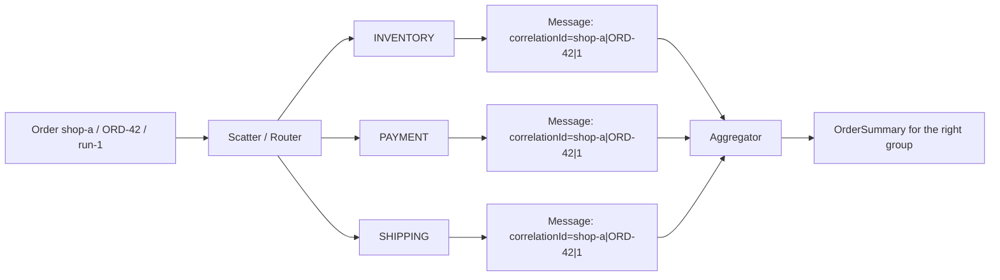
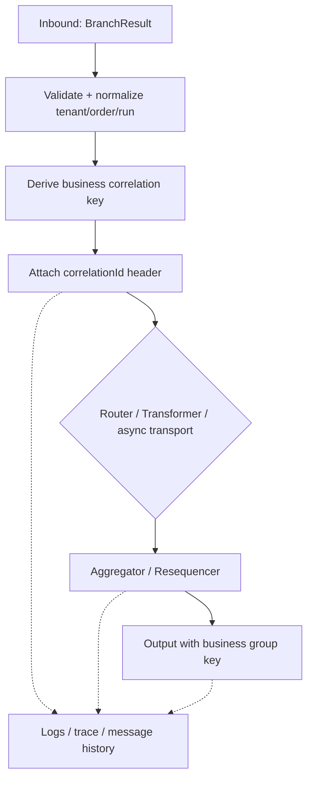
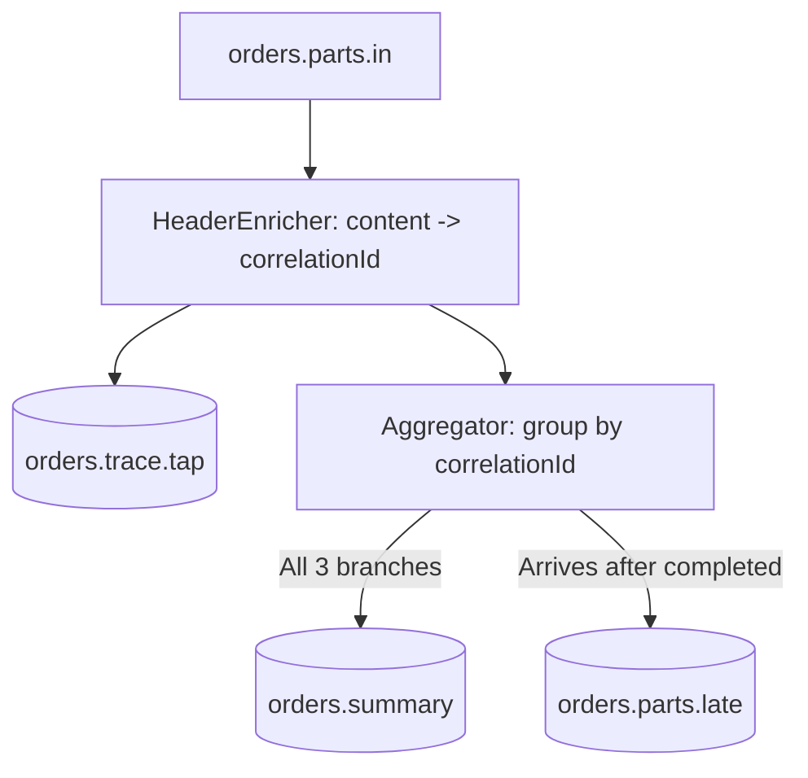
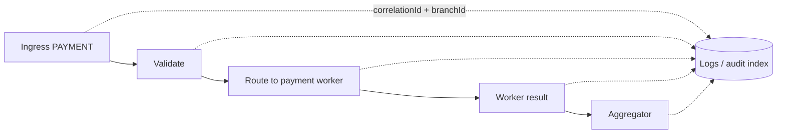
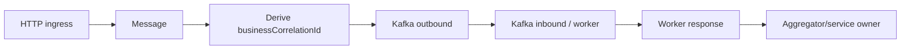

# Tracing Messages with Correlation ID in Spring Integration

## Lesson Objectives

An order-processing system runs three independent branches: **inventory check (INVENTORY)**, **payment confirmation (PAYMENT)**, and **shipping calculation (SHIPPING)**. Each branch returns a message upon completion. Because branches can execute on different workers, replies for multiple orders routinely **arrive interleaved**:

```text
Time        Tenant    Order     Run    Branch
T1          shop-a    ORD-42    1      INVENTORY
T2          shop-b    ORD-42    1      SHIPPING
T3          shop-a    ORD-42    1      PAYMENT
T4          shop-b    ORD-42    1      INVENTORY
T5          shop-b    ORD-42    1      PAYMENT
T6          shop-a    ORD-42    1      SHIPPING
```

Looking only at arrival order or order code `ORD-42`, the Aggregator could merge results from **two different tenants**. If every retry generates a new correlation key, messages of the same workflow splinter into multiple groups and never complete. Both to **gather related parts accurately** and to **trace the execution flow**, we need a stable, clearly scoped **correlation ID**.

In Spring Integration, **content-based correlation** computes the group key from **business content** of the message—such as `tenantId + orderId + runId`—rather than relying solely on an existing technical ID. Spring Integration supports default header-based correlation and custom payload/SpEL correlation strategies; those keys guide the Aggregator or Resequencer in forming groups.

This lesson belongs to the **Content-based correlation** chapter of the **SPRING_INTEGRATION_PATTERN** module. This track practices Enterprise Integration Patterns with Spring Integration—Router, Filter, Transformer, Splitter, Aggregator, Gateway, retry, error channel, and correlation—to build loosely coupled, extensible, testable, and observable message flows.

After this lesson, you will be able to:

1. Explain the difference between **business correlation ID**, **message ID**, **trace ID**, **request ID**, **sequence number**, and **idempotency key**.
2. Build correlation keys from validated content, preventing cross-tenant, cross-run, and cross-workflow mixing.
3. Use Java DSL `enrichHeaders(...correlationIdFunction(...))` with the Aggregator's default correlation.
4. Use `correlationStrategy(...)` or `correlationExpression(...)` to group directly from the payload.
5. Test two interleaved message groups, missing branches, late arrivals, wrong correlations, and duplicates.
6. Trace messages across Transformers, Routers, Gateways, brokers, and asynchronous branches using correlation ID alongside logs/traces/message history.
7. Understand limitations around security, state durability, retention, concurrency, and reproducing decisions across retries.

---

## 1. What Question Does a Correlation ID Answer?

A correlation ID answers:

> **Which messages belong to the same unit of business work?**

A message might carry only the result of the `PAYMENT` branch, yet belong to the same workflow as `INVENTORY` and `SHIPPING` results.



The three results **do not necessarily share `MessageHeaders.ID`**, nor are they necessarily created on the same thread. What links them is the deliberately defined group key.

### Correlation ID Is Not Ordering

`correlationId` identifies only the **group**, whereas `sequenceNumber` states which part precedes another when logical ordering matters. For an Aggregator receiving three branch results, ordering may not matter; for a Resequencer handling parts #1, #2, #3, ordering is essential.

### Correlation ID Does Not Tell the Whole Journey by Itself

A header containing `shop-a|ORD-42|1` helps find messages in the same group. However, to know which endpoints a message visited, how long it took, and where it failed, you also need:

- Structured logging per step and routing decision.
- Distributed tracing/observation for parent–child relationships and execution timings.
- Message history (when enabled and properly scoped).
- Business event/audit logs or outcome stores when tracing back days later.

Correlation ID is **a linking key** across those data sources, not an automatic historical ledger.

## 2. Distinguishing Six Commonly Confused IDs

| ID / Header | Purpose | Stability Level |
| --- | --- | --- |
| `MessageHeaders.ID` | Identifies a specific `Message<?>` instance | May change when building a new message |
| `correlationId` | Groups related messages in Aggregator/Resequencer | Stable within **one group** |
| `traceId` | Links spans in a distributed trace | Follows trace context; not identical to business workflow |
| `requestId` | Identifies an API request/session or transaction | Follows ingress/API contract |
| `orderId` / `workflowId` | Identifies a business entity/process | Domain-stable; may be reused across multiple runs |
| `idempotencyKey` | Prevents executing the same command/side effect twice | Scoped to the side effect being protected |

Example:

```text
messageId      = 2f3e... (technical message of the PAYMENT branch)
traceId        = 8a21... (an observability trace)
orderId        = ORD-42
workflowRun    = 1
correlationId  = shop-a|ORD-42|1
idempotencyKey = shop-a|ORD-42|1|PAYMENT|capture
```

- One order can have multiple workflow runs, yet each run should have a **distinct group key**.
- One group can span multiple traces (e.g., broker retry an hour later); a new trace does not change the group.
- Multiple messages in a group can carry different message IDs.
- A correlation ID **does not automatically block duplicate side effects**.

Never use `MessageHeaders.ID` as a business key across retries or `traceId` as a correlation group merely because both look like UUID strings.

## 3. Content-Based Correlation: Which Data Computes the Key?

Lesson model:

```java
public record BranchResult(
    String tenantId,
    String orderId,
    int runId,
    String branchId,
    String status
) {}
```

The first three fields identify **one specific workflow**:

```text
groupKey = tenantId + "|" + orderId + "|" + runId
```

Examples:

```text
shop-a|ORD-42|1
shop-a|ORD-42|2
shop-b|ORD-42|1
```

Even though both tenants share order code `ORD-42`, they **are not merged**. When re-running `shop-a`'s workflow, `runId=2` forms an independent group from run 1.

### Distinguishing Group Key and Part Key

| Key | Example | Function |
| --- | --- | --- |
| Group key | `shop-a|ORD-42|1` | Collects results belonging to one workflow |
| Part key | `shop-a|ORD-42|1|PAYMENT` | Uniquely identifies one result from the `PAYMENT` branch |
| Attempt key | `shop-a|ORD-42|1|PAYMENT|attempt-2` | Traces a single retry attempt |
| Output key | `shop-a|ORD-42|1|final` | Stable ID of the final summary |
| Trace key | `traceId` | Finds spans/logs of one execution path |

If the release strategy only checks `group.size() >= 3`, two copies of `PAYMENT` can satisfy the count before `SHIPPING` arrives. Then correlation is **right** while the **release decision is wrong**. Pair it with a release strategy checking the distinct branch set.

### Keys Must Be Canonicalized Before Computing

Common pitfalls:

- `"ord-42"` and `"ORD-42"` accidentally become two groups when the domain treats them as equal.
- Client-supplied `tenantId` causes messages to merge with another tenant.
- `orderId` contains `|`, causing concatenation collisions.
- `runId` fails to update when a workflow starts a new round.
- A downstream system strips the tenant prefix while forwarding.
- One component uses a legacy order code while another uses a canonical code.

Therefore define canonicalization at **controlled ingress** and use the **exact same key-builder algorithm** across all producers, consumers, replays, and audit systems.

## 4. Lifecycle of Correlation Inside a Flow



Each boundary must be examined separately:

1. **Ingress:** key is derived from trusted data sources.
2. **Message envelope:** headers travel with the message in-process.
3. **Endpoints:** Transformers, Routers, and handlers may construct new messages.
4. **Broker/HTTP boundary:** adapters may transmit only mapped headers.
5. **Aggregator:** maintains group state and releases once data is complete.
6. **Output:** summary must carry a meaningful group/business key even when sequence headers are adjusted by the framework.
7. **Tracing:** use correlation ID in logs/audits to reconstruct each stage.

**Never treat a header's presence at ingress as proof it survives to the end.** Test every boundary that could strip metadata.

## 5. Two Configuration Strategies in Spring Integration

### A. Build the `correlationId` Header from Payload, Then Use Default Correlation

This option is easy to observe when multiple downstream endpoints need the correlation key.

```java
.enrichHeaders(h -> h.correlationIdFunction(
    message -> businessKey((BranchResult) message.getPayload()),
    true))
.aggregate(spec -> spec
    .releaseStrategy(ReleasePolicy::ready))
```

- Header Enricher sets `correlationId` deliberately.
- `true` instructs it to **overwrite** any existing input value; this is safe only when the key function reads authenticated data.
- By default, the Aggregator groups by `IntegrationMessageHeaderAccessor.CORRELATION_ID`.
- Mid-flow logging or wire taps can read the header along the path.

### B. Group Directly from Payload Using `correlationStrategy`

```java
.aggregate(spec -> spec
    .correlationStrategy(message ->
        businessKey((BranchResult) message.getPayload()))
    .releaseStrategy(ReleasePolicy::ready))
```

Here the Aggregator computes the group key itself. Messages **do not necessarily carry a `correlationId` header** in earlier steps. Observability steps or Routers needing a correlation header must attach it separately.

### C. SpEL for Simple Rules

```java
.aggregate(spec -> spec
    .correlationExpression("payload.orderId"))
```

Conceptually valid for domains where `orderId` is already globally unique, yet **insufficient** for this lesson's multi-tenant/multi-run scenario. SpEL can combine fields, though once canonicalization/validation grows complex, a unit-tested Java method is easier to maintain.

**Never configure both A and B concurrently with two different algorithms.** When the header says group A while the Aggregator computes group B from the payload, logs/audits and group state contradict each other.

## 6. Complete Java DSL Demo: Group by Content and Trace by Header

We choose strategy **A**. Each message is the result of one of three branches:

- `INVENTORY`
- `PAYMENT`
- `SHIPPING`

A group releases when **all three branches** have reached a terminal status. Each group carries the key:

```text
tenantId | orderId | runId
```

### Diagram



`orders.trace.tap` is a **WireTap** so tests can inspect the enriched header before the Aggregator persists state.

### Configuration and Domain Model

```java
import java.util.Map;
import java.util.Set;
import java.util.TreeMap;
import java.util.regex.Pattern;
import java.util.stream.Collectors;

import org.springframework.context.annotation.Bean;
import org.springframework.context.annotation.Configuration;
import org.springframework.integration.channel.DirectChannel;
import org.springframework.integration.channel.QueueChannel;
import org.springframework.integration.config.EnableIntegration;
import org.springframework.integration.dsl.IntegrationFlow;
import org.springframework.integration.store.MessageGroup;
import org.springframework.messaging.Message;
import org.springframework.messaging.MessageChannel;
import org.springframework.messaging.PollableChannel;

@Configuration
@EnableIntegration
public class ContentCorrelationConfig {

    public record BranchResult(
        String tenantId,
        String orderId,
        int runId,
        String branchId,
        String status
    ) {}

    public record OrderSummary(
        String correlationKey,
        Map<String, String> statusByBranch
    ) {}

    private static final Set<String> REQUIRED =
        Set.of("INVENTORY", "PAYMENT", "SHIPPING");

    private static final Set<String> TERMINAL =
        Set.of("SUCCEEDED", "FAILED", "SKIPPED");

    private static final Pattern SAFE_ID =
        Pattern.compile("[A-Za-z0-9_-]+");

    static String businessKey(BranchResult result) {
        if (result == null
                || !validId(result.tenantId())
                || !validId(result.orderId())
                || result.runId() < 1
                || !REQUIRED.contains(result.branchId())
                || !TERMINAL.contains(result.status())) {
            throw new IllegalArgumentException("INVALID_BRANCH_RESULT");
        }

        // IDs are character-restricted so '|' cannot collide.
        return result.tenantId() + "|" + result.orderId()
            + "|" + result.runId();
    }

    private static boolean validId(String id) {
        return id != null && SAFE_ID.matcher(id).matches();
    }

    static boolean ready(MessageGroup group) {
        Set<String> terminalBranches = group.getMessages().stream()
            .map(m -> (BranchResult) m.getPayload())
            .filter(m -> TERMINAL.contains(m.status()))
            .map(BranchResult::branchId)
            .collect(Collectors.toSet());

        return terminalBranches.containsAll(REQUIRED);
    }

    static OrderSummary summarize(MessageGroup group) {
        String key = String.valueOf(group.getGroupId());
        Map<String, String> outcomes = new TreeMap<>();

        for (Message<?> message : group.getMessages()) {
            BranchResult result = (BranchResult) message.getPayload();

            if (!businessKey(result).equals(key)) {
                throw new IllegalStateException("CORRELATION_MISMATCH");
            }

            String previous = outcomes.putIfAbsent(
                result.branchId(), result.status());

            if (previous != null && !previous.equals(result.status())) {
                // Avoid silently picking a random status when
                // the same branch has two conflicting terminal replies.
                throw new IllegalStateException(
                    "CONFLICTING_BRANCH_OUTCOME");
            }
        }

        return new OrderSummary(key, Map.copyOf(outcomes));
    }

    @Bean("orders.parts.in")
    MessageChannel input() {
        return new DirectChannel();
    }

    @Bean("orders.trace.tap")
    PollableChannel traceTap() {
        return new QueueChannel();
    }

    @Bean("orders.summary")
    PollableChannel summaries() {
        return new QueueChannel();
    }

    @Bean("orders.parts.late")
    PollableChannel lateParts() {
        return new QueueChannel();
    }

    @Bean
    IntegrationFlow correlationFlow() {
        return IntegrationFlow.from("orders.parts.in")
            .enrichHeaders(h -> h
                .correlationIdFunction(message ->
                    businessKey(
                        (BranchResult) message.getPayload()),
                    true))
            .wireTap("orders.trace.tap")
            .aggregate(spec -> spec
                .releaseStrategy(ContentCorrelationConfig::ready)
                .outputProcessor(ContentCorrelationConfig::summarize)
                .expireGroupsUponCompletion(false)
                .discardChannel("orders.parts.late"))
            .channel("orders.summary")
            .get();
    }
}
```

### Execution Flow and the Relationship Between Three States

1. `orders.parts.in` receives a result from one branch.
2. `businessKey(...)` validates ID format, run, branch, and status, then computes the key from the payload.
3. `correlationIdFunction(..., true)` sets the group key header, **overwriting** any value an external source might claim.
4. `wireTap(...)` captures the message after header enrichment; the example uses a `QueueChannel` without a background consumer for test observation.
5. The Aggregator **defaults to the correlation ID header** as its group key.
6. `ready` checks the **set of unique terminal branches**, not just count.
7. `summarize` creates an `OrderSummary` carrying the key and all three branch statuses; same-branch duplicates with matching outcomes do not duplicate entries in the summary.
8. `expireGroupsUponCompletion(false)` retains completed-group records to identify late arrivals while the store keeps state.
9. `discardChannel` handles late messages under the Aggregator's mechanism; it **is not automatically an error channel for all exceptions**.

The lesson uses `DirectChannel` and `QueueChannel` for testing without background workers. In production, queues need consumers, bounded capacities, and explicit retention.

### Why Is `sequenceSize` Not Needed in This Flow?

The release strategy relies on the **three required branches**, rather than waiting for a default `sequenceSize`. Each branch emits one terminal outcome per contract. If an upstream Splitter or Router adds sequence headers, they may help other logic, yet **must not be treated as the sole source of truth for the branch set**.

### Duplicates Before Release

If two `PAYMENT` messages with the same status arrive before `SHIPPING`, the group stores two messages. `ready` does not release early because the branch set is incomplete. `summarize` does not duplicate `PAYMENT`. However, this example **does not deduplicate prior to storing in the group**; with large payloads or frequent retries, add an Idempotent Receiver or part ledger.

If **two conflicting terminal statuses for the same branch** arrive before release, the processor throws an exception when building the summary. Real systems should define version/attempt precedence and conflict-resolution policies upfront rather than relying on arrival order.

## 7. JUnit Test: Two Interleaved Groups Without Mixing

The test suite exercises the real path through Spring Integration endpoints—not just the key-builder function, but also **header enrichment**, group state, and summaries.

```java
import static org.assertj.core.api.Assertions.assertThat;
import static org.assertj.core.api.Assertions.assertThatThrownBy;

import java.util.Map;

import org.junit.jupiter.api.Test;
import org.springframework.beans.factory.annotation.Autowired;
import org.springframework.beans.factory.annotation.Qualifier;
import org.springframework.messaging.Message;
import org.springframework.messaging.MessageChannel;
import org.springframework.messaging.PollableChannel;
import org.springframework.messaging.support.MessageBuilder;
import org.springframework.test.context.junit.jupiter.SpringJUnitConfig;

@SpringJUnitConfig(ContentCorrelationConfig.class)
class ContentCorrelationFlowTest {

    @Autowired
    @Qualifier("orders.parts.in")
    MessageChannel input;

    @Autowired
    @Qualifier("orders.trace.tap")
    PollableChannel tap;

    @Autowired
    @Qualifier("orders.summary")
    PollableChannel summaries;

    @Autowired
    @Qualifier("orders.parts.late")
    PollableChannel late;

    private void send(
        String tenant,
        String order,
        int run,
        String branch,
        String status
    ) {
        var part = new ContentCorrelationConfig.BranchResult(
            tenant, order, run, branch, status);

        Message<?> message = MessageBuilder.withPayload(part)
            .setHeader("traceId", "trace-test")
            .setHeader("correlationId", "CLIENT_SPOOFED_KEY")
            .build();

        assertThat(input.send(message)).isTrue();

        // WireTap observes the canonicalized header, never trusting the spoofed value.
        Message<?> tapped = tap.receive(2_000);
        assertThat(tapped).isNotNull();
        assertThat(tapped.getHeaders().get("correlationId"))
            .isEqualTo(tenant + "|" + order + "|" + run);
        assertThat(tapped.getHeaders().get("traceId"))
            .isEqualTo("trace-test");
    }

    private ContentCorrelationConfig.OrderSummary summary() {
        Message<?> message = summaries.receive(2_000);
        assertThat(message).isNotNull();

        return (ContentCorrelationConfig.OrderSummary)
            message.getPayload();
    }

    @Test
    void interleavedTenantsWithSameOrderIdStaySeparate() {
        send("shop-a", "ORD-42", 1, "INVENTORY", "SUCCEEDED");
        send("shop-b", "ORD-42", 1, "SHIPPING", "SUCCEEDED");
        send("shop-a", "ORD-42", 1, "PAYMENT", "SUCCEEDED");
        assertThat(summaries.receive(0)).isNull();

        send("shop-b", "ORD-42", 1, "INVENTORY", "SUCCEEDED");
        send("shop-b", "ORD-42", 1, "PAYMENT", "SUCCEEDED");

        var b = summary();
        assertThat(b.correlationKey()).isEqualTo("shop-b|ORD-42|1");
        assertThat(b.statusByBranch()).containsAllEntriesOf(
            Map.of(
                "INVENTORY", "SUCCEEDED",
                "PAYMENT", "SUCCEEDED",
                "SHIPPING", "SUCCEEDED"))
            .hasSize(3);

        assertThat(summaries.receive(0)).isNull();

        send("shop-a", "ORD-42", 1, "SHIPPING", "FAILED");
        var a = summary();
        assertThat(a.correlationKey()).isEqualTo("shop-a|ORD-42|1");
        assertThat(a.statusByBranch().get("SHIPPING"))
            .isEqualTo("FAILED");
        assertThat(a.statusByBranch()).hasSize(3);

        assertThat(summaries.receive(0)).isNull();
        assertThat(late.receive(0)).isNull();
    }

    @Test
    void anotherRunMustNotJoinPreviousRun() {
        send("shop-a", "ORD-55", 1, "INVENTORY", "SUCCEEDED");
        send("shop-a", "ORD-55", 2, "INVENTORY", "SUCCEEDED");
        send("shop-a", "ORD-55", 1, "PAYMENT", "SUCCEEDED");
        send("shop-a", "ORD-55", 1, "SHIPPING", "SUCCEEDED");

        var first = summary();
        assertThat(first.correlationKey()).isEqualTo("shop-a|ORD-55|1");
        assertThat(summaries.receive(0)).isNull();

        send("shop-a", "ORD-55", 2, "PAYMENT", "SUCCEEDED");
        send("shop-a", "ORD-55", 2, "SHIPPING", "SUCCEEDED");

        var second = summary();
        assertThat(second.correlationKey())
            .isEqualTo("shop-a|ORD-55|2");
        assertThat(summaries.receive(0)).isNull();
    }

    @Test
    void lateReplyIsNotAnotherSummaryInSameContext() {
        send("shop-a", "ORD-88", 1, "INVENTORY", "SUCCEEDED");
        send("shop-a", "ORD-88", 1, "PAYMENT", "SUCCEEDED");
        send("shop-a", "ORD-88", 1, "SHIPPING", "SUCCEEDED");
        assertThat(summary().correlationKey())
            .isEqualTo("shop-a|ORD-88|1");

        send("shop-a", "ORD-88", 1, "PAYMENT", "SUCCEEDED");

        Message<?> lateMessage = late.receive(2_000);
        assertThat(lateMessage).isNotNull();
        assertThat(summaries.receive(0)).isNull();
    }
}
```

What these tests prove:

- Same `orderId` yet **different tenants** → separate groups.
- Same `tenantId/orderId` yet **different `runId`** → separate groups.
- Client-spoofed `correlationId` header is overwritten with the trusted flow-computed key.
- Aggregator emits a summary only once all three branches arrive, with no premature release.
- Late replies with the same correlation do not create a second summary in the **same context retaining completed-group state**.

What is **not** yet proven: crash/restart state loss, broker redeliveries, distributed trace spans, serialization errors, end-to-end transactions, or multiple instances sharing a group store. Those require dedicated integration/fault-injection tests.

### Testing Pure Keys and Invalid Inputs

```java
import static org.assertj.core.api.Assertions.assertThat;
import static org.assertj.core.api.Assertions.assertThatThrownBy;

import org.junit.jupiter.api.Test;

class BusinessCorrelationKeyTest {

    @Test
    void sameBusinessScopeYieldsSameKey() {
        var a = new ContentCorrelationConfig.BranchResult(
            "shop-a", "ORD-42", 1, "INVENTORY", "SUCCEEDED");

        var b = new ContentCorrelationConfig.BranchResult(
            "shop-a", "ORD-42", 1, "PAYMENT", "FAILED");

        assertThat(ContentCorrelationConfig.businessKey(a))
            .isEqualTo(ContentCorrelationConfig.businessKey(b));
    }

    @Test
    void tenantAndRunChangeKey() {
        var a = new ContentCorrelationConfig.BranchResult(
            "shop-a", "ORD-42", 1, "INVENTORY", "SUCCEEDED");
        var b = new ContentCorrelationConfig.BranchResult(
            "shop-b", "ORD-42", 1, "INVENTORY", "SUCCEEDED");
        var c = new ContentCorrelationConfig.BranchResult(
            "shop-a", "ORD-42", 2, "INVENTORY", "SUCCEEDED");

        assertThat(ContentCorrelationConfig.businessKey(a))
            .isNotEqualTo(ContentCorrelationConfig.businessKey(b))
            .isNotEqualTo(ContentCorrelationConfig.businessKey(c));
    }

    @Test
    void invalidIdCannotCreateCollidingKey() {
        var bad = new ContentCorrelationConfig.BranchResult(
            "shop-a|shop-b", "ORD-42", 1,
            "INVENTORY", "SUCCEEDED");

        assertThatThrownBy(
            () -> ContentCorrelationConfig.businessKey(bad))
            .isInstanceOf(IllegalArgumentException.class)
            .hasMessage("INVALID_BRANCH_RESULT");
    }
}
```

Restricting IDs with a regex prevents `|` delimiter collisions in this example. If your domain allows Unicode, delimiters, or long business IDs, use length-prefixed encoding, standard escaping, value objects, or agreed HMAC/surrogate IDs instead of copying the example code verbatim.

### Test Notes on State and Isolation

Completed groups retain metadata to reject late messages. Therefore tests use distinct keys. For tests sharing keys, use `@DirtiesContext` or isolated stores/controlled cleanup. When running tests in parallel, never assume a Spring context's `QueueChannel` is isolated per test method.

## 8. Alternative: Grouping Directly from Payload Without Writing a Header

When only the Aggregator needs the correlation key, you can use a custom `CorrelationStrategy`:

```java
@Bean
IntegrationFlow directContentCorrelation() {
    return IntegrationFlow.from("orders.parts.in")
        .aggregate(spec -> spec
            .correlationStrategy(message ->
                ContentCorrelationConfig.businessKey(
                    (ContentCorrelationConfig.BranchResult)
                        message.getPayload()))
            .releaseStrategy(ContentCorrelationConfig::ready)
            .outputProcessor(ContentCorrelationConfig::summarize)
            .expireGroupsUponCompletion(false))
        .channel("orders.summary")
        .get();
}
```

**This is an alternative configuration**; do not register it alongside the main flow on the same `DirectChannel`. Having two competing subscribers on a `DirectChannel` sends each message to only one handler, so groups will never complete.

Pros: no header needs to be stamped before the Aggregator. Cons: steps **upstream** of the Aggregator lack a correlation header from this flow, so logs/wire taps needing the key must compute it themselves or enrich at ingress.

### Using SpEL for Simple Mappings

```java
.aggregate(spec -> spec
    .correlationExpression("payload.orderId"))
```

This expression suits only cases where `orderId` is **already sufficiently unique** and properly typed. With multi-tenancy, multiple generations, varying payload schemas, or IDs needing normalization, prefer a unit-tested Java method.

Per Spring Integration documentation, the Aggregator's default `CorrelationStrategy` reads `IntegrationMessageHeaderAccessor.CORRELATION_ID`, while `correlationExpression(...)` creates an `ExpressionEvaluatingCorrelationStrategy` from the supplied expression.

## 9. Tracing a Specific Message Across Multiple Flows

One correlation ID typically links **multiple messages**. To investigate “where did `ORD-42`'s `PAYMENT` message go?”, you also need part identity.

Message example:

```text
payload:
  tenantId = shop-a
  orderId = ORD-42
  runId = 1
  branchId = PAYMENT
  status = SUCCEEDED
headers:
  correlationId = shop-a|ORD-42|1
  traceId = trace-xyz
  messageId = distinct UUID
```

An effective investigation query:

1. Search `correlationId=shop-a|ORD-42|1` in audits/logs.
2. Filter `branchId=PAYMENT` to isolate one branch.
3. Filter `attempt` or `messageId` to distinguish deliveries/retries.
4. Inspect recorded lifecycle events: ingress, validation, routed, started, retried, completed, aggregated.
5. Open the corresponding trace to inspect span timings and error stacks.
6. Check the business ledger to confirm whether side effects committed.



If endpoints log only a fresh `messageId` after each Transformer, the investigation trail breaks. Correlation key + business part ID keeps multiple message instances linked.

### Recommended Log Fields

| Field | Sample Value | Why Needed |
| --- | --- | --- |
| `correlationId` | `shop-a|ORD-42|1` | Query the same workflow |
| `branchId` | `PAYMENT` | Filter to a specific branch |
| `eventType` | `part_completed` | Know which step was traversed |
| `status` | `SUCCEEDED` | Outcome |
| `attempt` | `2` | Distinguish retries |
| `traceId` / `spanId` | Issued by tracing | View timings and call chains |
| `handlerId` / `flowStage` | `payment.worker` | Identify the endpoint |
| `policyVersion` | `v3` | Reproduce decisions |
| `messageId` | Current ID | Diagnose a specific message instance |

**Never put raw correlation IDs into metric tags under high cardinality**; use searchable logs/traces, queryable stores, or redacted reference codes.

## 10. Correlation ID Differs from Distributed Tracing

Consider this scenario:

```text
Workflow ORD-42 spans 2 days.
Day 1: trace-a (ingress, payment request).
Day 2: trace-b (broker redelivery, result handler).

Business correlation = shop-a|ORD-42|1
Trace IDs = trace-a and trace-b.
```

This is not a bug. A workflow outliving a single trace can span many traces, and a single trace can encompass many workflows via batch processing.

| Concept | Solves | Limitation |
| --- | --- | --- |
| **Business correlation** | Which messages belong to the same job? | Does not measure processing latency itself |
| **Distributed trace** | Which spans/services did a request traverse? | Not inherently as durable as a business ledger |
| **Message history** | Which tracked components did a message pass through? | Not a long-term guaranteed audit log |
| **Audit log** | Who/what changed business state? | Requires transaction, retention, and access design |
| **Idempotency ledger** | Which side effects already executed? | Does not by itself trace message routing |

### Spring Integration Message History

You can enable message history support:

```java
import org.springframework.context.annotation.Configuration;
import org.springframework.integration.config.EnableIntegration;
import org.springframework.integration.config.EnableMessageHistory;

@Configuration
@EnableIntegration
@EnableMessageHistory
class MessageHistoryExampleConfig {
    // Flows are registered separately in the Spring context.
}
```

When enabled, Spring Integration records **tracked components** in a `history` header. This is handy for debugging message paths, but:

- It does not automatically replace distributed tracing across HTTP/Kafka/JMS.
- It does not prove a message committed to a database.
- It must not serve as a legal audit trail based solely on an in-RAM header.
- It carries overhead and risks accumulating excess metadata; track only relevant components.
- The header can be lost or altered across serialization, custom Transformers, and external protocols.

Instead of letting every handler invent a different log format, standardize a log context: `correlationId`, `branchId`, `traceId`, `flowStage`, and `attempt`.

## 11. Preserving Correlation Across Transformer, Filter, and Router

### Transformer Creating a New Message

A message-to-message Transformer should preserve required metadata:

```java
import org.springframework.messaging.Message;
import org.springframework.messaging.support.MessageBuilder;

Message<?> normalizeMessage(Message<?> incoming, Object newPayload) {
    return MessageBuilder.withPayload(newPayload)
        .copyHeaders(incoming.getHeaders())
        .build();
}
```

This is an illustrative **snippet**: applications must govern which headers may be copied at each trust boundary. Inside internal flows needing replies/correlation, selective copying can be necessary. Across external brokers, never blindly copy `replyChannel` or `errorChannel` holding live channel objects.

If the new payload no longer holds `tenantId` and `orderId`, **re-grouping from the payload** downstream becomes impossible. In that case, preserve the correlation ID header or include key-bearing fields in the new DTO before changing schemas.

### Filter Rejecting One Part

If a workflow requires three terminal branch replies and a Filter silently drops `PAYMENT`, the Aggregator sees only two branches and **never releases**. Solutions:

- Reject input before scattering.
- Or turn the rejection into `BranchResult(status="SKIPPED")` with the same correlation key.
- Or use an explicit timeout/partial-release policy.

Distinguish `SKIPPED` as an **intentional terminal outcome** from a message that never arrived.

### Router Changing Channels Without Changing Workflows

A Router selects where to process; a message moving from `orders.parts.in` to `payment.handler` does not change its correlation group. The `correlationId` header should stay stable for the same run across all channels.

If a Router routes on an unverified `tenantId` header, an attacker can trigger cross-tenant routing. A correlation header recomputed from an unauthenticated payload is likewise insufficient as a security boundary.

## 12. Content-Based Correlation with Splitter and Resequencer

### Splitter Creating Sequence Metadata

A Splitter over a collection typically attaches:

```text
correlationId = original message ID (per Splitter mechanism)
sequenceNumber = 1..N
sequenceSize = N
```

Meanwhile, business correlation might be:

```text
shop-a|ORD-42|1
```

The two keys are not necessarily identical. If a downstream Aggregator relies on the **default `correlationId`** just minted by the Splitter, grouping works within **one split** but lacks stability once branches exit the flow, cross brokers, and rebuild as new messages.

### Do Not Overwrite Correlation When Nested Sequences Are Still Needed

If a batch splits into files and each file splits into lines, steps can use Spring Integration's `sequenceDetails` to manage multi-level sequences. Overwriting `correlationId` mid-flow without understanding active sequence structures can break the corresponding layer's Aggregator/Resequencer.

Safer design:

- Keep **`businessCorrelationId`** in a dedicated header or inside the payload for tracing.
- Preserve internal Splitter/Aggregator sequence headers while still using them to group.
- Choose explicit `correlationStrategy` per endpoint reading the right level's key.
- When transitioning between sequence levels, define group/sequence policies clearly and test nested flows.

### Resequencer Needs Both Key and Position

A Resequencer can use `correlationId` to know which messages share a sequence group, while **order** comes from `sequenceNumber`. An accurate correlation key cannot fix missing or duplicate positions:

```text
Group K: seq 3, 1, 2
-> Resequencer emits 1, 2, 3 (per policy)

Group K: seq 1, 2, 2
-> Duplicate #2 and missing #3
```

Without duplicate/missing-position rules, never assume a sequence is complete.

## 13. From Gateway and HTTP to Brokers: Correlation Does Not Cross Every Boundary Automatically

In-process, the `correlationId` header usually flows easily across channels. Across HTTP, Kafka, AMQP, JMS, or TCP, **header mappers, serializers, and adapters** decide which fields traverse the protocol.

### Multi-Service Example



A data packet sent to a worker might contain:

```json
{
  "tenantId": "shop-a",
  "orderId": "ORD-42",
  "runId": 1,
  "branchId": "PAYMENT",
  "commandId": "shop-a-ORD-42-1-PAYMENT"
}
```

Business correlation **can be recomputed** from the payload if those fields survive, independent of any single header mapper. However, producers and consumers must share the **same schema and canonicalization algorithm**.

### Boundary-Control Blueprint

1. Validate identity and tenant at ingress.
2. Compute canonical `businessCorrelationId`.
3. Embed in contract-supported, versioned payload/metadata.
4. Map appropriate headers; never transmit arbitrary internal channel objects.
5. Consumer validates data and recomputes/cross-checks the key.
6. Use structured logging with safely handled keys.
7. Govern retries, dead-lettering, replays, and group-store TTLs.

**If upstream sends a `correlationId` differing from the payload-derived key**, treat it under an explicit policy: reject/quarantine, or override with auditing. Never silently run with two conflicting keys across two services.

## 14. Key Collisions: When Is Sharing a Correlation Wrong?

Two scenarios:

```text
A: tenant=shop-a, order=ORD-42, run=1
B: tenant=shop-b, order=ORD-42, run=1
```

Using only `orderId` as the group key **merges** A and B despite belonging to different tenants.

Another example:

```text
Run 1: inventory/payment/shipping check for ORD-42
Run 2: reprocess ORD-42 after editing delivery details
```

Using `tenantId + orderId` without `runId` allows stale messages from run 1 to merge with fresh results from run 2.

### Decision Table

| Scenario | Same Correlation ID? | Reason |
| --- | --- | --- |
| Same order, tenant, run; different branch | **Yes** | Same workflow |
| Same order/run; different tenant | **No** | Tenant isolation |
| Same tenant/order; different run | **No** | Two distinct processing rounds |
| Same run/branch on retry | **Yes** | Same work, different attempt |
| Two distinct orders in one HTTP request | Usually **No** | One trace can still span multiple workflows |
| A batch of multiple orders needing one summary | Depends on group level | May have a higher-level batch correlation |
| Messages inside a nested child Splitter | Depends on level | Inner/outer sequences do not necessarily share a key |

**“Same correlation” is a business definition**, not proof that the system worked properly merely because two messages carry the same string.

## 15. When Correlation ID Is Missing

Some legacy systems emit messages without a correlation header. Three options:

1. **Recompute from payload** if reliable business fields are present.
2. **Look up mapping** from external transaction ID to persisted workflow run.
3. **Quarantine** if the exact group cannot be determined.

Avoid:

- Putting all keyless messages under a shared value like `"UNKNOWN"`.
- Generating a fresh random UUID per reply and expecting the Aggregator to join them.
- Arbitrarily substituting `traceId` for a business ID.
- Passing null correlation IDs into a default Aggregator and treating runtime errors as a release policy.

### Ingress Error Handling Table

| Missing/Invalid Data | Risk | Suggested Handling |
| --- | --- | --- |
| Missing `tenantId` | Cross-tenant mixing | Reject / validate identity |
| Missing `orderId` | Cannot identify workflow | Quarantine or look up from external reference |
| Missing `runId` | Merges multiple runs | Query run ledger; never guess |
| Key contains unescaped delimiter | Collision | Safely normalize/encode |
| Header mismatches payload | Inconsistent producer/mapper or spoofing | Reject/override with audit |
| Missing sequence number after Splitter | Resequencer loses order | Preserve metadata or redesign |
| Key arrives after group expired | Could open a phantom group | Business ledger blocking replays |

## 16. Duplicate Messages and Late Results

**Correct correlation does not mean duplicates were eliminated.** Two `PAYMENT` messages sharing `correlationId` yet having different `MessageHeaders.ID`s can still be two copies of the exact same outcome.

```text
Group shop-a|ORD-42|1

PAYMENT attempt 1 -> SUCCEEDED
PAYMENT attempt 1 -> SUCCEEDED (redelivery, new Message ID)
INVENTORY         -> SUCCEEDED
SHIPPING          -> SUCCEEDED
```

Defense layers:

1. **Idempotent Receiver / part ledger:** block duplicates by `(groupKey, branchId, terminalVersion)` when policy allows.
2. **Branch-set `ReleaseStrategy`:** never release early merely because raw count grew.
3. **Conflict-checking `OutputProcessor`:** never silently pick an arbitrary status.
4. **Completed-group retention:** retain release state to discard late messages.
5. **Idempotent consumer:** downstream side effects use a stable key like `groupKey + "|final"`.

If upstream can emit two different terminal statuses for the same branch, define a version/attempt/fencing policy or quarantine. “Picking the last message to arrive” fails because networks reorder arrivals.

### Retention and Group State

With `expireGroupsUponCompletion(false)`, Spring Integration keeps completed-group metadata to reject late arrivals **while that metadata remains in `MessageGroupStore`**. Once a cleanup/reaper purges state—or an in-memory store restarts—that protection disappears.

Therefore, when the business requires a single summary across restarts and broker redeliveries, use a persistent store or external business ledger alongside proper consumer transactions/idempotency.

## 17. Timeouts, Incomplete Groups, and Partial Decisions

A group may receive `INVENTORY` and `PAYMENT` and **never receive `SHIPPING`**. Waiting strictly for all three branches leaves the group open forever without timeout/expiry.

### Options

| Policy | Result | Impact on Tracing |
| --- | --- | --- |
| Wait indefinitely without timeout | No summary emitted | Group backlog builds; alerts needed |
| Timeout → discard | No business summary emitted | Must persist failure event for investigation |
| Timeout → partial summary | Emits incomplete-branch result | Needs `missingBranches` and `PARTIAL` status |
| Retry missing supplier | Result may arrive later | Keep correlation key stable |
| Manual replay | Intentional rerun | Use `runId`/generation and replay idempotency |

Illustrative DSL snippet **in an alternative configuration**:

```java
.aggregate(spec -> spec
    .releaseStrategy(ContentCorrelationConfig::ready)
    .groupTimeout(5_000L)
    .sendPartialResultOnExpiry(true)
    .discardChannel("orders.parts.late"))
```

This snippet is **not sufficient on its own** for accurate partial summaries: the earlier example's `summarize` returns only the map of received branches without `coverageStatus`/`missingBranches`. Enabling partial results requires a dedicated DTO and processor, plus a final/provisional policy.

`groupTimeout` does not automatically represent an absolute deadline from request creation. Track deadlines in workflow metadata when SLAs follow a business clock.

### Recording Group State

Investigative log example:

```text
event=correlation_group_timeout
correlationKey=shop-a|ORD-42|1
expectedBranches=INVENTORY,PAYMENT,SHIPPING
receivedBranches=INVENTORY,PAYMENT
missingBranches=SHIPPING
firstReceivedAt=...
lastReceivedAt=...
policyVersion=v3
```

A message dropped by a Filter after scattering can leave a group short of parts; standard fixes are emitting a `SKIPPED`/`FAILED` outcome **with the same correlation key** or removing that branch from the expected set **at dispatch time** per contract.

## 18. Tracing Errors with Retries and Error Channels

Two situations:

**A. Exception Before Stamping the Key**

```text
Inbound payload missing tenantId
  -> businessKey(...) throws INVALID_BRANCH_RESULT
  -> never enters Aggregator
```

Here logs/error flows cannot rely on the normalized correlation ID because none exists yet. Include `ingressRequestId`, source offsets, or trusted transport metadata for diagnostics.

**B. Exception After Stamping the Key**

```text
correlationId=shop-a|ORD-42|1
  -> worker hits DB error
  -> error flow / retry
```

Error logs should capture correlation key, `branchId`, attempt, `errorClass`, and safe trace info. On a `DirectChannel`, exceptions can propagate back to the sender; on pollers/executors/broker adapters, errors flow to worker/error paths per configuration. Never assume every exception automatically lands on an `errorChannel` without verifying the topology.

### Retry Same Group or Open a New Run?

- **Retrying an incomplete operation:** keep `tenantId/orderId/runId`; increment `attempt` or record retry metadata.
- **Starting a new business round:** increment `runId`/generation if policy requires an independent group.
- **Replaying to fix bad data:** clarify whether the replay aims to **complete the old run** or create a new run; never mix the two.

A common mistake is minting a fresh `runId` per retry, giving each retry its own group so no group ever collects all branches.

## 19. Security: Correlation ID Is Not Access Control

Many systems include tenant ID and order ID inside correlation keys; while helpful for diagnostics, that introduces identifier exposure risks.

- Never trust client-supplied `tenantId` to choose groups or secure routes.
- Never allow a service to read another tenant's data merely because it knows that tenant's correlation key.
- Never treat a correlation ID as a bearer token; a valid ID grants no permissions.
- When logs involve sensitive business IDs, use surrogate keys or HMAC/fingerprints in logs.
- Avoid putting raw keys in URL query strings or metric labels.
- When forwarding headers over brokers, govern header mappers, private data, and size limits.
- Enforce contract and permission checks at ingress and every sensitive data boundary.
- Apply TLS, channel/route allowlists, ACLs, and encryption suited to the environment.

### Multi-Tenant Trap

An attacker submits:

```text
headers.tenantId = "shop-b"
payload.orderId  = "ORD-42"
```

If the application derives the correlation key from the spoofed header and uses it to load business state, the message can pollute another tenant's workflow. **Correlation ID is routing/grouping metadata, not proof of ownership.** Authenticate tenant identity from a trusted token, session, or service principal before incorporating it into the key.

## 20. Performance, Stores, and Concurrency

The Aggregator buffers messages per group. As open workflows scale up, monitor:

- Open waiting groups.
- Message/group state memory or storage footprint.
- Latency from first part to final part.
- Timed-out or incomplete groups.
- Duplicate/late part rates.
- Store, lock, and serialization errors.
- Cleanup overhead for completed-group metadata.

| Setup | Suitable For | Notes |
| --- | --- | --- |
| In-memory `MessageGroupStore` | Tests, demos, short single-JVM workflows | State lost on restart |
| Persistent store (e.g., JDBC) | Workflows surviving restarts | Serialization, transactions, cleanup |
| Shared store + distributed lock | Multiple instances receiving parts of the same group | Locking/transactions must stay consistent |
| Partition by business key | Routing all parts of a group to one owner | Requires managing rebalancing/replays |

An in-JVM `DefaultLockRegistry` cannot synchronize two separate processes. If two instances write to the same persistent group store, you need a distributed lock or partition-ownership architecture. A durable store alone still does not guarantee downstream commits summaries exactly once.

### Cleaning Up Completed Groups

Retaining completed state blocks late arrivals, yet you cannot retain millions of groups forever. Choose retention based on the **actual late-arrival window**, backed by a **business idempotency ledger** to block replays beyond that window.

### High-Cardinality Keys

Correlation keys typically have huge cardinality. Querying logs by ID works well, whereas using raw keys in metric labels like `counter{correlationId=...}` explodes cardinality and strains Prometheus/metrics backends. Use low-cardinality labels (stage, status, tenant tier if permitted) and keep keys in access-controlled logs/traces.

## 21. Observability: Dashboards and Investigative Queries

Suggested application metrics:

| Metric | Meaning |
| --- | --- |
| `correlation_part_received_total{stage}` | Parts received |
| `correlation_key_invalid_total{reason}` | Messages failing key derivation |
| `correlation_group_open` | Incomplete groups |
| `correlation_group_completed_total` | Groups with all terminal branches |
| `correlation_group_wait_seconds` | Group wait duration |
| `correlation_duplicate_part_total` | Duplicate parts |
| `correlation_late_part_total` | Late arrivals |
| `correlation_group_timeout_total` | Timed-out groups |
| `correlation_missing_branch_total{branch}` | Which branch goes missing most often |
| `correlation_store_failure_total` | `MessageGroupStore` errors |
| `correlation_trace_lookup_total` | Correlation-based diagnostic lookups |
| `correlation_replay_total` | Replay count |

**These are suggested application metric names**, not all emitted automatically by Spring Integration under these exact names. Depending on your stack, combine Micrometer, Observation, OpenTelemetry/tracing, logs, and a business audit store.

### Illustrative Log Structure

```text
time=... event=part_received
correlationId=shop-a|ORD-42|1 branch=INVENTORY
status=SUCCEEDED traceId=trace-1 flowStage=inventory.reply

time=... event=group_completed
correlationId=shop-a|ORD-42|1 receivedUnique=3 expected=3
summaryId=shop-a|ORD-42|1|final

time=... event=late_part_discarded
correlationId=shop-a|ORD-42|1 branch=PAYMENT
attempt=2 reason=COMPLETED_GROUP
```

Never log raw payloads, tokens, payment details, or sensitive customer data. Business IDs appear in the log samples above for illustration; production needs redaction/pseudonymization and proper access control.

### Incident Investigation by Correlation

When asked “Why does `ORD-42` have no summary yet?”:

1. Compute the `correlationId` from tenant/order/run.
2. List `part_received` events by branch.
3. Compare expected branches against actual terminal branches.
4. Check whether the missing branch failed in a worker or was dropped by a Filter.
5. Check duplicate parts, status conflicts, group timeouts, and store errors.
6. Look up each branch's `traceId` to inspect network/handler latency.
7. Check whether a final summary already exists in the business ledger.
8. If replaying, reuse the business key or start a new run **per policy**, never by guessing.

## 22. Common Mistakes

| Symptom | Cause | Remediation |
| --- | --- | --- |
| Group A gets tenant B's part | Used only `orderId` as key | Include verified tenant |
| One order emits two summaries for two runs | Omitted `runId` from key, or group state cleaned up | Explicit generation + idempotent summary |
| Cannot trace logs end-to-end | Transformer stripped headers; logs recorded only Message ID | Carry business key, trace/message history |
| Aggregator never releases | Missing branch or inconsistent keys | Check expected/received and canonicalized keys |
| Early release despite missing `SHIPPING` | Duplicate `PAYMENT` satisfied count | Release by unique branch set |
| Same message processed twice | Correlation does not replace deduplication | Part/summary idempotency keys |
| Client header alters group | Failed to overwrite/validate correlation at ingress | Derive from trusted business content |
| Key `shop-a|ORD-42` collides | Delimiter injection or missing run | Validate/encode key components |
| Resequencer emits out of order | `sequenceNumber`/`Size` lost | Preserve sequence headers at the right level |
| Trace search misses retries | Retries get fresh `traceId`s | Combine business correlation + logs/audits |
| Late message spawns new group | Completed state exceeded retention | Durable ledger/retention |
| Metrics consume excessive RAM | Correlation ID used as metric label | Move IDs to logs/traces |
| Multi-instance misses joining groups | Each node uses an in-memory store | Shared store/partitioning |
| Error channel lacks correlation | Failed before enrichment or adapter dropped headers | Record `ingressRequestId`/transport metadata |
| Having key grants unauthorized data | Treated correlation ID as access credential | Enforce AuthN/AuthZ at boundaries |

## 23. Practice Exercises

### Exercise 1 — Identifying IDs

For a `PAYMENT` message, list `messageId`, `traceId`, `orderId`, `correlationId`, and `idempotencyKey`. Explain which fields change on retry or when creating a new message.

### Exercise 2 — Computing Keys from Payload

Write `businessKey(BranchResult)` for tenant/order/run. Test two tenants sharing `ORD-42`, two runs of the same order, and an ID containing a delimiter.

### Exercise 3 — Header Enrichment

Build an `enrichHeaders(...correlationIdFunction(..., true))` flow. Send a message carrying a client-spoofed correlation header and assert the final header matches the canonical payload key.

### Exercise 4 — Interleaved Aggregation

Send `shop-a`/`shop-b` results with the same order ID in the T1–T6 arrival order from the start of the lesson. Assert each summary contains only parts from the matching tenant and run.

### Exercise 5 — Custom `CorrelationStrategy`

Replace the HeaderEnricher with `correlationStrategy(message -> businessKey(payload))`. Compare pre-Aggregator logs against the header-enriched version; explain when to choose each.

### Exercise 6 — Duplicates Before Release

Send `INVENTORY`, `PAYMENT`, `PAYMENT` (duplicate), then `SHIPPING`. Verify the summary has only three branches; add an idempotent receiver or part ledger so duplicates do not occupy store capacity.

### Exercise 7 — Incomplete Group

Omit `SHIPPING` and configure timeout/partial outcomes. Produce an `OrderSummary` with `missingBranches={SHIPPING}` and `status=PARTIAL` per contract.

### Exercise 8 — Transformer Drops Correlation

Create a Transformer that does not copy headers. Verify downstream steps cannot find `correlationId`. Fix it using appropriate header propagation or DTO contracts.

### Exercise 9 — Cross-Broker Correlation

Send `BranchResult` over Kafka/AMQP with a header mapper. On the consumer side, recompute the key from payload and compare against the header; reject mismatches.

### Exercise 10 — Message History and Tracing

Enable `@EnableMessageHistory` in an isolated test context and observe tracked components. Use distributed tracing if available; demonstrate that `traceId` need not equal the business group key.

### Exercise 11 — Multi-Instance and Restarts

Configure a persistent `MessageGroupStore`, distributed lock, or partition ownership. Send two branches, restart, send the final branch, and verify the group completes. Test replay after expiry.

### Exercise 12 — Investigative Queries

Construct logs containing `correlationId`, `branchId`, `attempt`, `flowStage`, and `status`. Write a query or script to locate missing or duplicate branches in a group without logging raw payloads.

## 24. Implementation Checklist

1. Defined the **business unit to correlate**: order, batch, workflow, or session?
2. Group key includes tenant/namespace and run/generation where needed?
3. Key enforces canonicalization/validation against delimiters and nulls?
4. Key remains stable across retries yet distinct across new runs?
5. Correlation header derived from trusted data rather than blind client input?
6. All endpoints use the **exact same algorithm** to build keys?
7. Default header vs custom correlation strategy explicitly chosen for the Aggregator?
8. Release strategy checks **unique branches** rather than raw count when retries exist?
9. Correlation ID preserved across Transformers, Routers, Adapters, and brokers?
10. Business part ID/attempt recorded to trace individual messages within a group?
11. `traceId`/`spanId` and message history available for path debugging?
12. **Traceability** kept distinct from **idempotency** and **authorization**?
13. With Splitter/Resequencer, sequence metadata scoped to the right level without overwrites?
14. Timeout/partial strategies and error flows defined for missing branches?
15. Business ledger guards late arrivals and replays after cleanup against duplicates?
16. Persistent group state/shared locking in place for multi-instance or restart recovery?
17. Logs/audits include correlation keys without exposing payloads, sensitive tenants, or tokens?
18. Metrics avoid high-cardinality labels from business IDs?
19. Tests cover interleaved tenants/runs, duplicates, missing keys, wrong headers, timeouts, and retries?
20. During incident investigation, expected/received/missing branches and outcome status are all visible?

### Key Takeaways

**Content-based correlation** identifies relationships between messages from **canonicalized business content**, not solely from technical IDs. In Spring Integration, you can **stamp a `correlationId` header** with a HeaderEnricher and use the Aggregator's default correlation, or supply a **`CorrelationStrategy`/`correlationExpression`** to group directly from the payload.

A good correlation ID answers **“which workflow does this message belong to and which messages does it link with?”**. To answer **“where did it travel, where did it fail, and was it processed exactly once?”**, combine **structured logs, tracing, message history, terminal outcomes, state stores, and idempotency ledgers**.

Never confuse **same correlation** with **same access rights** or **proper execution order**. Enforce tenant/generation boundaries, validate inputs, preserve metadata across boundaries, handle duplicates/late arrivals, and test interleaved groups. Done right, correlation ID becomes a dependable anchor for joining outcomes and tracing messages in distributed integration architectures.

### References

- [Spring Integration Reference — Aggregator](https://docs.spring.io/spring-integration/reference/aggregator.html)
- [Spring Integration Reference — Message History](https://docs.spring.io/spring-integration/reference/message-history.html)
- [Spring Integration Reference — Message](https://docs.spring.io/spring-integration/reference/message.html)
- [Spring Integration Reference — Resequencer](https://docs.spring.io/spring-integration/reference/resequencer.html)
- [Spring Integration Reference — TCP Message Correlation](https://docs.spring.io/spring-integration/reference/ip/correlation.html)
- [Spring Integration API — CorrelationHandlerSpec](https://docs.spring.io/spring-integration/api/org/springframework/integration/dsl/CorrelationHandlerSpec.html)
- [Spring Integration API — HeaderEnricherSpec](https://docs.spring.io/spring-integration/api/org/springframework/integration/dsl/HeaderEnricherSpec.html)
