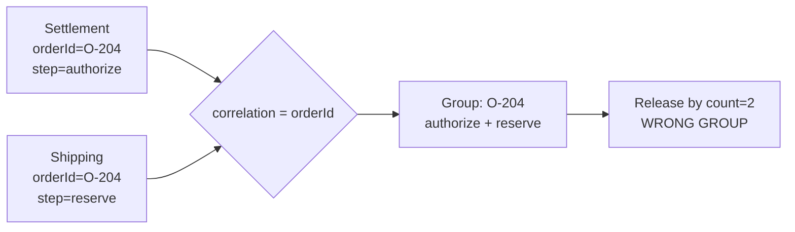
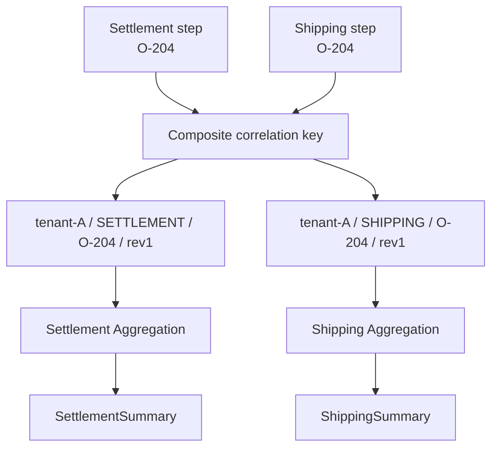
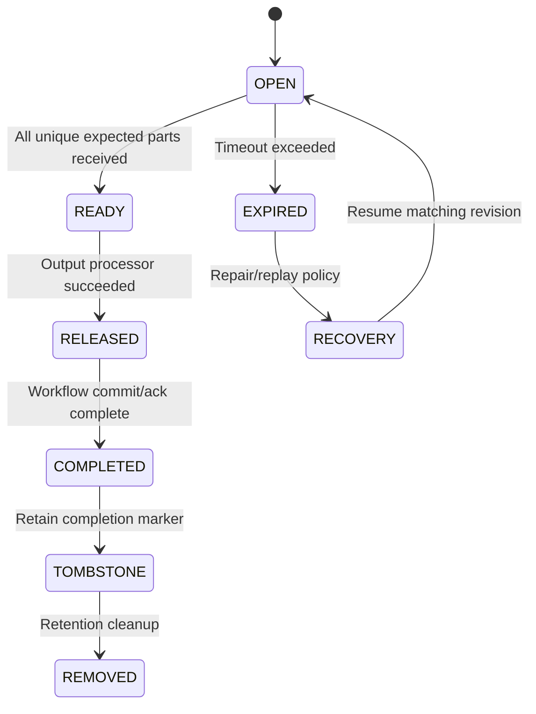

# ID Collisions Across Multiple Flows

## 1. When the Same ID Refers to Two Different Jobs

An order-processing platform runs two integration flows in parallel:

- **Settlement flow:** verifies payment and records settlement.
- **Shipping flow:** reserves stock and creates a dispatch order.

Both receive the same `orderId=O-204`, yet each flow needs its own result set:

```text
Tenant: tenant-A
Order:  O-204

SETTLEMENT:
  authorize → capture → result SettlementSummary

SHIPPING:
  reserve → dispatch → result ShippingSummary
```

Suppose both flows share an Aggregator or share the same keyspace in a `MessageGroupStore`, and the correlation strategy returns only:

```java
// Wrong when multiple workflows share a namespace/group store.
message -> ((WorkflowPart) message.getPayload()).businessId()
```

Then parts belonging to two distinct workflows are both assigned `groupId="O-204"`. If the release strategy merely counts messages, `authorize` + `reserve` may be treated as two complete parts, even though **Settlement is still missing `capture` and Shipping is still missing `dispatch`**.

That is an **ID collision across multiple flows**: two messages share the same local ID value yet **do not belong to the same business group**.

This lesson belongs to the **Content-based correlation** chapter of the **SPRING_INTEGRATION_PATTERN** module. The module teaches how to implement Enterprise Integration Patterns with Spring Integration to build loosely coupled, extensible message flows—coordinating Router, Filter, Transformer, Splitter, Aggregator, Gateway, retry, error channel, and correlation alongside testing and observability across processing branches.

After this lesson, you will be able to:

1. Recognize correlation key collisions across multiple flows, tenants, requests, or revisions.
2. Design a **composite correlation key** with a semantically meaningful namespace.
3. Distinguish business IDs, `MessageHeaders.ID`, `correlationId`, `replyChannel`, and idempotency keys.
4. Write Java DSL that gathers two workflows sharing the same `businessId` without merging them.
5. Test interleaving, multi-tenancy, revisions, duplicates, and conflicting replies.
6. Analyze shared `MessageGroupStore`, brokers, scatter-gather, and multi-instance deployments.
7. Establish correlation conventions, versioning, auditing, and recovery suited for production.

## 2. What Is Content-Based Correlation?

**Correlation** identifies which messages are related and must be processed together. In Content-based Correlation, the group key is **derived from message business content/attributes** rather than relying solely on an arbitrary upstream-supplied header.

Example:

```text
payment event:
  tenantId   = tenant-A
  orderId    = O-204
  workflow   = SETTLEMENT
  revision   = 1

shipping event:
  tenantId   = tenant-A
  orderId    = O-204
  workflow   = SHIPPING
  revision   = 1
```

Looking only at `orderId`, both events share the same ID. Yet they represent **two distinct result groups**:

```text
(tenant-A, SETTLEMENT, O-204, 1)
(tenant-A, SHIPPING,   O-204, 1)
```

Spring Integration lets you configure a `CorrelationStrategy` on an Aggregator/Resequencer to compute the group ID from payloads, headers, or delegated logic. The framework cannot infer on its own the scope within which `orderId` is meaningful—that is a **business contract that must be specified and tested**.

### Correlation Differs from Router and Filter

| Pattern | Question | Example |
| --- | --- | --- |
| **Content-Based Router** | Which branch does this message take? | `workflow=SHIPPING` → shipping handler |
| **Filter** | May this message proceed? | Reject step IDs outside the plan |
| **Content-based Correlation** | Which group does this message belong to? | `(tenant,workflow,order,revision)` |
| **Aggregator** | Once complete, what single result does the group emit? | Two steps → `WorkflowSummary` |
| **Resequencer** | In what order are parts of the same group emitted? | sequence 3,1,2 → 1,2,3 |
| **Scatter-Gather** | Which recipients must reply to complete? | Tax + Inventory, ignoring duplicates |
| **Idempotent Receiver** | Was this exact operation already processed? | One `eventId` must not apply twice |

A correct Router does not automatically guarantee correct correlation once branches converge back into one Aggregator. Sending a message to the right channel governs **routing path**, not **group ID namespace**.

## 3. Collision Diagram: Group ID Too Narrow



Proper design:



The diagram depicts **two logical groups**, not a mandate to deploy two separate Aggregator beans. You can use **one Aggregator serving multiple workflows** if correlation, release, and output processors distinguish each kind explicitly. Or you can use two separate Aggregators with isolated state/namespaces.

### Same ID Does Not Collide in Every Context

If each endpoint uses an **independent group store without mixing messages**, sharing `groupId="O-204"` might not break. Risk arises when:

- Multiple message types feed into the same Aggregator.
- Multiple Aggregators share a `MessageGroupStore` or share an unisolated namespace/region.
- Messages pass through a fan-in channel prior to correlation.
- A shared cache/metadata store uses un-namespaced IDs.
- Replies from multiple Gateways/Scatter-Gathers are matched by local request IDs.
- Replays or new revisions reuse a group ID while the old group is still active.

**Never assume all Aggregators share state by default.** Inspect the actual `MessageGroupStore` configuration, regions/namespaces, group lifecycle, and endpoints.

## 4. Commonly Confused ID Types

| ID | Purpose | Where Can It Collide? | Should It Be the Sole Group Key? |
| --- | --- | --- | --- |
| `orderId` | Identifies an order | Across tenants or order-processing workflows | Only when scope is already sufficiently narrow |
| `requestId` | Tracks one request | Two clients/connectors, retries, request scopes | No, without a namespace |
| `eventId` | Identifies one logical event | Stable across redeliveries, yet does not define the whole group | Usually for dedup, not group key |
| `MessageHeaders.ID` | Framework-generated message ID | Can change on transforms/redeliveries | Never use as business correlation |
| `correlationId` header | Header helping join messages | May come from Splitter or be spoofed by client | Trust only after validation/normalization |
| `replyChannel` | Where to return responses | Carries runtime context, not business group | No |
| `workflowId` | Identifies a specific workflow | May be unique by system design | Sufficient if entire scope is controlled |
| `processingRevision` | Distinguishes authorized re-executions | Normal retries must keep it fixed | Add when groups are intentionally reprocessed |
| `tenantId` | Data and access boundary | Each tenant has its own business IDs | Required when business IDs are not global |
| `stepId`/`partId` | Identifies a part within a group | Repeats across different groups | Used for within-group deduplication |

**Correlation keys** locate the **right group**. **Idempotency keys** decide whether **an outcome/operation was already recorded**. The two keys may share fields, yet must never be equated.

Example:

```text
correlationKey = (tenantId, workflowKind, businessId, revision)
partDedupKey   = (tenantId, workflowKind, businessId, revision, stepId)
outputKey      = (tenantId, workflowKind, businessId, revision, outputVersion)
```

## 5. Common ID Collision Patterns

### 5.1. Collisions Between Two Workflows

`SETTLEMENT/order-204` and `SHIPPING/order-204` are two distinct groups. Solution: add a `workflowKind` namespace.

### 5.2. Collisions Between Tenants

`tenant-A/order-204` and `tenant-B/order-204` must never join. Solution: include verified `tenantId`.

### 5.3. Collisions Between Processing Revisions

An order may be reprocessed to fix data. If the new revision shares the same key, late old messages can leak into the new group.

```text
tenant-A / SETTLEMENT / O-204 / rev1
tenant-A / SETTLEMENT / O-204 / rev2
```

Solution: add a business-meaningful revision, never incrementing revision merely on network retries.

### 5.4. Collisions from Non-Unique String Formatting

Naive string joining:

```java
return tenantId + "|" + workflow + "|" + businessId;
```

collides when components contain the delimiter. For example:

```text
["a|b", "c"] → "a|b|c"
["a",   "b|c"] → "a|b|c"
```

Solution: use a **typed composite key** or an explicit encoding contract (length prefixes, standard escaping, serialized tuples). If hashing, keep algorithms/canonicalization stable and account for collisions.

### 5.5. Collisions from Inconsistent Normalization

`O-204`, `o-204`, and ` O-204 ` can represent the same ID or three distinct IDs depending on the domain. Never automatically trim, lowercase, strip accents, or apply Unicode normalization without knowing the source's contract.

### 5.6. Collisions Between Endpoints Sharing a Store

Two code-separated Aggregators using the same store with overlapping group keys can interfere with each other unless namespaced. Conversely, two separate stores with inputs merged upstream before the Aggregators remain dangerous.

### 5.7. Collisions from Reusing IDs After Completion

Group `O-204` releases and state is deleted. A late/replayed message with the same ID arrives and opens a new group. You need completed-group ledgers/tombstones, retention, revisions, or controlled late-arrival policies.

## 6. Designing Correlation Keys from an Explicit Contract

A production key should answer five questions:

1. **Whose is it?** Tenant or security boundary.
2. **Which flow is it?** Workflow/flow namespace or process kind.
3. **Which entity/request is it?** Stable business ID.
4. **Which logical execution is it?** Revision/epoch/plan ID.
5. **Which key schema version is it?** For cross-service migrations.

Suggested typed model:

```java
enum WorkflowKind {
    SETTLEMENT,
    SHIPPING
}

record CorrelationScope(
    String tenantId,
    WorkflowKind workflowKind,
    String businessId,
    int revision) {}
```

This record provides clear `equals` and `hashCode` over all four fields, ideal as keys in an **application memory map**. However, some `MessageGroupStore`s or transports require serialized group IDs. In that case, encode `CorrelationScope` into a stable string under a **versioned encoding**.

### Encoding That Prevents Ambiguous Delimiters

An example length-prefix encoding:

```java
static String encodeComponent(String part) {
    return part.length() + "#" + part;
}

static String encode(CorrelationScope scope) {
    return "cor-v1|"
        + encodeComponent(scope.tenantId())
        + encodeComponent(scope.workflowKind().name())
        + encodeComponent(scope.businessId())
        + encodeComponent(Integer.toString(scope.revision()));
}
```

Examples:

```text
cor-v1|8#tenant-A10#SETTLEMENT5#O-2041#1
cor-v1|8#tenant-A8#SHIPPING5#O-2041#1
```

The numbers reflect Java character lengths. If the system is **polyglot**, standardize how length is measured (UTF-8 bytes vs Unicode code points), normalization, escaping, and cross-language test vectors. Never expose this raw format on public APIs without defining contracts and versions.

**Never change encodings mid-deploy without a migration plan.** A new consumer using `cor-v2` can open a new group for messages waiting under `cor-v1`, leaving both groups stuck.

## 7. Rules for Validating IDs Before Correlation

A composite key with all fields present is still dangerous if built from spoofed data:

```text
HTTP client sends:
  tenantId = tenant-B
  orderId = O-204
  workflowKind = SETTLEMENT
```

If the application trusts those fields, a request from tenant A can enter tenant B's group.

Establish a **trust boundary**:

- Derive tenant from verified ingress identity/token/mTLS, never from an arbitrary header.
- Derive workflow kind from the authorized endpoint/adapter, or verify via routing/contract.
- Validate business ID against the tenant's domain.
- Check revision against a validly created plan/workflow.
- Verify `stepId` belongs to the expected set of that workflow.
- **Verify** or recompute external producer correlation headers from trusted payload data.

When joining messages from two sources, both sources must share **one convention for IDs and permissions**, not merely the same `orderId` string.

## 8. End-to-End Example: Two Flows Sharing a Business ID

We define two workflows:

| Workflow | Two Required Steps | Meaning |
| --- | --- | --- |
| `SETTLEMENT` | `authorize`, `capture` | Payment outcome |
| `SHIPPING` | `reserve`, `dispatch` | Fulfillment outcome |

Each child message contains:

- `tenantId`: verified tenant.
- `workflowKind`: `SETTLEMENT` or `SHIPPING`.
- `businessId`: shared order code.
- `revision`: intentional processing round, starting at 1.
- `stepId`: required part identifier.
- `success`: final outcome status of the step.

**Test goal:** even when both workflows share `businessId="O-204"`, the Aggregator emits two properly typed summaries without mixing `authorize` and `reserve`.

### Data Model

```java
import java.util.List;

enum WorkflowKind {
    SETTLEMENT,
    SHIPPING
}

record WorkflowPart(
        String tenantId,
        WorkflowKind workflowKind,
        String businessId,
        int revision,
        String stepId,
        boolean success) {}

record WorkflowSummary(
        String tenantId,
        WorkflowKind workflowKind,
        String businessId,
        int revision,
        List<WorkflowPart> parts,
        boolean allSucceeded) {}
```

Assume each step emits **one terminal result**. An incomplete `RETRYING` attempt must not count as a valid part; if complex retry/failed-final states exist, use an explicit status enum instead of a boolean.

## 9. Java Policy: Namespace, Expected Set, and Output

Centralize all key rules in one place so endpoints never construct IDs inconsistently.

```java
import java.util.ArrayList;
import java.util.Comparator;
import java.util.HashMap;
import java.util.HashSet;
import java.util.List;
import java.util.Map;
import java.util.Set;

import org.springframework.integration.store.MessageGroup;
import org.springframework.messaging.Message;

final class WorkflowCorrelationRules {

    private static final Set<String> SETTLEMENT_STEPS =
        Set.of("authorize", "capture");

    private static final Set<String> SHIPPING_STEPS =
        Set.of("reserve", "dispatch");

    private WorkflowCorrelationRules() {}

    static Set<String> expected(WorkflowKind kind) {
        return switch (kind) {
            case SETTLEMENT -> SETTLEMENT_STEPS;
            case SHIPPING -> SHIPPING_STEPS;
        };
    }

    static boolean valid(WorkflowPart part) {
        return part != null
            && nonBlank(part.tenantId())
            && part.workflowKind() != null
            && nonBlank(part.businessId())
            && part.revision() > 0
            && nonBlank(part.stepId())
            && expected(part.workflowKind()).contains(part.stepId());
    }

    private static boolean nonBlank(String s) {
        return s != null && !s.isBlank();
    }

    private static String component(String s) {
        return s.length() + "#" + s;
    }

    static String correlationKey(WorkflowPart part) {
        if (!valid(part)) {
            throw new IllegalArgumentException(
                "Invalid workflow part");
        }

        return "cor-v1|"
            + component(part.tenantId())
            + component(part.workflowKind().name())
            + component(part.businessId())
            + component(Integer.toString(part.revision()));
    }

    static String correlationKey(Message<?> message) {
        return correlationKey((WorkflowPart) message.getPayload());
    }

    static boolean ready(MessageGroup group) {
        if (group.getMessages().isEmpty()) {
            return false;
        }

        WorkflowPart first =
            (WorkflowPart) group.getMessages()
                .iterator().next().getPayload();

        Set<String> seenSteps = new HashSet<>();

        for (Message<?> message : group.getMessages()) {
            WorkflowPart part =
                (WorkflowPart) message.getPayload();

            if (!valid(part)
                    || !correlationKey(part).equals(
                        group.getGroupId())) {
                throw new IllegalStateException(
                    "Correlation group contains invalid/mixed parts");
            }

            // Duplicate of the same step does not increase distinct step count.
            seenSteps.add(part.stepId());
        }

        return seenSteps.equals(expected(first.workflowKind()));
    }

    static WorkflowSummary summarize(MessageGroup group) {
        Map<String, WorkflowPart> uniqueParts = new HashMap<>();
        WorkflowPart first = null;

        for (Message<?> message : group.getMessages()) {
            WorkflowPart part =
                (WorkflowPart) message.getPayload();

            if (!valid(part)
                    || !correlationKey(part).equals(
                        group.getGroupId())) {
                throw new IllegalArgumentException(
                    "Mixed workflow correlation scope");
            }

            if (first == null) {
                first = part;
            }

            WorkflowPart existing =
                uniqueParts.putIfAbsent(part.stepId(), part);

            if (existing != null && !existing.equals(part)) {
                throw new IllegalStateException(
                    "Conflicting terminal reply: "
                        + part.stepId());
            }
        }

        if (first == null
                || !uniqueParts.keySet().equals(
                    expected(first.workflowKind()))) {
            throw new IllegalStateException(
                "Incomplete workflow summary");
        }

        List<WorkflowPart> ordered = uniqueParts.values()
            .stream()
            .sorted(Comparator.comparing(WorkflowPart::stepId))
            .toList();

        boolean success = ordered.stream()
            .allMatch(WorkflowPart::success);

        return new WorkflowSummary(
            first.tenantId(),
            first.workflowKind(),
            first.businessId(),
            first.revision(),
            List.copyOf(ordered),
            success);
    }
}
```

### Three Key Takeaways

**1. Build keys from content rather than an ambiguous ID.** `correlationKey(...)` distinguishes tenant, workflow, business ID, revision, and encoding version.

**2. Release by part ID set, not message count.** Duplicate `authorize,authorize` cannot stand in for `capture`. Using `group.size()==2` would release prematurely.

**3. Output processor verifies scope before building the summary.** If an upstream or store bug mixes messages, the processor **throws instead of emitting a bogus summary**. It also catches conflicting terminal replies for the same step.

**Intentional limitation:** detecting conflicts in the output processor happens **after the group has gathered the step set**. Production should place a validation/dedup gate at group admission to catch errors earlier; if a conflict arrives after output release, use a completed-group ledger and separate recovery policy.

## 10. Java DSL: Two Input Flows, One Fan-In Point

This configuration uses a single Aggregator to demonstrate how a **content-based key** prevents two workflows from mixing state even when sharing a result channel.

```java
import org.springframework.context.annotation.Bean;
import org.springframework.context.annotation.Configuration;
import org.springframework.integration.channel.DirectChannel;
import org.springframework.integration.channel.QueueChannel;
import org.springframework.integration.config.EnableIntegration;
import org.springframework.integration.dsl.IntegrationFlow;

@Configuration
@EnableIntegration
public class WorkflowCorrelationConfig {

    @Bean("workflow.settlement.in")
    DirectChannel settlementInput() {
        return new DirectChannel();
    }

    @Bean("workflow.shipping.in")
    DirectChannel shippingInput() {
        return new DirectChannel();
    }

    @Bean("workflow.parts.in")
    DirectChannel partsInput() {
        return new DirectChannel();
    }

    @Bean("workflow.summary.out")
    QueueChannel summaryOutput() {
        return new QueueChannel();
    }

    @Bean
    IntegrationFlow settlementIngress() {
        return IntegrationFlow.from("workflow.settlement.in")
            .filter(WorkflowPart.class,
                part -> part.workflowKind()
                    == WorkflowKind.SETTLEMENT,
                spec -> spec.throwExceptionOnRejection(true))
            .channel("workflow.parts.in")
            .get();
    }

    @Bean
    IntegrationFlow shippingIngress() {
        return IntegrationFlow.from("workflow.shipping.in")
            .filter(WorkflowPart.class,
                part -> part.workflowKind()
                    == WorkflowKind.SHIPPING,
                spec -> spec.throwExceptionOnRejection(true))
            .channel("workflow.parts.in")
            .get();
    }

    @Bean
    IntegrationFlow gatherWorkflows() {
        return IntegrationFlow.from("workflow.parts.in")
            .filter(WorkflowPart.class,
                WorkflowCorrelationRules::valid,
                spec -> spec.throwExceptionOnRejection(true))
            .aggregate(spec -> spec
                .correlationStrategy(
                    WorkflowCorrelationRules::correlationKey)
                .releaseStrategy(
                    WorkflowCorrelationRules::ready)
                .outputProcessor(
                    WorkflowCorrelationRules::summarize))
            .channel("workflow.summary.out")
            .get();
    }
}
```

**Role of each boundary:**

1. `workflow.settlement.in` accepts only `SETTLEMENT` parts.
2. `workflow.shipping.in` accepts only `SHIPPING` parts.
3. Both feed into `workflow.parts.in`.
4. The shared Filter ensures `stepId` belongs to the workflow's expected set.
5. The Aggregator computes the key from the **validated payload**.
6. `MessageGroup` stores isolated state under the composite key.
7. Releases once the workflow's own step set is complete.
8. Output processor builds `WorkflowSummary` and sends it to `workflow.summary.out`.

**Warning:** the demo flow trusts `tenantId` and `workflowKind` in the payload after checking **format**. In a real system, filtering by an enum is not source authentication; ingress must take tenant and workflow identity from an **authorized context** before creating an internal `WorkflowPart`.

The example uses `DirectChannel` for synchronous testing and `QueueChannel` for reading outputs. It does not configure a durable `MessageGroupStore`, broker, or authentication. Those must be added separately for production.

### Why Not Just Create Two Separate Aggregate Endpoints?

Having separate Aggregators for Settlement and Shipping is completely reasonable. It is simpler when the two workflows have very different release policies, timeouts, or `MessageGroupProcessor`s.

However, if both endpoints use the **same group store without separate namespaces**, or if messages from flows merge before the Aggregators, ID collisions can still occur. Composite keys add an explicit safety layer and unify observability.

**Never attach two Aggregators subscribing to the same `DirectChannel`** expecting broadcast delivery: `DirectChannel` has point-to-point semantics. For real fan-out, use a `PublishSubscribeChannel` or Recipient List.

## 11. JUnit: Two Workflows Sharing a `businessId` Do Not Mix

Policy unit tests and flow integration tests should verify **interleaving**: two workflows arriving interleaved with the same order ID and same tenant.

### 11.1. Integration Test

```java
import static org.assertj.core.api.Assertions.assertThat;
import static org.assertj.core.api.Assertions.assertThatThrownBy;

import org.junit.jupiter.api.Test;
import org.springframework.beans.factory.annotation.Autowired;
import org.springframework.beans.factory.annotation.Qualifier;
import org.springframework.integration.channel.QueueChannel;
import org.springframework.messaging.Message;
import org.springframework.messaging.MessageChannel;
import org.springframework.messaging.support.MessageBuilder;
import org.springframework.test.context.junit.jupiter.SpringJUnitConfig;

@SpringJUnitConfig(WorkflowCorrelationConfig.class)
class WorkflowCorrelationFlowTest {

    @Autowired
    @Qualifier("workflow.settlement.in")
    MessageChannel settlement;

    @Autowired
    @Qualifier("workflow.shipping.in")
    MessageChannel shipping;

    @Autowired
    @Qualifier("workflow.summary.out")
    QueueChannel summaries;

    private WorkflowPart part(
            String tenant,
            WorkflowKind kind,
            String order,
            int revision,
            String step,
            boolean success) {

        return new WorkflowPart(
            tenant, kind, order, revision, step, success);
    }

    private void send(MessageChannel channel, WorkflowPart part) {
        assertThat(channel.send(
            MessageBuilder.withPayload(part)
                .setHeader("requestId", "request-" + part.businessId())
                .build())).isTrue();
    }

    private WorkflowSummary receiveSummary() {
        Message<?> message = summaries.receive(1_000);
        assertThat(message).isNotNull();
        return (WorkflowSummary) message.getPayload();
    }

    @Test
    void sameOrderIdAcrossTwoWorkflowsCreatesTwoGroups() {
        send(settlement,
            part("tenant-A", WorkflowKind.SETTLEMENT,
                "O-204", 1, "authorize", true));
        send(shipping,
            part("tenant-A", WorkflowKind.SHIPPING,
                "O-204", 1, "reserve", true));

        // Two messages, yet each workflow only has one step so far.
        assertThat(summaries.receive(0)).isNull();

        send(shipping,
            part("tenant-A", WorkflowKind.SHIPPING,
                "O-204", 1, "dispatch", true));

        WorkflowSummary first = receiveSummary();
        assertThat(first.workflowKind())
            .isEqualTo(WorkflowKind.SHIPPING);
        assertThat(first.parts().stream()
            .map(WorkflowPart::stepId).toList())
            .containsExactly("dispatch", "reserve");

        send(settlement,
            part("tenant-A", WorkflowKind.SETTLEMENT,
                "O-204", 1, "capture", true));

        WorkflowSummary second = receiveSummary();
        assertThat(second.workflowKind())
            .isEqualTo(WorkflowKind.SETTLEMENT);
        assertThat(second.parts().stream()
            .map(WorkflowPart::stepId).toList())
            .containsExactly("authorize", "capture");

        assertThat(first.businessId()).isEqualTo("O-204");
        assertThat(second.businessId()).isEqualTo("O-204");
        assertThat(summaries.receive(0)).isNull();
    }

    @Test
    void sameOrderIdAcrossTenantsDoesNotMix() {
        send(settlement,
            part("tenant-A", WorkflowKind.SETTLEMENT,
                "O-same", 1, "authorize", true));
        send(settlement,
            part("tenant-B", WorkflowKind.SETTLEMENT,
                "O-same", 1, "authorize", true));

        assertThat(summaries.receive(0)).isNull();

        send(settlement,
            part("tenant-B", WorkflowKind.SETTLEMENT,
                "O-same", 1, "capture", true));

        assertThat(receiveSummary().tenantId())
            .isEqualTo("tenant-B");

        send(settlement,
            part("tenant-A", WorkflowKind.SETTLEMENT,
                "O-same", 1, "capture", true));

        assertThat(receiveSummary().tenantId())
            .isEqualTo("tenant-A");
    }

    @Test
    void differentRevisionsDoNotMix() {
        send(shipping,
            part("tenant-A", WorkflowKind.SHIPPING,
                "O-reprocess", 1, "reserve", true));
        send(shipping,
            part("tenant-A", WorkflowKind.SHIPPING,
                "O-reprocess", 2, "reserve", true));

        assertThat(summaries.receive(0)).isNull();

        send(shipping,
            part("tenant-A", WorkflowKind.SHIPPING,
                "O-reprocess", 2, "dispatch", true));
        assertThat(receiveSummary().revision()).isEqualTo(2);

        send(shipping,
            part("tenant-A", WorkflowKind.SHIPPING,
                "O-reprocess", 1, "dispatch", true));
        assertThat(receiveSummary().revision()).isEqualTo(1);
    }

    @Test
    void duplicateStepDoesNotFillTheOtherStep() {
        WorkflowPart first = part(
            "tenant-A", WorkflowKind.SETTLEMENT,
            "O-duplicate", 1, "authorize", true);

        send(settlement, first);
        send(settlement, first);

        assertThat(summaries.receive(0)).isNull();

        send(settlement,
            part("tenant-A", WorkflowKind.SETTLEMENT,
                "O-duplicate", 1, "capture", true));

        WorkflowSummary result = receiveSummary();
        assertThat(result.parts()).hasSize(2);
        assertThat(result.allSucceeded()).isTrue();
    }

    @Test
    void wrongWorkflowOnIngressIsRejected() {
        assertThatThrownBy(() -> send(
            shipping,
            part("tenant-A", WorkflowKind.SETTLEMENT,
                "O-invalid", 1, "authorize", true)))
            .isInstanceOf(RuntimeException.class);
        assertThat(summaries.receive(0)).isNull();
    }
}
```

These tests intentionally use distinct business IDs to isolate contexts. An incomplete group in the store can persist across multiple tests sharing an `ApplicationContext`; use proper test fixtures/cleanup in real projects.

**This tests wiring inside a Spring context**; it does not prove durable stores, multi-JVM concurrency, transactions, or broker redeliveries. Those belong to separate integration/failure tests.

### 11.2. Unit Testing Key Differentiation

```java
import static org.assertj.core.api.Assertions.assertThat;

import org.junit.jupiter.api.Test;

class WorkflowCorrelationRulesTest {

    private WorkflowPart p(
            String tenant,
            WorkflowKind workflow,
            String businessId,
            int revision) {

        return new WorkflowPart(
            tenant, workflow, businessId, revision,
            workflow == WorkflowKind.SETTLEMENT
                ? "authorize" : "reserve",
            true);
    }

    @Test
    void keySeparatesDifferentWorkflowTenantsAndRevisions() {
        WorkflowPart base =
            p("tenant-A", WorkflowKind.SETTLEMENT, "O-204", 1);

        String key = WorkflowCorrelationRules.correlationKey(base);

        assertThat(key)
            .isNotEqualTo(WorkflowCorrelationRules.correlationKey(
                p("tenant-A", WorkflowKind.SHIPPING, "O-204", 1)))
            .isNotEqualTo(WorkflowCorrelationRules.correlationKey(
                p("tenant-B", WorkflowKind.SETTLEMENT, "O-204", 1)))
            .isNotEqualTo(WorkflowCorrelationRules.correlationKey(
                p("tenant-A", WorkflowKind.SETTLEMENT, "O-204", 2)));
    }

    @Test
    void sameLogicalScopeGetsStableKey() {
        WorkflowPart first = p(
            "tenant-A", WorkflowKind.SETTLEMENT, "O-204", 1);

        WorkflowPart second = new WorkflowPart(
            "tenant-A", WorkflowKind.SETTLEMENT,
            "O-204", 1, "capture", true);

        assertThat(WorkflowCorrelationRules.correlationKey(first))
            .isEqualTo(
                WorkflowCorrelationRules.correlationKey(second));
    }

    @Test
    void delimiterInsideIdDoesNotProduceAmbiguousKey() {
        String one = WorkflowCorrelationRules.correlationKey(
            p("tenant|A", WorkflowKind.SETTLEMENT, "O-204", 1));

        String two = WorkflowCorrelationRules.correlationKey(
            p("tenant", WorkflowKind.SETTLEMENT, "A|O-204", 1));

        assertThat(one).isNotEqualTo(two);
    }
}
```

**What this test proves:** two messages in the same scope get the same key, and two different scopes get different keys. However, it **does not prove** the key schema is compatible with non-Java producers or persistence backends. Polyglot setups need cross-language golden test vectors and round-trip serialization tests.

## 12. Why Can a Right Key Still Yield a Wrong Result?

Even when the group key includes tenant, flow, and revision, the Aggregator still needs:

1. A trusted **expected part set**.
2. **Deduplication** by business part ID.
3. A proper **release strategy**.
4. An **output processor** verifying same-scope data.
5. An explicit **group lifecycle** for partial, timeout, complete, and replay cases.

Example:

```text
Group:
  tenant-A / SETTLEMENT / O-204 / rev1

Arrivals:
  authorize (event e1)
  authorize (redelivery event e1)
  capture (event e2)
```

If releasing on `group.size()==2`, it could emit after two copies of `authorize`. This lesson uses `Set<String> seenSteps`, releasing only once both `authorize` and `capture` arrive.

However, a **conflicting duplicate** such as:

```text
authorize(success=true)
authorize(success=false)
capture(success=true)
```

needs an explicit policy. The sample output processor flags a conflict; to detect it earlier, place a dedup/consistency gate before storing into the group. Never let “first wins” or “last arrives wins” emerge accidentally from arrival order.

### Defining “Has a Result”

If a worker emits `RETRYING` after an HTTP error and keeps going, that is not yet a terminal outcome. A boolean `success=false` can conflate two incompatible meanings: “permanent failure” and “transient attempt failure.”

Production should use an explicit enum:

```java
enum StepStatus {
    PENDING,
    RETRYING,
    SUCCEEDED,
    FAILED_FINAL
}
```

Only terminal statuses per policy count toward completeness; if a step is `FAILED_FINAL`, aggregation can still emit a group failure status when the contract permits.

## 13. Shared `MessageGroupStore`: Where Namespace Bugs Hide

A system might have two configurations:

```text
Aggregator A → JdbcMessageStore
Aggregator B → JdbcMessageStore
```

If A and B share tables, regions, or group IDs under the same namespace, identical local keys can collide. Inspect **how the store indexes groups**, transaction/lock scopes, and isolation settings—not just the class name.

Conversely:

```text
Aggregator A → separate store A
Aggregator B → separate store B
```

generally prevents state collisions across endpoints provided they do not share group state accidentally; yet **messages entering the wrong endpoint** still break things. Safety requires ingress validation and type contracts.

### Choosing One of Three Architectures

| Architecture | Pros | Conditions for Correctness |
| --- | --- | --- |
| **One multi-workflow Aggregator** | Shared fan-in logic, fewer endpoints | Composite key, expected set, and processor per workflow |
| **Separate Aggregator/store per workflow** | Isolated ownership, independent release/timeouts | Clean input boundaries; no accidental group namespace sharing |
| **Multiple Aggregators on a shared durable store** | Shared infrastructure | Explicit namespace/region/group IDs, proper transactions and locking |

**Do not force every workflow into one Aggregator.** Split them when SLAs, error flows, delivery semantics, or schemas diverge. Composite keys remain good practice for auditing/tracing and preventing data mixing as topologies evolve.

### Multi-Instance Shared Stores

One JVM sees all messages and releases cleanly. When multiple instances use separate in-memory stores:

```text
Instance 1: settlement/authorize
Instance 2: settlement/capture
→ Neither instance sees both.
```

Solutions: partition/co-locate by composite key, use a shared persistent group store with proper locking, or route to a dedicated group-owning service. **A shared store does not guarantee exactly-once**, as brokers can still redeliver and outputs can be resent.

## 14. Content-Based Correlation Can Read Payloads or Headers

Spring Integration lets you compute keys from:

- Normalized payloads.
- Headers stamped by trusted ingress or Splitters.
- Policy/service lookups determining workflow scope.
- Persisted request/plan metadata.

A short expression example (assuming validated payloads with the corresponding fields):

```java
// Expression idea; verify payload type and actual DSL API.
"payload.tenantId + ':' + payload.workflowKind + ':' " +
"+ payload.businessId + ':' + payload.revision"
```

This pattern is **unsafe if values can contain delimiters** or are unauthenticated. With multiple fields/complex namespaces, a Java policy function is cleaner to read and unit test than a long SpEL expression.

### Which Headers Should Survive Across Steps?

| Header / Metadata | Role | Risk |
| --- | --- | --- |
| `correlationId` | Group identity across parts | Adapters or Transformers alter/drop it |
| `sequenceNumber`/`sequenceSize` | Ordering and part counts from Splitter | Group fails to release or releases wrongly if lost |
| `requestId` | End-to-end tracing | Request IDs collide across systems/tenants |
| `eventId` | Dedup/replay | Minting a new UUID on retry lets duplicates slip through |
| Verified `tenantId` | Security scope | Client spoofs header |
| `replyChannel` | Gateway request/reply | Lost when building a new `Message` |
| `errorChannel` | Per-endpoint error routing | Not every exception routes here |
| `schemaVersion`/`planVersion` | Decoding and expected set lookup | Old replays mix with new versions |

**`MessageHeaders.ID` is not a business correlation ID.** A Transformer can build a new `Message`; framework IDs and timestamps change while the logical workflow stays the same.

If a pipeline crosses HTTP, Kafka, or AMQP, test **header mapping**, type conversions, byte encoding, and trusted field propagation. Never assume every Java header crosses other transports intact.

## 15. Collisions in Scatter-Gather and Gateways

Another scenario:

```text
Gateway X → requestId=42 → Tax + Inventory
Gateway Y → requestId=42 → Fraud + Customer
```

Both gateways use `42` (e.g., locally generated IDs), yet **not for the same request**. If replies gather by `requestId=42` in the same aggregator store, a Tax reply can pair with a Fraud reply.

In Scatter-Gather, distinguish:

- **Scatter request ID**: one logical fan-out.
- **Scatter plan ID/version**: expected responders for that request.
- **Responder ID**: reply source.
- **Reply ID**: one logical outcome from a responder, for dedup.
- **Gateway/flow namespace**: which context owns the request.

A solid key could be:

```text
(tenantId, gatewayNamespace, scatterRequestId, planRevision)
```

The release strategy must check that plan's **required responder set**, not merely `group.size()`. Two replies from the same provider do not substitute for two different sources.

### Replies Returning to the Wrong Gateway

`replyChannel` routes responses back to callers, yet transports do not preserve internal channel objects. Across brokers/HTTP, design reply routing with explicit request identity and namespaces; never accept a local response ID string without verifying flow ownership.

A response delivered to the wrong request can be worse than a timeout, as the caller may apply unauthorized data or the wrong order's result.

## 16. Collisions After Splitter/Resequencer

A Splitter commonly generates sequence metadata for child messages:

```text
Order O-204: Line 1, Line 2, Line 3
Order O-205: Line 1, Line 2
```

Both having `sequenceNumber=1` is **not a collision**, because each part belongs to a different group. Yet if correlation uses only sequence number:

```java
// Wrong: each group mixes every part with sequenceNumber=1.
message -> message.getHeaders().get("sequenceNumber")
```

then messages from the two orders mix together.

Similarly, two Splitter flows may both process `orderId=O-204` while splitting different structures:

- Splitter A splits `OrderLines` into 3 parts.
- Splitter B splits `ShipmentPackages` into 2 parts.

If both return to the same resequencer/aggregator keyed solely by order ID, two differently sized sequences merge together.

Solution: include **sequence kind / workflow namespace** and revision in the key, with separate expected sizes/parts. Preserve `correlationId` and sequence headers across Transformers, Filters, and recipient routing per contract.

## 17. Revisions and Replays: Old Groups Must Not Pollute New Groups

Suppose:

```text
rev1: Settlement already released; capture=SUCCESS
rev2: Reconciliation decides to rerun settlement
rev1: a late reply arrives from the broker
```

If the key has only `(tenant,workflow,order)`, the `rev1` reply can land in the `rev2` group.

**Never create a new revision merely for an HTTP retry or broker redelivery.** A revision represents **an authorized new logical execution**, possibly with updated policies, source snapshots, or billing periods.

Recommendations:

- Persist `WorkflowRunId/Revision` when starting a workflow.
- Carry the run ID and expected-part plan on every child message.
- Keep the run ID unchanged for retries of the same run.
- Keep the run ID unchanged when replaying to finish an old run, paired with idempotency.
- Use a new run/revision with auditing for re-evaluations that change outcomes.
- Never allow late `rev1` replies to silently update `rev2`.

### Correlation Key Schema Evolution

When upgrading `cor-v1` to `cor-v2`, plan dual-reading of both schemas, migrating open groups, and cutover rules for old producers. One logical workflow must never split into two groups simply because two code versions encode keys differently.

Tests should cover old and new versions running side by side during rolling deployments, especially with persistent `MessageGroupStore`s.

## 18. Duplicates and Conflicts Across Multiple Flows

The same `businessId` in different flows **is not a duplicate**.

```text
tenant-A / SETTLEMENT / O-204 / step=authorize
tenant-A / SHIPPING   / O-204 / step=reserve
```

They merely share an entity while belonging to independent workflows.

Within the same workflow:

```text
tenant-A / SETTLEMENT / O-204 / rev1 / authorize
tenant-A / SETTLEMENT / O-204 / rev1 / authorize
```

may be a duplicate.

Whereas:

```text
authorize(success=true)
authorize(success=false)
```

are **conflicting terminal results** within the same revision when no override rule exists.

Table:

| Scenario | Same Group? | Duplicate / Conflict? |
| --- | --- | --- |
| Same order ID, different workflow | No | No |
| Same order ID, different tenant | No | No |
| Same order ID, same flow, different revision | No | No, if new revision is intentional |
| Same group, different step ID | Yes | No |
| Same group, same step ID, identical logical content | Yes | Duplicate |
| Same group, same step ID, differing terminal content | Yes | Conflict |
| Same group, part arrives after completion | Logically belongs to completed group | Late arrival; policy needed |
| Same request ID, different Gateway namespace | No | No |

**Composite keys do not replace deduplication gates.** They prevent **merging distinct groups**; you still must prevent **double-counting parts inside the same group**.

## 19. Group Lifecycle: Can an ID Be Reused After Completion?

In Spring Integration, Aggregator/Resequencer maintain state in `MessageGroupStore`. A group may be:

- Open and waiting for new parts.
- Ready for release.
- Released while downstream has not yet confirmed side effects.
- Completed with retained metadata/tombstone.
- Purged/expired by cleanup.
- Receiving late messages or duplicates.



This diagram is an **application model**, not all built-in internal framework states. Exact completion/removal/expiration semantics depend on configuration and Spring Integration version.

**If a group is deleted completely**, the same correlation key can open a brand-new group when a late message arrives. Systems that must avoid emitting duplicate outputs need a sufficiently durable completed-key ledger/tombstone and a separate **output idempotency key**.

## 20. Shared State and Transactions: Collisions Are More Than Key Strings

Suppose two consumers receive two outcomes of the same workflow:

```text
Worker A receives authorize
Worker B receives capture
```

If each worker uses its own in-RAM store, both hold incomplete groups despite identical correlation keys. If using a shared store without locking, both workers can simultaneously see the group complete and emit two summaries.

You need:

1. Group ownership/partitioning keyed by the composite key.
2. A `MessageGroupStore` with appropriate consistency and locking.
3. Atomic claiming / unique part IDs to stop duplicates.
4. A group completion/idempotency ledger when outputs trigger side effects.
5. Transactions/outbox or recovery protocols for publishing summaries.
6. Group retention and idempotency markers sized for retries/DLQs.

**Crash window example:**

```text
1. Group completes authorize + capture.
2. Summary is dispatched downstream.
3. Process crashes before recording completion/ACK.
4. Broker or aggregator retries.
5. Summary may be dispatched a second time.
```

A right composite key guarantees only **identifying the right group**, not that **downstream writes once**. Consumers need an idempotency key such as:

```text
(tenantId, workflowKind, businessId, revision, summaryVersion)
```

When the summary and business update share a database, use unique constraints and transactions. When side effects call external APIs, use API idempotency, outboxes, or workflow reconciliation.

## 21. Timeouts and Partial Results Across Multiple Workflows

Two workflows sharing one Aggregator may have different SLAs:

- Settlement must finish fast to respond to a customer.
- Shipping can wait longer for fulfillment.
- One workflow allows partials; the other requires all-or-nothing.

Using **one shared group timeout** expires one too early or holds the other too long. When SLAs diverge significantly:

- Split Aggregators/flows per workflow kind, each with its own timeout and error policy; or
- Store per-group deadlines/policies and handle expiration according to content/plan.

**Never impose an arbitrary shared timeout just because two workflows share a business ID.** Composite keys do not solve SLAs.

When a group expires:

1. Identify missing steps from the persisted expected set.
2. Record a meaningful timeout/partial status.
3. Specify whether late arrivals for the old revision are rejected, reconciled, or resumed.
4. Never auto-create a new revision merely because one step ran late.
5. Avoid emitting a partial summary and later a full summary under the same key without versioning.

## 22. Observability: Log Key Scope, Not Just `orderId`

An insufficient log:

```text
groupId=O-204
status=RELEASED
```

It hides tenant, workflow, and revision. Suggested structured log:

```text
event=correlation_group_released
tenantScope=tenant-A
workflowKind=SETTLEMENT
businessId=O-204
revision=1
correlationSchema=cor-v1
expectedSteps=2
uniqueSteps=2
groupStatus=SUCCESS
outputVersion=1
```

These fields are a **suggested application schema**, not generated automatically by Spring Integration. Never log sensitive payloads, credentials, or tokens; hash or mask business IDs per policy.

Suggested metrics:

| Metric | Meaning |
| --- | --- |
| `correlation.input.total{workflow}` | Inbound messages per workflow |
| `correlation.scope.mismatch.total` | Messages with wrong tenant/flow/revision |
| `correlation.key.collision.total` | Different scopes producing the same key |
| `correlation.group.open{workflow}` | Waiting groups |
| `correlation.group.wait.duration{workflow}` | Wait duration until release |
| `correlation.group.expired.total{workflow}` | Expired groups |
| `correlation.duplicate.part.total{workflow}` | Redelivered parts |
| `correlation.conflict.part.total{workflow}` | Conflicting terminal results |
| `correlation.summary.dispatched.total{workflow}` | Dispatched outputs |
| `correlation.output.idempotency.hit.total` | Duplicate outputs caught at consumer |
| `correlation.store.error.total` | State storage failures |

These are **illustrative metric names**. Never put `businessId`/`requestId` or full correlation keys into high-cardinality metric labels. Trace specific requests via access-controlled traces/logs, and keep metrics bounded to workflow/result/error codes.

### Critical Signal: Mixed Workflows in One Group

If an output processor finds two `workflowKind` values in one group, that is an **invariant violation**, not “tricky data.” Throw `CORRELATION_SCOPE_MISMATCH`, write an audit record, and route to quarantine/recovery. Never take the first message's workflow and ignore the rest.

## 23. Troubleshooting: Symptoms and Root Causes

| Symptom | Possible Cause | How to Investigate |
| --- | --- | --- |
| Settlement summary contains shipping step | Correlated by `orderId` alone | Check payload/group key and fan-in topology |
| Two tenants merged in one group | Missing verified tenant in key | Inspect ingress identity and tenant isolation |
| New revision mixes old data | Key omits revision or replay uses wrong run ID | Check workflow run/plan |
| Never releases despite all steps sent | Parts split across stores/instances | Check group ownership and state sharing |
| Premature release while step missing | Counted messages instead of unique expected steps | Inspect release strategy |
| Same step counted twice | Missing dedup / redelivery | Check logical part ID and group admission |
| Group has conflicting outcomes | Two producers/attempts both authorized to write | Quarantine; compare event IDs/versions |
| Output emitted twice | Crash before ACK / flawed cleanup | Check output idempotency and completed ledger |
| Reply returns to wrong Gateway | Local request ID lacks namespace | Inspect request/reply correlation and channel mapping |
| Resequencer mixes two sequences | Key lacks sequence kind/workflow | Compare expected plan and metadata |
| Many groups stall right after deploy | Two correlation encoding versions running | Compare `cor-v1`/`cor-v2` and migration |
| Keys collide despite delimiters | IDs contain delimiters; non-injective encoding | Switch to canonical encoding with migration |
| Group exists in store yet unreadable | Namespace/region/schema mismatch | Inspect store configuration and version |
| Errors missing from global `errorChannel` | Exception occurred on sync `DirectChannel` | Inspect threads, adapters, and error flows |
| Bug appears only with multiple pods | Local store/lock/cache or race condition | Test multi-instance and partitioning |

## 24. Security and Trust Boundaries

**Correlation decides which messages can influence one another.** Therefore flawed correlation can leak data or mix work across tenants.

Checklist:

- Authenticate tenant and message source before computing the group key.
- Never let an HTTP client choose a correlation ID that accesses another tenant's group.
- Verify `workflowKind` matches the endpoint, role, and producer.
- Protect revision and expected-step plans from client tampering.
- Never use a global cache keyed solely by `orderId`.
- Isolate namespaces/regions for subsystems sharing a store when needed.
- Cap open groups, parts per group, and total retention against DoS.
- Never let a message claim `expectedCount=1` to force premature release.
- Verify signatures, schemas, and provenance on replies from external partners.
- Never let a conflicting `StepResult` silently overwrite a committed result.
- Encrypt and enforce ACLs on `MessageGroupStore`, DLQs, and audits.
- Limit logging of tenant/business IDs and personal data.
- Alert on mixed-scope groups and cross-tenant access attempts.

**A composite key with a client-supplied tenant is not security.** Verify tenant from an authoritative source before trusting the key.

## 25. Production Testing Matrix

| Scenario | Expected |
| --- | --- |
| Same tenant/order, different workflows | Two independent groups |
| Same workflow/order, different tenants | Two independent groups |
| Same tenant/workflow/order, different revisions | Two independent groups |
| Two steps of the same group | Same key, proper release |
| Steps arrive out of order | Result independent of arrival order |
| Duplicate of one step, other step missing | Does not release prematurely |
| Two differing terminal results for one step | Conflict detected, never picked silently |
| Unknown step ID | Rejected before entering group |
| Wrong workflow on endpoint | Rejected |
| Spoofed tenant header | Rejected at ingress |
| IDs with delimiters and Unicode | Encoding stays distinct and round-trips cleanly |
| Two languages generating keys | Compatible golden test vectors |
| Rolling deploy `cor-v1`/`cor-v2` | Never splits one logical group |
| One workflow times out, the other completes | Does not corrupt the other group |
| Completed group receives late reply | Does not re-emit revision 1 output |
| Restart while group is incomplete | State recovers when required by SLA |
| Two pods receive two steps of one group | Proper shared/partitioned state handling |
| Concurrent duplicates | Atomic dedup prevents double counting |
| Store temporarily unavailable | Bounded retry and error flow; never silently dropped |
| Output committed then ACK lost | Idempotent consumer |
| Scatter plan changes across retries | Never mixes expected responders across revisions |
| Reprocessor replays historical data | Preserves business snapshot or audited new revision |

Never test only three happy-path cases. For correlation, **negative tests** proving two messages do *not* join are often just as important as positive grouping tests.

## 26. Practice Exercises

### Exercise 1 — Spotting an Overly Narrow Key

Given four messages:

```text
tenant-A / SETTLEMENT / O-204 / rev1 / authorize
tenant-A / SHIPPING   / O-204 / rev1 / reserve
tenant-B / SETTLEMENT / O-204 / rev1 / authorize
tenant-A / SETTLEMENT / O-204 / rev2 / authorize
```

Compute the group key using only `orderId`, then compute the composite key. Explain the true number of groups, the risks of mixing tenants/flows/revisions, and how to namespace keys.

### Exercise 2 — Running Two Interleaved Flows

Using `WorkflowCorrelationConfig`, send settlement/`authorize`, shipping/`reserve`, shipping/`dispatch`, and settlement/`capture` for the same `O-204`. Verify the first output is `SHIPPING` and the second is `SETTLEMENT`, with neither summary containing steps from the other workflow.

### Exercise 3 — Duplicates Must Not Release Early

Send `authorize` twice without sending `capture`. Verify the group has not released. Then send `capture` and verify the output holds exactly two unique steps. Temporarily change the release strategy to `group.size()==2` to observe the bug, then fix it.

### Exercise 4 — Conflicts Within One Group

Send two terminal results for `authorize`—one success and one failure—in the same revision. Design a dedup/consistency gate to catch this before group completion, quarantine it, and never emit an arbitrary “success” summary.

### Exercise 5 — Cross-Tenant ID Collisions

Create two tenants sharing `orderId=O-204`. Interleave their steps. Assert two separate `WorkflowSummary` instances are produced. Add a test verifying a client cannot spoof tenant via a self-assigned header.

### Exercise 6 — Delimiters and Key Migration

Test IDs containing `|`, `#`, Unicode, and spaces. Verify the encoding is injective within the permitted input domain. Design a migration plan from `cor-v1` to `cor-v2` while groups remain open.

### Exercise 7 — Shared `MessageGroupStore`

Create two logical Aggregators A and B sharing a store/region. Identify conditions under which their group IDs collide. Design key namespacing or store isolation, then write an integration test against a real store proving zero interference.

### Exercise 8 — Scatter-Gather with Local IDs

Two Gateways both generate `requestId=42` using different recipient sets. Design `(tenant,gatewayNamespace,requestId,planRevision)` and release by expected responders. Test that two replies from different sources with identical payloads still count as two valid outcomes.

### Exercise 9 — Late Replies and Revisions

A `rev1` group has completed; `rev2` is in progress. A `rev1` reply is redelivered. Verify it cannot enter the `rev2` group or emit a duplicate `rev1` output. Design a completed-key ledger and retention policy.

### Exercise 10 — Dashboards and Runbooks

Instrument metrics for mixed-scope groups, duplicates, timeouts, group age, store contention, and output replays. Write a runbook distinguishing: key missing workflow, spoofed tenant, changed encoding version, and state fragmented across pods.

**Completion criteria:** learners can identify **which two messages must join**, **which two messages must never join despite matching IDs**, **when groups release**, **how duplicates/conflicts are handled**, and **why accurate correlation does not guarantee single side-effect execution**.

## 27. Pre-Production Design Checklist

- [ ] Every business ID has a clear owner and uniqueness scope.
- [ ] Correlation keys include verified tenant, workflow namespace, and revision where needed.
- [ ] Clear decision on when to split Aggregators/stores vs running one multi-workflow flow.
- [ ] Stable encoding/canonicalization with versioning and test vectors.
- [ ] `MessageHeaders.ID` never used in place of business correlation.
- [ ] Untrusted headers never used as source of truth for tenant/flow.
- [ ] Expected steps/responders sourced from an authoritative plan.
- [ ] Release checks unique expected parts, not raw message count.
- [ ] Duplicate/conflict policy defined by business part ID.
- [ ] `MessageGroupProcessor` verifies all parts share the exact correlation scope.
- [ ] Group timeout, expiration, and late-arrival policies defined.
- [ ] `MessageGroupStore` and locking fit multi-instance deployments.
- [ ] Retention and completion ledgers exist for released groups.
- [ ] Downstream consumers are idempotent with transactions/outboxes where needed.
- [ ] Tests cover interleaved workflows, tenants, revisions, duplicates, and conflicts.
- [ ] Tests cover schema migrations and rolling deployments.
- [ ] Traces/metrics scoped by namespace/flow without logging sensitive data.
- [ ] Access controls, quotas, and cleanup configured for group stores/DLQs.
- [ ] Explicit error flows handle invalid scopes, timeouts, and unavailable stores.
- [ ] Specific Spring Integration dependencies/APIs verified prior to rollout.

## 28. Summary

**ID collisions across multiple flows** happen when an ID that is unique only within a local scope is used as a group key across a broader scope. An `orderId=O-204` can simultaneously belong to Settlement, Shipping, another tenant, and another revision; **same ID does not mean same job**.

In Spring Integration:

1. **`CorrelationStrategy`** identifies the group from validated, canonicalized content.
2. **`ReleaseStrategy`** ensures all **required, unique** parts have arrived.
3. **`MessageGroupProcessor`** verifies group invariants and builds meaningful outputs.
4. **`MessageGroupStore`** holds state with proper namespacing, transactions, and lifecycles.
5. **Idempotency** at both parts and downstream protects against duplicates, replays, and crashes.

For two flows sharing a business ID, a composite key like:

```text
(tenantId, workflowKind, businessId, revision)
```

is a solid starting point. However, a key does not replace authorization, expected-part plans, deduplication, timeouts, or downstream transactions. **When two messages carry the same ID across different business scopes, never let them become one `MessageGroup`.**

## References

- [Enterprise Integration Patterns — Correlation Identifier](https://www.enterpriseintegrationpatterns.com/patterns/messaging/CorrelationIdentifier.html)
- [Enterprise Integration Patterns — Aggregator](https://www.enterpriseintegrationpatterns.com/patterns/messaging/Aggregator.html)
- [Enterprise Integration Patterns — Message Sequence](https://www.enterpriseintegrationpatterns.com/patterns/messaging/MessageSequence.html)
- [Spring Integration Reference — Aggregator](https://docs.spring.io/spring-integration/reference/aggregator.html)
- [Spring Integration Reference — Resequencer](https://docs.spring.io/spring-integration/reference/resequencer.html)
- [Spring Integration Reference — Message Store](https://docs.spring.io/spring-integration/reference/message-store.html)
- [Spring Integration Reference — Router](https://docs.spring.io/spring-integration/reference/router.html)
- [Spring Integration Reference — Scatter-Gather](https://docs.spring.io/spring-integration/reference/scatter-gather.html)
- [Spring Integration Reference — Java DSL](https://docs.spring.io/spring-integration/reference/dsl.html)
- [Spring Integration Reference — Idempotent Receiver](https://docs.spring.io/spring-integration/reference/handler-advice/idempotent-receiver.html)
- [Spring Integration Reference — Error Handling](https://docs.spring.io/spring-integration/reference/error-handling.html)

Examples use Java 17+ (`record`), Spring Integration Java DSL, and JUnit 5/AssertJ to illustrate a multi-workflow flow. Before adopting into a real project, verify APIs/overloads against your dependency versions, `MessageGroupStore` scoping and locking, header mappings, transactions, retry/ACK semantics, and real transports. This is a STEP 4 NEW lesson; compilation, system testing, and subject-matter Content QA are performed in separate steps.
