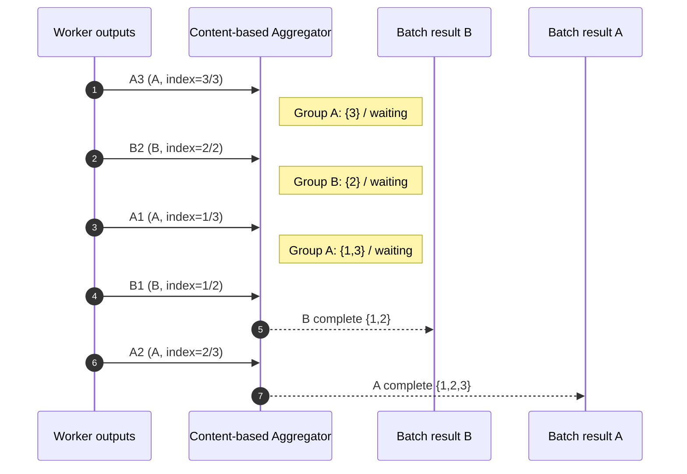
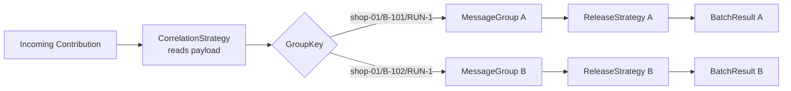
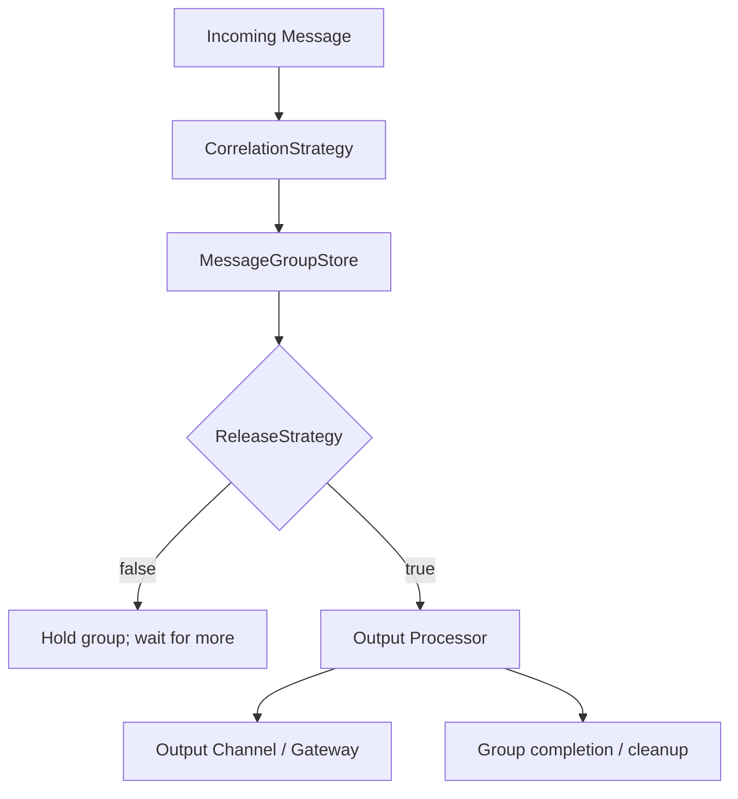
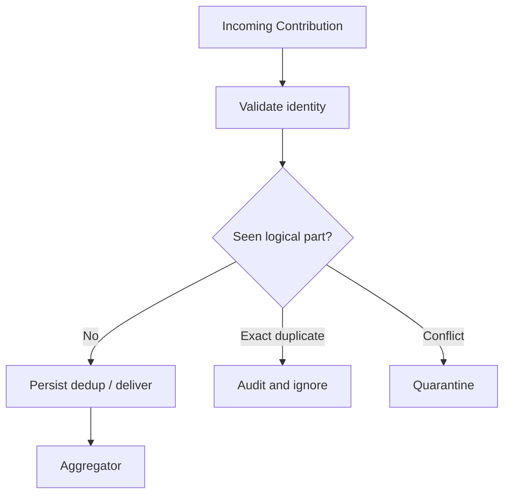
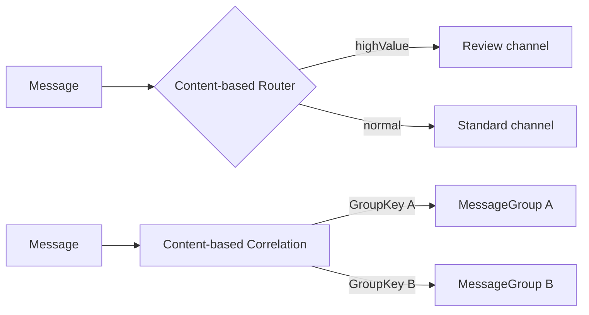
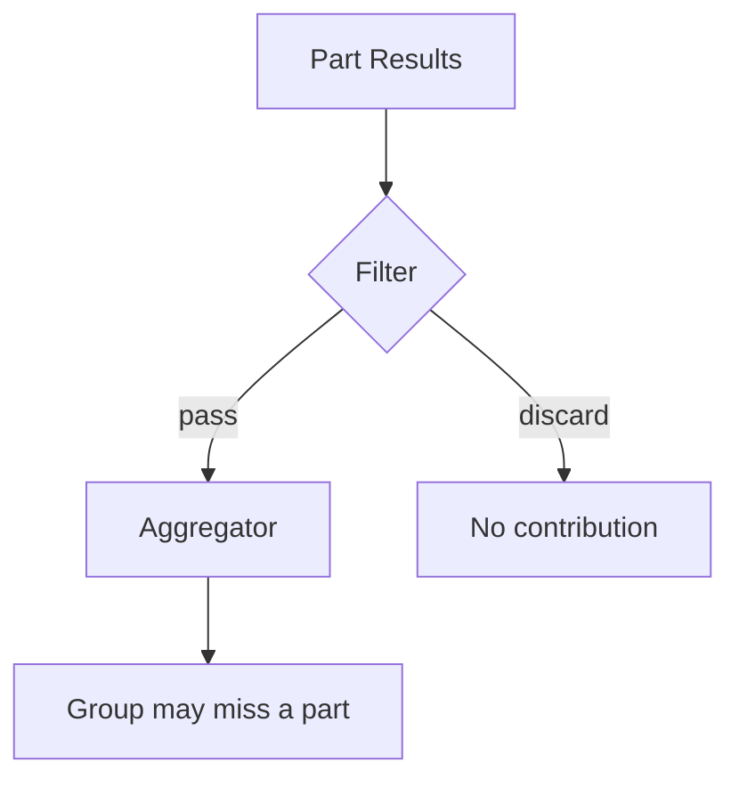
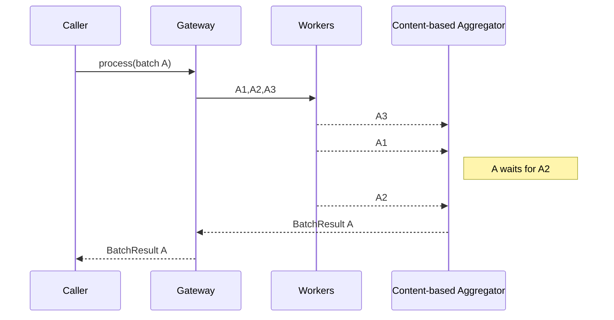
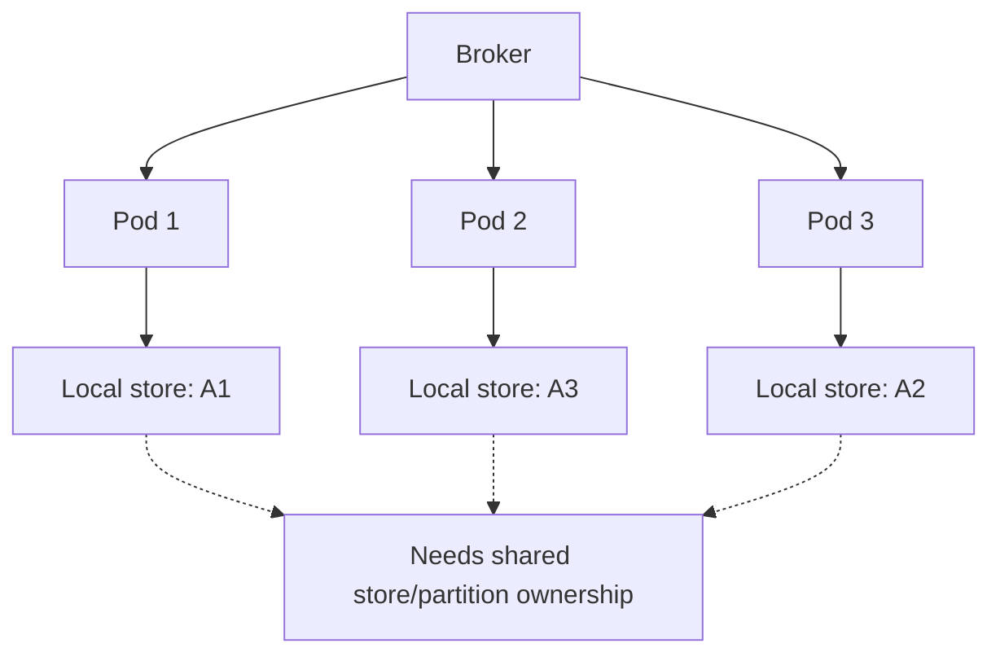
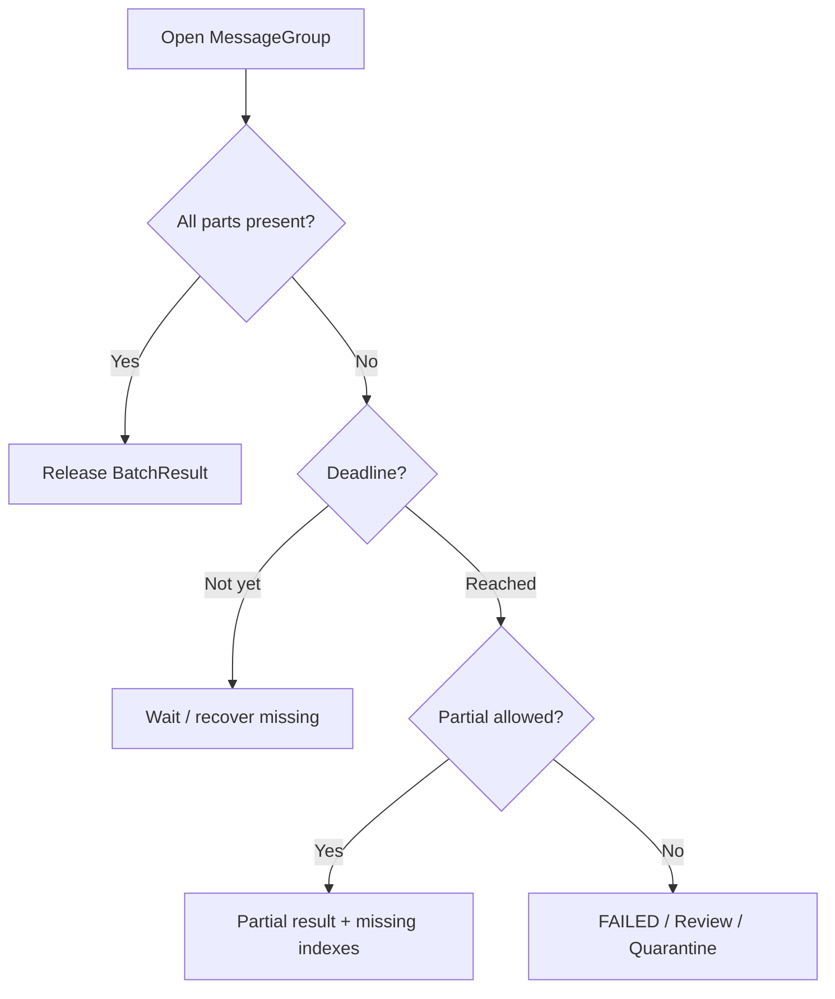

# Testing Correlation with Interleaved Messages in Spring Integration

> **Chapter:** Content-based correlation  
> **Lesson:** Testing correlation with interleaved messages  
> **Module:** `SPRING_INTEGRATION_PATTERN` — learning to implement Enterprise Integration Patterns with Spring Integration to build loosely coupled, extensible message flows; practicing Router, Filter, Transformer, Splitter, Aggregator, Gateway, retry, error channel, and correlation alongside testing and observing processing branches.

## 1. The Problem: Two Message Groups Arrive Interleaved and Must Never Mix

A payment system processes jobs in batches. Each batch is split into several parts (`Contribution`), processed across multiple workers, and results flow back to an **Aggregator** to build a summary per batch.

There are two independent batches:

- **Group A:** tenant `shop-01`, batch `B-101`, run `RUN-1`, three elements.
- **Group B:** tenant `shop-01`, batch `B-102`, run `RUN-1`, two elements.

Because of parallel processing, messages return in this order:

```text
A3 → B2 → A1 → B1 → A2
```

Looking only at arrival order, the second message `B2` could be mistaken for A's second element. Using a shared `correlationId` or grouping by a header that gets stripped can also cause the Aggregator to merge them.

Proper requirements:

1. `A1`, `A2`, `A3` must belong to **Group A**.
2. `B1`, `B2` must belong to **Group B**.
3. `B` releases as soon as `B1` and `B2` arrive, even while `A` is still missing `A2`.
4. `A` releases only once `A1`, `A2`, and `A3` have all arrived.
5. Each group produces exactly one result per contract.
6. A's result must contain no elements from B, and vice versa.



**Core point:** Content-based correlation determines **which messages belong to the same group based on content**, regardless of arrival order, threads, channels, or providers. Generating the right group key alone is not enough: you also need a **release strategy, interleaved testing, and handling for missing/duplicate messages**.

### Learning Objectives

After this lesson, you will be able to:

1. Distinguish **correlation strategy**, **release strategy**, and **output processor**.
2. Select a stable group key from payload content.
3. Prevent group mixing across tenants, batches, and workflow runs.
4. Write a `CorrelationStrategy`/Java DSL for an Aggregator.
5. Write JUnit 5 integration tests sending A/B interleaved and out of order.
6. Test completeness, missing parts, duplicates, and inconsistent `expectedCount`.
7. Distinguish technical group keys from `businessCorrelationId` and `MessageHeaders.id`.
8. Design timeouts, error channels, retries, persistence, idempotency, and late arrivals.

## 2. What Is Content-Based Correlation?

**Correlation** identifies which messages relate to one another so a stateful endpoint—particularly an Aggregator—can process them as a group.

In a simple flow with a Splitter, Spring Integration can apply `correlationId` and sequence headers to child messages. However, not every message originates from a Splitter; external sources may provide only business fields like `tenantId`, `batchId`, `runId`, and `partIndex`.

**Content-based correlation** uses those very fields to compute the **group key**. For example:

```text
content-based key(message) =
    GroupKey(
        message.payload.tenantId,
        message.payload.batchId,
        message.payload.runId
    )
```

Some systems prefer using a header derived from content at ingress; that works well too if the header is **verified and attached by a trusted component**. What matters is that the group key reflects business/workflow identity rather than relying on random message IDs or arrival order.



### Why Is It Called “Content-Based”?

Because the key can be determined from data fields:

- `orderId`, `invoiceId`, `batchId`.
- `tenantId` or a verified owner/namespace.
- `processingRunId`, `workflowVersion`.
- `documentGroupId` or a schema `correlationKey`.
- A pair or composite tuple of keys instead of a single header.

**It does not mean** grouping by the entire payload or an arbitrary hash of the payload. Payloads often contain fields mutated by Transformers/Enrichers; use only an **immutable subset of fields meaningful for grouping**.

## 3. Correlation, Release, and Aggregation Are Three Independent Responsibilities

In Spring Integration, an Aggregator typically has three decision layers:

| Responsibility | Question | Example |
| --- | --- | --- |
| **`CorrelationStrategy`** | Which group does the message belong to? | `GroupKey(tenant,batch,run)` |
| **`ReleaseStrategy`** | Has the group met completion criteria? | All part indexes `1..N` present |
| **Output processor** | Once done, what result is built? | `BatchResult(total, parts)` |



A properly computed group key does not prove the group is complete. Conversely, a group with enough messages but the **wrong key** can still mix unrelated outcomes.

### Illustrative Distinction

Suppose A has `expectedCount=3`:

```text
Group A receives A3 → A1:
    correlation right
    not ready for release

Group A then receives A2:
    correlation right
    ready for release

Group A accidentally receives B1:
    correlation wrong
    even with group.size()==3, must not be considered complete
```

This lesson therefore tests **both group identity and completion criteria**.

## 4. Metadata Model and Easily Confused Names

A result message may look like:

```text
payload:
  tenantId = shop-01
  batchId = B-101
  runId = RUN-1
  partIndex = 2
  expectedCount = 3
  eventId = EV-A2
  amountMinorUnits = 20000

headers:
  id = <Spring Message UUID>
  businessCorrelationId = payment:B-101
  traceId = ...
  correlationId = <optional / created upstream>
  replyChannel = <only when flow requires request-reply>
```

These IDs are not interchangeable:

| Data | Role | Do Not Assume It Is |
| --- | --- | --- |
| `tenantId` | Namespace and isolation control | Proof of authentication |
| `batchId` | Business batch | Globally unique across the system and all runs |
| `runId` | Processing attempt / workflow run | Automatically equal to message ID |
| `GroupKey(tenant,batch,run)` | Aggregator correlation | `businessCorrelationId` for tracing |
| `eventId` | Identifies a logical contribution | Sole group key for the entire group |
| `partIndex` | Element position or index | Completion arrival order |
| `expectedCount` | Expected logical element count | Received message count |
| `MessageHeaders.id` | Message UUID at a single hop | Durable ID across redeliveries |
| `correlationId` header | Can serve default grouping | Always present or always trustworthy |
| `businessCorrelationId` | Used to search logs/traces | Replacement for access control or grouping |

### Group Keys Must Have the Right Scope

These are two **different** groups, even for the same batch:

```text
GroupKey(shop-01, B-101, RUN-1)
GroupKey(shop-01, B-101, RUN-2)
```

A batch can be replayed or processed in multiple rounds. Using `batchId` alone lets old or incomplete results bleed into the new run.

These are also two **different** groups, even with the same batch name:

```text
GroupKey(shop-01, B-101, RUN-1)
GroupKey(shop-02, B-101, RUN-1)
```

For multi-tenant data, never rely solely on a `batchId` that could repeat across tenants.

## 5. Choosing Keys: Avoid Concatenation Collisions

Anti-pattern:

```java
String key = tenantId + ":" + batchId + ":" + runId;
```

If fields permit `:`, two different tuples produce the exact same string:

```text
tenant = a:b, batch = c, run = d
tenant = a,   batch = b:c, run = d

Both -> "a:b:c:d"
```

Better alternatives:

- Use a **value object** wrapping all three fields with explicit `equals/hashCode`.
- Or use length-prefixed encoding / an explicit canonical representation.
- Or use a unique group ID issued by a verified registry/coordinator.
- Never use Java `hashCode()` as a persistent key or cross-service key.

In this lesson, we use a Java record `GroupKey`. With a record, `equals/hashCode` compare each field structurally without delimiter-collision risks.

### `Serializable` When Persisting Groups Durably

When using a persistent `MessageGroupStore`, the group key must match the store's serializer and schema. A Java record can implement `Serializable` for demos; production also requires managing key versioning, migrations, and cross-language encoding for non-Java services.

## 6. Why Are Interleaved Messages Such a Crucial Test?

A test that sends all of A's messages followed by all of B's messages:

```text
A1, A2, A3, B1, B2
```

can pass even if code accidentally holds state in a “currently active batch,” such as a shared `currentBatchId` variable or a single buffer.

In production, concurrent sources interleave:

```text
A3, B2, A1, B1, A2
```

Interleaved tests catch many bugs:

1. Group key not computed per message.
2. Aggregator using a global mutable variable instead of a per-key store.
3. `CorrelationStrategy` reading the wrong field or omitting `runId`.
4. Group A mistakenly receiving B's elements.
5. Group B blocked because A is not finished yet.
6. Release relying on arrival order instead of group contents.
7. One result containing payloads from two different tenants.
8. Output processor pulling business ID from the last message of the wrong group.

Always keep at least **two incomplete groups coexisting** in a test, and finish Group B before Group A.

## 7. Domain Contract for the Practice Exercise

We build a `Contribution` example. Each contribution is the processing outcome of one part of a batch.

Assumptions:

- Each batch/run has `expectedCount` elements.
- Each logical part has a `partIndex` in `1..expectedCount`.
- Each part keeps a stable `eventId` across retries.
- `amountMinorUnits` shares the same currency/unit; no real side effects yet.
- `tenantId`, `batchId`, and `runId` were verified at ingress.
- The Aggregator must emit **one** `BatchResult` per group once all unique parts arrive.

### Immutable DTOs

```java
package example.integration;

import java.util.List;

public record Contribution(
    String tenantId,
    String batchId,
    String runId,
    String eventId,
    int partIndex,
    int expectedCount,
    long amountMinorUnits
) {

    public Contribution {
        if (tenantId == null || tenantId.isBlank()
                || batchId == null || batchId.isBlank()
                || runId == null || runId.isBlank()
                || eventId == null || eventId.isBlank()) {
            throw new IllegalArgumentException(
                "Missing Contribution identity");
        }

        if (expectedCount <= 0
                || partIndex < 1
                || partIndex > expectedCount) {
            throw new IllegalArgumentException(
                "Invalid partIndex/expectedCount");
        }

        if (amountMinorUnits < 0) {
            throw new IllegalArgumentException(
                "Amount must be non-negative");
        }
    }

    public GroupKey groupKey() {
        return new GroupKey(tenantId, batchId, runId);
    }
}

public record BatchResult(
    GroupKey key,
    int expectedCount,
    long totalMinorUnits,
    List<Contribution> contributions
) {}
```

**Java note:** place each `public record` in its own `.java` file in a real project; the article groups them in one code block to show the contract.

`BatchResult` holds only the summarized information. Use immutable `List.copyOf(...)` when building outputs to prevent external threads from mutating the list while downstream reads it.

### Group Key Type

```java
package example.integration;

import java.io.Serializable;

public record GroupKey(
    String tenantId,
    String batchId,
    String runId
) implements Serializable {

    private static final long serialVersionUID = 1L;

    public GroupKey {
        if (tenantId == null || tenantId.isBlank()
                || batchId == null || batchId.isBlank()
                || runId == null || runId.isBlank()) {
            throw new IllegalArgumentException(
                "GroupKey missing field");
        }
    }
}
```

Using a value object lets Java compare groups across **all three fields**.

### Separating Source Identity from Headers

`MessageHeaders.id` can change when messages are transformed, recreated, or redelivered. `eventId` in `Contribution` is the **business** identity of a logical contribution. If a broker redelivers element `A2`, it should still carry `eventId=EV-A2` per the source contract.

The `correlationId` header may be used by other patterns; our sample Aggregator will **explicitly compute groups from the payload**, never blindly trusting incoming headers.

## 8. Interleaved Dataset Used Throughout This Lesson

Inputs arrive in this exact order, while expected outputs separate by group:

| Arrival | Group | Part | Expected | Event ID | Amount |
| --- | --- | --- | --- | --- | --- |
| 1 | A: B-101 / RUN-1 | A3 | 3 | EV-A3 | 30 |
| 2 | B: B-102 / RUN-1 | B2 | 2 | EV-B2 | 200 |
| 3 | A: B-101 / RUN-1 | A1 | 3 | EV-A1 | 10 |
| 4 | B: B-102 / RUN-1 | B1 | 2 | EV-B1 | 100 |
| 5 | A: B-101 / RUN-1 | A2 | 3 | EV-A2 | 20 |

*Amounts in the table are illustrative minor units.*

Expected progression:

```text
After arrival 1: Group A = {3}       -> not released
After arrival 2: Group B = {2}       -> not released
After arrival 3: Group A = {1,3}     -> not released
After arrival 4: Group B = {1,2}     -> release B, total=300
After arrival 5: Group A = {1,2,3}   -> release A, total=60
```

**Important:** B's result appearing **before** A's is right because B finishes first. Correlation ensures **within-group** isolation, not a global ordering across groups.

## 9. `CorrelationStrategy`: Computing Group Key from Payload

Spring Integration provides the `CorrelationStrategy` interface to determine a message's group key. In our example, the strategy reads `Contribution` directly:

```java
package example.integration;

import org.springframework.integration.aggregator.CorrelationStrategy;
import org.springframework.messaging.Message;

public final class ContributionCorrelationStrategy
        implements CorrelationStrategy {

    @Override
    public Object getCorrelationKey(Message<?> message) {
        Object payload = message.getPayload();

        if (!(payload instanceof Contribution part)) {
            throw new IllegalArgumentException(
                "Expected Contribution payload");
        }

        // Value is stable by content, not by arrival order.
        return part.groupKey();
    }
}
```

With the same payload identity:

```text
A1 -> GroupKey(shop-01, B-101, RUN-1)
A2 -> GroupKey(shop-01, B-101, RUN-1)
A3 -> GroupKey(shop-01, B-101, RUN-1)

B1 -> GroupKey(shop-01, B-102, RUN-1)
B2 -> GroupKey(shop-01, B-102, RUN-1)
```

### Properties of a Good Strategy

- **Deterministic:** identical identity always yields identical keys.
- **Pure:** never reads or mutates global variables like `currentBatch`.
- **Fast:** never makes HTTP/DB calls on every key evaluation.
- **Stable:** avoids fields that change on retries (like attempt counters) when retries belong to the same group.
- **Scoped:** includes tenant and run when isolation is needed.
- **Serializable/portable:** compatible with `MessageGroupStore` when persisted.
- **Validated:** rejects blank, spoofed, or schema-invalid IDs.

### Should `CorrelationStrategy` Query a Database?

Usually not. If you need to map an external key to an internal group ID, **enrich/validate at ingress before the Aggregator**, then have `CorrelationStrategy` read the verified field.

Why: the Aggregator may handle thousands of messages and the correlation function sits on the hot path. Calling DBs/networks here slows grouping and blurs infrastructure errors with data errors.

### Header or Payload?

Another option:

```text
Ingress validates payload
  -> HeaderEnricher sets "verifiedGroupKey"
  -> Aggregator correlationStrategy reads verifiedGroupKey
```

This helps when downstream endpoints reshape payloads. However, distinguish **headers from untrusted sources** from headers stamped by a trusted component. Never let clients supply `verifiedGroupKey` and have the Aggregator trust it unconditionally.

## 10. `ReleaseStrategy`: Release Only When All Unique Parts Are Present

Correlation answers **which group**. For a given group, we also need to know whether all parts have arrived.

In our example, A has expected count 3 and B has 2. Requirements:

1. Every message has the same `GroupKey`.
2. Every message reports the same `expectedCount`.
3. `partIndex` falls within `1..expectedCount`.
4. No two parts share a `partIndex`.
5. No two logical events share an `eventId`.
6. All expected parts are present.

We write a pure rule:

```java
package example.integration;

import java.util.HashSet;
import java.util.Set;

import org.springframework.integration.store.MessageGroup;
import org.springframework.messaging.Message;

public final class ContributionReleaseRules {

    private ContributionReleaseRules() {}

    public static boolean allExpectedPartsPresent(
            MessageGroup group) {

        if (group.getMessages().isEmpty()) {
            return false;
        }

        Message<?> firstMessage =
            group.getMessages().iterator().next();

        if (!(firstMessage.getPayload()
                instanceof Contribution first)) {
            return false;
        }

        GroupKey key = first.groupKey();
        int expected = first.expectedCount();

        if (expected <= 0 || group.size() != expected) {
            return false;
        }

        Set<Integer> positions = new HashSet<>();
        Set<String> eventIds = new HashSet<>();

        for (Message<?> message : group.getMessages()) {
            if (!(message.getPayload()
                    instanceof Contribution part)) {
                return false;
            }

            if (!part.groupKey().equals(key)
                    || part.expectedCount() != expected
                    || part.partIndex() < 1
                    || part.partIndex() > expected
                    || !positions.add(part.partIndex())
                    || !eventIds.add(part.eventId())) {
                return false;
            }
        }

        return positions.size() == expected
            && eventIds.size() == expected;
    }
}
```

### Does This Release Condition Truly Prevent Duplicates?

It **prevents false releases** when a group has N messages with duplicate `partIndex` values. It **does not delete duplicates** or automatically recover a group that received a duplicate.

Example with `expectedCount=3`:

```text
A1, A1-duplicate, A2:
  group.size() = 3
  positions = {1,2}
  ReleaseStrategy -> false

Then A3 arrives:
  group.size() = 4
  ReleaseStrategy remains false (under this rule)
```

This group is “poisoned” until the duplicate is handled. Production needs deduplication **before** inserting into the group, or a group/release processor design that safely filters logical duplicates with auditing. Returning `false` forever is not a complete operational solution.

### Receiving All Parts Does Not Prove Business Success

If a payload carries `status=FAILED` as a valid outcome of a part, the group is still **informationally complete**. The output processor then builds `BatchResult(status=FAILED/PARTIAL)`. Never use `ReleaseStrategy` as a loop waiting “until every part succeeds” when failure is a valid terminal outcome.

Our demo models only non-negative amounts without status; the operational sections cover handling error outcomes.

## 11. Output Processor: Producing Deterministically Ordered Results

Once the group is eligible, the output processor aggregates the `Contribution`s.

```java
package example.integration;

import java.util.Comparator;
import java.util.List;

import org.springframework.integration.store.MessageGroup;

public final class ContributionResultFactory {

    private ContributionResultFactory() {}

    public static BatchResult aggregate(MessageGroup group) {
        List<Contribution> parts = group.getMessages().stream()
            .map(m -> (Contribution) m.getPayload())
            .sorted(Comparator.comparingInt(
                Contribution::partIndex))
            .toList();

        if (parts.isEmpty()) {
            throw new IllegalStateException("Empty group");
        }

        GroupKey key = parts.get(0).groupKey();

        long total = parts.stream()
            .mapToLong(Contribution::amountMinorUnits)
            .reduce(0L, Math::addExact);

        return new BatchResult(
            key,
            parts.get(0).expectedCount(),
            total,
            List.copyOf(parts));
    }
}
```

### Why Sort by `partIndex`?

Messages arrive as `A3,A1,A2`, so you cannot assume `MessageGroup`'s collection yields `A1,A2,A3`.

If downstream needs the original line order, sort by validated `partIndex` or domain sequence. That is the **output processor's** job, not the correlation strategy's.

### Why Use `Math.addExact`?

Using `long` for minor units avoids floating-point precision loss when summing integer money amounts, yet addition can still overflow. `Math.addExact` throws instead of silently overflowing. Production should classify exceptions and handle errors; for multi-currency amounts or sums exceeding `long`, use an appropriate monetary model.

### Do Not Derive Output Identity from the Last Arriving Message

If you set `batchId` from “whichever message arrived last,” results break whenever groups mix. Build outputs from the **validated group** using consistent group identity; add checks confirming every part shares that key.

## 12. Configuring the Aggregator in Spring Integration Java DSL

Minimal configuration covering all three responsibilities:

```java
package example.integration;

import org.springframework.context.annotation.Bean;
import org.springframework.context.annotation.Configuration;
import org.springframework.integration.channel.DirectChannel;
import org.springframework.integration.channel.QueueChannel;
import org.springframework.integration.config.EnableIntegration;
import org.springframework.integration.dsl.IntegrationFlow;
import org.springframework.messaging.MessageChannel;

@Configuration
@EnableIntegration
public class ContributionFlowConfiguration {

    @Bean
    public MessageChannel contributionsInput() {
        return new DirectChannel();
    }

    @Bean
    public QueueChannel completedBatches() {
        return new QueueChannel();
    }

    @Bean
    public ContributionCorrelationStrategy
            contributionCorrelationStrategy() {
        return new ContributionCorrelationStrategy();
    }

    @Bean
    public IntegrationFlow collectContributions(
            ContributionCorrelationStrategy correlation) {

        return IntegrationFlow.from("contributionsInput")
            .aggregate(spec -> spec
                .correlationStrategy(correlation)
                .releaseStrategy(
                    ContributionReleaseRules::allExpectedPartsPresent)
                .outputProcessor(
                    ContributionResultFactory::aggregate)
                .expireGroupsUponCompletion(true))
            .channel("completedBatches")
            .get();
    }
}
```

The illustrative configuration uses common Spring Integration Java DSL APIs. When integrating into a real project, verify overloads against your module's dependency version; build verification and QA belong to steps after STEP 4.

### Explanation

**`contributionsInput`** is the Aggregator's ingress channel. Producers can send results from multiple sources or workers concurrently.

**`.correlationStrategy(correlation)`** reads `Contribution` and computes `GroupKey`. It does not rely on any producer-supplied `correlationId` header.

**`.releaseStrategy(...)`** verifies all expected `partIndex` values and unique `eventId`s before emitting output.

**`.outputProcessor(...)`** builds a `BatchResult` with summed amounts and a sorted list of parts.

**`.expireGroupsUponCompletion(true)`** configures how the endpoint cleans up group state after completion. Deleting groups too early can let late messages reopen a group if no external tombstone/dedup exists; use a lifecycle policy tailored to production.

**`.channel("completedBatches")`** sends outputs to an internal `QueueChannel` for testing. This is not a persistent broker and has no DB transactions.

### Why Do We Not Need a `correlationId` Header on Every Message?

Because this Aggregator uses a **custom payload-based correlation strategy**. Even if a producer omits `correlationId` or attaches a different `correlationId`, groups still form by `tenantId,batchId,runId`.

This is a deliberate design choice for this lesson. In other flows, you may use the default correlation strategy reading headers stamped by a Splitter or ingress step.

### What This Code Does Not Yet Provide

- Deduplication upstream of the Aggregator.
- Persistent `MessageGroupStore` and cross-instance locking.
- Timeouts/expiry for incomplete groups.
- Business handlers with side effects.
- API authentication/tenant authorization.
- Replay/late-message policies.
- Broker header mapping and transactions.
- Gateway request–reply returning `BatchResult`.

Those capabilities must be designed explicitly; never assume they appear automatically after `.aggregate(...)`.

## 13. JUnit 5: Test Fixture Sending Messages for Groups

Testing `GroupKey.equals` alone is insufficient. This lesson uses **integration tests over a real Spring Integration flow**.

```java
package example.integration;

import static org.junit.jupiter.api.Assertions.*;

import org.junit.jupiter.api.Test;
import org.springframework.beans.factory.annotation.Autowired;
import org.springframework.beans.factory.annotation.Qualifier;
import org.springframework.integration.channel.QueueChannel;
import org.springframework.messaging.Message;
import org.springframework.messaging.MessageChannel;
import org.springframework.messaging.support.MessageBuilder;
import org.springframework.test.annotation.DirtiesContext;
import org.springframework.test.context.junit.jupiter.SpringJUnitConfig;

@SpringJUnitConfig(ContributionFlowConfiguration.class)
@DirtiesContext(
    classMode = DirtiesContext.ClassMode.AFTER_EACH_TEST_METHOD)
class ContributionCorrelationTest {

    @Autowired
    @Qualifier("contributionsInput")
    private MessageChannel input;

    @Autowired
    @Qualifier("completedBatches")
    private QueueChannel completed;

    private Contribution item(
            String tenant,
            String batch,
            String run,
            String event,
            int index,
            int count,
            long amount) {

        return new Contribution(
            tenant, batch, run, event, index, count, amount);
    }

    private void send(Contribution part) {
        Message<Contribution> message = MessageBuilder
            .withPayload(part)
            .setHeader(
                "businessCorrelationId",
                "payment:" + part.batchId())
            .build();

        assertTrue(input.send(message));
    }

    // The @Test methods below belong in this class.
}
```

### Why `@DirtiesContext`?

Tests intentionally leave incomplete groups unreleased. `@DirtiesContext` with `AFTER_EACH_TEST_METHOD` prevents leftover group state from leaking between tests. In large projects, you can replace this with a controlled group-store reset to keep the test suite fast.

### Never Use Spring Message ID as Group ID

In this fixture, every `MessageBuilder.build()` call creates a new Spring Message ID. Our `CorrelationStrategy` ignores that ID and reads `Contribution` content instead. Using message ID as the key would put each part in its own group so no group ever reaches N items.

## 14. Core Integration Test: A and B Arrive Interleaved

This is the centerpiece test of the lesson.

Send `A3 → B2 → A1 → B1 → A2` in order and assert **B releases before A**.

Add this method to `ContributionCorrelationTest`:

```java
@Test
void interleavedMessagesRemainInTheirOwnGroups() {
    // Arrival 1: A3
    send(item("shop-01", "B-101", "RUN-1",
        "EV-A3", 3, 3, 30L));
    assertNull(completed.receive(0));

    // Arrival 2: B2
    send(item("shop-01", "B-102", "RUN-1",
        "EV-B2", 2, 2, 200L));
    assertNull(completed.receive(0));

    // Arrival 3: A1
    send(item("shop-01", "B-101", "RUN-1",
        "EV-A1", 1, 3, 10L));
    assertNull(completed.receive(0));

    // Arrival 4: B1 -> B has 2/2.
    send(item("shop-01", "B-102", "RUN-1",
        "EV-B1", 1, 2, 100L));

    Message<?> firstOutput = completed.receive(1_000);
    assertNotNull(firstOutput);
    assertInstanceOf(
        BatchResult.class, firstOutput.getPayload());

    BatchResult resultB =
        (BatchResult) firstOutput.getPayload();

    assertEquals(
        new GroupKey("shop-01", "B-102", "RUN-1"),
        resultB.key());
    assertEquals(2, resultB.expectedCount());
    assertEquals(300L, resultB.totalMinorUnits());
    assertEquals(2, resultB.contributions().size());
    assertEquals(
        "EV-B1", resultB.contributions().get(0).eventId());
    assertEquals(
        "EV-B2", resultB.contributions().get(1).eventId());

    // A still misses A2; no second output yet.
    assertNull(completed.receive(0));

    // Arrival 5: A2 -> A has 3/3.
    send(item("shop-01", "B-101", "RUN-1",
        "EV-A2", 2, 3, 20L));

    Message<?> secondOutput = completed.receive(1_000);
    assertNotNull(secondOutput);
    assertInstanceOf(
        BatchResult.class, secondOutput.getPayload());

    BatchResult resultA =
        (BatchResult) secondOutput.getPayload();

    assertEquals(
        new GroupKey("shop-01", "B-101", "RUN-1"),
        resultA.key());
    assertEquals(3, resultA.expectedCount());
    assertEquals(60L, resultA.totalMinorUnits());
    assertEquals(3, resultA.contributions().size());

    assertEquals(
        "EV-A1", resultA.contributions().get(0).eventId());
    assertEquals(
        "EV-A2", resultA.contributions().get(1).eventId());
    assertEquals(
        "EV-A3", resultA.contributions().get(2).eventId());

    assertNull(completed.receive(0));
}
```

### What Does This Test Prove?

1. **Two groups coexist** in `MessageGroupStore`.
2. B's messages do not leak into group A.
3. B releases before A finishes; one group does not block another's progress.
4. Output B contains exactly `B1,B2` totaling 300.
5. Output A contains exactly `A1,A2,A3` totaling 60.
6. Outputs are sorted by `partIndex`, not arrival order.
7. No extra outputs appear once both groups finish.

### Why Call `receive(0)` After Each Step?

In this synchronous `DirectChannel` example, sending to the Aggregator runs on the calling thread, so `receive(0)` is a reasonable check that no output was produced at that moment.

If the flow uses `ExecutorChannel` or a broker, you cannot prove a group “has not released yet” with a single immediate queue poll; use synchronization, deadlines, and observable group state per contract.

### Does B Releasing Before A Guarantee Global Ordering?

No. That ordering is a consequence of the **exact send schedule in a synchronous test**. Correlation guarantees group isolation; it does not promise every Group B in production finishes before Group A. Under concurrency, cross-group output order can vary.

## 15. Testing Two Tenants with the Same `batchId` and `runId`

A dangerous bug is using `batchId` alone as the correlation key. Two tenants can choose the exact same batch code:

```text
shop-01 / B-SHARED / RUN-1
shop-02 / B-SHARED / RUN-1
```

Tests should catch cross-tenant mixing.

Add to the class above:

```java
@Test
void sameBatchAndRunAcrossTenantsStayIsolated() {
    send(item("shop-01", "B-SHARED", "RUN-1",
        "T1-P1", 1, 2, 10L));
    send(item("shop-02", "B-SHARED", "RUN-1",
        "T2-P2", 2, 2, 200L));

    assertNull(completed.receive(0));

    send(item("shop-02", "B-SHARED", "RUN-1",
        "T2-P1", 1, 2, 100L));

    BatchResult tenant2 = (BatchResult)
        completed.receive(1_000).getPayload();

    assertEquals("shop-02", tenant2.key().tenantId());
    assertEquals(300L, tenant2.totalMinorUnits());
    assertEquals(2, tenant2.contributions().size());

    assertNull(completed.receive(0));

    send(item("shop-01", "B-SHARED", "RUN-1",
        "T1-P2", 2, 2, 20L));

    BatchResult tenant1 = (BatchResult)
        completed.receive(1_000).getPayload();

    assertEquals("shop-01", tenant1.key().tenantId());
    assertEquals(30L, tenant1.totalMinorUnits());
    assertEquals(2, tenant1.contributions().size());
}
```

**Security note:** `tenantId` isolation works only when `tenantId` was **authenticated and canonicalized at ingress**. If a client sends `tenantId=shop-02` and the system trusts it blindly, custom correlation cannot stop cross-tenant injection. A correlation strategy **is not** an authorization mechanism.

## 16. Testing Two Runs of the Same Batch Do Not Mix

A batch can be replayed:

```text
shop-01 / B-101 / RUN-1
shop-01 / B-101 / RUN-2
```

Parts from run 1 and run 2 may arrive interleaved. Including `runId` in `CorrelationStrategy` keeps them apart.

```java
@Test
void differentRunsOfSameBatchStaySeparate() {
    send(item("shop-01", "B-101", "RUN-1",
        "R1-P2", 2, 2, 20L));
    send(item("shop-01", "B-101", "RUN-2",
        "R2-P1", 1, 2, 100L));

    assertNull(completed.receive(0));

    send(item("shop-01", "B-101", "RUN-1",
        "R1-P1", 1, 2, 10L));

    Message<?> output1 = completed.receive(1_000);
    assertNotNull(output1);
    BatchResult run1 = (BatchResult) output1.getPayload();

    assertEquals("RUN-1", run1.key().runId());
    assertEquals(30L, run1.totalMinorUnits());

    send(item("shop-01", "B-101", "RUN-2",
        "R2-P2", 2, 2, 200L));

    Message<?> output2 = completed.receive(1_000);
    assertNotNull(output2);
    BatchResult run2 = (BatchResult) output2.getPayload();

    assertEquals("RUN-2", run2.key().runId());
    assertEquals(300L, run2.totalMinorUnits());
}
```

This tests **group scope**, not merely message ordering. If only `batchId` were used as the correlation key, the two runs would merge and produce a wrong total.

### One Point to Align on Retries

Here `runId` represents one logical processing run. Retrying **a child within the same run** should keep the existing `runId`. When the business intentionally reruns **the entire batch as a new run**, issue a new `runId` with dedicated completion/reconciliation policies.

## 17. Testing Payload Keys When External Headers Are Untrusted

A producer might attach `correlationId="shared"` to both A and B, or omit the header completely. When the Aggregator is properly configured for content-based correlation, it must not merge groups due to mismatched headers.

Variant test:

```java
@Test
void customCorrelationDoesNotTrustIncomingGroupHeader() {
    Message<Contribution> a = MessageBuilder
        .withPayload(item("shop-01", "B-A", "RUN-1",
            "EV-A1", 1, 1, 11L))
        .setHeader("correlationId", "UNTRUSTED-SHARED")
        .build();

    Message<Contribution> b = MessageBuilder
        .withPayload(item("shop-01", "B-B", "RUN-1",
            "EV-B1", 1, 1, 22L))
        .setHeader("correlationId", "UNTRUSTED-SHARED")
        .build();

    assertTrue(input.send(a));
    assertTrue(input.send(b));

    BatchResult first = (BatchResult)
        completed.receive(1_000).getPayload();
    BatchResult second = (BatchResult)
        completed.receive(1_000).getPayload();

    assertNotEquals(first.key(), second.key());
    assertEquals(
        java.util.Set.of("B-A", "B-B"),
        java.util.Set.of(
            first.key().batchId(),
            second.key().batchId()));
}
```

Key takeaway: **for this Aggregator**, the custom strategy reads the payload instead of the header. Still, another downstream Aggregator or Resequencer might read `correlationId`; bad incoming headers should be stripped or normalized at the trust boundary. Never pass bad metadata along simply because one current endpoint ignores it.

## 18. Testing Missing Messages: Do Not Release Prematurely

Suppose Group A has `expectedCount=3`, yet only `A1` and `A3` arrive. While missing `A2`, the release strategy must return `false`.

```java
@Test
void missingPartDoesNotReleasePrematurely() {
    send(item("shop-01", "B-MISSING", "RUN-1",
        "EV-M1", 1, 3, 10L));

    send(item("shop-01", "B-MISSING", "RUN-1",
        "EV-M3", 3, 3, 30L));

    assertNull(completed.receive(0));
}
```

This test confirms **no complete result is emitted when a part is missing**. It does not prove the group gets cleaned up or that callers receive timely errors.

If `A2` is permanently lost:

- `MessageGroup` can sit waiting indefinitely.
- A Gateway waiting on the batch result can time out.
- Memory/store usage grows with incomplete groups.
- You need group timeouts, expiry, recovery, and missing-part metrics.

**Never “fix” it by lowering `expectedCount=2` just because `A2` has not arrived.** In a finite workflow, `expectedCount` must come from a trusted manifest/business contract, never dynamically adjusted to whichever messages happened to arrive.

### Late-Arrival Scenario

If `A2` arrives before the deadline, Group A completes properly. If `A2` arrives after the group expired or a partial result was emitted, handle it with an explicit late-arrival policy instead of assuming the Aggregator remembers the entire history.

## 19. Testing Duplicates: Three Messages Do Not Equal Three Distinct Parts

A message can be redelivered on consumer crashes, broker retries, or handler timeouts. Suppose we receive:

```text
A1(eventId=EV-1)
A1(eventId=EV-1)  // redelivery of the same logical event
A2(eventId=EV-2)
```

With `expectedCount=3`, releasing purely on `group.size()==3` would release prematurely without `A3`.

Test:

```java
@Test
void duplicatePartCannotReplaceMissingPart() {
    send(item("shop-01", "B-DUP", "RUN-1",
        "EV-D1", 1, 3, 10L));

    // A duplicate of the same logical contribution.
    send(item("shop-01", "B-DUP", "RUN-1",
        "EV-D1", 1, 3, 10L));

    send(item("shop-01", "B-DUP", "RUN-1",
        "EV-D2", 2, 3, 20L));

    // partIndex=3 has not arrived yet; must not release.
    assertNull(completed.receive(0));
}
```

### Two Layers of Duplicate Detection

**Duplicate event ID:** the same logical event is redelivered and can be ignored if payload/version match.

**Duplicate part index with different event ID:** data may conflict—such as `A1a` and `A1b` having different amounts. Never pick one record at random; use conflict handling or versioning policies.

```text
B-DUP, RUN-1:
  (partIndex=1, eventId=EV-D1, amount=10)
  (partIndex=1, eventId=EV-D1, amount=10)
    -> duplicate delivery

B-CONFLICT, RUN-1:
  (partIndex=1, eventId=EV-D1, amount=10)
  (partIndex=1, eventId=EV-D1B, amount=999)
    -> conflicting contributions
```

### Where Should Deduplication Live?

With the strict release rule in Section 10, a duplicate **already stored in the group** can stall the group. It is better to place an **idempotent receiver / deduplication boundary before the Aggregator**:



Pay close attention to atomicity between recording dedup state and dispatching to the Aggregator. If marking “seen” succeeds and the process crashes before adding the message to the group, retries will be ignored and the group will miss a part. Use transactions/outbox or proper recovery; never rely on a `ConcurrentHashMap` for durable dedup across multiple instances.

## 20. Testing Inconsistent `expectedCount`

Suppose `A1` declares `expectedCount=2` while `A2` declares `expectedCount=3`. Both share a group key, yet **disagree on the group contract**.

```java
@Test
void inconsistentExpectedCountMustNotRelease() {
    send(item("shop-01", "B-CONFLICT", "RUN-1",
        "EV-C1", 1, 2, 10L));

    send(item("shop-01", "B-CONFLICT", "RUN-1",
        "EV-C2", 2, 3, 20L));

    assertNull(completed.receive(0));
}
```

When a group has conflicting expected counts, `ReleaseStrategy` returns `false`. Still, **returning `false` alone is not enough**: investigate the root cause and route the group to recovery/quarantine.

### Where Should `expectedCount` Come From?

- A batch manifest published by the producer/coordinator.
- A workflow record persisted prior to fan-out.
- Verified metadata from an upstream Splitter.
- A batch-closing event or completion marker.

Never let individual workers compute `expectedCount` from whichever subset of items they happen to see.

### Which Group Invariants Should Be Verified?

| Invariant | Violation | Handling |
| --- | --- | --- |
| Same `GroupKey` | Message from another tenant/batch/run | Block/quarantine; fix correlation |
| Same `expectedCount` | Workers report differing sizes | Fail/reconcile manifest |
| `partIndex` in `1..N` | Negative, 0, or > N index | Validation error |
| One logical contribution/index | Duplicate or conflict | Dedup / conflict resolution |
| Stable event ID on retry | Retry changes ID | Fix producer contract |
| Valid amount | Negative/overflowing amount | Reject or domain-specific failure |
| All N elements present | Missing part | Wait/retry/timeout/partial |
| Group not yet completed | Late arrival | Completion record / late-message policy |

## 21. Testing Composite Key Collisions

A group key built with unescaped string concatenation can mix different field tuples.

```java
@Test
void compositeGroupKeyDoesNotCollideOnDelimiters() {
    GroupKey first =
        new GroupKey("tenant:x", "batch", "run");
    GroupKey second =
        new GroupKey("tenant", "x:batch", "run");

    assertNotEquals(first, second);

    // Unencoded concatenation produces an identical result.
    String naive1 = "tenant:x" + ":" + "batch" + ":" + "run";
    String naive2 = "tenant" + ":" + "x:batch" + ":" + "run";

    assertEquals(naive1, naive2);
}
```

This snippet can live in a separate unit test class importing `org.junit.jupiter.api.Test` and `Assertions.*`. It proves using a record as identity is safer than unnormalized string concatenation.

### Yet `GroupKey` Alone Is Not a Cross-Language/Cross-Transport Solution

If group state is persisted in Redis/JDBC or exchanged between Java and another service, both sides must agree on representation:

- Field names and order.
- Character encoding and normalization.
- Case sensitivity when IDs have domain rules.
- Handling nulls, empty strings, and whitespace.
- Schema versioning when adding `stageId` or `policyVersion`.

An in-JVM record with proper `equals` does not define cross-language serialization of group keys. Use a canonical key format or a coordinator-issued ID when cross-system grouping is needed.

## 22. Testing Real Concurrency: Do Not Assume Output Order Across Two Groups

In Section 14's interleaved test, send order was driven by a single thread. Production has multiple workers sending concurrently.

A concurrency test should:

1. Create `Contribution`s for at least two groups.
2. Start worker threads nearly simultaneously.
3. Wait for all send tasks to finish.
4. Receive both `BatchResult`s with bounded timeouts.
5. Assert the **set of group keys and each group's contributions**.
6. Never assert Group A appears before Group B.
7. Never rely on `Thread.sleep(...)` to guess completion timing.

Extension in `ContributionCorrelationTest`:

```java
@Test
void parallelSendersDoNotMixTwoGroups() throws Exception {
    java.util.List<Contribution> all = java.util.List.of(
        item("shop-01", "B-PAR-A", "RUN-1",
            "PA-3", 3, 3, 30L),
        item("shop-01", "B-PAR-B", "RUN-1",
            "PB-1", 1, 2, 100L),
        item("shop-01", "B-PAR-A", "RUN-1",
            "PA-1", 1, 3, 10L),
        item("shop-01", "B-PAR-B", "RUN-1",
            "PB-2", 2, 2, 200L),
        item("shop-01", "B-PAR-A", "RUN-1",
            "PA-2", 2, 3, 20L)
    );

    var executor =
        java.util.concurrent.Executors.newFixedThreadPool(5);
    var gate = new java.util.concurrent.CountDownLatch(1);
    var futures =
        new java.util.ArrayList<java.util.concurrent.Future<?>>();

    try {
        for (Contribution part : all) {
            futures.add(executor.submit(() -> {
                gate.await();
                send(part);
                return null;
            }));
        }

        gate.countDown();

        for (var future : futures) {
            future.get(5, java.util.concurrent.TimeUnit.SECONDS);
        }

        Message<?> m1 = completed.receive(2_000);
        Message<?> m2 = completed.receive(2_000);
        assertNotNull(m1);
        assertNotNull(m2);

        BatchResult r1 = (BatchResult) m1.getPayload();
        BatchResult r2 = (BatchResult) m2.getPayload();

        var byBatch = java.util.Map.of(
            r1.key().batchId(), r1,
            r2.key().batchId(), r2);

        assertEquals(2, byBatch.size());
        assertEquals(
            60L, byBatch.get("B-PAR-A").totalMinorUnits());
        assertEquals(
            300L, byBatch.get("B-PAR-B").totalMinorUnits());

        assertEquals(3,
            byBatch.get("B-PAR-A").contributions().size());
        assertEquals(2,
            byBatch.get("B-PAR-B").contributions().size());
        assertNull(completed.receive(0));
    } finally {
        executor.shutdownNow();
    }
}
```

This tests inside **one JVM**. It helps catch shared mutable state, yet does not prove multiple pods with separate `MessageGroupStore`s gather properly. Cross-process tests require matching storage/partitioning infrastructure.

### Limitations of Concurrency Tests

Passing once does not prove code is race-free under every thread schedule. Repeat runs with varied seeds/groups, verify message store locks/transactions, and run load tests. **Never use flaky timing tests as proof of undefined semantics.**

## 23. How Does Content-Based Correlation Differ from Content-Based Router?

The two patterns sound similar because both inspect payloads, yet their responsibilities differ.



| Criterion | Content-Based Router | Content-Based Correlation |
| --- | --- | --- |
| Question | Where does the message go? | Which group does the message belong to? |
| Input used | Payload, headers, expression | Payload, verified headers, expression |
| Direct output | Channel or list of channels | Correlation key |
| Has group state | Not a defining function of Router | Yes when used by Aggregator |
| Has release strategy | Not by default | Required at the grouping endpoint |
| Typical bug | Routed to wrong channel | Groups mixed or stalled incomplete |
| Key test | Message reaches right branch | Interleaved A/B never mix, proper release |

A flow can use both: Router picks handlers by contribution type, then branches return results to an Aggregator using content-based correlation. **Routing a message across channels must never arbitrarily alter group identity.**

## 24. Across Transformers and Content Enrichers: Does the Key Stay Stable?

A message may start with payload `Contribution` and later become a different DTO:

```text
Contribution
  -> Transformer
  -> EnrichedContribution
  -> Aggregator
```

If `CorrelationStrategy` still casts payloads to `Contribution`, it will throw. Three options:

1. Place the Aggregator before the Transformer if the contract fits.
2. Define a shared envelope, such as `VerifiedCorrelationEnvelope`, carrying `GroupKey` alongside mutable payload content.
3. Put `verifiedGroupKey` in a header via trusted ingress/Transformers, then have `CorrelationStrategy` read that header across all downstream types.

### Envelope Example

```java
public record CorrelatedPayload<T>(
    GroupKey key,
    String eventId,
    int partIndex,
    int expectedCount,
    T body
) {}
```

An envelope enables grouping on a stable portion even as `body` mutates through Transformers/Enrichers.

Still, it does not confer security by itself; `key` must come from authenticated identity. With untrusted client data, never call `new CorrelatedPayload<>(clientKey,...)` without validation.

### Content Enrichers Should Only Add Data

When enrichment adds customer tier, exchange rate, or audit metadata, it must never silently alter `tenantId`, `batchId`, or `runId` after messages have entered correlation scope. Mutating identity mid-flow splits parts of the same batch into two groups.

## 25. Splitter and Aggregator: When to Use Header Correlation Instead of Content?

When messages come from a Spring Integration Splitter, the framework typically stamps `correlationId`, `sequenceNumber`, and `sequenceSize` when applying sequence details to parts.

```text
Parent BatchMessage
  -> Splitter
      -> Child 1: correlationId=G, seq=1/3
      -> Child 2: correlationId=G, seq=2/3
      -> Child 3: correlationId=G, seq=3/3
```

For simple in-process flows, **default header correlation** can suffice. You do not need a custom content-based strategy if the Splitter's group ID is trustworthy and preserved.

Content-based correlation becomes necessary when:

- External producers do not emit compatible `correlationId` headers.
- Groups are defined by scoped business fields.
- Messages traverse multiple transports that drop framework metadata.
- Multiple services emit independent contributions for the same workflow.
- Producer-supplied correlation headers are untrusted.
- Groups must recover from persistent business identity.

### Avoid Overwriting Nested Splitter Metadata

If a batch splits into packages and then into line items, there are **multiple group levels**. Computing correlation from `batchId` at the line-level Aggregator would merge lines from different packages into one group.

There, the line-level key needs `packageId` or `stageId` matching that level, while the batch-level Aggregator uses a different key. Not every Aggregator in a system shares the same key.

## 26. Filters Between Workers and Aggregator Can Drop a Contribution

A Filter may drop a part before reaching the Aggregator:



If a group expects three parts and a Filter discards the second, the Aggregator waits forever because it never arrives.

Options:

- Emit a `PartOutcome(status=REJECTED)` for the filtered part and send it to the Aggregator.
- If the business aggregates only passing parts, adjust the expected set/count **before** opening the group.
- Use explicit completion markers, timeouts, or partial aggregation listing missing items.
- Route to `discardChannel` for recovery when required by design.

Never patch `expectedCount` down to two on one message while sibling messages still declare three. Even with right correlation, conflicting release contracts prevent the group from completing.

## 27. Gateway: Final Reply Must Come from the Right Group's Result

A `@MessagingGateway` can accept a batch request and return `BatchResult`. However, a batch with multiple child replies must never let individual workers reply directly to the Gateway when the caller expects one aggregated result.



With interleaved batches A and B, A's Gateway call must receive **result A** and B's must receive **result B**—or the application must use an async result store keyed by request ID.

### Group Key Does Not Guarantee Reply Routing

A `GroupKey(tenant,batch,run)` only tells the Aggregator which group messages belong to. It does not identify each caller's `replyChannel`, especially across brokers or multiple JVMs.

Design explicitly:

- Request ID / correlation protocol for callers.
- Valid reply destinations.
- Mapping from group ID to request context or result store.
- Timeouts and late-result policies.
- Never ship in-JVM Spring `replyChannel` objects across transports without mapping.

For workflows lasting minutes or hours, return `ACCEPTED/PENDING` and persist `BatchResult` to a durable store for caller polling or callbacks instead of holding a Gateway open.

## 28. Retries, Idempotency, and Redelivery: Same Group Does Not Mean Same Event

In an at-least-once system, workers can resend contributions. Different keys serve different levels:

```text
Group key:
  (tenantId, batchId, runId)

Logical child key:
  (tenantId, batchId, runId, partIndex)

Event key:
  eventId / eventVersion (per producer contract)

Idempotency key for side effects:
  (businessEventId, operationType)
```

**Never use `GroupKey` alone as the per-part idempotency key.** If all parts share the group key, after processing A1 the system could mistakenly treat A2/A3 as duplicates.

### Worker Retry vs Rerunning the Entire Batch

- **Retrying one child** after a transient error: keep `runId`/`partIndex`/`eventId` fixed for the same logical operation.
- **Rerunning the whole batch** as a new workflow: mint a new `runId` and define how old outcomes are superseded or isolated.
- **Replaying to rebuild old state:** establish a clear policy on whether to keep the `runId`, replace results, or start a new run.

Never let retry counts alter group identity accidentally. If `A2` retries into `RUN-2` while `A1`/`A3` stay in `RUN-1`, both groups end up missing parts.

## 29. Late Messages After Group Completion

Suppose B completes with two parts, the Aggregator releases, and the group is cleaned up. An hour later, `B2` is redelivered.

If the group was deleted, the system can spawn a brand-new Group B with a single message; if kept in completed state, it applies discard/late-arrival handling depending on configuration.

**Never assume `expireGroupsUponCompletion(true)` creates durable duplicate protection.**

A production design can persist:

```text
GroupCompletion(
    tenantId,
    batchId,
    runId,
    completionState=COMMITTED,
    resultVersion,
    completedAt
)
```

When a part arrives:

1. Check whether the group already completed.
2. Check whether the event/part ID is a valid duplicate.
3. If completed, audit and ignore/quarantine per policy.
4. If not, verify the manifest and feed into the Aggregator.
5. Never repeat downstream side effects if a result is re-emitted.

Retain completion records at least as long as the relevant redelivery/replay window. Retention shorter than broker message lifetimes opens a duplicate-processing window.

## 30. `MessageGroupStore` and Multiple JVMs: Right Correlation, Fragmented State

Content-based correlation produces the exact same `GroupKey` for `A1`/`A2`/`A3`, yet if the three messages hit three pods with **separate in-memory `MessageGroupStore`s**, each pod sees only one part:

```text
Pod 1 MessageGroupStore: A1
Pod 2 MessageGroupStore: A3
Pod 3 MessageGroupStore: A2

All use the same GroupKey,
yet no pod has all 3 parts.
```



Architecture-dependent solutions:

- **Partition by group key:** route same-group messages to a single owning consumer/instance consistently.
- **Shared/persistent `MessageGroupStore`:** all nodes see shared state, guarded by locking/transactions.
- **Workflow coordinator:** gather in a dedicated service/state store.
- **Batch result store:** persist contributions by group key in a DB and finalize via transactions/rules.

### A Durable `MessageGroupStore` Is Not Yet Exactly-Once

A worker can crash after publishing output yet before marking the group complete. Output can be redelivered. Downstream business handlers need idempotency and an appropriate completion/outbox protocol.

When persisting Java `GroupKey` records, ensure **group payloads/messages** are also serializable or have matching codecs. Java `record`s do not implement `Serializable` unless explicitly declared; production often favors JSON/schema envelopes or DTOs with tested serialization contracts.

## 31. Timeouts, Expiry, and Partial Groups

A group can stay short of parts forever due to worker failures, Filter drops, or lost broker deliveries. Enforce deadlines.



### Group Timeout Is Not Business Success

For example, A has `expected=3` and receives parts 1 and 3:

```text
status=PARTIAL
receivedIndexes=[1,3]
missingIndexes=[2]
totalKnown=40
```

If the business accepts partial reports, release with explicit status. If every part is mandatory for payment decisions, fail/hold and never emit `SUCCESS`.

An expiry handler should record:

- `GroupKey` and business correlation.
- Expected count and received parts.
- Missing indexes/event IDs if known.
- First/last arrival timestamps and deadline.
- Failure reasons and retry attempts.
- Final policy outcome.

### Avoid Lowering `expectedCount` to “Cure” Timeouts

If Group A has `expected=3` and misses `A2`, editing `A1`/`A3` to `expected=2` while keeping `partIndex` 1 and 3 creates an inconsistent contract. When partial outcomes are genuinely permitted, use a **partial result policy** that records gaps rather than faking full completion.

## 32. Observability: Log by Group Without Mixing Tenants or Runs

Logs should capture both group identity and logical child identity.

Example:

```text
stage=CONTRIBUTION_RECEIVED
tenant=shop-01 batch=B-101 run=RUN-1
eventId=EV-A3 index=3 expected=3

stage=GROUP_WAITING
tenant=shop-01 batch=B-101 run=RUN-1
receivedIndexes=3 missingIndexes=1,2

stage=CONTRIBUTION_RECEIVED
tenant=shop-01 batch=B-102 run=RUN-1
eventId=EV-B1 index=1 expected=2

stage=GROUP_RELEASED
tenant=shop-01 batch=B-102 run=RUN-1
receivedIndexes=1,2 totalMinorUnits=300

stage=GROUP_RELEASED
tenant=shop-01 batch=B-101 run=RUN-1
receivedIndexes=1,2,3 totalMinorUnits=60
```

These are illustrative log lines, not automatic Spring Integration outputs in this exact format.

### Useful Metrics

| Metric | Question It Answers |
| --- | --- |
| `contributions.received` | How many messages entered the Aggregator? |
| `groups.active` | How many groups remain incomplete? |
| `group.age` | Which groups have been waiting too long? |
| `groups.released` | How many groups met completion criteria? |
| `groups.expired` | How many groups missed parts at deadline? |
| `contributions.duplicate` | Redelivery/duplicate rate |
| `contributions.invalid_key` | How many inputs lacked valid identity? |
| `contributions.conflict` | How many groups had inconsistent metadata? |
| `group.release_latency` | Time from first part to completion? |
| `group.late_arrivals` | How many parts arrived after completion? |
| `output.dispatch_failures` | Were there post-release errors? |

Never use `batchId`/`eventId` as metric labels due to high cardinality. Use structured logs and traces to inspect individual groups; limit logging of personal info or sensitive payment details.

### Distinguishing Milestones

```text
PART_RECEIVED      : message reached ingress
GROUP_UPDATED      : message persisted in group
RELEASE_ELIGIBLE   : ReleaseStrategy returned true
OUTPUT_DISPATCHED  : BatchResult sent to channel
BUSINESS_COMMITTED : downstream handler committed side effect
```

Successful release **does not mean** downstream committed its transaction. That is why metrics and audits must track each distinct milestone.

## 33. Summary of Anti-Patterns

### 33.1. Correlating by the Last Message's ID

`MessageHeaders.id` can differ on every part. Grouping by it puts every message into its own separate group.

### 33.2. Correlating Solely by `batchId`

Two tenants or two workflow runs can share `batchId`, causing data mixing.

### 33.3. Using a Global `currentBatchId` Variable

Interleaved messages overwrite that variable across groups. `CorrelationStrategy` must compute keys per **individual message**, never reading state from the previous message.

### 33.4. Using Unescaped String Concatenation

Collisions arise when fields contain delimiters. Use composite value objects or canonical encoding.

### 33.5. Releasing When `group.size()` Equals Expected Without Checking Duplicates

Three messages may represent only two logical parts. Enforce unique indexes/child IDs and deduplication.

### 33.6. Not Verifying `expectedCount`

Two workers claiming the same group with different expected sizes can stall forever or release wrongly if code picks one arbitrarily.

### 33.7. Trusting Payload `tenantId` as Authorization

Tenant-scoped correlation does not replace authentication/authorization. Ensure tenant identity comes from a trusted source.

### 33.8. Filter Dropping a Part Without Emitting an Outcome

The Aggregator expects N parts yet receives N-1. Provide recovery outcomes, completion markers, or partial/timeout policies.

### 33.9. Building a New Message and Dropping Metadata

Other endpoints may need `businessCorrelationId`, `replyChannel`, or group metadata. Whenever building `Message<?>`, enforce an explicit header-propagation contract.

### 33.10. Assuming One Local Group Store Works Across Multiple Pods

Same key across three JVMs does not merge state on its own. Use a shared store or keyed routing.

### 33.11. Deleting Groups Without Keeping a Completion Marker

Late duplicates can open a new group or emit duplicate outputs on replay. Maintain lifecycle, retention, and idempotency.

### 33.12. Asserting Output Order Between Two Independent Groups

Groups A and B are independent. Completion order depends on when each finishes gathering its parts, not group names or message arrival order.

## 34. Practice Exercise: Two Orders, Three Groups, One Interleaved Stream

**Context:** the `SPRING_INTEGRATION_PATTERN` module receives `Contribution`s from multiple workers. There are two tenants and one batch retried under a new run.

### Data

```text
shop-01 / B-101 / RUN-1: A1,A2,A3 (expected=3)
shop-01 / B-101 / RUN-2: C1,C2     (expected=2)
shop-02 / B-101 / RUN-1: D1,D2     (expected=2)
```

Send in this interleaved order:

```text
A3 → D2 → C1 → A1 → D1 → C2 → A2
```

### Requirements

1. Define immutable `Contribution` and composite `GroupKey`.
2. Write a `CorrelationStrategy` reading tenant/batch/run from payload.
3. Define `expectedCount` from a trusted manifest.
4. Write a `ReleaseStrategy` checking all unique part indexes.
5. Write an output processor returning `BatchResult` ordered by `partIndex`.
6. Send inputs in the exact interleaved order above.
7. Assert D finishes before C, followed by A, under **this synchronous send schedule**.
8. Assert each output has the right tenant/run and zero parts from other groups.
9. Test sending `A1` twice before `A3`; group must not release prematurely.
10. Test one permanently missing part; design expiry/partial/recovery.
11. Test inconsistent `expectedCount` within one group.
12. Test two groups sharing `batchId` across different tenants.
13. Test same tenant/batch across two different runs.
14. Test sending a wrong `correlationId` header; custom strategy still groups accurately.
15. Try an `ExecutorChannel` and assert output sets rather than global order.
16. Describe carrying group state across multiple pods and recovering after restarts.
17. Instrument metrics for active groups, duplicates, late messages, and release latency.
18. Define idempotency keys per part and for the final `BatchResult`.

### Expected Test Table

| Scenario | Correlation | Release |
| --- | --- | --- |
| A3, D2, C1 arrive incomplete | Creates 3 distinct groups | No group releases |
| D1 arrives after D2 | Group `shop-02`/`RUN-1` reaches 2/2 | Releases D |
| C2 arrives after C1 | Group `shop-01`/`RUN-2` reaches 2/2 | Releases C |
| A2 arrives after A1, A3 | Group `shop-01`/`RUN-1` reaches 3/3 | Releases A |
| A receives duplicate `partIndex=1` | Group A holds duplicate contribution | No premature release |
| One part never arrives | Group remains incomplete | Expiry/error/partial per policy |
| Completed group receives late result | Key already completed | Ignore/quarantine/idempotent |
| One worker alters `expectedCount` | Conflicting metadata | Does not release as full success |
| Distinct group keys despite same `batchId` | Tenant/run isolation | No mixing |
| Multi-thread arrivals | Deterministic group keys | Right group outputs, non-deterministic global order |

### Self-Assessment Questions

**Question 1.** Why can't “consecutively arriving messages” define a group?

*Because messages from many batches/tenants/runs legitimately arrive interleaved; groups must be determined from stable identity.*

**Question 2.** Why is `CorrelationStrategy` alone insufficient for right final outputs?

*Because it only selects the group. `ReleaseStrategy` and the output processor decide when the group is complete and what payload to emit.*

**Question 3.** Is `batchId` enough for multi-tenant systems with replays?

*Usually not. You need scopes like tenant and workflow run to prevent group mixing.*

**Question 4.** If a group has three messages and `expected=3`, are all three parts guaranteed to be present?

*No. One part could be a redelivery. You must check unique logical child identities / part indexes.*

**Question 5.** If Group B releases before Group A, is that an ordering bug?

*No. Two groups are independent; B can finish first. Check ordering within a group when required by the business contract.*

**Question 6.** Why doesn't a concurrent-send test prove multi-pod correctness?

*Because multiple threads in one JVM share the same `MessageGroupStore`; multiple pods with separate local stores will not share state automatically.*

**Question 7.** Does a tenant-scoped correlation key replace authorization?

*No. Tenant identity must be authenticated at ingress and access rights enforced separately.*

## 35. Pre-Operations Checklist

- **Identity:** `GroupKey` accurately captures tenant, batch, run, and stage if needed.
- **Canonical:** Avoid concatenation collisions; maintain a serialization contract.
- **Trust:** Validate incoming identity before using it for grouping.
- **Determinism:** `CorrelationStrategy` is fast, pure, and independent of arrival/threads.
- **Expected parts:** Count comes from manifest/coordinator, never inferred from `group.size()`.
- **Release:** Verifies unique contributions and group invariants.
- **Deduplication:** Strategy stops duplicates before poisoning groups.
- **Conflict:** Detects matching `partIndex` with differing payloads.
- **Ordering:** Sorts output by domain index, not arrival order.
- **Timeout:** Incomplete groups have deadlines, expiry, and recovery policies.
- **Late arrival:** Retains completion records long enough to block unintended replays.
- **Idempotency:** Separate keys for child operations and group outputs.
- **Gateway:** Final reply matches the right request/group without returning child replies straight to callers.
- **Filter/Router:** Never drops contributions silently or alters group identity arbitrarily.
- **Transformer/Enricher:** Preserves keys across schema transformations and verifies headers.
- **Persistence:** `MessageGroupStore`, serializers, transactions, and locking support multi-node setups.
- **Transport:** Header mappers and correlation protocols verified across services.
- **Observability:** Tracks group lifecycle, missing parts, duplicates, expiries, emissions, and commits.
- **Testing:** Interleaved A/B, same batch across tenants/runs, out-of-order, duplicates, missing parts, inconsistent counts, concurrency, and restarts.

## 36. Conclusion

**Testing content-based correlation with interleaved messages** proves that an Aggregator does not depend on arrival order or a shared “current group.” A solid test creates **multiple concurrent groups**, sends A/B parts interleaved, completes B before A, and verifies results remain accurately separated by `GroupKey`.

In Spring Integration, keep the three contracts separate: **`CorrelationStrategy` derives groups from content**, **`ReleaseStrategy` verifies unique required contributions**, and the **output processor builds deterministically ordered results**. Scope properly by tenant, batch, and run; verify duplicates, missing parts, timeouts, late arrivals, and multi-instance group state.

When verified alongside retries, idempotency, error handling, and observability, content-based correlation becomes a dependable foundation for Enterprise Integration Patterns pipelines processing many concurrent groups without mixing business data.
