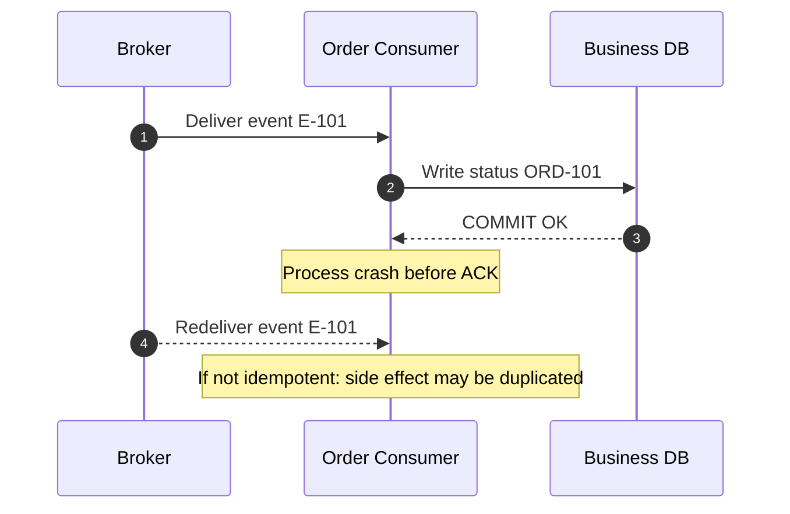
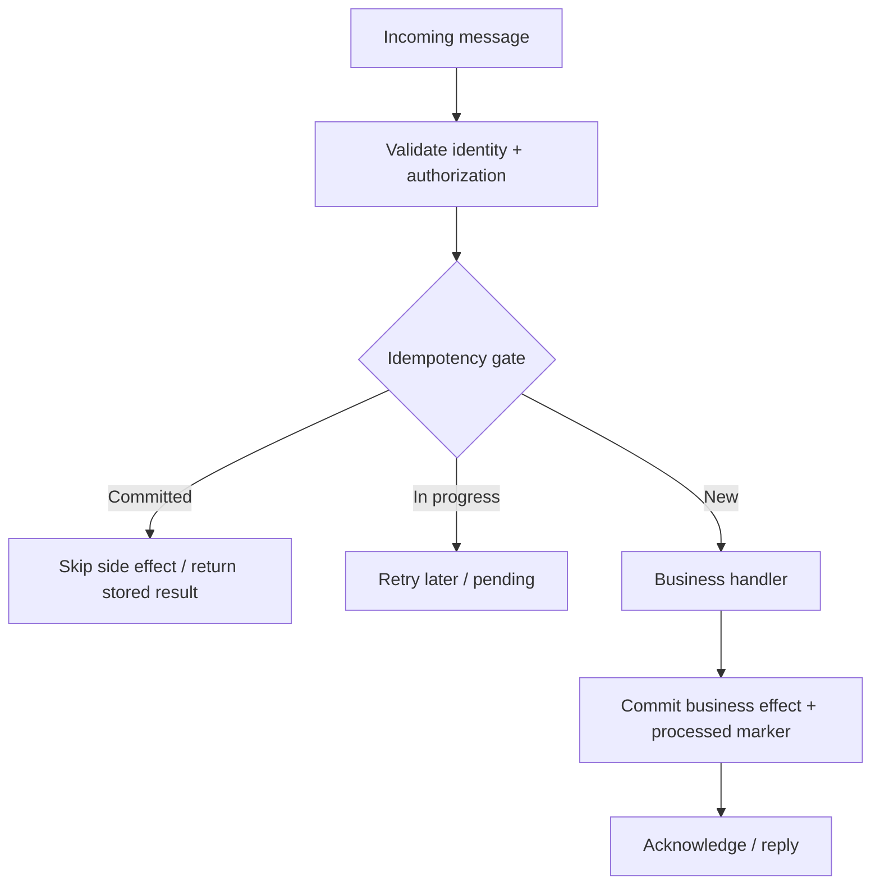
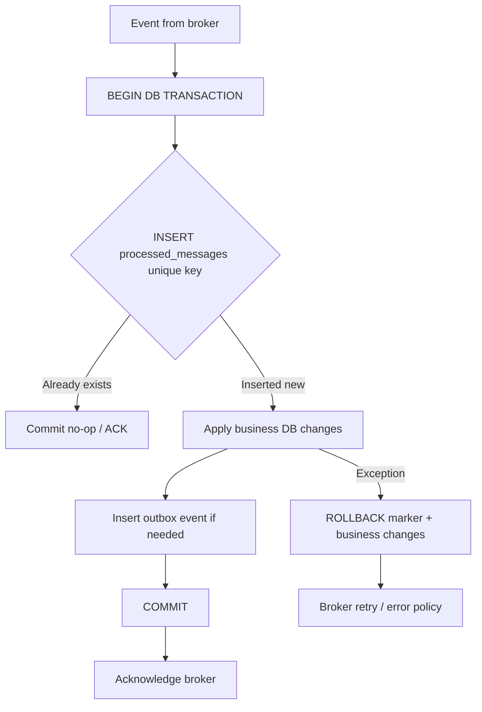
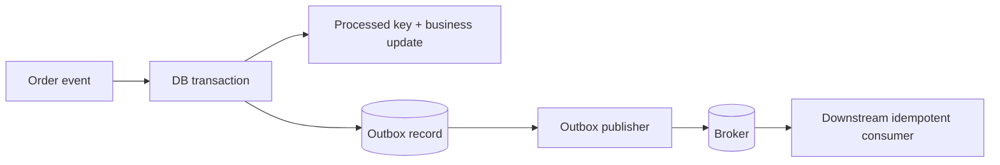
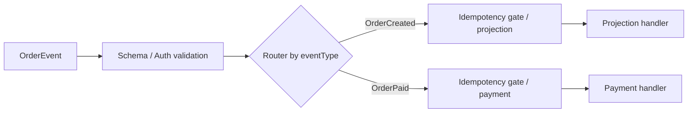
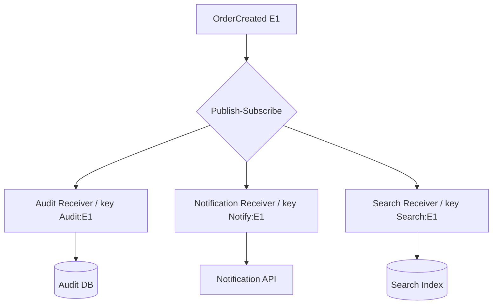

# Idempotent Receiver for Safely Handling Duplicate Messages

A service receives an `OrderCreated` event from a broker, updates the database, and acknowledges processing. After the database commits successfully, the process stops right **before sending the acknowledgment** back to the broker. Not knowing that the task has completed, the broker redelivers **the same event**. If the consumer runs the entire business logic whenever it receives a message, the system may create two warehouse issue slips, deduct inventory twice, or send two notifications.

This scenario is not a rare bug. Retries after timeouts, broker redeliveries, reconnects, multiple instances, and operations that do not commit within the same transaction can all create **duplicate messages**. The **Idempotent Receiver** pattern in **Enterprise Integration Patterns (EIP)** helps the receiver recognize **the same logical operation that has already been processed** and act in a controlled manner, instead of executing the side effect a second time.

The article **“Idempotent Receiver for Safely Handling Duplicate Messages”** belongs to the **Idempotent receiver** chapter of the `SPRING_INTEGRATION_PATTERN` module. The goal is to build a loosely coupled and extensible Spring Integration message flow that combines **Router, Filter, Transformer, Splitter, Aggregator, Gateway, retry, error channel, and correlation**, while being testable across the success path, redelivery, data conflicts, crashes, and concurrent processing.

> **Important principle:** **Detecting a duplicate does not mean the side effect will be executed exactly once.** If a “seen” marker is recorded before the business logic commits and the process crashes, a subsequent redelivery might be skipped even though no outcome was produced. Practical idempotency must be designed **together with transaction boundaries, acknowledgments, and recovery mechanisms**.

## 1. Why Is a Message Received Multiple Times?

Suppose we have:

```json
{
  "eventId": "a9408e98-bd75-48cb-9f4c-b07881ef9b02",
  "tenantId": "TENANT-A",
  "orderId": "ORD-101",
  "eventType": "OrderCreated",
  "schemaVersion": 1
}
```

A consumer processes this event:



Messages can be duplicated because of:

- **At-least-once delivery:** the broker prioritizes not losing messages; when an ack is uncertain, it may redeliver.
- **Producer retry:** a publish request times out, even though the broker may have already received the first attempt.
- **Consumer crash:** the database commits and then the process dies before acking the broker.
- **Gateway/HTTP timeout:** the caller resends because it has not seen a reply yet, even though the backend is still processing or has already committed.
- **Dead-letter replay:** failed messages are put back into the processing pipeline by operations.
- **Manual reprocessing/backfill:** historical data is re-read.
- **Concurrent delivery:** two instances receive the same logical event nearly simultaneously due to retry/routing or coordination errors.

### 1.1. Three Types of Duplication to Distinguish

| Type | Example | How to Identify |
| --- | --- | --- |
| **Same message redelivered** | Broker redelivers an event with `eventId=E1`. | Stable event/message identity. |
| **Two different messages describing the same operation** | Two capture requests for the same `paymentOperationId`. | Business operation/idempotency key. |
| **Two valid operations that look similar** | The same customer places a new order identical to an old order. | Must be distinguished by different operation/business identities. |

If you only compare **payload equality**, you may mistakenly block two valid transactions. If you only compare `MessageHeaders.ID` newly generated on each receipt, you may fail to recognize **the same operation** across broker adapters, retries, or when a producer republishes under a new message ID.

## 2. What Does Idempotency Actually Mean?

An operation `f` is called **idempotent** if repeatedly applying the same **logical request** does not change the observable outcome beyond the result of the first valid application:

\[
f(f(s, k), k) = f(s, k)
\]

Where `s` is the system state and `k` is the **idempotency key** identifying the same operation. This is a simplified interpretation: in real systems, you must also consider **external side effects**, caller replies, published events, and changes over time.

Examples:

| Operation | Idempotent by Default? | Why |
| --- | --- | --- |
| `SET order.status = RECEIVED` | Possibly, if targeting the same record/state and secondary side effects are controlled. | Assigning the same value multiple times does not accumulate. |
| `UPDATE stock SET quantity = quantity - 1` | **No.** | Calling twice deducts two units. |
| `INSERT shipment without a unique key` | **No.** | May create two shipments. |
| `PUT resource with version and stable key` | Possibly. | Must consider optimistic locking, responses, and secondary operations. |
| `POST charge/payment` | **Should not be assumed.** | Requires an operation ID and provider-side deduplication. |
| `Send email` | No. | Re-running the receiver typically sends a second email without dedup. |

**An Idempotent Receiver does not magically make every downstream handler idempotent.** You need to know which side effects require protection, where the markers are stored, and whether the marker is committed together with the business effect.

### 2.1. “Skipping Duplicates” Is Not the Whole Requirement

When receiving a request again, the receiver may:

1. **Avoid re-executing the side effect** if it knows the operation has already committed.
2. **Return the stored result** from the first execution if the caller expects a response.
3. **Report that processing is still in progress** if another instance holds the execution lease.
4. **Reject as a conflict** if the same key has a different payload or operation semantics.
5. **Allow a retry** if the previous attempt definitely did not complete and policy permits.

For fire-and-forget systems, a duplicate can simply be **acked without doing anything**. For a request–reply Gateway, simply dropping the message can cause the caller to **timeout**; the corresponding response contract must be defined.

## 3. Stable Identity: Choosing the Right Deduplication Key

The key to an Idempotent Receiver is **defining “the same operation”**. A sufficiently good key usually includes both the **consumer/operation scope** and an identity issued by a trusted source.

```text
idempotencyKey =
    (consumerName, tenantId, operationType, operationId)
```

Or for a consumer processing a single event type that has a globally non-repeating `eventId`:

```text
idempotencyKey = (consumerName, eventId)
```

**Why add `consumerName`?** The same `OrderCreated` event may be processed independently by a **Projection Consumer**, an **Audit Consumer**, and a **Notification Consumer**. If all three consumers share an unscoped key, the first consumer to record the marker will cause the other two to be misidentified as duplicates.

### 3.1. Distinguishing Important IDs

| ID/Metadata | Question It Answers | Should It Be Used Alone as an Idempotency Key? |
| --- | --- | --- |
| `MessageHeaders.ID` | Which technical message instance is this? | Usually **no** if adapters/retries generate a new ID. |
| `eventId` | Which logical event did the producer emit? | Possibly, when **stable, unique, and trustworthy**. |
| `orderId` | Which business entity? | Usually no; the same order has many valid operations/events. |
| `operationId` | Which operation such as capture/reserve? | Usually well-suited if stable across retries. |
| `correlationId` | Which messages belong to the same conversation/group? | **Not by default**; multiple parts/operations share a correlation. |
| `sequenceNumber` | Which part number is this in a group? | No; every group has a part 1. |
| `traceId` | Which spans belong to a distributed trace? | No; trace IDs may change on retry. |
| `claimId` | Which original payload is stored in the Claim Check store? | Not by default; does not identify a business operation. |
| Kafka offset | Where does the record sit in a partition? | Does not represent the same operation if republished to a different offset. |

### 3.2. An Overly Broad Key Will Mistakenly Block Valid Business Operations

If the key is just `orderId=ORD-101`:

```text
Event 1: OrderCreated   ORD-101
Event 2: OrderPaid      ORD-101
Event 3: OrderCancelled ORD-101
```

The consumer might accept the first event and mark the next two as duplicates, even though they are **distinct and valid** state transitions. Better:

```text
(consumerName, orderId, eventType, operationId)
```

or each event's own `eventId` **if the producer guarantees identity** and the consumer processes the exact event.

### 3.3. An Overly Narrow Key Will Miss Duplicates

If every retry generates a new `UUID.randomUUID()` and the consumer uses that UUID as the key, the system will see **each attempt as a new operation**. Messages may carry identical payloads while lacking a **stable operationId**.

A good idempotency key must be **assigned before the first attempt**, then **kept unchanged** across all retries of the same operation; a new key is only created when the business genuinely creates a new operation.

### 3.4. Canonicalization and Collision Prevention

Do not concatenate `tenantId + orderId` arbitrarily: `("AB","C")` and `("A","BC")` both become `ABC`. Use a typed key/canonical encoding or an internal UUID:

```java
public record OperationKey(
    String consumer,
    String tenantId,
    String operationType,
    String operationId
) {
    public OperationKey {
        if (consumer == null || consumer.isBlank()
                || tenantId == null || tenantId.isBlank()
                || operationType == null || operationType.isBlank()
                || operationId == null || operationId.isBlank()) {
            throw new IllegalArgumentException("Invalid idempotency key");
        }
    }
}
```

In the database, use separate columns or a key encoded with explicit length/escaping/versioning. Avoid case-normalization if the domain treats differing cases as two distinct IDs.

## 4. EIP Idempotent Receiver Differs from Message Filter

A **Message Filter** decides whether a message passes based on a predicate. An **Idempotent Receiver** relies on **the processing history of a logical operation** and requires **state/transactions** to decide whether the current delivery is the first attempt, a retry, or a duplicate.



### 4.1. Why Is a Stateless Filter Not Enough?

A Filter like:

```java
.filter(OrderEvent.class, e -> "CREATED".equals(e.eventType()))
```

only checks **properties of the current message**. It does not know whether the same `eventId` was already committed in a previous execution.

You can use a **stateful MessageSelector** with a `MetadataStore` as a dedup gate, or use **`IdempotentReceiverInterceptor`** as an advice. Even then, you must understand **when state is written** and **whether that state participates in the business side effect's transaction**.

### 4.2. “Seen” Differs from “Processed”

| State | Meaning | Safe to Skip Retry? |
| --- | --- | --- |
| **Unseen** | No record yet. | Not yet; processing may start according to policy. |
| **In progress / reserved** | A consumer has claimed execution rights. | Not necessarily; requires lease/status and recovery. |
| **Committed** | Business effect and processed marker have committed. | Usually safe to skip **the same operation** or return cached result. |
| **Failed retryable** | Incomplete, can be retried. | Should not be permanently skipped. |
| **Failed terminal** | Final failure outcome recorded. | Can return the stored error outcome; does not necessarily need re-execution. |
| **Expired / unknown** | Record expired or status uncertain. | Requires replay/reconciliation policy. |

These states are an **application-designed model**, not an enum automatically generated by `IdempotentReceiverInterceptor`.

## 5. How Does Spring Integration Support Idempotent Receiver?

Spring Integration provides useful building blocks:

- **`IdempotentReceiverInterceptor`**: an advice applying logic to select whether a message is a duplicate, typically attached to an endpoint/handler.
- **`MetadataStoreSelector`**: a `MessageSelector` that uses a metadata store to record identities and decide whether a message has already been seen.
- **`ConcurrentMetadataStore`**: an abstraction providing atomic operations such as `putIfAbsent`; the implementation must actually provide proper concurrency semantics.
- **`SimpleMetadataStore`**: an in-memory store convenient for demos/tests, **not durable across restarts**.
- **Persistent metadata store** compatible with stacks like JDBC/Redis or other implementations depending on version: serves multiple instances when properly configured.
- **Advice/endpoint configuration** in the Spring Integration DSL to place the gate **right before the handler that has side effects**.

**Important note on defaults:** `IdempotentReceiverInterceptor` should not be assumed to simply “silently drop duplicates by default”. The interceptor mechanism can **mark a duplicate header** and continue processing depending on configuration; when you want to discard/route duplicates, you must **configure it explicitly** and test it. Moreover, even when duplicates are blocked at the advice level, **the possibility of crashing after marking but before committing** must still be handled at the business boundary.

### 5.1. `MetadataStore` Is Not `MessageStore`

| Abstraction | What Does It Store? | Related EIP |
| --- | --- | --- |
| **`ConcurrentMetadataStore`** | Small key/value metadata, such as idempotency identities. | Idempotent Receiver. |
| **`MessageStore`** | A `Message<?>` retrievable by ID. | Claim Check. |
| **`MessageGroupStore`** | Multiple messages in the same group and release state. | Aggregator, Resequencer. |

Do not store entire payment records or sensitive payloads in the metadata store solely to detect duplicates. Store only **minimal keys and states** according to retention policies.

### 5.2. A “First Seen” State May Not Suffice for Transactions

A selector puts a key into the metadata store via `putIfAbsent` **before the handler executes**:

```text
T1: putIfAbsent(eventId) → NEW
T2: business handler starts
T3: JVM crashes before business commit
T4: broker redelivers eventId
T5: metadata store still has key → DUPLICATE
T6: event is dropped even though business effect never happened
```

This is a **risk of lost processing** if metadata recording “seen” is treated as proof of “committed”. Therefore, the DSL example below uses an in-memory store **only to demonstrate endpoint-level deduplication mechanics**. The production design in Section 8 places **the unique key and the business effect in the same database transaction**.

## 6. Java DSL Example: IdempotentReceiverInterceptor

We use `OrderEvent` with a stable event ID. The demo handler only records a marker in memory and **performs no real business side effects**.

### 6.1. Input DTO and Test Recorder

```java
// OrderEvent.java
import java.util.UUID;

public record OrderEvent(
    UUID eventId,
    String tenantId,
    String orderId,
    String eventType
) {
    public OrderEvent {
        if (eventId == null
                || tenantId == null || tenantId.isBlank()
                || orderId == null || orderId.isBlank()
                || eventType == null || eventType.isBlank()) {
            throw new IllegalArgumentException("Invalid event");
        }
    }
}
```

```java
// RecordingOrderHandler.java
import java.util.List;
import java.util.concurrent.CopyOnWriteArrayList;

public final class RecordingOrderHandler {
    private final List<String> accepted = new CopyOnWriteArrayList<>();

    public void record(OrderEvent event) {
        accepted.add(event.eventId().toString());
    }

    public int processedCount() {
        return accepted.size();
    }
}
```

### 6.2. Spring Integration Configuration

```java
// IdempotentOrderConfiguration.java
import org.springframework.beans.factory.annotation.Qualifier;
import org.springframework.context.annotation.Bean;
import org.springframework.context.annotation.Configuration;
import org.springframework.integration.channel.QueueChannel;
import org.springframework.integration.config.EnableIntegration;
import org.springframework.integration.dsl.IntegrationFlow;
import org.springframework.integration.handler.advice.IdempotentReceiverInterceptor;
import org.springframework.integration.metadata.ConcurrentMetadataStore;
import org.springframework.integration.metadata.SimpleMetadataStore;
import org.springframework.integration.selector.MetadataStoreSelector;
import org.springframework.messaging.MessageChannel;

@Configuration
@EnableIntegration
public class IdempotentOrderConfiguration {

    @Bean
    ConcurrentMetadataStore demoIdempotencyStore() {
        return new SimpleMetadataStore(); // Demo in-memory only.
    }

    @Bean("orders.duplicates")
    QueueChannel duplicates() {
        return new QueueChannel(16);
    }

    @Bean
    RecordingOrderHandler recordingOrderHandler() {
        return new RecordingOrderHandler();
    }

    @Bean
    IdempotentReceiverInterceptor orderIdempotentAdvice(
            ConcurrentMetadataStore demoIdempotencyStore,
            @Qualifier("orders.duplicates")
            MessageChannel duplicateChannel) {

        MetadataStoreSelector selector = new MetadataStoreSelector(
            message -> {
                OrderEvent event = (OrderEvent) message.getPayload();
                return "order-projection:" + event.eventId();
            },
            demoIdempotencyStore);

        IdempotentReceiverInterceptor advice =
            new IdempotentReceiverInterceptor(selector);
        advice.setDiscardChannel(duplicateChannel);
        return advice;
    }

    @Bean
    IntegrationFlow consumeOrders(
            IdempotentReceiverInterceptor orderIdempotentAdvice,
            RecordingOrderHandler recordingOrderHandler) {
        return IntegrationFlow.from("orders.events.in")
            .handle(OrderEvent.class,
                (event, headers) -> {
                    recordingOrderHandler.record(event);
                    return null; // One-way handler in this demo.
                },
                endpoint -> endpoint.advice(orderIdempotentAdvice))
            .get();
    }
}
```

**How it works:**

1. `orders.events.in` receives the event.
2. `MetadataStoreSelector` extracts the key from the **stable event ID** instead of `MessageHeaders.ID` generated on every delivery.
3. The in-memory store accepts the first key; subsequent events with the **same key** are evaluated as duplicates.
4. `IdempotentReceiverInterceptor` is applied at the handler; **the discard channel is declared explicitly**, rather than relying on the interceptor's defaults.
5. The handler only records the first event in this demo; duplicates are routed to `orders.duplicates` for inspection.

**Snippet constraints:** You need a Spring Integration version that supports the corresponding `MetadataStoreSelector`, `IdempotentReceiverInterceptor`, and `endpoint.advice(...)` constructors/APIs. If configuring different discard semantics, verify against Javadoc/version and test the endpoint itself; do not treat assumptions about defaults as a contract.

**Do not use this in-memory configuration to protect payments or inventory deductions in production.** Keys are recorded before the handler runs, the store is not transactional with the business DB, and data is lost on JVM restart.

### 6.3. Why Does the Key Have a Prefix?

`"order-projection:" + eventId` only makes sense when `eventId` is a reliably issued UUID unique across a sufficiently broad scope. The prefix represents the **consumer/operation scope** so that another consumer sharing the store can still process the same event independently.

If `eventId` is only unique within a tenant, `tenantId` must be included using safe canonical/encoding. Never take an arbitrary header provided by an external client directly without validation.

## 7. JUnit 5 Test: A Second Message with a Different Technical ID Is Still a Duplicate

The goal is to send **two message instances** carrying the same `eventId` in the payload. `MessageBuilder` creates distinct technical messages; idempotency logic must rely on **business identity**, independent of the `Message<?>` instance.

```java
import static org.junit.jupiter.api.Assertions.*;

import java.util.UUID;
import org.junit.jupiter.api.Test;
import org.springframework.beans.factory.annotation.Autowired;
import org.springframework.context.ApplicationContext;
import org.springframework.integration.channel.QueueChannel;
import org.springframework.messaging.Message;
import org.springframework.messaging.MessageChannel;
import org.springframework.messaging.support.MessageBuilder;
import org.springframework.test.context.junit.jupiter.SpringJUnitConfig;

@SpringJUnitConfig(IdempotentOrderConfiguration.class)
class IdempotentOrderFlowTest {

    @Autowired ApplicationContext context;

    @Test
    void recordsOnlyFirstDeliveryAndRoutesDuplicate() {
        UUID eventId = UUID.fromString(
            "a9408e98-bd75-48cb-9f4c-b07881ef9b02");
        OrderEvent event = new OrderEvent(
            eventId, "TENANT-A", "ORD-101", "OrderCreated");

        Message<OrderEvent> first = MessageBuilder
            .withPayload(event)
            .build();
        Message<OrderEvent> redelivery = MessageBuilder
            .withPayload(event)
            .build();

        assertNotEquals(
            first.getHeaders().getId(),
            redelivery.getHeaders().getId());

        MessageChannel input = context.getBean(
            "orders.events.in", MessageChannel.class);
        assertTrue(input.send(first));
        assertTrue(input.send(redelivery));

        RecordingOrderHandler handler =
            context.getBean(RecordingOrderHandler.class);
        assertEquals(1, handler.processedCount());

        QueueChannel duplicates =
            context.getBean("orders.duplicates", QueueChannel.class);
        Message<?> rejected = duplicates.receive(0);
        assertNotNull(rejected);
        assertEquals(eventId,
            ((OrderEvent) rejected.getPayload()).eventId());
        assertNull(duplicates.receive(0));
    }
}
```

**What the test proves:** if the advice configuration works as expected, **the same logical event** does not run the demo handler twice, even when the two deliveries have **different technical message IDs**.

**What the test does not prove:** durability, atomicity with the DB, crash windows, HTTP API idempotency, deduplication across two pods, or exactly-once delivery. When sharing a test context, separate event IDs across tests or reset the metadata store because state can persist across test methods.

### 7.1. Testing Same Payload with Different Operation IDs

Another test should ensure:

```text
Event A: eventId=E-1, orderId=ORD-101
Event B: eventId=E-2, orderId=ORD-101
```

Two events with **different identities** should both be accepted if the contract specifies they are two valid operations. Do not write a selector that only uses `orderId` and accidentally blocks all events for an order.

### 7.2. Testing Same Key with Conflicting Payloads

```text
eventId=E-1, status=APPROVED
eventId=E-1, status=DECLINED
```

Do not silently treat these two messages as completely identical duplicates. For events requiring immutable content, store a **payload hash/version** or canonical fingerprint in the idempotency record and **report a conflict/quarantine** when the same key carries different content. A key-only selector will not automatically detect data conflicts.

## 8. A Safer Boundary: Shared Transaction with the Business Effect

Suppose the consumer uses PostgreSQL to update an order projection. To avoid losing processing on crash, the **processed marker and business write** should reside within the **same database transaction**:



### 8.1. Unique Constraint in the Database

```sql
CREATE TABLE processed_messages (
    consumer_name VARCHAR(100) NOT NULL,
    event_id UUID NOT NULL,
    processed_at TIMESTAMPTZ NOT NULL DEFAULT now(),
    PRIMARY KEY (consumer_name, event_id)
);

CREATE TABLE order_projection (
    tenant_id VARCHAR(100) NOT NULL,
    order_id VARCHAR(100) NOT NULL,
    status VARCHAR(40) NOT NULL,
    PRIMARY KEY (tenant_id, order_id)
);
```

This is an **illustrative schema for PostgreSQL**. If `eventId` is not unique across tenants, `tenant_id` must be added to the unique key, and the source identity must be verified. You can add `payload_hash`/`result_json` to detect conflicts and return cached results, along with appropriate retention/indexes.

### 8.2. One Transaction Controlling Both Marker and Business Update

```sql
BEGIN;

-- Idempotency claim; succeeds at most once per
-- (consumer_name, event_id) when the unique key is enforced.
INSERT INTO processed_messages (consumer_name, event_id)
VALUES ('order-projection', :event_id)
ON CONFLICT DO NOTHING;

-- The application must inspect the inserted row count (0 or 1).
-- If 0: duplicate already has a record -> COMMIT no-op / ACK.
-- If 1: run the business SQL below within the SAME transaction.

INSERT INTO order_projection (tenant_id, order_id, status)
VALUES (:tenant_id, :order_id, 'RECEIVED')
ON CONFLICT (tenant_id, order_id)
DO UPDATE SET status = EXCLUDED.status;

-- If there is an outbound event, write to the outbox in the same transaction.
-- On business error: ROLLBACK both the marker and the business write.

COMMIT;
```

**Reading the pseudo-flow properly:** Subsequent SQL statements must **only execute when the marker INSERT returns 1 row**. The snippet above illustrates the transaction steps; in a real implementation, code must branch on the update count. Do not run the `order_projection` update for duplicates.

**Safety comes from:**

1. **A unique constraint** on the consumer's processing operation identity.
2. **A single database transaction** covering both the marker and the business effect.
3. **Rolling back** the marker when the business write fails.
4. **Acking the broker after commit**, or an equivalent transport mechanism.
5. When commit succeeds but ack is lost, redelivery hits the marker and **does not re-execute the effect**.

This **does not turn two independent systems** (DB + remote HTTP/broker) into a single atomic distributed transaction. Side effects outside the database require their own idempotency/outbox/saga mechanisms.

### 8.3. Service Implementation with Spring JDBC

```java
// TransactionalOrderProjectionService.java
import java.util.UUID;
import org.springframework.jdbc.core.JdbcTemplate;
import org.springframework.stereotype.Service;
import org.springframework.transaction.annotation.Transactional;

@Service
public class TransactionalOrderProjectionService {

    private final JdbcTemplate jdbc;

    public TransactionalOrderProjectionService(JdbcTemplate jdbc) {
        this.jdbc = jdbc;
    }

    @Transactional
    public void apply(OrderEvent event) {
        // Validate/authenticate tenant + event identity at ingress.
        UUID id = event.eventId();

        int inserted = jdbc.update("""
            INSERT INTO processed_messages(consumer_name, event_id)
            VALUES (?, ?)
            ON CONFLICT DO NOTHING
            """, "order-projection", id);

        if (inserted == 0) {
            // Marker already exists; do not re-apply business effect.
            return;
        }

        jdbc.update("""
            INSERT INTO order_projection(tenant_id, order_id, status)
            VALUES (?, ?, ?)
            ON CONFLICT (tenant_id, order_id)
            DO UPDATE SET status = EXCLUDED.status
            """, event.tenantId(), event.orderId(), "RECEIVED");

        // If RuntimeException is thrown, both marker and update roll back.
        // If another event needs to be published, write to a transactional outbox here.
    }
}
```

**Notes:**

- This code uses **PostgreSQL-specific syntax** (`ON CONFLICT`) and assumes a Spring transaction manager configured for the **same DataSource**.
- `@Transactional` must be invoked properly through a Spring proxy; self-invocation or instantiating with `new` may prevent transaction advice from being applied.
- The “set status = RECEIVED” logic is just an example; if events arrive out of order or the order status has already progressed further, an unconditional UPSERT can **regress the state**. Use a business version/state-machine guard when appropriate.
- If the event payload changes while keeping the same ID, the unique constraint only detects the **same key**; contract-level conflict validation is still required.
- Do not call payment APIs or send emails directly inside the transaction assuming they will automatically roll back with the DB.

### 8.4. Wiring the Service into a Spring Integration Flow

```java
// BusinessConsumerFlow.java
import org.springframework.context.annotation.Bean;
import org.springframework.context.annotation.Configuration;
import org.springframework.integration.config.EnableIntegration;
import org.springframework.integration.dsl.IntegrationFlow;

@Configuration
@EnableIntegration
public class BusinessConsumerFlow {

    @Bean
    IntegrationFlow transactionalOrderReceiver(
            TransactionalOrderProjectionService service) {
        return IntegrationFlow.from("orders.business.in")
            .handle(OrderEvent.class,
                (event, headers) -> {
                    service.apply(event);
                    return null; // One-way message handling.
                })
            .get();
    }
}
```

Here, the **business service performs deduplication inside the same transaction**. You may place `IdempotentReceiverInterceptor` as an **optimization layer** before the service to reduce duplicate load, but **never rely on a non-transactional “seen-before” layer as the sole condition to skip** when guaranteed processing without loss is required. In many systems, **having transactional dedup directly in the service** is clearer and easier to audit.

## 9. Analyzing Crash Windows and ACK

A matrix that must be verified:

| Crash Point | DB Marker | Business Effect | Broker ACK | Result After Redelivery |
| --- | --- | --- | --- | --- |
| Before starting transaction | Not present | Not present | No | Retried normally. |
| After marker INSERT, before business write, **not yet COMMITTED** | Uncommitted | Uncommitted | No | Transaction rolls back; redelivery reprocesses. |
| After business write, before COMMIT | Uncommitted | Uncommitted | No | Rolls back; redelivery reprocesses. |
| After COMMIT, before ACK | Committed | Committed | No | Redelivery sees processed key, does not write again. |
| After ACK | Committed | Committed | Yes | Broker normally does not redeliver that message; if replayed, still a no-op. |

### 9.1. Do Not ACK Before Business Commit

```text
Wrong:
    receive message
    → ACK immediately
    → process DB
    → crash
    => broker considers it done, DB is not updated
```

If the transport/adapter uses auto-ack, you must understand the exact moment the broker acknowledges the message and its behavior when the handler throws an exception. Do not assume all brokers have identical ack semantics.

### 9.2. Ensure Transaction Rollback Covers the Marker

```text
Wrong:
    putIfAbsent(key) into Redis or metadata store
    → DB write fails
    → Redis still keeps "seen" key
    → redelivery is dropped
```

Without a distributed transaction, Redis keys and database writes **cannot be assumed** to commit/roll back together. You can use `IN_PROGRESS`/lease/`COMPLETED` states combined with recovery, or move the identity record into the DB transaction alongside the business effect.

### 9.3. Unique Key Resolves Races Between Two Consumers

Two pods receive event `E1` simultaneously:

```text
Pod A: INSERT processed_messages(E1) → winner
Pod B: INSERT processed_messages(E1) → wait/conflict

Pod A: business update + COMMIT
Pod B: INSERT count=0 → no-op / ACK
```

This illustrates the **behavior when the DB enforces unique constraints and appropriate transaction isolation**. In practice, Pod B may have to wait for A's transaction to finish; if A rolls back, B can become the winner. Test concurrency and deadlocks/lock timeouts against a real database, not just an in-memory `HashSet`.

## 10. Handling Side Effects Outside the Database

For example, the receiver must:

1. Write the order status to PostgreSQL.
2. Call a Payment API.
3. Publish `OrderAccepted` to a broker.
4. Send a confirmation email.

No simple local DB transaction spans all four. If you mark processed and then **call the API after commit**, crashing between steps leaves side effects missing. If you **call the API before commit**, retrying after a crash may call the API twice.

### 10.1. Sending an Idempotency Key to the Provider

When the Payment API supports idempotency, attach the **same operation key** to every retry:

```text
POST /payments/capture
Idempotency-Key: TENANT-A:PAY-OP-101

Attempt 1 → caller times out, provider may have captured
Attempt 2 → same Idempotency-Key
          → provider returns previous result or detects duplicate
```

This is a **conceptual model**, not the exact API header name of every payment provider. Always read the specific contract: key retention, payload mismatch handling, response replay, and the difference between timeouts and failures.

### 10.2. Transactional Outbox for Publishing Events



**Recording business state + outbox row in the same DB transaction** avoids committing the DB without having a record of the event to publish. The publisher may emit duplicates after a crash, so **downstream still needs an Idempotent Receiver**.

### 10.3. Multi-Step Sagas/Workflows

For cross-service operations that cannot execute in an atomic transaction, you can use:

- Stable `workflowId` and `operationId` for each step.
- Versioned state machine/step log.
- Idempotent per-step handlers and deadline-bounded retries.
- Compensation when a step fails after earlier steps have committed.
- Reconciliation for “unknown outcome” rather than assuming a timeout means unexecuted.

**Compensation is not an instant rollback and can itself be executed repeatedly**; compensation steps must also be idempotent.

## 11. Duplicate Policy: Skip, Return Cached Result, or Report Conflict?

Not every receiver should silently drop duplicates.

| Case | Possible Policy | Required Contract |
| --- | --- | --- |
| Consumer updating a projection from events | ACK/no-op if already committed. | Durable marker and proper consumer scope. |
| Command via Gateway needing an `OrderReceipt` | Return the **stored result** of the same operation. | Persist response/status by idempotency key. |
| Operation currently running on another pod | Return `PENDING` or schedule retry. | Lock/lease, timeout, and preventing two workers from running together. |
| Same key but different payload | `CONFLICT`/quarantine. | Payload hash, schema/version, and ownership check. |
| Permanently invalid event data | Reject/DLQ after classification, optionally store terminal failure. | Do not retry indefinitely. |
| Same business order but **new operation** | Process as new. | Clear identity distinguishing events/operations. |

### 11.1. Same Key, Different Payload

If two requests are:

```json
{"operationId":"CAP-101","amount":100000}
```

and

```json
{"operationId":"CAP-101","amount":250000}
```

they **must not be treated as two identical requests solely because the key matches**. Silently ignoring the second request could hide a payment bug. Store a **canonical payload fingerprint** and return `409 CONFLICT` or an appropriate domain error.

Notes on hashing: JSON field ordering, decimals, charset, version, and ignorable fields must be canonicalized; hashing does not replace validation/auth.

### 11.2. Persisting the First Response

A request–reply service can store:

```text
idempotency_key = CAP-101
payload_hash = SHA256(canonical_request)
state = COMPLETED
response_code = 200
response_body = {receiptId: ...}
completed_at = ...
```

A retry with the same key and same request hash returns the **same outcome**, without creating a new payment. Do not merely return “duplicate” if the API contract requires a receipt for the caller to continue its workflow.

## 12. Retries: Where to Place Them, When to Stop, and Avoiding Retry Storms

A message can be retried simultaneously at:

- The producer HTTP client.
- Broker delivery.
- Spring Integration `RequestHandlerRetryAdvice` or the endpoint's retry mechanism.
- Payment/Inventory HTTP client.
- DLQ reprocessing scheduler.
- Gateway caller.

If every layer retries three times, the number of attempts hitting a dependency can multiply rapidly. Choose a **retry owner** and classify errors:

| Error | Retry? | Reason |
| --- | --- | --- |
| Transient DB connection failure, transaction rolled back | Possibly, bounded. | Must ensure marker did not commit. |
| Already committed duplicate | No need to re-run business logic. | ACK/no-op or cached response. |
| Payload missing required key/invalid schema | Do not retry same payload. | Needs reject/quarantine. |
| Same idempotency key with conflicting payload | Do not retry blindly. | Needs conflict handling. |
| Lock/lease held by another owner | Wait/retry or return PENDING with bounds. | Avoid two workers running concurrently. |
| External payment HTTP timeout | Consider **reconciling by operation ID** first. | Timeout does not prove the provider didn't charge. |
| Overloaded storage/circuit breaker | Backoff + jitter, bounded concurrency. | Avoid retry storms during recovery. |

### 12.1. Retries and the `IN_PROGRESS` State

If implementing a dedicated repository for commands:

```text
NEW → IN_PROGRESS (owner + lease)
IN_PROGRESS → COMPLETED (result)
IN_PROGRESS → RETRYABLE_FAILED
IN_PROGRESS → TERMINAL_FAILED
IN_PROGRESS lease expired → RECOVER / RECONCILE
```

This is an **application state machine**, not a built-in feature of `SimpleMetadataStore`. An `IN_PROGRESS` key must not stay stuck forever if a worker dies. However, “lease expired” does not mean external side effects rolled back; before taking over, reconcile or rely on provider-side idempotency.

### 12.2. Backoff and Deadlines

Set limits on **max attempts**, **backoff/jitter**, and **deadlines**. If the Gateway only waits one second, while an external dependency takes five seconds, do not keep retrying synchronously in request–reply and report false success; instead transition to `PENDING` and a status query.

## 13. Combining with Router, Filter, and Transformer

### 13.1. Placing Idempotency on the Exact Branches with Side Effects



Two handlers have **different operation scopes** and should not share an overly broad `orderId` key.

If an event must be processed by both Audit and Projection, **each consumer needs independent deduplication** keyed by `(consumer,eventId)`. Putting a single global gate **before Publish–Subscribe** can prevent an event from reaching all subscribers, but it cannot replace each subscriber protecting its own side effects.

### 13.2. Filter and Idempotent Receiver Differ on State

A Filter can drop invalid `OrderEvent` messages based on payload. It does not know whether an event was previously processed. An Idempotent Receiver needs **identity + state** and usually an **atomic claim**.

When using a stateful selector inside `.filter(...)`, passing the Filter should not be interpreted as a **business commit**. If it writes the key before the handler, the crash window described in Section 5 still exists.

### 13.3. Transformer Must Preserve a Stable Operation ID

If a Transformer converts a JSON String into `OrderEvent`, the `eventId` field must be parsed/validated from a trusted source, **not generated as a new UUID every time the message is deserialized**. Dangerous example:

```java
// Wrong if this is the same logical event being retried:
OrderEvent rehydrateWithoutStableId(String orderId) {
    return new OrderEvent(
        java.util.UUID.randomUUID(),
        "TENANT-A", orderId, "OrderCreated");
}
```

Assigning a different ID on each retry defeats deduplication. When there is no upstream event ID, you need a **stable business operation identity** with a clear contract; **do not rely on hashing the entire payload as a silver bullet**, because two independent operations can have identical contents.

### 13.4. Content Enricher May Call Dependencies Repeatedly

A Content Enricher looking up read-only data generally tolerates retries better than an Enricher calling an API with side effects. If the lookup actually creates a reservation or incurs a charge, idempotency is needed **at that dependency itself**, not only at a downstream Aggregator.

## 14. Splitter, Aggregator, Resequencer, and Correlation

A batch has three parts:

```text
Batch B-101
  → Splitter seq=1/3, 2/3, 3/3
  → parallel handlers
  → Aggregator / Resequencer
```

If part `seq=2` is redelivered, it is still **the same logical part**. A key may consist of:

```text
(consumerName, batchId, batchGeneration, partId, operationType)
```

**Do not use `sequenceNumber` alone**: every batch has a part 1. And if the Splitter generates `correlationId` from the **MessageHeaders.ID** of the split invocation, replaying the batch may produce a new correlation ID; consider using a stable business key.

### 14.1. Counting Enough Messages Does Not Mean Enough Distinct Parts

```text
expectedParts=3
received:
  part=1
  part=2
  part=2 (duplicate)

group.size()=3 but distinctParts=2
```

**The Aggregator** must release based on enough **valid outcomes** or a release strategy designed for duplicates. An idempotent receiver before the Aggregator can reduce storing duplicates, but if a duplicate is dropped while the first attempt has not yet produced a terminal outcome, the group might wait forever. Clearly define:

- Each processed part has **one terminal result** (SUCCESS/REJECTED/FAILED).
- Dedup based on stable part identity.
- Retry when not yet committed.
- Aggregator release/expiry and partial policies.
- Late replies after the group has finalized.

### 14.2. Resequencer Does Not Deduplicate by Reordering

A Resequencer may emit `1,2,3` in order, yet a stream can receive `1,2,2,3`. Correct ordering does not mean processed once. Separate deduplication/identity and group expiry/late-arrival handling are required.

### 14.3. Nested Groups

A file contains orders; each order has lines. You may need:

```text
outer group key = (tenantId, fileId, generation)
inner part key  = (tenantId, fileId, orderId, lineId, operationType)
```

With only a flat `correlationId`, it is easy to confuse identities across levels. The idempotency key must identify **each part/operation's side effect**, not be mechanically derived from group correlation.

## 15. Scatter–Gather, Publish–Subscribe, and Independent Subscribers

An event may be broadcast to:

- Audit Consumer.
- Metrics Consumer.
- Notification Consumer.
- Search Index Consumer.



Each subscriber must **execute its own side effect once appropriately**, so it needs **consumer-scoped idempotency**. If Audit has already processed E1, Notification must still be allowed to send the E1 notification the first time.

### 15.1. Scatter–Gather and Duplicate Replies

In Scatter–Gather, Pricing replies twice while Inventory has not replied yet. The Aggregator must not treat “two replies” as sufficient for “two recipients”. Use a release strategy based on a **unique set of roles/recipients**, while applying appropriate deduplication on the reply consumers.

### 15.2. Idempotent Reply Differs from Idempotent Business Call

A Gather step might discard a duplicate Pricing reply, yet the Pricing handler could have already called an external API twice earlier. **Deduplication at gather only protects the reply collection**, not the side effects at the source service. Place idempotency wherever needed.

## 16. Claim Check and Idempotent Receiver

In a Claim Check flow, the token may be redelivered:

```text
token C1 → Claim Check Out → Business handler
token C1 → Claim Check Out → Business handler (retry)
```

**Claim ID** identifies the stored payload, not the **operation** or who is authorized to process it. If a claim has multiple consumers, both Audit and Archive can legitimately restore the same payload. Thus the key may be:

```text
(consumerName, claimId, businessOperationId)
```

If check-out uses **remove-on-read**, a retry might encounter `claim not found` even when the business handler has not committed. For retries, fan-out, and side effects, design **read-many/lease/cleanup-after-completion** or a truly atomic one-time claim workflow.

**Do not treat reading the claim token as proof that the business effect has committed.** This is the same distinction between `SEEN` and `COMPLETED`.

## 17. Request–Reply Gateway: Duplicates Must Receive Consistent Replies

A Java Gateway can provide a facade:

```java
import org.springframework.integration.annotation.MessagingGateway;

@MessagingGateway(defaultRequestChannel = "commands.in")
interface OrderCommandGateway {
    OrderReceipt submit(OrderCommand command);
}

// OrderCommand/OrderReceipt are application-defined.
// The real flow must produce a reply and an idempotency-aware result.
```

If the caller sends `operationId=CMD-101` twice:

1. **First attempt completed:** return the first attempt's receipt; the second call returns **the same logical outcome**.
2. **First attempt still running:** return `PENDING` or wait with a bound, never letting two handlers execute the side effect simultaneously.
3. **Same ID, different payload:** return **CONFLICT** or an appropriate domain error.
4. **First attempt failed transiently:** allow retry per policy, after confirming the operation is no longer running or has been reconciled.
5. **First attempt had a terminal failure:** can return the stored failure per contract.

**The `IdempotentOrderConfiguration` example in Section 6 does not produce an `OrderReceipt`**; it is a one-way handler demonstrating advice and duplicate discard. When using a Gateway, you need a flow with a reply path and a repository storing the state/result of the idempotent operation; simply discarding duplicates can cause the caller to timeout.

### 17.1. Gateway Timeout Does Not Mean the Side Effect “Never Happened”

```text
Caller → submit(CMD-101)
Gateway replyTimeout after 1 second
Backend commits after 1.5 seconds
Caller retries CMD-101
```

The retry must carry the **same operation ID** and the receiver must recognize the already committed result. Never treat a timeout as a rollback; if the backend called a remote payment service and the outcome is unknown, query/reconcile via the provider key.

## 18. Error Channel, DLT, and Acknowledgment

In Spring Integration, errors can travel via:

- **Synchronous handler**: exceptions propagate back to the caller on the same call stack.
- **Async/poller/adapter**: exceptions can be wrapped in an `ErrorMessage` and sent to `errorChannel` when configured appropriately.
- **Broker listener**: nack/requeue/DLT/redelivery depending on transport and acknowledgment policy.

A failure path must distinguish:

| Error | Is It a Duplicate? | Action |
| --- | --- | --- |
| Key already **COMPLETED** and valid payload | Yes. | ACK/no-op or replay stored response. |
| Key is **IN_PROGRESS** | Uncertain. | Wait/lease/reconcile, do not run in parallel. |
| New key, business DB deadlock | No. | Roll back, bounded retry. |
| Malformed payload | No. | Reject/quarantine, do not retry blindly. |
| Duplicate key, different payload | Conflict. | Report/quarantine; do not silently skip. |
| External API timeout | Outcome uncertain. | Query status by operation ID, retry safely. |
| Metadata store unavailable | Cannot classify yet. | Fail closed or retry; do not default to treating as a new event. |
| Outbound event publish failure | Possible partial completion. | Outbox/recovery; do not re-run committed side effects. |

### 18.1. Do Not Swallow Exceptions and Cause Incorrect Broker ACKs

If a handler throws an error before business commit but the error flow **logs and returns success**, the adapter may ACK even though the task did not complete. Establish a contract:

- When to **requeue/retry**?
- When to send to **DLT**?
- When to **terminally reject** and store the result?
- When to return a response to the caller?
- When can an incident be handled via manual replay?

Do not treat `errorChannel` as an automatic idempotency recovery mechanism. It is simply an error observation/handling route according to the configured topology.

### 18.2. DLT Replays Must Reuse the Old Identity

If an operator fixes a broken payload and republishes it under a **new eventId**, deduplication will not know whether it is the same partially processed operation. Define a policy:

- Keep `operationId` when still retrying **the same operation**.
- Create a new operation ID/generation when genuinely executing **a new operation**.
- Track the reason, original eventId, and causal relationship.
- Assess business state before replaying if the old outcome may have already committed.

## 19. TTL and Retention of Idempotency Records

Keeping keys **forever** can cause the metadata store to grow unbounded. Deleting keys **too early** allows old replays to re-execute side effects.

Example:

```text
10:00 Event E1 processed, key retained for 1 hour
11:05 Key TTL expires
11:10 Broker/DLT replays E1
11:10 Receiver treats it as NEW → side effect may be duplicated
```

Retention should consider:

- **Broker retention/redelivery** window and queue backlog.
- Maximum retry/backoff duration and DLT/manual replay window.
- How long a command/Gateway caller may resend the same key.
- Payment/reconciliation regulations and severity of the side effect.
- Storage cost, privacy, and retention regulations.
- Key reuse and operation generation policies.

**There is no single safe default TTL for all business domains.** For critical financial operations, design long-lived business identity/state and replay reconciliation instead of relying solely on short-lived Redis keys.

### 19.1. Deleting the Key After a Failed Attempt?

If an attempt failed and rolled back cleanly **before any side effect**, retries can be allowed. But if the process timed out after a remote service committed, **deleting the key immediately** to allow retry can cause duplication. Use an `UNKNOWN/PENDING_RECONCILIATION` state and reconcile.

### 19.2. Key Reuse After Expiry

If the same client reuses `operationId=ABC` for a new command after 24 hours, the system may accept it as new once the TTL expires. Whether that is acceptable is an **API contract**. Never let accidental key reuse trigger two payments when the caller thought it was still retrying the old one.

## 20. Multi-Instance: Deduplication Must Be Atomic and Share State

`SimpleMetadataStore` only stores data in a single JVM. Two pods:

```text
Pod A: SimpleMetadataStore A, does not have E1
Pod B: SimpleMetadataStore B, does not have E1

Pod A receives E1 → sees NEW
Pod B receives E1 → sees NEW
→ both may process E1
```

For multiple instances to jointly protect an operation:

1. Use a **durable/shared repository** with atomic uniqueness or appropriate compare-and-set.
2. Share a **transaction boundary** with business state whenever possible.
3. Limit concurrency/partitioning by business key.
4. Provide a way to recover reservations/leases when a pod dies.
5. Test two pods receiving **the same key concurrently**.
6. Handle store outages with a safe policy; never fail open for high-risk side effects.

### 20.1. What Do Redis `SETNX`/Metadata Stores Solve and Not Solve?

An atomic `putIfAbsent` in a shared metadata store can ensure **only one caller gets the “first claim” at a time**. However, if the key remains after the handler crashes, it can block retries of an uncommitted operation. If the key's lease expires while the handler is still running, another worker can begin executing the same side effect.

That is why **atomic claim** and **atomic business commit** are two different problems. Recovery/leases/fencing and provider-side idempotency are needed when they are not in the same transaction.

### 20.2. Preventing Races on Business Records

Even when deduplication by event ID is working properly, two **different** events modifying the same order can race:

```text
OrderPaid event P1
OrderCancelled event C1
```

That is a **concurrency/ordering issue**, not a duplicate. It requires optimistic locking/version guards, partitioning by order key, or state-machine validation. An Idempotent Receiver **does not replace a Resequencer or data version control**.

## 21. Security: Do Not Trust Idempotency Keys from Unauthenticated Sources

An attacker can send someone else's key or deliberately craft keys:

```json
{
  "tenantId": "TENANT-B",
  "operationId": "CAP-101",
  "amount": 100000
}
```

If the receiver blindly trusts `tenantId` from the payload and uses a single system-wide dedup store:

- An attacker can **pre-claim a key**, causing a subsequent valid request to be treated as a duplicate.
- Two tenants can collide on keys and interfere with each other.
- Conflicting payloads might be skipped without auditing.
- Unauthorized actions might trigger business side effects if auth is misconfigured.

Countermeasures:

- Perform AuthN/AuthZ before creating or trusting a stable operation identity.
- Derive `tenantId` from the **authenticated context** when needed.
- Scope keys by consumer/tenant/operation.
- Validate schema and **payload hash** if the same key requires identical content.
- Apply rate limits and quotas on new keys, in-flight requests, TTL, and storage.
- Never put tokens/cookies/PII in idempotency keys or metric labels.
- Protect metadata stores, logs, DLTs, manual replay tooling, and backups.
- Use constant-time comparison/cryptographic primitives when designing appropriate secret tokens; never rely on hard-to-guess UUIDs as your entire authorization.

**Idempotency is not authorization**: a request with a duplicate ID must still comply with permissions and data policies.

## 22. Observability: Seeing Duplicates Without Hiding Lost Processing

Recommended metrics:

| Metric/Trace | Purpose |
| --- | --- |
| `idempotency_received_total` | Total deliveries entering the receiver. |
| `idempotency_first_seen_total` | Keys observed for the first time. |
| `idempotency_completed_total` | Operations committed successfully. |
| `idempotency_duplicate_completed_total` | Duplicate deliveries of already committed operations. |
| `idempotency_in_progress_total` | Requests contending for an in-progress operation. |
| `idempotency_conflicts_total` | Same key with conflicting payload/outcome. |
| `idempotency_store_failures_total` | Metadata/DB store failures. |
| `idempotency_rollback_total` | Rolled-back executions needing retry. |
| `idempotency_reconciliation_total` | Operations with unknown outcomes requiring reconciliation. |
| `idempotency_record_age_seconds` | Record age/retention. |
| `broker_redelivery_total` | Redeliveries from transport if provided by the adapter. |
| `business_side_effect_attempts_total` | Attempts actually invoking the business effect. |
| `business_side_effect_commits_total` | Successful logical commits. |
| `outbox_publish_retries_total` | Outbox publisher retry attempts. |

These are **suggested metric names**, not built-in metrics provided out-of-the-box by `IdempotentReceiverInterceptor`. Labels should have bounded cardinality such as `consumer=order-projection`, `outcome=DUPLICATE`. Do not attach per-request `eventId`, `orderId`, or tokens to metric labels to avoid high cardinality/PII leaks.

### 22.1. Safe Logging

```text
event=idempotent_message_handled
consumer=order-projection
operation_ref=<opaque-reference>
delivery_kind=REDELIVERY
decision=DUPLICATE_COMPLETED
side_effect_executed=false
correlation_ref=<opaque-trace-reference>
```

```text
event=idempotency_conflict
consumer=payment-capture
operation_ref=<opaque-reference>
reason=SAME_KEY_DIFFERENT_PAYLOAD
decision=QUARANTINE
```

Example logs should be emitted from **verified state**. A `duplicateMessage` header set by an interceptor does not by itself prove the business transaction committed. Never log raw payment details, credentials, or entire failed messages.

### 22.2. Diagnosing Duplicated Side Effects

1. Does the producer preserve the **same operationId/eventId** across retries?
2. Did a Transformer/adapter generate a new technical ID and cause the selector to use the wrong ID?
3. Does the dedup key have the right **consumer/tenant/operation scope**?
4. Do multiple instances share the same store with atomic uniqueness?
5. Was the marker written **before or in the same transaction** as the business effect?
6. Did broker ACK occur **before or after commit**?
7. Was an external HTTP API retried without an idempotency key?
8. Could an outbox publisher or DLT replay emit the event a second time?
9. Is the key TTL shorter than the replay window?
10. Is the business effect truly **idempotent** for events with different IDs representing the same operation?

### 22.3. Diagnosing **Lost** Processing

1. Was the key written as **SEEN** before business commit and then the process crashed?
2. Did an error handler swallow an exception and cause a false broker ACK?
3. Did the metadata store retain a claim from a failed attempt?
4. Is a lease stuck or missing recovery?
5. Was the same key used for **two different operations**?
6. Did wrong tenant/source auth allow a key to be pre-claimed?
7. Did cleanup/TTL delete metadata or payloads too early?

A system with a **low duplicate rate** is not necessarily healthy if it is **dropping events that have not yet been processed successfully**.

## 23. Idempotent Receiver Test Matrix

| Scenario | What Must Be Proven |
| --- | --- |
| New event | Business effect happens once; marker commits properly. |
| Same eventId sent twice | Side effect does not execute a second time. |
| Same eventId, different MessageHeaders.ID | Still detected as the same logical event. |
| Two different event IDs, same order | Not mistakenly blocked if they are two valid operations. |
| Same key, conflicting payload | Conflict reported, not silently ignored or overwriting the first result. |
| Error before DB commit | Marker and business write roll back; redelivery can reprocess. |
| Crash after DB commit before broker ACK | Redelivery is a no-op, no duplicate side effect. |
| Two workers receive same key concurrently | Unique constraint/atomic claim allows only one logical commit. |
| Metadata store unavailable | Clear fail/retry policy, does not fail open for risky effects. |
| Broker redelivery after app restart | Durable marker still prevents duplicates. |
| Key TTL expires before DLT replay | Detected and business guard remains safe. |
| Gateway retry with same operation ID | Returns cached result/PENDING per contract, does not process twice. |
| External payment timeout | Reconciles with provider ID, prevents double capture. |
| Duplicate outbox publish | Downstream consumer is idempotent. |
| One event sent to two different consumers | Each consumer processes once independently. |
| Duplicate Splitter part | Deduplicated by `(batch,part,operation)`, group does not release incorrectly. |
| Out-of-order events with different identities | Not treated as duplicates; handled via version/order policy. |
| Different tenants using same operationId | No state mixing, proper auth and tenant isolation. |
| Rolling deploy | Key encoding/schema compatible, dedup does not silently vanish. |

### 23.1. Testing Transactions with a Real Database

With PostgreSQL/Testcontainers or a production-like database in the test environment:

1. Create the `processed_messages` table with its unique constraint and the business table.
2. Run the same `eventId` from two threads/transactions.
3. Verify **only one transaction performs the business write**.
4. Inject an exception after marker INSERT but before the business update; verify **rollback removes the uncommitted marker**.
5. Resend the event and verify the retry commits successfully.
6. Simulate commit success without ack and resend; verify no-op.
7. Send the same key with a different payload; verify conflict policy.

**Do not run this test using an in-memory `Set` and conclude database races/rollbacks are correct.** The local test in Section 7 only demonstrates endpoint-level dedup; transactional invariants must be verified against a real DB.

### 23.2. Performance and Failure Testing

- Increase consumer/partition count and check lock contention and unique index hot spots.
- Test DB unavailability while the broker keeps delivering messages.
- Verify backlog, bounded retries, and that the DLT does not explode.
- Simulate crashing after outbox row commit and before broker publish confirmation.
- Test manual replay after the key retention window ends.
- Measure the impact of storing **payload hashes/results** in the idempotency repository.
- Ensure no operation keys or sensitive payloads leak into logs/metrics.

## 24. Common Mistakes

### Mistake 1 — “The broker has exactly-once, so the consumer doesn't need to be idempotent”

**Do not assume this.** Broker/producer/consumer guarantees have specific scopes; writing to a database or calling external HTTP services may fall outside that scope.

### Mistake 2 — “Just drop any duplicate message”

**Incomplete.** A request–reply receiver may need to replay the result; if the first attempt did not commit, it must not be dropped; if payloads conflict, an error must be reported.

### Mistake 3 — “`MessageHeaders.ID` is always stable across retries”

**False.** Adapters/Transformers may construct new message instances. Use a contract-defined stable event/operation identity.

### Mistake 4 — “Having Redis SETNX before the handler guarantees exactly-once”

**False.** Crashing before business commit can leave the key behind and cause retries to be skipped. Atomic claim differs from atomic business effect.

### Mistake 5 — “Writing the marker at the start of a transaction and calling an external API is atomic”

**False.** External APIs do not automatically roll back with the database. Use provider idempotency, outbox, reconciliation, or sagas.

### Mistake 6 — “Using orderId as the key for every operation”

**False.** OrderCreated, OrderPaid, and OrderCancelled can be three valid operations. Scope keys by operation/consumer.

### Mistake 7 — “Two messages with identical payloads are definitely duplicates”

**False.** Two users may perform two identical valid operations. Workflow-issued identity is required.

### Mistake 8 — “Duplicates won't happen after restart if using SimpleMetadataStore”

**False.** An in-memory store loses its data on restart; use a durable marker when the business requires it.

### Mistake 9 — “One interceptor protects the entire fan-out system”

**False.** Each subscriber/consumer has its own side effects, requiring consumer-scoped keys and protection at the right boundaries.

### Mistake 10 — “A timeout means the provider didn't charge”

**False.** The caller may time out after the provider commits. Query/reconcile and retry with the same provider operation ID.

### Mistake 11 — “A short TTL doesn't affect idempotency”

**False.** A replay after TTL expiry can re-execute an old operation. Retention must cover the replay window and business policy.

### Mistake 12 — “Correlation ID is the idempotency key”

**Not by default.** A correlation group can contain multiple valid parts/roles/operations; group identity must be separated from effect identity.

### Mistake 13 — “Resequencer ordering automatically removes duplicates”

**False.** Ordering and deduplication are two separate requirements.

### Mistake 14 — “Handling errors on the error channel automatically rolls back transactions”

**False.** Rollback depends on transaction boundaries, exception propagation, and adapter acknowledgment policies.

### Mistake 15 — “A duplicate marker alone proves business completion”

**False.** You must know whether the marker committed **alongside the effect** or points to a confirmed terminal result.

## 25. Practice Exercises

**Exercise 1 — Define the operation.** Given three events `OrderCreated`, `OrderPaid`, and `OrderCancelled` for the same order, propose an idempotency key so valid operations are not mistakenly blocked.

**Exercise 2 — DSL interceptor.** Run the Section 6 example, sending the same `OrderEvent` twice with two different MessageHeaders.IDs. Verify the recording handler is called only once and the duplicate goes to the discard channel.

**Exercise 3 — Key scope.** Two consumers, Audit and Projection, both receive `eventId=E1`. Define keys allowing both to process E1 once independently.

**Exercise 4 — Crash after marker.** Use an in-memory metadata store to record first-seen, then intentionally throw an exception before the business update. Analyze why redelivery gets blocked and propose a shared transaction.

**Exercise 5 — PostgreSQL transaction.** Create the schema in Section 8; run `TransactionalOrderProjectionService` and inject an exception between the marker and the update, verifying rollback.

**Exercise 6 — Race condition.** Send the same event from two threads to the DB, using a unique constraint so only one transaction is treated as first processing. Verify business effects are not doubled.

**Exercise 7 — Conflict.** Send two requests with the same `operationId` but different amounts. Design payload hashing, error responses, and auditing.

**Exercise 8 — Gateway replay.** A request completes but the reply is lost. Design a repository storing the result so a retry with the same operation ID returns `OrderReceipt` without reprocessing.

**Exercise 9 — External Payment.** Simulate a capture committed by the provider while the client times out. Use a provider-supported idempotency key and status reconciliation.

**Exercise 10 — Outbox.** Write the processed marker, business state, and outbox record in one transaction; crash the publisher after publishing and verify the downstream consumer remains idempotent.

**Exercise 11 — Splitter.** A 3-part batch where part 2 is redelivered twice. Design a stable `partId` and an Aggregator that releases based on three distinct outcomes.

**Exercise 12 — Nested correlation.** A file contains multiple orders, and each order has multiple lines. Separate the Aggregator's group key from each line handler's idempotency key.

**Exercise 13 — MetadataStore TTL.** The DLT replays an event after two days while the key was deleted after one day. Describe the risk and propose retention/reconciliation.

**Exercise 14 — Multi-instance.** Two pods use two separate `SimpleMetadataStore` instances: demonstrate that each pod treats the event as new. Switch to a shared/transactional store and test the race.

**Exercise 15 — Error flow.** Classify completed duplicates, in-progress items, invalid payloads, transient DB errors, and unknown external outcomes to design ACK/retry/DLT handling.

**Exercise 16 — Dashboard.** Build metrics for first-seen, completed, duplicate, conflicting, in-progress, rollback, unknown-result, and broker redelivery, avoiding `eventId` as a metric label.

## 26. Production Readiness Checklist for Idempotent Receiver

| Question | Condition to Verify |
| --- | --- |
| Has “the same operation” been defined? | Business-stable identity exists, not just payload equality. |
| Is the key scoped properly? | Includes consumer/tenant/operation when needed. |
| Does the producer preserve the key across retries? | Does not generate a new ID for the same logical operation. |
| Are keys and payloads validated? | Schema, ownership, canonicalization, hash/version. |
| Is there a conflict policy? | Same key with different payload is not silently skipped. |
| Is deduplication placed right before the side effect? | Does not use a global gate that breaks independent subscribers. |
| Does the store provide atomic uniqueness? | Unique constraint/atomic putIfAbsent matching the concurrency model. |
| Is the processed marker in the same transaction as the business DB write? | Yes when guaranteeing local effects, rolling back together. |
| Are there side effects outside the DB? | Provider idempotency/outbox/saga and reconciliation. |
| Does broker ACK occur after commit? | Verified against actual adapter and ack mode. |
| Is crash after commit before ACK handled? | Redelivery is a no-op or replays the stored result. |
| Is crash after first-seen before effect handled? | Does not lose an uncommitted operation. |
| Are duplicates prevented when two pods receive concurrently? | Shared durable store/atomic claim/transaction test. |
| Are replays after restart handled? | Idempotency record persists or business guard is safe. |
| Is TTL/retention clearly defined? | Covers retries, DLT/manual replay, and business policy. |
| Does the Gateway need a response for duplicates? | Has cached receipt/PENDING/conflict contract. |
| Do Filter/Router alter the scope? | Do not accidentally block events on other branches. |
| Does the Transformer keep a stable event ID? | Does not generate a new UUID on each attempt. |
| Do Splitter/Aggregator/Resequencer preserve identity? | Distinct parts/outcomes enforced; correlation not treated as dedup. |
| Does the error channel handle failures properly? | Does not swallow exceptions causing bad ACKs; clear retry/DLT rules. |
| Have security checks been verified? | AuthN/AuthZ, tenant isolation, anti-key-claim, auditing. |
| Is there observability for both lost processing and duplicated side effects? | Measures completed/rollback/duplicate/conflict/unknown, not just throughput. |
| Have fault-injection tests been run? | Crash, race, timeout, replica lag, provider unknown outcome, rolling deploy. |

## Conclusion

**Idempotent Receiver for safely handling duplicate messages** is the foundation for Spring Integration flows involving retries, broker redeliveries, Gateway timeouts, and multiple consumers. It requires **a stable identity defining the same logical operation**, properly scoped to each consumer and side effect. Components such as **`IdempotentReceiverInterceptor`**, **`MetadataStoreSelector`**, and **`ConcurrentMetadataStore`** help implement the duplicate-detection layer, but **a first-seen marker does not by itself prove the business logic has committed**.

To prevent both **duplicate side effects** and **lost processing**, design **the idempotency record and business write within the same database transaction whenever possible**, acknowledge after commit, use unique constraints/concurrency control, handle external operations with provider idempotency/outbox/reconciliation, and retain records long enough for retries and replays. When combined properly with Router, Filter, Transformer, Splitter, Aggregator, Resequencer, Scatter–Gather, Claim Check, Gateway, error channels, correlation, and observability, Idempotent Receiver lets you **tolerate duplicate deliveries while safeguarding the business outcomes that must remain intact**.
