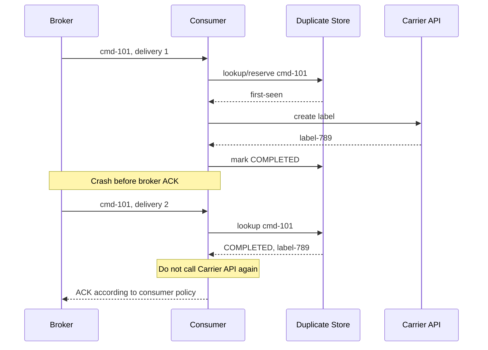
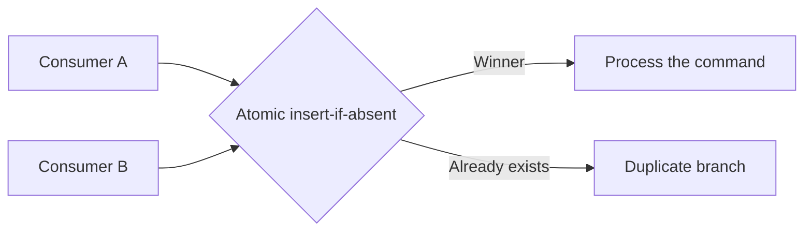
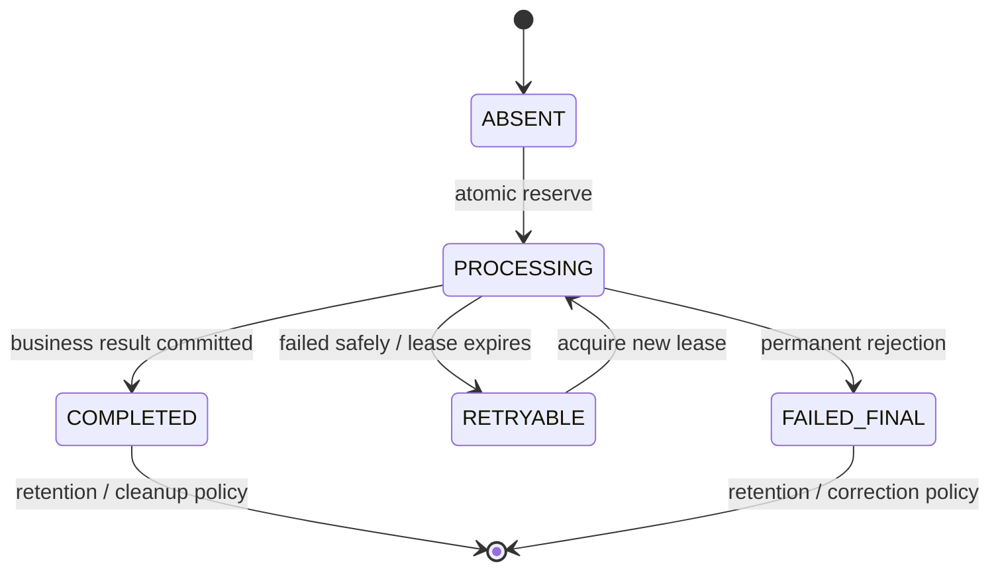
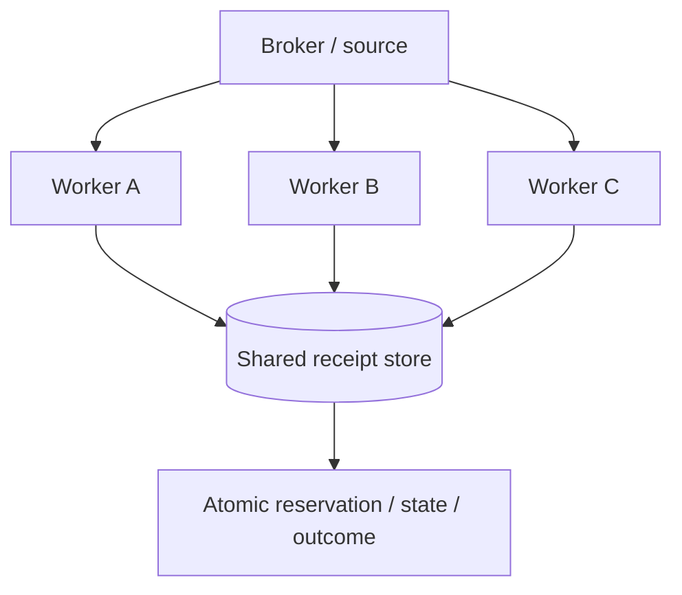
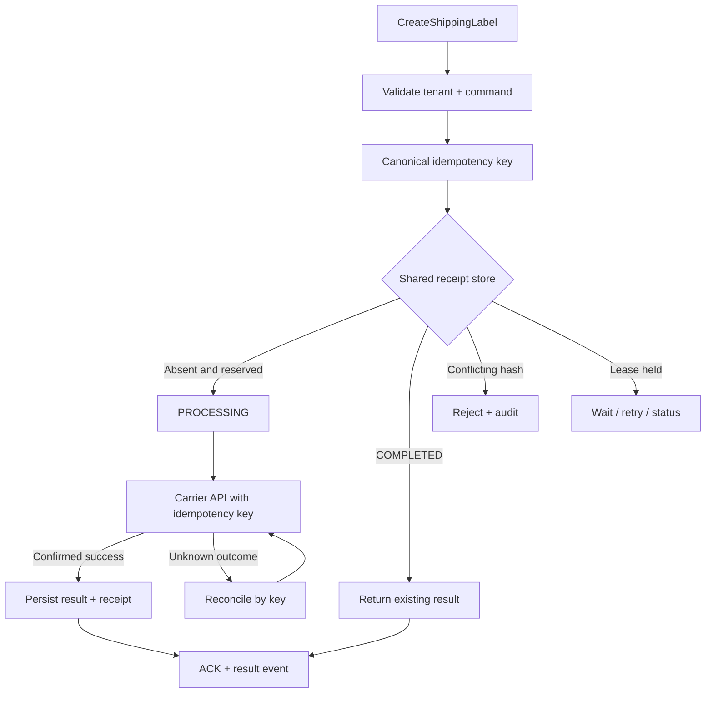

# Duplicate Message Store

In an integration system, **the same message may be delivered multiple times even when the producer intends to send it once**. A broker may redeliver after a consumer finishes processing but before it sends the ACK; an application may retry after a timeout; an operator may replay an event; or two instances may pick up the same work almost simultaneously. If every receipt creates a shipment order, deducts money, writes a ledger entry, or sends an email, the system will produce **duplicate side effects**.

**Idempotent Receiver** is an Enterprise Integration Pattern (EIP) that enables a consumer to recognize whether a request has already been processed or is currently being processed, and thus decide whether to **skip, return the old result, reject a conflict, or process for the first time**. The key component is the **duplicate message store** (*deduplication store, receipt store, idempotency ledger*): the place that stores a **durable identifying key** and associated state so subsequent deliveries can be checked against it.

The article **“Duplicate Message Store”** belongs to the **Idempotent receiver** chapter of the `SPRING_INTEGRATION_PATTERN` module. The module's scope is learning to implement Enterprise Integration Patterns with Spring Integration to build loosely coupled and extensible message flows; practicing Router, Filter, Transformer, Splitter, Aggregator, Gateway, retry, error channel, correlation, as well as testing and observing processing branches.

**After this lesson, you will be able to:**

- Distinguish **duplicate delivery**, **business duplicate**, **in-progress**, and **successfully processed**.
- Choose an appropriate **idempotency key** and avoid confusing a Spring message ID with a durable business ID.
- Explain the requirement for **atomic put-if-absent / unique constraint** when multiple consumers compete.
- Evaluate `ConcurrentMetadataStore`, `MetadataStoreSelector`, `IdempotentReceiverInterceptor`, and a custom **receipt table**.
- Design a `PROCESSING → COMPLETED/FAILED` lifecycle, leases, retries, TTL, cleanup, and payload conflict handling.
- Wire deduplication into Spring Integration without losing ACKs, replies, correlation, or retryable errors.
- Test concurrency, restarts, broker redeliveries, duplicate replies, and external side effects.

## 1. Why Are Duplicates Normal in Messaging?

Consider a shipping-label creation flow:

```text
ShipmentRequested(commandId=cmd-101)
    |
    v
Broker -> Shipping consumer
    |
    v
Carrier API: createLabel()
    |
    v
Persist label result
    |
    v
ACK broker
```

If the consumer calls the Carrier API successfully, persists the result, and then **crashes before ACKing**, the broker may redeliver `cmd-101`. The second delivery **is not a new label-creation request**; it is another delivery of the same command. Without an idempotency mechanism, the consumer might call `createLabel()` twice.



The diagram shows the design goal. With a real Carrier API, **marking `COMPLETED` and the external side effect do not automatically belong to the same transaction**. An idempotency key accepted by the Carrier or a reconciliation mechanism is needed to ensure a retry does not create a second label.

### Three Easily Confused Types of “Duplicates”

| Type | Example | Should It Be Skipped? |
| --- | --- | --- |
| **Delivery duplicate** | Broker redelivers the same event/command after an ACK failure. | Usually **do not re-execute the side effect**; can ACK and return the stored result. |
| **Business duplicate** | User clicks “Place Order” twice, creating two distinct `commandId`s. | Depends on business rules; receipts keyed by command ID **do not automatically recognize** two requests with the same intent. |
| **Conflicting duplicate** | Same `commandId=cmd-101`, but the second delivery has a different payload. | **Never silently treat as normal**; check fingerprint/contract and report a conflict. |

**An Idempotent Receiver cannot infer user intent.** It requires a **unit of work and identifying key** defined by the business contract.

## 2. What Does a Duplicate Message Store Need to Store?

A simple duplicate store might just be a set of previously seen keys:

```text
seen_keys:
  TENANT-A / SHIP_LABEL / cmd-101
  TENANT-A / SHIP_LABEL / cmd-102
```

However, “previously seen” does not mean “completed”. In a system that must retry safely, a richer **receipt** should be stored:

```text
IdempotencyReceipt {
  tenantId       = TENANT-A
  operation      = CREATE_SHIPPING_LABEL
  commandId      = cmd-101
  contractVersion= v1
  payloadHash    = <SHA-256 of canonical request>
  status         = COMPLETED
  resultRef      = label-789
  createdAt      = ...
  updatedAt      = ...
  expiresAt      = ...
}
```

This is an **illustrative application schema**, not a built-in Spring Integration class.

| Field | Meaning |
| --- | --- |
| `tenantId` | Authenticated principal scope, preventing two tenants with the same command ID from mixing. |
| `operation` | Distinguishes `CREATE_LABEL` from `CANCEL_LABEL` or `REFUND`. |
| `commandId` / `eventId` | Durable business key preserved across retries/redeliveries. |
| `contractVersion` | Enables versioning of keys/canonicalization when the contract changes. |
| `payloadHash` | Detects **same key with different content**; does not replace authentication. |
| `status` | `PROCESSING`, `COMPLETED`, `FAILED`, or policy-specific states. |
| `resultRef` | Reference to the result so duplicate requests can receive the old output if needed. |
| `createdAt`, `updatedAt` | Investigating timelines and stuck processes. |
| `leaseUntil` / `owner` | Exclusive coordination for long-running work; requires real CAS/locking. |
| `expiresAt` | Receipt retention deadline; does not auto-delete records without cleanup. |

**A duplicate store does not necessarily store the full message.** Many applications only need the key, fingerprint, outcome, and minimal metadata to avoid storing sensitive or huge payloads. If replaying the original message is needed, that belongs to the broker, event store, Claim Check, or an appropriate source store.

## 3. Choosing the Idempotency Key Is the Most Important Decision

Too narrow a key lets duplicates slip through; too broad a key causes **two valid requests to be treated as one**.

A design for shipping labels might be:

```text
key = tenantId + operation + commandId + contractVersion

TENANT-A | CREATE_LABEL | cmd-101 | v1
```

### Keys That Commonly Cause Bugs

| Key | Problem |
| --- | --- |
| `MessageHeaders.id` | A newly built Spring message after replay may get a new ID. |
| `traceId` | One trace can span multiple tasks; tracing is not a business key. |
| `customerId` | One customer has many valid orders. |
| `orderId` without operation | Creating, editing, and cancelling the same order may all be valid. |
| `batchId` for every item | May mistakenly drop distinct items within a batch. |
| Current `timestamp` | Every retry generates a new key, breaking deduplication. |
| Hash of raw JSON | Changing field order or whitespace can yield a different hash. |

**A good key must define the exact unit of idempotency**: one payment, one label issuance, one inventory receipt event, or one page-processing task.

### Keys Must Be Deliberately Normalized

If `commandId=" Cmd-101 "` and `"cmd-101"` are considered the same command, normalize explicitly. If IDs are case-sensitive, **do not automatically lowercase**. When combining fields, avoid ambiguous string concatenation:

```text
tenant=A|B, operation=C, id=D
tenant=A, operation=B|C, id=D
```

Both tuples produce the same string with an unescaped delimiter. Use structured keys or length-prefixed encoding, for example:

```text
8:TENANT-A|12:CREATE_LABEL|7:cmd-101|2:v1
```

The lengths above only illustrate the **length-prefix** technique and must be computed dynamically in code; do not copy these numbers as production data.

### Fingerprint: Same Key, Changed Payload

Use a hash of a **canonical representation** after clearly identifying the business-significant fields. For example, an old `commandId` paired with a new shipping address may be a **conflict**, not a successful duplicate. When comparing, check the checksum in the store under the same transaction/lock when needed.

**Do not treat a hash as a digital signature.** It does not prove a trusted source and does not replace tenant/authorization checks; for sensitive structured data, consider avoiding exposing raw hashes without security context in public systems.

## 4. Atomicity: Why `get` Then `put` Is Not Enough

Consider two workers receiving the same command concurrently:

```text
Worker A: if store.get(key) == null -> true
Worker B: if store.get(key) == null -> true
Worker A: store.put(key, "seen")
Worker B: store.put(key, "seen")
Worker A: create label
Worker B: create label
```

Both see that the key does not exist yet. That is a **check-then-act race condition**.



An **atomic** store operation is required:

- `putIfAbsent`/compare-and-set with atomic semantics within the storage scope being used.
- `INSERT ... ON CONFLICT DO NOTHING` with a **unique constraint** in the database.
- Unique index + transaction or optimistic locking/CAS.
- With a distributed cache, server-side atomic operations and suitable persistence/eviction policies.

**Do not use a local `synchronized` block to prevent duplicates across three JVMs.** It only locks within a single process. If two instances use separate in-memory stores, each instance can still process the same command once.

## 5. Common Ways to Store Duplicates

| Store Type | Strengths | Limitations |
| --- | --- | --- |
| **In-memory concurrent map** | Fast, easy for demos and unit tests. | Lost on restart; not shared across replicas. |
| **Spring `SimpleMetadataStore`** | Easy for learning Spring Integration APIs, fits single-JVM/test flows. | No built-in durability across restarts. |
| **JDBC-backed metadata store** | Durable storage, shareable DB, supports DB-level atomicity. | Requires schema, transactions, retention, tuning, and migrations. |
| **Distributed key/value store** | Fast and shareable across instances. | Must verify atomic writes, persistence, eviction, and TTL. |
| **Receipt table with state + result** | Easily expresses `PROCESSING/COMPLETED`, audits, and replay/replies. | Must implement repository, concurrency, leases, and cleanup yourself. |
| **Business DB unique constraint** | Can place dedup and side effects in the same transaction. | Does not automatically cover external HTTP/broker side effects. |

Spring Integration provides abstractions such as **`MetadataStore`**, **`ConcurrentMetadataStore`**, and concrete implementations depending on module/version. Constructor signatures and overloads can vary by dependency; verify against your project's actual API version when implementing.

### `MetadataStore` vs. a Receipt Repository

A metadata store can serve **first seen / already seen** decisions, whereas a receipt repository can store both **business state and the final result**. When a Gateway must return the same outcome for duplicates, a receipt is typically far richer than a Boolean.

An Aggregator's `MessageGroupStore` groups messages by correlation and **does not replace** a deduplication store. Both stores can share a database while still answering **two different questions**.

## 6. Spring Integration and `MetadataStoreSelector`

Spring Integration supports a metadata-based selector to determine whether a message is seen for the **first time** for a given key. This concept is commonly paired with **`MetadataStoreSelector`** and a `ConcurrentMetadataStore`.

Illustrative wiring example:

```java
import org.springframework.context.annotation.Bean;
import org.springframework.context.annotation.Configuration;
import org.springframework.integration.handler.advice.IdempotentReceiverInterceptor;
import org.springframework.integration.selector.MetadataStoreSelector;
import org.springframework.integration.metadata.ConcurrentMetadataStore;
import org.springframework.integration.metadata.SimpleMetadataStore;
import org.springframework.messaging.Message;

@Configuration
class DuplicateMetadataConfiguration {

    @Bean
    ConcurrentMetadataStore duplicateMetadataStore() {
        return new SimpleMetadataStore();
    }

    @Bean
    IdempotentReceiverInterceptor idempotentReceiverInterceptor(
            ConcurrentMetadataStore store) {

        MetadataStoreSelector selector = new MetadataStoreSelector(
                message -> {
                    DispatchCommand cmd =
                            (DispatchCommand) message.getPayload();
                    return cmd.tenantId() + "|" + cmd.operation()
                            + "|" + cmd.commandId();
                },
                store
        );

        return new IdempotentReceiverInterceptor(selector);
    }
}
```

`DispatchCommand` is an application type defined in the hands-on section later. This is an **API wiring illustration**, not compiled repository code; verify packages/imports and `MetadataStoreSelector` overloads against the Spring Integration version in use during technical QA.

### Selector and Interceptor Have Different Roles

- **`MetadataStoreSelector`**: decides whether a message has a new key according to the metadata store.
- **`IdempotentReceiverInterceptor`**: attaches the check to a `MessageHandler`/endpoint via advice.
- **Endpoint/handler**: performs business logic or generates a response.
- **Metadata store**: stores key-recognition state according to implementation semantics.

**Note on duplicate behavior:** In Spring Integration usage, the interceptor can **mark duplicates via a header** and offers configuration to discard or throw rather than always dropping the message. Never assume simply adding the interceptor means the handler will never run on duplicates; **configure an explicit policy and test** the behavior in your actual framework version.

### The `duplicateMessage` Header Does Not Mean “Already Processed”

A duplicate header can indicate that **the key already exists**. If the key is written to the store **before** the handler finishes, a second worker may see a duplicate while the first worker is still processing. It **does not prove** the first worker committed the business result.

For tasks with critical side effects, use `PROCESSING/COMPLETED` states or handler-level transactions/idempotency rather than relying solely on “key previously seen”.

## 7. Standalone Demo: Atomic Key Check Using an In-JVM Map

The example below separates **first-seen** behavior from real business logic. It only returns a simulated status and **makes no external API calls**, preventing learners from confusing in-memory deduplication with financial transaction guarantees.

### 7.1. Data Types and Guard

```java
import java.util.concurrent.ConcurrentHashMap;
import java.util.concurrent.ConcurrentMap;

record DispatchCommand(
        String tenantId,
        String operation,
        String commandId,
        String parcelId
) {}

record DispatchDecision(
        String commandId,
        String status
) {}

final class InMemoryDuplicateGuard {
    private final ConcurrentMap<String, Boolean> seen =
            new ConcurrentHashMap<>();

    boolean firstSeen(DispatchCommand command) {
        if (command.tenantId() == null || command.tenantId().isBlank()
                || command.operation() == null
                || command.operation().isBlank()
                || command.commandId() == null
                || command.commandId().isBlank()) {
            throw new IllegalArgumentException("INVALID_DEDUP_KEY");
        }

        String key = command.tenantId() + ":"
                + command.operation() + ":"
                + command.commandId();

        return seen.putIfAbsent(key, Boolean.TRUE) == null;
    }
}
```

`ConcurrentHashMap.putIfAbsent()` guarantees **only one winner per key** when multiple threads access *the same map instance*. This is **not a persistent store**; nor does it check whether payloads for the same key differ.

In production, use unambiguous key encoding and a receipt schema; colon concatenation in the example is purely illustrative.

### 7.2. Wiring into Java DSL

```java
import org.springframework.context.annotation.Bean;
import org.springframework.context.annotation.Configuration;
import org.springframework.integration.channel.DirectChannel;
import org.springframework.integration.channel.QueueChannel;
import org.springframework.integration.config.EnableIntegration;
import org.springframework.integration.dsl.IntegrationFlow;

@Configuration
@EnableIntegration
class DuplicateDemoFlowConfig {

    @Bean
    InMemoryDuplicateGuard duplicateGuard() {
        return new InMemoryDuplicateGuard();
    }

    @Bean
    DirectChannel dispatchInput() {
        return new DirectChannel();
    }

    @Bean
    QueueChannel dispatchDecisions() {
        return new QueueChannel();
    }

    @Bean
    IntegrationFlow dispatchFlow(InMemoryDuplicateGuard guard) {
        return IntegrationFlow.from("dispatchInput")
                .handle(DispatchCommand.class, (command, headers) -> {
                    boolean first = guard.firstSeen(command);
                    return new DispatchDecision(
                            command.commandId(),
                            first ? "FIRST_SEEN" : "DUPLICATE");
                })
                .channel("dispatchDecisions")
                .get();
    }
}
```

This flow intentionally **returns a `DispatchDecision`** for both first-seen and duplicate deliveries; it creates no shipping label, commits no database changes, and sends no broker ACK. It makes the **observable behavior of the duplicate store** visible without masking side effects.

### This Demo Must Not Be Used Directly to “Prevent Duplicate Payments”

If a payment call is placed **after** the guard marks `seen` and the payment fails, a retry may be treated as a duplicate and **never retried**, causing lost work. State + transactions/compensation/downstream idempotency are required; see the following sections.

## 8. JUnit Integration Test: First Seen, Duplicate, and Tenant Scope

Spring Test can boot the Section 7 flow and send the same command twice:

```java
import static org.junit.jupiter.api.Assertions.assertEquals;
import static org.junit.jupiter.api.Assertions.assertNotNull;
import static org.junit.jupiter.api.Assertions.assertTrue;

import org.junit.jupiter.api.Test;
import org.springframework.beans.factory.annotation.Autowired;
import org.springframework.beans.factory.annotation.Qualifier;
import org.springframework.integration.channel.QueueChannel;
import org.springframework.messaging.Message;
import org.springframework.messaging.MessageChannel;
import org.springframework.messaging.support.MessageBuilder;
import org.springframework.test.annotation.DirtiesContext;
import org.springframework.test.context.junit.jupiter.SpringJUnitConfig;

@SpringJUnitConfig(DuplicateDemoFlowConfig.class)
@DirtiesContext(classMode = DirtiesContext.ClassMode.AFTER_EACH_TEST_METHOD)
class DuplicateDemoFlowTest {

    @Autowired @Qualifier("dispatchInput")
    MessageChannel input;

    @Autowired @Qualifier("dispatchDecisions")
    QueueChannel output;

    @Test
    void sameCommandIsOnlyFirstSeenOnce() {
        DispatchCommand cmd = new DispatchCommand(
                "TENANT-A", "CREATE_LABEL", "cmd-101", "P-1");

        assertTrue(input.send(
                MessageBuilder.withPayload(cmd).build()));
        assertTrue(input.send(
                MessageBuilder.withPayload(cmd).build()));

        Message<?> first = output.receive(1_000);
        Message<?> second = output.receive(1_000);
        assertNotNull(first);
        assertNotNull(second);

        assertEquals("FIRST_SEEN",
                ((DispatchDecision) first.getPayload()).status());
        assertEquals("DUPLICATE",
                ((DispatchDecision) second.getPayload()).status());
    }

    @Test
    void sameCommandIdInAnotherTenantIsNotTheSameKey() {
        input.send(MessageBuilder.withPayload(new DispatchCommand(
                "TENANT-A", "CREATE_LABEL", "cmd-102", "P-1")).build());
        input.send(MessageBuilder.withPayload(new DispatchCommand(
                "TENANT-B", "CREATE_LABEL", "cmd-102", "P-1")).build());

        assertEquals("FIRST_SEEN",
                ((DispatchDecision) output.receive(1_000)
                        .getPayload()).status());
        assertEquals("FIRST_SEEN",
                ((DispatchDecision) output.receive(1_000)
                        .getPayload()).status());
    }
}
```

Both tests are at the **Spring Integration wiring level**: channels, handler, response payload, and a map in one JVM. They **do not prove** durability, atomicity across replicas, retries on transaction rollback, or exactly-once side effects.

`@DirtiesContext` recreates the context between tests, which adds execution cost but avoids stale map state. In real projects, use a fixture reset or a distinct store namespace per test.

## 9. When Is “First Seen” Not Enough?

Suppose state is only a Boolean:

```text
T1: reserve(key) -> first seen
T2: call payment API -> timeout
T3: message re-delivered
T4: reserve(key) -> duplicate
```

If T2 was a transient error and payment actually **did not happen**, T4 is blocked and the task remains incomplete. If T2 actually **charged the account** but the response was lost, a blind retry could charge a second time.

Therefore, production receipts must distinguish:



The diagram is an **application state machine**, not a built-in Spring Integration enum.

| State | Meaning | How to Handle Incoming Messages with Same Key |
| --- | --- | --- |
| `ABSENT` | No receipt yet. | Attempt atomic reservation. |
| `PROCESSING` | A worker holds execution rights; no confirmed outcome yet. | Wait/schedule delayed retry/return `IN_PROGRESS`; do not run side effect twice. |
| `COMPLETED` | Successful outcome recorded. | Do not re-run; ACK/return cached result if needed. |
| `RETRYABLE` | Prior attempt failed safely and can be retried. | Acquire lease/CAS and retry. |
| `FAILED_FINAL` | Terminal business rejection. | Return recorded rejection outcome; do not retry forever. |
| `EXPIRED` | Past retention/key validity window. | Per policy: reject replay or treat as a new request if allowed. |

**There is no single state machine for all systems.** A flow that only records metrics might only need a key set; a flow creating financial transactions needs outcomes, reconciliation, and idempotency at the side-effect receiver.

## 10. A Receipt Table on PostgreSQL

To share the duplicate store across multiple consumers, you can use a receipt table with a **unique constraint**.

```sql
CREATE TABLE idempotency_receipts (
    tenant_id        VARCHAR(80) NOT NULL,
    operation        VARCHAR(80) NOT NULL,
    command_id       VARCHAR(120) NOT NULL,
    contract_version VARCHAR(32) NOT NULL,
    payload_hash     CHAR(64) NOT NULL,
    status           VARCHAR(32) NOT NULL,
    result_ref       VARCHAR(200),
    lease_owner      VARCHAR(120),
    lease_until      TIMESTAMPTZ,
    created_at       TIMESTAMPTZ NOT NULL,
    updated_at       TIMESTAMPTZ NOT NULL,
    expires_at       TIMESTAMPTZ,
    PRIMARY KEY (
        tenant_id, operation, command_id, contract_version
    )
);
```

This is an **illustrative PostgreSQL schema**, lacking indexes/schedulers/partitioning/migrations tailored to every production system. Constraints on payload size, valid statuses, security standards, and retention must be added.

### Atomic Insert-If-Absent

```sql
INSERT INTO idempotency_receipts (
    tenant_id, operation, command_id, contract_version,
    payload_hash, status, created_at, updated_at
) VALUES (
    :tenant_id, :operation, :command_id, :version,
    :payload_hash, 'PROCESSING', NOW(), NOW()
)
ON CONFLICT (
    tenant_id, operation, command_id, contract_version
)
DO NOTHING;
```

Upon execution, the **inserted row count** is the signal:

- `1`: this key was claimed for the first time within this transaction.
- `0`: a record already exists for the unique key; you must **read the status/fingerprint** and apply duplicate policy.

`SELECT` followed by `INSERT` cannot replace this atomic operation. On other databases, use a unique constraint and the corresponding upsert/insert-if-absent syntax rather than copying PostgreSQL SQL verbatim.

### Why Does the Unique Constraint Matter?

If two instances execute the same SQL concurrently, the database must decide **one winning transaction** for the same unique key. You do not have to rely on per-JVM locks. However, upserting a receipt **does not automatically bind** all side effects to the receipt; proper transaction scoping is still required.

## 11. Writing Business Results and Receipts in the Same DB Transaction

When the side effect is a data change **in the same database**, a transaction can write both the receipt and the business outcome **atomically**.

```text
DB transaction:
  INSERT receipt (if absent)
  IF inserted:
      INSERT shipment_result / update business rows
      UPDATE receipt status=COMPLETED, result_ref=...
  ELSE:
      compare payload_hash and read stored outcome
COMMIT
```

If the DB transaction rolls back due to an error, **both the business change and the receipt marker** roll back together.

### Transactional Service Example

```java
import org.springframework.stereotype.Service;
import org.springframework.transaction.annotation.Transactional;

record ShipmentCommand(
        String tenantId,
        String commandId,
        String parcelId,
        String operation
) {}

record ProcessOutcome(
        String status,
        String resultReference
) {}

interface ReceiptRepository {
    boolean insertIfAbsent(
            ShipmentCommand command, String payloadHash);
    StoredReceipt find(ShipmentCommand command);
    void markCompleted(
            ShipmentCommand command, String resultRef);
}

record StoredReceipt(
        String payloadHash,
        String status,
        String resultReference
) {}

interface ShipmentRepository {
    String createRecord(ShipmentCommand command);
}

@Service
class ShipmentCommandService {
    private final ReceiptRepository receipts;
    private final ShipmentRepository shipments;

    ShipmentCommandService(
            ReceiptRepository receipts,
            ShipmentRepository shipments) {
        this.receipts = receipts;
        this.shipments = shipments;
    }

    @Transactional
    public ProcessOutcome handle(
            ShipmentCommand command, String canonicalHash) {

        if (!receipts.insertIfAbsent(command, canonicalHash)) {
            StoredReceipt old = receipts.find(command);
            if (!old.payloadHash().equals(canonicalHash)) {
                throw new IllegalArgumentException(
                        "IDEMPOTENCY_CONFLICT");
            }
            if ("COMPLETED".equals(old.status())) {
                return new ProcessOutcome(
                        "ALREADY_COMPLETED", old.resultReference());
            }
            return new ProcessOutcome("IN_PROGRESS", null);
        }

        // In this example, createRecord ONLY writes to the same database.
        String ref = shipments.createRecord(command);
        receipts.markCompleted(command, ref);
        return new ProcessOutcome("PROCESSED", ref);
    }
}
```

**Design limitations to remember:**

- The receipt and shipment repositories must use **the same database/transaction manager**. `@Transactional` does not make HTTP carrier APIs, Kafka, or object stores atomic.
- `insertIfAbsent` requires a unique constraint and must accurately reflect inserted rows/contention.
- When a duplicate returns `IN_PROGRESS`, the caller policy must know to retry, query status, or wait. Do not treat it as business success.
- `canonicalHash` must be computed from a standardized and validated contract; never accept an arbitrary client-provided hash as proof of data.
- At an appropriate isolation level, a contending transaction may have to wait for the prior transaction to commit/roll back; bounded timeouts and deadlock/serialization conflict handling are needed.
- If `createRecord()` actually calls an external API, the example no longer provides the atomic guarantee described above.

### When the DB Rolls Back, Should the Receipt Be Deleted?

If the receipt was inserted **in the same DB transaction** and the transaction rolls back, the row generally rolls back automatically, allowing retries. If the receipt lives in an **independent cache** written prior to the transaction, a DB rollback does not automatically remove the cache key: **false duplicates** may appear. That is one reason not to choose a duplicate store based solely on speed.

## 12. External Side Effects: Storing Receipts Cannot Replace Target-Side Idempotency

For an external carrier/payment API:

```text
1. reserve receipt PROCESSING
2. POST /create-label
3. remote service creates label
4. remote reply lost / timeout
5. local worker cannot know if label exists
```

If the worker calls the API again with a **new request ID**, a second label may be created. If it marks the receipt `COMPLETED` without knowing the result, it may record a false success.

A stronger approach:

1. Send a **durable idempotency key** to the target API if supported, e.g., `tenantId/operation/commandId`.
2. On timeout, **query status** by that key before executing another side effect.
3. Record `PROCESSING`/`UNKNOWN_REMOTE_OUTCOME` appropriately; do not assume failure.
4. Use an outbox when external commands/events must be emitted from a business transaction.
5. For APIs without idempotency support, design reconciliation/compensation and explicitly accept the analyzed guarantee level.

**A consumer-side duplicate store protects one boundary; it does not make the entire system exactly-once.** Exactly-once side effects can only be protected by combining transactions, unique constraints, downstream idempotency, and realistic recovery.

## 13. Leases for Long-Running Work and Concurrent Consumers

If an OCR job takes 10 minutes, writing `PROCESSING` and waiting forever is insufficient: the worker could crash. A **lease** or time-bounded ownership mechanism is needed:

```text
receipt:
  key = (tenant, operation, commandId)
  status = PROCESSING
  owner = worker-07
  leaseUntil = 2026-11-21T10:10:00Z
  version = 17
```

Steps:

1. Worker A acquires the lease via **transaction/CAS**.
2. A processes the work and renews the lease if needed while still holding ownership.
3. If A crashes, the lease expires; worker B can acquire it via CAS.
4. If A returns after losing the lease, it **must not commit state against lost ownership**.
5. For external side effects, use **fencing tokens** or target-side idempotency; a local lease cannot stop an old HTTP call from completing late.

### Illustrative CAS SQL

```sql
UPDATE idempotency_receipts
SET lease_owner = :new_owner,
    lease_until = :new_lease_until,
    updated_at = NOW()
WHERE tenant_id = :tenant_id
  AND operation = :operation
  AND command_id = :command_id
  AND contract_version = :version
  AND status = 'PROCESSING'
  AND (lease_until IS NULL OR lease_until < NOW());
```

If `rowCount=1`, the worker won at the moment of the update. If `0`, another valid owner exists or the state does not match. Production systems also need a **monotonic version/fencing token** to stop stale workers from committing. Never treat a single `UPDATE` as an exactly-once mechanism for tasks already sent to an external service.

## 14. TTL and the Deduplication Window

A duplicate store cannot retain keys forever in every system. However, too short a TTL causes old messages on redelivery **to be treated as new**.

```text
T0       handle cmd-101 -> completed
T0+1h    receipt TTL expires
T0+3h    broker replays cmd-101
```

If the message is treated as new, the handler may repeat the side effect. An appropriate retention period must consider:

- How long the broker retains messages and can redeliver them.
- Retry/backoff/DLQ/manual replay policies.
- How long users may resend the same request.
- Maximum processing duration and lease expiry.
- How long the old outcome must be returned to Gateways/APIs.
- Retention regulations, data deletion rights, and business guarantees.

### Which States Does TTL Apply To?

| State | What to Consider |
| --- | --- |
| `PROCESSING` | Do not delete simply because TTL elapsed if a worker holds an active lease. |
| `COMPLETED` | Keep through the replay/idempotency window or store durable business outcomes. |
| `FAILED_FINAL` | Retain if retries of the same request must receive the same final error. |
| `RETRYABLE` | Do not clean up before permitted retry deadlines. |
| `EXPIRED` | Keep a tombstone if late replays must be distinguished from new commands. |

**Deleting a receipt does not undo side effects that already occurred.** If the system cannot tolerate re-executing a payment after one month, keeping dedup keys for only one day violates the contract.

### Cleanup Must Not Race with Workers

Do not run:

```sql
DELETE FROM idempotency_receipts
WHERE created_at < :cutoff;
```

without checking `status`, `leaseUntil`, retention, and business policy. Proper cleanup must check terminal-state conditions, handle tombstones or archiving if needed, and use transactions/CAS if another worker could update the same key.

## 15. In-Memory, JDBC, and Distributed Stores: Choosing by Requirements

### Single JVM Without Durability Requirements

`SimpleMetadataStore` or a concurrent map is sensible for **learning/testing/local duplicate reduction**. However, on process restart the map is empty and old events may be seen as new. Across multiple replicas, each replica has its own map so duplicates can run once **per replica**.

### JDBC-Backed Store

A JDBC store can use a shared DB and transactions, with unique constraints preventing contention. Spring Integration offers JDBC metadata-store implementations depending on module/version, though to support outcomes, leases, fingerprints, and status queries, a **dedicated receipt repository** usually expresses the contract more cleanly.

### Distributed Cache

Redis or a shared cache can support atomic commands and TTLs. However, you must evaluate:

- Persistence/restart: does data survive failover?
- Eviction policy: can keys be evicted when memory fills up?
- Atomicity of reserve/complete operations.
- Lease expiration and stale workers.
- Consistency between the cache and the business DB.
- Replication/failover windows with unsynchronized writes.

**Do not call a cache with `SETNX` an exactly-once receipt store** when business side effects live in a separate database/API and the cache can lose data before the replay window closes.

### Quick Selection Table

| Requirement | Initial Option to Consider |
| --- | --- |
| Simple single-JVM demo | Concurrent map or `SimpleMetadataStore`. |
| Multiple instances, key-only duplicate blocking | Shared `ConcurrentMetadataStore` with atomic semantics and proper retention. |
| Need outcome/reply, leases, and auditing | Custom receipt table with unique key, state, and transactions. |
| Business rows live in the same DB | Place receipt + business change in one transaction. |
| External payment/carrier API | Receipt + downstream idempotency + reconciliation. |
| Need long-term restarts/replays | Persistent receipt store, cleanup/tombstones, and crash tests. |

## 16. Broker ACK, Retry, and Filter: Duplicates Do Not Always Have to Be Dropped

When a consumer receives a message identified as a duplicate, behavior must depend on **state and contract**:

| State/Outcome | Suggested Behavior |
| --- | --- |
| `COMPLETED` with matching fingerprint | Can ACK current delivery and return cached reply, without reprocessing. |
| `PROCESSING` owned by another worker | Delay/requeue/query status; do not ACK as success if an outcome is still needed. |
| `RETRYABLE` | Allow retry upon successfully acquiring the lease. |
| `FAILED_FINAL` | ACK/return the prior business rejection per contract. |
| `IDEMPOTENCY_CONFLICT` | Reject/quarantine and audit; do not silently skip. |
| Unable to read duplicate store | Fail/retry per policy; avoid **failing open** on sensitive tasks. |

**Do not automatically ACK every message whose key exists.** A `PROCESSING` record might belong to a dead worker with no business outcome yet. ACKing and dropping it can lose the work permanently.

### Is `Filter` the Same as Idempotent Receiver?

A `Filter` with predicate `firstSeen(message)` can block duplicate messages, but you must decide:

- Does the predicate write the key to the store before the handler runs or only check?
- If the handler after the Filter fails, who deletes/resets the key?
- Does the Filter discard channel have a consumer/audit?
- Will a Gateway waiting for a reply time out because the duplicate was dropped?
- Are payload conflicts and `PROCESSING` handled?

**A Filter is purely a message-control mechanism**; state storage and business semantics belong to the duplicate store and application service.

### Error Channel Differs from the Duplicate Store

`errorChannel` routes errors according to endpoint/poller/async semantics. It **does not automatically mark receipts `FAILED`**, release reserved keys, or turn exceptions into cached replies. When an error handler retries, it must understand what keys remain in the store and which states are eligible for reprocessing.

## 17. Router, Splitter, Aggregator, Gateway, and Claim Check

### Router: Keys Must Match the Business Branch

A message may be routed by a Router to `CREATE_LABEL` or `CANCEL_LABEL`. If the dedup key only uses `parcelId`, a cancel command could be mistaken for a duplicate of the create command. Therefore, include `operation` or an appropriately scoped command ID.

### Splitter: Each Item Needs Its Own Identity

Suppose a batch has three items:

```text
Batch B-101
  item L-1
  item L-2
  item L-3
```

If the Splitter emits three child messages that all use `batchId=B-101` as their dedup key, **only the first item will be processed**. Use `(batchId, lineId, operation)` or each item's own command ID, depending on the contract.

**`correlationId` and `sequenceNumber` do not automatically replace idempotency keys**. Correlation helps the Aggregator group messages; sequence denotes position within a split, which may change on replay.

### Aggregator: Duplicates Can Cause Incorrect Release

If an Aggregator waits for three items while one item is delivered twice and one has not arrived yet, a release strategy that only counts message quantity can be fooled. Deduplication by **item identity** and an appropriate release strategy are two distinct layers. If duplicates are filtered before the Aggregator while the group still needs an outcome, ensure a valid outcome already exists or is delivered per contract.

### Gateway: Duplicate Requests Still Need Replies

A Gateway may invoke the same `commandId` a second time because the first call timed out. If the Idempotent Receiver simply **drops** the duplicate without replying, the second call can **time out again** even though the work already completed.

The usual solution is to store the result/status by key and return **the same business outcome** for `COMPLETED` duplicates. While `PROCESSING`, the Gateway can return `ACCEPTED/PENDING`, wait with a bound, or provide status queries — never fabricate a fake `SUCCESS`.

### Claim Check: Duplicate Tickets Do Not Mean Duplicate Business Work

A large event may be checked in via Claim Check In twice under two different `claimId`s due to producer retries. If `claimId` is used as the sole dedup key, the same business operation could be processed twice. Durable business IDs and claim/ticket mappings are needed alongside check-out authorization and claim store TTLs.

### Scatter–Gather: One Response per Recipient per Run

If a provider sends two replies due to redelivery, the Gatherer must not count them as two completed recipients. Use a response key such as `(requestRunId, providerId)` and a release strategy checking the reply source. A duplicate store can be placed on the reply path before the Gatherer, without losing a required group outcome.

## 18. Testing Concurrency: Multiple Threads Sending the Same Command

Unit tests against the same guard instance must prove **only one thread wins** the atomic operation:

```java
import static org.junit.jupiter.api.Assertions.assertEquals;

import java.util.List;
import java.util.concurrent.Callable;
import java.util.concurrent.CountDownLatch;
import java.util.concurrent.ExecutorService;
import java.util.concurrent.Executors;
import java.util.concurrent.Future;

import org.junit.jupiter.api.Test;

class InMemoryDuplicateGuardConcurrencyTest {

    @Test
    void exactlyOneThreadObservesFirstSeen() throws Exception {
        InMemoryDuplicateGuard guard = new InMemoryDuplicateGuard();
        DispatchCommand command = new DispatchCommand(
                "TENANT-A", "CREATE_LABEL", "cmd-777", "P-7");

        int workers = 8;
        CountDownLatch start = new CountDownLatch(1);
        ExecutorService pool = Executors.newFixedThreadPool(workers);

        try {
            List<Callable<Boolean>> tasks =
                    java.util.stream.IntStream.range(0, workers)
                            .<Callable<Boolean>>mapToObj(i -> () -> {
                                start.await();
                                return guard.firstSeen(command);
                            })
                            .toList();

            List<Future<Boolean>> futures = tasks.stream()
                    .map(pool::submit)
                    .toList();

            start.countDown();

            int winners = 0;
            for (Future<Boolean> future : futures) {
                if (future.get()) {
                    winners++;
                }
            }
            assertEquals(1, winners);
        } finally {
            start.countDown();
            pool.shutdownNow();
        }
    }
}
```

This test proves atomicity of **one concurrent map in one JVM**. It does not prove PostgreSQL unique constraints, restart recovery, or a single downstream API call across multiple replicas.

To avoid hanging CI tests, production suites should use `future.get(timeout, unit)` and bounded shutdown rather than waiting indefinitely. Test conditions must actively force workers to contend on the same key.

## 19. Testing Failures Between Receipt and Side Effect

Duplicate store tests covering **only the happy path are insufficient**.

### Failure Injection Matrix

| Injection Point | Expectation |
| --- | --- |
| Crash before inserting receipt | Event can retry as first attempt. |
| Receipt insert fails | Do not execute side effect without dedup policy. |
| Receipt insert succeeds, business DB insert fails in same transaction | Both roll back; retry is safe. |
| Receipt written to cache, business DB fails | Do not retain false `COMPLETED`; proper recovery exists. |
| External API succeeds, response lost | Query status by idempotency key; do not unconditionally create new work. |
| Business DB commits, broker ACK lost | Redelivery sees `COMPLETED`, does not write again. |
| Two workers acquire lease simultaneously | One valid owner; stale worker cannot commit. |
| Lease expires while old worker still running | Fencing/downstream idempotency prevents duplicate side effects. |
| Receipt cleaned up before redelivery | Must not repeat side effects against contract; TTL/tombstones must be designed. |
| Different payload with same key | Report `IDEMPOTENCY_CONFLICT`, audit. |
| Store outage | Retry/error per policy; do not fail open on sensitive tasks. |
| Multiple tenants sharing `commandId` | Do not mix receipts or return results across tenants. |

### Rollback Test Example with a Real Database

An integration test using PostgreSQL/Testcontainers can:

1. Open a transaction and insert a receipt via `ON CONFLICT DO NOTHING`.
2. Make `ShipmentRepository.createRecord()` throw an exception.
3. Verify the transaction rolls back **both the receipt and the business row**.
4. Redeliver the same command and verify the next attempt succeeds.
5. Commit the result, redeliver again, and verify **only one business row** exists.

This is a **testing procedure**, not a runnable test without the project's database schema, migrations, and transaction manager.

## 20. Multi-Instance and Restart Recovery

A properly placed duplicate store is accessed by **every consumer that might process the same idempotency key**. If consumers are grouped by Kafka partition, partition affinity can reduce contention but **does not replace** durable dedup: rebalances, replays, and topology changes still occur.



**Questions to verify:**

1. Are all three workers sharing **the same database/namespace**, or does each JVM have its own store?
2. Does the unique constraint cover **tenant, operation, command ID, and version** properly?
3. When worker A crashes, can B recover `PROCESSING` via lease without duplicating the side effect?
4. Can database failover lose non-durable/unreplicated writes?
5. Can cache eviction happen within the valid replay window?
6. Could cleanup delete a receipt while another worker is updating it?
7. How is an already-processed event recognized if replayed after deploying a new version?

**Restart test:** process a command, restart all consumers, redeliver the same command, and verify the old outcome is read from the **persistent** receipt. If testing with an in-memory map, deduplication stopping after restart is the expected limitation.

## 21. Security and Data in the Duplicate Store

Receipts typically contain IDs, statuses, and result metadata. Even without storing full raw payloads, they remain **business data** requiring protection.

- **Tenant isolation:** unique keys and queries must be scoped by the authenticated tenant.
- **Access control:** only authorized consumers may read/update receipts; public APIs must not allow querying arbitrary `commandId`s of other tenants.
- **PII minimization:** do not put full payloads, emails, or tokens into keys/metrics.
- **Encryption:** encrypt at rest and use TLS in transit as required.
- **Fingerprint:** checksums do not replace access control or digital signatures.
- **Result caching:** when storing cached replies, review sensitive data exposure and retention.
- **Tamper resistance:** do not let clients arbitrarily mutate a receipt to `COMPLETED`.
- **Rate limiting/quotas:** prevent flooding random keys to bloat the metadata store.
- **Auditing:** log `RECEIPT_CREATED`, `DUPLICATE_SEEN`, `CONFLICT`, `COMPLETED`, `EXPIRED`, and `REPLAY_REJECTED` with appropriate context.

When a request is classified as a duplicate, also check **whether the caller is authorized to receive the old result**, rather than exposing outcomes solely on matching IDs.

## 22. Observing Deduplication Effectiveness

A system can run “error-free” while continuously **dropping unfinished commands** because `PROCESSING` states are stuck. Thus, merely counting duplicates is not enough.

| Illustrative Metric | Meaning |
| --- | --- |
| `idempotent_received_total` | Total deliveries entering the receiver. |
| `idempotent_first_seen_total` | New keys successfully reserved. |
| `idempotent_duplicate_total{status}` | Encounters with existing keys, broken down by state. |
| `idempotent_conflict_total` | Same key with a different fingerprint. |
| `idempotent_processing_active` | Number of receipts currently `PROCESSING`. |
| `idempotent_processing_age_seconds` | Age of pending receipts, especially the oldest group. |
| `idempotent_lease_expired_total` | Leases requiring recovery. |
| `idempotent_store_latency_seconds{operation}` | Latency of reserve/read/CAS/complete operations. |
| `idempotent_store_error_total{reason}` | Metadata store or DB errors. |
| `idempotent_replay_after_expiry_total` | Deliveries arriving after the retention window. |
| `idempotent_cached_reply_total` | Duplicates receiving the prior outcome. |

These are **metric names an application may choose**, not metrics guaranteed by the framework under these exact names. Do not put `commandId`, `eventId`, `customerId`, full keys, or payload hashes into **metric labels** due to high cardinality and data-exposure risks.

Logs may look like:

```text
eventId=evt-101 operation=CREATE_LABEL tenantScope=TENANT-A
receiptState=COMPLETED decision=DUPLICATE_SUPPRESSED
resultRef=label-789 traceId=trace-101
```

Log only operationally approved IDs; if a key acts as an access token, log an audit ID or fingerprint that cannot be used directly to fetch data.

### Alerts to Have

- `PROCESSING` age rising past lease/retry deadlines.
- Unusual duplicate spikes after broker rebalances/redeploys.
- Increasing store timeouts degrading throughput.
- Rising `IDEMPOTENCY_CONFLICT` from producers changing payloads while reusing keys.
- Receipt cleanup purging too many `COMPLETED` records before the redelivery window closes.
- Late replays after TTL causing duplicate side effects.
- Cached results returned to unauthorized callers.

## 23. Case Study Exercise: Idempotent Shipping Labels Across Services

**Context:** An e-commerce platform sends `CreateShippingLabel` to a shipping system. Kafka may redeliver events; the Carrier API may time out after already creating a label; the system has three worker instances; an order has multiple parcels; and users may resubmit the same request expecting the exact label created earlier.



### Design Requirements

1. **Key:** specify `tenantId`, `parcelId`, `commandId`, `operation`, and `version`; explain why `orderId` alone is insufficient.
2. **Fingerprint:** under what rule must the same command ID with a different shipping address report a conflict?
3. **Store:** choose between a PostgreSQL receipt table or a distributed metadata store; explain durability, unique constraints, TTL, and shared access.
4. **State:** define `PROCESSING`, `COMPLETED`, `RETRYABLE`, `FAILED_FINAL`, and lease expiry; distinguish in-flight work from completed work.
5. **Carrier idempotency:** if the API supports `Idempotency-Key`, which key is used? If unsupported, how do you reconcile after a timeout?
6. **Broker ACK:** when `COMPLETED`, ACK and return the old result; when `PROCESSING`, what is the wait/retry policy?
7. **Splitter:** one order has 3 parcels; each parcel needs its own dedup key while keeping correlation to the same batch for the Aggregator.
8. **Gateway:** a synchronous request times out on the first call; should the second call return a cached reply or `PENDING`?
9. **Concurrency:** two replicas process the same command; unique constraints and CAS/fencing must block duplicate side effects.
10. **Retention:** TTL must span broker replays, manual retries, and the user outcome-query window.
11. **Security:** tenant A must never read tenant B's receipts even if knowing the command ID.
12. **Testing:** duplicates before/during/after processing, DB rollbacks, Carrier timeouts, lost ACKs, lease expiry, restarts, concurrent replicas, and replays after TTL.

### Self-Assessment Questions

**Question 1:** A consumer receives the same command again after a broker ACK was lost. Should it call the Carrier API again immediately? **No**, check the receipt/outcome and use Carrier-side idempotency when needed.

**Question 2:** Two threads concurrently run `if get(key)==null` followed by `put(key)`. Is only one thread guaranteed to process? **No.** An atomic operation or unique constraint is required.

**Question 3:** Does an existing key mean the task is finished? **No.** The receipt could be `PROCESSING` or `RETRYABLE`.

**Question 4:** Does `SimpleMetadataStore` in one JVM prevent duplicates across restarts and multiple replicas? **Do not assume so.** A shared persistent store is needed if those are requirements.

**Question 5:** An event was filtered out by a Filter before the Aggregator after a Splitter. Should the group automatically be considered complete? **No.** A substitute outcome or an appropriate release/timeout policy is required.

**Question 6:** If the same key arrives with a different payload, should the old cached result always be returned? **No.** It may be an idempotency conflict; compare fingerprints and check authorization.

**Question 7:** Does `@Transactional` on the handler make an HTTP Carrier API part of the DB transaction? **No.** Downstream idempotency/reconciliation is required.

**Question 8:** Is a 1-hour TTL safe when the broker can replay after 24 hours? **No**, if late replays can cause duplicate side effects disallowed by business rules.

## 24. Production Readiness Checklist for a Duplicate Store

- [ ] Unit of idempotency and key are defined in the business contract, with tenant/operation scope.
- [ ] Same key with different payload has fingerprinting and an `IDEMPOTENCY_CONFLICT` policy.
- [ ] Store reserves keys via **atomic putIfAbsent/unique constraint**, not check-then-act.
- [ ] `PROCESSING`, `COMPLETED`, `RETRYABLE`, and `FAILED_FINAL` are separated as needed.
- [ ] Leases, timeouts, and worker-crash recovery exist for potentially long-running work.
- [ ] Business changes in the same DB are written in the same transaction as the receipt whenever possible.
- [ ] External side effects have downstream idempotency keys or reconciliation.
- [ ] `COMPLETED` duplicates can return cached outcomes when the caller expects a reply.
- [ ] ACK/retry/Filter/errorChannel do not drop work still in `PROCESSING`.
- [ ] Store persistence, replication, failover, and retention cover the redelivery window.
- [ ] Cleanup is conditional and uses tombstones when needed; never deletes keys with active leases.
- [ ] Splitter/Aggregator use properly scoped correlation and item identities.
- [ ] Tests cover parallel consumers, crash windows, DB rollbacks, replays, and TTL expiry.
- [ ] Metrics track `firstSeen/duplicate/conflict/inProgress/leaseExpired` without exposing keys.
- [ ] Authorization and tenant isolation are verified on both receipt reads and writes.

## Summary

- **A duplicate message store** is the foundation of an **Idempotent Receiver**: it stores keys/states/outcomes to detect **duplicate deliveries**, not just mark that a Spring message ID was seen.
- **The idempotency key** must be stable, match the right business unit, and be scoped by tenant/operation/version; add fingerprinting to detect **same key with conflicting payloads**.
- **Atomic put-if-absent/unique constraints** prevent two workers from claiming execution simultaneously. `get` then `put` is unsafe under concurrency; in-memory stores are insufficient for multi-instance deployments or restarts.
- **`PROCESSING` differs from `COMPLETED`**. Marking “seen” before a side effect and dropping all duplicates can cause **lost work** if the first handler fails.
- With a **business DB**, aim to write the receipt and outcome in a single transaction. With **external APIs/brokers**, downstream idempotency and outbox/ACK/reconciliation are required; a duplicate store alone does not create end-to-end exactly-once semantics.
- **Retries, leases, TTL, cleanup, and cached replies** must follow the contract: never falsely ACK in-flight messages, never purge receipts too early, and never leave Gateways hanging because duplicates were silently dropped.
- Test **concurrency, retries, duplicates, payload conflicts, DB rollbacks, lost ACKs, restarts, multiple instances, broker redeliveries, and TTLs**; monitor long-running receipts, conflicts, and replayed outcomes.
