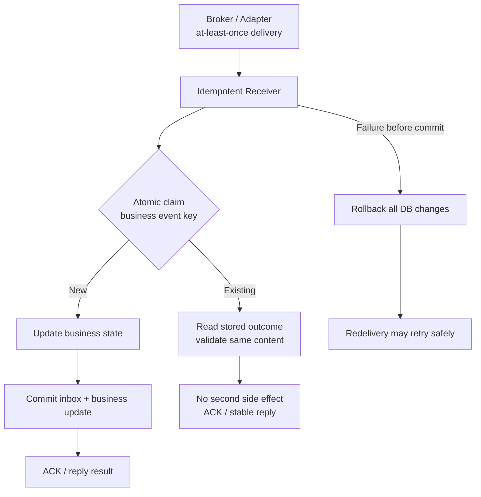
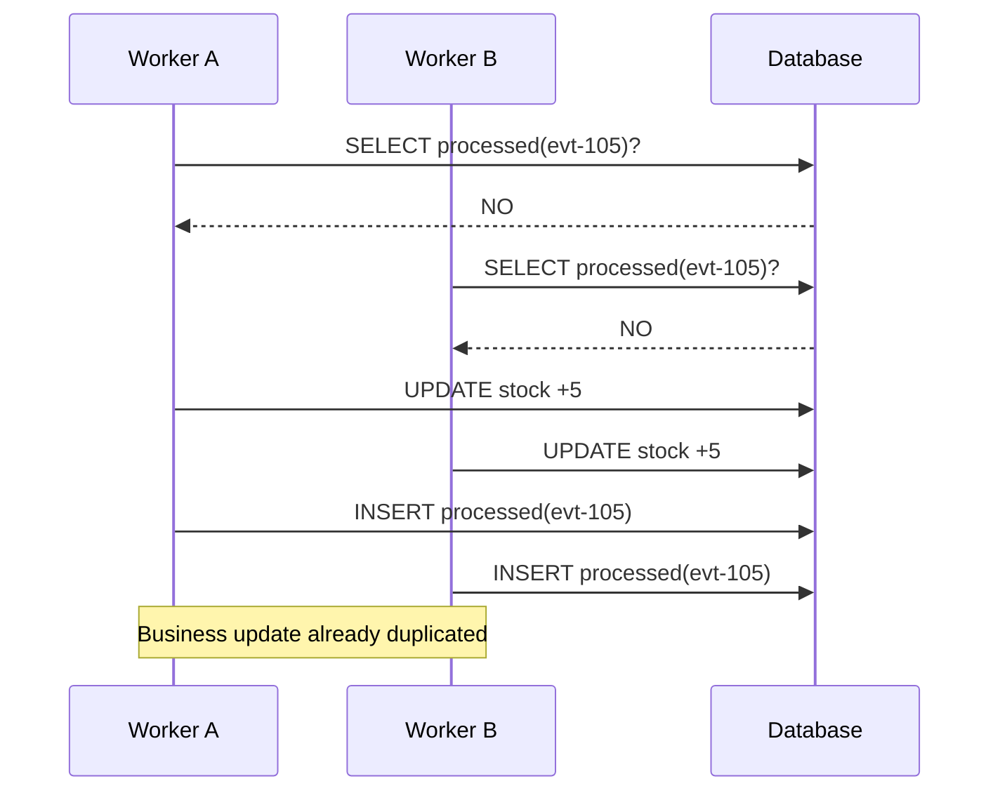
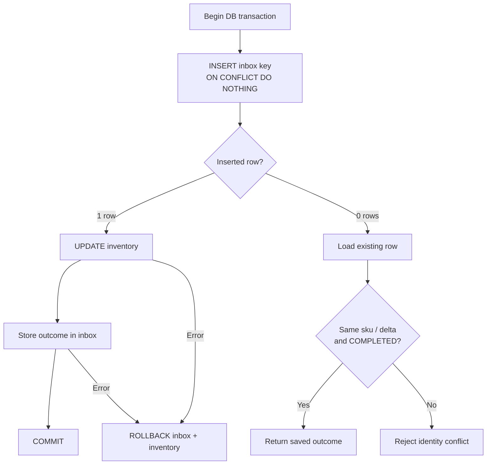
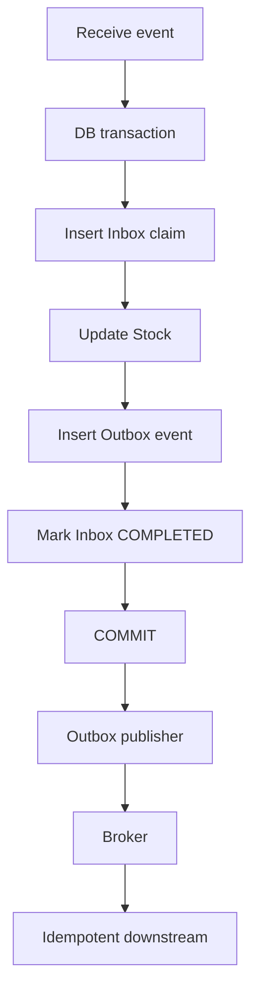

# Checking and Recording Messages Atomically

## 1. Why Is “Check First, Process Later” Not Safe Enough?

In an inventory intake flow, a broker delivers a `StockAdjustmentRequested` event with `eventId=evt-105`, requesting to add 5 units to a SKU's stock. The consumer updates the stock successfully but loses connectivity before sending the ACK. The broker redelivers **the same logical event**. If the receiver adds 5 units again, inventory is incremented twice.

That is why **Idempotent Receiver** exists in Enterprise Integration Patterns (EIP): a receiver may receive the same request multiple times, yet **the business effect is allowed to happen at most once per idempotency key**. In practice, the hardest part is not writing `if (seen) return`, but ensuring that **checking, recording the marker, and updating business data** are safe under two threads, two JVMs, transaction rollbacks, or crashes.

In the **Idempotent receiver** chapter of the **SPRING_INTEGRATION_PATTERN** module, learners implement EIP with Spring Integration to build loosely coupled, extensible message flows. The material connects directly to Router, Filter, Transformer, Splitter, Aggregator, Gateway, retry, error channel, and correlation; while practicing testing, observing branches, and handling replayed messages.



**Important distinction:** A message *may be delivered multiple times*, while the effect is designed to be recorded once. This **does not** turn the broker into exactly-once delivery, nor does it automatically guarantee an external API is called only once.

## 2. Defining Idempotency and the Scope to Protect

An operation `f` is called idempotent when repeatedly executing it with the same logical request does not change business state beyond the first successful execution:

```text
apply(event E) -> stock = 15
apply(event E) -> stock = 15 (duplicate suppressed)
apply(event E) -> stock = 15 (duplicate suppressed)

apply(event F) -> stock = 19 (different event, processed)
```

Three layers must be distinguished:

| Layer | Example | What Does Idempotency Solve? |
| --- | --- | --- |
| **Delivery** | Broker redelivers after ACK timeout | Tolerates receiving multiple times |
| **Receiver / processing** | Same event arrives multiple times, even concurrently | Prevents repeating business side effects |
| **Downstream side effect** | Calling a bank, sending email, publishing new events | Requires separate idempotency/transaction/outbox mechanisms |

If the goal is merely “do not process duplicate events in one consumer”, clearly define **which consumer**, **which event identity**, and **which side effect**. The same event may need to pass through two independent consumers: updating stock and writing reports. Suppressing at the inventory consumer does not mean the reporting consumer should skip it as well.

### 2.1. Two Ways to Return Results When Receiving a Duplicate

1. **Suppress:** do not run business logic again; optionally return an ACK or no-op.
2. **Replay saved outcome:** return the stored result from the first execution, useful when request–reply or a Gateway retries after a timeout.

For example, the consumer originally returned a remaining quantity of 15. When a duplicate arrives after another event has changed stock to 20, the receiver should **return the original event's outcome (15)** if the contract is “replay result”, rather than reading current stock (20) and pretending that was the duplicate event's result.

### 2.2. Idempotency Is Not “Drop Everything Previously Seen”

An event with the same `eventId` but a different payload is an **identity conflict**, not a valid duplicate. Canonicalized data or a request fingerprint must be compared; never check only key existence and ACK a request whose contents changed.

```text
First:     (tenant-a, evt-105, SKU-A, +5)
Duplicate: (tenant-a, evt-105, SKU-A, +5)   -> replay / no-op

Conflict:  (tenant-a, evt-105, SKU-B, +50)  -> reject / investigate
```

## 3. Anti-Pattern: SELECT Then INSERT in Two Separate Operations

A very common implementation:

```java
// ANTI-PATTERN: unsafe when multiple consumers run concurrently.
if (!repository.existsByEventId(event.eventId())) {
    inventory.add(event.sku(), event.delta());
    repository.insertProcessed(event.eventId());
}
```

When there are two consumers on different threads or instances:



Both `SELECT` calls are valid when they run, yet **they fail to establish exclusive processing rights**. This is a *check-then-act race* / *time-of-check to time-of-use (TOCTOU)* bug.

### 3.1. Adding a UNIQUE Constraint After the Side Effect Is Not Enough

Suppose the processed events table has a UNIQUE `eventId`. Worker B might fail with a duplicate error on `INSERT`, yet if it already **updated stock in another transaction** beforehand, stock still increased twice. A unique constraint protects the marker table; it only protects business data when **processing rights are claimed first and business updates happen in the same atomic transaction**.

### 3.2. JVM Locks and Caches Do Not Replace a Database Transaction

| Attempted Approach | Problem |
| --- | --- |
| `synchronized` inside a bean | Does not lock other instances, does not survive crashes |
| `ConcurrentHashMap.putIfAbsent` | Lost on restart, not committed with the DB |
| Redis `SETNX` | Can avoid parallel execution, but does not auto-commit with the business DB |
| Checking only `duplicateMessage` message header | Header is informational, not proof of commit |
| `SELECT EXISTS` outside a transaction | Can race and does not protect side effects |
| Recording processed event after calling external API | Crashing between steps causes the API to be called again |

When business data and markers live in the same relational database, **transaction + unique constraint + atomic claim** is usually a strong, clear, and testable choice.

## 4. Designing Semantic Idempotency Keys

A good key must remain stable across retries and be specific enough that two valid tasks are not mistaken for duplicates.

```text
IdempotencyKey = (consumerName, tenantId, eventId)

consumerName = "inventory-adjustment"
tenantId     = "tenant-hcm"
eventId      = "evt-105"
```

| Component | Meaning | Failure When Missing |
| --- | --- | --- |
| `consumerName` | Each consumer keeps its own marker | One consumer wrongly blocks another consumer |
| `tenantId` | Partitions data and permissions | Two tenants with same event ID collide |
| `eventId` | Stable logical event identity | Retries are treated as new events |
| `eventVersion` (when needed) | Distinguishes intentional revisions | New revision wrongly treated as duplicate |
| `sourceIndex` (if event contains batch) | Distinguishes items within a batch | Second item wrongly blocked |

**Do not use SKU alone** as the key: two independent stock adjustments can target the same SKU. **Do not use `MessageHeaders.ID`** as the business event ID: adapters or redeliveries can create new message envelopes. **Do not use receive timestamps**: every attempt will differ.

### 4.1. Keys for Splitter/Aggregator

If a batch message has three items and a consumer applies each item:

```text
(consumerName, tenantId, batchEventId, sourceIndex)
```

A shared `eventId` for the whole batch without `sourceIndex` will cause item 0 to “claim the slot” and items 1 and 2 to be misidentified as duplicates. Conversely, if idempotency is at the **whole-batch** level, a transaction/workflow must guarantee the entire batch rather than inferring it from a single key in an item consumer.

### 4.2. Same Key, Different Content

Two principles:
- **The key** identifies the *logical operation*.
- **The fingerprint or stored source fields** verify that the operation has the same content across deliveries.

In the following example, we store `sku` and `delta` in the Inbox to compare directly on duplicates. For complex payloads, store a canonical fingerprint (e.g., SHA-256 of a stable, schema-versioned representation), rather than hashing arbitrary `toString()` output or JSON with non-deterministic field ordering and assuming immutability.

## 5. Solution: Atomic Claim and Business Update in the Same Transaction

We use **PostgreSQL** for its `INSERT ... ON CONFLICT DO NOTHING` statement. This mechanism is not universal SQL across all DBs; if using MySQL, SQL Server, or Oracle, choose equivalent syntax/locking and verify behavior.

Design:

1. Transaction begins.
2. Attempt to **claim the key** via an insert into an Inbox table with a unique constraint.
3. If the insert succeeds: execute the business logic inside **that exact transaction**, store the outcome, and commit.
4. If the key already exists: read the committed outcome, verify the payload matches, and return duplicate/no-op.
5. If an exception occurs before commit: both the Inbox insert and the business update **roll back together**; redelivery can safely retry.



**This is the atomicity that must be proven:** There is no point in time where *the inventory update has committed while the idempotency marker has not* when both reside in the exact same DB transaction.

### 5.1. Stock Balances Table

```sql
CREATE TABLE stock_balances (
    tenant_id  VARCHAR(80) NOT NULL,
    sku        VARCHAR(64) NOT NULL,
    quantity   BIGINT NOT NULL CHECK (quantity >= 0),
    PRIMARY KEY (tenant_id, sku)
);
```

Each tenant/SKU pair has one row. An UPDATE like `quantity = quantity + delta` executes in the database inside the transaction, avoiding read-modify-write lost updates in Java.

### 5.2. Inbox and Processed Outcome Table

```sql
CREATE TABLE inventory_inbox (
    consumer_name    VARCHAR(80) NOT NULL,
    tenant_id        VARCHAR(80) NOT NULL,
    event_id         VARCHAR(120) NOT NULL,
    sku              VARCHAR(64) NOT NULL,
    delta            BIGINT NOT NULL,
    status           VARCHAR(24) NOT NULL,
    result_quantity  BIGINT,
    created_at       TIMESTAMPTZ NOT NULL DEFAULT now(),
    completed_at     TIMESTAMPTZ,
    PRIMARY KEY (consumer_name, tenant_id, event_id),
    CHECK (status IN ('PROCESSING', 'COMPLETED', 'REJECTED'))
);
```

Meaning:
- `PRIMARY KEY (consumer_name, tenant_id, event_id)` is the **concurrency arbitration point** for the same logical event.
- `sku` and `delta` store content identity to check duplicates vs. conflicts.
- `status` indicates whether the event COMPLETED or was intentionally rejected.
- `result_quantity` stores the **outcome at the time the event executed**, not current stock.
- `created_at`/`completed_at` support auditing and retention.

In the code below, the `PROCESSING` row only exists **inside an uncommitted transaction**. A successful transaction transitions it to `COMPLETED` before commit; on failure, the `PROCESSING` row is rolled back so it never persists as a processed marker. If using a multi-phase design for external APIs, the lifecycle differs (see later sections).

### 5.3. Which Steps Does a Single Transaction Cover?

```text
BEGIN
  INSERT inventory_inbox(... status=PROCESSING)
  UPDATE stock_balances
  SELECT resulting quantity
  UPDATE inventory_inbox(status=COMPLETED, result_quantity=...)
COMMIT
```

**Do not** split “record processed marker” into a separate prior transaction and update stock afterward. If the marker commits and the stock update fails, redelivery will be suppressed even though the business effect never happened. Conversely, if the stock update commits first and the marker is written later, a crash in between duplicates the side effect.

## 6. Java Model and Input Validation Contract

The Java 17 example uses immutable records. `StockAdjustmentRequested` is **one business event**, not each delivery attempt.

```java
record StockAdjustmentRequested(
        String tenantId,
        String eventId,
        String sku,
        long delta) {

    StockAdjustmentRequested {
        if (tenantId == null || tenantId.isBlank()
                || eventId == null || eventId.isBlank()
                || sku == null || sku.isBlank()
                || delta == 0) {
            throw new IllegalArgumentException(
                    "Invalid stock adjustment event");
        }
    }
}

record ApplyResult(
        String tenantId,
        String eventId,
        long resultingQuantity,
        boolean duplicate) {}
```

- `delta > 0`: increases quantity.
- `delta < 0`: decreases quantity; quantity must never become negative.
- `delta == 0`: treated as invalid input in this example.
- `tenantId` must come from a trusted identity/source and match the event.
- An `eventId` remains unchanged across redeliveries; **an intentionally revised event** requires a new version/event ID policy.

`ApplyResult.duplicate` indicates whether the current delivery produced no new business update. For valid duplicates, `resultingQuantity` is the snapshot saved during the first execution.

## 7. Java: Atomic Check-and-Record with TransactionTemplate and JdbcTemplate

Using `TransactionTemplate` makes the transaction boundary explicit and avoids depending on whether `@Transactional` goes through a Spring proxy. All SQL statements below use **the same DataSource and transaction manager**.

### 7.1. Transaction Template Configuration

```java
import org.springframework.context.annotation.Bean;
import org.springframework.context.annotation.Configuration;
import org.springframework.transaction.PlatformTransactionManager;
import org.springframework.transaction.TransactionDefinition;
import org.springframework.transaction.support.TransactionTemplate;

@Configuration
class InventoryTransactionConfig {

    @Bean
    TransactionTemplate inventoryTransactionTemplate(
            PlatformTransactionManager txManager) {
        var template = new TransactionTemplate(txManager);
        template.setIsolationLevel(
                TransactionDefinition.ISOLATION_READ_COMMITTED);
        return template;
    }
}
```

The example intentionally uses PostgreSQL's `READ_COMMITTED` level. When two transactions contend on the unique key, `INSERT ... ON CONFLICT DO NOTHING` resolves contention using the unique constraint; the losing transaction may wait for the winning transaction to finish. After receiving 0 rows inserted, the subsequent SELECT in `READ COMMITTED` sees the row committed by the winner.

Do not generalize this exact behavior to every database engine or isolation level. Under `REPEATABLE_READ`/snapshot isolation, reading the row after a conflict and retrying transactions can behave differently and must be tested against a real DB.

### 7.2. Complete Transactional Service

```java
import java.util.List;
import java.util.Objects;
import org.springframework.jdbc.core.JdbcTemplate;
import org.springframework.stereotype.Service;
import org.springframework.transaction.support.TransactionTemplate;

@Service
class InventoryIdempotentReceiver {
    private static final String CONSUMER = "inventory-adjustment";

    private final JdbcTemplate jdbc;
    private final TransactionTemplate tx;

    InventoryIdempotentReceiver(
            JdbcTemplate jdbc,
            TransactionTemplate inventoryTransactionTemplate) {
        this.jdbc = jdbc;
        this.tx = inventoryTransactionTemplate;
    }

    ApplyResult accept(StockAdjustmentRequested event) {
        Objects.requireNonNull(event, "event");

        ApplyResult result = tx.execute(status -> {
            int claimed = jdbc.update("""
                    INSERT INTO inventory_inbox
                        (consumer_name, tenant_id, event_id,
                         sku, delta, status)
                    VALUES (?, ?, ?, ?, ?, 'PROCESSING')
                    ON CONFLICT
                        (consumer_name, tenant_id, event_id)
                    DO NOTHING
                    """,
                    CONSUMER,
                    event.tenantId(),
                    event.eventId(),
                    event.sku(),
                    event.delta());

            if (claimed == 0) {
                return handleExisting(event);
            }
            if (claimed != 1) {
                throw new IllegalStateException(
                        "Unexpected claim insert row count");
            }

            // Same transaction as the Inbox INSERT.
            int changed = jdbc.update("""
                    UPDATE stock_balances
                    SET quantity = quantity + ?
                    WHERE tenant_id = ?
                      AND sku = ?
                      AND quantity + ? >= 0
                    """,
                    event.delta(),
                    event.tenantId(),
                    event.sku(),
                    event.delta());

            if (changed != 1) {
                throw new IllegalStateException(
                        "STOCK_ROW_MISSING_OR_INSUFFICIENT");
            }

            Long quantity = jdbc.queryForObject("""
                    SELECT quantity FROM stock_balances
                    WHERE tenant_id = ? AND sku = ?
                    """,
                    Long.class,
                    event.tenantId(),
                    event.sku());
            if (quantity == null) {
                throw new IllegalStateException(
                        "Stock row disappeared");
            }

            int recorded = jdbc.update("""
                    UPDATE inventory_inbox
                    SET status = 'COMPLETED',
                        result_quantity = ?,
                        completed_at = now()
                    WHERE consumer_name = ?
                      AND tenant_id = ?
                      AND event_id = ?
                      AND status = 'PROCESSING'
                    """,
                    quantity,
                    CONSUMER,
                    event.tenantId(),
                    event.eventId());

            if (recorded != 1) {
                throw new IllegalStateException(
                        "Could not finalize inbox");
            }

            return new ApplyResult(
                    event.tenantId(),
                    event.eventId(),
                    quantity,
                    false);
        });

        return Objects.requireNonNull(result, "Transaction result");
    }

    private ApplyResult handleExisting(
            StockAdjustmentRequested event) {
        List<InboxRecord> matches = jdbc.query("""
                SELECT sku, delta, status, result_quantity
                FROM inventory_inbox
                WHERE consumer_name = ?
                  AND tenant_id = ?
                  AND event_id = ?
                """,
                (rs, index) -> new InboxRecord(
                        rs.getString("sku"),
                        rs.getLong("delta"),
                        rs.getString("status"),
                        rs.getObject(
                                "result_quantity", Long.class)),
                CONSUMER,
                event.tenantId(),
                event.eventId());

        if (matches.size() != 1) {
            throw new IllegalStateException(
                    "Claim exists but inbox record not visible");
        }

        InboxRecord stored = matches.get(0);
        if (!stored.sku().equals(event.sku())
                || stored.delta() != event.delta()) {
            throw new IllegalArgumentException(
                    "IDEMPOTENCY_KEY_CONFLICT");
        }
        if (!"COMPLETED".equals(stored.status())
                || stored.resultQuantity() == null) {
            throw new IllegalStateException(
                    "INBOX_NOT_COMPLETED");
        }

        return new ApplyResult(
                event.tenantId(),
                event.eventId(),
                stored.resultQuantity(),
                true);
    }

    private record InboxRecord(
            String sku,
            long delta,
            String status,
            Long resultQuantity) {}
}
```

**Important points to avoid misunderstanding:**

1. **The atomic claim is enforced by the database constraint**, not an `if` in Java.
2. Claiming, updating stock, and finalizing the Inbox all execute in **one transaction**.
3. `ON CONFLICT (consumer_name, tenant_id, event_id) DO NOTHING` only ignores contention on that exact key; other constraint errors are not swallowed as duplicates.
4. When `claimed == 0`, the code reads the committed record and **compares inputs**. Different SKU/delta → identity conflict.
5. When the stock update fails, the exception rolls back the transaction; the Inbox is not committed as processed either.
6. For valid duplicates, the code returns `resultQuantity` from the Inbox, **not** by reading current quantity.
7. Arithmetic in the DB can overflow if exceeding BIGINT range; constraint violations will roll back the transaction.
8. `READ_COMMITTED` and `ON CONFLICT` syntax are chosen **specifically for PostgreSQL**; do not copy to another DB without verification.

### 7.3. If the Stock Row Is Missing or Balance Is Insufficient

The example above throws `STOCK_ROW_MISSING_OR_INSUFFICIENT` and rolls back. On redelivery of the same event, it will retry and may fail again. **This is an illustrative choice**, suitable when a missing row is a misconfiguration or transient unsynchronized data.

In production, distinguish:
- **Transient failures** (database timeout, stock record not yet synced) → bounded retry.
- **Terminal business rejection** (insufficient stock under a snapshot/contract) → you may want to commit the Inbox with status `REJECTED` and store a reason code in the same transaction.
- **Invalid input** (invalid SKU, unauthorized tenant) → reject/quarantine, do not retry endlessly.

Only mark `REJECTED` when the business decision is genuinely final. If a “deduct 10 units” event lacks stock today but policy permits waiting for replenishment tomorrow, permanently recording `REJECTED` can break the workflow.

## 8. Integrating into Spring Integration Java DSL

The receiver service guarantees atomicity, while Spring Integration orchestrates messages. We can wire a Service Activator via Java DSL:

```java
import org.springframework.context.annotation.Bean;
import org.springframework.context.annotation.Configuration;
import org.springframework.integration.channel.DirectChannel;
import org.springframework.integration.channel.QueueChannel;
import org.springframework.integration.config.EnableIntegration;
import org.springframework.integration.dsl.IntegrationFlow;
import org.springframework.messaging.MessageChannel;
import org.springframework.messaging.PollableChannel;

@Configuration
@EnableIntegration
class InventoryIdempotencyFlow {

    @Bean("inventory.adjustments")
    MessageChannel adjustments() {
        return new DirectChannel();
    }

    @Bean("inventory.results")
    PollableChannel results() {
        return new QueueChannel();
    }

    @Bean
    IntegrationFlow applyStockAdjustments(
            InventoryIdempotentReceiver receiver) {
        return IntegrationFlow.from("inventory.adjustments")
                .handle(StockAdjustmentRequested.class,
                        (event, headers) -> receiver.accept(event))
                .channel("inventory.results")
                .get();
    }
}
```

A demo producer:

```java
import org.springframework.messaging.support.MessageBuilder;

// input is the MessageChannel bean "inventory.adjustments".
var event = new StockAdjustmentRequested(
        "tenant-hcm", "evt-105", "SKU-A", 5L);

input.send(MessageBuilder.withPayload(event)
        .setHeader("traceId", "trace-105")
        .setHeader("eventId", event.eventId())
        .build());
```

On success, output `ApplyResult(tenant-hcm, evt-105, 15, false)` can be read from `inventory.results`; on resending the same event, output is `ApplyResult(..., 15, true)` while stock remains at 15 if no other events ran.

**Layers of responsibility:**
- Ingress adapters must authenticate tenant and data, never trusting an arbitrary client-supplied `eventId` header.
- Receiver manages the unique key, transaction, and domain update.
- Flow routes `ApplyResult` per the routing/reply contract.
- `QueueChannel` in the example is **in-memory** and does not persist results across restarts.
- When using a broker, ACK should only be treated as successful **after the transaction has committed** and the adapter finishes per policy. If ACK fails and the broker redelivers, the receiver must still tolerate duplicates.

### 8.1. If Duplicates Are Filtered/Discarded Instead of Returning a Result

Spring Integration also supports endpoint-level idempotency via **Idempotent Receiver advice/interceptor** paired with a `MessageSelector` and `MetadataStore`. You can choose to mark/discard duplicate messages before the business handler.

However, two warnings:
1. **Marking a message in a MetadataStore does not by default share a transaction with updating stock in the database.** If a claim commits in Redis/cache and the business update fails, retries can be wrongly blocked.
2. If the interceptor only attaches a duplicate marker header and lets the message proceed, **the consumer must actively check it** and avoid executing the side effect a second time. Verify interceptor semantics and advice/discard configuration for your Spring Integration version.

This article prioritizes **Inbox table + transactional business update** to fulfill the title “checking and recording messages atomically”. A pure selector is useful for filtering, but should not be treated as a transaction boundary for all side effects.

## 9. Why Atomic Processing Differs from Check-Then-Set-Flag

Even within the same database, separate transactions can still create dangerous “gaps”. The table below compares crash points:

| Crash Point | Marker Recorded in Separate Transaction | Inbox + Business in Same Transaction |
| --- | --- | --- |
| Before claim | No effect yet | No effect yet |
| Claim committed, business not yet run | **Risk of permanently lost effect** when retries are blocked | No such partial commit state |
| Business committed, Inbox not yet committed | **Risk of duplicate execution** on redelivery | No such partial commit state |
| Transaction updating, not yet committed | May leave orphaned update if separate transaction | **Rolls back both claim and update** |
| Both committed, broker ACK failed | May rerun if marker is not durable | Duplicate enters outcome-reading branch |
| Committed, output reply lost | Caller may retry and cause duplicate side effect | Receiver returns stored outcome |

**DB atomicity** only covers operations on the same transactional resource. It **does not** automatically span broker ACKs, HTTP responses, sending emails, or bank APIs.

### 9.1. Properly Understanding “Claim First, Process Later”

The phrase “claim first” in this example means **inserting a row with a unique key inside an uncommitted transaction**. Another worker cannot concurrently commit a row with the same key. Only if the lock-holding transaction rolls back can another worker claim and process it. This is not **committing a `PROCESSING` flag first and then doing business work in another transaction**.

If using a multi-phase state machine model, `PROCESSING` may be a committed record requiring **leases, timeouts, owner tokens, and fencing tokens** to recover from worker crashes. That is a separate pattern and lacks the same atomic guarantee when side effects sit outside the transaction.

### 9.2. Why Is `READ COMMITTED` Explicitly Specified?

In PostgreSQL, an `INSERT ... ON CONFLICT DO NOTHING` colliding on a key held by another active transaction can wait for that transaction to finish. Under `READ COMMITTED`, the subsequent SELECT inside the transaction gets a fresh snapshot and reads the row just committed by the winner.

Under another snapshot isolation level, the same check flow may require retrying **the entire transaction** after a conflict or serialization failure. Never pick an example's isolation level mechanically for every DB or workload; test concurrency against your production database.

## 10. Terminal Business Errors and the REJECTED State

The Section 7 example rolls back on insufficient stock. However, some requests must be **permanently rejected** by business rules. If every redelivery runs the same validation and throws the same error, the message can become a poison message that is never ACKed.

There are two different policies:

| Failure Type | Suggested Policy | Inbox |
| --- | --- | --- |
| DB/queue timeout | Bounded retry | Roll back; not processed |
| Deadlock/serialization conflict | Retry transaction with backoff | Roll back; safe to reclaim |
| Final business decision: rejected | Commit rejection outcome | `REJECTED` and `reason_code` |
| Invalid schema/tenant, untrusted data | Reject/quarantine at ingress | Do not create bogus claim |
| External API status uncertain | Reconcile/query by idempotency key | Do not assume success |
| Wrong payload with same event key | Security/identity conflict | Do not overwrite initial Inbox |

To record a rejection decision as a stable outcome, extend the schema:

```sql
ALTER TABLE inventory_inbox
ADD COLUMN reason_code VARCHAR(80);
```

Inside **the same claiming transaction**, if stock is insufficient and policy dictates a final rejection:

```text
BEGIN
  INSERT inbox(PROCESSING)
  evaluate stock + business rules
  UPDATE inbox
    SET status='REJECTED', reason_code='INSUFFICIENT_STOCK'
  COMMIT
```

For duplicates of a `REJECTED` event, the receiver returns the same business rejection (without re-executing). Update the existing-record branch to handle `REJECTED` per contract rather than treating every non-`COMPLETED` status as a system error like the demo code.

**Note:** Do not use `REJECTED` for mutable data sources or transient errors if the contract allows retries to succeed. Permanently caching a negative decision can cause subsequent valid retries to be wrongly dropped.

## 11. Atomic Inbox Does Not Cover Effects Outside the Database

Suppose the same flow also sends an email or publishes `InventoryAdjusted` to a broker in addition to updating stock. If the external side effect runs **before DB commit**, a transaction rollback can leave the email/event sent even though stock never changed.

```text
BEGIN DB transaction
  INSERT inbox
  UPDATE stock
  send email / publish broker event  <-- does not roll back with DB
  UPDATE inbox COMPLETED
COMMIT
```

A crash or DB failure after sending the email causes redelivery to repeat sending. Conversely, committing the DB first and publishing afterward loses the notification if a crash occurs before publishing.

### 11.1. Transactional Outbox

Instead of publishing immediately, write an **outbox record in the same transaction** as the Inbox and stock update:



Suggested schema:

```sql
CREATE TABLE integration_outbox (
    event_id        VARCHAR(160) PRIMARY KEY,
    tenant_id       VARCHAR(80) NOT NULL,
    event_type      VARCHAR(80) NOT NULL,
    payload_json    JSONB NOT NULL,
    published_at    TIMESTAMPTZ,
    created_at      TIMESTAMPTZ NOT NULL DEFAULT now()
);
```

In the first-execution code (inside the Section 7 transaction, **before commit**), you can add:

```java
// Illustrative example; payloadJson is produced by a safe serializer.
jdbc.update("""
        INSERT INTO integration_outbox
            (event_id, tenant_id, event_type, payload_json)
        VALUES (?, ?, 'InventoryAdjusted', CAST(? AS jsonb))
        """,
        event.tenantId() + ":" + event.eventId() + ":stock:v1",
        event.tenantId(),
        payloadJson);
```

In the `claimed==0` duplicate branch, **do not insert a new outbox event**. The outbox publisher reads unpublished rows, sends them to the broker, and marks them published. The publisher may emit duplicates if it crashes after the broker receives the event but before updating `published_at`. Downstream consumers therefore **still need idempotency** keyed by outbox event identity.

An outbox record with a stable `event_id` requires careful scoping/encoding: use a canonical composite ID or unambiguous encoding if source strings can contain delimiters.

### 11.2. External APIs Such as Payments

Never call `chargeCard()` inside a DB transaction assuming a transaction rollback will refund the charge. Options:
- Emit a command via an outbox using an **idempotency key** supported by the payment provider.
- Persist intent/processing state and reconcile the API result when a timeout leaves success or failure unknown.
- For multi-step workflows, design sagas/compensation and enforce valid state transitions.
- Never replay a financial transaction with a new key just to “try again”.

Database claims protect **local** state; external systems require their own policies.

## 12. Retries, ACKs, and Redelivery in a Spring Integration Flow

With an at-least-once broker, the ideal sequence is:

```text
broker -> message adapter -> Spring Integration handler
                             -> DB atomic transaction
                             -> return success
       <- ACK (per adapter / listener policy)
```

If the handler throws an exception:
- `TransactionTemplate` rolls back.
- The adapter applies its retry/nack/requeue/dead-letter policy.
- The message can be redelivered and the claim key can still be used to process successfully.

If the DB commits and the network drops before ACK:
- The broker may redeliver.
- The claim key already exists with `COMPLETED`.
- The receiver verifies matching data and returns the stored outcome.
- The adapter can ACK the new delivery without updating stock again.

### 12.1. Distinguishing Three Error Categories

| Category | Example | Retry? |
| --- | --- | --- |
| **Valid duplicate** | Same eventId and same canonical payload | Do not run side effect; ACK |
| **Transient error** | DB timeout, deadlock, lock timeout | Yes, bounded with backoff |
| **Permanent/contract error** | Same key with different payload, wrong tenant, bad schema | Reject, quarantine, or terminal reply |

Never write `catch (Exception ignored) { ack(); }`: it loses unprocessed messages. Conversely, never endlessly retry `IDEMPOTENCY_KEY_CONFLICT`, because an invalid payload will not become valid upon re-execution.

### 12.2. Retry Storms from Layering Retries

If the HTTP client retries 3 times, the Service Activator retries 3 times, and the broker adapter redelivers 3 times, total attempts can reach 27 for the same event in the worst case. Idempotency protects the business side effect, yet **does not automatically reduce load on the database or external API**. Bound total attempts, use backoff/jitter, timeouts, circuit breakers, and observable DLQ/quarantine mechanisms.

### 12.3. Error Channel Does Not Replace the Inbox

Spring Integration can emit an `ErrorMessage` to `errorChannel` depending on the endpoint type (poller, executor, gateway, broker adapter). However, an error channel:
- Does not record processed events in the same transaction as the business DB.
- Does not verify whether an event already committed.
- Does not provide durability or dead-letter storage by itself.
- Does not make the DB and broker ACK atomic.

Inbox/outbox solves **state & consistency**, while the error channel supports **error routing and observability**. The two concepts complement each other.

## 13. Testing Idempotency Against a Real Database, Not Just Mock Repositories

Atomicity depends on unique constraints, transaction managers, JDBC connections, and isolation. Mocking `existsById()` to return `false` then `true` cannot prove two concurrent workers will not double-process.

**Use real PostgreSQL in integration tests**, such as via Testcontainers (adding test dependencies). Tests must use the production-like schema and connect to the same DataSource used by `JdbcTemplate`/TransactionTemplate.

### 13.1. PostgreSQL Testcontainers Test Fixture

The example below starts a PostgreSQL container for the test class. This code is intended for environments **with Docker and Testcontainers installed**; it is not executed during the authoring of this document.

```java
import org.junit.jupiter.api.AfterAll;
import org.junit.jupiter.api.BeforeAll;
import org.junit.jupiter.api.BeforeEach;
import org.junit.jupiter.api.Test;
import org.springframework.jdbc.core.JdbcTemplate;
import org.springframework.jdbc.datasource.DataSourceTransactionManager;
import org.springframework.jdbc.datasource.DriverManagerDataSource;
import org.springframework.transaction.TransactionDefinition;
import org.springframework.transaction.support.TransactionTemplate;
import org.testcontainers.containers.PostgreSQLContainer;

import java.util.concurrent.*;
import static org.junit.jupiter.api.Assertions.*;

class InventoryIdempotentReceiverPostgresIT {

    private static PostgreSQLContainer<?> postgres;
    private static JdbcTemplate jdbc;
    private static InventoryIdempotentReceiver receiver;

    @BeforeAll
    static void startDatabaseAndCreateSchema() {
        postgres = new PostgreSQLContainer<>("postgres:16-alpine");
        postgres.start();

        var ds = new DriverManagerDataSource(
                postgres.getJdbcUrl(),
                postgres.getUsername(),
                postgres.getPassword());

        jdbc = new JdbcTemplate(ds);
        var tx = new TransactionTemplate(
                new DataSourceTransactionManager(ds));
        tx.setIsolationLevel(
                TransactionDefinition.ISOLATION_READ_COMMITTED);
        receiver = new InventoryIdempotentReceiver(jdbc, tx);

        jdbc.execute("""
                CREATE TABLE stock_balances (
                    tenant_id VARCHAR(80) NOT NULL,
                    sku VARCHAR(64) NOT NULL,
                    quantity BIGINT NOT NULL CHECK (quantity >= 0),
                    PRIMARY KEY (tenant_id, sku)
                )
                """);

        jdbc.execute("""
                CREATE TABLE inventory_inbox (
                    consumer_name VARCHAR(80) NOT NULL,
                    tenant_id VARCHAR(80) NOT NULL,
                    event_id VARCHAR(120) NOT NULL,
                    sku VARCHAR(64) NOT NULL,
                    delta BIGINT NOT NULL,
                    status VARCHAR(24) NOT NULL,
                    result_quantity BIGINT,
                    created_at TIMESTAMPTZ NOT NULL DEFAULT now(),
                    completed_at TIMESTAMPTZ,
                    PRIMARY KEY (consumer_name, tenant_id, event_id),
                    CHECK (status IN
                        ('PROCESSING','COMPLETED','REJECTED'))
                )
                """);
    }

    @AfterAll
    static void stopDatabase() {
        if (postgres != null) {
            postgres.stop();
        }
    }

    @BeforeEach
    void resetData() {
        jdbc.update("DELETE FROM inventory_inbox");
        jdbc.update("DELETE FROM stock_balances");
        jdbc.update("""
                INSERT INTO stock_balances
                    (tenant_id, sku, quantity)
                VALUES ('tenant-test', 'SKU-A', 10)
                """);
    }

    private static StockAdjustmentRequested event(
            String eventId, long delta) {
        return new StockAdjustmentRequested(
                "tenant-test", eventId, "SKU-A", delta);
    }

    private long currentQuantity() {
        Long quantity = jdbc.queryForObject("""
                SELECT quantity
                FROM stock_balances
                WHERE tenant_id = 'tenant-test'
                  AND sku = 'SKU-A'
                """, Long.class);
        return quantity.longValue();
    }

    @Test
    void sameEventTwiceChangesStockOnlyOnce() {
        var message = event("evt-101", 5);

        ApplyResult first = receiver.accept(message);
        ApplyResult second = receiver.accept(message);

        assertFalse(first.duplicate());
        assertTrue(second.duplicate());
        assertEquals(15L, currentQuantity());
        assertEquals(15L, first.resultingQuantity());
        assertEquals(15L, second.resultingQuantity());

        Integer inboxCount = jdbc.queryForObject("""
                SELECT COUNT(*)
                FROM inventory_inbox
                WHERE tenant_id = 'tenant-test'
                """, Integer.class);
        assertEquals(1, inboxCount);
    }

    @Test
    void sameKeyWithDifferentPayloadIsConflict() {
        receiver.accept(event("evt-102", 5));

        assertThrows(IllegalArgumentException.class, () ->
                receiver.accept(event("evt-102", 9)));

        assertEquals(15L, currentQuantity());
    }

    @Test
    void negativeStockRollsBackBothClaimAndUpdate() {
        assertThrows(IllegalStateException.class, () ->
                receiver.accept(event("evt-103", -99)));

        assertEquals(10L, currentQuantity());

        Integer inboxCount = jdbc.queryForObject("""
                SELECT COUNT(*)
                FROM inventory_inbox
                WHERE event_id = 'evt-103'
                """, Integer.class);
        assertEquals(0, inboxCount);
    }

    @Test
    void twoConcurrentDeliveriesApplyOnce() throws Exception {
        var message = event("evt-104", 5);
        var gate = new CountDownLatch(1);
        var pool = Executors.newFixedThreadPool(2);

        try {
            Callable<ApplyResult> deliver = () -> {
                gate.await();
                return receiver.accept(message);
            };
            Future<ApplyResult> f1 = pool.submit(deliver);
            Future<ApplyResult> f2 = pool.submit(deliver);
            gate.countDown();

            ApplyResult a = f1.get(10, TimeUnit.SECONDS);
            ApplyResult b = f2.get(10, TimeUnit.SECONDS);

            assertEquals(15L, currentQuantity());
            assertTrue(a.duplicate() ^ b.duplicate());
            assertEquals(15L, a.resultingQuantity());
            assertEquals(15L, b.resultingQuantity());
        } finally {
            pool.shutdownNow();
        }
    }

    @Test
    void duplicateReturnsHistoricalOutcomeNotCurrentBalance() {
        var original = event("evt-105", 5);
        var newer = event("evt-106", 3);

        receiver.accept(original);  // stock: 10 -> 15
        receiver.accept(newer);     // stock: 15 -> 18
        ApplyResult replay = receiver.accept(original);

        assertEquals(18L, currentQuantity());
        assertTrue(replay.duplicate());
        assertEquals(15L, replay.resultingQuantity());
    }
}
```

**Why use a real database?**
- Unique constraints must protect keys even when two connections write simultaneously.
- Transaction rollbacks must remove the uncommitted Inbox row and leave stock untouched.
- PostgreSQL `ON CONFLICT`, MVCC, and isolation must be verified under concurrency.
- In-memory mocks cannot faithfully reproduce lock waits, commit/rollback behavior, and snapshot visibility.

To verify real crashes, you can add a **controlled failpoint in integration tests** right after the stock UPDATE but before finalize/commit, throwing an exception and asserting both Inbox and stock roll back. Never run such tests against real data environments.

### 13.2. Notes on the Test Framework

- Testcontainers requires Docker or a compatible container runtime.
- Do not annotate tests with an outer `@Transactional` that accidentally leaves seed/test data uncommitted across threads; each worker uses its own transaction and must see committed seed data.
- Avoid running tests mutating the same tables in parallel unless test isolation is separated.
- The test code only illustrates functionality; add compatible `spring-jdbc`, PostgreSQL driver, JUnit 5, and Testcontainers dependencies to your actual build.
- During subsequent Content QA/compilation, verify syntax/configuration against your Spring version; do not treat writing code blocks as proof they were executed.

## 14. Integration Testing Through the Spring Integration Flow

An end-to-end test should send a **real message** to `inventory.adjustments`, read `ApplyResult` from `inventory.results`, and check stock/Inbox in the DB. Example steps:

```text
Given:
  stock = 10
  inbox empty
  event = (tenant-test, evt-200, SKU-A, +5)

When:
  send event to inventory.adjustments
  receive result from inventory.results
  send same event again with new MessageHeaders.ID
  receive second result

Then:
  first result.duplicate = false
  second result.duplicate = true
  both resultingQuantity = 15
  stock quantity = 15
  inbox count for (consumer, tenant, eventId) = 1
```

When sending the duplicate, actively construct **a message envelope with a different ID** while preserving `eventId` in the payload, so the test genuinely verifies stable business identity rather than relying on framework-generated IDs.

If a `Router` or `Filter` precedes the receiver, verify tenant metadata and `eventId` are not altered in ways that skew the key. If using a `Splitter`, verify each item carries an appropriate identity; if using an `Aggregator`, never use an arbitrary child `eventId` as the ID of the whole summary.

### 14.1. Testing Multiple Consumers and Tenants

| Test | Expectation |
| --- | --- |
| Same eventId, same tenant, same consumer | Duplicate |
| Same eventId, two tenants | Two distinct logical operations |
| Same eventId, two consumers | Each consumer processes once |
| Same eventId, different payload | Conflict, does not run update a second time |
| Two different eventIds, same SKU | Two valid updates |
| Same event, two delivery threads | One update + one duplicate |
| Crash before DB commit | Roll back, redelivery can claim |
| Crash after DB commit before ACK | Duplicate safe |
| DB timeout | Bounded retry |
| External event publish fails | Outbox retains publish request |
| Out-of-order message arrival | Do not confuse event identity with arrival order |
| Invalid poison message | Do not retry indefinitely |
| Inbox record expires too early | Check risk of duplicate replay after retention |

## 15. Monitoring, Maintenance, and Inbox Retention

The Inbox is coordination data **with business value**, not merely a cache that can be purged at any time. Once completed Inbox records are cleaned up, a very old redelivered event **may be processed again as new**.

### 15.1. Retention Policy

Must be based on:
- How long the broker can redeliver.
- DLQ TTL and manual replay windows.
- Audit/traceability and dispute resolution requirements.
- Ability to reconstruct the inbox from other ledgers/event history.
- Migration rules when changing `consumerName` or event schemas.
- Index, partitioning, archiving, and DB row-count costs.

If the broker/DLQ can replay after 30 days while the Inbox only retains 7 days, **there is no idempotency guarantee for late replays**. You may need long-term ledgers, archive lookups, or more durable “closed event” markers depending on the system.

### 15.2. Metrics to Monitor

| Metric | Meaning |
| --- | --- |
| `idempotent_receiver.events.received` | Total deliveries entering the receiver |
| `idempotent_receiver.claim.created` | New events claimed successfully |
| `idempotent_receiver.duplicate.detected` | Duplicate events suppressed |
| `idempotent_receiver.key.conflict` | Same key, different payload |
| `idempotent_receiver.transaction.rollback` | Claim + business rollbacks |
| `idempotent_receiver.db.lock.wait` | Contention on unique key |
| `idempotent_receiver.processing.latency` | Event processing duration |
| `idempotent_receiver.retry.count` | Retries from transient errors |
| `idempotent_receiver.inbox.rows` | Size of stored state |
| `idempotent_receiver.inbox.cleanup.lag` | Cleanup/retention lag |
| `outbox.unpublished.count` | Post-processing events not yet published |
| `consumer.dead_letter.count` | Events that could not be processed |

The metric names above are **application-level suggestions**; do not assume Spring Integration emits all of these automatically. Metric labels should include consumer, outcome, and error class, while avoiding high-cardinality `eventId`, tenant IDs, or raw SKUs as labels. Logs should include `eventId`/tenant per security policy without recording sensitive payloads.

### 15.3. What Does a High Duplicate Rate Signal?

A high duplicate rate does not necessarily mean the receiver is broken: the broker may be redelivering due to ACK timeouts, network errors, consumer crashes, or excessive producer retries. Compare:
- Duplicates by event source and adapter;
- Time between first delivery and redelivery;
- Transaction/ACK latency;
- Lock contention and connection pool saturation;
- DLQ backlog and event age;
- Error codes leading to redeliveries.

Do not turn on duplicate discarding at the start of the flow and mask signals of an adapter redelivering abnormally.

## 16. Common Design Mistakes

1. **SELECT to check key then UPDATE before INSERT** without an atomic claim mechanism.
2. **Using `synchronized` in one JVM** instead of a DB unique constraint across multiple nodes.
3. **Writing the processed marker in a separate transaction before the business update**, causing lost effects on crash.
4. **Committing the business update first and writing the Inbox afterward**, causing duplicate processing on redelivery.
5. **Using `MessageHeaders.ID` as the key** instead of a stable logical `eventId`.
6. **Using `sku` or `tenantId` alone as the key**, mistakenly blocking valid operations.
7. **Failing to distinguish same key/different payload**, silently ACKing a modified request.
8. **Treating the `duplicateMessage` header as a DB commit guarantee**, even when the advice runs outside the transaction.
9. **Returning current stock balance as the outcome of an old duplicate**, breaking replay semantics.
10. **Not testing two consumers claiming the same key concurrently**, missing races.
11. **Catching a unique constraint error inside a PostgreSQL transaction and continuing**, even though the transaction may already be aborted.
12. **Calling HTTP/payment APIs directly inside a DB transaction assuming they can roll back**.
13. **Publishing events outside the DB without an outbox/recovery**, losing or duplicating notifications.
14. **ACKing before commit** so the broker does not redeliver even when business data was not updated.
15. **Retrying payload conflict errors indefinitely** when they cannot self-heal.
16. **Purging the Inbox earlier than the replay window**, causing old events to rerun as new.
17. **Counting and dropping duplicates at the wrong layer** when the same event is still needed by another independent consumer.
18. **Failing to version IDs when an operation is intentionally revised**.
19. **Failing to scope tenants in business queries**, causing cross-tenant updates.
20. **Reading `PROCESSING` as `COMPLETED`** while a multi-phase execution is still running.
21. **Forgetting to store outcomes for request–reply**, preventing duplicates from returning stable results.
22. **Treating a unique constraint as exactly-once delivery**, when it only protects writing one key in the DB.

## 17. Practice Exercises

**Exercise:** A `PaymentConfirmed` stream is emitted by a broker with `tenantId`, `eventId`, `orderId`, `amountMinorUnits`, and `paymentProviderRef`. The consumer must update the order status and emit `OrderPaid` for accounting, shipping, and notification branches to process.

1. Propose an `IdempotencyKey` scoped by `consumerName`, `tenantId`, and `eventId`.
2. Explain why `orderId` alone must not be used if an order can have multiple valid payment events.
3. Create an Inbox table with a unique key and the fields needed to check payload conflicts.
4. Write the SELECT-then-update-then-insert anti-pattern and describe the race between two JVMs.
5. Use PostgreSQL `INSERT ... ON CONFLICT DO NOTHING` or the atomic equivalent in your database.
6. Write the Inbox record and order status update in one DB transaction; roll back everything on failure.
7. Save the first outcome so duplicates can return a stable result.
8. Consider how to record a final business rejection under the `REJECTED` status.
9. Add an `OrderPaid` outbox event in the **same transaction** and have a publisher emit it after commit.
10. Simulate the publisher crashing after the broker receives the event but before ACK; prove downstream still needs idempotency.
11. Write tests for same event twice, two concurrent deliveries, key conflict, and two valid events.
12. Inject a failure after the business update but before commit; assert both Inbox and order roll back.
13. Simulate broker redelivery after commit before ACK; assert no second side effect.
14. Set Inbox retention shorter than DLQ retention; demonstrate the consequence when replaying weeks later.
15. Simulate an external payment API timeout: why must you never retry the charge with a new key?
16. Put the Service Activator into Spring Integration Java DSL, verifying error and header propagation.
17. Measure duplicate rate, transaction latency, lock wait, rollbacks, and outbox backlog.
18. Define policies for the error channel, retries, quarantine, and manual replay criteria.

**Self-assessment:** Why is `SELECT EXISTS` insufficient to guarantee atomicity? Which fields must the unique constraint cover? If the Inbox commits while the business update rolls back, what happens? If both are in the same transaction and roll back, can a retry reprocess safely? When the same `eventId` arrives with a different payload, should it be ACKed as a duplicate? Why can an Inbox not replace a bank API's idempotency? If the Inbox is purged after 7 days while the DLQ replays after 30 days, what happens?

**Checking and recording messages atomically** is central to enabling an Idempotent Receiver to withstand retries and redeliveries without corrupting business data. In Spring Integration, routing messages through channels, Gateways, or Service Activators does not automatically create atomicity between a “processed flag” and a business update. Place **unique-key execution claims, domain updates, and outcome records inside the same transaction**, verify concurrency against a real database, and use outbox/downstream idempotency for effects extending beyond the transaction boundary.
