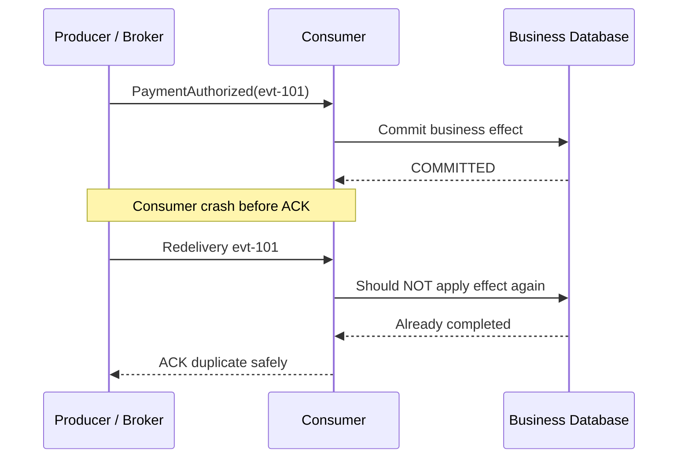
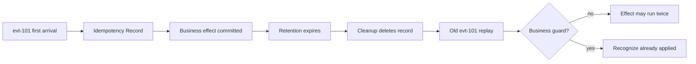
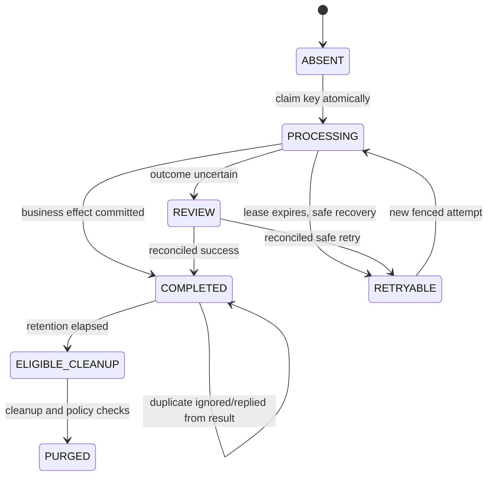
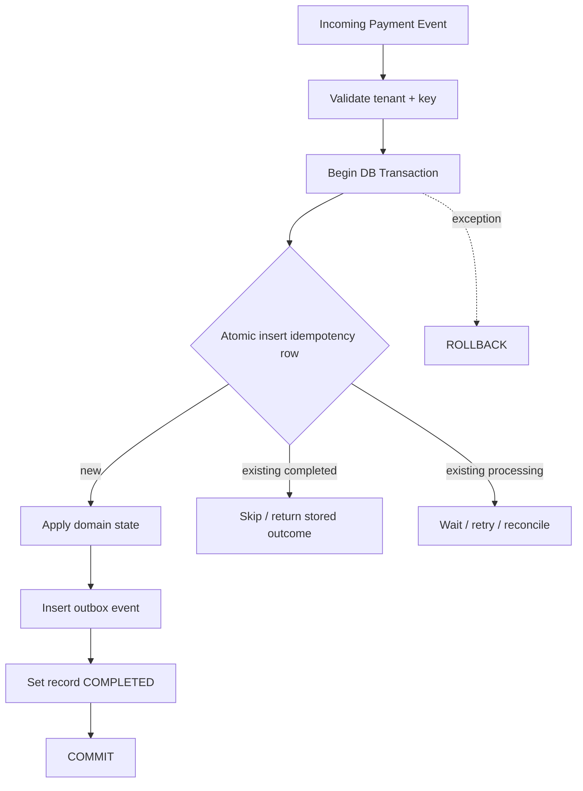
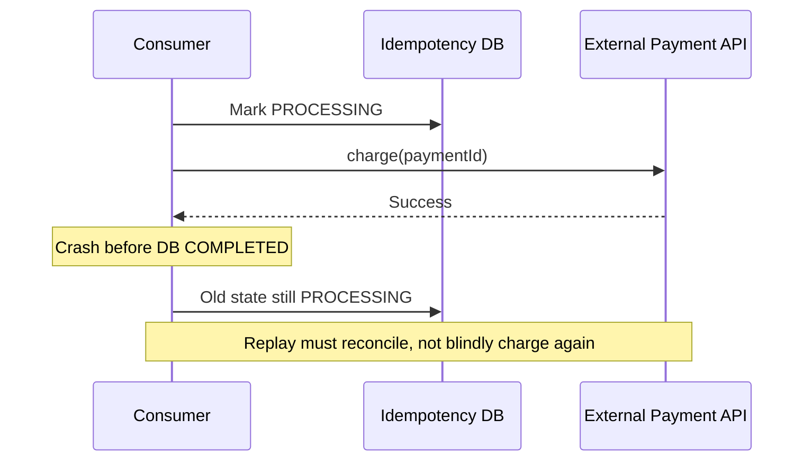
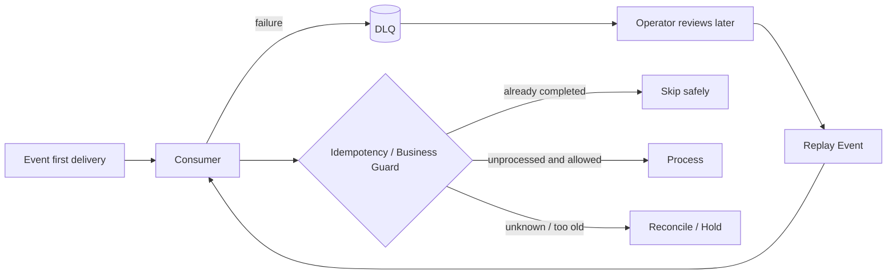
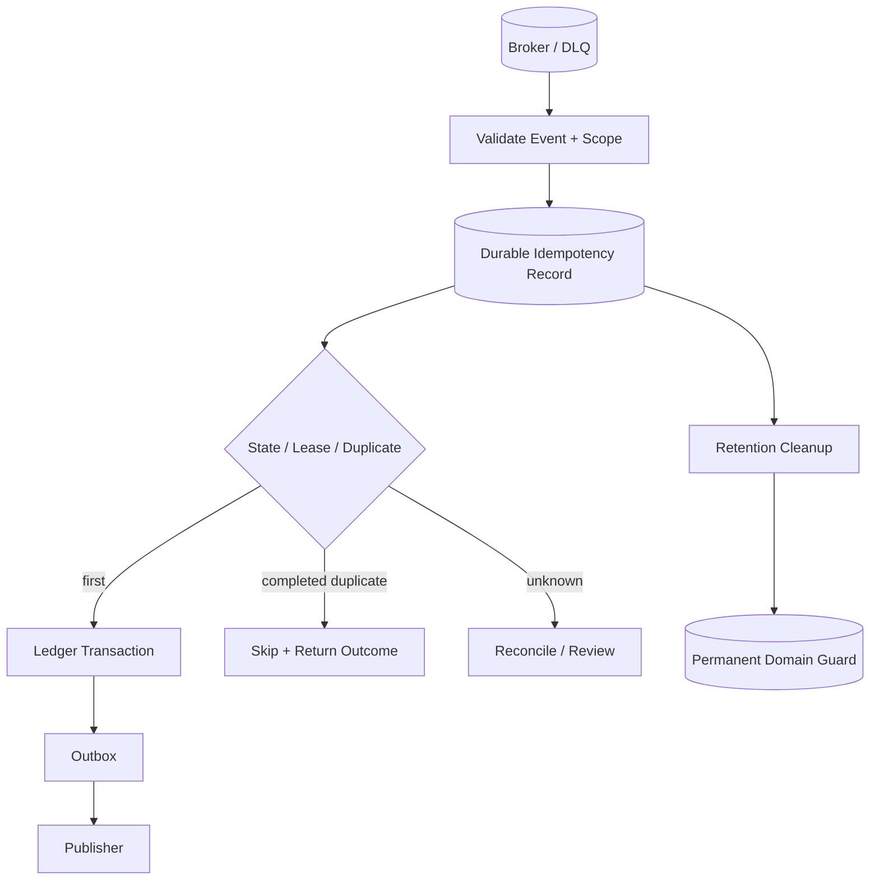

# Retention Period of Idempotency Records

**Idempotent Receiver** is an Enterprise Integration Pattern (EIP) that prevents a consumer from **re-executing a business impact** when the same message or command is delivered multiple times. In a system using brokers, retries, Gateways, Routers, and asynchronous workers, a message arriving more than once is normal: a consumer may finish processing and lose its acknowledgment, a broker may redeliver after a restart, or an operator may replay from a dead-letter queue (DLQ).

To recognize that a delivery has already been processed, an Idempotent Receiver typically stores an **idempotency record** keyed by a stable key, such as `(tenantId, consumerScope, businessEventId)`. Yet **how long** must that record be retained? If deleted too early, an old message arriving after data cleanup will be treated as new. If every record is kept forever, the store may bloat, become costly, and exceed retention requirements.

That is the subject of **“Retention Period of Idempotency Records”**, belonging to the **Idempotent receiver** chapter of the **SPRING_INTEGRATION_PATTERN** module. This module focuses on practicing Enterprise Integration Patterns with Spring Integration to build loosely coupled, extensible message flows; combining Router, Filter, Transformer, Splitter, Aggregator, Gateway, retry, error channel, correlation, testing, and observing processing branches.

This article focuses on **designing the retention window**, distinguishing deduplication retention from processing timeouts, identifying redelivery/replay risks, choosing durable storage models, safely cleaning up records, and testing boundary scenarios right before and after expiration.

**Expected outcomes:** You will be able to explain why a TTL shorter than the replay window is unsafe, choose the right key and scope, define a record state machine, coordinate idempotency with side effects and a transactional outbox, implement an illustrative Spring Integration flow, and verify it with clock-controlled and concurrency tests.

## 1. Why Does a Message Arrive Multiple Times?

Common mechanisms such as **at-least-once delivery** prioritize never losing messages, and therefore may redeliver the same event when certain confirmation has not been received.



Common sources of duplicate deliveries:

- Broker redelivery when an ACK is lost or a session drops.
- Consumer restart after the business transaction commits.
- Retry advice re-running a segment of the flow.
- HTTP client resending the same idempotency key after a timeout.
- Outbox publisher re-emitting an event after losing publish confirmation.
- Operator replaying messages from a DLQ or archive store.
- A Router/Recipient List accidentally sending a message to the same consumer via two paths.
- A callback from an external system resent even though the effect already happened.
- A job re-running after deployment or failover.

**Not every duplicate delivery can be prevented at the transport layer.** Idempotent Receiver is the safeguard at **the point where the effect executes**, especially when transport only guarantees at-least-once.

However, **idempotency does not mean end-to-end exactly-once**. Correctness also depends on the identifying key, transactional recording of the marker and side effect, recovery, and how long the record persists.

## 2. What Does an Idempotency Record Store?

A record does not merely answer “has this key appeared before?”. In many applications, it must also indicate whether an event is currently processing, finished processing, or awaiting reconciliation.

| Field | Role |
| --- | --- |
| `tenantId` | Separates data across tenants |
| `consumerScope` | Identifies the consumer/side-effect type to which dedup applies |
| `idempotencyKey` or digest | Identifies the same command/event per contract |
| `state` | PROCESSING, COMPLETED, FAILED/REVIEW... |
| `firstSeenAt` | Timestamp when first received |
| `completedAt` | Timestamp when the effect completed as defined by the app |
| `retainUntil` | Earliest timestamp eligible for record deletion review |
| `leaseUntil` | Expiration of a worker's ownership over an unfinished execution |
| `attempt` | Controlled execution attempt count |
| `resultReference` | Reference to the outcome to return if the request repeats |
| `policyVersion` | Version of the dedup/retention policy |
| `generationId` | Explicitly distinguishes newly authorized re-executions |

Not every application needs every field, yet **`retainUntil` and `leaseUntil` must never be used interchangeably**.

### The Record and Business State Are Two Distinct Sources of Information

For example, a payment transaction has already written `paymentId` and a unique constraint in the business table. The idempotency record helps detect repeated requests at the receiver, while **domain uniqueness** remains the final guardrail against charging twice.

If the metadata store is purged while the business database still holds the payment record, the consumer should check domain constraints and avoid re-executing the side effect. Never assume a `processed=true` flag in cache is a sufficient guardrail for financial transactions.

## 3. Three Types of Durations to Distinguish

This is the most critical part of the design.

| Concept | Meaning | Question |
| --- | --- | --- |
| **Dedup/retention window** | Duration a record must exist to recognize duplicates | Until when can an old event still legitimately be replayed? |
| **Processing lease/timeout** | Duration a worker is authorized to process a `PROCESSING` record | If a worker dies, when is takeover allowed? |
| **Business/data retention** | Duration business results, receipts, and audits may/must be kept | How long do legal/SLO rules require data to persist? |

Example:

```text
Processing lease:       2 minutes
Dedup retention window: 30 days
Business audit record:  7 years (example only)
```

A worker that dies after 2 minutes may need another worker to take over and continue; **never delete all traces of an already completed event just because a lease expired**.

Conversely, retaining an idempotency record for 30 days does not grant a worker a 30-day execution lock. Leases require fencing/ownership mechanisms, retries, and job states.

### Retention Must Be Based on When a Message Can Arrive Again

The first question is not “how much free memory do we have?”, but:

> In the current design, **what is the latest time a duplicate can arrive at the receiver and still potentially trigger a side effect?**

That duration can originate from brokers, DLQs, manual replays, client retries, callbacks, or asynchronous stages.

## 4. Principles for Choosing a Retention Window

One mental model is taking the **maximum reasonable duplicate window of each source**, then adding a safety margin:

\[
T_{\text{record}} \ge
\max(T_{\text{broker-redelivery}},
     T_{\text{queue-lag}},
     T_{\text{DLQ-replay}},
     T_{\text{client-retry}},
     T_{\text{callback}})
+ T_{\text{safety}}
\]

This is a **design formula**, not a Spring Integration API or default value. All variables must be measured **from the reference point tied to the first occurrence of the event/record**; you cannot add or compare durations with different origin timestamps without converting them.

For example, a system with policies:

| Duplicate Source | Guaranteed Window by Design |
| --- | ---: |
| HTTP client retry | Up to 24 hours |
| Broker redelivery/backlog | Up to 3 days |
| Routine DLQ replay | Up to 14 days |
| Partner callback | Up to 7 days |
| Post-reconciliation safety margin | 2 days |

If all duplicates within those windows must be suppressed, **retention of at least 16 days from the aligned reference timestamp** can be a starting point. However, verify that policy genuinely caps DLQ replays at 14 days. If operators can still replay an event from six months ago, 16 days **cannot** protect against that scenario.

**Do not use the example table as default configuration.** Retention values must be derived from actual retry contracts, queue/broker retention, incident recovery times, operational policies, and real business requirements.

### A Finite Window Cannot Protect Against Infinite Replay

If the organization allows **unbounded historical replays**, no short TTL guarantees absolute deduplication. You will need one of these additional mechanisms:

- **Domain uniqueness** outliving the record TTL.
- A **tombstone/minimal business marker** kept long enough per contract.
- A new **generation/version** for an explicitly authorized reprocess.
- Replay jobs that **check existing outcomes** and do not re-emit old side effects.
- A queryable outcome/audit store paired with a reconciliation procedure.

Retention policy is part of the **reprocessing contract**, not merely a record-deletion setting.

## 5. What Happens When a Record Is Deleted Too Early?

Suppose:

```text
T0: Event evt-101 processed successfully, record kept 24 hours.
T0 + 23h: Duplicate arrives -> recognized, not re-charged.
T0 + 24h: Cleanup deletes record.
T0 + 36h: DLQ replays evt-101 -> record is gone.
```

If the receiver only checks the idempotency store, the replay after 36 hours may be treated as a **new** request.



Key takeaway: **TTL only protects within a defined time window**. If old messages are allowed to exist and run beyond that window, the application must have **longer-lived guardrails** or a policy blocking replays by age/generation.

### Deleting a Record Is Not “Deleting the Event”

Brokers, DLQs, or object storage may still hold copies of the event. Purging a row in `idempotency_record` does not erase every previously emitted copy. Therefore, never assume “since the record expired, the old message can no longer arrive”.

## 6. TTL: Expire-After-Write, Sliding Expiration, and Logical Expiry

Some stores/caches support TTL mechanisms. Yet **how TTL measures time** affects semantics.

### Expire-After-Write

The record expires after a fixed duration from a write or chosen timestamp. This is usually the easiest to align with the **duplicate window from first appearance**.

For example, an event appears on day 1 and needs protection through day 31; duplicates arriving in between **do not automatically extend expiration** unless policy requires it.

### Sliding Expiration

Every read or duplicate receipt extends the expiration. The system might retain a record indefinitely if a source replays continuously. While occasionally useful, **never choose it by default simply because a cache supports it**.

Ask: is extending retention on duplicates the desired business behavior, or could an attacker/bug keep millions of records alive forever?

### Logical Expiry Before Physical Deletion

A record's `retainUntil` has passed, yet the cleanup job has not run. When handling a new request, the application needs a clear policy:

- **Reject/review overly old events** based on event age.
- **Allow reprocessing under a new generation** if explicitly authorized.
- **Continue treating the existing record as a dedup marker** until cleanup runs.
- **Never automatically treat an expired record as “never processed”** if doing so could produce a duplicate side effect.

For sensitive systems, do not let a duplicate bypass domain guards merely because metadata shows `retainUntil < now`. Separate the condition for **eligibility to process** from the condition for **eligibility to purge metadata**.

## 7. From Which Timestamp Is Retention Measured?

Reference timestamps can differ:

| Reference Point | Advantage | Risk If Misused |
| --- | --- | --- |
| Event created time | Tied to source event age | Source clock skew; delayed event arrival |
| First accepted time | Simple, server-controlled | A late-arriving event still starts a fresh TTL |
| Business committed time | Guarantees dedup after side effect | Pre-commit `PROCESSING` must be managed separately |
| Last legitimate replay allowed | Matches operational policy | Requires clear registry and deadline formula |
| Last access time | Serves cache liveness | Easily extended indefinitely by duplicates |

A common strategy is computing `retainUntil` **from a trusted server timestamp** per policy. If the SLA requires 30 days of protection **after the effect commits**, store `completedAt` and measure retention from there, not merely from queue arrival.

If an event was created long before the consumer first reads it, policy must check **event age** prior to execution. Otherwise, an ancient event could be treated as “newly received” and cause an impact no longer permitted by the business.

**Never blindly trust client-supplied timestamps.** Use authenticated clocks/metadata and clock skew tolerances published in the contract.

## 8. Record Lifecycle: PROCESSING Is Not COMPLETED

To avoid confusion, model the states explicitly:



This is an **application-recommended state machine**, not states automatically provided by the framework.

**Key point:** When a worker has only **claimed the key** and not yet executed the side effect, recording `COMPLETED` is premature. If the worker dies, duplicates will be permanently skipped even though the work never finished.

Conversely, once the side effect commits but `COMPLETED` has not been recorded, a duplicate may re-execute the impact. Therefore, **synchronize record state and business work** using transactions, outboxes, or downstream-specific idempotency mechanisms.

### Never Delete PROCESSING Simply Because TTL Elapsed

A `PROCESSING` row may represent a transaction with an uncertain outcome. Purging it without reconciliation can cause another worker to re-run an operation that already executed externally.

When a lease expires, **transfer execution ownership via fencing/transactions and recovery policies**, rather than deleting the record like a regular cache entry.

## 9. Leases and Retention Must Be Managed Independently

A short `leaseUntil` enables recovery when a worker hangs. A long `retainUntil` enables duplicate detection after completion.

```text
Event evt-101:
  t=00:00  PROCESSING lease until 00:02
  t=00:01  business commit + COMPLETED
  t=00:01  retainUntil = t + 30 days

Duplicate at t=00:03:
  -> COMPLETED record exists -> skip/reply existing outcome

A different event stuck PROCESSING beyond 00:02:
  -> reconcile/reacquire with fencing; do not delete blindly
```

If two workers try to take over concurrently, use **atomic compare-and-set** or a transaction/unique constraint. The old worker may wake up after its lease expired; without a **fencing token/attempt generation**, both workers could execute the side effect.

**Do not rely solely on a timestamp column on a row to prevent races.** Protect the side-effect destination with transactions or downstream idempotency keys/expected versions.

## 10. Idempotency Key Design Affects Retention

A record is only useful if the key is constructed properly.

| Key Source | Example | Assessment |
| --- | --- | --- |
| Stable `businessEventId` | `evt-101` | Suitable if the same event ID is never reused |
| `tenantId + eventId + consumerScope` | `tenant-a/payment-ledger/evt-101` | Separates tenants and effect types |
| Spring `MessageHeaders.ID` | New message ID after transform/redelivery | **Not** a reliable business idempotency key across transports |
| New request ID on each retry | `req-200` then `req-201` | Fails to recognize retries of the same command |
| Payload hash | SHA-256 of body | Insufficient if body has unstable timestamps or two valid commands share content |
| `orderId` alone | `ORD-42` | May mistakenly block other valid payments/refunds |
| `eventId + generation` | `evt-101/reprocess-v2` | Useful when reprocessing is explicitly authorized |
| Trace/span ID | Varies by instrumentation | Does not represent a business effect |

**Consumer scoping** matters because the same event may need to be processed **once per subscriber**, not once across the entire system.

For example, a `PaymentCaptured` event must update the ledger **and** send an invoice email. If both handlers share an unscoped key, the ledger processing first could cause the email handler to treat the event as a duplicate and skip it.

### Idempotency Keys Do Not Need to Store Raw PII

If a key contains government IDs, emails, or private data, consider tokenization/digests/HMAC per your threat model with canonicalization rules. However, hashing a predictable input **does not turn the input into a secret**. Avoid exposing sensitive data in logs, metrics, or unprotected tables.

## 11. How Does Spring Integration Support Idempotent Receiver?

Spring Integration provides **`IdempotentReceiverInterceptor`**, typically paired with **`MetadataStoreSelector`** and a `MetadataStore` to mark or check whether a message has been accepted.

Related concepts:

- **MessageSelector:** determines whether a message is considered new/valid per policy.
- **MetadataStore:** stores key/value metadata to recognize previously seen events.
- **`ConcurrentMetadataStore`:** interface supporting compare/put operations with concurrency semantics when the implementation provides them.
- **`SimpleMetadataStore`:** convenient for in-memory testing; not durable across restarts.
- **`JdbcMetadataStore`:** option for database persistence when properly configured.
- **`IdempotentReceiverInterceptor`:** advice applying idempotent receiver semantics to the protected endpoint.

**Important point:** Not every `MetadataStore` has a **default TTL** or automatically deletes records in sync with your replay window. Expiration/cleanup depends on the implementation and store design. A metadata table may keep rows forever without a cleanup job; a local cache may evict records too early under memory pressure.

Check the API, duplicate-handling configuration, and semantics of `IdempotentReceiverInterceptor` for **the exact Spring Integration version your application uses**. If you need explicit `PROCESSING/COMPLETED` workflows, leases, retention, and audits, a **business repository** may fit better than a simple key/value metadata store.

### Avoid a Dangerous Assumption

**“Having `IdempotentReceiverInterceptor` means all side effects execute exactly once.”** False. If the “seen” marker is written before the side effect commits, a crash can cause unfinished work to be skipped. If the marker is written after an external side effect, retries can duplicate the side effect.

Your choice of interceptor placement, transaction boundaries, source ACKs, and recovery logic determines the actual guarantee.

## 12. Designing a Persistent Schema in PostgreSQL

To focus on retention, we can use a dedicated idempotency table instead of relying entirely on caches.

```sql
-- Illustrative PostgreSQL schema, not a default Spring Integration schema.
CREATE TABLE idempotency_record (
    tenant_id        varchar(80)  NOT NULL,
    consumer_scope   varchar(120) NOT NULL,
    dedup_key        varchar(160) NOT NULL,
    state            varchar(24)  NOT NULL,
    first_seen_at    timestamptz  NOT NULL DEFAULT now(),
    completed_at     timestamptz,
    retain_until     timestamptz  NOT NULL,
    lease_until      timestamptz,
    attempt          bigint       NOT NULL DEFAULT 1,
    result_reference varchar(160),
    policy_version   varchar(40)  NOT NULL,
    PRIMARY KEY (tenant_id, consumer_scope, dedup_key),
    CHECK (state IN ('PROCESSING', 'COMPLETED', 'REVIEW')),
    CHECK (retain_until >= first_seen_at)
);

CREATE INDEX idx_idempotency_cleanup
    ON idempotency_record (retain_until)
    WHERE state = 'COMPLETED';
```

**Design explanation:**

- `PRIMARY KEY` enforces uniqueness at the database level, independent of individual JVMs.
- `tenant_id` and `consumer_scope` prevent one subscriber or tenant from “claiming” another's key.
- `dedup_key` can be a canonical event ID or digest, never an arbitrary Spring Message ID.
- `retain_until` determines when a record is **eligible to be considered for cleanup**.
- `lease_until` governs in-progress executions, **not the duplicate-prevention horizon**.
- `state` and `completed_at` distinguish completed work from unfinished work.
- `result_reference` enables returning prior outcomes if the protocol requires consistent replies.
- The partial index supports batch cleanup; benchmark performance with partitioning when the table grows large.

This is solely a **learning schema**: production systems must design specific constraints, transactions, auditing, encryption/PII handling, indexing, partitioning, migrations, and state transitions. If `retain_until` is policy-adjustable, writing it via the database clock and checking it in the same transaction reduces clock skew across application nodes.

## 13. Atomic Insert for First-Time Processing

An unsafe implementation pattern:

```text
if (!repository.exists(key)) {
    callPaymentGateway();
    repository.save(key);
}
```

Two consumers can both read “does not exist” and both execute the side effect.

An **atomic insert-if-absent** command in the database:

```sql
-- PostgreSQL; executed within a controlled transaction.
INSERT INTO idempotency_record (
    tenant_id, consumer_scope, dedup_key,
    state, first_seen_at, retain_until,
    lease_until, attempt, policy_version
)
VALUES (
    :tenant, :scope, :key,
    'PROCESSING', now(), :retain_until,
    :lease_until, 1, :policy_version
)
ON CONFLICT (tenant_id, consumer_scope, dedup_key)
DO NOTHING;
```

The consumer must inspect the **inserted row count**:

- `1 row`: authorized to proceed with the first-execution state machine.
- `0 rows`: key already exists; read current state to decide duplicate/in-progress/review.
- Database error: **do not** treat as key absent and bypass the guard; handle as an infrastructure failure.

**Having a unique constraint does not automatically guarantee the business side effect**. If the insert and the side effect reside on two resources without a shared transaction, a crash between them can still leave the outcome uncertain.

## 14. Recording the Marker and Business Effect in the Same Transaction

When both the record and the business effect reside in **the same database**, a single transaction can:

1. Atomically claim the key.
2. Write the side effect in business tables.
3. Transition the record to `COMPLETED`.
4. Write an outbox event if outbound publishing is needed.
5. Commit everything or roll back everything.



### Java Service Example with Spring Transaction

```java
import java.time.Instant;

record PaymentEvent(
    String tenantId,
    String eventId,
    String paymentId,
    long amountMinor
) {
    PaymentEvent {
        if (tenantId == null || tenantId.isBlank()
                || eventId == null || eventId.isBlank()
                || paymentId == null || paymentId.isBlank()
                || amountMinor <= 0) {
            throw new IllegalArgumentException("Invalid payment event");
        }
    }
}

interface IdempotencyRepository {
    // Atomic INSERT ... ON CONFLICT DO NOTHING in the same DB transaction.
    boolean tryInsertProcessing(
        String tenant, String scope, String eventId,
        Instant retainUntil);

    // UPDATE record in the same transaction, verifying ownership/state.
    void markCompleted(
        String tenant, String scope, String eventId);

    // Read state to distinguish duplicates vs. in-progress/review.
    String findState(
        String tenant, String scope, String eventId);
}

interface PaymentLedger {
    // Business write with unique/domain guard in the same database.
    void applyPayment(PaymentEvent event);
}

interface OutboxRepository {
    // Write event for async publisher to emit after commit.
    void enqueuePaymentApplied(PaymentEvent event);
}
```

```java
import java.time.Clock;
import java.time.Duration;
import java.time.Instant;
import org.springframework.transaction.annotation.Transactional;

class PaymentEventApplicationService {
    private static final String SCOPE = "payment-ledger-v1";
    private static final Duration RETENTION =
        Duration.ofDays(45); // Example only, not a default.

    private final IdempotencyRepository ids;
    private final PaymentLedger ledger;
    private final OutboxRepository outbox;
    private final Clock clock;

    PaymentEventApplicationService(
            IdempotencyRepository ids,
            PaymentLedger ledger,
            OutboxRepository outbox,
            Clock clock) {
        this.ids = ids;
        this.ledger = ledger;
        this.outbox = outbox;
        this.clock = clock;
    }

    @Transactional
    public void process(PaymentEvent event) {
        // Event has already been authenticated from a trusted source.
        Instant retainUntil =
            Instant.now(clock).plus(RETENTION);

        boolean first = ids.tryInsertProcessing(
            event.tenantId(), SCOPE,
            event.eventId(), retainUntil);

        if (!first) {
            String state = ids.findState(
                event.tenantId(), SCOPE, event.eventId());

            if ("COMPLETED".equals(state)) {
                // Duplicate: skip side effect, optionally return old result.
                return;
            }

            // Do not equate PROCESSING/REVIEW with COMPLETED.
            throw new IllegalStateException(
                "Payment event requires retry or reconciliation");
        }

        ledger.applyPayment(event);
        outbox.enqueuePaymentApplied(event);
        ids.markCompleted(
            event.tenantId(), SCOPE, event.eventId());

        // DB transaction commits after the method completes normally.
    }
}
```

**Critical conditions for this example:**

- `ids`, `ledger`, and `outbox` **must share the same database/transaction manager** for the described atomicity.
- `@Transactional` only works when invoked through a **Spring-managed proxy**; it does not take effect with manual `new` instantiation or invalid self-invocation.
- `tryInsertProcessing` and `markCompleted` require real implementations, constraints, and proper isolation.
- `REVIEW`/`PROCESSING` throws into a recovery path; this illustrative snippet omits a waiting coordinator or lease takeover.
- The domain ledger should still enforce a **unique constraint or conditional update** by payment ID/business operation to prevent duplicates beyond the record retention period.
- 45 days here is an **assumed value to explain the code** and must be chosen per your actual replay contract.
- Never place external payment API calls **outside the database** directly inside this transaction assuming both resources roll back together.

### Setting Retention After Completion

In the example, `retainUntil` is computed when receiving the event. If policy requires retaining **45 days after commit time**, the repository must compute/update `retainUntil` at `markCompleted` (or inside the same transaction), not only at ingress.

A minor difference may rarely matter, yet in legal/SLA contracts the exact anchor timestamp must be defined. Never hide the distinction behind a generic `TTL` variable name.

## 15. Spring Integration Flow: Receiver Does Not Repeat Side Effects

The transactional service can be invoked from a simple Spring Integration flow.

```java
import org.springframework.context.annotation.Bean;
import org.springframework.context.annotation.Configuration;
import org.springframework.integration.channel.DirectChannel;
import org.springframework.integration.config.EnableIntegration;
import org.springframework.integration.dsl.IntegrationFlow;
import org.springframework.messaging.MessageChannel;

@Configuration
@EnableIntegration
class IdempotentPaymentFlowConfiguration {

    @Bean
    PaymentEventApplicationService paymentEventApplicationService(
            IdempotencyRepository ids,
            PaymentLedger ledger,
            OutboxRepository outbox) {
        return new PaymentEventApplicationService(
            ids, ledger, outbox, java.time.Clock.systemUTC());
    }

    @Bean("payments.events.in")
    MessageChannel paymentEventsInput() {
        return new DirectChannel();
    }

    @Bean
    IntegrationFlow paymentEventsFlow(
            PaymentEventApplicationService applicationService) {
        return IntegrationFlow.from("payments.events.in")
            .handle(PaymentEvent.class, (event, headers) -> {
                // Delegates to @Transactional Spring-managed service.
                applicationService.process(event);
                return null; // One-way consumer: no reply required.
            })
            .get();
    }
}
```

This flow **implements Idempotent Receiver inside the business service**; it does not use `IdempotentReceiverInterceptor` directly because this scenario requires managing state/retention and side effects within the same transaction.

If you want to use the interceptor and `MetadataStoreSelector` for a problem without complex state workflows, you must:

- Derive the key from a stable business event ID, not just the message ID.
- Choose a store with the required durability and atomicity.
- Specify whether duplicates are discarded, tagged with a marker header, or routed to a dedicated inspection branch per configuration.
- Check when the selector writes metadata relative to when the side effect commits.
- **Define retention/cleanup independently**, rather than assuming the store always has a TTL.
- Test redeliveries before/after record deletion and across node restarts.

**Do not run both mechanisms against the same key without a clear boundary.** An interceptor marking “seen” before a service that expects “new” in the same store could block even the first attempt or create inconsistent state.

## 16. External Side Effects: A Database Transaction Is Not Enough

If a consumer calls an external payment, shipping, or email API, database `@Transactional` **cannot roll back that API call**.



Coordinating mechanisms:

1. **Provider idempotency key:** send a stable key so the external API recognizes duplicate requests, if supported and if its key retention is long enough.
2. **Outcome reconciliation:** on timeout/lost ACK, query transaction status rather than blindly calling again.
3. **Transactional outbox:** record outbound commands in the same transaction as business state; the publisher emits them with stable keys.
4. **Inbox/receiver dedup** at the consumer receiving the command.
5. **Tombstone/domain uniqueness** for actions with long-term consequences.
6. **Fencing/leases** so an old worker cannot cause additional side effects after losing ownership.

**Receiver retention cannot protect against provider-side idempotency expiration.** If the provider only keeps idempotency keys for 24 hours while replays can occur after 7 days, the system needs reconciliation or another business key/constraint before re-invoking.

## 17. Outcome Table and Result Replay for an API Gateway

For request–reply APIs, when a caller resends the same idempotency key, returning an empty `200 OK` is not always right. You may need to return **the same committed result**.

Example contract:

```json
{
  "idempotencyKey": "pay-evt-101",
  "operation": "CAPTURE_PAYMENT",
  "status": "COMPLETED",
  "paymentId": "PAY-101",
  "resultVersion": 1
}
```

When a duplicate arrives:

- If `COMPLETED` and the outcome is still available: return the stored outcome without re-charging.
- If `PROCESSING`: return `PENDING`/retry-after or perform bounded waiting per contract.
- If `REVIEW`: do not report definite failure; direct the caller to status/reconciliation.
- If the key matches but **payload/operation differs**: reject as a key-reuse conflict; never return another command's result.
- If the record was already cleaned up: still check domain uniqueness/event age to avoid re-executing an old transaction.

When using different TTLs for **dedup records** and **cached responses**, define clearly: losing a cached response does not authorize re-executing the side effect. You can retain a **minimal tombstone** until the replay window ends even if the response body was purged earlier per privacy policy.

## 18. TTL Caches and MetadataStore: Not a Replacement for Durable Records

A local cache like `ConcurrentHashMap`, Caffeine, or an in-memory metadata store can reduce duplicate queries hitting the database. However, it loses state on restart and may evict entries early under memory pressure.

| Mechanism | Appropriate Role | Risk |
| --- | --- | --- |
| In-memory set/cache | Fast path, tests, best-effort duplicate reduction | Restart/eviction loses markers |
| TTL distributed cache | Bounded-window dedup when contract permits | Eviction, failover, sync, TTL policy |
| JDBC metadata store | More durable key/value, atomic ops depending on impl | Requires cleanup, transactions, and sizing |
| Domain unique constraint | Long-term blocking of certain duplicate side effects | Does not replace full response/retry semantics |
| Dedicated idempotency table | Explicit states/leases/retention | More complex; needs migrations and ops |
| Business outcome store | Long-term reconciliation/replies on replay | Storage and privacy retention |

A layered model might be:

```text
fast cache (optional)
  -> durable idempotency record
      -> domain uniqueness / outcome store
          -> side effect
```

A **cache hit** can enable a fast skip; a **cache miss must never be assumed to mean “unprocessed”** when a durable store backs it. If the cache fails, the receiver must fall back to the trusted store or fail closed appropriately, never dropping the guard and executing the transaction.

## 19. Safe Cleanup: Purge Completed Records, Not Every Old Row

A cleanup job can run in batches to delete records that are past retention and **eligible per business rules**.

PostgreSQL example:

```sql
-- Illustrative cleanup only after confirming
-- no valid replays or pending reconciliations remain.
WITH doomed AS (
    SELECT tenant_id, consumer_scope, dedup_key
    FROM idempotency_record
    WHERE state = 'COMPLETED'
      AND retain_until <= now()
    ORDER BY retain_until
    LIMIT 1000
    FOR UPDATE SKIP LOCKED
)
DELETE FROM idempotency_record AS r
USING doomed AS d
WHERE r.tenant_id = d.tenant_id
  AND r.consumer_scope = d.consumer_scope
  AND r.dedup_key = d.dedup_key;
```

This SQL is only safe if **retention policies and prerequisites are guaranteed** in the system: no outstanding valid replays, no need to keep records for corrections, and domain guards still block non-repeatable side effects.

**Never delete `PROCESSING`, `REVIEW`, or uncertain-outcome records simply because `firstSeenAt` is old.** They require separate recovery/lease/reconciliation workflows.

### Why Clean Up in Batches?

- Avoids one transaction deleting millions of rows and holding locks for long periods.
- Bounds I/O/redo-log spikes and latency impact.
- Can run periodically with observable backlog counts.
- Pairs well with partitioning/dropping partitions when retention policies are time-based and data allows.
- Can be paused or throttled when the system is under heavy load.

**If multiple instances run cleanup concurrently**, use appropriate locking/claiming or protective SQL to avoid conflicting deletes. Jobs must be idempotent; re-running must never delete ineligible records.

## 20. Clocks, Skew, and Exact Expiration Boundaries

Retention deadlines are usually timestamp-based; in multi-node systems, **clock skew** can occur.

Example:

```text
Node A: 12:00:10
Node B: 11:59:55
DB    : 12:00:00
```

If node A considers a record expired before node B does, behavior can become inconsistent. Use **database time or a unified clock** for conditional store operations, and test boundaries with explicit comparisons:

```text
now < retainUntil  -> not yet eligible for cleanup
now >= retainUntil -> eligible to consider for cleanup, not automatically safe
```

Never put `Thread.sleep(86400000)` in tests to wait a day. Use an injected `Clock` or database test clock/timestamp control in fixtures.

### Cleanup Schedule vs. Actual Expiration

A record with `retainUntil=00:00` and an hourly cleanup job may still exist until `01:00`. That is **physical cleanup lag**, and does not permit duplicates to cause side effects in the meantime.

Never design code assuming “at exactly 00:00 the record vanishes”. Key-checking behavior and cleanup eligibility must be explicit before the job runs.

## 21. Manual Replay, DLQ, and Historical Events

A DLQ workflow often makes record retention much harder to pin down.



Conventions must be established:

- **What is the maximum DLQ retention?**
- Are operators allowed to replay messages **past the default deadline**?
- Is a replay **the same execution** or a **new reprocessing generation**?
- If the event already completed, is the replay meant to fix data or just investigate?
- If the external provider no longer retains the idempotency key, how does the system reconcile?
- Once a record's TTL expires, is there a minimal tombstone or business outcome preventing duplicate side effects?

### Reprocessing Is Not a Duplicate

An **approved reprocess** may need to rerun logic under a new policy, such as rebuilding analytics reports. Never bypass idempotency by arbitrarily modifying event IDs and re-emitting into a payment flow.

Assign a distinct **generation/version and purpose**. Example:

```text
eventId       = evt-101
consumerScope = analytics-v1
generation    = original

approved reprocess:
eventId       = evt-101
consumerScope = analytics-v2
generation    = reprocess-2026-11
```

Changing scope/generation must be **authorized and audited**; clients must never arbitrarily append suffixes to bypass guards. Non-repeatable effects (such as charging money) still need domain uniqueness independent of generation.

## 22. Retention by Event Class, Not One TTL for Every Flow

A system may handle multiple classes of work:

| Flow Type | Characteristics | Retention Approach |
| --- | --- | --- |
| Best-effort telemetry/analytics | Duplicates cause double-counting, though re-aggregatable | Bounded window + idempotent aggregation |
| Sending notifications | May send duplicates; needs UX control | Per event replay/notification policy |
| CRM synchronization | Can use upserts/versioning | Depends on replay sources and state reconciliation |
| Payments/refunds | Sensitive side effects, must not repeat | Long-term domain uniqueness + records/outcomes/reconciliation |
| Access provisioning | Security impact; tracks latest state | Version guards, current authorization, auditing |
| Order fulfillment | Multi-step with slow callbacks | Retention covering full workflow and callback horizon |
| Large batch processing | May span days with many retries | Per-batch/generation records and progress checkpoints |

**TTL policies should vary by `consumerScope` or business type**, rather than hardcoding one global number across the application just for “operational convenience”.

If a new policy **shortens** retention, evaluate existing records and events potentially sitting in DLQs. Never just change `Duration.ofDays(45)` to `Duration.ofDays(7)` and mass-purge on the next deployment.

## 23. Versioning Retention Policies and Configuration Changes

A policy may evolve:

```text
policy v1: keep COMPLETED records 14 days
policy v2: keep COMPLETED records 45 days
```

When rolling out v2 while v1 records still exist, the system must decide:

- Do v1 records keep their already-fixed `retainUntil`?
- Or are they extended under the new policy?
- If the new policy is shorter, is early deletion of old records allowed?
- Must DLQ/replay operations be notified?
- Can multiple instances run both policies during a rolling deployment?

Storing `policyVersion` alongside the record helps explain past decisions, yet **does not perform migration automatically**. Cleanup jobs must understand approved policies and prioritize safety.

### Do Not Shorten Retention by Editing Cache Settings

Once a record is evicted from a cache, changing policy afterward cannot restore duplicate detection. For durable records, `retainUntil` can be extended in a controlled way. For TTL stores that already deleted data, there is no way to “increase the TTL of a missing row”.

That is why retention for critical side effects should be governed as a **data property**, not an ad-hoc performance tuning knob.

## 24. Capacity and Partitioning: Longer Retention Means a Larger Store

Rough estimate:

\[
N_{\text{records}} \approx
\text{events per day}
\times \text{retention days}
\]

For example, a consumer receiving **500,000 events/day** retained for 45 days will hold roughly **22.5 million records** at steady state, before accounting for in-flight records, retries, audits, index overhead, and extra capacity.

Capacity factors:

- Key size, index size, and metadata column count.
- Number of concurrent writers.
- Throughput of atomic inserts and unique indexes.
- Batch/partition cleanup speed.
- Age of `PROCESSING`/`REVIEW` records and backlogs.
- Security, backups, recovery, and data retention policies.
- Outcome lookups when duplicates need prior responses.
- Manual replay frequency and post-incident backlog bursts.

**Never shorten TTL merely to fix a large table** if doing so opens the risk of duplicate side effects. First optimize schemas, indexes, partitioning, purge schedules, minimal tombstones, or storage architecture.

## 25. Observability for Retention and Duplicates

An Idempotent Receiver must measure not only “how many duplicate messages were filtered”, but also **when records risk expiring before the duplicate horizon**.

Suggested metrics:

```text
idempotency_first_seen_total{scope="payment-ledger"}
idempotency_duplicate_total{scope="payment-ledger",state="completed"}
idempotency_in_progress_total{scope="payment-ledger"}
idempotency_reconciliation_total{scope="payment-ledger"}
idempotency_cleanup_deleted_total{scope="payment-ledger"}
idempotency_cleanup_backlog{scope="payment-ledger"}
idempotency_old_replay_total{scope="payment-ledger"}
idempotency_record_age_seconds{scope="payment-ledger"}
idempotency_lease_expired_total{scope="payment-ledger"}
idempotency_store_errors_total{scope="payment-ledger"}
```

These are **metrics an application can instrument itself**, not a list automatically generated by Spring Integration. Never put `eventId`, `paymentId`, or idempotency keys as metric labels due to high cardinality and data-exposure risks.

A minimal audit record:

```json
{
  "event": "idempotent_receiver_duplicate",
  "consumerScope": "payment-ledger-v1",
  "businessEventId": "evt-101",
  "recordState": "COMPLETED",
  "firstSeenAt": "2026-11-01T08:00:00Z",
  "retainUntil": "2026-12-16T08:00:00Z",
  "decision": "SKIP_EFFECT"
}
```

This example illustrates a structured log, not a framework default. For sensitive IDs, apply masking, access control, and dedicated audit-log retention.

### Useful Alerts

- Spikes in duplicates arriving near or **after** the retention horizon.
- Cleanup deleting more records than expected.
- `PROCESSING` records lingering too long with occupied leases and no recovery.
- Rising store error rates while the receiver still executes side effects.
- Multiple different keys for the same business event due to canonicalization or source mismatches.
- Broker lag/DLQ replay age exceeding retention assumptions.
- A domain unique constraint catching a duplicate **after the idempotency record was already purged**.

In particular, that last event is a critical signal that actual retention is shorter than reality or a more durable dedup mechanism is needed.

## 26. Testing Retention with Clock Instead of Waiting in Real Time

Tests must verify **before deadline, at deadline, and after deadline**, along with record states.

### 26.1. Unit Testing Cleanup Eligibility Decisions

```java
import java.time.Clock;
import java.time.Instant;

record IdempotencySnapshot(
    String state,
    Instant retainUntil,
    Instant leaseUntil
) {}

final class CleanupEligibilityPolicy {

    boolean canDelete(
            IdempotencySnapshot record,
            Clock clock) {
        if (record == null || record.retainUntil() == null) {
            return false;
        }

        // Time + state condition only.
        // Production also needs replay policies, outcomes/outboxes,
        // transactions, and other prerequisites.
        return "COMPLETED".equals(record.state())
            && !Instant.now(clock)
                .isBefore(record.retainUntil());
    }
}
```

```java
import static org.junit.jupiter.api.Assertions.*;
import java.time.Clock;
import java.time.Instant;
import java.time.ZoneOffset;
import org.junit.jupiter.api.Test;

class CleanupEligibilityPolicyTest {

    private final CleanupEligibilityPolicy policy =
        new CleanupEligibilityPolicy();

    @Test
    void onlyCompletedRecordsPastDeadlineAreEligible() {
        Instant deadline =
            Instant.parse("2026-12-16T08:00:00Z");

        Clock before = Clock.fixed(
            deadline.minusMillis(1), ZoneOffset.UTC);
        Clock at = Clock.fixed(deadline, ZoneOffset.UTC);
        Clock after = Clock.fixed(
            deadline.plusSeconds(1), ZoneOffset.UTC);

        var completed = new IdempotencySnapshot(
            "COMPLETED", deadline, null);

        var processing = new IdempotencySnapshot(
            "PROCESSING", deadline,
            deadline.minusSeconds(60));

        assertFalse(policy.canDelete(completed, before));
        assertTrue(policy.canDelete(completed, at));
        assertTrue(policy.canDelete(completed, after));
        assertFalse(policy.canDelete(processing, after));
    }
}
```

**Limitation:** `canDelete` only checks state and time. An expired `COMPLETED` record **is not automatically safe to delete** if the business still requires replay protection or auditing. Real cleanup jobs must enforce additional business conditions and synchronize with the database.

### 26.2. Testing Receiving an Old Event After Record Deletion

An important integration test:

1. Send `evt-101`, assert the business side effect happens once.
2. Send a duplicate within retention, assert no new side effect.
3. Make the record eligible for cleanup and run the cleanup job in the test fixture.
4. Resend **the same old event** after the record was deleted.
5. Assert **domain uniqueness or event-age guards still prevent prohibited repeated side effects** if required by contract.
6. If the business intentionally allows reprocessing, assert it requires valid generation/authorization.

**This tests the end-to-end contract**, rather than merely asserting “the idempotency table row is gone”.

## 27. Testing Concurrency and Crash Recovery

### Test Matrix

| Scenario | Outcome to Verify |
| --- | --- |
| Two consumers receive a new key concurrently | One claim succeeds; no two side effects |
| Consumer crashes before transaction commit | Record/effect rolls back or recovers consistently |
| Consumer crashes after business commit before ACK | Redelivery does not execute side effect again |
| Idempotency insert succeeds, handler fails | Transaction rolls back or state recovers; never falsely marked COMPLETED |
| External API succeeds, response lost | Reconciliation/idempotency key prevents blind re-invocation |
| Duplicate within retention window | Skips/replies existing result |
| Duplicate right at `retainUntil` boundary | Behavior matches defined comparator/policy |
| Duplicate after cleanup | Domain guard or authorized reprocess policy applies |
| `PROCESSING` lease expires | Fenced takeover/reconciliation; never deleted arbitrarily |
| Two workers contend on expired lease | One valid owner; old owner cannot commit |
| Store unavailable | Does not execute side effect without required protection |
| Manual DLQ replay past deadline | Held/reconciled or processed under approved generation |
| Same event across two consumer scopes | Each scope executes once independently |
| Same `eventId` across two tenants | No mixing of records/permissions |
| Same key with different payload | Conflict, never silently reuses outcome |
| Cleanup running when duplicate arrives | Transactions/locking do not drop guard |
| Restart with in-memory cache | Durable state still recognizes duplicate |
| Retention policy changes during rolling deploy | Old rows not mistakenly deleted |

### Concurrency Testing Tips

Use a real test database with a unique constraint, a `CountDownLatch` or barrier so both requests start together, then verify **the count of inserted rows** and **the count of business side effects**. Never just launch two threads and check timestamps: the test might accidentally execute sequentially.

For external APIs, use a mock server that records idempotency keys and simulates a timeout **after executing the side effect**. On retry, assert no second effect violating the contract occurs.

### Do Not Try to Prove Exactly-Once with a Single Test

One test without duplicates only proves that fixture behaves as expected. You must test across boundaries: transaction commits, broker ACKs, replays, lease takeovers, outbound publishing, and cleanup.

## 28. Coordinating with Filter, Router, Splitter, and Aggregator

### Filter Before Idempotent Receiver

You can validate schema/tenant in a Filter prior to recording, avoiding reserving keys for invalid messages. However, if a message passes the Filter and executes a side effect, **idempotency must wrap that effect itself**.

If the Filter discards business messages, decide whether to store a **rejection outcome** so duplicates are not treated differently if policies change. Never equate every message dropped by a Filter with a completed execution.

### Router and Recipient List

The same event traverses multiple branches. Each branch typically has its own `consumerScope`:

```text
(tenant-a, ledger-consumer, evt-101)
(tenant-a, invoice-consumer, evt-101)
(tenant-a, notification-consumer, evt-101)
```

Do not use a single global metadata key across all subscribers unless the goal is genuinely one shared side effect.

### Splitter and Aggregator

A Splitter produces N child messages. Each part may need idempotency by `(batchId, itemId)`; the Aggregator needs a correlation key to group **unique results**. If one part is processed twice, it must not count as two independent results causing premature Aggregator release.

**Retention of part-result records** must cover the window during which individual parts can be redelivered; **batch-outcome record** retention may differ because batch callbacks/reconciliations continue after parts complete.

### Transformer

A Transformer may generate a new message ID; the business event ID/idempotency key must stay stable if it still represents the same event. If the Transformer changes the schema or creates a **new business command**, assign a distinct idempotency scope rather than blindly copying the old key.

### Gateway and Error Channel

A request–reply Gateway may time out after the receiver has already committed. Caller retries must return the old outcome or known status per contract. Synchronous errors via `DirectChannel` propagate to the caller; async errors via pollers/executors/adapters follow configured error handlers. **An error channel never replaces an idempotent business guard**.

## 29. Common Mistakes

**“Idempotency records only need to be kept 5 minutes because clients usually retry within 5 minutes.”** DLQs/manual replays, broker backlogs, or delayed callbacks can arrive days later.

**“A 30-day TTL guarantees exactly-once.”** No, an event can be replayed on day 31; races and external side effects also remain.

**“Delete the idempotency record when the lease expires.”** Leases govern execution ownership; retention governs completed-work deduplication; deleting can duplicate effects.

**“Inserting the key means the business logic succeeded.”** On a pre-commit crash, marking completed early loses work.

**“Deleting the row eliminates duplicate risk.”** Messages can still sit in DLQs; old replays or domain uniqueness must still be controlled.

**“Always return success on duplicates.”** If the record is `PROCESSING`/`REVIEW` or has a payload conflict, return the appropriate status.

**“Spring Message ID is enough to deduplicate.”** Message IDs can change across transforms/transports; a stable business key is needed.

**“A local cache with TTL is a reliable dedup store.”** Caches restart/evict, and multiple instances do not share state.

**“All consumers should share one key.”** The same event may need independent side effects across multiple subscribers.

**“Delete everything once retainUntil has passed.”** Only delete when state and business/replay prerequisites are satisfied.

**“Calling external APIs inside `@Transactional` is atomic with the database.”** No; provider idempotency, outboxes, and reconciliation are needed.

**“Extending TTL on every duplicate is always better.”** It can lead to unbounded retention or abuse.

**“Keeping response bodies short-term allows re-executing the command once the body is deleted.”** Response payloads and side-effect guard markers have separate lifecycles.

**“Increasing retention is enough when replay policies change.”** If records were already purged earlier, new config cannot recover them.

## 30. Exercise: Retention Policy for a Payment System's Idempotent Receiver

A system receives `PaymentCaptured` from a broker and updates a ledger. The same event also sends an invoice email via another consumer. Assumed operating conditions:

- HTTP callers can retry for 12 hours.
- The broker can hold a backlog up to 5 days.
- Routine DLQ replays occur within 21 days.
- Operations is allowed to replay historical events older than 21 days **only via an approval workflow**.
- The payment provider retains idempotency keys for 7 days.
- The ledger must never double-record a payment, even after many months.
- Normal processing time is under 30 seconds; workers can die mid-flight.
- API response payloads may be deleted earlier than dedup markers.
- All services run multiple instances.



Answer the following:

1. Why is keeping records for only 12 hours insufficient?
2. Given a 21-day DLQ replay window, what delays/safety margins must be added when computing `retainUntil`?
3. If a manual replay six months later is approved, may it re-charge the customer? Why?
4. Distinguish `leaseUntil` and `retainUntil` for a `PROCESSING` event.
5. Do keys for the ledger consumer and invoice consumer differ?
6. Is `MessageHeaders.ID` suitable as a key for broker redeliveries?
7. Since the payment provider only keeps keys for seven days, how must reconciliation handle replays beyond that limit?
8. Once the record is purged while the ledger still holds the payment ID, what constraint prevents double-recording?
9. If two instances claim the same key concurrently, what atomic mechanism protects it?
10. If the external API succeeds while the DB fails to commit, how do you avoid calling again blindly?
11. May a `REVIEW` record be deleted simply because 21 days have passed?
12. If policy shrinks from 30 days to 7 days, what must be checked before rollout?
13. Which test must send a duplicate after cleanup to expose risks?
14. Which metrics reveal that actual replays are exceeding expectations?
15. If a batch has 100 parts, how do part-result and batch-outcome keys and retention differ?

**Completion criteria:** A retention formula derived from retry/replay sources, long-term domain uniqueness for critical side effects, explicit lease and record lifecycles, stateful recovery/outbox, safe cleanup, and a test matrix at expiration boundaries.

## 31. Checklist Before Deploying a Retention Policy

- [ ] Defined `consumerScope` and stable business idempotency keys.
- [ ] Key includes tenant/generation when required by business rules.
- [ ] Never uses Message ID/trace ID in place of business identity.
- [ ] Inventoried all duplicate sources: client retries, brokers, DLQs, callbacks, manual replays.
- [ ] Retention covers allowed replay windows, measured from the appropriate anchor timestamp.
- [ ] Policy exists for replays arriving **after retention expires**.
- [ ] Domain unique constraints/tombstones protect non-repeatable long-term side effects.
- [ ] Separated `PROCESSING` leases from `COMPLETED` retention.
- [ ] Never marks `COMPLETED` before the business effect finishes per contract.
- [ ] Key insertion is atomic and race-safe across instances.
- [ ] DB side effects and records commit in the same transaction whenever possible.
- [ ] External side effects use appropriate idempotency/reconciliation/outbox mechanisms.
- [ ] Store durability survives restarts/failovers; caches serve only as optional optimization layers.
- [ ] TTL semantics are explicit: expire-after-write, sliding, logical expiry, and physical cleanup.
- [ ] Uses reliable clocks/timestamps and tests exact deadline boundaries.
- [ ] Purges only `COMPLETED` records once business conditions are met; never arbitrarily deletes `REVIEW/PROCESSING`.
- [ ] Cleanup runs in batches with metrics, throttling, and concurrency guards.
- [ ] Retention policy is versioned/migrated when changed.
- [ ] Response cache lifetime is separated from dedup marker lifetime if permitted by contract.
- [ ] Tests cover duplicates before deadline, at deadline, and after cleanup.
- [ ] Tests cover concurrency, crashes before/after commit, redeliveries, and DLQ replays.
- [ ] Observability covers record age, cleanup backlog, duplicate age, and store errors.
- [ ] Verified `IdempotentReceiverInterceptor`/`MetadataStore` APIs against the actual Spring Integration version.

## Key Takeaways

**The retention period of an idempotency record** is how long the system must remember that **an effect has been processed**, not how long a worker may hold a lock. Retention must derive from **actual retry/redelivery/replay/callback windows** plus a safety margin, whereas leases handle recovery for unfinished work.

In Spring Integration, `IdempotentReceiverInterceptor` and `MetadataStore` implementations help realize the pattern, yet **do not automatically pick the right TTL, safely purge records, or make side effects end-to-end exactly-once**. Use properly scoped business keys, store state/retention durably when needed, commit records alongside business writes when sharing a database, coordinate external systems via outbox/reconciliation, and enforce long-term domain uniqueness for actions that must never repeat.

**A record may only be cleaned up once the duplicate-protection window has elapsed *and* deleting it cannot turn an old message into a dangerous new business command.** That is the single most important criterion for keeping an Idempotent Receiver both correct and sustainable in production.
