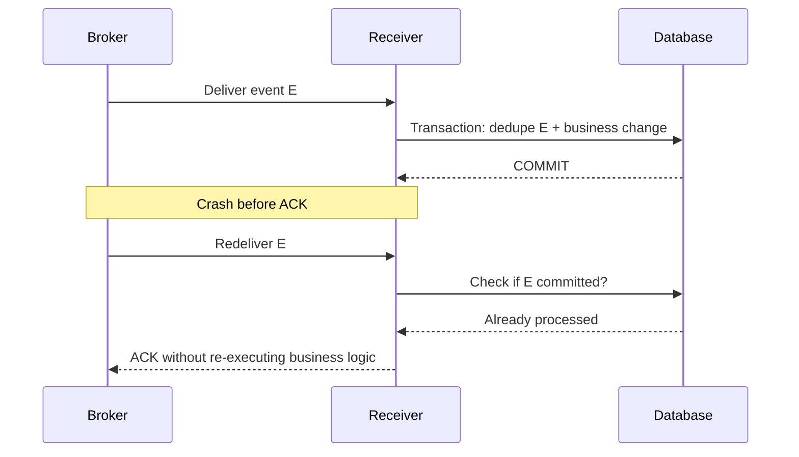
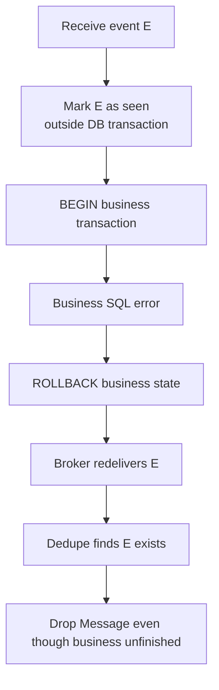
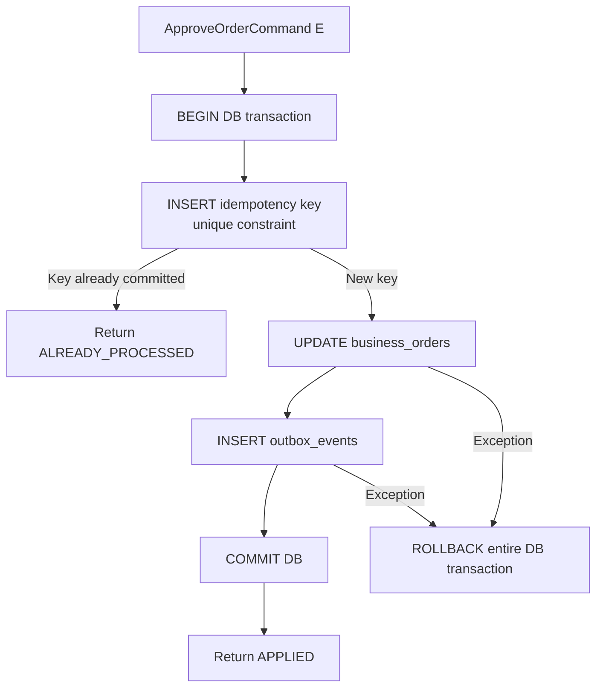
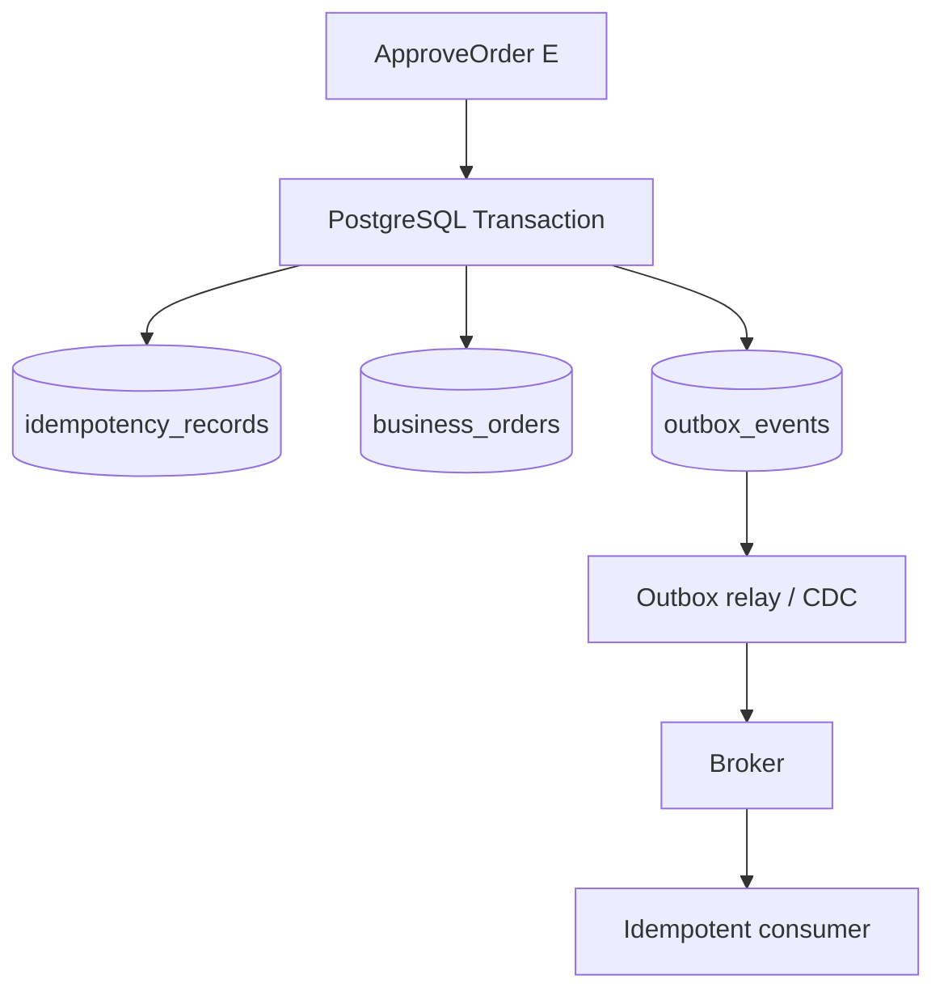
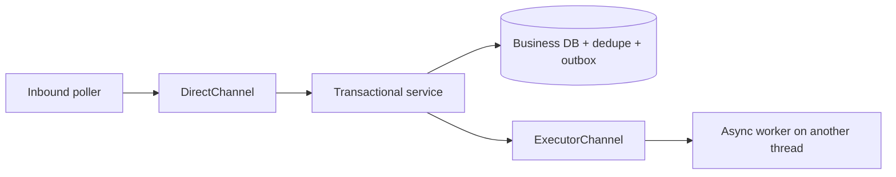
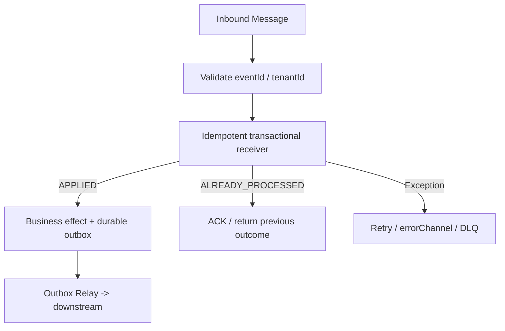

# Idempotency with Transactions

In an integration system, the same Message may arrive multiple times because a consumer loses connection before acknowledging, a broker redelivers after a timeout, a retry step re-executes, or a sender is unsure whether its previous request succeeded. If the Message represents a command to **approve an order**, **record a payment**, or **reserve inventory**, executing the side effect twice can cause severe consequences.

**Idempotent Receiver** is an Enterprise Integration Patterns (EIP) pattern that helps a receiver recognize work already processed and ensure that receiving an equivalent request again produces no unintended extra business impact. However, a duplicate Message filter alone is not enough: if the receiver records a “processed” marker and then the business transaction rolls back, a subsequent redelivery could be wrongly blocked and the work **would never complete**.

The article **Idempotency with Transactions** belongs to the **Idempotent receiver** chapter of the `SPRING_INTEGRATION_PATTERN` module. The module aims at implementing Router, Filter, Transformer, Splitter, Aggregator, Gateway, retry, error channel, and correlation with Spring Integration, while testing and observing branches to build loosely coupled, extensible flows. This article focuses on **placing the idempotency key, business update, and outcome recording inside an appropriate transaction boundary**, thereby handling rollbacks, redeliveries, concurrency, and outbound emission properly.

## 1. The Problem: Delayed ACK and the Same Command Delivered Twice

Suppose the system receives a command:

```json
{
  "tenantId": "tenant-7",
  "orderId": "ORD-1001",
  "eventId": "evt-approve-1001",
  "operation": "APPROVE_ORDER"
}
```

The consumer approves the order and updates the database. Sequence:

```text
t1  Broker delivers event evt-approve-1001
t2  Receiver approves ORD-1001, COMMIT succeeds
t3  Receiver crashes before ACKing the broker
t4  Broker redelivers event evt-approve-1001
```

The second delivery **is not a new approval request**. The receiver must recognize it as a redelivery of the same *logical operation* and avoid repeating the business mutation or sending an approval notification a second time.



**The goal is not necessarily to receive the Message only once.** In an at-least-once system, a Message can be delivered multiple times; what must be guaranteed is that **the same work does not produce duplicate business side effects**.

## 2. Distinguishing At-Least-Once, Idempotency, and Exactly-Once

| Concept | Meaning | What Must Not Be Inferred |
| --- | --- | --- |
| **At-least-once delivery** | Message may be redelivered if no ACK | Each Message is processed only once |
| **At-most-once delivery** | May not redeliver | No Messages are lost on crash |
| **Idempotent operation** | Repeating the same command yields business effects equivalent to running once | Every branch, HTTP call, and broker output is atomic |
| **Deduplication** | Detecting a previously seen work key | That work's business logic committed successfully |
| **Database transaction** | Changes sharing the transaction commit/roll back atomically | Covers Kafka ACK or emails outside the DB |
| **Exactly-once effect within DB scope** | One business key produces one committed state transition when designed properly | The entire distributed system is exactly-once |

A receiver can be **at-least-once at the input** while **idempotent at the database**. This is a common design and usually far more practical than demanding a distributed transaction spanning every system.

### 2.1. Idempotency Applies to a Meaningful Operation

For example, `SET order.status = APPROVED` might leave a similar final state when rerun, yet accompanying operations such as:

```text
INSERT audit event
SEND email
DECREMENT inventory
PUBLISH OrderApproved event
```

can still happen twice. **Idempotency must cover side effects and outbound contracts**, not merely the primary update statement.

## 3. Choosing an Idempotency Key: One Exact Logical Operation

An effective key typically includes:

```text
idempotencyKey = tenantId + ":" + eventId + ":" + handlerId

tenantId  = tenant-7
eventId   = evt-approve-1001
handlerId = APPROVE_ORDER
```

| Component | Why Is It Needed? |
| --- | --- |
| `tenantId` | Isolates tenant data and permissions |
| `eventId` or `commandId` | Stable across retries/redeliveries of the same command |
| `handlerId` / operation type | Avoids conflating distinct tasks triggered by the same event |
| `business aggregate ID` | Used to check payload and business state consistency |
| `payload version/hash` (when needed) | Detects reuse of the same key with different content |

**Do not choose `MessageHeaders.ID` as the sole cross-system key** when producers may construct a new Message on retry. Framework-generated Message IDs can change, whereas the business `eventId` must remain constant.

### 3.1. Do Not Use `orderId` Alone for Every Operation

The same order can go through:

```text
CREATE_ORDER
APPROVE_ORDER
SHIP_ORDER
CANCEL_ORDER
```

If marked solely by `orderId`, `SHIP_ORDER` could be mistaken for a duplicate of `APPROVE_ORDER`. The key must account for **operation type** or the appropriate business lifecycle.

### 3.2. Do Not Reuse Keys for Different Payloads

If a client sends:

```text
eventId=E1, orderId=ORD-1001
eventId=E1, orderId=ORD-9999
```

never silently drop the second command as a normal duplicate. Return an **idempotency key reuse conflict** error or equivalent state, because the same key carries a different business intent.

## 4. Why Does Out-of-Transaction Deduplication Easily Lose Work?

Consider a flawed design:

```text
1. Save key E in metadata store: PROCESSING
2. Begin database transaction
3. Update order
4. SQL error -> ROLLBACK
5. Broker redelivers E
6. Metadata store still has E -> DROP
```



This is a **poisoned idempotency key**: the marker claims “processed” when in reality no business commit occurred.

A similar issue arises when using RAM or caches to remember keys: they do not share a transaction boundary with the business DB, can vanish on restart, or persist erroneously after a rollback.

### Goal Principle

If both the “completed” key and business state live in the same database, strive to guarantee:

\[
\text{Commit}(\text{dedupe record}) \iff
\text{Commit}(\text{business change})
\]

With a single DB transaction, **both commit together or roll back together**. If output must be emitted to a broker, you also need an **outbox** record in the same transaction so the publish intent is never lost.

## 5. Three States to Distinguish: Unprocessed, In Progress, and Committed

| Logical State | Meaning | When a Duplicate Arrives |
| --- | --- | --- |
| **NOT_SEEN** | No valid work record exists yet | Can accept for processing |
| **IN_PROGRESS** | A transaction/worker is currently processing | Wait, retry, or coordinate contention; never assume success |
| **COMPLETED** | Business side effect committed per contract | Do not reprocess; return old outcome or ACK |
| **FAILED_RETRYABLE** | Work failed but can be retried | Allow retry per policy |
| **FAILED_FINAL** | Cannot or must not be retried | Error/DLQ/audit per contract |

Not every application needs a table with a `status` column for all these states. In the transactional pattern using an **uncommitted unique insert**, a contender may have to wait for the first transaction to commit/roll back; after commit, the existence of the dedupe record serves as proof that the co-transactional business change committed.

**Never equate “key currently held by another transaction” with “key completed”.** If the first transaction rolls back, another consumer must still have the opportunity to process the work.

## 6. Proper DB Transaction Boundary: Dedupe + State + Outbox

With a PostgreSQL database, the design can comprise:



Three tables involved:

1. `idempotency_records`: a unique key for the logical operation.
2. `business_orders`: business state.
3. `outbox_events`: intent to emit an event once the transaction commits.

All must participate in **the same transaction manager, same database/resource, and same thread scope** to be atomic under this model.

### 6.1. Desired Invariants

- Each `(tenantId, eventId, handlerId)` has at most **one committed record**.
- If the business change fails, the idempotency record **must not commit**.
- If the outbox insert fails, both the business change and idempotency record roll back together.
- Once a record commits and the same key arrives again, the receiver **does not execute the side effect a second time**.
- If the key is reused for a different order, the receiver **reports a conflict** rather than pretending it is a valid duplicate.

In the steps below, we use PostgreSQL's `INSERT ... ON CONFLICT DO NOTHING` and primary keys for atomic contention handling. This is **PostgreSQL** syntax and must not be copied verbatim to every RDBMS.

## 7. SQL Schema: Unique Constraints as the Final Guardrail

```sql
-- PostgreSQL example. Run via controlled migrations.
CREATE TABLE business_orders (
    tenant_id       VARCHAR(80)  NOT NULL,
    order_id        VARCHAR(120) NOT NULL,
    status          VARCHAR(24)  NOT NULL,
    PRIMARY KEY (tenant_id, order_id)
);

CREATE TABLE idempotency_records (
    tenant_id       VARCHAR(80)  NOT NULL,
    event_id        VARCHAR(120) NOT NULL,
    handler_id      VARCHAR(80)  NOT NULL,
    order_id        VARCHAR(120) NOT NULL,
    processed_at    TIMESTAMPTZ  NOT NULL DEFAULT CURRENT_TIMESTAMP,
    PRIMARY KEY (tenant_id, event_id, handler_id)
);

CREATE TABLE outbox_events (
    tenant_id       VARCHAR(80)  NOT NULL,
    event_id        VARCHAR(120) NOT NULL,
    event_type      VARCHAR(80)  NOT NULL,
    order_id        VARCHAR(120) NOT NULL,
    created_at      TIMESTAMPTZ  NOT NULL DEFAULT CURRENT_TIMESTAMP,
    published_at    TIMESTAMPTZ,
    PRIMARY KEY (tenant_id, event_id, event_type)
);
```

The schema intentionally separates:

- **Command key**: `(tenant_id, event_id, handler_id)`.
- **Order key**: `(tenant_id, order_id)`.
- **Outbox event key**: `(tenant_id, event_id, event_type)`.

If multiple distinct handlers can emit the same `event_type` from the same `event_id`, include handler/operation in the outbox key to avoid collisions. In this example only the `APPROVE_ORDER` handler emits `ORDER_APPROVED`.

### 7.1. Why Is SELECT Then INSERT Insufficient?

A race-prone pattern:

```text
Thread A: SELECT key E -> absent
Thread B: SELECT key E -> absent
Thread A: execute business logic
Thread B: execute business logic
Thread A: INSERT E
Thread B: INSERT E -> duplicate key
```

Even though Thread B fails on the final step, it may have already called HTTP or executed an **unrollbackable** side effect beforehand. Therefore, **claim the key via an atomic operation/unique constraint before the side effect** within the same transaction, and only then execute business logic.

### 7.2. Unique Constraints Do Not Replace Business Validation

A new key can still carry an invalid command. The receiver must validate tenant, order ID, order state, permissions, and state-transition preconditions. The unique constraint only solves **uniqueness of the logical operation**, not whether the transaction should be accepted.

## 8. Java 17+: Idempotent Processing Inside a Single TransactionTemplate

The example below uses `JdbcTemplate`, `PlatformTransactionManager`, and `TransactionTemplate`. Explicit transaction handling makes it crystal clear that **dedupe insert, order update, and outbox insert share one transaction**.

```java
package example.integration;

import java.util.Objects;

import org.springframework.jdbc.core.JdbcTemplate;
import org.springframework.transaction.PlatformTransactionManager;
import org.springframework.transaction.support.TransactionTemplate;

public final class TransactionalApproveOrderService {

    public record ApproveOrderCommand(
            String tenantId,
            String orderId,
            String eventId) {
        public ApproveOrderCommand {
            require(tenantId, "tenantId");
            require(orderId, "orderId");
            require(eventId, "eventId");
        }

        private static void require(String value, String field) {
            if (value == null || value.isBlank()) {
                throw new IllegalArgumentException(field + " is required");
            }
        }
    }

    public enum HandleOutcome {
        APPLIED, ALREADY_PROCESSED
    }

    private static final String HANDLER_ID = "APPROVE_ORDER";
    private final JdbcTemplate jdbc;
    private final TransactionTemplate transaction;

    public TransactionalApproveOrderService(
            JdbcTemplate jdbc,
            PlatformTransactionManager transactionManager) {
        this.jdbc = Objects.requireNonNull(jdbc);
        this.transaction = new TransactionTemplate(
                Objects.requireNonNull(transactionManager));
    }

    public HandleOutcome handle(ApproveOrderCommand command) {
        Objects.requireNonNull(command, "command");

        return transaction.execute(status -> {
            int inserted = jdbc.update(
                    """
                    INSERT INTO idempotency_records
                        (tenant_id, event_id, handler_id, order_id)
                    VALUES (?, ?, ?, ?)
                    ON CONFLICT DO NOTHING
                    """,
                    command.tenantId(),
                    command.eventId(),
                    HANDLER_ID,
                    command.orderId());

            if (inserted == 0) {
                // Key exists: verify this is truly the same operation.
                String previousOrderId = jdbc.queryForObject(
                        """
                        SELECT order_id
                        FROM idempotency_records
                        WHERE tenant_id = ?
                          AND event_id = ?
                          AND handler_id = ?
                        """,
                        String.class,
                        command.tenantId(),
                        command.eventId(),
                        HANDLER_ID);

                if (!command.orderId().equals(previousOrderId)) {
                    throw new IllegalArgumentException(
                            "Idempotency key reused for another order");
                }
                return HandleOutcome.ALREADY_PROCESSED;
            }

            int updated = jdbc.update(
                    """
                    UPDATE business_orders
                    SET status = 'APPROVED'
                    WHERE tenant_id = ?
                      AND order_id = ?
                      AND status = 'PENDING'
                    """,
                    command.tenantId(),
                    command.orderId());

            if (updated != 1) {
                // Exception rolls back the new idempotency INSERT as well.
                throw new IllegalStateException(
                        "Order not found or not PENDING");
            }

            jdbc.update(
                    """
                    INSERT INTO outbox_events
                        (tenant_id, event_id, event_type, order_id)
                    VALUES (?, ?, 'ORDER_APPROVED', ?)
                    """,
                    command.tenantId(),
                    command.eventId(),
                    command.orderId());

            return HandleOutcome.APPLIED;
        });
    }
}
```

### 8.1. What Does Each Step Protect?

1. `INSERT ... ON CONFLICT DO NOTHING` reserves the key under the **PostgreSQL unique constraint**.
2. If the result is `0`, the transaction verifies the previous key points to the same `orderId`; it does not run the business update or write the outbox a second time.
3. If the key is new, `UPDATE` requires the order to be in `PENDING` state. Failing to match exactly one row → throws an exception.
4. Inserts an `outbox_events` row in the **same transaction** as the prior two changes.
5. When the `TransactionTemplate` callback finishes normally, the transaction manager commits; when an unchecked exception escapes, the transaction rolls back by default.

With PostgreSQL and the Section 7 primary key, two transactions concurrently executing `INSERT` for the same key are arbitrated by the database via the unique constraint. The second transaction may have to **wait** for the first to commit or roll back. If the first rolls back, the second gets to insert and process; if the first commits, the second sees a conflict and returns `ALREADY_PROCESSED`.

**Limitation:** the logic here only handles `APPROVE_ORDER`; a genuinely new event ID for an already-`APPROVED` order will fail the status condition and roll back. That is a **business rule**, not an idempotency bug; supporting other states requires explicit business definitions.

### 8.2. Why Not Catch SQL Errors and Return ALREADY_PROCESSED?

If `UPDATE` deadlocks, the database drops the connection, or the outbox insert fails, that is **not** proof the work finished. Let the transaction roll back and apply bounded retries at the caller or message adapter.

Only the `inserted == 0` branch with valid key-match verification returns `ALREADY_PROCESSED` in this example.

### 8.3. Why Returning from the Callback Still Requires Distinguishing Commit

`TransactionTemplate.execute(...)` manages the commit before `handle()` returns a successful result to the caller. In contrast, when using an outer transaction with propagation joining an existing transaction, a method call may return **before the outermost commit**. Therefore, in real systems, identify where transactions start and end; never log `COMMITTED` merely because a helper method returned.

## 9. Wiring the Transactional Service into Spring Integration

Spring Integration orchestrates Messages; the business service decides **which key is applied inside the transaction**. A `Service Activator` or Java DSL `.handle(...)` can invoke the service just built.

```java
package example.integration;

import javax.sql.DataSource;

import org.springframework.context.annotation.Bean;
import org.springframework.context.annotation.Configuration;
import org.springframework.integration.channel.DirectChannel;
import org.springframework.integration.channel.QueueChannel;
import org.springframework.integration.config.EnableIntegration;
import org.springframework.integration.dsl.IntegrationFlow;
import org.springframework.jdbc.core.JdbcTemplate;
import org.springframework.jdbc.datasource.DataSourceTransactionManager;
import org.springframework.messaging.MessageChannel;
import org.springframework.messaging.PollableChannel;
import org.springframework.transaction.PlatformTransactionManager;

import example.integration.TransactionalApproveOrderService.ApproveOrderCommand;

@Configuration
@EnableIntegration
public class IdempotentOrderFlowConfiguration {

    // Declare this manager only if the app does not already have a suitable one.
    // The same DataSource must be used by business JDBC and outbox.
    @Bean
    public PlatformTransactionManager transactionManager(
            DataSource dataSource) {
        return new DataSourceTransactionManager(dataSource);
    }

    @Bean
    public TransactionalApproveOrderService orderService(
            JdbcTemplate jdbcTemplate,
            PlatformTransactionManager transactionManager) {
        return new TransactionalApproveOrderService(
                jdbcTemplate, transactionManager);
    }

    @Bean
    public MessageChannel approveOrderInput() {
        return new DirectChannel();
    }

    @Bean
    public PollableChannel orderHandlingResults() {
        return new QueueChannel(20);
    }

    @Bean
    public IntegrationFlow approveOrderFlow(
            TransactionalApproveOrderService service) {
        return IntegrationFlow.from("approveOrderInput")
                .handle(ApproveOrderCommand.class,
                        (command, headers) -> service.handle(command))
                .channel("orderHandlingResults")
                .get();
    }
}
```

The example assumes the application already has `DataSource`, `JdbcTemplate`, and the Section 7 schema (Spring Boot can auto-configure those beans). Do not register two competing transaction managers if the project already has one; use the manager **bound to the exact same DataSource** and verify Spring Integration configuration against your dependency version.

### 9.1. One Message In, One Processing Outcome

```text
ApproveOrderCommand(E)
    ↓
IntegrationFlow
    ↓
TransactionalApproveOrderService.handle(E)
    ↓
APPLIED or ALREADY_PROCESSED
```

A valid duplicate can be **ACKed** and return `ALREADY_PROCESSED` without executing side effects. This is an explicit choice when the caller needs to know the Message was skipped because it was already processed. In some flows, Idempotent Receiver can **drop** duplicates or set a header and route to another branch; the choice must match the Gateway/consumer contract.

### 9.2. `QueueChannel(20)` Does Not Provide Durability

`orderHandlingResults` is merely an in-memory queue for demonstration. A `HandleOutcome.APPLIED` result on that queue **is not a durable business event record**. Emitting business events to a broker relies on the **committed outbox row**, not this queue, to reason about publication reliability.

## 10. Failure Window Matrix: What Happens Before and After COMMIT?

| Crash/Error Point | Dedupe Record | Business State | Outbox Record | When Broker Redelivers |
| --- | --- | --- | --- | --- |
| Before transaction | Absent | Unchanged | Absent | Can process as new |
| After INSERT, before COMMIT | Rolls back if tx aborts | Rolls back | Rolls back | Retry can claim key |
| After business UPDATE, outbox INSERT fails | Rolls back | Rolls back | Not committed | Retry reprocesses |
| COMMIT finished, input not yet ACKed | Committed | Committed | Committed | Valid duplicate, skips side effect |
| COMMIT finished, output broker not yet received | Committed | Committed | Committed | Outbox relay emits later |
| Outbox sent successfully, not yet marked published | Committed | Committed | Possibly unmarked | Relay may send duplicate |
| ACK input before COMMIT then crash | Possibly uncommitted | Possibly uncommitted | Possibly uncommitted | Risk of **lost work** |

These rows assume **all three tables share the same PostgreSQL transaction**. They do not assert that ack sequences across Kafka, AMQP, HTTP, or JDBC adapters are identical.

```mermaid
sequenceDiagram
    participant B as Input Broker
    participant S as Integration Service
    participant D as PostgreSQL
    participant O as Outbox Relay
    S->>B: Receive E
    B-->>S: Deliver E
    S->>D: BEGIN, insert E, update order, insert outbox
    D-->>S: COMMIT
    Note over S,B: Crash or lost ACK
    B-->>S: Redeliver E
    S->>D: INSERT same key ON CONFLICT
    D-->>S: 0 rows; previously committed E
    S-->>B: ACK duplicate
    O->>D: Read pending outbox
    O-->>B: Publish OrderApproved(E)
```

**A committed business key proves that transaction's DB changes committed**, because the same transaction protects both the marker and the business update. It does not prove a remote consumer received the event; that belongs to the outbox and downstream receivers.

## 11. Rollback Must Allow Genuine Retries

An important test: Message E arrives, marker E is provisionally inserted, yet business validation fails.

```text
BEGIN
  INSERT idempotency_records(E)  // uncommitted
  UPDATE business_orders        // 0 rows
  THROW
ROLLBACK

After rollback: idempotency_records(E) does not exist.
```

Once the business condition is fixed or source data syncs, the same E can be retried and processed.

### 11.1. Not Every Error Should Be Retried

| Error Category | Example | Handling Direction |
| --- | --- | --- |
| Transient infrastructure error | Connection timeout, deadlock | Bounded retry with backoff |
| Recoverable business error | Order not created yet when event arrived early | Retry or send to delay queue per policy |
| Permanent business error | Wrong tenant, invalid command | Reject/DLQ, do not retry endlessly |
| Already committed duplicate | Same event/operation arrives again | Do not execute side effect again |
| Key reuse with different payload | Duplicate event ID, different order | Report conflict; do not treat as valid duplicate |

**Rollback frees up the ability to retry**, yet does not by itself know whether an error is retryable. Retry policies and dead-lettering are separate parts of the flow.

### 11.2. Advice and Transaction Interceptor Ordering

When combining Spring Integration retry advice, transaction advice, and idempotent interceptor on the same endpoint, **the nesting order of advices** affects when markers are written and rolled back.

Design flaw example:

```text
idempotent advice writes key to store A
    -> business DB B transaction starts
        -> business exception / rollback B
    -> advice A does not roll back
```

Never see both `@Transactional` and `IdempotentReceiverInterceptor` and assume the interceptor's marker rolls back automatically. Verify **which transaction/resource each uses and in what order they are invoked**.

## 12. Two Concurrent Messages with the Same Key: Atomic Check-and-Claim Needed

A cache check like:

```java
if (!seenIds.contains(eventId)) {
    seenIds.add(eventId);
    applyBusinessChange();
}
```

is unsafe when two threads run concurrently. Both can see `contains=false` and both execute the business logic.

With a PostgreSQL unique constraint:

```text
Thread A: INSERT key E → succeeds, uncommitted
Thread B: INSERT key E → waits for transaction A's outcome

If A COMMITs:
    B receives conflict → skips business logic

If A ROLLBACKs:
    B can INSERT successfully → runs business logic
```

This prevents duplicate DB side effects in a single database, yet also requires:

- Appropriate **lock wait/statement timeouts** to avoid hanging too long.
- Handling deadlocks/serialization failures with safe retries.
- Keeping business state and markers in the same transaction.
- Never calling external services before winning processing rights for the key.
- Defining keys by tenant, operation, and canonicalized event ID.

### 12.1. “Select Then Update” Does Not Replace Unique Insert

`SELECT ... FOR UPDATE` on an **already existing** row can help, yet when the key does not exist yet, there is no row to lock simply. An `INSERT` under a unique constraint, an atomic upsert, or a properly scoped lock resolves **the race when creating a new key**.

### 12.2. Multiple Instances Still Need a Shared Layer Mechanism

A `synchronized` method or `ConcurrentHashMap` only protects one JVM; two independent replicas can still process the same event. A unique constraint in a shared database provides a coordination boundary visible to both instances.

## 13. `IdempotentReceiverInterceptor` and `MetadataStore` in Spring Integration

Spring Integration includes components supporting the Idempotent Receiver pattern, such as **`IdempotentReceiverInterceptor`** and **`MetadataStoreSelector`** backed by a suitable `MetadataStore`.

Idea:

```text
Message E
  ↓
Idempotent receiver advice / selector
  ↓
Compute key from eventId + handlerId
  ↓
MetadataStore checks/records key
  ↓
Proceed, skip, or handle duplicate per configuration
```

A `ConcurrentMetadataStore` supporting atomic operations such as `putIfAbsent` is safer than an unsynchronized check-then-put map when multiple threads receive Messages concurrently. You can use RAM-backed or persistent store implementations matching your requirements.

**However, the atomicity of `putIfAbsent` does not mean atomicity with the business transaction.** If the key is written to a separate store, or written and committed outside the business update's scope, a rollback failure can leave a stale marker behind.

### 13.1. Choosing Between Interceptor and DB Transaction Pattern

| Approach | Advantages | What Must Be Checked |
| --- | --- | --- |
| `IdempotentReceiverInterceptor` + metadata store | Integrates with Message endpoints, uses key strategy/advice | Key write timing, duplicate handling, resource rollback, advice order |
| Unique key inside business DB transaction | Clearly atomic with business state in same DB | RDBMS/schema, concurrent inserts, transaction manager |
| Out-of-DB Redis/metadata CAS | Fast, shared across instances | Marker and business commit are not atomic without compensating protocol |
| Idempotent domain service | Controls business rules and outputs | Must be invoked along every processing path |
| Outbox + idempotent receiver | Reduces lost outputs and duplicate side effects | Relay can still resend; consumer must deduplicate |

If using the interceptor to **flag duplicates in a header**, downstream must decide whether to drop, report conflict, or return the old result. If using the interceptor to **drop Messages**, a request–reply Gateway needs a policy so it does not wait for a reply that will never arrive.

Exact constructors, DSL advice syntax, and duplicate policies depend on the Spring Integration version; **verify API/advice ordering and write real rollback tests** instead of copying configuration incompatible with your project version.

## 14. Outbox: Business Commit and Outbound Intent in the Same Transaction

After approving an order, the system must emit `OrderApproved`. If sending to the broker directly inside the handler:

```text
BEGIN DB
UPDATE order
SEND broker event
COMMIT DB
```

the broker event may reach consumers even if the DB rolls back. Reversing the order:

```text
COMMIT DB
SEND broker event
```

risks crashing between the two steps and losing the event. **A local database transaction does not cover an independent broker**.

The common solution is **Transactional Outbox**:



In the Section 8 example, `outbox_events` is inserted **before the DB commits**. If the transaction rolls back, no event is persisted for the relay to emit. If it commits before the relay runs, the row remains safely persisted to be emitted later.

### 14.1. The Relay Can Still Emit Duplicates

```text
Relay sends E to broker successfully.
Relay crashes before updating published_at.
Relay restarts and sends E again.
```

Therefore, consumers receiving `OrderApproved` also need idempotency keyed by a **stable event ID**. The outbox primarily protects **durability of publish intent**, rather than magically providing exactly-once effects across all transports.

### 14.2. Do Not Lose Events When Only Input Duplicates Arrive

Re-receiving event `E` returns `ALREADY_PROCESSED` without inserting a new outbox row. If `E`'s outbox row is still pending, the independent relay will still emit the original event. The receiver does not need to emit the event a second time merely because the input was redelivered.

### 14.3. Outbox Keys Must Be Consistent

For a logical approval, the outbox uses `(tenantId, eventId, eventType)`. When changing event schemas or emitting multiple events per command, extend the key/sequence accordingly; never treat an event ID as globally unique in every context unless the producer guarantees it.

## 15. HTTP, Email, Payments, and Other Side Effects Outside the DB

If a handler calls a payment service **before committing the marker**, be careful:

```text
BEGIN local DB transaction
  CALL paymentProvider.charge() → money deducted
  INSERT idempotency_records
  SQL exception
ROLLBACK local DB
```

The deduction at the provider does not roll back with the local DB. On retry, the customer could be charged twice.

For side effects outside the DB:

1. Use an **external API-supported idempotency key** if available.
2. Persist a durable command/outbox/job intent inside a DB transaction.
3. Have a worker dispatch the command with a **stable key** and bounded retries.
4. Track outcomes/lifecycles in a status table or inbox.
5. Implement reconciliation/compensation if one side succeeds while the other fails to record it.

You cannot claim exactly-once from `@Transactional` alone when critical operations live outside the DB or in an independent system.

### 15.1. “Set State” vs. “Increment/Decrement” Side Effects Differ

```text
SET order.status = APPROVED
```

can be naturally idempotent regarding final state, whereas:

```text
UPDATE stock SET reserved = reserved + 1
```

is not idempotent. A command key or unique reservation ID is needed to ensure redeliveries do not increment again.

## 16. Transaction Context: Threads, Proxies, and Self-Invocation

In Spring, transactions are typically bound to the executing thread. Consider a flow:



Never assume the service's transaction propagates automatically across an `ExecutorChannel` to a worker on another thread. If that worker updates state, it needs its own transaction with matching guarantees.

### 16.1. `@Transactional` Only Works When Truly Applied

When using `@Transactional` instead of `TransactionTemplate`, remember:

- The bean must be Spring-managed and transaction management enabled.
- Calls must go through the appropriate proxy/interceptor; **self-invocation** can bypass the transaction proxy.
- Choose the `PlatformTransactionManager` matching the DataSource.
- Runtime exceptions trigger rollback by default; checked exceptions may require `rollbackFor` depending on configuration.
- If a method joins a caller's transaction, the method returning does not guarantee the outer transaction committed.
- Across executors/brokers, define a new transaction boundary.

`TransactionTemplate` in Section 8 illustrates scope more directly, yet still cannot control remote HTTP/brokers as DB transaction resources.

## 17. JUnit 5 + PostgreSQL: Testing Commit, Duplicate, and Rollback

To verify `INSERT ... ON CONFLICT DO NOTHING` with real transactions, use **PostgreSQL Testcontainers** (or an equivalent PostgreSQL instance) rather than inferring PostgreSQL semantics from mocks or H2.

The test example below creates tables with SQL matching Section 7. It requires JUnit 5, Spring JDBC/Transaction, PostgreSQL JDBC driver, and Testcontainers PostgreSQL in test dependencies.

```java
package example.integration;

import static org.junit.jupiter.api.Assertions.*;

import org.junit.jupiter.api.AfterAll;
import org.junit.jupiter.api.BeforeAll;
import org.junit.jupiter.api.BeforeEach;
import org.junit.jupiter.api.Test;
import org.junit.jupiter.api.TestInstance;
import org.springframework.jdbc.core.JdbcTemplate;
import org.springframework.jdbc.datasource.DataSourceTransactionManager;
import org.springframework.jdbc.datasource.DriverManagerDataSource;
import org.testcontainers.containers.PostgreSQLContainer;

import example.integration.TransactionalApproveOrderService.*;

@TestInstance(TestInstance.Lifecycle.PER_CLASS)
class TransactionalApproveOrderServiceTest {

    private final PostgreSQLContainer<?> postgres =
            new PostgreSQLContainer<>("postgres:16-alpine");

    private JdbcTemplate jdbc;
    private TransactionalApproveOrderService service;

    @BeforeAll
    void setUpDatabase() {
        postgres.start();
        var dataSource = new DriverManagerDataSource();
        dataSource.setDriverClassName("org.postgresql.Driver");
        dataSource.setUrl(postgres.getJdbcUrl());
        dataSource.setUsername(postgres.getUsername());
        dataSource.setPassword(postgres.getPassword());

        jdbc = new JdbcTemplate(dataSource);
        service = new TransactionalApproveOrderService(
                jdbc, new DataSourceTransactionManager(dataSource));

        jdbc.execute("""
                CREATE TABLE business_orders (
                    tenant_id VARCHAR(80) NOT NULL,
                    order_id VARCHAR(120) NOT NULL,
                    status VARCHAR(24) NOT NULL,
                    PRIMARY KEY (tenant_id, order_id)
                )
                """);
        jdbc.execute("""
                CREATE TABLE idempotency_records (
                    tenant_id VARCHAR(80) NOT NULL,
                    event_id VARCHAR(120) NOT NULL,
                    handler_id VARCHAR(80) NOT NULL,
                    order_id VARCHAR(120) NOT NULL,
                    processed_at TIMESTAMPTZ NOT NULL DEFAULT CURRENT_TIMESTAMP,
                    PRIMARY KEY (tenant_id, event_id, handler_id)
                )
                """);
        jdbc.execute("""
                CREATE TABLE outbox_events (
                    tenant_id VARCHAR(80) NOT NULL,
                    event_id VARCHAR(120) NOT NULL,
                    event_type VARCHAR(80) NOT NULL,
                    order_id VARCHAR(120) NOT NULL,
                    created_at TIMESTAMPTZ NOT NULL DEFAULT CURRENT_TIMESTAMP,
                    published_at TIMESTAMPTZ,
                    PRIMARY KEY (tenant_id, event_id, event_type)
                )
                """);
    }

    @AfterAll
    void stopDatabase() {
        postgres.stop();
    }

    @BeforeEach
    void clearRows() {
        jdbc.execute("""
                TRUNCATE outbox_events,
                         idempotency_records,
                         business_orders
                """);
    }

    private void pendingOrder(String orderId) {
        jdbc.update("""
                INSERT INTO business_orders
                    (tenant_id, order_id, status)
                VALUES ('tenant-7', ?, 'PENDING')
                """, orderId);
    }

    private int count(String table) {
        // Table is a constant called only by tests, never user-supplied.
        return jdbc.queryForObject(
                "SELECT COUNT(*) FROM " + table, Integer.class);
    }

    @Test
    void firstDeliveryAppliesAndRedeliveryDoesNotRepeatEffects() {
        pendingOrder("ORD-1001");
        var command = new ApproveOrderCommand(
                "tenant-7", "ORD-1001", "evt-1001");

        assertEquals(HandleOutcome.APPLIED, service.handle(command));
        assertEquals(
                HandleOutcome.ALREADY_PROCESSED,
                service.handle(command));

        assertEquals(1, count("idempotency_records"));
        assertEquals(1, count("outbox_events"));
        assertEquals("APPROVED", jdbc.queryForObject(
                """
                SELECT status FROM business_orders
                WHERE tenant_id = 'tenant-7'
                  AND order_id = 'ORD-1001'
                """, String.class));
    }

    @Test
    void rollbackRemovesMarkerSoSameEventCanBeRetried() {
        // Order does not exist yet; UPDATE inside transaction will fail.
        var command = new ApproveOrderCommand(
                "tenant-7", "ORD-MISSING", "evt-missing");

        assertThrows(
                IllegalStateException.class,
                () -> service.handle(command));
        assertEquals(0, count("idempotency_records"));
        assertEquals(0, count("outbox_events"));

        pendingOrder("ORD-MISSING");
        assertEquals(HandleOutcome.APPLIED, service.handle(command));
        assertEquals(1, count("idempotency_records"));
        assertEquals(1, count("outbox_events"));
    }

    @Test
    void sameKeyWithDifferentOrderIsRejectedAsConflict() {
        pendingOrder("ORD-1001");
        pendingOrder("ORD-2002");
        service.handle(new ApproveOrderCommand(
                "tenant-7", "ORD-1001", "evt-shared"));

        assertThrows(IllegalArgumentException.class, () ->
                service.handle(new ApproveOrderCommand(
                        "tenant-7", "ORD-2002", "evt-shared")));

        assertEquals("PENDING", jdbc.queryForObject(
                """
                SELECT status FROM business_orders
                WHERE tenant_id = 'tenant-7'
                  AND order_id = 'ORD-2002'
                """, String.class));
        assertEquals(1, count("outbox_events"));
    }
}
```

**These tests are examples to implement and run in the project's testing step; Docker, Gradle, or JUnit were not executed while authoring this article.** The key point is that tests use **real PostgreSQL** for unique constraints and `ON CONFLICT`, not just mocked `JdbcTemplate`.

### 17.1. What Does the First Test Prove?

The same `eventId` enters twice, yet only **one dedupe record, one outbox event, and one business state transition** occur.

### 17.2. What Does the Second Test Prove?

When the business UPDATE fails, the transaction rolls back marker `E`; once the input preconditions can succeed, the next attempt **is not wrongly blocked by a stale marker**.

### 17.3. What Does the Third Test Prove?

An already-processed key must not serve as a “free pass skipping validation” for a different payload. The receiver rejects reusing the key with a mismatched `orderId`.

## 18. Concurrency and Failure Injection Testing

Sequential tests are not enough to prove two concurrent Messages with the same key are safe.

### 18.1. Two Threads Sending the Same Command Simultaneously

With the database/test service set up in Section 17, you can add a test:

```java
// Method placed in TransactionalApproveOrderServiceTest
@Test
void concurrentDuplicateDeliveryOnlyAppliesOnce() throws Exception {
    pendingOrder("ORD-CONCURRENT");
    var cmd = new ApproveOrderCommand(
            "tenant-7", "ORD-CONCURRENT", "evt-concurrent");

    var gate = new java.util.concurrent.CountDownLatch(1);
    var pool = java.util.concurrent.Executors.newFixedThreadPool(2);
    try {
        java.util.concurrent.Callable<HandleOutcome> task = () -> {
            gate.await();
            return service.handle(cmd);
        };

        var f1 = pool.submit(task);
        var f2 = pool.submit(task);
        gate.countDown();

        var first = f1.get(30, java.util.concurrent.TimeUnit.SECONDS);
        var second = f2.get(30, java.util.concurrent.TimeUnit.SECONDS);

        assertEquals(
                java.util.Set.of(
                        HandleOutcome.APPLIED,
                        HandleOutcome.ALREADY_PROCESSED),
                java.util.Set.of(first, second));
        assertEquals(1, count("idempotency_records"));
        assertEquals(1, count("outbox_events"));
    } finally {
        pool.shutdownNow();
    }
}
```

The test uses a barrier so both tasks start near each other, though it **does not guarantee all thread schedules overlap identically**. To thoroughly test failure windows, use a barrier/hook test right after the uncommitted INSERT to force the second transaction to contend on the same key.

### 18.2. Additional Failure-Injection Tests Needed

| Test | Where to Inject Failure? | What Must Be Proven |
| --- | --- | --- |
| Rollback after dedupe INSERT | Throw exception before business UPDATE | Marker does not commit |
| Rollback after business UPDATE | Throw exception before outbox INSERT | Marker and business state roll back together |
| Commit finished, ACK lost | Redeliver same event | No second side effect created |
| Two consumers with same key | Run concurrently | One APPLIED, the other duplicate |
| Deadlock or DB timeout | When claiming/writing key | Safe retry, never false success |
| Outbox relay crashes after publish | Before marking published | Target consumer deduplicates event |
| Same key, different order | Change payload | Conflict, never silently dropped |
| Two tenants, same event ID | Different `tenantId` | No data mixing |
| TTL deletes marker, then old event arrives | After retention window | Suitable long-term duplicate guard |
| `ExecutorChannel` splits transaction | After thread handoff | Actual transaction boundaries verified |

**No single JUnit test proves system-wide exactly-once.** Real transactions, transport redeliveries, outboxes, and downstream consumers must be tested at each boundary.

## 19. Filter, Router, Gateway, and Retries Around Idempotent Receiver

A flow can combine multiple EIPs:



### 19.1. Filter Before the Receiver

A Filter can drop Messages missing required keys or violating schema before touching the database. However, if the Filter drops Messages **without an error/reject response**, a request–reply Gateway may wait for a reply that never arrives. Define an explicit rejection policy.

### 19.2. Router by Operation Type

A Router may pick `APPROVE_ORDER`, `CANCEL_ORDER`, or `SHIP_ORDER`. Dedupe keys must distinguish operation types so an event in one handler never wrongly blocks another handler.

### 19.3. Retries Can Live at the Poller, Endpoint, or Client Layer

If an adapter redelivers or retry advice re-runs the whole handler, a rolled-back transaction allows claiming the key again; a committed transaction enters the duplicate branch. However, each retry layer has its own deadline/backoff and can amplify calls.

Never retry permanent validation errors forever; nor should you “swallow” all exceptions to ACK before a business commit.

### 19.4. Gateways Need Replies for Duplicates

If the consumer requires request–reply, a duplicate may need to **return the committed outcome** rather than being dropped and timing out the caller. The example currently returns enum `ALREADY_PROCESSED`; a real API may need to look up the business result or persist a response snapshot per idempotency key.

### 19.5. Splitter/Aggregator and Per-Element Idempotency

When a Splitter creates multiple child Messages, deduplication may need keys like `(batchAttemptId, lineId, operationType)`. If all children share the parent's key without differentiating elements, the second child may be mistaken for a duplicate of the first.

Similarly, an Aggregator needs a correlation key to group messages, whereas an Idempotent Receiver needs a key to detect **the same repeated logical input**. These two keys may be related yet **are not identical**.

## 20. TTL, Retention, and When Dedupe Records May Be Deleted

You cannot keep every idempotency record forever under high volume. However, purging too early makes redelivered old Messages look new.

```text
t0: event E committed, dedupe record exists
t1: cleanup deletes key E after 1 hour
t2: broker redelivers E after 2 hours
t3: E may be processed as a new event
```

Retention must be based on:

- How long the broker can retain/redeliver.
- Producer's retry budget and maximum backoff window.
- How long the workflow/outbox can still run.
- Reconciliation/audit needs and legal requirements.
- Rules for handling expired historical events.

### 20.1. Separating Business State from Short-Term Deduplication

A storage-optimization approach:

1. Short/medium-term dedupe records for routine retries.
2. Domain state with unique identifiers and state-transition preconditions.
3. A completion/outbox history matching long-term recovery requirements.
4. Rejection/archival rules for overly old events.

When deleting dedupe records, **never automatically lose protection against duplicate side effects** if an old event can still pose danger.

### 20.2. Cleanup Must Avoid Deleting Markers Used by Active Transactions

Do not clean up solely via `created_at < now()-TTL` without knowing whether the row committed, whether the workflow is still active, or whether redelivery is still possible. A cleanup job needs clear retention policies and coordination, with metrics for row counts and ages.

## 21. Multi-Tenancy, Security, and Key Consistency

A key without a tenant namespace can cause:

```text
tenant-A / eventId=E1
tenant-B / eventId=E1
```

to be treated as the same task, especially when tenants' producers use independent event counters. The Section 7 table includes `tenant_id` in the primary key to prevent such confusion.

In addition, you need:

- Authenticate the tenant from a trusted security context, not solely from a client-supplied header.
- Validate authorization to operate on `orderId` before accepting business changes.
- Never put raw personal data into idempotency keys or metric labels.
- When storing payload hashes/fingerprints, choose proper canonicalization and algorithms.
- Control read/delete permissions on dedupe records since deleting a key can re-enable duplicate effects later.
- Audit whenever a key is reused with a different payload.

**Idempotency does not replace authentication/authorization.** Someone replaying another user's key must not be treated as authorized to view their business outcome.

## 22. Observability: Distinguishing Valid Duplicates from Transaction Errors

Receiver logs should explain what happened without dumping excessive sensitive data.

Example application-designed structured log:

```json
{
  "stage": "idempotent-order-receiver",
  "tenantId": "tenant-7",
  "eventId": "evt-approve-1001",
  "operation": "APPROVE_ORDER",
  "orderId": "ORD-1001",
  "outcome": "ALREADY_PROCESSED",
  "businessMutationApplied": false,
  "databaseCommitConfirmed": true
}
```

The value `databaseCommitConfirmed=true` here is only valid if the application **verified** the marker belongs to a committed transaction; never log `COMMITTED` while a method is still inside an uncommitted transaction.

| Suggested Metric | Meaning |
| --- | --- |
| `idempotency.received.count` | Total Messages received |
| `idempotency.applied.count` | Newly committed commands |
| `idempotency.duplicate.count` | Already committed valid duplicates |
| `idempotency.key_conflict.count` | Same key, different payload/operation |
| `idempotency.transaction.rollback.count` | Transaction rollbacks |
| `idempotency.insert.conflict.count` | Attempts hitting unique conflict |
| `idempotency.lock.wait` | Wait latency on same key |
| `idempotency.retry.count` | Retry counts |
| `outbox.pending.count` | Unpublished events |
| `outbox.publish.retry.count` | Relay retry attempts |
| `idempotency.record.age` | Age of retained markers |

These names are **instrumentation suggestions**, not default meters guaranteed to exist in Micrometer or Spring Integration. Never use `eventId` or `orderId` as high-cardinality metric tags; keep them in logs/traces per security policy.

### 22.1. When Duplicate Rates Spike

Investigate:

1. Is the broker redelivering due to slow ACKs?
2. Are consumers crashing after commits?
3. Are producers retrying too early without keeping the same event ID?
4. Is an event being published multiple times from the outbox?
5. Could multiple replicas be receiving the same logical command?
6. Are old events arriving past the retention window?

Rising duplicates **are not always a receiver bug**; they can signal transport, ACK, retry, or publisher issues.

## 23. Common Implementation Mistakes

| Symptom | Root Cause | Fix |
| --- | --- | --- |
| Event fails once and retries are always dropped | Marker committed outside business transaction | Same transaction or suitable state machine/recovery |
| Two consumers execute command simultaneously | Non-atomic check-then-insert | Unique key/atomic claim before business work |
| DB committed, broker event lost | Direct publish after DB commit, crash in between | Transactional outbox |
| Outbox sends twice | Relay crashed before marking published | Idempotent downstream consumer |
| `@Transactional` present yet SQL doesn't roll back | Wrong manager, self-invocation, async boundary | Check proxy/thread/resource and test rollback |
| Catching every SQL error and reporting DUPLICATE | Confusing DB outage with key conflict | Identify duplicates strictly via atomic/constraint results |
| Dedupe wrongly blocks other operations | Key uses `orderId` only | Add event ID + operation/handler ID |
| Same-key different-payload duplicates skipped | Missing fingerprint/order ID check | Return key-reuse conflict |
| Restart loses dedupe markers | RAM-only store | Appropriate persistent store |
| Short TTL lets old events rerun | Dedupe record purged too early | Retention/archival + domain idempotency |
| Two tenants with same event ID collide | Key missing `tenantId` | Namespace by tenant |
| Gateway hangs forever on duplicates | Filter/advice drops Message without replying | Return old result/explicit duplicate status |
| One child Message blocks sibling children | Shared batch key across all children | Key by batch + child/operation |
| External HTTP retries duplicate side effects | Local DB transaction does not roll back HTTP | Provider idempotency key, outbox/saga |
| Side effect committed then logged “failed” | Logging before confirming commit/output | Instrument at real commit/outbox/ACK boundaries |

## 24. Checklist for Designing Idempotency with Transactions

- **Define the logical operation:** which event/command constitutes one unit of work?
- **Choose a stable idempotency key:** tenant, event ID, handler/operation; keep unchanged across retries.
- **Do not use framework-generated Message IDs as primary keys** if producers may reconstruct Messages.
- **Add unique constraints/atomic inserts:** eliminate check-then-act races.
- **Use the same transaction for marker + business update:** failures must roll back both.
- **Persist outbox in the same transaction when durable event emission is needed.**
- **Distinguish committed duplicates from in-flight executions:** never report success before commit.
- **Verify same key carries same meaning:** if order/payload differs, return conflict.
- **Never swallow infrastructure errors:** bounded retries, dead-lettering when appropriate.
- **Only ACK per durability contract:** never ACK before work is safely accepted/committed.
- **Design consumer idempotency outside the DB:** HTTP/payment providers and subscribers need their own keys.
- **Control advice order, proxies, and async boundaries** when using Spring Integration/Spring Transaction.
- **Separate group correlation from idempotency keys** in Splitter/Aggregator.
- **Set realistic retention:** never delete markers before major redelivery possibilities end.
- **Test rollbacks and concurrency with a real DB:** not just mocked repositories.
- **Monitor duplicates, rollbacks, lock waits, outbox backlogs, and key-reuse conflicts.**

## 25. Exercise: Same Event, Three Crash Points

A service receives `ReserveInventory(eventId=E42, sku=BOOK-01, quantity=3)`. Upon receipt, the service must deduct stock, write an idempotency record, and emit `InventoryReserved` to a shipping service.

Analyze three scenarios:

```text
A. Dedupe marker was written to an external store outside the DB,
   then the stock-deduction transaction rolls back.

B. DB transaction containing marker + stock deduction + outbox COMMITs;
   consumer crashes before ACKing input broker.

C. Outbox relay sends InventoryReserved successfully;
   relay crashes before marking the outbox row sent.
```

Questions:

1. In A, what can happen when the broker redelivers E42?
2. In B, how must the receiver respond and may it deduct stock again?
3. In C, can the broker receive the event another time?
4. Which key should `ReserveInventory` use if an order has multiple lines with the same SKU?
5. If two replicas receive E42 concurrently, what mechanism stops both from deducting stock?

Suggested answers: A can create a **poisoned key** causing lost work; B must recognize the committed duplicate and **avoid repeating the side effect**; C can emit duplicate events, so downstream consumers also need idempotency. The key should bind to a **stable event/operation/line identity**, not SKU alone. A unique constraint and shared DB transaction arbitrate contention for the same key, while brokers and outboxes require their own guarantees.

---

**Idempotency with transactions is more than remembering that a Message once appeared.** For a reliable receiver, the dedupe record and business change must commit/roll back within the exact same scope; outbound messages must be durably persisted whenever crashes between database and broker are possible; and every redelivery must be reconciled against a stable logical operation. Combining **atomic uniqueness, transaction boundaries, outboxes, retry policies, and failure-window testing** enables Spring Integration to handle duplicate Messages without losing work or producing duplicate side effects.
