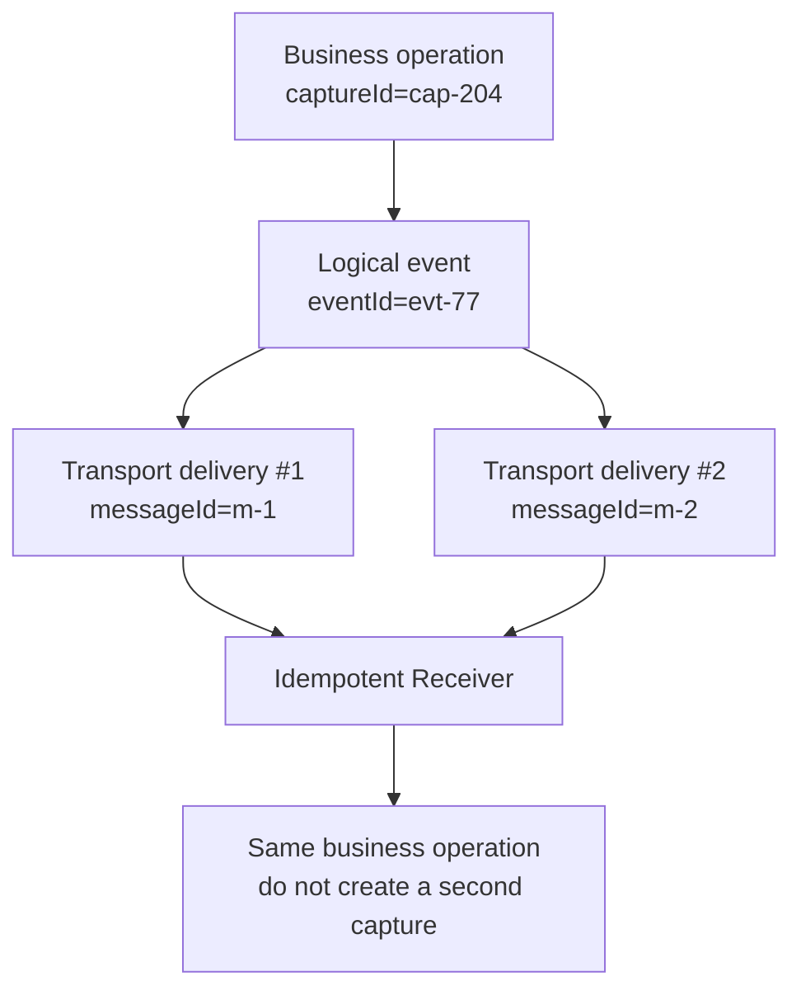
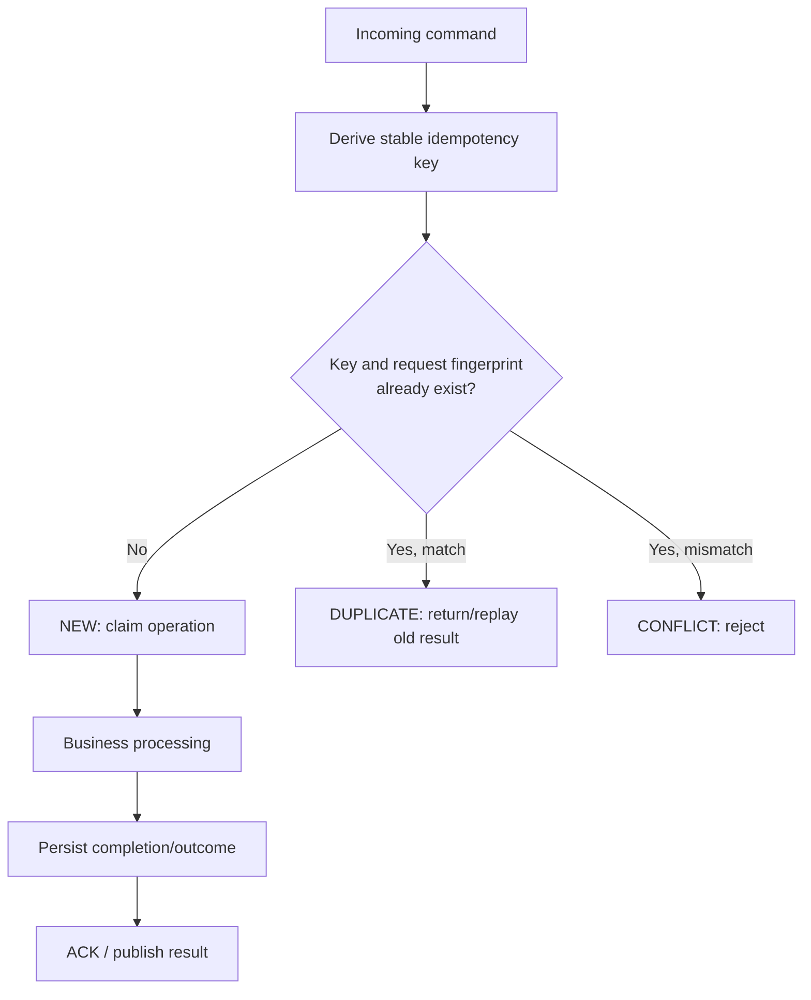
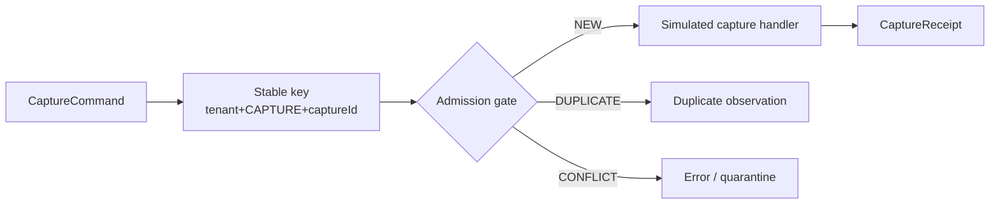
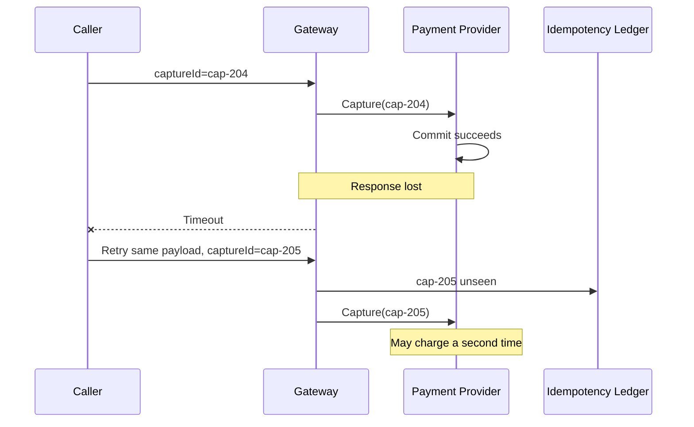
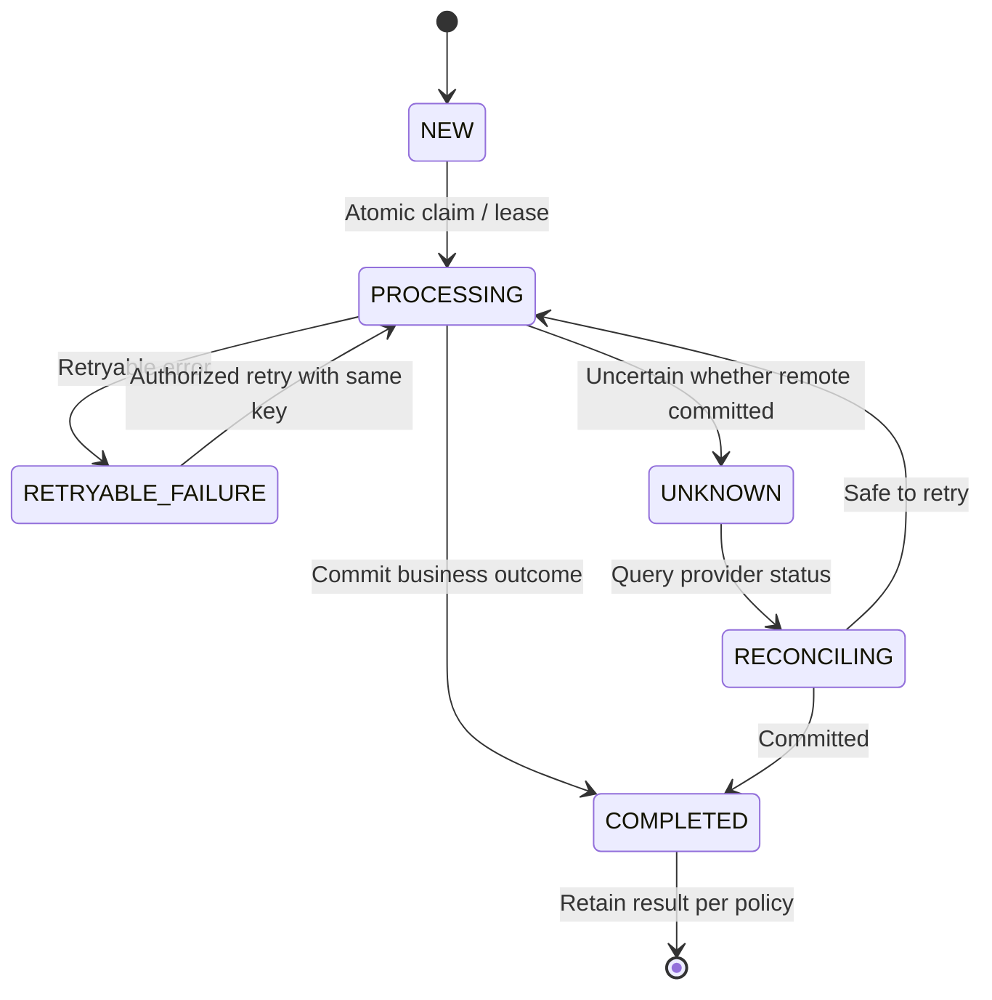
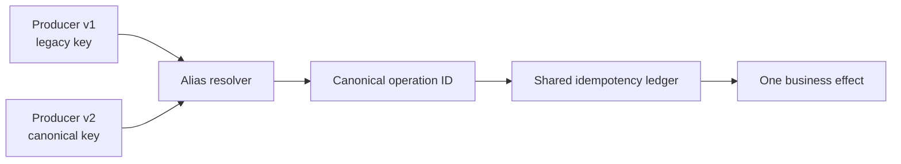
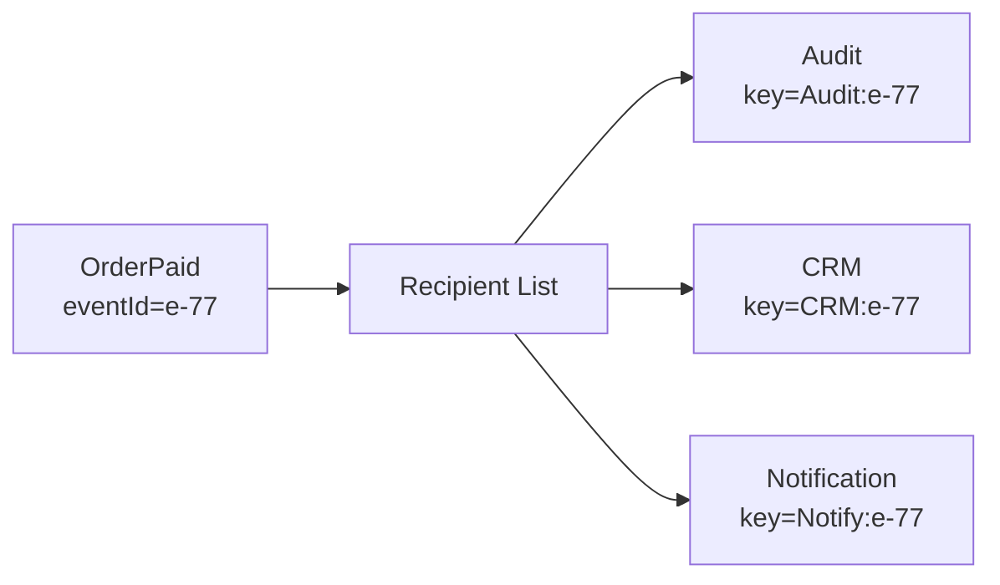
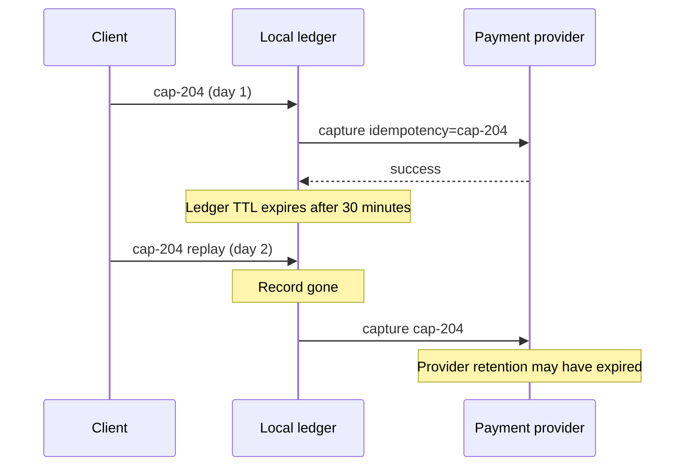

# Different Keys for the Same Payload

## 1. The Problem: Identical Payload Yet Idempotent Receiver Processes Twice

A payment system receives a capture request:

```json
{
  "tenantId": "tenant-A",
  "captureRequestId": "cap-204",
  "orderId": "O-204",
  "amount": 199500,
  "currency": "VND"
}
```

The first message reaches the consumer with headers:

```text
brokerDeliveryId = delivery-101
traceId          = trace-a
retryAttempt     = 1
```

The consumer sends the command to the payment gateway, which creates the capture successfully, yet the broker ACK is lost. The broker redelivers **the same business payload**, this time with:

```text
brokerDeliveryId = delivery-205
traceId          = trace-b
retryAttempt     = 2
```

If the Idempotent Receiver uses the key:

```java
// Unstable across deliveries of the same business command.
message -> message.getHeaders().getId().toString()
```

or:

```java
// Each broker redelivery may receive a new delivery ID.
message -> message.getHeaders().get("brokerDeliveryId").toString()
```

then both deliveries are treated as **two previously unseen messages**. The consumer may create **two captures** even though the visible payload is identical.

Conversely, you cannot simply hash the whole payload to drop matching copies: two users might submit **two independent payment commands** with the same amount, order, and currency. If both commands carry **different business operation IDs**, they must be processed separately even when the remaining data fields match.

The article **“Different Keys for the Same Payload”** belongs to the **Idempotent receiver** chapter of the **SPRING_INTEGRATION_PATTERN** module. The module focuses on practicing Enterprise Integration Patterns with Spring Integration to build loosely coupled, extensible message flows; coordinating Router, Filter, Transformer, Splitter, Aggregator, Gateway, retry, error channel, correlation, and testing/observing processing branches.

After this lesson, you will be able to:

1. Distinguish **same payload**, **same logical event**, **same business operation**, and **same delivery attempt**.
2. Explain why idempotency keys based on technical headers, timestamps, or freshly generated UUIDs let retries slip through.
3. Design stable keys scoped by tenant, operation type, and authoritatively issued business IDs.
4. Distinguish valid duplicates from **conflicts: same key with different business content**.
5. Write Spring Integration Java DSL and JUnit examples protecting a capture from executing twice.
6. Understand the limits of Maps/`MetadataStore` and crash windows before/after side effects.
7. Design appropriate state machines, transactions, outboxes, and downstream idempotency.
8. Handle key-format migrations, replays, multi-instance setups, fan-out, TTLs, and cases where identity cannot be inferred from payloads.

## 2. Payload Equality Is Not Business Identity

There are two distinct questions:

**A. Do two messages have the same data values?** That is content-representation comparison.

**B. Do two messages represent the same business operation that must apply at most once?** That is **business identity** and the idempotency contract.

The two questions can yield different answers:

| Scenario | Payload Identical? | Same Business Operation? | Desired Behavior |
| --- | --- | --- | --- |
| Broker redelivers same capture | Yes | Yes | Do not capture a second time |
| HTTP client retries, reusing `captureRequestId` | Yes | Yes | Return old result/in-progress |
| HTTP retry where gateway generates a new `captureRequestId` | ID field differs, economic content identical | **Yes**, if still retrying the same command | First fix the contract to issue a stable ID |
| Two independent purchase requests of identical value | Economic fields may match | No | Process both |
| Producer edits metadata/tracing and republishes | JSON bytes/headers differ | Yes | Do not re-execute business side effect |
| Same operation ID with changed amount | Different | Supposed to be same ID; **conflict** | Reject/investigate; never silently treat as retry |
| Replay of a historical event | Yes | Yes | Do not duplicate side effects; may rebuild projections per policy |
| Intentional rerun with new operation/revision | May be identical | No, if business allows new execution | Process once for the new revision |

No pure hashing algorithm can reliably infer **caller intent** if the contract fails to provide a stable identifier. That is a business-contract limit, not a quirk of Spring Integration.

### Three Layers of Identity



- **Business operation ID:** a command with business meaning; essential for preventing duplicate side effects.
- **Logical event ID:** an event emitted by a producer; stable across redeliveries of **the same event**.
- **Transport delivery/message ID:** identifies one delivery or technical message instance; may change across attempts.

Not every system has all three layers. If a business API produces one event per command, operation ID and event ID may be one-to-one. Yet **never assume** they are always identical.

## 3. What Does Idempotent Receiver Do in EIP?

According to Enterprise Integration Patterns, **Idempotent Receiver** lets a receiver handle repeated messages without **producing unintended extra business impacts**. The idea is recognizing an already-applied operation and skipping it or returning the appropriate outcome on redelivery.



In Spring Integration, the pattern can be applied via:

- **Idempotent Receiver advice/interceptor** around an endpoint, e.g., `IdempotentReceiverInterceptor` paired with `MetadataStoreSelector`.
- **Filter/Service Activator** with an application-managed admission policy and store.
- A **transactional idempotency ledger** at the business layer when operations have side effects and require reliable recovery.
- **Downstream API** idempotency support, e.g., forwarding the same business idempotency key to a payment provider.

The core lies in **the key and when state is recorded**; choosing annotations, DSL, or interceptors cannot substitute for this contract.

### Idempotency Does Not Equal Technical Deduplication

“Drop duplicate messages” is one implementation option, yet if the prior execution failed **before commit**, dropping messages can prevent the business operation from ever completing.

A proper receiver must answer:

- Did the previous attempt **complete**, is it **in progress**, or was it only **claimed**?
- Does the current attempt's content match the previously accepted content?
- If already completed, return the old result or simply ACK?
- If currently in progress, wait, return `IN_PROGRESS`, or retry later?
- If the owner crashed, is there a lease/recovery path to continue?

Thus **same key** is only the first step; state management determines end-to-end correctness.

## 4. Why Do Keys Change Even When Payloads Are Identical?

Common anti-patterns:

### 4.1. Using Spring's Message ID

```java
String key = message.getHeaders().getId().toString();
```

Framework messages can be recreated after Transformers/adapters or after broker redeliveries. Repeating payloads do not force matching Message IDs.

### 4.2. Using Per-Delivery IDs

```java
String key = String.valueOf(
    message.getHeaders().get("brokerDeliveryId"));
```

Delivery IDs/offsets carry transport semantics. A logical event can traverse multiple topics, partitions, or connectors, or be republished as a new record with a new ID.

### 4.3. Generating UUIDs at the Receiver

```java
String key = UUID.randomUUID().toString(); // New key every time.
```

Every retry becomes “new”, completely defeating idempotency.

### 4.4. Putting Timestamps, Attempts, or traceId into the Key

```text
cap-204|attempt-1
cap-204|attempt-2
```

Two different keys for the same command. `attemptId` is strictly for diagnostics, **never for distinguishing business operations**.

### 4.5. Every Service Invents Its Own Key

```text
Producer: tenant-A/capture/cap-204
Gateway:  cap-204
Receiver: tenant-A/O-204/199500
```

Without a shared identity contract, the system may receive the same operation in two different namespaces or collapse two different operations into one.

### 4.6. Changing Keys on Schema Upgrades

```text
idempotency-v1|tenant-A|cap-204
idempotency-v2|tenant-A|cap-204
```

If both formats point to **the same logical operation**, changing the prefix without migration opens a new “slot” and allows re-execution. Key versions must be managed like data migrations, not casual string edits.

### 4.7. Keying on Uncanonicalized JSON

```json
{"amount":19.50,"currency":"USD"}
```

and:

```json
{"currency":"USD","amount":19.5}
```

may represent the exact same value yet have different bytes and field order. Hashing raw bytes produces two distinct keys. Conversely, dropping too many fields from the hash can wrongly collapse two valid operations.

### 4.8. Using a Single Overly Broad Business ID

```text
orderId=O-204
```

If the same order can undergo `AUTHORIZE`, `CAPTURE`, `REFUND`, or two partial captures, keying solely on `orderId` will **drop valid operations**. Key scope must match **the unit of business impact**.

## 5. Choose the Unit of Idempotency Before Choosing the Key Formula

In payments, you may have:

| Operation | Recommended ID | Why |
| --- | --- | --- |
| Authorize | `authorizationRequestId` | One order may require separate authorizations |
| Capture | `captureRequestId` | One authorization can be partially captured |
| Refund | `refundRequestId` | Multiple valid refunds may have the same value |
| Payment webhook | `providerEventId` for ingestion dedup, plus payment state | Webhooks can redeliver without creating new payments |
| Ledger projection | `eventId + projectionName/version` | One event can feed multiple projections |
| Notification | `eventId + recipientId + notificationType` | One event may notify multiple recipients |

A key should bind to **one action permitted to occur once**, not merely an entity that can undergo many actions.

For example, `O-204` has two valid captures:

```text
captureRequestId=cap-204-A, amount=100.00
captureRequestId=cap-204-B, amount= 99.50
```

A key using only `orderId` would wrongly block capture B. Two captures with identical amounts can also still be valid if the business issued two distinct `captureRequestId`s.

### Distinguishing Correlation Keys and Idempotency Keys

| Key | Purpose | Example |
| --- | --- | --- |
| Correlation | Groups multiple messages into a workflow/group | `tenant-A/O-204/settlement-r1` |
| Message/event dedup | Identifies redelivered logical events | `tenant-A/provider/evt-77` |
| Business operation idempotency | Prevents applying a command multiple times | `tenant-A/CAPTURE/cap-204` |
| Per-recipient idempotency | Prevents duplicate work at each fan-out target | `tenant-A/evt-77/audit` |
| Output summary idempotency | Prevents duplicate writes of Aggregator results | `tenant-A/O-204/settlement-r1/v1` |

The same ID string may participate in multiple contracts if semantics align, yet **never assume** correlation and idempotency are equivalent.

## 6. Stable Key Formula and Its Requirements

In the payment example, use:

```text
key = (tenantId, operationType=CAPTURE, captureRequestId)
```

Where:

- `tenantId` is supplied by the authenticated ingress layer, never trusting self-declared headers.
- `CAPTURE` namespaces the operation to avoid colliding with `REFUND`.
- `captureRequestId` is issued **once when the command is created** and kept unchanged across retries/replays.
- Exclude `traceId`, `attemptNumber`, broker offsets, or delivery timestamps from the key.
- Never change `captureRequestId` if the command has not succeeded and the client is merely retrying.

For a key to be durable and reliable, it must be:

1. **Stable:** same logical operation always yields the same key.
2. **Distinctive:** two genuinely independent operations yield different keys.
3. **Scoped:** includes tenant, action, and logical stream as needed.
4. **From a trusted source:** clients cannot abuse keys to access another tenant.
5. **Unambiguously encoded:** no two different field tuples encode to the same string.
6. **Appropriately retained:** ledger retention spans the retry/replay window.
7. **Versioned/migratable:** algorithm updates do not reprocess old operations.
8. **Conflict-checked:** same key with changed content must raise an error, not fake success.

**If the producer lacks a stable operation ID**, the receiver cannot reliably tell a retry apart from a new command with an identical payload. Fix this by **updating the ingress protocol** or defining business uniqueness constraints, not by “patching” it with an arbitrary hash.

## 7. Example Data and Processing Flow

We use `CaptureCommand` with two identity fields and three core content fields:

```java
import java.math.BigDecimal;

record CaptureCommand(
    String tenantId,
    String captureRequestId,
    String orderId,
    BigDecimal amount,
    String currencyCode) {}

record CaptureReceipt(
    String tenantId,
    String captureRequestId,
    String providerReference,
    String resultStatus) {}
```

**Example assumptions:**

- Handles `USD` only, permitting positive amounts with at most two significant decimal places.
- `captureRequestId` is generated by an authoritative application/producer layer and remains stable across retries.
- Two commands sharing `captureRequestId` must carry identical normalized economic fields, or else it is a conflict.
- `tenantId` is extracted from the authenticated context and placed into the internal command.
- The demo calls no real payment gateway and produces no monetary side effects.
- `CaptureReceipt` is strictly a simulated output and must not be treated as production payment confirmation.

Topology:



Routing duplicates to a separate branch lets JUnit observe the behavior without performing a real payment.

## 8. Java: Building Collision-Free Keys When IDs Contain Delimiters

Never concatenate `tenantId + ":" + captureRequestId` if either field can contain the delimiter. A simple in-JVM approach encodes into one string with length prefixes.

```java
import java.math.BigDecimal;
import java.math.RoundingMode;
import java.util.Locale;

final class CaptureIdentity {

    private CaptureIdentity() {}

    static String key(CaptureCommand command) {
        validate(command);

        return "capture-key-v1|"
            + part(command.tenantId())
            + part("CAPTURE")
            + part(command.captureRequestId());
    }

    static CaptureSignature signature(CaptureCommand command) {
        validate(command);

        return new CaptureSignature(
            command.orderId(),
            command.amount().setScale(
                2, RoundingMode.UNNECESSARY),
            command.currencyCode()
                .toUpperCase(Locale.ROOT));
    }

    static void validate(CaptureCommand command) {
        if (command == null
                || blank(command.tenantId())
                || blank(command.captureRequestId())
                || blank(command.orderId())
                || blank(command.currencyCode())
                || command.amount() == null
                || command.amount().signum() <= 0) {
            throw new IllegalArgumentException(
                "Invalid capture command");
        }

        if (!"USD".equals(
                command.currencyCode().toUpperCase(
                    Locale.ROOT))) {
            throw new IllegalArgumentException(
                "Unsupported currency");
        }

        try {
            command.amount().setScale(
                2, RoundingMode.UNNECESSARY);
        } catch (ArithmeticException ex) {
            throw new IllegalArgumentException(
                "Amount cannot be represented in exact cents",
                ex);
        }
    }

    private static String part(String value) {
        return value.length() + "#" + value;
    }

    private static boolean blank(String value) {
        return value == null || value.isBlank();
    }
}

record CaptureSignature(
    String orderId,
    BigDecimal amount,
    String currencyCode) {}
```

Example of two distinct key strings even when components contain `#` or `|`:

```text
("tenant-A", CAPTURE, "cap-204")
("tenant-A", CAPTURE, "cap|204")
```

Length prefixes mark component boundaries unambiguously. However, **Java's `String.length()` counts UTF-16 code units**, not UTF-8 bytes. When multiple languages generate keys, standardize the encoding protocol and maintain golden test vectors rather than copying length logic unverified.

### Do Not Arbitrarily Normalize Business IDs

In the code, `tenantId`, `captureRequestId`, and `orderId` are assumed to be **canonicalized at trusted ingress**. If the domain treats `CAP-1` and `cap-1` as the same ID, case-folding rules must be defined at the source. If IDs are case-sensitive, lowercasing at the receiver wrongly merges two operations.

Similarly, Unicode normalization, leading zeros, whitespace, or textual UUID formatting must follow an explicit contract before key construction. **Canonicalization does not mean discarding business distinctions.**

## 9. Fingerprints Detect Conflicts, Never Replace Identity

Same key, yet two deliveries carry different amounts:

```text
key=tenant-A/CAPTURE/cap-204
attempt 1: order O-204, USD 19.95
attempt 2: order O-204, USD 29.95
```

Never do this:

```java
if (seenKeys.contains(key)) {
    return previousSuccess;  // Hides content conflict.
}
```

Instead, store a **canonical signature/fingerprint** of the fields affecting the outcome. When encountering the same key:

- Matching signature → valid duplicate of the same request.
- Differing signature → **IDEMPOTENCY_KEY_CONFLICT**.
- Key absent → new command, if authorized and valid per contract.
- Key in progress → check state/lease; never mark successful before commit.

```text
Key  = (tenantId, CAPTURE, captureRequestId)
Data = (orderId, exact amount, currencyCode)

Business identity differs from content fingerprint:
  - Key answers "which operation is this?"
  - Fingerprint answers "did this operation's content change?"
```

**Why use `BigDecimal`?** `new BigDecimal("19.5")` and `new BigDecimal("19.50")` are not equal under `equals()` because their scales differ. `setScale(2, UNNECESSARY)` yields the same signature without rounding, while `19.999` is rejected.

**Never treat hashing the full payload as sufficient.** Fingerprints must derive from **business-significant fields**; exclude delivery timestamps, retry counts, or trace IDs. If the key matches while the amount changes, it is a conflict even if the producer preserved the ID.

## 10. Java: In-Memory Gate Demonstrating Duplicates and Conflicts

The gate below uses `ConcurrentHashMap.putIfAbsent` for one JVM to record the first key atomically. It strictly **illustrates key-selection mechanics**, without guaranteeing business transactions.

```java
import java.util.concurrent.ConcurrentHashMap;
import java.util.concurrent.ConcurrentMap;

enum Admission {
    NEW,
    DUPLICATE
}

final class InMemoryCaptureGate {

    private final ConcurrentMap<String, CaptureSignature> seen =
        new ConcurrentHashMap<>();

    Admission register(CaptureCommand command) {
        String key = CaptureIdentity.key(command);
        CaptureSignature candidate =
            CaptureIdentity.signature(command);

        CaptureSignature previous =
            seen.putIfAbsent(key, candidate);

        if (previous == null) {
            return Admission.NEW;
        }

        if (previous.equals(candidate)) {
            return Admission.DUPLICATE;
        }

        throw new IllegalStateException(
            "IDEMPOTENCY_KEY_CONFLICT: " + key);
    }
}
```

Example:

```text
1. cap-204 / USD 19.95 → NEW
2. cap-204 / USD 19.95 → DUPLICATE
3. cap-204 / USD 29.95 → CONFLICT
4. cap-205 / USD 19.95 → NEW (different valid command)
```

### What the Map Can Do

- Blocks duplicates within **one live JVM**.
- Distinguishes same-key/same-signature from same-key/different-signature.
- Does not use `MessageHeaders.ID` or delivery IDs as keys.
- `putIfAbsent` stops two threads from accepting the same new key in that Map.

### What the Map Cannot Do

- Does not survive restarts.
- Is not shared across two pods.
- Does not coordinate transactions with a payment API, database, or broker.
- Does not know an operation was only **claimed**, not finished.
- Can block valid retries if the handler fails after the Map recorded the key.
- Lacks TTL/cleanup, risking unbounded memory growth.
- Cannot return prior results per business contracts.
- Does not guarantee end-to-end exactly-once execution.

**Special note:** This example Map **intentionally marks the key before the handler executes**. That is a classic source of lost work when handlers fail; the transaction and recovery sections later explain how to fix this for production.

## 11. Spring Integration Java DSL: Filter Before the Handler

The Spring Integration example uses these channels:

- `capture.commands.in` receives commands.
- `capture.receipts.out` receives outcomes of new commands.
- `capture.duplicates.out` lets us observe messages filtered as duplicates.

A simulated handler counting executions:

```java
import java.util.concurrent.atomic.AtomicInteger;

final class SimulatedCaptureHandler {

    private final AtomicInteger executions =
        new AtomicInteger();

    CaptureReceipt capture(CaptureCommand command) {
        executions.incrementAndGet();

        return new CaptureReceipt(
            command.tenantId(),
            command.captureRequestId(),
            "demo-" + command.captureRequestId(),
            "SIMULATED_SUCCESS");
    }

    int executions() {
        return executions.get();
    }
}
```

Flow configuration:

```java
import org.springframework.context.annotation.Bean;
import org.springframework.context.annotation.Configuration;
import org.springframework.integration.channel.DirectChannel;
import org.springframework.integration.channel.QueueChannel;
import org.springframework.integration.config.EnableIntegration;
import org.springframework.integration.dsl.IntegrationFlow;

@Configuration
@EnableIntegration
public class CaptureIdempotencyDemoConfig {

    @Bean
    InMemoryCaptureGate captureGate() {
        return new InMemoryCaptureGate();
    }

    @Bean
    SimulatedCaptureHandler captureHandler() {
        return new SimulatedCaptureHandler();
    }

    @Bean("capture.commands.in")
    DirectChannel captureCommands() {
        return new DirectChannel();
    }

    @Bean("capture.receipts.out")
    QueueChannel captureReceipts() {
        return new QueueChannel();
    }

    @Bean("capture.duplicates.out")
    QueueChannel duplicateCaptures() {
        return new QueueChannel();
    }

    @Bean
    IntegrationFlow captureFlow(
            InMemoryCaptureGate gate,
            SimulatedCaptureHandler handler) {

        return IntegrationFlow.from("capture.commands.in")
            .filter(CaptureCommand.class,
                command ->
                    gate.register(command) == Admission.NEW,
                spec -> spec.discardChannel(
                    "capture.duplicates.out"))
            .handle(CaptureCommand.class,
                (command, headers) ->
                    handler.capture(command))
            .channel("capture.receipts.out")
            .get();
    }
}
```

This flow is a **Filter + Service Activator example** demonstrating Idempotent Receiver, not a production payment pipeline. Commands filtered as duplicates go to the discard channel; **the prior receipt is not automatically re-sent**. If callers use a request–reply Gateway, simply discarding can cause the Gateway to wait and time out. Design an explicit duplicate response or query stored outcomes in a ledger when the contract is “retries return the original outcome”.

### Why Use DirectChannel?

The demo needs synchronous testing with minimal dependencies. With `DirectChannel`, errors from the gate or handler propagate back to the sender (Spring may wrap exceptions). With `ExecutorChannel`, polled `QueueChannel`, or broker listeners, errors run on other threads and require suitable error flows and ACK policies.

### Should You Use PublishSubscribeChannel to Fan Out?

Not needed for a single-consumer demo. When genuinely fanning out to Audit, CRM, and Notification, **each recipient has its own unit of idempotency**. Never use a single global marker that blocks remaining recipients simply because the first recipient processed the event.

## 12. JUnit 5: Same Payload, Different Delivery ID Still Not Reprocessed

The tests below run inside a Spring Test context and strictly verify **the simulated flow inside one JVM**.

```java
import static org.assertj.core.api.Assertions.assertThat;
import static org.assertj.core.api.Assertions.assertThatThrownBy;

import java.math.BigDecimal;

import org.junit.jupiter.api.Test;
import org.springframework.beans.factory.annotation.Autowired;
import org.springframework.beans.factory.annotation.Qualifier;
import org.springframework.integration.channel.QueueChannel;
import org.springframework.messaging.Message;
import org.springframework.messaging.MessageChannel;
import org.springframework.messaging.support.MessageBuilder;
import org.springframework.test.context.junit.jupiter.SpringJUnitConfig;

@SpringJUnitConfig(CaptureIdempotencyDemoConfig.class)
class CaptureIdempotencyFlowTest {

    @Autowired
    @Qualifier("capture.commands.in")
    MessageChannel input;

    @Autowired
    @Qualifier("capture.receipts.out")
    QueueChannel receipts;

    @Autowired
    @Qualifier("capture.duplicates.out")
    QueueChannel duplicates;

    @Autowired
    SimulatedCaptureHandler handler;

    private CaptureCommand command(
            String tenant, String id, String amount) {
        return new CaptureCommand(
            tenant, id, "O-204",
            new BigDecimal(amount), "USD");
    }

    private void send(CaptureCommand command, String deliveryId) {
        Message<CaptureCommand> message = MessageBuilder
            .withPayload(command)
            .setHeader("brokerDeliveryId", deliveryId)
            .setHeader("traceId", "trace-" + deliveryId)
            .build();

        assertThat(input.send(message)).isTrue();
    }

    @Test
    void repeatedLogicalCommandWithDifferentDeliveryIdsIsDeduped() {
        int before = handler.executions();
        CaptureCommand c =
            command("tenant-A", "cap-repeated", "19.95");

        send(c, "delivery-1");
        send(c, "delivery-2");

        Message<?> receipt = receipts.receive(1_000);
        assertThat(receipt).isNotNull();
        assertThat(receipt.getPayload())
            .isInstanceOf(CaptureReceipt.class);

        Message<?> duplicate = duplicates.receive(1_000);
        assertThat(duplicate).isNotNull();
        assertThat(duplicate.getPayload()).isEqualTo(c);

        assertThat(receipts.receive(0)).isNull();
        assertThat(handler.executions() - before).isEqualTo(1);
    }

    @Test
    void differentBusinessIdsWithSameEconomicFieldsAreIndependent() {
        int before = handler.executions();

        send(command("tenant-A", "cap-new-1", "19.95"),
            "delivery-3");
        send(command("tenant-A", "cap-new-2", "19.95"),
            "delivery-4");

        CaptureReceipt first =
            (CaptureReceipt) receipts.receive(1_000)
                .getPayload();
        CaptureReceipt second =
            (CaptureReceipt) receipts.receive(1_000)
                .getPayload();

        assertThat(first.captureRequestId())
            .isEqualTo("cap-new-1");
        assertThat(second.captureRequestId())
            .isEqualTo("cap-new-2");
        assertThat(handler.executions() - before).isEqualTo(2);
        assertThat(duplicates.receive(0)).isNull();
    }

    @Test
    void sameKeyWithDifferentAmountIsConflict() {
        send(command("tenant-A", "cap-conflict", "19.95"),
            "delivery-5");
        assertThat(receipts.receive(1_000)).isNotNull();

        assertThatThrownBy(() ->
            send(command("tenant-A", "cap-conflict", "29.95"),
                "delivery-6"))
            .isInstanceOf(RuntimeException.class);

        assertThat(receipts.receive(0)).isNull();
    }

    @Test
    void tenantNamespacePreventsCrossTenantCollapse() {
        int before = handler.executions();

        send(command("tenant-A", "cap-same-id", "19.95"),
            "delivery-7");
        send(command("tenant-B", "cap-same-id", "19.95"),
            "delivery-8");

        assertThat(receipts.receive(1_000)).isNotNull();
        assertThat(receipts.receive(1_000)).isNotNull();
        assertThat(handler.executions() - before).isEqualTo(2);
    }
}
```

**Fixture note:** the tests use distinct IDs to avoid a singleton `InMemoryCaptureGate` leaking state across tests. They must run sequentially or with fixture isolation, and queues must be drained per test. Production tests should never depend on JUnit execution order.

### What Tests Are Still Missing?

Although the test proves stable keys work, it **does not prove** a payment cannot be recorded twice when:

- The consumer crashes after the provider accepts the capture.
- Two pods have separate Maps.
- The broker redelivers after marker TTL expires.
- A command waits in `PROCESSING` state.
- A conflicting duplicate arrives after an outcome committed.
- A Gateway times out and the client retries with a changed operation ID.
- The idempotency store is unavailable.
- The remote payment API lacks idempotency support.

These cases require integration/failure tests and contracts with a real provider.

## 13. Unit Testing Keys and Fingerprints

You do not need a Spring context to test identity rules.

```java
import static org.assertj.core.api.Assertions.assertThat;
import static org.assertj.core.api.Assertions.assertThatThrownBy;

import java.math.BigDecimal;

import org.junit.jupiter.api.Test;

class CaptureIdentityTest {

    private CaptureCommand command(
            String tenant, String id, String amount) {
        return new CaptureCommand(
            tenant, id, "O-204",
            new BigDecimal(amount), "USD");
    }

    @Test
    void deliveryHeadersNeverAffectStableBusinessKey() {
        CaptureCommand c =
            command("tenant-A", "cap-204", "19.95");

        assertThat(CaptureIdentity.key(c))
            .isEqualTo(CaptureIdentity.key(c));
        // Technical headers do not participate in key().
    }

    @Test
    void twoTenantsAndTwoCaptureIdsHaveDifferentKeys() {
        String base = CaptureIdentity.key(
            command("tenant-A", "cap-204", "19.95"));

        assertThat(base)
            .isNotEqualTo(CaptureIdentity.key(
                command("tenant-B", "cap-204", "19.95")))
            .isNotEqualTo(CaptureIdentity.key(
                command("tenant-A", "cap-205", "19.95")));
    }

    @Test
    void equivalentDecimalRepresentationsShareSignature() {
        CaptureSignature a = CaptureIdentity.signature(
            command("tenant-A", "cap-204", "19.5"));
        CaptureSignature b = CaptureIdentity.signature(
            command("tenant-A", "cap-204", "19.50"));

        assertThat(a).isEqualTo(b);
    }

    @Test
    void anActualAmountChangeIsAConflict() {
        InMemoryCaptureGate gate = new InMemoryCaptureGate();

        assertThat(gate.register(command(
            "tenant-A", "cap-204", "19.95")))
            .isEqualTo(Admission.NEW);

        assertThatThrownBy(() ->
            gate.register(command(
                "tenant-A", "cap-204", "29.95")))
            .isInstanceOf(IllegalStateException.class)
            .hasMessageContaining("IDEMPOTENCY_KEY_CONFLICT");
    }

    @Test
    void amountThatRequiresRoundingIsRejected() {
        assertThatThrownBy(() ->
            CaptureIdentity.key(
                command("tenant-A", "cap-204", "19.999")))
            .isInstanceOf(IllegalArgumentException.class);
    }
}
```

A great improvement in real projects is testing **fixed golden vectors** for key encoding, canonical decimals, currencies, Unicode, and schema versions. That is essential when multiple services/languages construct the same key.

## 14. Spring Integration `IdempotentReceiverInterceptor` and `MetadataStoreSelector`

Spring Integration has components built specifically for Idempotent Receiver:

- `IdempotentReceiverInterceptor`: advice attached to a message handler endpoint to execute duplicate-detection logic.
- `MetadataStoreSelector`: uses a key/value selection strategy and a `MetadataStore` to check/record message-recognition metadata.
- `MetadataStore`: offers local/shared/durable implementations depending on dependencies and configuration.
- Header or discard behavior on duplicates: depends on interceptor configuration and version; explicitly define whether duplicates are **flagged, skipped, routed to a discard channel, or raise errors**.

Key-selector configuration idea:

```java
// Configuration sketch: use the exact overloads/imports/endpoint advice
// for your project's Spring Integration version.
MetadataStoreSelector selector = new MetadataStoreSelector(
    message -> CaptureIdentity.key(
        (CaptureCommand) message.getPayload()),
    metadataStore);

IdempotentReceiverInterceptor interceptor =
    new IdempotentReceiverInterceptor(selector);
```

These two lines illustrate binding a **business key function** to a selector/receiver advice; when registering Spring beans, configure `MetadataStore`, endpoint advice, and duplicate routing per your actual API/version.

**Important:** `IdempotentReceiverInterceptor` is an interceptor/advice, not an atomic remote-payment commit mechanism. When metadata markers are written before side effects, the same crash windows as in the Map demo still apply. Verify selector/metadata-store semantics before choosing reject/discard behavior.

### Why Should Markers Not Be Treated as Business Success?

Suppose:

```text
1. Receiver inserts key=cap-204 into MetadataStore.
2. Payment provider times out or service crashes.
3. Broker redelivers cap-204.
4. Selector finds key present → treats message as already received.
5. If discarded immediately → nobody ever completes the capture.
```

Here **“key seen”** differs from **“capture completed”**. A production policy needs `PROCESSING`/`COMPLETED` states, leases, result persistence, or remote idempotency; a single Boolean marker is not enough.

## 15. Why Is Changing the Key Right After a Timeout the Most Dangerous Bug?



When you do not know whether the provider committed, generating a new key means **requesting a brand-new operation** to most idempotency-key APIs.

Better handling:

1. Retry with **the same business operation ID** after a timeout.
2. If the provider supports idempotency keys, pass **the same key** to the provider.
3. If the provider exposes a status query API, reconcile by merchant operation reference.
4. If the old outcome committed, return that outcome to the caller.
5. If no outcome exists and evidence confirms it never ran, continue per workflow/recovery.
6. If status cannot be determined, transition to `UNKNOWN_REQUIRES_RECONCILIATION` rather than creating a new capture.

Retrying with an old key **never guarantees the provider itself is idempotent**; rely on the provider's API contract and retention window.

### When May a New Key Be Created?

When **the caller intentionally creates a new operation** permitted by business rules, such as a second partial capture, or a revision/replacement workflow after deciding to cancel the old result. Maintain an audit trail and state links between old and new operations.

Never assign a new UUID merely because `attemptNumber++`.

## 16. State Machine: Key Seen, In Progress, Completed

A production idempotency ledger might use:



This is a **proposed application state machine**. These enums/statuses are not provided out-of-the-box by `MetadataStoreSelector`.

Response table on message delivery:

| Current Key State | Signature | Response |
| --- | --- | --- |
| No record | Valid | Atomic insert/claim `PROCESSING` |
| `PROCESSING` with active lease | Match | Return `IN_PROGRESS`, wait or retry later |
| `PROCESSING` past lease | Match | Recovery/fencing; do not assume uncommitted |
| `COMPLETED` | Match | Return persisted outcome or ACK duplicate |
| `COMPLETED` | Mismatch | `IDEMPOTENCY_KEY_CONFLICT` |
| `RETRYABLE_FAILURE` | Match | Retry same key within budget |
| `UNKNOWN` | Match | Reconcile before re-executing |
| Any state | Mismatch | Reject conflict, write audit |
| Store unavailable | Unknown | Bounded fail/retry; **never** create new operation “just to be safe” |

The tricky part is ensuring `PROCESSING → COMPLETED` aligns with side effects. When the payment provider is an independent system, the receiver's database transaction cannot span the HTTP request; provider idempotency + reconciliation are required.

## 17. Transactional Ledger: One Key Is Not Enough

A logical table:

```sql
CREATE TABLE capture_idempotency (
    scope_key           VARCHAR(512) PRIMARY KEY,
    request_fingerprint VARCHAR(128) NOT NULL,
    state               VARCHAR(40) NOT NULL,
    owner_token         VARCHAR(128),
    lease_until         TIMESTAMP,
    provider_reference  VARCHAR(200),
    result_json         TEXT,
    created_at          TIMESTAMP NOT NULL,
    updated_at          TIMESTAMP NOT NULL
);
```

This is a **suggested schema**; adapt for DB dialect, timezones, encryption, and retention. Workflow:

1. Validate/authorize tenant and operation.
2. Compute stable key and canonical fingerprint.
3. Atomically insert key/state if absent (unique constraint).
4. If key exists, compare fingerprint before acting.
5. For a valid owner, execute business logic or call the provider with **the same idempotency key**.
6. Persist outcome/remote reference and mark `COMPLETED` per contract.
7. Publish result/ACK with crash recovery.
8. Subsequent duplicates look up the saved outcome without re-executing the side effect.

### Why Is Check-Then-Insert Unsafe?

```text
Thread A: SELECT key → not found
Thread B: SELECT key → not found
Thread A: calls payment API
Thread B: calls payment API
Thread A: INSERT key
Thread B: INSERT key fails unique constraint
```

By the time the database catches the unique conflict, **two external calls have already been sent**.

Instead, **claim the key via an atomic operation before the side effect**, with leases/fencing/recovery for dead owners. An atomic DB claim also does not guarantee remote operations run once without target-API idempotency.

### Fencing Tokens

When a `PROCESSING` lease expires, a new worker can reclaim it. The old worker may wake up and resume processing. Some systems issue **monotonically increasing fencing tokens** so downstream services or the database reject stale owners. Fencing only works if the side-effect resource **actually checks the token**, rather than merely logging a generated number.

## 18. Crash Windows and Recovery Requirements

Three common failure windows:

**A. Marker before processing**

```text
WRITE seen(key) succeeds
CRASH
Business side effect has not run
Retry → discarded if relying solely on marker
```

Consequence: lost work.

**B. Side effect before completion marker**

```text
Payment provider commits successfully
CRASH before saving COMPLETED
Retry → receiver does not know outcome
```

Consequence: risk of duplicate side effects if the provider is not idempotent.

**C. Result saved, but response/ACK lost**

```text
Save COMPLETED + result succeeds
ACK/HTTP reply lost
Caller/broker retries
```

Correct behavior: **return the old result or a valid ACK**, never sending a new payment command.

A system must handle all three cases; testing only `duplicate → discard` is insufficient.

### At Which Boundary Does Transactional Outbox Help?

If the ledger and outbox share the same database, state transition + outbound event can be saved in one transaction. The publisher retries sending when the broker fails.

However, a transactional outbox **does not make an external HTTP payment API part of the database transaction** and does not guarantee consumers receive events only once. Combine it with provider/consumer idempotency and outcome persistence.

## 19. Multi-Instance: One Map per Pod Is Not System-Wide Deduplication

Example:

```text
Pod A receives cap-204 → seen A = {cap-204}
Pod B receives cap-204 → seen B = {}
Pod B calls provider again
```

A local Map is only atomic within one process. To behave properly when scaling horizontally:

- Use a database with unique constraints and transactional state transitions.
- Or a shared metadata store with atomic per-key put/compare-and-set.
- Configure broker partitioning/ordering so events for the same operation reach one consumer where appropriate.
- Still support recovery when partitions rebalance and owners crash.
- Keep TTL/cleanup consistent across instances.
- Enforce downstream idempotency when side effects risk replay.

**Co-locating messages by partition does not replace business idempotency.** Rebalances, retries, DLQ replays, and multiple producers can still re-emit the same logical command.

### Is Redis Enough?

Redis atomic operations can support admission, yet:

- Redis markers may be written before business commit.
- Redis and payment/database systems do not automatically share a transaction.
- TTLs may expire before retries or DLQ replays.
- Eviction/failover can affect markers.
- Leases/fencing/recovery must still be designed.

Redis fits when its durability and failure policies meet requirements, not merely for low latency.

## 20. When Payloads Match Yet Business Operations Differ: Avoiding False Blocks

This is the flip side of the problem.

Two commands:

```json
{
  "tenantId": "tenant-A",
  "captureRequestId": "cap-301",
  "orderId": "O-204",
  "amount": 19.95,
  "currencyCode": "USD"
}
```

and:

```json
{
  "tenantId": "tenant-A",
  "captureRequestId": "cap-302",
  "orderId": "O-204",
  "amount": 19.95,
  "currencyCode": "USD"
}
```

They share the same amount, order, and currency, yet have **two different capture request IDs**. They may represent two authorized partial captures. If the key were only a hash of `orderId + amount + currency`, the receiver would wrongly block the second command.

**Do not assume every distinct capture request ID is automatically valid.** The business domain still needs validation for remaining capturable amount, authorization, order status, maximum limits, and fraud checks. Idempotency only ensures **the same operation is not processed repeatedly**; it does not replace all business constraints.

### Why Can “Hash the Entire Payload” Fail on Both Sides?

- **False negative:** same operation with different JSON field order/trace timestamp → different hash, duplicate slips through.
- **False positive:** two independent operations with identical economic payloads → same hash, valid command blocked.
- **Semantic conflict:** same operation ID, different amount → different hash; if the hash were the key, both would be treated as new operations instead of reporting a conflict.

Proper design: **identity key independent of the request fingerprint**, then compare fingerprints when keys match.

## 21. Cross-Version Key Migration and Alias Mapping

Suppose an old producer uses:

```text
legacy-key = "CAPTURE/O-204/204-1"
```

A new producer uses:

```text
canonical-key = "tenant-A/CAPTURE/cap-204"
```

If both represent the same capture, they must **resolve to one operation record**. Never write two parallel rows hoping consumers somehow know they are equivalent.

A strategy:

1. Define a **canonical operation identity** in the authoritative source database.
2. Store a mapping `(producerNamespace, legacyEventId) → canonicalOperationId`.
3. When receiving events from the old producer, resolve aliases before deduplicating.
4. Use unique constraints to stop two aliases from mapping to two conflicting operations.
5. For in-flight messages or DLQ replays, keep the backward-compatible resolver active long enough.
6. Decouple key-format changes from business/revision changes.
7. Emit metrics for legacy resolver hits and plan deprecation.



**Never heuristically match two keys by amount/order** without proof they belong to the same operation. In financial data, such heuristics can wrongly merge two valid commands.

### Is a Version Prefix Always Required in the Key?

Not always. If `captureRequestId` is issued within a well-scoped, immutable namespace, a business key stable across schema upgrades is usually better. A version prefix is only needed when **encoding contracts** genuinely change; yet changing prefixes must accompany migration so deduplication is not reset.

## 22. Fan-Out: One Event, Multiple Valid Receivers

An `OrderPaid(eventId=e-77)` event is sent by a Recipient List to:

- Audit service.
- CRM service.
- Notification service.

All three must process it, even though payload and event ID match:



If all three share a metadata store with key `e-77` alone, Audit may write the marker first, causing CRM and Notification to treat the event as processed and skip it. That is an **idempotency scope false positive**.

Keys should include the **receiver operation/recipient namespace**, such as:

```text
(tenantId, eventId, recipientId, handlerOperation)
```

If a recipient must email two addresses, the key may need `recipientAddressId` or `notificationIntentId`. Still avoid creating a new key on every email retry.

### Fan-Out and Shared Mutable Payloads

If recipients share a mutable Java object and mutate fields or metadata, fingerprints at receivers can diverge. Use immutable event DTOs, copy/transform per contract, and fingerprint **stable semantic fields**. Never use a mutable object's `toString()` as a canonical key.

## 23. Combining Router, Splitter, Aggregator, Gateway, and Error Channel

| EIP | Related Idempotency Contract | Mistake to Avoid |
| --- | --- | --- |
| **Router** | An event may take different branches by policy/version | Writing marker before identifying right consumer/operation |
| **Filter** | Duplicate gate may route messages to discard flow | Treating discard as business success when uncommitted |
| **Transformer** | Changes data representation while keeping business event ID | Hashing raw payload pre/post-transform into different keys |
| **Recipient List** | Each recipient has its own operation | Sharing key on event ID alone, blocking remaining recipients |
| **Splitter** | Multiple parts belong to one event | Using shared event ID as key so only first part runs |
| **Aggregator** | Output is a new summary/operation | Failing to separate part dedup from summary output idempotency |
| **Resequencer** | Same part may be redelivered | Using bare sequence number without group ID |
| **Scatter-Gather** | Each responder has an identity | Counting duplicate replies as new responders |
| **Gateway** | Caller retries after timeout | Generating new `captureRequestId` per attempt |
| **Claim Check** | Token may be restored multiple times | Using claim token instead of business operation ID without semantics |
| **Retry/Error Channel** | Permanent conflicts do not retry; transient errors retry with same key | Retrying with changed keys or swallowing store errors |

### Example with Splitter

```text
Batch eventId=e-77
  part line-1
  part line-2
  part line-3
```

A key of `eventId=e-77` alone lets `line-1` pass and blocks `line-2`/`line-3`. Use:

```text
(tenantId, eventId, lineId, handlerOperation)
```

Meanwhile, the Aggregator needs a batch-level correlation key and releases on expected unique parts. **Correlation and idempotency share some fields, yet solve different problems.**

## 24. Retries and Error Classification

Not all errors should be handled alike:

| Case | Retry with Same Key? | Appropriate Response |
| --- | --- | --- |
| Duplicate already `COMPLETED` | Do not re-run effect | Return stored result/ACK |
| Duplicate currently `PROCESSING` | Can retry later/wait per deadline | Return `IN_PROGRESS` |
| Same key, different fingerprint | No | `CONFLICT` + audit |
| Database ledger timeout | Yes, bounded | Never treat as absent key |
| Payment provider HTTP 503 | Yes, with same idempotency key | Backoff/deadline/reconcile |
| Payment provider timeout, commit uncertain | Never generate new key | `UNKNOWN` + reconciliation |
| Invalid currency/schema in payload | Never retry forever | Validate/reject |
| Missing ID or client regenerates per attempt | Cannot dedup reliably | Fix producer/ingress contract |
| TTL deleted ledger marker | Must check retry horizon | Never assume operation never existed |
| Fraud/authorization denied | No | Security/error flow |

Not every exception automatically enters the global `errorChannel`. In synchronous `DirectChannel` flows, errors may propagate to the sender; in executor/poller/broker flows, errors are observed via configured error handlers, recovery callbacks, or channels.

**Stopping retries does not mean deleting the command.** For permanent states, retain failure records/DLQ/manual review with full context; for transient errors, use bounded retries and ensure markers never cause lost work.

## 25. Idempotency Key Retention Is Part of the Contract

Suppose a marker is kept 30 minutes while:

- The broker retains messages for 7 days.
- Operators may replay DLQs after 14 days.
- Clients may retry payments after 24 hours.
- The provider retains idempotency keys for only 12 hours.

Once the marker expires, the same command may be treated as new despite having completed earlier.



**Never pick TTLs by guesswork.** Calculate the retry/replay window and how long the provider guarantees idempotency.

Options:

- Keep operation/result ledgers longer than transient metadata TTLs.
- Keep a durable tombstone after purging sensitive payloads.
- Query provider status before re-executing an old operation.
- Prohibit replays past a business deadline, or require a recovery flow.
- Attach a version/revision if intentionally creating a new command.
- Enforce data deletion policies compliant with privacy/retention laws.

Do not keep full payloads/PII forever just for dedup. Store opaque keys, safe fingerprints, statuses, and necessary references within the retention policy.

## 26. Security: Keys Are Also Tenant and Authorization Boundaries

A key like `(tenantId, captureRequestId)` is only safe if the tenant is authenticated.

Risks:

- A client sends header `tenantId=tenant-B` and reads B's processed outcome.
- An API lets clients guess `captureRequestId` and retrieve old responses.
- Logs print keys containing emails, account numbers, or tokens verbatim.
- Shared stores mix keys across services without service namespaces.
- Exposing raw payload hashes publicly lets attackers probe transaction existence via dictionary attacks.
- A producer spoofs another source's business event ID, pre-claiming the slot.
- Broker headers lack publisher-identity verification.

Mitigations:

1. Authenticate services/users at trusted ingress.
2. Bind tenant and operation namespaces server-side.
3. Authorize the caller before returning a cached result for a completed key.
4. Never leak whether a key exists in another tenant.
5. Use opaque IDs and keep PII out of keys/logs.
6. Validate schemas, amounts, currencies, order ownership, and business invariants.
7. Use secret-managed hashes/HMACs for sensitive fingerprints with explicit canonical fields.
8. Rate-limit and monitor conflict/dedup floods.
9. Protect the idempotency ledger with ACLs, encryption, retention, and auditing.
10. Never let external clients supply namespaces colliding with internal subsystems.

**Specifically:** return stored results for a duplicate key only after proving the caller is authorized to view that outcome. Idempotency never permits bypassing authorization.

## 27. Observability: Measuring Duplicates, Key Churn, and Conflicts

If the same logical operation receives multiple keys, *accepted new* counts spike abnormally while duplicate rates might **not rise**. Monitoring solely by “messages dropped as duplicates” misses this failure mode completely.

Example log:

```text
event=idempotency_admission
tenantScope=tenant-A
operation=CAPTURE
operationRef=cap-204
keySchema=capture-key-v1
deliveryAttempt=2
decision=DUPLICATE_COMPLETED
fingerprintMatch=true
resultReference=provider-783
```

This is a **suggested structured log**, not automatic output from Spring Integration. Never print tokens/PII or full payloads unless authorized.

Suggested metrics:

| Metric | Meaning |
| --- | --- |
| `idempotency.admission.total{decision}` | NEW/DUPLICATE/CONFLICT/IN_PROGRESS |
| `idempotency.key.conflict.total` | Same key, changed content |
| `idempotency.duplicate.delivery.total{source}` | Redeliveries by source |
| `idempotency.handler.execute.total{operation}` | Actual handler executions |
| `idempotency.stored_result.reused.total` | Times old outcomes were returned |
| `idempotency.lease.expired.total` | Abandoned `PROCESSING` records |
| `idempotency.reconciliation.total{result}` | Provider status lookup outcomes |
| `idempotency.ledger.error.total` | Store/transaction errors |
| `idempotency.key.schema.usage{version}` | v1/v2 distribution during migration |
| `idempotency.unknown.outcome.total` | Uncertain remote commits |
| `idempotency.consumer.replay.total` | Commands arriving from replays |

These are **application-proposed metrics**, not guaranteed built-in framework meters. Never use `captureId`, `orderId`, `eventId`, or raw keys as high-cardinality metric labels.

### Detecting Key Churn

An investigative signal: the same `orderId + operationType + amount` appearing with multiple `captureRequestId`s in a short window. This can detect clients generating new UUIDs after timeouts, though **it is insufficient grounds to automatically merge two operations**. Alert and reconcile in business context.

## 28. Troubleshooting

| Symptom | Possible Cause | Remedy |
| --- | --- | --- |
| Same payload, side effect ran twice | Key used delivery ID/per-attempt UUID | Use stable business operation ID |
| HTTP retry created new capture | Client generated new key after timeout | Reuse key; query payment status |
| Two valid captures blocked | Key used orderId/amount only | Add operation scope and `captureRequestId` |
| Sudden NEW spike after v2 deploy | Key encoding/prefix changed | Aliases/migration, dual-read contract |
| One recipient missed event | Shared key too broad across Audit/CRM | Scope key by recipient/handler |
| Splitter processed only first part | Key used batch `eventId` only | Add part ID |
| Same key, changed amount returned success | Missing fingerprint check | Conflict detection |
| Decimals 19.5 and 19.50 treated as different | Raw `BigDecimal.equals` | Canonical scale per contract |
| Duplicate dropped when handler never ran | Marker written before side effect | State machine/lease/recovery |
| Two pods both executed | Isolated local Maps | Shared transactional ledger/partitioning |
| Capture re-ran after TTL | Short marker retention | Durable ledger/tombstones/reconcile |
| Payment API timeout caused double charge | Retried with different key or non-idempotent provider | Same key + provider contract + status lookup |
| Gateway received no reply on duplicate | Filter discard did not reply | Persist/replay old result or explicit duplicate response |
| Errors missing from `errorChannel` | Synchronous `DirectChannel` propagation | Inspect threads, endpoints, adapters |
| Unknown whether remote committed | Provider reference/state not saved | `UNKNOWN` + reconciliation workflow |
| Failures only in DLQ replays | Old events lacked stable IDs or used v1 keys | Aliases, migration, and retention |
| Authorization skipped when returning cached result | “Key match” treated as authorization | Authorize before replaying outcomes |

## 29. Critical Test Matrix

| Case | Expectation |
| --- | --- |
| Same command, different delivery headers | One business execution |
| Same command, different `MessageHeaders.ID` | One business execution |
| Same command, different `retryAttempt` | One business execution |
| Same key, different amount | `CONFLICT` |
| Same key, amounts 19.5 / 19.50 | Equivalent per cent contract |
| Same amount/order, different capture IDs | Two independent operations if business allows |
| Same capture ID, different tenants | Two separate namespaces |
| Same order, CAPTURE and REFUND | Do not block each other |
| Fan-out one event to Audit/CRM | Each recipient processes once |
| Splitter splits one event into 3 parts | All 3 parts valid; per-part duplicates blocked |
| Same logical event ID, changed payload | Conflict/snapshot/version policy |
| Producer v1/v2 different key formats | Resolve to canonical operation ID |
| Ledger timeout | Never execute as if key were absent |
| Two workers claim same key concurrently | Only one active owner per policy |
| Owner crashes after claiming | Recovery does not lose job |
| Provider commits then response lost | Reconcile / same provider idempotency key |
| `COMPLETED` then broker redelivers | Return old outcome/ACK, do not re-run |
| Ledger TTL expires then DLQ replays | Do not automatically create duplicate side effect |
| Sender changes key across retries | Alert/protocol error; never guess |
| Client spoofs tenant | Reject before reading outcome |
| Schema migration while group/command pending | Never reset operation identity |

## 30. Practice Exercises

### Exercise 1 — Find the Unstable Key

Deliver the same `cap-204` command three times with different `MessageHeaders.ID`, `brokerDeliveryId`, and `traceId` values. Design the key as `(tenantId,CAPTURE,captureRequestId)`. Calculate how many times the handler runs under both strategies and explain why.

### Exercise 2 — Prevent False Positives

Create two valid partial captures with the same order ID and amount but different `captureRequestId`s. Prove a key built only from order/amount wrongly blocks the second, whereas an operation-ID key permits both. Add validation against exceeding the authorized amount to see that idempotency and business constraints are two separate layers.

### Exercise 3 — Key Conflict

Send `cap-204/USD19.95` twice, then use the same ID with `USD29.95`. Write a test ensuring the third call reports a conflict; never vary the key by amount to let the new command slip through.

### Exercise 4 — Java DSL

Run `CaptureIdempotencyDemoConfig`. Send two messages with identical payloads yet different `brokerDeliveryId`s. Assert one receipt and one duplicate observation. Use `SimulatedCaptureHandler.executions()` to verify the handler ran once.

### Exercise 5 — Replace Filter with `IdempotentReceiverInterceptor`

Create a `MetadataStoreSelector` using `CaptureIdentity.key(...)` and attach `IdempotentReceiverInterceptor` to the handler per your project version. Verify explicitly whether duplicates are discarded, header-tagged, or routed to a discard channel; never rely on unread defaults. Test the difference between message “received” and side effect “committed”.

### Exercise 6 — Crash After Claim

Simulate writing `NEW → PROCESSING` to the ledger, then kill the worker before calling the provider. The broker redelivers the command. Design leases/recovery so the command is neither permanently lost nor executed by two unfenced workers.

### Exercise 7 — Unknown Remote Outcome

The payment provider committed yet the HTTP response was lost. The caller retries. Design a flow saving the provider reference, querying status, continuing with **the same operation ID**, and returning the old outcome. Explain why generating a new ID can charge twice.

### Exercise 8 — Schema Migration

Producer v1 uses `legacyCaptureId`, v2 uses `captureRequestId`. Write an alias resolver with an authoritative mapping; test v1/v2 resolving to one canonical key. Test a conflicting alias and require quarantine instead of heuristic merging by amount.

### Exercise 9 — Fan-Out and Splitter

The same event ID `e-77` goes to Audit, CRM, and Notification; meanwhile a Splitter creates three line messages. Design keys scoped by receiver/part namespace so each valid task runs, while duplicates of individual recipients/parts do not re-execute.

### Exercise 10 — Multi-Instance and TTL

Two pods receive the same capture within the same second. Compare `ConcurrentHashMap`, shared metadata store, and transactional ledger. Design retention spanning broker redelivery, DLQ replays, and the provider's idempotency window.

### Exercise 11 — Test Canonical Fingerprinting

Write tests for `19.5`, `19.50`, `19.500`, and `19.501`; the cent policy must never silently round. Test `usd` and `USD` per contract, Unicode/delimiters in IDs, and cross-language key encoding.

### Exercise 12 — Observability and Runbook

Build dashboards for NEW/DUPLICATE/CONFLICT/PROCESSING/COMPLETED, key schema versions, ledger failures, and unknown remote outcomes. Write a runbook for when successful captures suddenly double right after a Gateway deployment.

**Completion criteria:** learners can demonstrate **why two deliveries represent the same operation despite differing metadata**, **why two valid operations with identical payloads remain distinct**, **how to handle same-key payload changes**, and **how to avoid losing or duplicating side effects after crashes**.

## 31. Production Deployment Checklist

- [ ] Unit of operation is defined by business rules, not delivery attempt.
- [ ] Stable business operation ID is generated once at ingress/producer.
- [ ] Retries/replays keep the same operation ID; never generate a new UUID per attempt.
- [ ] Key includes tenant/operation/recipient/part namespaces as needed.
- [ ] Tenant is authenticated; keys never replace authorization.
- [ ] Never use `MessageHeaders.ID`, broker offsets, `traceId`, or delivery timestamps as business keys.
- [ ] Canonical fingerprinting distinguishes conflicts from duplicates.
- [ ] Never use payload hashing as default business identity.
- [ ] Unique constraints/atomic claims guard concurrent workers.
- [ ] States include `PROCESSING`, `COMPLETED`, `UNKNOWN/RECOVERY`, not merely a Boolean `seen`.
- [ ] Results/references are durably stored so duplicates can receive old outcomes.
- [ ] Remote APIs receive stable idempotency keys or undergo reconciliation.
- [ ] Crash windows before and after side effects are addressed.
- [ ] Retention covers retries, broker/DLQ replays, and legal requirements.
- [ ] Key schema migration, aliases, and compatibility policies exist.
- [ ] Fan-out and Splitters avoid overly broad keys that block valid work.
- [ ] Exceptions are classified as permanent/transient; error flows and bounded retries are explicit.
- [ ] Unit/integration/failure tests cover redelivery, conflicts, crashes, and multi-instance runs.
- [ ] Observability tracks decisions and schema versions without logging PII.
- [ ] Never claim exactly-once solely because `IdempotentReceiverInterceptor` advice is attached.

## 32. Summary

**Different keys for the same payload** can cause an Idempotent Receiver to treat retries/redeliveries as new commands and duplicate side effects. Conversely, comparing payload equality alone can **mistakenly block two valid operations**.

The contract must distinguish:

- **Business operation identity:** which action may execute once.
- **Logical event identity:** which event may be redelivered.
- **Transport delivery identity:** which delivery attempt is occurring.
- **Canonical fingerprint:** whether the content of the same operation changed.
- **Processing state:** whether the operation was received, is running, committed, or needs reconciliation.

A stable key strategy such as:

```text
(tenantId, CAPTURE, captureRequestId)
```

is a starting point, yet insufficient alone. For critical side effects, combine **a stateful ledger, atomic claims, downstream idempotency, recovery, retention, and crash-window testing**.

**Never change business IDs simply because a message was resent — and never collapse two independent actions simply because their economic payloads match.**

## References

- [Enterprise Integration Patterns — Idempotent Receiver](https://www.enterpriseintegrationpatterns.com/patterns/messaging/IdempotentReceiver.html)
- [Enterprise Integration Patterns — Correlation Identifier](https://www.enterpriseintegrationpatterns.com/patterns/messaging/CorrelationIdentifier.html)
- [Enterprise Integration Patterns — Message Sequence](https://www.enterpriseintegrationpatterns.com/patterns/messaging/MessageSequence.html)
- [Spring Integration Reference — Idempotent Receiver](https://docs.spring.io/spring-integration/reference/handler-advice/idempotent-receiver.html)
- [Spring Integration Reference — Message Filtering](https://docs.spring.io/spring-integration/reference/filter.html)
- [Spring Integration Reference — Java DSL](https://docs.spring.io/spring-integration/reference/dsl.html)
- [Spring Integration Reference — Metadata Store](https://docs.spring.io/spring-integration/reference/meta-data-store.html)
- [Spring Integration Reference — Error Handling](https://docs.spring.io/spring-integration/reference/error-handling.html)
- [Spring Integration Reference — Message Routing](https://docs.spring.io/spring-integration/reference/router.html)
- [Spring Integration Reference — Gateway](https://docs.spring.io/spring-integration/reference/gateway.html)

Examples use Java 17+ (records), Spring Integration Java DSL, and JUnit 5/AssertJ to illustrate the mechanics. They **do not perform real money captures**. Before using in production, verify APIs/overloads against your dependencies, test store transactions/locking/expiry, provider idempotency contracts, failure recovery, and transport ACKs. This article belongs to STEP 4 NEW; compilation, infrastructure test execution, and specialized Content QA are conducted in separate phases.
