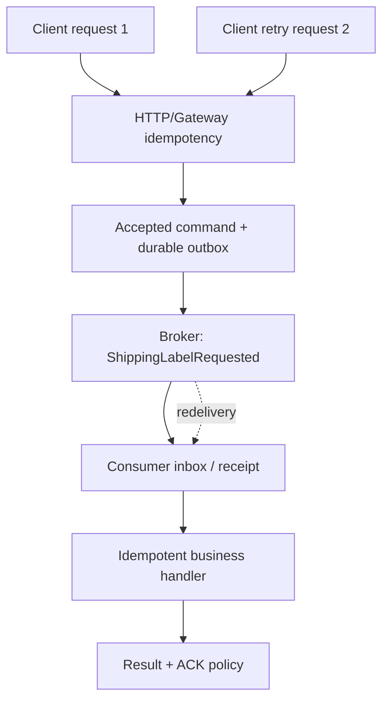
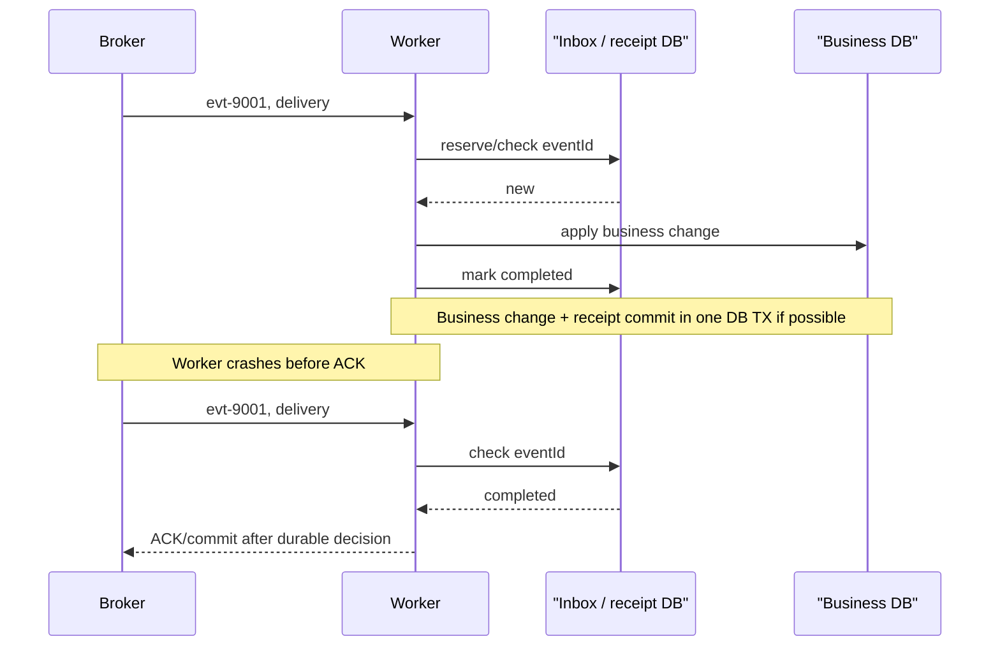
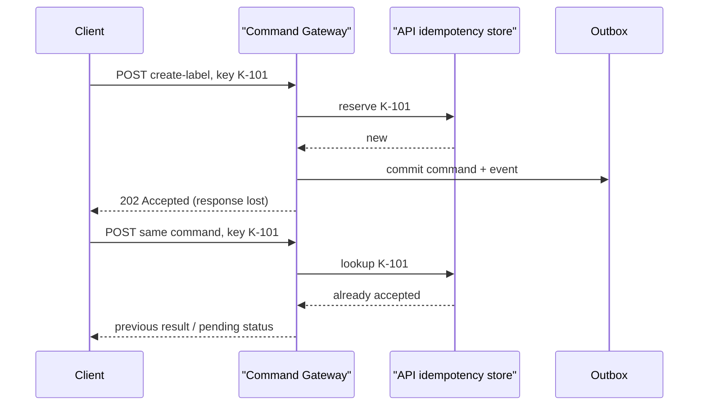
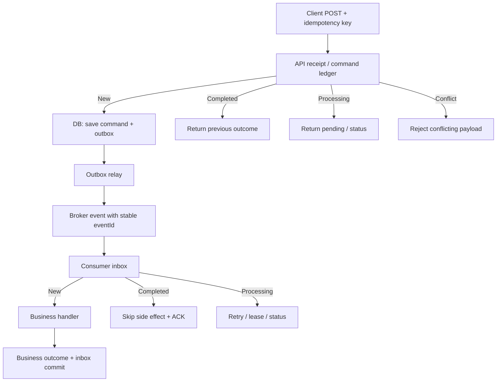
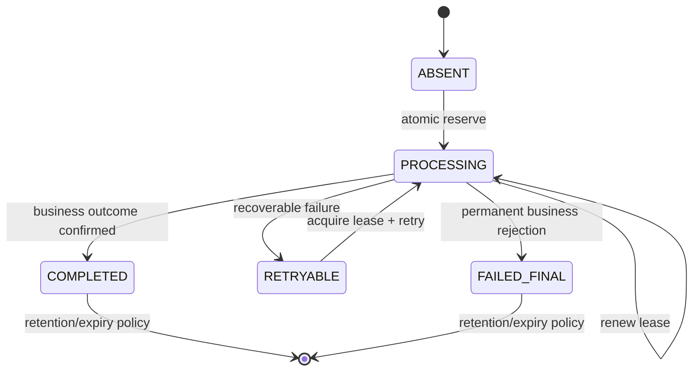
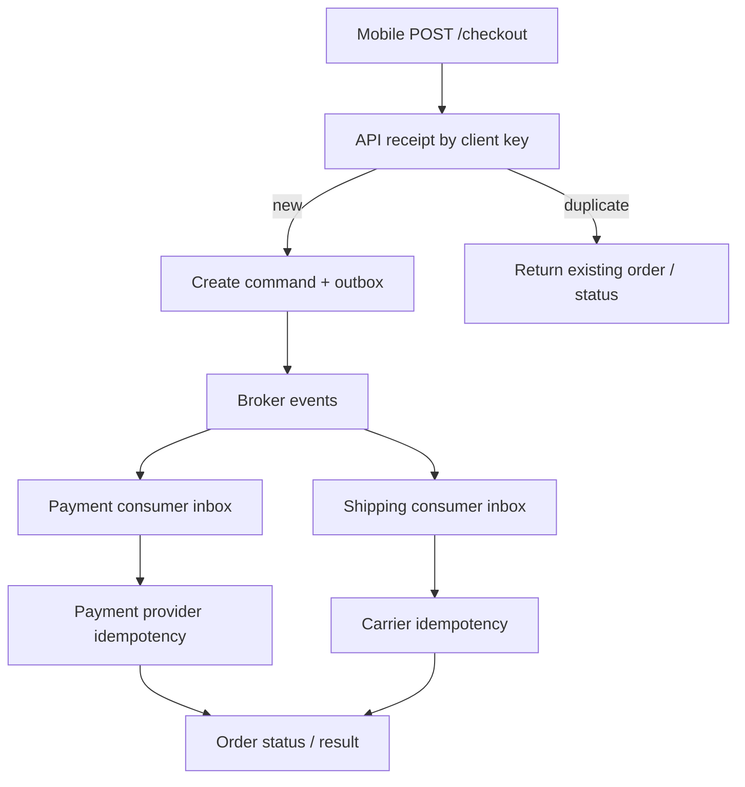

# Broker Duplicates vs. Client Duplicates

In **Spring Integration** systems, a business command can appear multiple times at two very different points: **the broker redelivers an existing message** or **the client resends a request** due to a timeout, network drop, or repeated user action. On the surface both look like “the same task requested twice”, yet **their origin, trustworthy identifiers, processing windows, and response contracts differ**.

For example, a user taps **Create Shipping Label** on mobile. The first HTTP request reaches the server, yet the network drops before the client receives the reply. The mobile app retries, potentially creating **two HTTP requests**. Meanwhile, the backend emits an event to Kafka; the consumer creates the label successfully but crashes before committing the offset, so **the same event** is redelivered by the broker. Addressing only one layer of duplicates can still create two labels or return inconsistent responses.

**Idempotent Receiver** is an Enterprise Integration Patterns (EIP) pattern enabling a receiver to handle **the same business operation being requested or delivered multiple times** without producing disallowed extra side effects. The article **“Broker Duplicates vs. Client Duplicates”** belongs to the **Idempotent receiver** chapter of the `SPRING_INTEGRATION_PATTERN` module: learning to implement EIP with Spring Integration to build loosely coupled, extensible message flows combining Router, Filter, Transformer, Splitter, Aggregator, Gateway, retry, error channel, and correlation, alongside testing and observing processing branches.

This lesson helps you:

- Distinguish **broker redelivery**, **producer retry**, and **client retry/double submit**.
- Identify the right **idempotency key** at HTTP/Gateway ingress and **event/command ID** at message consumers.
- Design a **two-layer deduplication architecture**: ingress command receipts and consumer event inboxes/receipts.
- Understand why **ACK/offset commit** and **business completion** are not synonyms.
- Return outcomes for `COMPLETED` duplicates, handle `PROCESSING`, and detect **same key with different payload**.
- Implement Java/Spring Integration examples and test restarts, concurrency, timeouts, duplicates, retries, and error channels.
- Recognize the boundaries of “exactly once” when calling databases or external services.

## 1. One Business Command, Two Paths Creating Duplicates

Suppose the application exposes `POST /shipping-labels`:

```text
HTTP request:
  tenantId = T-1
  idempotencyKey = ship-req-2026-001
  orderId = ORD-42
  parcelId = P-7

Domain command:
  CreateShippingLabel(orderId=ORD-42, parcelId=P-7)

Broker event:
  eventId = evt-9001
  commandId = ship-req-2026-001
  type = ShippingLabelRequested
```

There are at least two scenarios:

**Scenario A — Client duplicate**

```text
Mobile app -> HTTP request #1 -> API accepted
Mobile app <- response lost
Mobile app -> HTTP request #2 (retry same action)
```

The server must know **whether both HTTP calls represent one business command**. The client may preserve the same idempotency key or generate a new key; if it generates a new key, a filter on the old key cannot infer both commands share the same intent.

**Scenario B — Broker duplicate**

```text
Kafka -> delivers event evt-9001 -> consumer processes
Consumer -> DB write completed
Consumer crashes before offset commit
Kafka -> delivers event evt-9001 again
```

The consumer must know **whether event `evt-9001` already produced its side effect**. Both deliveries may carry different Spring `MessageHeaders.id` values despite sharing the same domain `eventId`.



**Core idea:** the upper layer prevents **command duplication by clients**, while the lower layer prevents **event re-execution by brokers**. Both are usually needed together.

## 2. Definition: “Duplicate” Depends on the Unit of Work

Receiving a message is **not enough to conclude it is a duplicate**. The system must define a **unit of idempotency**.

| Unit | Question | Common Key |
| --- | --- | --- |
| HTTP/API command | Is the user resending **the same command**? | `(tenant, operation, clientIdempotencyKey)` |
| Domain command | Is this the same shipping-label creation request? | `(tenant, commandId, operation)` |
| Event consumer | Has this consumer already processed this event? | `(consumerName, eventId)` or equivalent domain key |
| Split item | Has this line item/parcel already been processed? | `(batchId, itemId, operation)` |
| External side effect | Has the label API already created a label for **this command**? | Idempotency key supported by target API |
| Aggregator result | Has this result already been aggregated/published? | `(groupRunId, resultVersion)` |

For instance, two requests with the **same `orderId` yet different `parcelId`s** can both be valid operations. Using `orderId` alone as a dedup key would wrongly drop a parcel. Conversely, if a user repeats the same action while generating a new `requestId` each time, deduping by request ID lets duplicate business effects slip through.

### Three Commonly Conflated States

- **Key seen (`SEEN`)**: the store holds a marker. This **does not prove the task finished**.
- **Processing (`PROCESSING`)**: a worker owns or is executing the work; an outcome may not exist yet.
- **Completed (`COMPLETED`)**: the business outcome was confirmed/persisted per contract.

An idempotent receiver must choose its reaction **by state**, not merely by asking `containsKey`.

## 3. Comparing Broker Duplicates and Client Duplicates

| Aspect | Broker Duplicate | Client Duplicate |
| --- | --- | --- |
| Source | Redeliveries, lost ACK/commit, rebalances, replays, producer retries. | HTTP retries, double-clicks, refreshes, mobile offline replays, API timeouts. |
| Duplicated object | Usually the same **domain event/command**, though potentially two physical records. | May be the same HTTP operation, same intent, or **two valid distinct commands**. |
| Desired stable ID | `eventId`/`commandId` inside payload/envelope. | `Idempotency-Key`/`commandId` kept stable by client for the same action. |
| IDs not to use alone | Kafka offset, Rabbit delivery tag, Spring message ID. | TCP connection, per-retry HTTP request ID, timestamp. |
| Detection point | Consumer inbound before business side effect. | API/Gateway or command intake **before emitting a new event**. |
| When completed | ACK delivery; skip repeated side effect, optionally log duplicate. | Return **same business outcome** or status/cached response per API contract. |
| When processing | Delay/requeue/lease/status; avoid parallel execution. | `PENDING`/`202`, status query, or bounded wait. |
| When payload conflicts | Quarantine/reject events with same ID but differing data. | Return conflict per API contract; never overwrite prior request. |
| Dedup window | Broker retention, retries, DLQ/manual replays. | Client retry window and response-obligation duration. |
| Goal | Do not re-execute an already received/processed event. | Do not create a second business command on retry of the same action. |

**Note on producer duplicates:** the broker is not necessarily delivering **the same physical record a second time**. A producer may publish **two records** carrying the same `eventId` when unsure if the first was ACKed by the broker. Consumers must recognize them by **event identity**, not just topic/partition/offset.

## 4. Broker Duplicates: Anatomy of a Redelivered Execution



**What happens varies by broker:**

- With **Kafka**, a consumer can finish processing a record without **committing the offset**; after a rebalance/restart, the record may be read again. Offsets identify physical record positions, **not business event IDs**.
- With **RabbitMQ/AMQP**, messages can be **requeued/redelivered** if the consumer/channel/connection closes before ACK or per requeue policies. `deliveryTag` is channel-scoped, **not a durable idempotency key**.
- With other transports/pollers, progress checkpoints and redelivery contracts must likewise be clearly understood.

**Not every broker duplicates on every run**, yet applications must never build correctness on assuming **“messages are delivered strictly once across all failures”**.

### Producer Retries and Consumer Redeliveries Differ

**Producer retry**: A producer sends an event, loses the ACK, and resends. The broker may store **two records with equivalent event payloads**. Depending on idempotent-producer settings, physical duplicates may be reduced within specific bounds, yet consumers still need **business idempotency** for replays or application-level retries.

**Consumer redelivery**: The broker holds one record while the consumer **re-reads** it after losing progress/ACK. Both reads may share the same Kafka topic/partition/offset or carry different AMQP delivery metadata. Event identity and outcome checks are still required.

### Do Not Overuse the Term “Exactly Once”

Some infrastructure provides **exactly-once** mechanics within a specific transaction/stream-processing boundary. That **does not automatically include** HTTP payment APIs, other databases, email services, object stores, and your business domain. State **the exact guarantee boundary**, rather than concluding “Kafka transactions are enabled so double-charging is impossible”.

## 5. Client Duplicates: Server Processed Yet Client Does Not Know

An API command may already be processed **even though the client sees a timeout**:



The server **cannot know** whether the client received the response. Therefore, upon receiving the same `Idempotency-Key` again, it is best **not to issue a new command**, instead returning the status/reply matching the initial execution.

Common causes:

- Users tapping a button **twice** when UI locking lags or connections are slow.
- Mobile apps auto-retrying after timeouts.
- HTTP clients/proxies/gateways retrying requests with uncertain outcomes.
- Offline sync jobs replaying queued requests once connectivity returns.
- Users refreshing the page after submitting a form.
- The first request was accepted yet the reply was lost en route to the client.

### `Idempotency-Key` Only Helps If Clients Reuse It Properly

For **the same action intent**, the client must preserve **one stable key** across all retries. When creating **a valid new action**, the client must use a new key. Auto-generating a random key **on every HTTP retry** defeats server-side deduplication.

However, untrusted clients can send colliding or deliberately altered keys. APIs must **authenticate principals/tenants, scope keys, compare fingerprints, and enforce business constraints**. A client-supplied key **is not proof of authorization**.

## 6. Two Button Clicks: Is It Always a Duplicate?

No. Distinguish **repeating the same task** from **two tasks permitted to coexist**.

| Behavior | Example | Sensible Decision |
| --- | --- | --- |
| Retry after timeout | Same parcel, same operation, same key preserved. | Return prior request's status/outcome. |
| Double-click creating two HTTP requests | Same UI action within milliseconds. | Client keeps one key per action; server deduplicates per contract. |
| User genuinely buys two identical items | Two independent checkouts, each with a new command ID. | Do not block merely because payloads match. |
| Edit address and recreate label | Same parcel yet valid new operation/revision. | Issue new command/version honoring business rules. |
| Same key with changed payload | Request #1 `amount=100`, #2 `amount=200`. | `IDEMPOTENCY_CONFLICT`; never return the old payload's result as equivalent. |
| Client omits key | Sensitive POST lacking an idempotency contract. | Reject/require key or rely on intentional business uniqueness. |

**Do not deduplicate naively by comparing identical JSON bodies within a few seconds.** Two commands with matching payloads can both be legitimate. To curb UI duplicates, combine **client action identity** with business constraints rather than timestamp heuristics.

## 7. Identities Across Multiple Boundaries

A single shipping-label creation can involve multiple IDs:

```text
tenantId             = TENANT-A
clientIdempotencyKey = ship-intent-101
commandId            = cmd-101
eventId              = evt-9001
brokerRecordId       = topic/partition/offset (transport)
springMessageId      = a UUID generated for this message instance
correlationId        = group/run key for aggregation
traceId              = observability context
```

| ID | Lifecycle / Meaning | Use for Deduplication? |
| --- | --- | --- |
| **Client idempotency key** | One API command and its HTTP retries. | Yes, at API/Gateway once scoped/validated. |
| **Command ID** | Identifies an accepted business command. | Yes, for command-driven actions. |
| **Event ID** | Identifies a durable domain/integration event. | Yes, in consumer inboxes per subscriber. |
| **Broker offset/delivery tag** | Identifies/locates a delivery/record in transport. | Do not use in place of event identity. |
| **Spring `MessageHeaders.id`** | A specific Spring message object instance. | Unstable across reconstruction/redelivery. |
| **`correlationId`** | Groups related messages for Splitter/Aggregator/Gateway. | Not suitable by default for business dedup. |
| **`traceId`** | Serves observability and span linking. | No; multiple operations can share one trace. |

**Key distinction:** HTTP request #2 may have a **new technical request ID**, yet the **old client idempotency key**. A Kafka redelivery may construct a **new Spring message**, yet an **unchanged business event ID**. Never pick keys from technical metadata guaranteed to change per transmission.

### One Command Can Emit Multiple Events

For example, command `cmd-101` may produce:

```text
evt-9001: ShippingLabelRequested
evt-9002: ShippingLabelCreated
evt-9003: ShippingNotificationQueued
```

If a consumer deduplicates everything by `commandId`, it could mistakenly drop **distinct events**. Inbox keys should bind to **event identity and consumer context** or the consumer's target operation, not just the overarching command ID.

## 8. Two-Layer Architecture: API Receipt and Consumer Inbox

A practical design typically has:



**Layer 1 — API receipt** prevents the same client action from creating two new commands. It can store **responses/statuses** so retrying clients get consistent replies.

**Layer 2 — consumer inbox** prevents the same event (from broker retries/redeliveries) from triggering side effects again. It is typically partitioned by **consumer/subscriber**, since **the same event may need independent processing by multiple consumers**.

With API idempotency alone and no consumer inbox, broker redeliveries can still trigger side effects twice. With a consumer inbox alone where each client retry generates a new `eventId`, consumers treat both events as valid and execute side effects twice.

### Be Careful Sharing One Inbox Across Services

The same `eventId=evt-9001` may be processed **once each** by **Inventory**, **Billing**, and **Notification**. If all three share an `eventId` key without a `consumerName`/`operation` scope, the first worker blocks the other two. Thus:

```text
consumerInboxKey = consumerName + eventId
```

and within each service, if one event causes multiple independent side effects, distinguish each operation accordingly.

## 9. Typed Request and Receipt Contracts

A Java 17+ example:

```java
record CreateLabelRequest(
        String tenantId,
        String idempotencyKey,
        String orderId,
        String parcelId,
        String addressFingerprint
) {}

record ShippingLabelRequested(
        String eventId,
        String commandId,
        String tenantId,
        String orderId,
        String parcelId,
        String addressFingerprint
) {}

enum ReceiptStatus {
    PROCESSING,
    COMPLETED,
    FAILED_FINAL,
    RETRYABLE
}

record ApiReceipt(
        String tenantId,
        String operation,
        String idempotencyKey,
        String payloadHash,
        ReceiptStatus status,
        String resultReference
) {}
```

These are **application types**, not built-in Spring Integration classes. An API receipt can store the JSON response/HTTP status upon completion, or store `resultReference` to retrieve the outcome from the business DB.

### Fingerprinting and Canonicalization

A request with the same `Idempotency-Key` yet a different `parcelId` or address may be a **conflict**. Compute the fingerprint from fields affecting the operation after deliberate canonicalization:

```text
canonical = {
  operation: CREATE_LABEL,
  tenant: TENANT-A,
  order: ORD-42,
  parcel: P-7,
  addressRevision: addr-v3
}
payloadHash = SHA-256(canonical bytes)
```

Do not hash **raw JSON** if insignificant field ordering or whitespace can differ across retries. Never use hashes as authentication proof or to skip permission checks.

### Keys Must Be Properly Scoped

A bare key like `ship-101` might be chosen by two tenants. API receipt keys should usually be:

```text
(tenantId, operation, idempotencyKey, apiContractVersion)
```

For consumer inboxes:

```text
(consumerName, eventId)
```

If an event can spawn multiple independent operations inside the same consumer, extend with `operation`/`processingVersion`. Justify every extension by the business contract rather than adding fields “just in case”.

## 10. Receipt Lifecycle: Seen Does Not Mean Completed

A minimal state machine:



| Receipt State | Client Retry | Broker Redelivery |
| --- | --- | --- |
| `ABSENT` | Create command if valid; reserve atomically. | Process event for first time if valid. |
| `PROCESSING` | Return `PENDING`/`202`, optionally status query/bounded wait. | Do not run in parallel; delayed retry/lease ownership. |
| `COMPLETED` | Return cached result/old receipt. | Skip repeated side effect; ACK per delivery policy. |
| `FAILED_FINAL` | Return consistent business rejection. | Do not endlessly retry the same permanent error. |
| `RETRYABLE` | Return status/retry command per policy keeping same key. | Acquire lease and retry with backoff/bounds. |
| `UNKNOWN_REMOTE_OUTCOME` (if added) | Status uncertain; do not create new command. | Reconcile external API before calling again. |

**Never mark `COMPLETED` upon receiving the request** if workers have not executed the business logic yet. The API may return `202 Accepted` because the command and outbox are durably persisted, yet that means **accepted for processing**, not **label created successfully**.

## 11. Atomicity in the Receipt Store: `get` Then `put` Is Unsafe

When two HTTP requests or two broker consumers arrive concurrently with the same key:

```text
Worker A: get(key) -> missing
Worker B: get(key) -> missing
Worker A: put(key, PROCESSING)
Worker B: put(key, PROCESSING)
Worker A: create label
Worker B: create label
```

You need an **atomic reserve** in shared storage:

- `INSERT ... ON CONFLICT DO NOTHING` + unique constraint in the database.
- `ConcurrentMetadataStore.putIfAbsent` with appropriate atomic semantics.
- Versioned CAS/conditional updates when transitioning record states.
- Redis atomic commands with explicit persistence/TTL/eviction policies.
- Properly scoped transactions/locks when multiple instances contend.

**`synchronized` in one JVM does not protect other replicas.** Nor should `SELECT` before `INSERT` be relied upon as the sole race guard.

### Consider Atomicity with the Business DB

If receipt insertion and business outcome updates live in **the same database/transaction**, both roll back when a handler fails. If the receipt is written to a separate cache prior to writing the business DB, a business DB rollback **does not automatically remove the cache key**, causing subsequent retries to be wrongly blocked as duplicates.

## 12. Illustrative PostgreSQL Schema: Separating API Receipts and Consumer Inboxes

```sql
CREATE TABLE api_idempotency_receipts (
    tenant_id        VARCHAR(80) NOT NULL,
    operation        VARCHAR(80) NOT NULL,
    idempotency_key  VARCHAR(180) NOT NULL,
    contract_version VARCHAR(32) NOT NULL,
    payload_hash     CHAR(64) NOT NULL,
    status           VARCHAR(32) NOT NULL,
    command_id       VARCHAR(160),
    result_ref       VARCHAR(200),
    lease_owner      VARCHAR(120),
    lease_until      TIMESTAMPTZ,
    created_at       TIMESTAMPTZ NOT NULL,
    updated_at       TIMESTAMPTZ NOT NULL,
    PRIMARY KEY (
        tenant_id, operation, idempotency_key, contract_version
    )
);

CREATE TABLE consumer_inbox (
    consumer_name    VARCHAR(120) NOT NULL,
    event_id         VARCHAR(180) NOT NULL,
    payload_hash     CHAR(64) NOT NULL,
    status           VARCHAR(32) NOT NULL,
    result_ref       VARCHAR(200),
    lease_owner      VARCHAR(120),
    lease_until      TIMESTAMPTZ,
    created_at       TIMESTAMPTZ NOT NULL,
    updated_at       TIMESTAMPTZ NOT NULL,
    PRIMARY KEY (consumer_name, event_id)
);
```

This is a **design schema**; add retention, indexes, migrations, retry attempts/versions/fencing tokens as needed by your system. There is no inherent constraint forcing events of the same command to share one consumer outcome: that is the service's responsibility.

### Atomic Reserve

```sql
INSERT INTO consumer_inbox (
    consumer_name, event_id, payload_hash, status,
    created_at, updated_at
) VALUES (
    :consumer_name, :event_id, :payload_hash,
    'PROCESSING', NOW(), NOW()
)
ON CONFLICT (consumer_name, event_id) DO NOTHING;
```

When `rowCount=1`, a consumer reserved the event. When `rowCount=0`, read the existing receipt, verify the fingerprint and state; **never automatically ACK merely because the key exists** if the state is an unfinished `PROCESSING`.

### Can a Client Retry Produce a New Command/Event?

If the API handles duplicates properly, **the same idempotency key** should map to **the same accepted command** without emitting extra unintended business outbox events. If the client deliberately generates a new key, the database sees a distinct command unless a **business unique constraint** (e.g., each parcel may have at most one `ACTIVE` label per operation/version) or domain anti-double-submit logic applies.

## 13. Spring Integration: Idempotent Receiver at Consumer Inbound

Spring Integration provides **`IdempotentReceiverInterceptor`**, `MetadataStoreSelector`, and `ConcurrentMetadataStore` implementations to filter/flag messages by key.

Key points to understand:

1. **`MetadataStoreSelector`** can decide whether a message is first-seen via a key extractor and metadata store.
2. **`IdempotentReceiverInterceptor`** attaches the selector to a handler as advice; duplicate handling policy must be configured.
3. A “seen” metadata key **is not automatically a `COMPLETED` receipt** with full outcome and transaction guarantees.
4. Simply adding the interceptor **does not by default** return cached API responses or handle remote side effects.

Illustrative metadata selector setup; verify overloads and packages against your project's Spring Integration version:

```java
import org.springframework.context.annotation.Bean;
import org.springframework.context.annotation.Configuration;
import org.springframework.integration.handler.advice.IdempotentReceiverInterceptor;
import org.springframework.integration.metadata.ConcurrentMetadataStore;
import org.springframework.integration.metadata.SimpleMetadataStore;
import org.springframework.integration.selector.MetadataStoreSelector;

@Configuration
class BrokerDedupConfig {

    @Bean
    ConcurrentMetadataStore eventSeenStore() {
        return new SimpleMetadataStore();
    }

    @Bean
    IdempotentReceiverInterceptor idempotentAdvice(
            ConcurrentMetadataStore store) {

        MetadataStoreSelector selector = new MetadataStoreSelector(
                message -> {
                    ShippingLabelRequested event =
                            (ShippingLabelRequested) message.getPayload();
                    return "shipping-label-worker|" + event.eventId();
                },
                store
        );
        return new IdempotentReceiverInterceptor(selector);
    }
}
```

**Deployment warning:** `SimpleMetadataStore` here is **in-memory** and unsuitable if deduplication must survive restarts or be shared across workers. `MetadataStoreSelector` has **key-marking** semantics rather than replacing business transactions; do not treat this snippet as guaranteeing each label is created only once.

### Why Not Just Use `Filter`?

A `Filter` with predicate “unseen event ID” can remove duplicates from the flow, yet duplicates arriving while the first handler is still **`PROCESSING` or has failed** must not always be dropped. Moreover, a Filter dropping messages does not automatically send a Gateway reply or fix Aggregator group releases. A stateful receipt with explicit policies is often required over a Boolean selector.

## 14. In-JVM Java Example: Two Duplicate Sources, Two Check Gates

We build a **practice model** using Java 17+, Spring Integration Java DSL, and `ConcurrentHashMap` to illustrate both boundaries. The example **has no external side effects** and must not be equated with production exactly-once guarantees.

### 14.1. Contracts and Atomic Guards

```java
import java.util.concurrent.ConcurrentHashMap;
import java.util.concurrent.ConcurrentMap;

record ClientCommand(
        String tenantId,
        String idempotencyKey,
        String parcelId
) {}

record BrokerEvent(
        String eventId,
        String commandId,
        String parcelId
) {}

record ReceiptDecision(
        String identity,
        String source,
        String status
) {}

final class TwoBoundaryDedup {
    private final ConcurrentMap<String, Boolean> clientKeys =
            new ConcurrentHashMap<>();
    private final ConcurrentMap<String, Boolean> eventKeys =
            new ConcurrentHashMap<>();

    ReceiptDecision onClient(ClientCommand command) {
        String key = checked(command.tenantId())
                + "|" + checked(command.idempotencyKey());
        boolean first = clientKeys.putIfAbsent(key, true) == null;
        return new ReceiptDecision(
                command.idempotencyKey(),
                "CLIENT",
                first ? "FIRST_ACCEPTED" : "DUPLICATE_CLIENT");
    }

    ReceiptDecision onBroker(BrokerEvent event) {
        String eventId = checked(event.eventId());
        boolean first = eventKeys.putIfAbsent(eventId, true) == null;
        return new ReceiptDecision(
                eventId,
                "BROKER",
                first ? "FIRST_DELIVERY" : "DUPLICATE_BROKER");
    }

    private static String checked(String value) {
        if (value == null || value.isBlank() || value.contains("|")) {
            throw new IllegalArgumentException("INVALID_IDENTITY");
        }
        return value;
    }
}
```

**Intentional limitations:**

- Guards only record **first-seen**, without knowing `PROCESSING` vs. `COMPLETED`.
- Does not verify payload fingerprints, operation/version, event tenant, or transactions.
- Not persistent and cannot span multiple JVMs.
- Uses `|` delimiter with validation for demo; production needs structured/unambiguous encoding and explicit normalization policies.
- Performs no authorization checks on clients or broker producers.
- **Never use this guard to execute real payments/orders**; if a business call fails, retries would be flagged as duplicates and wrongly dropped.

### 14.2. Spring Integration DSL for Both Input Channels

```java
import org.springframework.context.annotation.Bean;
import org.springframework.context.annotation.Configuration;
import org.springframework.integration.channel.DirectChannel;
import org.springframework.integration.channel.QueueChannel;
import org.springframework.integration.config.EnableIntegration;
import org.springframework.integration.dsl.IntegrationFlow;

@Configuration
@EnableIntegration
class TwoBoundaryDedupFlowConfig {

    @Bean
    TwoBoundaryDedup twoBoundaryDedup() {
        return new TwoBoundaryDedup();
    }

    @Bean
    DirectChannel apiCommandInput() {
        return new DirectChannel();
    }

    @Bean
    DirectChannel brokerEventInput() {
        return new DirectChannel();
    }

    @Bean
    QueueChannel apiDecisions() {
        return new QueueChannel();
    }

    @Bean
    QueueChannel brokerDecisions() {
        return new QueueChannel();
    }

    @Bean
    IntegrationFlow apiIntakeFlow(TwoBoundaryDedup guard) {
        return IntegrationFlow.from("apiCommandInput")
                .handle(ClientCommand.class,
                        (command, headers) -> guard.onClient(command))
                .channel("apiDecisions")
                .get();
    }

    @Bean
    IntegrationFlow brokerConsumerFlow(TwoBoundaryDedup guard) {
        return IntegrationFlow.from("brokerEventInput")
                .handle(BrokerEvent.class,
                        (event, headers) -> guard.onBroker(event))
                .channel("brokerDecisions")
                .get();
    }
}
```

These are **two internal flows** testing duplicate classification across **two identity namespaces**. There are no real HTTP/Kafka adapters or offset commits; `brokerEventInput` simulates **events entering the consumer after the adapter**.

In a real application, adapters should map the stable `eventId` from trusted payloads/envelopes onto messages and invoke a service backed by durable receipts. `QueueChannel` is only used to inspect decisions in tests.

## 15. JUnit 5 Integration Test: Separating Both Duplicate Layers

Tests must demonstrate:

- Two client submissions with the same key are caught as duplicates at the **client boundary**.
- Two broker deliveries with the same event ID are caught as duplicates at the **broker boundary**.
- Broker redelivery of `evt-1` does not increment `clientKeys`.
- Two distinct events remain **two separate events**, even with the same `commandId` — per domain contract.

```java
import static org.junit.jupiter.api.Assertions.assertEquals;
import static org.junit.jupiter.api.Assertions.assertNotNull;
import static org.junit.jupiter.api.Assertions.assertTrue;

import org.junit.jupiter.api.Test;
import org.springframework.beans.factory.annotation.Autowired;
import org.springframework.beans.factory.annotation.Qualifier;
import org.springframework.integration.channel.QueueChannel;
import org.springframework.messaging.MessageChannel;
import org.springframework.messaging.support.MessageBuilder;
import org.springframework.test.annotation.DirtiesContext;
import org.springframework.test.context.junit.jupiter.SpringJUnitConfig;

@SpringJUnitConfig(TwoBoundaryDedupFlowConfig.class)
@DirtiesContext(classMode = DirtiesContext.ClassMode.AFTER_EACH_TEST_METHOD)
class TwoBoundaryDedupFlowTest {

    @Autowired @Qualifier("apiCommandInput")
    MessageChannel apiInput;

    @Autowired @Qualifier("brokerEventInput")
    MessageChannel brokerInput;

    @Autowired @Qualifier("apiDecisions")
    QueueChannel apiOutput;

    @Autowired @Qualifier("brokerDecisions")
    QueueChannel brokerOutput;

    private static String status(QueueChannel output) {
        var message = output.receive(1_000);
        assertNotNull(message);
        return ((ReceiptDecision) message.getPayload()).status();
    }

    @Test
    void clientRetriesSameKeyButDoesNotCreateNewIntent() {
        var request = new ClientCommand(
                "TENANT-A", "ship-action-1", "P-1");

        assertTrue(apiInput.send(
                MessageBuilder.withPayload(request).build()));
        assertTrue(apiInput.send(
                MessageBuilder.withPayload(request).build()));

        assertEquals("FIRST_ACCEPTED", status(apiOutput));
        assertEquals("DUPLICATE_CLIENT", status(apiOutput));
    }

    @Test
    void brokerRedeliversSameEventIndependentlyOfClientRequests() {
        var event = new BrokerEvent("evt-1", "cmd-1", "P-1");

        assertTrue(brokerInput.send(
                MessageBuilder.withPayload(event).build()));
        assertTrue(brokerInput.send(
                MessageBuilder.withPayload(event).build()));

        assertEquals("FIRST_DELIVERY", status(brokerOutput));
        assertEquals("DUPLICATE_BROKER", status(brokerOutput));
    }

    @Test
    void differentEventIdsAreDifferentEventsEvenWithSameCommandId() {
        brokerInput.send(MessageBuilder.withPayload(
                new BrokerEvent("evt-requested", "cmd-1", "P-1")).build());
        brokerInput.send(MessageBuilder.withPayload(
                new BrokerEvent("evt-completed", "cmd-1", "P-1")).build());

        assertEquals("FIRST_DELIVERY", status(brokerOutput));
        assertEquals("FIRST_DELIVERY", status(brokerOutput));
    }
}
```

`@DirtiesContext` gives each test its own `ConcurrentHashMap`, isolated from previous tests' keys. These tests check **Spring Integration wiring and first-seen behavior**, not real business outputs or persistence.

**Question to remember:** different `eventId`s do not guarantee two independent tasks. The third test merely shows two different **event identities** must not be blindly merged due to sharing `commandId`. If a producer accidentally creates **two `ShippingLabelRequested` events with two IDs for the same command**, domain/business idempotency in the handler must still prevent creating two labels.

## 16. Special Case: Client Retry Creates a New Event, So the Inbox Misses It

Consider the broken flow:

```text
HTTP #1 (no stable client key)
   -> cmd-A -> event evt-A -> broker -> consumer

HTTP #2 retry of same user action
   -> cmd-B -> event evt-B -> broker -> consumer
```

The consumer inbox sees `evt-A` and `evt-B` as **two distinct events**, so both are processed as new. This **is not an inbox bug**: ingress created two different business commands from one user intent.

Fix at **the earliest point that knows business intent**:

1. The API requires or issues a stable **client action/idempotency key**.
2. The receipt store reserves the key atomically.
3. The API binds the key to **one command ID** and one eventual outcome.
4. Events are emitted from an outbox with a **stable `eventId`** for the same accepted command.
5. Consumers still keep inboxes because the broker may redeliver even when the API emits only one command.

If a client cannot preserve keys across app restarts, a business uniqueness constraint can help (e.g., “each parcel has at most one `ACTIVE` label per operation/version”). Yet that is a **domain rule**, not deduplicating every request with the same `orderId`.

## 17. Reverse Case: Idempotent API Yet Broker Redelivers

Consider proper ingress:

```text
HTTP #1 -> idempotencyKey K-1 -> command C-1
HTTP #2 -> idempotencyKey K-1 -> same command C-1
Outbox emits event E-1
```

Yet on the consumer:

```text
Broker E-1 delivery #1 -> create label -> DB commit
Crash before offset commit
Broker E-1 delivery #2 -> create label AGAIN (if no inbox/idempotency)
```

Hence **API receipts do not replace consumer inboxes**. If the side effect writes to the same DB as the inbox, use a **transaction** to save the receipt/processed marker and business result together. If the side effect is an external Carrier API, use a **downstream idempotency key** or status query capability.

## 18. ACK/Commit: Which Milestone Is Safe for Duplicates?

Systems have multiple kinds of acknowledgments:

| Milestone | Meaning | Does Not Prove |
| --- | --- | --- |
| HTTP `202` response | Server accepted the request per contract. | Worker created the label / finished business work. |
| Outbox commit | Command/event intent durably saved in DB. | Broker received the message. |
| Broker producer ACK | Broker accepted publish per ack configuration. | Consumer processed it. |
| Consumer ACK/offset commit | Consumer reports receive/process progress per policy. | Remote side effects committed atomically with offset. |
| Business result commit | Outcome persisted under business DB transaction. | Caller saw reply; external system definitely ACKed. |

### A Small Crash Matrix

| Crash Point | What Can Happen | Mitigation |
| --- | --- | --- |
| Before reserving API key | HTTP retries as a new request. | Atomic reserve. |
| After reserving API key, before saving command | Key sits in `PROCESSING` with no work. | Shared DB transaction or lease/recovery. |
| After committing command/outbox, before HTTP response | Client retries same key. | Return cached accepted command/status. |
| After broker publish, before producer receives ACK | Event may be published again. | Stable event ID, outbox relay, inbox. |
| After business DB commit, before consumer offset commit | Broker redelivers. | Inbox/receipt in same DB transaction. |
| After external side effect, before local result commit | Uncertain whether remote executed. | Remote idempotency key / reconciliation. |

**Never ACK/commit offsets before recovery-critical data is durably stored**, unless the business contract intentionally tolerates lost work. Conversely, holding messages un-ACKed indefinitely on `PROCESSING` duplicates can trigger retry storms; define retry, backoff, and lease policies.

## 19. PostgreSQL: Transaction Binding Inbox with Business Row

When inbox and business outcomes live in the same database, the logic can be:

```text
BEGIN;
  INSERT INTO consumer_inbox(eventId, consumerName, status=PROCESSING)
    ON CONFLICT DO NOTHING;

  IF new:
      INSERT business result (unique business key)
      UPDATE consumer_inbox SET status=COMPLETED, result_ref=...
  ELSE:
      read current receipt
      compare payloadHash
      if COMPLETED: return old result
      if PROCESSING: wait/retry later, do not duplicate side effect
COMMIT;
```

**Enforce unique constraints wherever appropriate**. The inbox unique key protects **event delivery**, whereas a business unique key protects the domain when two distinct events represent the same action.

If inserting the business row fails and the transaction rolls back, the inbox record must also roll back if retries should run as first-time executions. If `INSERT inbox` hits a cache outside the DB, the transaction does not revert the cache key back to unseen.

### Outbox Handling Client Retries

For HTTP requests, one transaction can:

```text
BEGIN;
  reserve/read api_receipt by stable key
  if new:
      insert accepted_command
      insert outbox_event
      mark api_receipt ACCEPTED with command ID
COMMIT;
```

Subsequent HTTP retries with the same key simply read `api_receipt`, **without inserting a new command/outbox**. The outbox relay may emit duplicate events if ACKs are uncertain; the consumer inbox blocks duplicate processing downstream.

**Do not merge API receipt state and consumer inbox state** into one Boolean “seen” flag, because they answer two different questions.

## 20. With a Synchronous HTTP Gateway, Which Reply Should Duplicates Receive?

An API can return final outcomes synchronously or process asynchronously. Define a **consistent response contract** for duplicates.

| API Receipt State | Potentially Suitable Response |
| --- | --- |
| New key, accepted async | `202 Accepted` + `commandId`/status URL. |
| Old key, still processing | Return `202/PENDING` with same command ID; optionally bounded wait per policy. |
| Old key, completed | Return cached business result/status with same resource ID. |
| Old key, terminal business rejection | Return consistent rejection outcome. |
| Old key, different payload | Return `409 Conflict` or API-defined idempotency error code. |
| Old key, receipt past retention | Per contract: reject replay/require new action, or treat as fresh if safe. |

**Exact HTTP status codes have no single universal standard across all APIs**, depending on sync/async semantics. More importantly, never create **two commands** for the same valid key and never return `SUCCESS` for unfinished work.

### A Common Pitfall with `Filter` or Interceptors

If a Gateway sends a message into a Spring Integration flow and Idempotent Receiver **drops** the duplicate without emitting a reply, the caller can time out even though the old outcome sits in the receipt store. For APIs requiring replies, route duplicates to a **cached-result handler/status lookup** instead of dropping messages silently.

## 21. `PROCESSING` and Retries: Do Not Turn Duplicates into Lost Work

Suppose worker A reserves a key, then hits a transient error:

```text
A: reserve eventId=evt-7 -> PROCESSING
A: call remote API -> timeout
B: receives evt-7 again
B: finds PROCESSING
```

If B ACKs and drops permanently, work is lost. If B immediately calls the remote API, side effects may duplicate.

A policy is needed:

- Receipts store `leaseOwner`, `leaseUntil`, `attemptCount`, `lastErrorCode`.
- Worker A renews its lease or transitions to `RETRYABLE` when it knows work did not finish.
- Worker B only acquires the lease when CAS/expiry and policy permit.
- For remote APIs with uncertain outcomes, **reconcile by idempotency key** before calling again.
- Use backoff, jitter, max attempts, and dead-letter/quarantine once limits are exceeded.

### Leases Do Not Stop Late Remote Side Effects

Worker A can lose its lease and still receive a late HTTP response. Worker B gets the new lease and also calls the remote service. Preventing two side effects requires downstream idempotency or a **fencing token** honored by the executor/store. A `leaseUntil` column in the DB **does not cancel** already-dispatched calls.

## 22. Client-Side Mitigations Help, Never Replace Server Idempotency

In UI/mobile apps, duplicates can be reduced by:

- Disabling submit buttons while a request is pending.
- Preserving the same `Idempotency-Key` across retries of **one action**, even across app restarts.
- Avoiding auto-retrying sensitive POSTs without an idempotency contract.
- Showing `PENDING` and querying status instead of issuing new actions on network drops.
- Limiting re-submissions of offline outbox jobs if client queues replay.

However, **clients can crash, be cloned, run on multiple devices, or be tampered with**. Thus the server must enforce business constraints and atomic receipts. UI debouncing only reduces traffic; it never guarantees against double payments or double shipments.

## 23. Router, Filter, Splitter, Aggregator, and Claim Check

### Router

A command may be routed to different services. Dedup keys at each service must be scoped by **operation/consumer**; never share an `orderId` key across create-label and cancel-label branches. Route metadata does not prove tenant authorization.

### Filter

A Filter can exclude duplicate deliveries, yet you must understand its `discardChannel`. **Discard** differs from **error** and differs from **returning an old result**. When replies are needed, route to a cached-result/status handler. If an Aggregator awaits a result, dropping messages can stall the group.

### Splitter

When a batch of three parcels splits into three messages, items must not share an idempotency key of just `batchId`:

```text
item 1 key: (batchId=B-1, parcelId=P-1, operation=CREATE_LABEL)
item 2 key: (batchId=B-1, parcelId=P-2, operation=CREATE_LABEL)
item 3 key: (batchId=B-1, parcelId=P-3, operation=CREATE_LABEL)
```

Keep `correlationId`/`sequenceNumber` for the Aggregator to gather outcomes; **correlation does not replace idempotency**. When processed items are redelivered, return **cached `ItemResult`s** to the group when needed rather than dropping and stalling the release strategy.

### Aggregator

Duplicate replies can prematurely release a group if the release strategy only counts messages. Use recipient/item identity to deduplicate and enforce cardinality per contract. Once a group has released, late duplicates need a policy so they do not emit a second summary.

### Gateway

Calling a Gateway after a timeout with the same command ID may need to return a cached response or `PENDING` status. Relying solely on the first invocation's `replyChannel` will not deliver results to the second invocation: the original reply channel may belong to an expired caller.

### Claim Check

One business request may be checked into Claim Check twice, producing **two different tickets**. If deduplicating solely by `claimId`, the same event/action can run twice. Durable event/command identities independent of tickets and claim-store retention/expiry matching redeliveries are needed.

## 24. Concurrency Testing: Two Client Requests and Two Broker Deliveries

**Do not test sequential submissions only.** Two requests can arrive simultaneously at two replicas; `SELECT` then `INSERT` fails against races. Inside a JVM, you can verify guard atomicity; in production, test real unique constraints and transactions.

```java
import static org.junit.jupiter.api.Assertions.assertEquals;

import java.util.ArrayList;
import java.util.List;
import java.util.concurrent.Callable;
import java.util.concurrent.CountDownLatch;
import java.util.concurrent.ExecutorService;
import java.util.concurrent.Executors;
import java.util.concurrent.Future;
import java.util.concurrent.TimeUnit;

import org.junit.jupiter.api.Test;

class TwoBoundaryDedupConcurrencyTest {

    @Test
    void exactlyOneWinnerForEightConcurrentClientRetries()
            throws Exception {

        TwoBoundaryDedup guard = new TwoBoundaryDedup();
        var command = new ClientCommand("TENANT-A", "same-action", "P-1");
        int total = 8;
        ExecutorService pool = Executors.newFixedThreadPool(total);
        CountDownLatch start = new CountDownLatch(1);

        try {
            List<Callable<String>> calls = new ArrayList<>();
            for (int i = 0; i < total; i++) {
                calls.add(() -> {
                    start.await();
                    return guard.onClient(command).status();
                });
            }

            List<Future<String>> futures = new ArrayList<>();
            for (Callable<String> call : calls) {
                futures.add(pool.submit(call));
            }
            start.countDown();

            int firstAccepted = 0;
            for (Future<String> future : futures) {
                if ("FIRST_ACCEPTED".equals(
                        future.get(2, TimeUnit.SECONDS))) {
                    firstAccepted++;
                }
            }
            assertEquals(1, firstAccepted);
        } finally {
            start.countDown();
            pool.shutdownNow();
        }
    }
}
```

This test only proves **one `ConcurrentHashMap` in one JVM** yields a single winner. Production tests need two service instances sharing a DB, two concurrent HTTP requests with the same key and fingerprint, and outbox-aware event emissions. For brokers, simulate parallel redeliveries or rebalances per transport rather than assuming consumer groups protect all side effects.

## 25. Test Matrix Distinguishing Broker and Client Duplicates

| ID | Scenario | Expectation |
| --- | --- | --- |
| CLIENT-01 | HTTP retry with same key, same payload. | One accepted command; subsequent calls return cached status/outcome. |
| CLIENT-02 | Double-click on same action/key. | Does not create two commands/outbox events. |
| CLIENT-03 | Same key, different payload. | `IDEMPOTENCY_CONFLICT`; does not overwrite prior work. |
| CLIENT-04 | Same payload with intentionally new key. | Per business constraints, not treated as duplicate solely for matching JSON. |
| CLIENT-05 | Retry after response timeout while command committed. | Retrieves old command/result; does not emit new command. |
| CLIENT-06 | Two tenants using same key. | Independent receipts; no cross-tenant result leaks. |
| CLIENT-07 | Key expired, client retries much later. | Per replay/retention contract, does not duplicate sensitive tasks. |
| CLIENT-08 | Two parallel HTTP requests with same key. | One atomic reserve winner; remaining requests receive proper status. |
| BROKER-01 | Redelivery of same `eventId` after consumer crash. | Does not execute side effect a second time. |
| BROKER-02 | Two records sharing `eventId` from producer retry. | Inbox detects duplicate by event ID regardless of offset. |
| BROKER-03 | Same `commandId` with two different event types/IDs. | Consumer handles per each event's contract; no false drop. |
| BROKER-04 | Business DB commits, offset not yet committed. | Redelivery sees `COMPLETED`; ACKs per policy. |
| BROKER-05 | Receipt reserved, worker crashes before business effect. | Lease/recovery allows retry without losing work. |
| BROKER-06 | External API succeeds, local reply lost. | Downstream query/idempotency; never blindly creates new effect. |
| BROKER-07 | Redis/cache receipt lost on restart. | Test exposes limitation; never claims durability. |
| BROKER-08 | Two instances process same event. | Shared atomic receipt/unique key; no racing side effects. |
| CROSS-01 | Client retries valid key while broker also redelivers. | One accepted command, one business effect; both dedup layers work. |
| CROSS-02 | Client retry generates new key for same parcel. | Business uniqueness/command ID enforces if genuine duplicate. |
| CROSS-03 | Filter drops duplicate item before Aggregator. | Does not stall group; returns cached `ItemResult` or handles per policy. |
| CROSS-04 | Gateway retries after result already finished. | Retry does not time out from silent Filter drop. |
| SECURITY-01 | Client alters tenant/operation in headers. | Cannot bypass permissions or access another tenant's receipt. |
| RETENTION-01 | Broker replays after TTL. | Outcome matches retention contract; no surprise double payment. |

**The single most important end-to-end test** is typically: *client resends same key, outbox relay may publish duplicates, broker redelivers, workers crash at multiple points — business outcome still occurs once per contract*.

## 26. Observability and Runbook When Duplicates Surge

If you only count API requests, the system may look like it has healthy growth while **80% are retries** from a downstream outage. Conversely, counting only inbox duplicates can miss the API creating two commands with different IDs from a double-click.

Measure separately:

| Illustrative Metric | Question to Answer |
| --- | --- |
| `api_idempotency_first_total` | How many new API keys were accepted? |
| `api_idempotency_duplicate_total{status}` | How many HTTP retries received old state? |
| `api_idempotency_conflict_total` | How many had same key with different payload? |
| `broker_event_received_total` | How many deliveries/records reached consumers? |
| `consumer_inbox_duplicate_total{status}` | How many duplicate events came from redelivery/replay? |
| `consumer_inbox_processing_age_seconds` | Which receipts have been stuck `PROCESSING` too long? |
| `consumer_inbox_lease_expired_total` | How much work required recovery? |
| `outbox_publish_retry_total` | How often did the relay lose ACK and republish? |
| `business_effect_confirmed_total` | How many side effects were confirmed? |
| `idempotency_conflict_total{boundary}` | Did conflict occur at API or consumer? |
| `duplicate_after_retention_total` | How many replays arrived after the dedup window? |

Metric names are **application-instrumented suggestions**, not guaranteed built-ins from Spring Integration. Never use `idempotencyKey`, `eventId`, `commandId`, customer IDs, or raw payloads as metric labels due to high cardinality and exposure risks.

Structured event logs:

```text
boundary=API
action=CREATE_LABEL
decision=DUPLICATE_COMPLETED
commandRef=cmd-101
traceId=trace-11

boundary=BROKER
consumer=shipping-label-worker
decision=EVENT_ALREADY_APPLIED
eventRef=evt-9001
traceId=trace-12
```

Log only audit-approved identifiers; if a client idempotency key acts as a bearer token, **never log it verbatim**.

### Incident Triage Runbook

- **API duplicates spiking:** check client retry policies, network timeouts, UI double-submits, and response latency.
- **Inbox duplicates spiking:** check consumer crashes, offset/ACK timing, producer retries, broker rebalances, and outbox relays.
- **Both spiking together:** downstream latency likely increased causing both client retries and broker redeliveries; investigate shared root cause.
- **Receipts stuck `PROCESSING`:** inspect lease owners, dead workers, retry queues, and unknown remote outcomes.
- **Fingerprint conflicts spiking:** producers/clients may be misusing keys; never delete receipts merely to silence alerts.
- **Side effect counts rising despite blocked duplicates:** check mis-scoped keys, non-idempotent external APIs, or out-of-transaction side effects.

## 27. Applied Scenario: Orders, Payments, and Shipping

**Context:** An e-commerce app receives `POST /checkout`. Mobile clients have unstable networks. The backend publishes `OrderAccepted`, `PaymentRequested`, and `ShippingRequested` events to a broker. Payment and Shipping consumers run multiple replicas, can restart, and receive redeliveries. Users can either legitimately buy twice or resubmit one checkout due to timeouts.



### Design Exercises

1. **Client key:** define what key each tap of “Pay” uses, where it is stored across app restarts, and when a new key is generated for a second purchase.
2. **Payload conflict:** if the same key arrives with a changed cart/address/amount, what error returns? Canonical hashing and explicit policy are required.
3. **Command/outbox:** how does an HTTP retry produce **only one accepted order command**, even if another API node handles the retry?
4. **Event identity:** what stable ID does each `PaymentRequested`/`ShippingRequested` event carry? Why are two events sharing an order ID not treated as one?
5. **Consumer inbox:** Payment/Shipping need per-consumer/event unique keys; where do transaction boundaries sit?
6. **External provider:** when payment times out after the provider may have charged, how do you reconcile before retrying?
7. **Gateway response:** if checkout takes minutes, should the HTTP request block synchronously? Choose `202`/status query or final reply per contract.
8. **Broker ACK:** when is committing offset/ACK safe if the receipt is `COMPLETED` vs. still `PROCESSING`?
9. **Lease/recovery:** the Payment worker crashes and its lease expires; how do you prevent both the stale worker and new worker from charging?
10. **Splitter:** each order has multiple parcels; per-parcel idempotency must preserve correlation for the Aggregator to gather.
11. **Retention:** do API receipt and inbox retention periods cover retries, mobile offline sync, and manual broker replays?
12. **Observability:** distinguish HTTP retry rates, broker redeliveries, outbox publish retries, and confirmed business effects.

### Self-Assessment Questions

**Question 1:** A client retries the same POST while generating a new HTTP request ID. Is this a new command? **Not necessarily.** Check the client idempotency key and business contract, not the HTTP request ID.

**Question 2:** Kafka redelivers the same event because the consumer failed to commit the offset. If `MessageHeaders.id` is new, is it a new business event? **No.** Rely on the durable domain/envelope `eventId`.

**Question 3:** If the API already deduplicates well, is a consumer inbox still needed? **Often yes.** Broker redeliveries or producer retries can still repeat events even though the API accepted only one command.

**Question 4:** The consumer inbox already has a `PROCESSING` record. Can we ACK and drop the event as “already seen”? **Not by default.** The work may not be done; lease/status/recovery handling is needed.

**Question 5:** Two `PaymentRequested` events have different IDs yet share the same order/payment intent. Is an event-ID inbox enough to prevent double-charging? **Not necessarily.** Business uniqueness or downstream payment idempotency by payment intent/operation is needed.

**Question 6:** Do different broker offsets guarantee two distinct business events? **No.** A producer may have published duplicate records carrying the same event ID.

**Question 7:** A user buys the same cart twice using two new idempotency keys. Should every case be blocked? **No.** Both transactions may be valid; business rules decide.

**Question 8:** Does using `IdempotentReceiverInterceptor` mean the handler never re-runs on duplicates and side effects happen exactly once? **No.** You must understand duplicate-handling configuration, receipt transactions, and external service boundaries.

## 28. Implementation and Review Checklist

- [ ] Distinguished **client intent**, accepted command, emitted event, and broker delivery.
- [ ] Clients use a **stable idempotency key** for retries of one action; new key for new actions.
- [ ] API keys are scoped by tenant, operation, and version; never trust client-asserted permissions.
- [ ] Same key with different payload is detected via fingerprinting/canonicalization and handled as a conflict.
- [ ] API receipts track `PROCESSING/COMPLETED/FAILED` and appropriate cached results/statuses.
- [ ] Accepted commands and outbox rows commit in the same transaction when sharing a DB.
- [ ] Outbox events preserve **stable `eventId`** when relays republish after lost ACKs.
- [ ] Consumer inboxes separate keys by `consumerName + eventId` or business operation per contract.
- [ ] Atomic inserts/CAS/unique constraints prevent concurrent consumers from processing the same key.
- [ ] Receipts and business outcomes commit in the same transaction when in the same database.
- [ ] External side effects have provider idempotency keys or reconciliation when responses are uncertain.
- [ ] `PROCESSING` is never dropped as `COMPLETED`; leases, backoff, and recovery exist.
- [ ] Broker ACKs/offset commits align with recoverable state, not merely successful `send()`.
- [ ] Gateway/HTTP duplicates receive cached results/statuses rather than timing out from Filter drops.
- [ ] Splitter/Aggregator preserve correlation, item identity, and proper handling of duplicate child messages.
- [ ] Dedup stores are sufficiently durable, shared across replicas, and retain records across replay windows.
- [ ] Tests cover client retries, broker redeliveries, producer publish retries, concurrency, restarts, and lost ACKs.
- [ ] Metrics distinguish API duplicates from consumer duplicates, with alerts for stuck receipts.
- [ ] Never make an “exactly once” claim exceeding what transactions/transports actually guarantee.

## Summary

- **Client duplicates** occur when **an API intent is resent**; they require stable ingress idempotency keys, stateful receipts, and cached results/command IDs. Identical payloads do not automatically mean identical intent, and same-key different-payload requests must be handled as conflicts.
- **Broker duplicates** occur when events/records are republished or redelivered; consumers must use **durable event IDs and inboxes/receipts** to prevent duplicate side effects, never relying on offsets, delivery tags, Spring message IDs, or trace IDs.
- **The two idempotency layers do not replace each other**: API receipts stop client retries from creating new commands; consumer inboxes stop broker redeliveries from re-executing events. A client retry can still spawn events with different IDs if the API layer is poorly designed.
- **`PROCESSING` differs from `COMPLETED`**. Knowing a key exists is insufficient to ACK/drop; transactions, leases, retries/recovery, and duplicate-reply policies are required.
- For DB side effects, **unique constraints and transactions** synchronize receipts and business outcomes; for external APIs, downstream idempotency keys, `UNKNOWN` states, and reconciliation are needed. No broker, interceptor, or cache alone provides end-to-end exactly-once guarantees.
- Test **both duplicate sources separately and combined**, especially timeouts, lost ACKs, producer publish retries, concurrency, restarts, and payload conflicts; monitor metrics at every boundary to pinpoint root causes.
