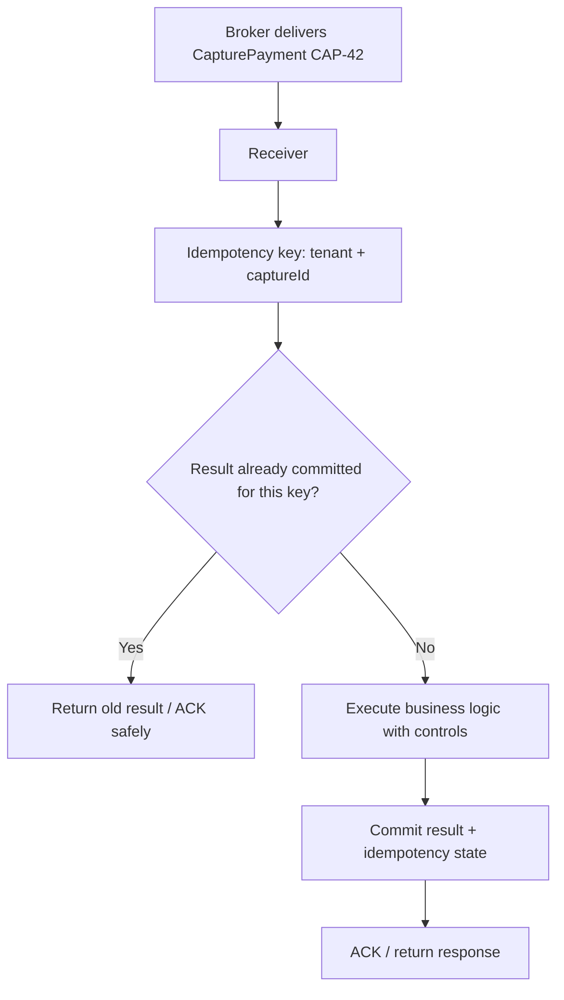
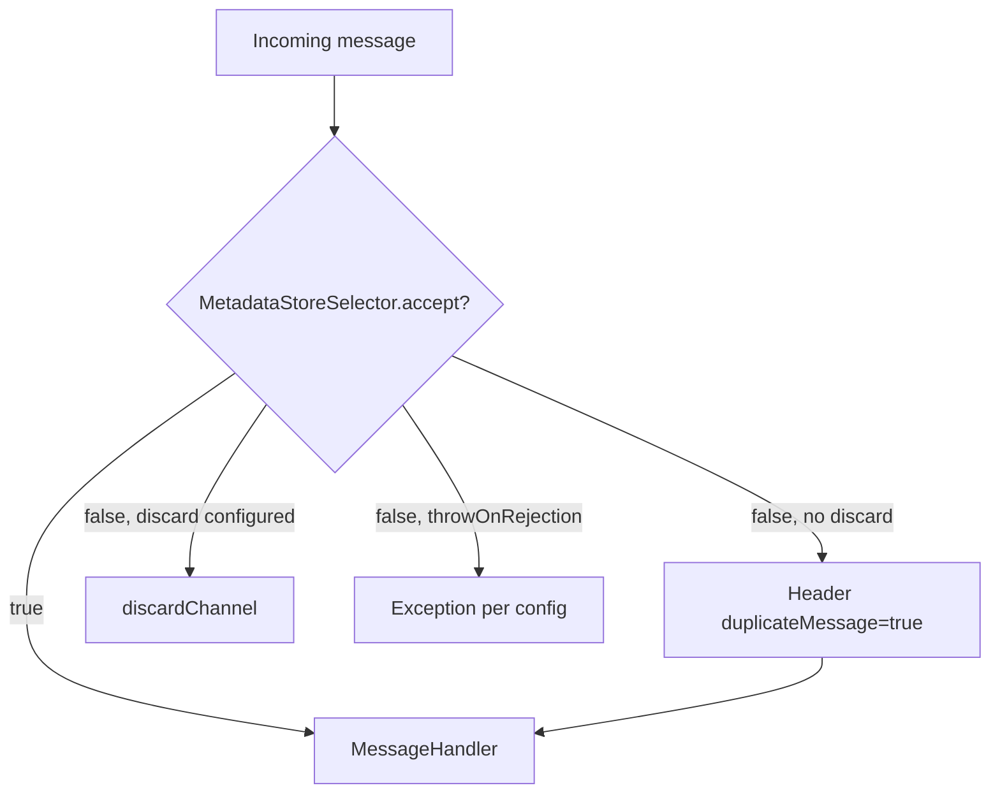
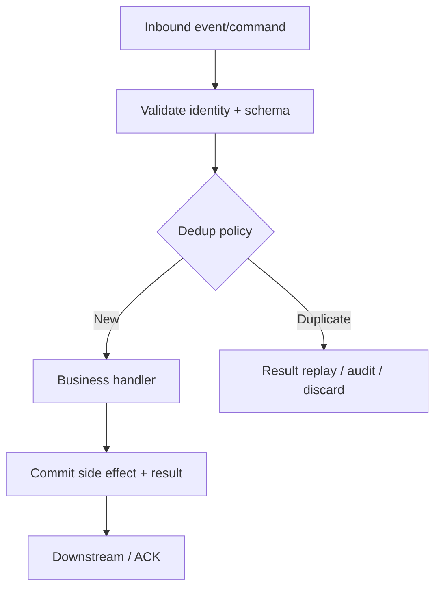
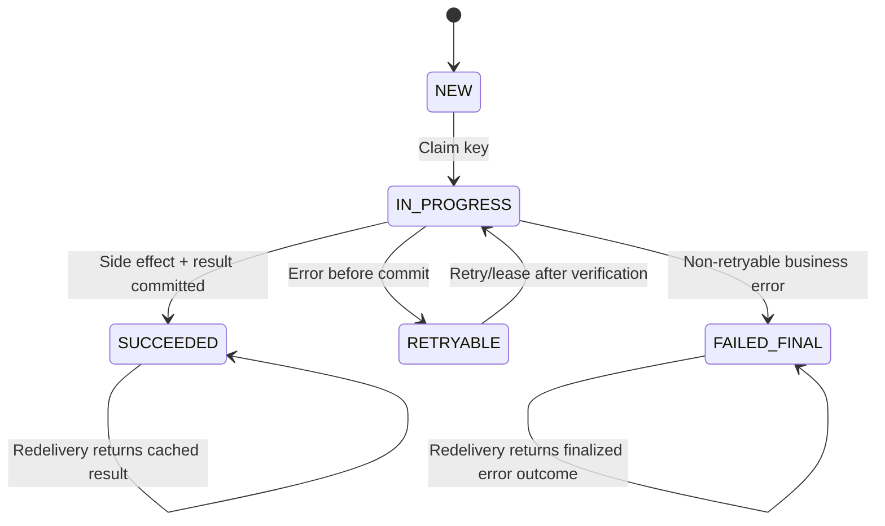

# Differences Between Idempotency and Deduplication in Spring Integration

## Lesson Objectives

A payment system receives a `CapturePayment` command from a broker. The broker delivers the message to a worker, the worker calls the payment service, yet the ACK is lost. The broker sends **the same command again**. If the worker charges twice, the system violates business rules. A natural reaction is “just filter out duplicate messages”. However, if the worker **marks the message as seen before charging** and crashes before calling the payment service, the redelivery may be filtered out; the customer **was never charged yet the system considers it processed**.

This is why two commonly conflated concepts must be distinguished:

- **Deduplication:** identifying multiple occurrences of the same unit of information by a key/rule, then retaining, flagging, skipping, or merging duplicates.
- **Idempotency (of an operation):** applying **the same logical request multiple times** still produces **the same desired business state/effect** as executing it once, within the defined contract scope and retention window.

Deduplication can **assist** an Idempotent Receiver, yet does not by itself prove side effects committed once. Conversely, an operation can be idempotent without removing every duplicate message at the transport layer.

This article belongs to the **Idempotent receiver** chapter of the **SPRING_INTEGRATION_PATTERN** module. The learning path applies Enterprise Integration Patterns with Spring Integration to build loosely coupled, extensible flows; practicing Router, Filter, Transformer, Splitter, Aggregator, Gateway, retry, error channel, correlation, and observing processing branches.

After this lesson, you will be able to:

1. Clearly explain **message duplicate**, **business command duplicate**, **idempotent operation**, and **exactly-once effect**.
2. Choose durable idempotency keys scoped by tenant, operation, and business request rather than relying solely on `MessageHeaders.ID` or payload content.
3. Use `MetadataStoreSelector` with `ConcurrentMetadataStore` to detect previously seen keys.
4. Use `IdempotentReceiverInterceptor` in Java DSL and understand the difference between **setting `duplicateMessage`** and **routing to a discard channel**.
5. Write JUnit tests verifying first delivery, redelivery with a new message ID, requests with different keys, and invalid inputs.
6. Analyze races/crashes across **claim key → invoke handler → commit → ACK**, including across multiple workers/instances.
7. Design business idempotency using unique constraints, transactions, result replay, transactional outboxes, and external service idempotency keys.
8. Know when **not to deduplicate**: update events with new versions, new commands with identical contents, corrections/reversals, or multiple branches of a Scatter–Gather.

---

## 1. Opening Example: Two Deliveries Do Not Necessarily Mean Two Executions

Suppose the command is:

```text
tenantId   = shop-a
orderId    = ORD-42
captureId  = CAP-42
amount     = 125000 VND
```

The broker may deliver:

```text
T1 broker -> Worker: Message ID=m-101, captureId=CAP-42
T2 Worker begins processing
T3 Worker records payment or sends request to provider
T4 Worker loses connection before ACK
T5 broker -> Worker: Message ID=m-102, captureId=CAP-42
```

Two Spring `Message<?>` instances have **different** technical IDs yet represent **the same charge request**. Choosing a dedup key based on message ID will **not** prevent the second execution.

What must be protected is **the “capture CAP-42” effect**, not merely a packet of data.



This is the **desired business model**, not the automatic behavior of a `MetadataStoreSelector`.

## 2. Exact Definitions: Deduplication and Idempotency

### Deduplication

A duplicate-detection function might be:

\[
D(m) = \mathrm{key}(m)
\]

If two messages `m1` and `m2` satisfy `D(m1)=D(m2)`, the system **may** treat them as duplicates under a specific policy. That policy must also consider:

- Is the key still valid within the dedup window?
- Do both messages genuinely represent the same **business command**?
- If they share the key yet have **different payloads**, is that a valid retry or a conflict?
- Was the prior message **finished processing** or merely **received/marked**?
- Should duplicates be dropped, return the old outcome, be quarantined, or proceed with a duplicate flag?

**Deduplication is a decision about records/messages**, not by itself a guarantee that side effects completed.

### Idempotency

For an operation `f` over business state, generally expressed as:

\[
f(f(s)) = f(s)
\]

Examples:

- `setOrderStatus(orderId, "PAID")` can usually be made idempotent when status is already `PAID` and the contract emits no extra side effects.
- `incrementBalance(accountId, 100)` is **not naturally idempotent**: calling twice adds 200.
- `sendEmail(...)` is not naturally idempotent: calling twice can send two emails.
- `capturePayment(captureId, ...)` can **be made idempotent** using a stable key and proper ledger/provider support.

Idempotency must specify **which observations must remain identical**. For instance, “set status=PAID” may leave the DB unchanged after the first call, yet if it still sends an email every time, **the overall operation** still duplicates side effects.

### Quick Comparison

| Criterion | Deduplication | Idempotency |
| --- | --- | --- |
| Primary unit | Message/event/request record | Business operation and impact |
| Question | “Have we seen this key/record already?” | “Does re-executing change the committed outcome?” |
| Common mechanisms | Metadata stores, caches, hashes, unique event keys | Unique command keys, transactions, state machines, result replay |
| Can it drop messages? | Yes, depending on policy | Not required; can return old outcomes |
| After pre-processing crash | Risk of wrongly dropping retry messages | Must recover claim/state for safe retries |
| After post-commit crash | May not know commit occurred | Must reconcile business ledger/outcome |
| Multiple instances | Needs atomic key store/claims | Must guarantee commits and idempotency across instances |
| Time scope | Dedup/retention window | Duration defined by business contract |

**Conclusion:** dedup can be part of an Idempotent Receiver, yet **idempotency is stronger** because it binds directly to outcomes and side effects.

## 3. Four Easily Confused Scenarios

### Scenario A — Dedup Succeeds Yet Business Fails

```text
T1 receive CAP-42
T2 selector putIfAbsent(CAP-42) -> SUCCESS
T3 crash before charging
T4 broker redelivers CAP-42
T5 selector finds key exists -> DROP
```

Outcome: only one message passed the filter, yet **the payment was never collected**.

### Scenario B — No Dedup Yet Operation Remains Idempotent

```text
T1 CAP-42 -> DB transaction creates capture, status=SUCCEEDED
T2 CAP-42 redelivery -> DB reads capture already SUCCEEDED
T3 returns same captureResult; writes no extra side effects
```

Two inbound executions occurred, yet **one business outcome**.

### Scenario C — Identical Content Yet Not a Duplicate

Two separate orders with the same amount:

```text
Capture CAP-42 amount=125000
Capture CAP-43 amount=125000
```

Hashing payloads solely by `amount` could lose a valid transaction. Choose keys by **business operation identity**, not by attributes that happen to match.

### Scenario D — Same Key Yet Different Content

```text
CAP-42 attempt 1: amount=125000
CAP-42 attempt 2: amount=999000
```

Never silently treat the second delivery as a normal retry or process it as a new transaction. This is a **`KEY_REUSE_CONFLICT`** if the contract binds `captureId` to one command content. Fingerprint the immutable request fields and return an error/audit per policy.

## 4. Delivery Models: At-Most-Once, At-Least-Once, and Exactly-Once

| Delivery Semantics | Can Messages Be Lost? | Can Duplicates Occur? | Consequence |
| --- | --- | --- | --- |
| At-most-once | Yes | Generally avoided per contract | Work can be lost on crashes |
| At-least-once | Retries delivery until acked | **Yes** | Consumer must tolerate redeliveries |
| Exactly-once delivery within a specific scope | Depends on protocol/mechanism | Guaranteed within stated scope | Does not imply external DB/API effects are exactly-once |

A broker or stream processor offering “exactly-once” **does not automatically encompass** payment APIs, external databases, or email servers. Define **the transaction boundary**.

### A Classic Failure Point

```text
Consumer executes DB COMMIT successfully.
ACK to broker is lost.
Broker redelivers.
```

If the consumer repeats `UPDATE balance = balance + amount` without a command ledger, the balance becomes wrong. In-RAM dedup might block temporarily yet vanishes on app restarts or replica switches.

Business idempotency must sit **where it protects the side effect**.

## 5. What Does Spring Integration Provide?

Spring Integration implements the **Idempotent Receiver** pattern via `IdempotentReceiverInterceptor` — a **`HandleMessageAdvice`**, not a standalone endpoint. It uses a `MessageSelector` to decide whether a message is accepted or recognized as a duplicate.

Components:

| Component | Responsibility |
| --- | --- |
| `MessageSelector` | Function deciding new vs. old messages per policy |
| `MetadataStoreSelector` | Selector using keys/values in `ConcurrentMetadataStore` |
| `ConcurrentMetadataStore` | Provides atomic operations such as `putIfAbsent` |
| `SimpleMetadataStore` | In-memory store suited for demos/tests; not retained across restarts |
| `IdempotentReceiverInterceptor` | Advice attached to `MessageHandler.handleMessage(...)` |
| `IntegrationMessageHeaderAccessor.DUPLICATE_MESSAGE` | Header marking duplicate messages |
| `discardChannel` | Destination for rejected messages if configured |
| `throwExceptionOnRejection` | Converts rejections into `MessageRejectedException` if enabled |

### Default Behavior Is **Not DROP**

Per the Spring Integration Reference:

- If the selector accepts the message → the handler receives it normally.
- If the selector rejects it, **with no discard channel and no throw-exception config** → the handler **is still invoked** with header `duplicateMessage=true`.
- If `discardChannel` is configured → duplicate messages go to that channel and do not reach the target handler.
- If `throwExceptionOnRejection(true)` is enabled → duplicates are rejected and an exception is thrown per policy; if a discard channel is also set, it may be sent to discard before throwing.
- To drop silently, use `nullChannel` as the discard destination.

**Never add `IdempotentReceiverInterceptor` and assume all duplicates vanish automatically.**



This is a logical flow, not the exact callback sequence when combining discard and throw. Always test your application's actual configuration path.

## 6. How `MetadataStoreSelector` Detects Duplicates

Suppose the selector uses the key:

```text
key = shop-a|capture|CAP-42
```

First time:

```text
ConcurrentMetadataStore.putIfAbsent(key, value)
  -> returns null, value stored
  -> selector.accept(message) == true
```

Subsequent time:

```text
ConcurrentMetadataStore.putIfAbsent(key, value)
  -> returns old value
  -> selector.accept(message) == false
```

**Important note:** the selector writes the key **while deciding acceptance**, meaning **before the handler finishes business processing**. A key in the metadata store cannot be treated as proof of `COMMITTED`.

### What Is the Metadata Key's Value?

By default `MetadataStoreSelector` uses the message's `timestamp` header to generate the metadata value. You can pass a `valueStrategy` to store versions/offsets/sequence numbers.

Application example:

```text
key   = file-import|doc-42
value = highest-processed-line-number
```

When using `compareValues`, the selector can accept a message if the new value represents progress over the old value. `BiPredicate<String,String>` receives **old value first, new value second**; if it returns `true`, the new value is written and the message is accepted.

This is a **high-water mark update policy**, and does not mean every smaller line number succeeded; if parallel execution or gaps occur, storing only the largest number can lose uncommitted items.

## 7. Designing Properly Scoped Idempotency Keys

A typical key for a charge command:

```text
tenantId + "|" + operation + "|" + captureId
```

Examples:

```text
shop-a|CAPTURE|CAP-42
shop-a|REFUND|CAP-42
shop-b|CAPTURE|CAP-42
```

These three keys are **distinct**. A capture ID may collide across tenants or be referenced in a completely different refund operation.

### Keys to Avoid

| Key | Why Unsuitable in Many Cases |
| --- | --- |
| `MessageHeaders.ID` | Retries may generate a new message ID |
| `traceId` | May change across runs/retries; one trace spans multiple commands |
| `timestamp` | Every delivery has a different timestamp |
| Hash of full payload | Unstable metadata fields; two valid commands can look identical |
| `orderId` alone | One order has multiple captures/refunds/generations |
| `tenantId` alone | Wrongly blocks every other command in the same tenant |
| `correlationId` alone | One group has multiple branches or distinct side effects |

### At What Granularity?

- **Event dedup:** producer-issued `eventId` plus namespace/source.
- **Command idempotency:** `tenant + operation + commandId`.
- **Per-branch result:** `workflowId + branchId + resultVersion`.
- **Per-line import:** `sourceId + sourceVersion + physicalLineNumber`.
- **Summary consumer:** `workflowId + generation + "final"`.

Not every system needs the same key at every layer. Choose keys by **the impact being protected**.

### Payload Fingerprinting

When an idempotency key must correspond to a single command body, store a fingerprint of meaningful fields:

```text
key = shop-a|CAPTURE|CAP-42
fingerprint = SHA-256(canonical amountMinor + currency + account + ...)
```

Fingerprints detect **same key with different requests**. They **do not replace keys**, because two valid commands with different IDs can have identical payloads.

Fingerprints require canonicalization, schema versioning, encoding, and PII protection policies.

## 8. Complete Java DSL: Detecting Duplicates and Routing to a Discard Channel

This example shows **message-level deduplication** with `IdempotentReceiverInterceptor`, without pretending to be a production payment processor. The handler simply forwards accepted messages to a test `QueueChannel` to observe **zero duplicate invocations within one Spring context**.

### Input Data

```java
public record CaptureCommand(
    String tenantId,
    String orderId,
    String captureId,
    long amountMinor
) {}
```

`amountMinor` is the amount in minor units per contract; this example assumes no currency conversion. Real systems need `currency` and explicit rounding rules.

### Java 17+ / Spring Integration 6.x Configuration

```java
import java.util.regex.Pattern;

import org.springframework.beans.factory.annotation.Qualifier;
import org.springframework.context.annotation.Bean;
import org.springframework.context.annotation.Configuration;
import org.springframework.integration.channel.DirectChannel;
import org.springframework.integration.channel.QueueChannel;
import org.springframework.integration.config.EnableIntegration;
import org.springframework.integration.dsl.IntegrationFlow;
import org.springframework.integration.handler.advice.IdempotentReceiverInterceptor;
import org.springframework.integration.metadata.ConcurrentMetadataStore;
import org.springframework.integration.metadata.SimpleMetadataStore;
import org.springframework.integration.selector.MetadataStoreSelector;
import org.springframework.messaging.MessageChannel;
import org.springframework.messaging.MessageHandler;
import org.springframework.messaging.PollableChannel;

@Configuration
@EnableIntegration
public class DemoDedupConfig {

    public record CaptureCommand(
        String tenantId,
        String orderId,
        String captureId,
        long amountMinor
    ) {}

    private static final Pattern SAFE =
        Pattern.compile("[A-Za-z0-9_-]+");

    static String key(CaptureCommand command) {
        if (command == null
                || !valid(command.tenantId())
                || !valid(command.orderId())
                || !valid(command.captureId())
                || command.amountMinor() <= 0) {
            throw new IllegalArgumentException("INVALID_COMMAND");
        }

        // IDs use restricted characters so '|' will not collide.
        return command.tenantId() + "|CAPTURE|"
            + command.captureId();
    }

    private static boolean valid(String value) {
        return value != null && SAFE.matcher(value).matches();
    }

    @Bean("capture.in")
    MessageChannel input() {
        return new DirectChannel();
    }

    @Bean("capture.accepted")
    PollableChannel accepted() {
        // Test sink for messages permitted to process.
        return new QueueChannel();
    }

    @Bean("capture.duplicates")
    PollableChannel duplicates() {
        // Test sink / observation channel for rejected messages.
        return new QueueChannel();
    }

    @Bean
    ConcurrentMetadataStore dedupMetadataStore() {
        // In-memory for demo only; not durable across restarts.
        return new SimpleMetadataStore();
    }

    @Bean
    IdempotentReceiverInterceptor dedupAdvice(
        ConcurrentMetadataStore dedupMetadataStore
    ) {
        var selector = new MetadataStoreSelector(
            message -> key((CaptureCommand) message.getPayload()),
            dedupMetadataStore);

        var advice = new IdempotentReceiverInterceptor(selector);
        advice.setDiscardChannelName("capture.duplicates");
        return advice;
    }

    @Bean("captureHandler")
    MessageHandler captureHandler(
        @Qualifier("capture.accepted") MessageChannel accepted
    ) {
        // Simulated handler: merely forwards message to test sink.
        return message -> accepted.send(message);
    }

    @Bean
    IntegrationFlow dedupFlow(
        @Qualifier("captureHandler") MessageHandler handler,
        IdempotentReceiverInterceptor dedupAdvice
    ) {
        return IntegrationFlow.from("capture.in")
            .handle(handler, endpoint -> endpoint.advice(dedupAdvice))
            .get();
    }
}
```

### Flow Analysis

1. `capture.in` receives `CaptureCommand`.
2. `IdempotentReceiverInterceptor` invokes `MetadataStoreSelector` to compute the key.
3. For an unseen key, `ConcurrentMetadataStore.putIfAbsent` succeeds; the message proceeds to `captureHandler`.
4. The handler puts the message onto `capture.accepted` — **merely a test sink**, performing no real payment capture.
5. For an existing key, the advice sends the message to `capture.duplicates`; the handler is not invoked again.
6. The two `QueueChannel`s let tests clearly observe accepted vs. duplicate-flagged messages.

**Limitation:** in step 3, the key is written **before** the handler completes. Replacing the test sink with a real payment API without a business ledger and retry/recovery can still **lose effects** or diverge state on failures.

### Why Not Pick `MessageHeaders.ID` as the Key?

Each `MessageBuilder.withPayload(...)` call constructs a new message that can receive a new ID, even when payload `captureId` matches. Business keys detect redeliveries **of the same command**, while letting a different command with a different capture ID pass.

## 9. Integration Testing with JUnit 5 and AssertJ

```java
import static org.assertj.core.api.Assertions.assertThat;
import static org.assertj.core.api.Assertions.assertThatThrownBy;

import org.junit.jupiter.api.Test;
import org.springframework.beans.factory.annotation.Autowired;
import org.springframework.beans.factory.annotation.Qualifier;
import org.springframework.messaging.Message;
import org.springframework.messaging.MessageChannel;
import org.springframework.messaging.PollableChannel;
import org.springframework.messaging.support.MessageBuilder;
import org.springframework.test.context.junit.jupiter.SpringJUnitConfig;

@SpringJUnitConfig(DemoDedupConfig.class)
class DemoDedupFlowTest {

    @Autowired
    @Qualifier("capture.in")
    MessageChannel input;

    @Autowired
    @Qualifier("capture.accepted")
    PollableChannel accepted;

    @Autowired
    @Qualifier("capture.duplicates")
    PollableChannel duplicates;

    private void send(String tenant, String order, String capture) {
        var command = new DemoDedupConfig.CaptureCommand(
            tenant, order, capture, 125_000L);

        assertThat(input.send(
            MessageBuilder.withPayload(command).build()
        )).isTrue();
    }

    @Test
    void firstCommandAcceptedButRedeliveryDiscarded() {
        send("shop-a", "ORD-42", "CAP-42");

        Message<?> first = accepted.receive(2_000);
        assertThat(first).isNotNull();
        assertThat(
            ((DemoDedupConfig.CaptureCommand)
                first.getPayload()).captureId()
        ).isEqualTo("CAP-42");

        // MessageBuilder creates a new message with the same captureId.
        send("shop-a", "ORD-42", "CAP-42");

        Message<?> duplicate = duplicates.receive(2_000);
        assertThat(duplicate).isNotNull();
        assertThat(
            ((DemoDedupConfig.CaptureCommand)
                duplicate.getPayload()).captureId()
        ).isEqualTo("CAP-42");

        assertThat(accepted.receive(0)).isNull();
        assertThat(duplicates.receive(0)).isNull();
    }

    @Test
    void sameCaptureIdInDifferentTenantIsNotDuplicate() {
        send("shop-a", "ORD-55", "CAP-55");
        send("shop-b", "ORD-55", "CAP-55");

        Message<?> a = accepted.receive(2_000);
        Message<?> b = accepted.receive(2_000);

        assertThat(a).isNotNull();
        assertThat(b).isNotNull();
        assertThat(accepted.receive(0)).isNull();
        assertThat(duplicates.receive(0)).isNull();
    }

    @Test
    void differentCaptureIdIsASeparateCommand() {
        send("shop-a", "ORD-66", "CAP-66-A");
        send("shop-a", "ORD-66", "CAP-66-B");

        assertThat(accepted.receive(2_000)).isNotNull();
        assertThat(accepted.receive(2_000)).isNotNull();
        assertThat(accepted.receive(0)).isNull();
    }

    @Test
    void invalidCommandFailsBeforeHandler() {
        var invalid = new DemoDedupConfig.CaptureCommand(
            "shop-a", "ORD-77", "", 125_000L);

        assertThatThrownBy(() ->
            input.send(MessageBuilder.withPayload(invalid).build())
        ).isInstanceOf(RuntimeException.class);

        assertThat(accepted.receive(0)).isNull();
        assertThat(duplicates.receive(0)).isNull();
    }
}
```

**Why does this test still not prove idempotency?** It only observes **messages reaching the test handler** inside **one JVM**; it does not test payment commits, broker ACKs, process crashes, external API retries, or two concurrent instances.

**State isolation note:** `SimpleMetadataStore` and the queues live in the Spring context; tests use distinct keys and must not run concurrently against the same queues. If tests reuse keys across methods, use separate contexts/stores or controlled cleanup.

## 10. Duplicate-Marking Mode Instead of Discarding

Without a `discardChannel`, `IdempotentReceiverInterceptor` can **let duplicates pass to the handler** while adding a header:

```java
import org.springframework.integration.IntegrationMessageHeaderAccessor;
import org.springframework.messaging.Message;

void handle(Message<?> message) {
    boolean duplicate = Boolean.TRUE.equals(
        message.getHeaders().get(
            IntegrationMessageHeaderAccessor.DUPLICATE_MESSAGE));

    if (duplicate) {
        // Can look up the already-processed outcome and return to caller.
        return;
    }

    // First-time execution per contract.
}
```

This is an **illustrative snippet**, not wired into a full flow. Key point: `duplicateMessage=true` is **advisory metadata**, and does not guarantee the handler skips business logic.

### Three Policies When Seeing a Duplicate

| Policy | Meaning | Contract with Caller |
| --- | --- | --- |
| **Mark and continue** | Handler receives duplicate flag | Handler must decide side effect/response itself |
| **Discard** | Duplicate does not reach main handler | May yield no reply if caller is waiting |
| **Throw** | Duplicate rejected via exception | Caller must understand errors/retry conditions |

If a client sends an HTTP/Gateway request with the same idempotency key, silently dropping it **can cause the Gateway to time out** even though the prior request already succeeded. Many business flows should **return the old outcome** instead of simply dropping.

### Why Is Result Replay Needed?

Suppose the first request produced:

```json
{
  "captureId": "CAP-42",
  "status": "SUCCEEDED",
  "providerReference": "PROV-777"
}
```

A duplicate request with the same key should return **that exact saved business outcome** (or a contract-equivalent response), rather than `409 Duplicate` or silence.

`duplicateMessage` only detects at the message layer; returning results requires a **business result store**.

## 11. Where Can Deduplication Live in a Pipeline?



### Filter Before Handler

You can use `MessageFilter` + `MetadataStoreSelector`:

```java
.filter(
    new MetadataStoreSelector(
        message -> (String) message.getHeaders().get("eventKey"),
        metadataStore),
    spec -> spec.discardChannel("events.duplicates"))
```

This is an **excerpt**, requiring channels and `ConcurrentMetadataStore` to be defined. It works well for message-level dedup, yet like the advice, marking keys before business commit still risks **dropping retries after crashes**.

### Advice on Handler

```java
.handle(handler, endpoint -> endpoint.advice(dedupAdvice))
```

This places Idempotent Receiver **on the exact consumer endpoint needing protection**, rather than putting a shared filter ahead of branches that still need to receive the message.

### Broker-Side Dedup

Some brokers/adapters drop records with matching producer sequences or event IDs within a certain window. Even so, applications must still enforce DB/provider idempotency because brokers do not see all side effects.

### DB-Side Idempotency

For data-mutating operations, transactions and unique business keys are usually the most critical guardrail. Inbound dedup can be used to **shed load**, never as the sole protection for money, quotas, inventory, or notifications.

## 12. Crash Windows: Why “Key Seen” Is Not “Processing Finished”

An ideal command state machine:



**This is an application-designed state machine**, not states automatically stored by `MetadataStoreSelector`.

### Failure-Timing Analysis Table

| Crash Timing | What May Have Happened | What to Do on Retry |
| --- | --- | --- |
| Before claiming key | No state created | Can accept command as new |
| After claim, before side effect | Unprocessed yet key exists | Check `IN_PROGRESS` timeout/lease then retry |
| After DB side effect, before commit | DB transaction may roll back | Rely on actual commit status, do not guess |
| After DB commit, before ACK | Side effect occurred, broker redelivers | Read ledger and return old result |
| After external API success, before saving local result | Provider may have executed transaction | Reconcile/query provider using same idempotency key |
| After outbox commit, before publish ACK | Event may be re-emitted | Downstream consumer still needs idempotency |

`ConcurrentMetadataStore.putIfAbsent` resolves **key-creation contention**, without wrapping side effects, store updates, and broker ACKs into one transaction.

### Why Must Keys Never Be Deleted Immediately on Exceptions?

If a handler throws after **the provider already collected payment** yet local state is unaware, deleting the key and retrying can charge again. Classify instead:

- Definitely no side effect → retry can be safe.
- Side effect may have occurred → reconcile first.
- Side effect committed → return saved outcome.
- Request payload conflicts → reject.

Never let a catch-all `catch(Exception e) { metadataStore.remove(key); }` allow payments to repeat.

## 13. Designing Idempotency at the Database Layer

PostgreSQL example:

```sql
CREATE TABLE capture_request (
    tenant_id       VARCHAR(100) NOT NULL,
    capture_id      VARCHAR(150) NOT NULL,
    request_hash    VARCHAR(128) NOT NULL,
    state           VARCHAR(32) NOT NULL,
    result_ref      VARCHAR(200),
    created_at      TIMESTAMPTZ NOT NULL DEFAULT now(),
    updated_at      TIMESTAMPTZ NOT NULL DEFAULT now(),
    PRIMARY KEY (tenant_id, capture_id)
);
```

A real key may need `operation` in the unique constraint if CAPTURE and REFUND share an ID space.

### Transaction Pseudocode for Same-DB Side Effects

```text
BEGIN TRANSACTION

  INSERT capture_request(tenant, capture, hash, IN_PROGRESS)
    ... ON CONFLICT DO NOTHING

  If key already exists:
      SELECT state, request_hash, result_ref
      If hash differs -> KEY_REUSE_CONFLICT
      If SUCCEEDED -> return saved result
      If IN_PROGRESS -> follow wait / lease / retry later policy
      If FAILED_FINAL -> return finalized error outcome
  If new claim:
      Apply business changes in DB
      Save result_ref and state=SUCCEEDED
      Write outbox event if publishing needed
      COMMIT

ACK / return result
```

This is **directional pseudocode**, not runnable SQL. Production must handle lock ordering/unique violations, transaction isolation, timeouts, rollbacks, and concurrent requests.

### Key Point

If **idempotency state**, **business writes**, and **outbox events** live in **the same DB transaction**, you eliminate gaps like “marked seen but never executed” or “executed but result unsaved”. This does not automatically cover external side effects outside the DB.

### Never Use Unprotected `SELECT` Then `INSERT`

Two workers:

```text
Worker A: SELECT key -> absent
Worker B: SELECT key -> absent
Worker A: INSERT + side effect
Worker B: INSERT + side effect
```

If business logic runs **before** the unique constraint/transaction claim wins, both can produce side effects. Use unique constraints/atomic inserts/locks first so only one worker wins execution rights; test races under load.

## 14. Effects Outside the DB: Payment Providers, Email, and HTTP

An external service does not participate in local transactions. Example:

```text
T1 local DB writes IN_PROGRESS
T2 send capture to payment provider
T3 provider charges successfully
T4 network timeout, local fails to receive outcome
```

Retrying with a **new idempotency key** can cause the provider to create a second charge. To avoid this:

1. Choose a **stable provider idempotency key** for the same command.
2. Send the same key and same payload per the provider's contract.
3. If the response is lost, call the provider's status query/reconciliation API if available.
4. Never generate a new key for technical retries.
5. Persist the provider reference/result and local state once verified.
6. Apply business reconciliation if the provider lacks strong idempotency support.

**Providers differ on retention windows, request-hash storage, and status handling.** Never assume every payment API retains idempotency keys forever.

### Email and Notifications

Even when sending an email twice causes annoyance rather than financial loss, keys like `notificationId` or `workflowId + template + recipient + generation` are still needed. Track send status, use outboxes, and bound retries — remembering that “HTTP 200” does not always prove single delivery to the user's inbox.

### Inventory Reservation

`reserve(orderId, sku, quantity)` can use a unique reservation key and state to prevent reserving stock twice. If increasing quantity is permitted, that is a **new versioned command**, not an old duplicate; never filter solely by `orderId`.

## 15. Dedup Does Not Equal Business Uniqueness

Suppose two different orders buy the same product in the same quantity:

```text
event-101: order ORD-101, sku=SKU-5, qty=1
event-102: order ORD-102, sku=SKU-5, qty=1
```

Hashing content after stripping `orderId` produces the same fingerprint, yet **both events are valid**.

Conversely:

```text
event-101 delivery #1: messageId=UUID-A
event-101 delivery #2: messageId=UUID-B
```

Two messages with different IDs represent the same business event. Wrong dedup keys cause:

- **False positives:** dropping valid work.
- **False negatives:** missing duplicates.
- **Scope collisions:** mixing tenants/operations/generations.
- **Expiry mismatches:** old keys purged while the broker still redelivers.
- **Version conflicts:** wrongly dropping newer updates for the same entity.

### Choosing by Event Semantics

| Message Kind | Recommended Key | Risk If Misused |
| --- | --- | --- |
| Immutable event | Source + `eventId` | Lost events if keyed only by `entityId` |
| Charge command | Tenant + CAPTURE + `captureId` | Double charge if keyed by `messageId` |
| Versioned status update | Tenant + `entityId` + version | Drops v2 update if keyed only by `entityId` |
| Per-line import | SourceVersion + `physicalLineNo` | Wrongly skips lines across import runs |
| Branch result | WorkflowRun + `branchId` + terminalVersion | Aggregator releases early on duplicates |
| Notification | Business `notificationId` | Multiple emails on retry |

## 16. `compareValues`: Version/Progress Dedup Differs from Once-Only Delivery

Some problems do not want to store a key for **every message**. For example, a million-line file import tracking the highest processed offset:

```java
import org.springframework.integration.selector.MetadataStoreSelector;

// keyStrategy picks the same key for lines of the same file.
// valueStrategy extracts the sequence/offset as a String.
// metadataStore should support ConcurrentMetadataStore.
var selector = new MetadataStoreSelector(
    message -> (String) message.getHeaders().get("sourceId"),
    message -> String.valueOf(
        message.getHeaders().get("lineNumber")),
    metadataStore);

selector.compareValues((oldValue, newValue) ->
    Long.parseLong(newValue) > Long.parseLong(oldValue));
```

With `compareValues`:

- Old and new values are compared.
- If new is greater than old, the selector can accept and update metadata.
- If new is less than or equal to old, the selector rejects.

**This only illustrates a high-water mark, unsuitable when lines complete out of order.** For example, if line #20 finishes before #19, recording 20 as the highest offset can cause #19 to be dropped uncommitted. Parallel processing requires tracking individual completed positions or a **contiguous** watermark.

### Safe Scope for High-Water Marks

Only use “highest offset seen” as progress when:

1. Processing/commit order is strictly guaranteed, or
2. Metadata values reflect **contiguous completion from the start up to that position**, not merely the highest received position.

And you must still close the transaction gap between watermark updates and business write commits.

## 17. Should Duplicate Messages Enter an Aggregator?

If a Splitter emits three parts with `sequenceSize=3`:

```text
Part #1
Part #2
Part #2 (redelivery)
Part #3
```

A release strategy **relying solely on message count** might treat the first three messages as complete and emit a summary **missing #3**. That is the risk of duplicates prior to Aggregator release.

Solutions:

- Deduplicate by `groupKey + sequenceNumber` when each position has at most one terminal outcome.
- Or have the release strategy verify a **unique set of `sequenceNumber`/`branchId`s**.
- For results evolving across retries, use terminal versions and conflict policies.
- Retain completed-group metadata to handle late arrivals.
- Make the summary consumer idempotent by summary ID.

### Resequencer

A Resequencer orders parts; if the same `sequenceNumber` arrives twice with different message IDs, lacking duplicate rules can break group semantics. Correct ordering **does not mean** each position produces only one side effect.

### Scatter–Gather

If one supplier replies twice while another has not replied yet, a group may hit its *count* without hearing from every supplier. Separate:

- `requestId`: one scatter wave.
- `supplierId`: one branch.
- `quoteVersion`: latest valid version.

Deduplicate/enforce unique-branch release before ranking, rather than picking quotes by arrival order.

## 18. Duplicates and Gateways: Dropping Duplicates Can Time Out Callers

A common trap when placing Idempotent Receiver before a request–reply `Gateway`:

```text
Caller -> Gateway -> IdempotentReceiver
                        |
                        +-- first command -> Handler -> reply
                        |
                        +-- duplicate -> discard (no reply)
```

If the client retries because the first response was lost, it expects a consistent reply. If duplicates are discarded before generating a reply, the Gateway may **wait until timeout**.

### Suggested Policies

| Key State in Business Ledger | Response for Duplicates |
| --- | --- |
| `SUCCEEDED` | Return authorized cached result/response |
| `FAILED_FINAL` | Return the same finalized business error |
| `IN_PROGRESS` | Return 202/409/wait per contract; do not run command twice |
| `RETRYABLE` | Accept retry per claim/lease policy |
| Same key, different payload fingerprint | Return key-conflict error |
| Key past retention | Per key-reuse/reconciliation policy; do not guess |

When the goal is an **idempotent API**, consider a central handler reading the business ledger and replying for both initial and duplicate calls. `MetadataStoreSelector` at ingress can reduce load, yet is insufficient on its own to satisfy response contracts.

## 19. Retries, Error Channels, and Undo Policies

In Spring Integration:

- `RequestHandlerRetryAdvice` can retry handlers per configuration.
- Error flows use `errorChannel`/`ErrorMessage` in suitable topologies.
- Broker adapters have their own ack/nack/redelivery mechanisms.
- `IdempotentReceiverInterceptor` can sit inside a handler's advice chain.

### Advice Ordering Can Affect Semantics

If `RetryAdvice` wraps outside `IdempotentReceiverInterceptor`, each retry may hit a selector that already claimed the key on the first try. If `IdempotentReceiverInterceptor` wraps outside `RetryAdvice`, the selector may run once per delivery while inner retries share the claim. **Never guess defaults**: test advice ordering and how Spring Integration applies interceptors to the real endpoint.

### Never Blindly Delete Keys on Every Error

- Validation errors before side effects → reject immediately without claiming.
- Infrastructure errors definitely uncommitted → allow retry after controlled cleanup.
- Timeout after calling provider → **uncertain** state; reconcile.
- Terminal business errors → persist error outcome under the idempotency key.
- Errors publishing events after DB commit → use outbox/publish retries; never re-run business writes.

An `ErrorMessage` can contain the original message and exception; redact sensitive data when logging. When exceptions occur **before attaching a business key**, investigate using ingress request IDs/transport offsets.

## 20. Multi-Instance and Atomicity

A `SimpleMetadataStore` on each instance:

```text
Instance A: key CAP-42 unseen -> accepts
Instance B: key CAP-42 unseen -> accepts
```

Both can process the same command. Cross-instance deduplication requires:

- A shared `ConcurrentMetadataStore` with **atomic `putIfAbsent`** semantics backed by shared storage.
- Or partitioning/routing all messages for the same key to one owner.
- Most importantly, a **business ledger** with unique constraints + transactions where side effects are recorded.

`ConcurrentMetadataStore` is an **atomic metadata-operation contract**, not automatic durability or cross-process consistency if backed only by in-RAM storage.

### Races in the DB

```text
Worker A: claim key CAP-42
Worker B: claim key CAP-42
```

A unique constraint and transaction/lease allow only one worker to execute, or make the losing worker wait/return the old outcome. Running `SELECT key` before `INSERT` without concurrency guards introduces races.

### Crashes and Leases

If the claim-winning worker crashes in `IN_PROGRESS`, you need:

- Timeouts/leases with owner and fencing/versioning.
- Recovery jobs or conditional retries.
- Reconciliation if external side effects may have occurred.
- State-transition rules preventing two workers from committing the same command.

A `ConcurrentHashMap.newKeySet()` does not replace this solution, even if every single-threaded unit test passes.

## 21. Retention, TTL, and Key Reuse

A dedup cache only remembers keys for a time window; an idempotency ledger may need to persist for a business duration.

```text
T1 command CAP-42 processed.
T2 after 5 minutes dedup cache TTL expires.
T3 after 6 minutes broker redelivers CAP-42.
```

Without a persistent business ledger, `CAP-42` could be processed a second time.

### Choosing Retention

| Factor | Question to Ask |
| --- | --- |
| Broker redelivery window | How long can messages be redelivered? |
| Client retry policy | Can clients retry hours/days later? |
| Business reversals/chargebacks | How long must outcomes be queryable? |
| Audit/legal | Are transaction trails required to be kept? |
| Key reuse policy | When is reusing the same key permitted? |
| Storage cleanup | Once keys are purged, what else protects against repeats? |

Never set a 10-minute TTL “to save RAM” when the broker can redeliver days later.

### Key Reuse Can Be Valid If Versioned

If an order is processed a second time under a new request, issue a **new `commandId`** or new `generation`. Never delete an old record and reuse the same key and meaning for a different impact while downstream may still replay old data.

## 22. Idempotency and Versioned Updates

Not every message sharing an entity ID is a duplicate.

```text
Order ORD-42 version 1 -> status=CREATED
Order ORD-42 version 2 -> status=PAID
Order ORD-42 version 3 -> status=SHIPPED
```

Filtering all events by `orderId` accepts only the first event; subsequent valid updates are lost.

### Better Policies

- Deduplicate by `eventId` when events are immutable.
- Key by `(entityId, version)` when each version is a logical event.
- Enforce `expectedVersion` and optimistic locking in the DB.
- If events arrive out of order, use a Resequencer/partition ordering or explicit pending states.
- When newer versions may supersede older ones, use version-checked upserts (only applying newer versions), never letting stale data overwrite newer state.

Illustrative SQL principle:

```sql
UPDATE order_projection
SET status = :new_status, version = :new_version
WHERE order_id = :order_id
  AND version < :new_version;
```

This **illustrates a monotonic update policy**, without handling version skips, out-of-order gaps, or other transactional side effects. Many domains require `version = :new_version - 1` so intermediate transitions are not skipped.

## 23. Security: Do Not Let Idempotency Keys Be Spoofed

Idempotency keys affect whether commands are accepted or rejected. An attacker could:

- Submit another tenant's key to block legitimate transactions.
- Replay the same request repeatedly to overload selectors/stores.
- Flood random keys to bloat metadata/DB storage.
- Reuse a key with a different amount to exploit “return old result” logic.
- Expose sensitive keys in URLs/logs/traces.

Controls:

1. Derive namespaces from the **authenticated principal/tenant**, not arbitrary headers.
2. Bind keys tightly to operations and business identities.
3. Store request fingerprints or immutable fields to catch key conflicts.
4. Enforce authorization to view cached results; knowing a key **does not grant read access**.
5. Apply rate limits, quotas, payload size limits, and retention.
6. Never log raw payloads/payment cards/API tokens; avoid PII in keys.
7. Use hashes/HMACs/surrogate IDs when keys must appear in public logs.
8. Audit adapter policies when propagating keys over HTTP/Kafka/JMS.

### Correlation ID Is Not an Idempotency Key

`correlationId` may link INVENTORY, PAYMENT, and SHIPPING in one workflow. Using that single key to dedup all three branches would filter out PAYMENT and SHIPPING results after receiving INVENTORY. Keys for each side effect must distinguish the appropriate **branch/operation**.

## 24. Observability: Separating Three Rates

A dashboard showing only “duplicate messages” is insufficient. Separate:

- **Detected duplicate rate:** how many messages the selector identified as duplicates.
- **Business replay rate:** how many requests reused an already-committed outcome.
- **Effect duplication rate:** whether unintended repeated real-world side effects occurred (via reconciliation).

Example application metrics:

| Illustrative Metric | Meaning |
| --- | --- |
| `idempotency_message_received_total{source}` | Total inbound |
| `idempotency_key_invalid_total{reason}` | Invalid/missing keys |
| `idempotency_first_seen_total{operation}` | Selector accepted new key |
| `idempotency_duplicate_detected_total{operation}` | Selector saw existing key |
| `idempotency_discarded_total{operation}` | Messages routed to discard |
| `idempotency_in_progress_total` | Commands awaiting commit |
| `idempotency_result_replayed_total` | Requests returned cached results |
| `idempotency_key_conflict_total` | Same key with different request |
| `idempotency_recovery_total` | Claims recovered after crash/lease |
| `idempotency_provider_reconciled_total` | External effects reconciled |
| `idempotency_store_error_total` | Metadata/ledger storage errors |
| `idempotency_effect_duplicate_total` | Duplicate side effects found via audit |

These are **suggested metric names**, not guaranteed Spring Integration outputs for every app. Never attach raw `commandId`/`captureId` as high-cardinality labels; keep them in controlled logs/traces.

### Useful Logs

```text
traceId=trace-42 tenant=shop-a operation=CAPTURE
commandRef=CAP-42 event=command_accepted state=IN_PROGRESS

traceId=trace-43 tenant=shop-a operation=CAPTURE
commandRef=CAP-42 event=duplicate_detected
action=RESULT_REPLAY state=SUCCEEDED

traceId=trace-44 tenant=shop-a operation=CAPTURE
commandRef=CAP-43 event=key_reuse_conflict
reason=PAYLOAD_FINGERPRINT_MISMATCH
```

These are illustrative logs; if command IDs contain sensitive identifiers, redact/pseudonymize them. Also include `correlationId`, `messageId`, and `attempt` to distinguish redeliveries within a workflow.

## 25. Typical Troubleshooting Table

| Symptom | Common Cause | Direction for Fix |
| --- | --- | --- |
| Attached `IdempotentReceiver` yet duplicates still execute | Default advice only sets `duplicateMessage` | Handler must inspect header or configure discard |
| Duplicates skipped yet business work never ran | Key claimed before handler, crashed pre-commit | Transactional ledger/leases/recovery |
| Charge executes twice after restart | In-RAM store lost state | Durable ledger + provider idempotency |
| Two pods both process same key | Two independent `SimpleMetadataStore`s | Shared atomic store and business constraints |
| Gateway times out on duplicate requests | Discarded without replying | Cached result/appropriate response |
| Version 2 update event dropped | Deduplicated by `entityId` only | Event ID or `entityId` + version |
| Two valid commands with matching payload merged | Key hashed payload without command identity | Stable business command ID |
| Same key with different amount still succeeded | Missing fingerprint/conflict policy | Validate request hash, reject conflicts |
| File line skipped during parallel processing | High-water mark jumped past gap | Contiguous committed watermark / per-line ledger |
| `RetryAdvice` fails to retry as expected | Advice ordering / metadata key already claimed | Test advice order and retry boundaries |
| External payment timed out then called twice | Retry used new key / lacked reconciliation | Same provider idempotency key + status query |
| Summary missing a branch | Duplicate in Aggregator satisfied count early | Unique branch release + dedup |
| Store bloated with too many keys | Missing retention/cleanup | TTL/partitioning/quotas + ledger |
| Keys differ between producer and consumer | Inconsistent canonicalization/tenant/operation | Shared key contract and integration tests |
| Logs say “duplicate=0” yet DB has two transactions | Metric measured selector only, not business effects | Unique business ledger and reconciliation |

## 26. Practice Exercises

### Exercise 1 — Dedup Differs from Idempotency

Write a timeline of “record metadata first → crash → redelivery → drop”. Explain why a lower processed-message count does not prove business work completed.

### Exercise 2 — Run the Sample Java DSL

Use `DemoDedupConfig`. Send two messages with different IDs yet the same `captureId`; assert the accepted queue has one message and the duplicates queue has one message.

### Exercise 3 — Compare Tenants

Send `CAP-42` belonging to `shop-a` and `shop-b`. Verify both are accepted because the business key includes the authenticated tenant.

### Exercise 4 — Mark-and-Continue Mode

Remove the discard channel from `IdempotentReceiverInterceptor`. Inside the handler, inspect `IntegrationMessageHeaderAccessor.DUPLICATE_MESSAGE`. On duplicates, return a simulated cached result instead of executing.

### Exercise 5 — Key Conflict

Send the same `captureId` with a different amount. Design a request fingerprint and a `KEY_REUSE_CONFLICT` error outcome instead of silently returning the wrong request's outcome.

### Exercise 6 — Failed Before Commit

Simulate the handler throwing an exception after the selector accepts the key. Resend the command and verify the retry is flagged/rejected as duplicate. Propose a stateful recovery/ledger fix.

### Exercise 7 — Race Between Two Workers

Have two threads/instances claim the same key concurrently. Prove why `SELECT` then `INSERT` is unsafe; add a unique constraint so only one worker claims it.

### Exercise 8 — Result Replay for Gateway

A request succeeds yet its response is lost. Resend with the same idempotency key; design a response returning the same `resultRef` without creating a new side effect or timing out needlessly.

### Exercise 9 — Line-by-Line File Import

Use `MetadataStoreSelector.compareValues` with file ID and line number. Process #20 before #19; prove the highest high-water mark can skip #19. Fix using a contiguous committed watermark.

### Exercise 10 — Versioned Events

Send entity `ORD-42` with versions 1, 2, 3; test deduping solely by `orderId`. Fix using `(orderId, version)` and optimistic locking; confirm valid updates are preserved.

### Exercise 11 — External Payment Uncertainty

Simulate a provider collecting payment and timing out. Retry with the same key, query the provider, and reconcile; compare against retrying with a new key. Note provider idempotency retention limits.

### Exercise 12 — Splitter/Aggregator

Produce three branch results where `PAYMENT` is redelivered. Verify the release strategy counts only unique branches and the idempotent summary consumer does not record outcomes twice.

### Exercise 13 — Store Restart/TTL

Run the demo with an in-memory store, restart, and resend the key to observe the selector forgetting the marker. Then configure a suitable persistent `ConcurrentMetadataStore`, set retention, and test redeliveries past TTL.

### Exercise 14 — Observability and Audit

Emit logs/metrics for first-seen, duplicates, result replays, key conflicts, recoveries, and effect duplicates. Trace a capture by business idempotency key without logging raw payment payloads.

## 27. Implementation Checklist

1. Is “duplicate” defined by **message ID, event ID, or business command**?
2. Is the side effect being protected a **DB update, payment, email, inventory**, or something else?
3. Does the idempotency key have proper tenant/operation/generation scope and stay stable across retries?
4. Is the key derived from trusted identity rather than unverified client headers?
5. Are same-key different-payload requests caught as conflicts?
6. Is it understood that `IdempotentReceiverInterceptor` **marks duplicates by default** instead of dropping them?
7. If using a discard channel, do Gateways/callers still receive appropriate replies?
8. `MetadataStoreSelector` can claim keys **before** handler commit; are crash windows addressed?
9. Does the metadata store provide atomic `putIfAbsent` and durability/sharing across replicas when needed?
10. Is there a business ledger tracking `NEW/IN_PROGRESS/SUCCEEDED/FAILED_FINAL` or an equivalent policy?
11. Are idempotency markers and business writes committed in the same transaction whenever possible?
12. For external side effects, are there stable provider idempotency keys + reconciliation?
13. Are `RetryAdvice`, discard, error flows, and broker ACKs tested against your topology?
14. Does dedup avoid blocking new-version events, new commands, or independent branches?
15. Is there a plan for duplicate messages **before Aggregator release** and duplicate summaries at consumers?
16. Does TTL/retention align with redelivery windows and audit requirements?
17. Are concurrency, restarts, crashes before/after commit, and post-TTL duplicates tested?
18. Are message-level dedup metrics separated from business-effect correctness?
19. Is logging/tracing safe without turning idempotency keys into credentials to read outcomes?
20. Are guarantee boundaries explicitly documented instead of claiming generic “exactly once”?

### Key Takeaways

**Deduplication** answers “have we seen this message/key before, and should we block or flag copies?”. **Idempotency** answers “if the same business request executes again, is the final impact identical to executing once?”. **A successful duplicate-filtering selector does not by itself prove the side effect committed**, especially when it marks keys before the handler completes or when stores/ACKs are outside the transaction.

In Spring Integration, `MetadataStoreSelector` and `IdempotentReceiverInterceptor` help detect and handle duplicates at consumer endpoints. By default, the interceptor **adds `duplicateMessage=true` and lets the handler continue**, unless discard or throwing is configured. To execute business logic safely across retries and redeliveries, combine **stable business keys, transactions/unique constraints, state/result ledgers, outboxes, provider idempotency, and recovery**.

The true goal is not merely **reducing message deliveries**, but **protecting business outcomes from being executed wrongly or duplicated** under real-world concurrency, timeouts, broker redeliveries, and process crashes.

### References

- [Spring Integration Reference — Idempotent Receiver](https://docs.spring.io/spring-integration/reference/handler-advice/idempotent-receiver.html)
- [Spring Integration Reference — Metadata Store](https://docs.spring.io/spring-integration/reference/meta-data-store.html)
- [Spring Integration Reference — Handling Message Advice](https://docs.spring.io/spring-integration/reference/handler-advice.html)
- [Spring Integration API — IdempotentReceiverInterceptor](https://docs.spring.io/spring-integration/api/org/springframework/integration/handler/advice/IdempotentReceiverInterceptor.html)
- [Spring Integration API — MetadataStoreSelector](https://docs.spring.io/spring-integration/api/org/springframework/integration/selector/MetadataStoreSelector.html)
- [Spring Integration API — ConcurrentMetadataStore](https://docs.spring.io/spring-integration/api/org/springframework/integration/metadata/ConcurrentMetadataStore.html)
