# Testing Duplicate Messages and Concurrency with Idempotent Receiver in Spring Integration

> **Chapter:** Idempotent receiver  
> **Lesson:** Testing duplicate messages and concurrent processing  
> **Module:** `SPRING_INTEGRATION_PATTERN` — learning to implement Enterprise Integration Patterns with Spring Integration to build loosely coupled, extensible message flows; practicing Router, Filter, Transformer, Splitter, Aggregator, Gateway, retry, error channel, and correlation, while testing and observing processing branches.

## 1. Why Can a Message Be Delivered Multiple Times?

In an asynchronous pipeline, a producer sends `PaymentCaptured` to a broker. The consumer receives the message, writes data, and acks. Between those two steps a failure can occur:

```text
Producer              Broker                 Consumer
   |                     |                       |
   | -- Payment E-101 -->|                       |
   |                     | -- E-101 -----------> | 
   |                     |                       |-- write database
   |                     |                       |-- crash before ACK
   |                     | -- E-101 -----------> | (redelivery)
   |                     |                       |-- write database again?
```

This is normal in systems with **at-least-once delivery**: the broker may resend a logical event if it cannot confirm completion. Spring Integration retries, HTTP client retries, job reruns, or users resubmitting the same request produce similar behavior.

If a side effect repeats, consequences can be severe:

- Writing two accounting entries instead of one.
- Sending two emails/notifications.
- Deducting inventory twice.
- Calling a payment API or creating a shipping order twice.
- Sending two identical contributions into an Aggregator, causing the release strategy to miscount.
- Launching two workflows for the same request.

**Idempotent Receiver** is the EIP that detects previously processed logical messages and reduces the risk of repeated task execution. However, placing a duplicate filter at the start of a flow **does not by itself guarantee exactly-once side effects**, especially when a worker can crash between marking and committing.

### Learning Objectives

After this lesson, you will be able to:

1. Distinguish duplicate deliveries, retries, replays, and valid new requests.
2. Derive an **idempotency key** from verified business identity.
3. Understand Spring Integration's `IdempotentReceiverInterceptor`, `MessageSelector`, and `MetadataStoreSelector`.
4. Build a gate using atomic `putIfAbsent`/`add` operations to demonstrate an idempotent receiver.
5. Test sending the same logical message multiple times, even when `MessageHeaders.id` differs.
6. Test multiple threads contending for one key with `CountDownLatch`, without using `Thread.sleep`.
7. Distinguish safety **within one JVM** from concurrency **across multiple pods**.
8. Handle failures between claiming the key and executing the side effect.
9. Design a `PROCESSING/COMPLETED/FAILED` state machine, retry leases, outboxes, transactions, and API response replay.
10. Integrate idempotency with Router, Filter, Splitter, Aggregator, Gateway, error channels, and observability.

## 2. What Does Idempotent Exactly Mean?

An operation `f` is called idempotent if applying it multiple times with the same request semantics yields a business outcome equivalent to applying it once:

\[
f(f(x)) = f(x)
\]

Example updating order status:

```text
setOrderStatus("ORD-101", "SHIPPED")
setOrderStatus("ORD-101", "SHIPPED")
  -> final state remains SHIPPED
```

Conversely:

```text
decrementInventory("SKU-1", 1)
decrementInventory("SKU-1", 1)
  -> inventory deducted by 2
```

However, **the same final state** does not guarantee all side effects are identical. For example, an endpoint calling `setStatus` twice that sends an email each time leaves the DB state identical, yet the user still receives two emails.

In a real pipeline, establish **idempotency across all critical effects**, not merely by comparing output payloads.

### Terminology Distinctions

| Term | Meaning | Example |
| --- | --- | --- |
| **Duplicate delivery** | Same logical event sent to a consumer more than once | Broker redelivers E-101 |
| **Retry** | Re-attempting after an error, usually with the same logical identity | Retrying an inventory API call |
| **Replay** | Re-emitting historical data to rebuild state or recover | Reprocessing last month's logs |
| **New business operation** | A valid new action despite a similar payload | Two orders buying the same product |
| **Deduplication** | Filtering/flagging messages sharing the same logical key | Dropping E-101 on 2nd arrival |
| **Idempotent effect** | Side effect is not duplicated when an operation repeats | Creating only one payment ledger entry |
| **Exactly-once delivery** | Each message delivered strictly once within a defined scope | Cannot be inferred from a filter alone |
| **Exactly-once effect** | Critical business effect commits only once | One `captureId` posted to ledger once |

**Separate your goals:** Idempotent Receiver helps filter/route duplicates at an endpoint. Preventing duplicate **business effects** also depends on transactions, key ownership, concurrency synchronization, and recovery.

## 3. Where Does Spring Integration Idempotent Receiver Operate?

In Spring Integration, Idempotent Receiver can be installed as an **advice** on a `MessageHandler`. Key components include:

- `IdempotentReceiverInterceptor`: advice applied to a message-handling endpoint.
- `MessageSelector`: logic accepting or flagging messages.
- `MetadataStoreSelector`: selector backed by a `MetadataStore` and a key/value strategy.
- `MetadataStore` / `ConcurrentMetadataStore`: metadata store backing decisions on whether a message was seen.
- `SimpleMetadataStore`: simple implementation useful for tests/single JVM; not a shared persistent store.
- Backends such as `JdbcMetadataStore`, `RedisMetadataStore`, or custom stores: serve multi-instance/persistence needs when properly configured.

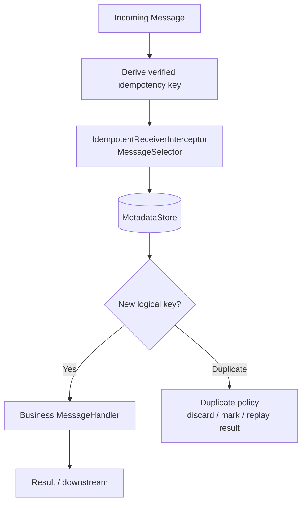

### Two Decisions to Separate

1. **Should the message be processed as a new contribution?** This is the dedup/selection decision.
2. **If the message is deemed a duplicate, what must the caller or system do?** It may drop, route to a discard channel, attach a marker, or return the completed outcome.

The duplicate behavior of `IdempotentReceiverInterceptor` depends on endpoint/advice configuration. Never assume adding the interceptor alone always **drops** duplicates. Spring Integration uses the `duplicateMessage` header and discard/rejection options; test your exact configuration and version.

### Advice Does Not Automatically Span the Whole Pipeline

If the advice wraps only **one** handler, side effects occurring **before that handler** remain unprotected. Example:

```text
Incoming
  -> send welcome email          (not yet idempotent)
  -> IdempotentReceiver advice
  -> write business record
```

Even if the record write is not duplicated, the welcome email may already have been sent twice. Place the idempotency boundary **before the side effect needing protection**, or give each operation its own key.

## 4. `MessageHeaders.id` Is Not a Business Idempotency Key

A record can be redelivered across hops and reconstructed into multiple Spring `Message<?>` instances. New message IDs can differ:

```text
First attempt:
  payload.eventId = CAP-701
  headers.id      = 1d2a-...

Redelivery:
  payload.eventId = CAP-701
  headers.id      = 9a43-...
```

Using `MessageHeaders.id` as a dedup key can cause the same logical event to look like two different messages.

**The right key** depends on the business domain, for example:

```text
tenantId=merchant-42
captureId=CAP-701
operationType=POST_CAPTURE_LEDGER

IdempotencyKey =
  (tenantId, captureId, operationType)
```

This key must be:

- Stable across retries/redeliveries of the same operation.
- Distinct for two separate valid operations.
- Namespaced by tenant when IDs are not globally unique.
- Scoped by stage/operation type if the same event triggers multiple independent side effects.
- Independent of receive time, attempt number, or thread ID.
- Derived from a trusted source so clients cannot claim another tenant's key.
- Canonically represented when persisted in Redis/JDBC/brokers.

### Do Not Use `orderId` Alone for Every Operation

The same order may have multiple steps:

```text
PAYMENT_CAPTURE
RESERVE_INVENTORY
SEND_CONFIRMATION
CREATE_SHIPMENT
```

If all use key `ORD-101`, once capture stores the key, reserve will be treated as a duplicate even though it is a different operation. Add `operationType` to the idempotency namespace or use command-specific keys.

## 5. Atomic Key Registration: Why `contains` Then `add` Is Wrong

Anti-pattern with two workers:

```java
if (!processedIds.contains(key)) {
    processedIds.add(key);
    performBusinessEffect();
}
```

Two threads can simultaneously observe `contains(key)==false`:

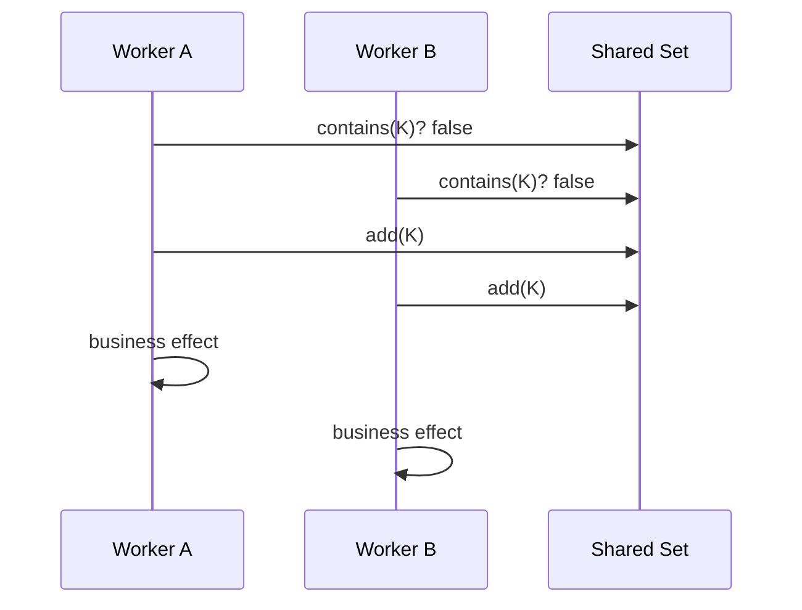

Even if individual set operations are thread-safe, the **check-then-act** pair does not atomically arbitrate processing rights.

### Using Atomic `putIfAbsent`/`add` Within One JVM

```java
Set<String> seen = ConcurrentHashMap.newKeySet();

boolean firstArrival = seen.add(key);
if (firstArrival) {
    performBusinessEffect();
}
```

`ConcurrentHashMap.newKeySet().add(key)` ensures **only one thread wins** for the same key in the same JVM.

Yet a serious problem remains:

1. Worker A adds the key successfully.
2. Worker A crashes **before executing the business effect**.
3. Message redelivers; Worker B sees the key already exists.
4. Worker B drops the message; the business effect **never happened**.

Thus atomic `add` only guarantees **entering the processing branch once under normal demo conditions**, not **completing the business work at least once** on failures.

## 6. Namespaced Key Model Instead of Unchecked String Concatenation

A key can be a value object:

```java
package example.integration;

public record IdempotencyKey(
    String tenantId,
    String eventId,
    String operationType
) {
    public IdempotencyKey {
        if (tenantId == null || tenantId.isBlank()
                || eventId == null || eventId.isBlank()
                || operationType == null
                || operationType.isBlank()) {
            throw new IllegalArgumentException(
                "Missing idempotency key component");
        }
    }
}
```

Using a record distinguishes tuples:

```text
("tenant:a", "event-1", "CAPTURE")
("tenant", "a:event-1", "CAPTURE")
```

Joining three fields with `:` unescaped would collapse both tuples into the same string. When storing string keys in a `MetadataStore`, use canonical encoding or an internal operation ID from a registry—**never** use `Object.hashCode()` as persistent identity.

### With Persistent Metadata Stores

Many `MetadataStore` implementations accept string keys/values. One simple controlled encoding uses **length-prefixed fields**:

```text
tenant="merchant-42"
event="CAP-701"
operation="POST_CAPTURE_LEDGER"

key:
  11:merchant-42|7:CAP-701|19:POST_CAPTURE_LEDGER
```

Length numbers in the example are purely illustrative; production code must compute length prefixes dynamically rather than hardcoding them. If IDs contain Unicode, standardize whether length counts bytes or characters so multi-language services compute matching keys.

Another option is a server/coordinator-issued random key token mapped to a verified tuple. This works well when avoiding exposing business identifiers in metadata storage or logs.

## 7. Test Use Case: Recording Payment Capture Events

We build a minimal example:

- The producer may send the same `PaymentCaptured` multiple times.
- The demo side effect increments a counter and creates a `ProcessingReceipt`.
- Multiple distinct valid events must still be processed.
- The same `eventId` across **two different tenants** represents two independent operations.
- The same event may serve **two different operation types**: each stage needs its own key.
- In concurrency testing, 20 threads send the same event; only **one** is accepted.

### Domain Records

```java
package example.integration;

public record PaymentCaptured(
    String tenantId,
    String eventId,
    String captureId,
    long amountMinorUnits
) {
    public PaymentCaptured {
        if (tenantId == null || tenantId.isBlank()
                || eventId == null || eventId.isBlank()
                || captureId == null || captureId.isBlank()
                || amountMinorUnits <= 0L) {
            throw new IllegalArgumentException(
                "Invalid PaymentCaptured");
        }
    }
}

public record ProcessingReceipt(
    String tenantId,
    String eventId,
    String status,
    long amountMinorUnits
) {}
```

Both `public record` declarations belong in separate `.java` files in a real project; they are shown together here for readability.

### Trusted Identity Sources

In production, `tenantId` and `eventId` must originate from verified sources: JWT/service identity, event signatures, merchant account mappings, webhook authorization, or ingress normalization. Never let arbitrary user-supplied payloads **claim another tenant's key**.

For payments, distinguish `eventId` and `captureId`:

- `eventId` identifies a logical event/message emitted by a source.
- `captureId` identifies the business capture transaction.
- One capture may emit multiple event versions or states.
- The idempotency key must use the entity/operation matching the protected side effect.

In the demo, we use `eventId` as the identity of recording the event; for a payment ledger, you may need `(captureId + ledgerEntryType)` to guard against upstream emitting **two different `eventId`s for the same capture**.

## 8. In-RAM Gate for Concurrency Tests

We use `ConcurrentHashMap.newKeySet()` to demonstrate atomic acceptance. This is **not** a durable production configuration.

```java
package example.integration;

import java.util.Set;
import java.util.concurrent.ConcurrentHashMap;

public final class InMemoryIdempotencyGate {

    private static final String OPERATION =
        "RECORD_CAPTURE_EVENT";

    private final Set<IdempotencyKey> acceptedKeys =
        ConcurrentHashMap.newKeySet();

    public boolean accept(PaymentCaptured event) {
        IdempotencyKey key = new IdempotencyKey(
            event.tenantId(),
            event.eventId(),
            OPERATION);

        // Atomic within this single JVM's set.
        return acceptedKeys.add(key);
    }

    public int seenKeyCount() {
        return acceptedKeys.size();
    }
}
```

### Real Guarantees of the Demo

- Two threads contending for the **same key** in one JVM: at most one `add` returns `true`.
- Two different keys: accepted independently.
- No mutable global `currentEventId` variable needed.

### What the Demo Does Not Guarantee

- Keys do not survive restarts.
- Keys are not shared across two JVMs/pods.
- Does not distinguish `PROCESSING` from `COMPLETED`.
- Does not roll back the key if a downstream handler after the Filter fails.
- Does not replay business results for duplicate requests.
- Lacks TTL, quotas, encryption, or durable auditing.
- Lacks transactions spanning dedup marker and side effect.

**The gate's purpose is making duplicate/concurrency problems testable**, then highlighting architectural requirements for production correctness.

## 9. Demo Business Processor: Measuring Side-Effect Execution Count

```java
package example.integration;

import java.util.concurrent.atomic.AtomicInteger;

public final class CaptureEventProcessor {

    private final AtomicInteger invocationCount =
        new AtomicInteger();

    public ProcessingReceipt process(PaymentCaptured event) {
        invocationCount.incrementAndGet();

        return new ProcessingReceipt(
            event.tenantId(),
            event.eventId(),
            "RECORDED",
            event.amountMinorUnits());
    }

    public int invocationCount() {
        return invocationCount.get();
    }
}
```

`AtomicInteger` enables thread-safe counting in tests. It only simulates an effect; it performs no DB writes, PSP calls, emails, or transactions.

**Do not infer:** Because the processor ran once in this test, the whole system will execute once under crashes, retries, or multi-instance deployments. In production, test failure windows, DB uniqueness, outboxes, and replays.

## 10. Spring Integration Java DSL: Filter Duplicates Then Process Once

To test the complete flow, wire:

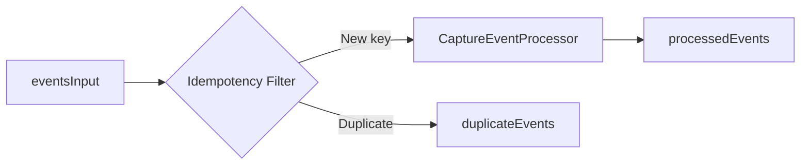

The example below uses `filter(...)` with an atomic gate so duplicate behavior is **explicit and easy to assert**. This is one way to express **Idempotent Receiver semantics** with Spring Integration components; a later section explains the dedicated `IdempotentReceiverInterceptor`.

### 10.1. Channel and IntegrationFlow Configuration

```java
package example.integration;

import org.springframework.context.annotation.Bean;
import org.springframework.context.annotation.Configuration;
import org.springframework.integration.channel.DirectChannel;
import org.springframework.integration.channel.QueueChannel;
import org.springframework.integration.config.EnableIntegration;
import org.springframework.integration.dsl.IntegrationFlow;
import org.springframework.messaging.MessageChannel;

@Configuration
@EnableIntegration
public class IdempotentReceiverDemoConfiguration {

    @Bean
    public MessageChannel eventsInput() {
        return new DirectChannel();
    }

    @Bean
    public QueueChannel duplicateEvents() {
        return new QueueChannel();
    }

    @Bean
    public QueueChannel processedEvents() {
        return new QueueChannel();
    }

    @Bean
    public InMemoryIdempotencyGate gate() {
        return new InMemoryIdempotencyGate();
    }

    @Bean
    public CaptureEventProcessor processor() {
        return new CaptureEventProcessor();
    }

    @Bean
    public IntegrationFlow paymentEventFlow(
            InMemoryIdempotencyGate gate,
            CaptureEventProcessor processor) {

        return IntegrationFlow.from("eventsInput")
            .filter(PaymentCaptured.class, gate::accept,
                spec -> spec.discardChannel("duplicateEvents"))
            .transform(PaymentCaptured.class, processor::process)
            .channel("processedEvents")
            .get();
    }
}
```

### 10.2. What Does Each Part Do?

- `eventsInput` receives `Message<PaymentCaptured>`.
- `gate.accept(...)` uses an in-JVM atomic `Set.add` to identify new keys.
- `filter(...)` lets first-time keys pass.
- `duplicateEvents` receives rejected messages for tests/auditing; in practice, never turn this queue into an unbounded duplicate store.
- `processor.process(...)` runs the simulated effect, increments the counter, and returns `ProcessingReceipt`.
- `processedEvents` receives one receipt for each permitted execution.

### 10.3. Guarantees of This Configuration Are Limited

If `processor.process(...)` throws an exception **after the gate already saved the key**, retries of the same event get dropped by the filter. That is the inherent failure window of `check-in-memory-before-effect` designs.

Thus this code works well for demonstrating **duplicate deliveries and concurrent acceptance**, not production payment ledgers. In Sections 23–27, we design transactional idempotent processing and `IN_PROGRESS/COMPLETED` states.

### 10.4. How Does Filter Differ from `IdempotentReceiverInterceptor`?

`Filter` is a message-screening endpoint. `IdempotentReceiverInterceptor` is an **advice around a handler** and can use `MetadataStoreSelector` to detect duplicates. Both can recognize previously seen keys, yet:

- Application point differs: filter is a flow step, advice attaches to a handler.
- How duplicates are flagged/rejected/discarded must be configured.
- Ordering of advice, transactions, and retries can alter semantics.
- Scope of the protected side effect must be defined upfront.

When using the dedicated interceptor, never skip duplicate tests assuming the framework drops every duplicate automatically.

## 11. JUnit 5 Fixture: Separating Message Identity from Event Identity

Create a test Spring context with output queues and an injectable Processor.

```java
package example.integration;

import static org.junit.jupiter.api.Assertions.*;

import java.util.ArrayList;
import java.util.List;
import java.util.Set;
import java.util.concurrent.CountDownLatch;
import java.util.concurrent.Executors;
import java.util.concurrent.Future;
import java.util.concurrent.TimeUnit;

import org.junit.jupiter.api.Test;
import org.springframework.beans.factory.annotation.Autowired;
import org.springframework.beans.factory.annotation.Qualifier;
import org.springframework.integration.channel.QueueChannel;
import org.springframework.messaging.Message;
import org.springframework.messaging.MessageChannel;
import org.springframework.messaging.support.MessageBuilder;
import org.springframework.test.annotation.DirtiesContext;
import org.springframework.test.context.junit.jupiter.SpringJUnitConfig;

@SpringJUnitConfig(IdempotentReceiverDemoConfiguration.class)
@DirtiesContext(
    classMode = DirtiesContext.ClassMode.AFTER_EACH_TEST_METHOD)
class IdempotentReceiverDemoTest {

    @Autowired
    @Qualifier("eventsInput")
    MessageChannel input;

    @Autowired
    @Qualifier("processedEvents")
    QueueChannel processed;

    @Autowired
    @Qualifier("duplicateEvents")
    QueueChannel duplicates;

    @Autowired
    CaptureEventProcessor processor;

    @Autowired
    InMemoryIdempotencyGate gate;

    private PaymentCaptured event(
            String tenant,
            String eventId,
            String captureId) {

        return new PaymentCaptured(
            tenant, eventId, captureId, 125_000L);
    }

    private Message<PaymentCaptured> message(
            PaymentCaptured payload) {

        return MessageBuilder.withPayload(payload)
            .setHeader(
                "businessCorrelationId",
                "capture:" + payload.captureId())
            .build();
    }

    private void send(PaymentCaptured payload) {
        assertTrue(input.send(message(payload)));
    }

    // The @Test methods below belong inside this same class.
}
```

### Why Use `@DirtiesContext`?

The example's gate holds state in RAM, and some tests intentionally send duplicates into queues. `@DirtiesContext(AFTER_EACH_TEST_METHOD)` gives each test a fresh gate and queues, preventing results from depending on prior tests.

In a large test suite, you can use a fixture creating an isolated store with controlled resets to reduce context startup overhead. Never reset shared production idempotency state as a way to “fix” tests.

## 12. Test 1: Same Logical Event Sent Twice Sequentially

This is the baseline:

```java
@Test
void duplicateEventIsProcessedOnlyOnce() {
    PaymentCaptured same =
        event("merchant-42", "E-101", "CAP-101");

    send(same);
    send(same);

    Message<?> first = processed.receive(1_000);
    assertNotNull(first);
    assertInstanceOf(
        ProcessingReceipt.class, first.getPayload());

    ProcessingReceipt receipt =
        (ProcessingReceipt) first.getPayload();

    assertEquals("E-101", receipt.eventId());
    assertEquals("RECORDED", receipt.status());

    // No second business output.
    assertNull(processed.receive(0));

    // Duplicate is routed to the discard channel.
    Message<?> duplicate = duplicates.receive(1_000);
    assertNotNull(duplicate);
    assertEquals(same, duplicate.getPayload());
    assertNull(duplicates.receive(0));

    // Simulated side effect invoked once.
    assertEquals(1, processor.invocationCount());
    assertEquals(1, gate.seenKeyCount());
}
```

### Why Are All Three Assertions Needed?

1. **Output count = 1** proves the flow did not emit two receipts.
2. **Duplicate queue holds the message** proves the second delivery followed the discard policy rather than disappearing due to a send failure.
3. **Processor count = 1** proves the protected handler genuinely executed only once.

Asserting only that `processed.receive()` returned one receipt might miss two processor calls where one failed with no output. Counting invocations catches that case in the demo.

### Remember: `MessageChannel.send(...)` Succeeding Does Not Mean the Effect Succeeded

A successful `send` only indicates the message was accepted by the channel/dispatcher per channel semantics. It **does not** prove downstream side effects committed to a DB or ACKed a broker. Synchronous `DirectChannel` tests are convenient due to their narrow scope, yet production still needs transaction/recovery tests.

## 13. Test 2: Different Spring Message IDs Yet Same Logical Key

A crucial test is creating **two fresh messages**, not merely resending the same Java object:

```java
@Test
void differentSpringMessageIdsDoNotBypassDeduplication() {
    PaymentCaptured payload =
        event("merchant-42", "E-102", "CAP-102");

    Message<PaymentCaptured> m1 = message(payload);
    Message<PaymentCaptured> m2 = message(payload);

    assertNotEquals(
        m1.getHeaders().getId(),
        m2.getHeaders().getId());

    assertTrue(input.send(m1));
    assertTrue(input.send(m2));

    assertNotNull(processed.receive(1_000));
    assertNull(processed.receive(0));
    assertNotNull(duplicates.receive(1_000));

    assertEquals(1, processor.invocationCount());
}
```

This catches a common mistake: using `MessageHeaders.id` instead of the business event ID as the idempotency key. A consumer can receive the same event wrapped in different Spring `Message` instances and must still recognize it as one logical contribution.

### Additional Test: Same Payload Yet Different `eventId`

Can two purchase events carry the same amount and `captureId`? That case requires an explicit business rule. If two **different `eventId`s** are designed as two valid events, an event-ID gate lets both pass. Conversely, if two different event IDs for the same capture actually represent one business operation, an event-ID gate **is insufficient** to prevent double ledger entries.

Distinguish:

- *Transport event dedup:* `(tenantId, eventId)`.
- *Business action idempotency:* `(tenantId, captureId, ledgerEntryType)`.

Choose keys for the effect being protected, not merely for payload convenience.

## 14. Test 3: Same `eventId` in Different Tenants Is Not Wrongly Blocked

In a multi-tenant system, event IDs may collide while belonging to separate business scopes.

```java
@Test
void sameExternalEventIdInDifferentTenantsIsIndependent() {
    send(event("merchant-42", "E-200", "CAP-A"));
    send(event("merchant-99", "E-200", "CAP-B"));

    Message<?> first = processed.receive(1_000);
    Message<?> second = processed.receive(1_000);

    assertNotNull(first);
    assertNotNull(second);

    Set<String> tenants = Set.of(
        ((ProcessingReceipt) first.getPayload()).tenantId(),
        ((ProcessingReceipt) second.getPayload()).tenantId());

    assertEquals(
        Set.of("merchant-42", "merchant-99"),
        tenants);

    assertEquals(2, processor.invocationCount());
    assertEquals(2, gate.seenKeyCount());
    assertNull(duplicates.receive(0));
}
```

**Idempotency namespaces must include the tenant if event IDs are not globally unique.**

However, note `tenantId` is just a field. The system must derive/verify it from a trusted identity at ingress; otherwise an attacker could deliberately swap `tenantId` to bypass deduplication or touch another tenant's key.

## 15. Test 4: Multiple Threads Sending the Same Logical Event Concurrently

A sequential test cannot uncover **check-then-act** bugs. You need a test forcing multiple threads to contend on the same key nearly simultaneously.

### Deterministic Design

- Create 20 tasks sharing one `PaymentCaptured`.
- Each task signals readiness via `ready.countDown()`.
- All tasks wait on the same `startGate`.
- Once all tasks are ready, the test opens the gate so all call `input.send(...)`.
- Await each `Future` with a timeout.
- Only one task gets `true` from the gate's `add(key)`.
- The remaining 19 messages go to `duplicateEvents`.

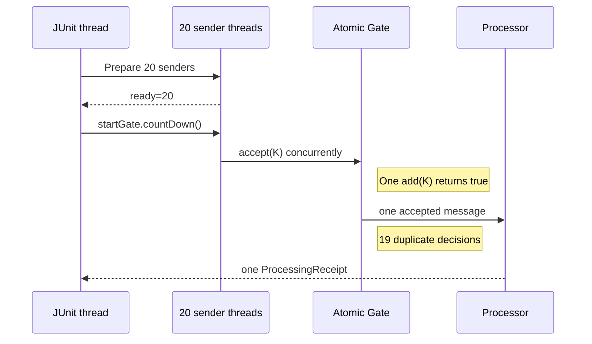

### JUnit 5 Test

Add the following method to `IdempotentReceiverDemoTest`:

```java
@Test
void concurrentDuplicateSendsInvokeProcessorOnce()
        throws Exception {

    final int senderCount = 20;
    PaymentCaptured same =
        event("merchant-42", "E-RACE", "CAP-RACE");

    var executor = Executors.newFixedThreadPool(senderCount);
    var ready = new CountDownLatch(senderCount);
    var startGate = new CountDownLatch(1);
    List<Future<?>> futures = new ArrayList<>();

    try {
        for (int i = 0; i < senderCount; i++) {
            futures.add(executor.submit(() -> {
                ready.countDown();

                if (!startGate.await(5, TimeUnit.SECONDS)) {
                    throw new IllegalStateException(
                        "Start gate timeout");
                }

                send(same);
                return null;
            }));
        }

        assertTrue(
            ready.await(5, TimeUnit.SECONDS),
            "All senders must be ready");

        startGate.countDown();

        for (Future<?> future : futures) {
            future.get(5, TimeUnit.SECONDS);
        }

        Message<?> winner = processed.receive(2_000);
        assertNotNull(winner);
        assertEquals(
            "E-RACE",
            ((ProcessingReceipt) winner.getPayload()).eventId());

        assertNull(processed.receive(0));
        assertEquals(1, processor.invocationCount());
        assertEquals(1, gate.seenKeyCount());

        // 19 duplicates, no second business output.
        for (int i = 0; i < senderCount - 1; i++) {
            Message<?> rejected =
                duplicates.receive(2_000);
            assertNotNull(rejected);
            assertEquals(
                "E-RACE",
                ((PaymentCaptured) rejected.getPayload()).eventId());
        }

        assertNull(duplicates.receive(0));
    } finally {
        startGate.countDown(); // avoid stranding workers if an assert fails
        executor.shutdownNow();
    }
}
```

### What Does the Test Prove?

- Atomic `Set.add(key)` ensures only one winner per key within the JVM.
- Concurrent contention does not invoke the Processor 20 times.
- Duplicates are not silently lost when `discardChannel` is configured.
- Multiple threads sending concurrently into a `DirectChannel` race on the handler path, so the store/gate must be thread-safe.

### What the Test Does Not Prove

- No crash between the gate and the business effect.
- No multiple pods with separate stores.
- No broker acknowledgments or redeliveries across restarts.
- No DB transactions or exactly-once ledger entries.
- Does not prove absence of races under every possible interleaving from a single run.

Run multi-round stress tests, fault-injection tests, and transaction-level tests to build confidence. **Never rely on `Thread.sleep(...)` to “create a race”**: sleep depends on the OS scheduler and makes tests both slow and flaky.

## 16. Test 5: Multiple Valid Keys Concurrently Are All Processed

An overly coarse gate, such as keying only by `tenantId`, can mistakenly block multiple events belonging to the same merchant.

```java
@Test
void independentEventsInSameTenantAllPass() {
    send(event("merchant-42", "E-301", "CAP-301"));
    send(event("merchant-42", "E-302", "CAP-302"));
    send(event("merchant-42", "E-303", "CAP-303"));

    assertNotNull(processed.receive(1_000));
    assertNotNull(processed.receive(1_000));
    assertNotNull(processed.receive(1_000));

    assertEquals(3, processor.invocationCount());
    assertEquals(3, gate.seenKeyCount());
    assertNull(processed.receive(0));
    assertNull(duplicates.receive(0));
}
```

This is a **do-not-false-block** test. An idempotent system must simultaneously satisfy:

1. **Safety:** never execute the same effect twice.
2. **Liveness:** still allow valid operations with distinct keys to proceed.

Optimizing purely for “fewest effects” can produce overly broad gates that drop valid data.

## 17. Adding Tests for Right Keys at the Right Stage

One `PaymentCaptured` event may require two independent operations:

```text
Event E-401:
   RECORD_LEDGER_ENTRY
   SEND_PAYMENT_NOTIFICATION
```

If both receivers share a single `tenantId + eventId` key in a metadata store, the notification receiver could be blocked because the ledger already marked the key.

The contract should be:

```text
(merchant-42, E-401, RECORD_LEDGER_ENTRY)
(merchant-42, E-401, SEND_PAYMENT_NOTIFICATION)
```

These are two distinct keys. Each stage can process **once independently** without interfering with the other stage's effect.

### Do Not Confuse Stage Keys with Retry Attempts

`retryAttempt=1` and `retryAttempt=2` are two executions of **the same operation**, and must never be used to differentiate idempotency keys when trying to prevent duplicates.

```text
Wrong:
  eventId + ":" + retryAttempt

Right when representing the same logical operation:
  tenantId + eventId + operationType
```

Tests for stage-specific keys can include a unit test asserting `assertNotEquals` on two `IdempotencyKey`s, followed by an integration test running two processing flows sharing a metadata store with distinct namespaces.

## 18. Dedicated Spring Integration `IdempotentReceiverInterceptor`

Using `filter` in Section 10 makes flow testing transparent. For endpoints with an existing `MessageHandler`, you can apply advice:

```java
import org.springframework.integration.handler.advice
    .IdempotentReceiverInterceptor;
import org.springframework.integration.selector
    .MetadataStoreSelector;
import org.springframework.integration.metadata
    .ConcurrentMetadataStore;

// Bean configuration sketch; check imports/APIs
// against your project's Spring Integration version.

@Bean
IdempotentReceiverInterceptor idempotentAdvice(
        ConcurrentMetadataStore store) {

    var selector = new MetadataStoreSelector(
        store,
        message -> {
            PaymentCaptured event =
                (PaymentCaptured) message.getPayload();

            return canonicalIdempotencyKey(
                event.tenantId(),
                event.eventId(),
                "RECORD_CAPTURE_EVENT");
        });

    return new IdempotentReceiverInterceptor(selector);
}
```

`canonicalIdempotencyKey(...)` is an **application-defined** key encoding/normalization function, not a built-in Spring Integration API. The snippet intentionally shows how to wire selector/store/advice; place the bean in the right handler's advice chain and specify the duplicate policy.

### `MetadataStoreSelector` Mechanics

`MetadataStoreSelector` uses a metadata store to check whether a key was previously selected, typically relying on `ConcurrentMetadataStore`'s conditional put. Value comparison or value-update rules must be configured explicitly when using mutable states/versions.

**Never use `SimpleMetadataStore` to claim safety across multiple pods.** It is meant for demos or single-instance state; production requires a shared store with strong concurrency semantics.

### Choosing Duplicate Policies Deliberately

Options to configure and test against your Spring Integration version:

| Policy | Desired Behavior | When Appropriate |
| --- | --- | --- |
| Discard duplicate | Do not invoke business handler; route duplicate to audit channel if needed | Fire-and-forget events |
| Mark duplicate header | Pass message through with marker so handler decides | Handler needs to read status/return cached result |
| Throw rejection exception | Raise structured error | Contract treats duplicates as errors |
| Replay stored result | Return committed business result without running effect | HTTP/Gateway request–response |

Spring Integration provides the `duplicateMessage` header for flagging duplicates alongside discard/rejection options in its Idempotent Receiver support. **Never treat setting the header as proof the handler was skipped**. Tests must count real handler invocations and inspect output/discard/error paths.

### Advice Order Can Change Semantics

Example:

```text
Option A:
   RetryAdvice
      -> IdempotentReceiverAdvice
          -> Handler

Option B:
   IdempotentReceiverAdvice
      -> RetryAdvice
          -> Handler
```

If a retry re-runs the selector after the key was already claimed, it can be treated as a duplicate and **block the retry the business needs**. Conversely, if the selector runs once and retries wrap the inner handler, the handler must be idempotent across per-attempt side effects.

Never choose advice ordering by habit; write a **fault-injection test** where the handler throws on the first attempt and succeeds on the second.

## 19. Testing Real Retries: What If Keys Are Saved Before the Effect?

This is one of the most important scenarios:

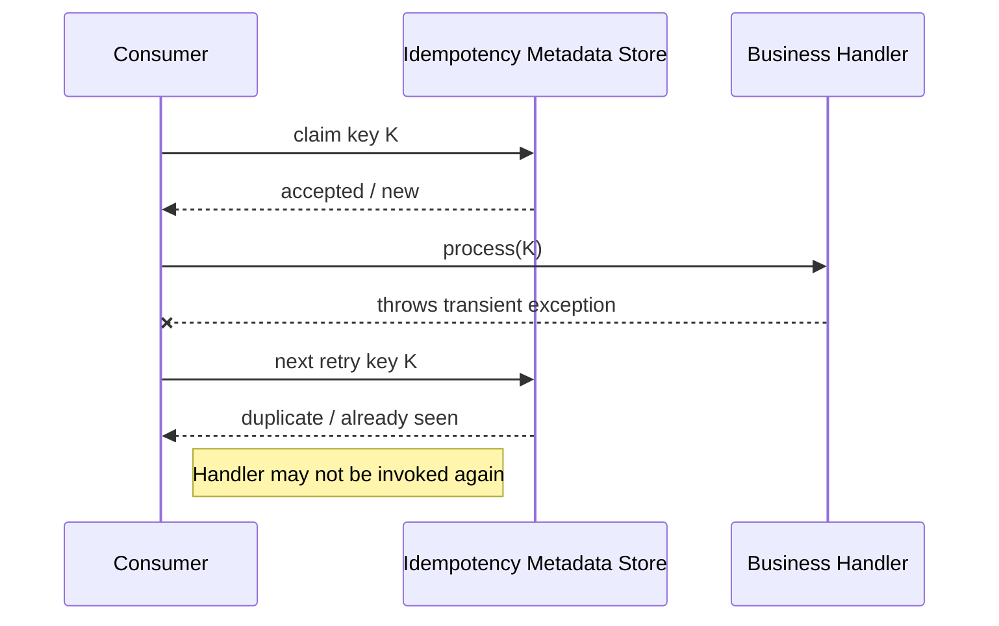

In the Section 10 demo, once `gate.accept(...)` returns `true`, the key stays in RAM even if `processor.process(...)` fails. Subsequent retries get discarded. **That is a liveness bug**: the system recorded seeing the message without completing the effect.

### Tests Should Expose Limitations, Not Hide Them

A fault-injection test (separate from the demo flow) can:

1. Use a processor that throws an exception on the first attempt.
2. Send logical event `E-501`.
3. Assert the exception/error path.
4. Resend `E-501`.
5. Verify the gate kept the key and blocked the retry.
6. Document this test as **demonstrating the limitation** of a `seen-set` gate, not desired production behavior.

Never fix this by **unconditionally deleting the key when catching exceptions**, because the effect may have committed before the exception occurred:

```text
Handler:
  DB commit OK
  Network reply fails
Catch:
  remove(K)
Retry:
  DB commit again
```

The proper fix depends on verifying effect state, transactions, and downstream idempotency.

## 20. Three Crash Windows to Analyze

Consider these steps:

- `R`: reserve/dedup key.
- `E`: business effect.
- `C`: mark completed.

### Crash Before R

```text
Message received but key not yet reserved.
Consumer crashes.
Broker redelivers.
```

If broker and consumer ACKs are configured properly, retries can execute the operation again. Since no prior effect happened, recovery is straightforward.

### Crash After R, Before E

```text
Reserved(K)
    |
    X crash
Business effect has not run
```

If the gate treats every present key as completed, redeliveries get dropped and **the effect is lost**. Distinguish `PROCESSING` from `COMPLETED`, or roll back the reservation transactionally with the business effect.

### Crash After E, Before C

```text
Reserved(K)
Business effect committed
    |
    X crash
Completed marker not yet written
```

If the system allows retries because it does not see `completed`, it can execute the effect twice. Idempotency at the effect layer, outboxes, or unified transactions covering both business writes and completion markers (when possible) are required.

### Crash After C, Before Broker ACK

```text
Business effect committed
Completed(K)
    |
    X crash before ACK
Broker redelivers
```

The idempotency store detects `COMPLETED` and the consumer avoids re-executing the effect. For request–response workflows, read back the **stored result** to return to the caller.

## 21. What States Are Needed for Reliable Processing?

A production idempotency registry usually needs more than a “seen” flag:

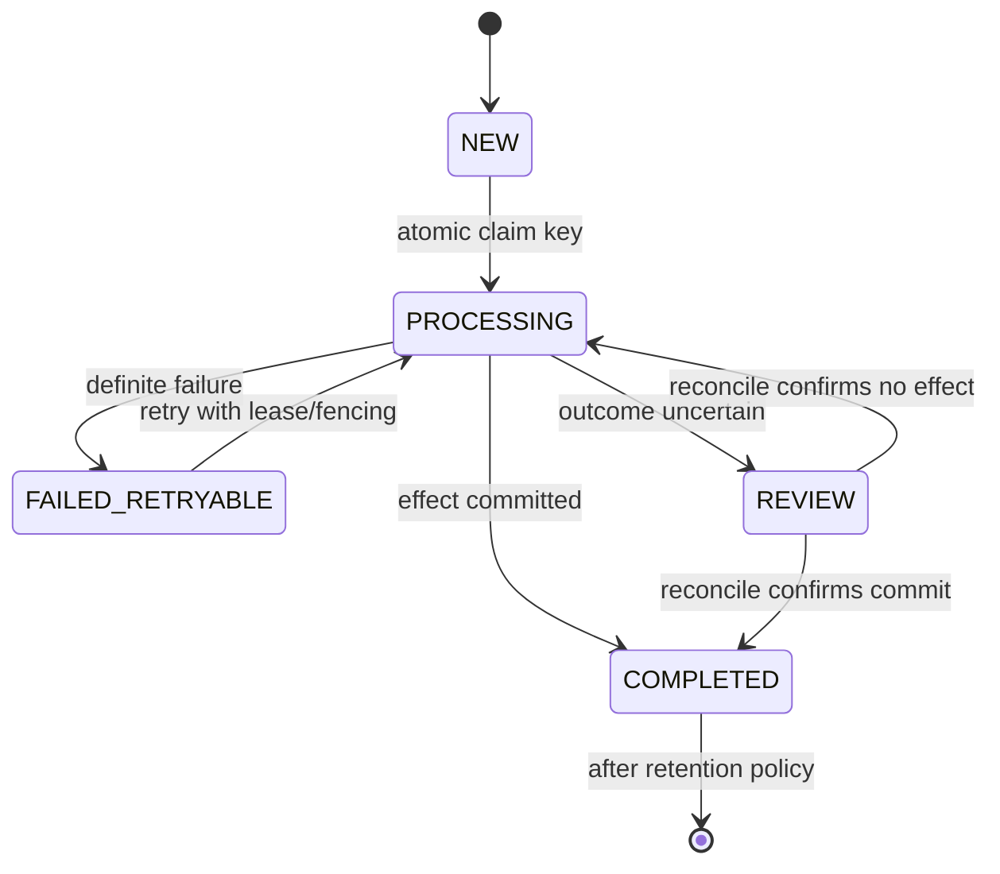

A suggested record:

```java
public record IdempotencyRecord(
    String key,
    String payloadFingerprint,
    String status,
    String ownerId,
    long fencingToken,
    java.time.Instant leaseUntil,
    java.time.Instant completedAt,
    String resultReference
) {}
```

This is a **domain design**, not a record supplied out-of-the-box by the framework.

### Why a Payload Fingerprint Is Needed

If a client reuses the same `idempotencyKey` while sending a **different payload**:

```text
Request 1:
  key=K, amount=100

Request 2:
  key=K, amount=999
```

Skipping request 2 as a normal duplicate can mask bugs or abuse. Enforce a policy:

- Duplicate key + **matching canonical request fingerprint**: duplicate/replay result.
- Duplicate key + **differing fingerprint**: conflict (e.g., HTTP 409), do not execute effect.
- New key: permitted to create a new operation.

Fingerprints must be computed from **meaningful business fields**, not volatile delivery-attempt/timestamp headers. For sensitive data, store controlled hashes and never log raw payloads.

## 22. Handling Stale `PROCESSING`: Leases and Fencing Tokens

If a worker holds a key in `PROCESSING` and dies, the key can remain stuck forever.

One solution is a time-bounded lease:

```text
Claim K:
  status=PROCESSING
  owner=worker-A
  leaseUntil=T+30s
  fencingToken=7
```

Once the lease expires, worker B can atomically acquire processing rights with token 8.

**A lease alone is insufficient.** Worker A may pause for a long time, wake up, and resume executing the effect while worker B is also running. **Fencing** or target-side idempotency is required so the stale worker cannot commit stale work.

```text
Worker A: token=7, paused
Worker B: token=8, acquires lease
Worker A: resumes writing with token=7
Database: rejects stale token or enforces unique business operation
```

### Avoid Deleting Keys on Lease Expiry Without Verification

If a record's effect already COMMITTED yet its status was not updated due to a crash, deleting the key upon lease expiry opens the door to duplicate effects. **Reconcile** the outcome or rely on a transaction/unique constraint on the operation before allowing retries.

## 23. Production Idempotency with Database Unique Constraints

When the business effect is a database write, a strong approach is using a **unique constraint** in the same transaction for both the idempotency record and business data.

### Illustrative Schema

```sql
CREATE TABLE processed_operations (
    idempotency_key VARCHAR(300) PRIMARY KEY,
    payload_fingerprint VARCHAR(128) NOT NULL,
    status VARCHAR(30) NOT NULL,
    result_reference VARCHAR(300),
    completed_at TIMESTAMP
);

CREATE TABLE ledger_entries (
    ledger_entry_id VARCHAR(100) PRIMARY KEY,
    capture_id VARCHAR(100) NOT NULL,
    entry_type VARCHAR(40) NOT NULL,
    amount_minor_units BIGINT NOT NULL,
    UNIQUE (capture_id, entry_type)
);

CREATE TABLE outbox_events (
    outbox_id VARCHAR(100) PRIMARY KEY,
    event_type VARCHAR(100) NOT NULL,
    payload TEXT NOT NULL,
    published_at TIMESTAMP
);
```

This schema is illustrative; multi-tenant systems must include `tenant_id` in unique constraints/business keys accordingly and choose data types/SQL matching their actual database.

### Atomic Transaction Pattern

```text
BEGIN TRANSACTION

  INSERT idempotency_key K
  IF KEY ALREADY COMMITTED:
      validate fingerprint
      return stored result (do not run effect)

  INSERT ledger entry
      with UNIQUE (tenant, captureId, entryType)

  UPDATE idempotency record:
      status = COMPLETED
      result = ledgerEntryId

  INSERT outbox event:
      LEDGER_ENTRY_POSTED

COMMIT
```

When all critical writes live **inside the same DB transaction**, pre-commit crashes roll back everything, allowing safe retries. Post-commit broker redeliveries hit the record/unique constraint, detecting the completed operation without **duplicating the ledger entry**.

### An Illustrative SQL Skeleton

```sql
BEGIN;

INSERT INTO processed_operations (
    idempotency_key,
    payload_fingerprint,
    status
)
VALUES (
    :key,
    :fingerprint,
    'PROCESSING'
)
ON CONFLICT (idempotency_key) DO NOTHING;

-- The application must inspect the inserted row count.
-- If 0 rows: read existing record and handle completed/conflict
-- per policy; do not insert ledger entry again.
-- If 1 row: execute the remaining writes in the same transaction.

INSERT INTO ledger_entries (
    ledger_entry_id,
    capture_id,
    entry_type,
    amount_minor_units
)
VALUES (
    :entryId,
    :captureId,
    'CAPTURE',
    :amount
)
ON CONFLICT (capture_id, entry_type) DO NOTHING;

UPDATE processed_operations
SET status = 'COMPLETED',
    result_reference = :entryId,
    completed_at = CURRENT_TIMESTAMP
WHERE idempotency_key = :key;

INSERT INTO outbox_events (
    outbox_id,
    event_type,
    payload
)
VALUES (
    :outboxId,
    'LEDGER_ENTRY_POSTED',
    :outboxPayload
);

COMMIT;
```

**This is an explanatory skeleton**, not a runnable stored procedure, and omits tenant scoping, ownership checks, result consistency, row-count checks, and exception mapping. `ON CONFLICT` uses PostgreSQL syntax; other databases differ.

### Why Have Two Unique Constraints?

- `processed_operations.idempotency_key` blocks duplicates of the same request/event stage.
- `ledger_entries(capture_id,entry_type)` protects **the business effect** even if upstream generates a second event ID for the same capture.

An idempotency key solely on `eventId` cannot prevent duplicates if the source emits two distinct event IDs for one business capture when the contract treats them as the same operation.

### Concurrency Between Two DB Transactions

Two pods concurrently execute `INSERT idempotency_key=K`. Database unique constraints and transaction isolation/locking ensure at most one transaction commits record `K` in the appropriate state. The other transaction reads the committed outcome or waits/retries per database behavior.

**Never run `SELECT exists → INSERT` without a unique constraint**: two DB transactions can both observe absence simultaneously. Only unique constraints, proper transaction boundaries, and conflict/retry handling provide the required guarantee.

## 24. What If the Side Effect Is an External HTTP API Outside the Database?

You cannot arbitrarily bundle an external HTTP call into a local DB transaction. Example:

```text
BEGIN DB transaction
  reserve K
  call external payment API
  mark K completed
COMMIT
```

If the external API captures successfully and the consumer crashes before DB commit, retries may invoke capture again.

### Appropriate Solutions

1. **External API supplies idempotency keys:** send the same stable key on retries, verifying the provider's guarantees and retention.
2. **Query/reconciliation:** when the outcome is uncertain, look up operation status at the provider by business reference before calling again.
3. **Outbox + dedicated dispatcher:** record intent in the DB transaction; after commit, the dispatcher performs external calls and saves outcomes/idempotency states.
4. **Saga/compensation:** when atomic effects are impossible, apply business compensation upon detecting duplicates or partial failures.
5. **Quarantine/manual review:** for monetary operations with uncertain states, avoid blind retries.

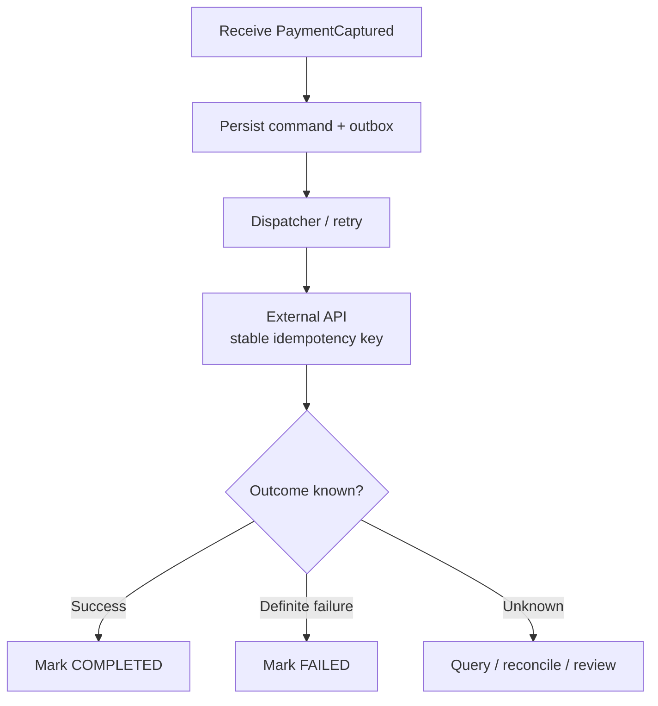

**Never claim** a Redis key or Spring advice alone creates exactly-once effects across HTTP, DB, and brokers. That is a multi-system transaction/reconciliation problem.

## 25. Testing Crash After Commit, Before ACK: More Important Than Simply Sending Twice

A production integration test should simulate:

1. Consumer processes `E-601` and commits the DB entry.
2. Before ACKing the broker, simulate a crash/network error.
3. Broker redelivers `E-601` in a different Spring Message.
4. Consumer reads the `COMPLETED` idempotency record.
5. No second ledger entry is created.
6. If the API contract requires a reply, return the stored result.
7. Broker ACKs the redelivery once processing is confirmed.

### Core Assertions

```java
// Pseudo-test using a real DB test container / adapter.
@Test
void redeliveryAfterCommitDoesNotDuplicateLedgerEntry() {
    PaymentCaptured event =
        event("merchant-42", "E-601", "CAP-601");

    consumeAndCommitWithoutAck(event);
    redeliverSameBusinessEvent(event);

    assertEquals(1,
        ledgerRepository.countByCaptureId("CAP-601"));

    assertEquals("COMPLETED",
        idempotencyRepository
            .findStatusFor(event, "RECORD_CAPTURE_EVENT"));
}
```

This is a **test fragment describing the contract**, not runnable standalone without `ledgerRepository`, `idempotencyRepository`, `consumeAndCommitWithoutAck`, and a broker test fixture.

### Other Scenarios Requiring Fault Injection

| Failure Point | Data That May Remain | Expectation |
| --- | --- | --- |
| Before reserve | No key/effect yet | Redelivery processed |
| After reserve, before effect (same uncommitted transaction) | Transaction rolls back | Retry permitted |
| DB effect and marker committed in same transaction | Both durable | Retry sees `completed` |
| External effect succeeded, response lost | Outcome uncertain | Reconcile or API idempotency |
| Marked completed before broker ACK | Record completed | Redelivery does not duplicate effect |
| Metadata store temporarily disconnected | Cannot decide safely | Fail closed / retry later |
| Lease expired while old worker still alive | Two workers may contend | Fencing / unique effect |
| Key deleted due to TTL | No evidence left | Duplicate may be treated as new |

## 26. Testing Concurrency Across Two Pods Differs from 20 Threads in One JVM

Section 15's test uses one `InMemoryIdempotencyGate` and one Java process. Two pods each running an independent gate will both accept key `K`:

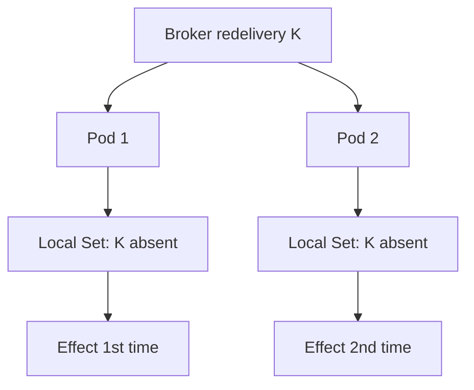

For cross-process safety:

- Use a shared `ConcurrentMetadataStore` with proper atomic **conditional inserts**.
- Or use database unique constraints/transactions for operations.
- Or partition ownership so one key routes to one consumer, while still guarding replays after restarts/rebalances.
- For stateful workflows, use coordinators/leases with fencing and business idempotency.

### What Should a Two-Pod Test Do?

1. Start two consumer instances pointing to **the same backend store**.
2. Simultaneously submit/replay the same `key=K`.
3. Observe key-claim outcomes on both.
4. Count committed business effects in the DB (not just invocation counts).
5. Simulate one pod disconnecting or crashing mid-processing.
6. Verify leases, retries, outcomes, and zero lost operations.
7. Repeat after restarting individual pods and the backend store.

Never treat a thread-safe `SimpleMetadataStore` in one JVM as proof of synchronization across pods.

### Shared Stores Must Also Have Atomic Semantics

If multiple nodes share one database yet the app still runs `SELECT exists` then `INSERT` without a unique constraint, races remain. Shared storage **does not automatically mean** atomic claims. True backend-enforced compare-and-set, atomic `putIfAbsent`, or transactions/unique keys are required.

## 27. `MetadataStoreSelector` and TTL Windows

Metadata stores retain accepted keys. If data stays forever, storage grows unbounded. If purged too early, old duplicates may be treated as new.

```text
Day 1:  process K -> COMPLETED
Day 2:  metadata TTL expires -> K removed
Day 3:  broker/event replays K
        -> system accepts as NEW
```

### How to Choose Retention

Record retention must account for:

- Broker retry/redelivery windows.
- Job replay horizons.
- Upstream provider idempotency key TTLs.
- Dispute/chargeback reconciliation periods.
- How long business operations can legitimately be retried.
- Retention laws and data minimization rules.

If the system can replay an event after 90 days while metadata only lives 24 hours, never advertise a 90-day dedup guarantee—or enforce another durable business uniqueness constraint protecting the effect.

### Distinguishing Metadata TTL from Workflow Expiry

An Aggregator group may expire after 10 minutes; individual child idempotency records may need longer retention to prevent late duplicates. Their lifecycles differ; never share one TTL out of habit.

### Eviction While `PROCESSING`

Never arbitrarily evict a `PROCESSING` record due to TTL. If the worker is still running, the key could be reclaimed and cause concurrent execution. Explicit leases/fencing and heartbeat/recovery policies are required.

## 28. Request–Reply Gateway: Duplicates Must Not Be Dropped and Timed Out

An API client sends a request with `Idempotency-Key: K`, loses connection, and resends the same request. If the pipeline uses a Filter dropping duplicates, the second Gateway call receives no reply and times out.

That is a poor experience even when the effect wasn't duplicated.

### Desired Outcomes for Request–Response

| Key State | Reasonable API Behavior |
| --- | --- |
| Never seen | Reserve, process, and return result |
| `PROCESSING` | Return pending status or wait within bounds |
| `COMPLETED`, matching fingerprint | Return **stored result** without running effect |
| `COMPLETED`, differing fingerprint | Return conflict without running effect |
| `FAILED_RETRYABLE` | Retry per policy and lease |
| `UNKNOWN/REVIEW` | Return status for reconciliation; never execute blindly |

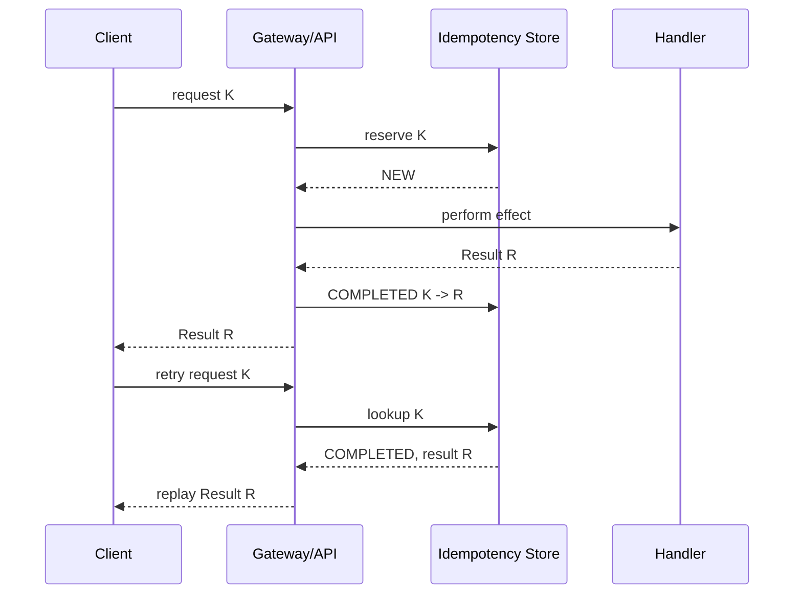

### Why Can You Not Rely Only on `duplicateMessage=true`?

A duplicate header merely tells the handler this message repeated. It does not carry the committed business result, identify the claimant, provide a response cache, or prove payloads matched the prior request. Replaying responses requires a **result store** and input fingerprinting.

### Correlation Does Not Replace Idempotency

A Gateway can use request correlation to route replies back to the right caller. Yet two retried HTTP requests for the same operation may have **two different reply channels** while sharing one idempotency key.

- `requestCorrelationId`: maps **reply back to the right invocation**.
- `idempotencyKey`: identifies **the non-repeatable business effect**.
- `businessCorrelationId`: tracks the business flow.
- `MessageHeaders.id`: ID of a single Spring `Message`.

Never use a stale `replyChannel` from the first request to answer a retry after the original Gateway timed out.

## 29. Idempotent Receiver with Filter, Router, and Publish–Subscribe

### Place Gate Before or After Router?

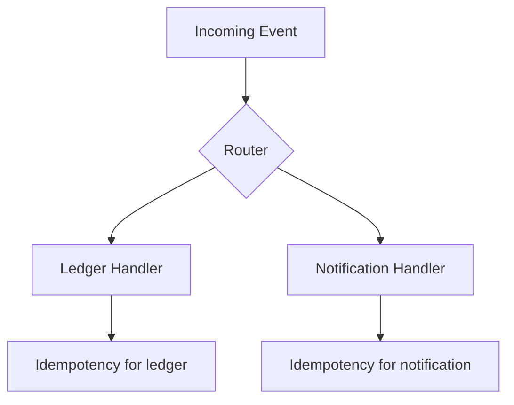

If an event enters **only one branch** performing one effect, the gate can sit at ingress before the Router.

If an event routes to **multiple branches with independent effects** (Recipient List / Publish–Subscribe), scope idempotency keys by **operation/subscriber**:

```text
(merchant-42, E-701, WRITE_LEDGER)
(merchant-42, E-701, SEND_NOTIFICATION)
(merchant-42, E-701, UPDATE_METRICS)
```

A single gate before fan-out can block the whole event on retry even when one subscriber previously failed while others succeeded. For flows needing independent per-subscriber retries, give each branch its own ownership/idempotency record.

### Filter Differs from Duplicates

A Filter may reject events due to business rules, such as orders below a threshold or invalid schemas. An Idempotency Gate rejects events because **the logical operation was already processed/claimed**. Never lump both under one `FILTERED` reason because recovery paths differ.

### Routers Must Not Arbitrarily Alter Logical Keys

If the same effect routes to a different handler due to a config change, it still needs a durable idempotency identity or migration rule. Never use the current channel name as an irreplaceable part of the key if topology changes could cause the same business effect to re-execute.

## 30. Splitter/Aggregator: Deduplicate Per Child, Not by Group

A batch has three children:

```text
Batch B-101
  -> Child 1: event=E-1
  -> Child 2: event=E-2
  -> Child 3: event=E-3
```

If all children share `correlationId=G` and the gate deduplicates solely by `G`:

```text
Receive Child 1 -> key=G accepted
Receive Child 2 -> key=G duplicate (wrongly dropped)
Receive Child 3 -> key=G duplicate (wrongly dropped)

Aggregator only has Child 1 and never completes the group.
```

The right key at the child boundary should include:

```text
Child key:
  (groupRunId, partIndex, operationType)

Group completion key:
  (groupRunId, AGGREGATE_RESULT)
```

Correlation ID and idempotency key **may relate yet serve two different goals**.

### With Aggregator

A duplicate child can push `group.size()` to the expected threshold while missing another logical child, or stall strict release rules because the group contains duplicates. Therefore:

1. Deduplicate logical children before feeding the Aggregator.
2. Have the release strategy verify unique parts/sequences when business rules require.
3. Provide recovery for conflicting data rather than waiting forever.
4. Have the output processor emit results only once the group is genuinely complete.
5. Enforce downstream idempotency on group completion outcomes.

### With Resequencer

Duplicates with the same `sequenceNumber` can break ordering contracts or emit late/replayed messages after a group closes. Use logical event/window/sequence keys; never use `correlationId` alone for every element in a sequence.

## 31. Retries and Error Channels: Ensuring Operations Are Never Lost

A key principle: **duplicates and failures are not the same event**.

- Duplicate: key already appeared; determine completed/in-progress/conflict.
- Business failure: effect returned a potentially terminal failure outcome.
- Transient failure: service unavailable; can retry.
- Unknown outcome: external API called, uncertain whether commit occurred.
- Invalid input: bad schema/permissions; usually do not retry the same message.

### Error Channels Help Observe Errors, Never Recover State Automatically

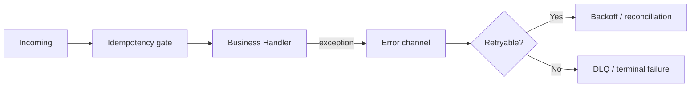

If the gate saved key `K` before the handler, a retry looping back **through the gate** can be blocked. Error handlers do not fix that automatically. Design state machines/transactions and scope retries properly.

### Using Retry Advice Around Endpoints

Ordering among retry advice, transaction advice, and idempotent advice changes which attempts trigger the selector. Test with a fake handler:

```text
Attempt 1: throws retryable exception
Attempt 2: succeeds
Expected:
  business effect committed once
  idempotency state COMPLETED
  no permanently lost event
```

Never claim “using `RequestHandlerRetryAdvice` and `IdempotentReceiverInterceptor` just works” without verifying advice order and transactional boundaries.

### When to Send to a DLQ?

- Input is invalid and cannot self-heal.
- Duplicate key with conflicting payload fingerprint.
- Retry budget exhausted while outcome remains uncertain.
- Payload/schema incompatibility after upgrade.
- Tenant/authorization failure.
- Corrupted idempotency metadata.

DLQ records must include event ID, tenant, operation, reason, and retry/reconciliation state; never log sensitive card numbers/tokens.

## 32. Observability: Measuring Duplicates and Effects, Not Just Inbound Traffic

A system can receive 100,000 messages while processing only 90,000 unique operations. Metrics counting only inbound volume easily confuse traffic with business throughput.

### Suggested Metrics

| Metric | Meaning |
| --- | --- |
| `receiver.messages.received` | Total incoming messages |
| `receiver.keys.new` | Keys reserved for the first time |
| `receiver.messages.duplicates` | Messages with previously known keys |
| `receiver.keys.conflict` | Duplicate key with differing fingerprint |
| `receiver.keys.processing` | Operations currently processing |
| `receiver.keys.completed` | Completed operations |
| `receiver.keys.stale_lease` | Expired leases |
| `receiver.reconciliations` | Verifications of uncertain outcomes |
| `receiver.effect.commits` | Real committed business effects |
| `receiver.effect.retries` | Actual retries |
| `receiver.replay_results` | Stored results returned |
| `receiver.store.errors` | Metadata store errors |
| `receiver.outbox.backlog` | Pending outbound effects/events |

### Structured Logs

```text
eventId=E-101 tenant=merchant-42
operation=RECORD_CAPTURE_EVENT
state=NEW
action=RESERVED

eventId=E-101 tenant=merchant-42
operation=RECORD_CAPTURE_EVENT
state=COMPLETED
resultRef=LEDGER-401

eventId=E-101 tenant=merchant-42
operation=RECORD_CAPTURE_EVENT
state=COMPLETED
action=DUPLICATE_REPLAYED
```

These are illustrative logs, not default Spring Integration outputs.

Avoid putting individual `eventId`/`idempotencyKey` values into high-cardinality metric labels. Use logs/traces to look up specific events; for sensitive keys, log hashes or sanitized references.

### Distinguishing Three Kinds of Success

```text
MESSAGE_ACCEPTED:
    Channel accepted the message.

IDEMPOTENCY_RESERVED:
    A worker claimed the logical key.

BUSINESS_COMPLETED:
    Effect committed and state is queryable.
```

A `RESERVED` record does not prove the effect completed. Dashboards should display these states separately.

## 33. Common Design Mistakes

### 33.1. Using `MessageHeaders.id` for Deduplication

New messages on redelivery receive different IDs. Use stable event/business IDs.

### 33.2. Check-Then-Add in Two Operations

Two threads can slip through together. Use atomic `putIfAbsent` or DB uniqueness/transactions.

### 33.3. Using In-RAM Metadata Stores Across Multiple Pods

Each pod sees the same key as new. Use shared/atomic stores or DB business uniqueness.

### 33.4. Marking Seen Before Effect Without Handling Failures

Crashing between steps loses the operation. Use transactions or state machines/recovery.

### 33.5. Unconditionally Deleting Keys When Handlers Throw

The effect may have committed while the response failed. Retrying after deletion can duplicate effects. Reconcile outcomes first.

### 33.6. Treating the `duplicateMessage` Header as Skipping the Handler

Depends on interceptor configuration; verify actual invocation/discard/throw behavior.

### 33.7. Sharing One Key Across Independent Subscribers

Ledger processes and blocks notification. Namespace by operation/subscriber.

### 33.8. Blocking Children by Using `correlationId` as Dedup Key

All children in a group share the correlation ID. Keys must identify each logical child/effect.

### 33.9. Returning Gateway Timeouts on Duplicate Requests

If the effect already completed, return the stored result; if still processing, return pending/wait per contract.

### 33.10. Skipping Payload Fingerprint Checks

Same key with a different amount must be a conflict, never silently accepted or silently ignored.

### 33.11. Overly Short TTLs

Keys expire before the replay/redelivery window and old duplicates pass through. Retention must match SLAs.

### 33.12. Using Leases Without Fencing

A revived stale worker can commit after a new worker acquired the lease. Fencing/unique effects are needed.

### 33.13. Equating a `MetadataStore` with Exactly-Once

Selectors are only one component. Exactly-once business effects require transactions/idempotency/reconciliation.

### 33.14. Testing Duplicates Only Sequentially

Tests miss check-then-act races. Include concurrent-key, multi-instance, and crash tests.

## 34. Lab Exercise: Order Payment Event Receiver

**Context:** An application receives `OrderPaid` events from two merchants. Each event arrives via a broker and may redeliver. Each order triggers two effects: posting a payment ledger entry and sending a confirmation.

### Part A — In-JVM Gate

1. Create immutable `OrderPaid(merchantId,eventId,orderId,amount)`.
2. Define `IdempotencyKey(merchantId,eventId,operationType)`.
3. Build a gate with `ConcurrentHashMap.newKeySet().add`.
4. Use Spring Integration Java DSL to filter already-processed keys.
5. Send the same event twice with **two different Message IDs**.
6. Assert the processor runs once and duplicates go to a separate queue.
7. Send multiple distinct events for the same merchant; verify all process.
8. Send the same `eventId` for different merchants; verify no false blocking.
9. Use 20 threads and `CountDownLatch` sending the same key; assert one winner.
10. Explain why the tests still do not prove safety across restarts.

### Part B — Testing Failures and Recovery

11. Simulate the handler throwing after the gate accepted the key.
12. Write a test proving retries get blocked if the gate only tracks “seen”.
13. Design `PROCESSING`, `COMPLETED`, and `FAILED_RETRYABLE`.
14. Enforce a DB unique constraint on the operation key.
15. Place idempotency marker, business write, and outbox in one DB transaction where possible.
16. Simulate crashing after DB commit before broker ACK.
17. Redeliver and assert only one ledger entry exists.
18. Simulate an external API timing out after executing the effect; reconcile before retrying.
19. Test reusing an idempotency key with a different amount; must report conflict.
20. Design leases/fencing for workers dying while `PROCESSING`.

### Part C — Multi-Service and EIP

21. Create ledger and notification branches with **separate operation namespaces**.
22. When a Splitter emits N children, attach per-child idempotency keys by child index/event ID.
23. Feed results into an Aggregator and test that duplicate children do not trigger premature release.
24. Add a Gateway returning cached results for completed duplicate requests.
25. Simulate error channels/retry advice; verify states do not get stuck.
26. Run two instances sharing a store, rather than two independent RAM sets.
27. Set key retention long enough for the replay window.
28. Add metrics for `new/duplicate/completed/conflict/stale` and structured logs.

### Test Matrix to Satisfy

| Scenario | Expected Result |
| --- | --- |
| Same event sent twice sequentially | One effect, one duplicate |
| Same logical event with different Message IDs | Still treated as duplicate |
| Two distinct keys | Two valid effects |
| Same `eventId` across different tenants | Not wrongly blocked when identities are valid |
| 20 threads racing on same key | One winner in shared atomic gate |
| Two pods with isolated RAM | Test exposes double-effect risk |
| Two pods + DB unique transaction | Never two commits for same business key |
| Crash after claim, before effect | Retry/recovery does not lose operation |
| Crash after effect commit, before ACK | Redelivery does not duplicate effect |
| Duplicate key with different request payload | Conflict, effect not executed |
| Completed key and Gateway retry | Stored result replayed |
| Lease expires, old worker returns | Stale worker cannot commit |
| Splitter creates three children in same group | All three valid children processed |
| Child redelivered into Aggregator | Does not count as an extra logical contribution |
| Key TTL expires before replay window | Test exposes retention limit |

### Self-Assessment Questions

**Question 1.** Why is `ConcurrentHashMap.newKeySet().add` better than `contains` followed by `add`?

*Because `add` decides and inserts atomically within the JVM's set, preventing two threads from passing the check together.*

**Question 2.** Does an in-RAM atomic gate guarantee business effects occur strictly once across crashes?

*No. If the key was recorded before the effect committed, retries may be blocked; if the effect committed before metadata updated, retries may duplicate the effect.*

**Question 3.** Why avoid using `MessageHeaders.id` as an idempotency key?

*Because the same logical event can be wrapped in new Spring Messages with different IDs upon redelivery.*

**Question 4.** Does `IdempotentReceiverInterceptor` always drop duplicates?

*Never assume so. Flagging, discarding, or throwing depends on configuration; test handler invocations and output channels.*

**Question 5.** Should ledger and notification share the same key?

*Not if they are two independent effects requiring separate retries/commits. Namespace by operation type.*

**Question 6.** Why does a 20-thread test not prove safety across two pods?

*Because two pods might use separate stores. A shared atomic store or unique constraint plus cross-process restart/concurrency tests are required.*

**Question 7.** When a key is already `COMPLETED` and the client retries the same request, what should the API do?

*Return the stored result if the fingerprint matches; do not re-execute the effect.*

**Question 8.** What if the key matches yet the amount differs?

*Report a conflict and preserve the initial effect; never process the new request under the old key.*

**Question 9.** Why might retaining keys for 24 hours be insufficient?

*Brokers or business workflows may replay after 24 hours. Purged keys let duplicates look new unless another business uniqueness guard exists.*

**Question 10.** Can retry advice, idempotent advice, and transactions be ordered arbitrarily?

*No. Ordering determines whether selectors re-run and which transaction retries execute in. Run fault-injection tests matching the real topology.*

## 35. Production Checklist

- **Logical identity:** key binds properly to tenant, event/business operation, and stage.
- **Canonical key:** collision-free; excludes message IDs, attempts, and timestamps.
- **Authorization:** tenant and business IDs come from trusted sources.
- **Atomic claim:** backend supports genuinely atomic `putIfAbsent`/unique constraints.
- **Multi-node:** does not rely on one pod's RAM.
- **Payload fingerprint:** matching key with differing payload raises an explicit conflict.
- **Processing state:** distinguishes `NEW`, `PROCESSING`, `COMPLETED`, and `REVIEW`.
- **Transaction:** business effect and completion marker commit atomically when sharing a DB.
- **External effects:** uses provider idempotency keys, outboxes, or reconciliation.
- **Lease/fencing:** stale workers cannot commit after losing ownership.
- **Retries:** handles crashes between reserve/effect/complete/ack.
- **TTL:** retention aligns with replay/redelivery horizons and audit rules.
- **Duplicate policy:** discard/mark/throw/replay behavior is contractually explicit.
- **Gateway:** duplicate requests return cached results or pending status instead of timing out blindly.
- **Routing:** separate namespaces per subscriber/operation.
- **Splitter:** separate keys per child; never use group correlation ID as dedup key.
- **Aggregator:** counts unique logical contributions; prevents duplicates from poisoning groups.
- **Error channel:** explicitly handles retryable, conflict, invalid, and unknown outcomes.
- **Observability:** measures received, reserved, completed, duplicate, conflict, stale, and effect commits.
- **Tests:** sequential duplicates, distinct Message IDs, tenant isolation, 20-thread races, multi-pod, crashes, transaction replays, and key expiry.

## 36. Conclusion

**Testing duplicate messages and concurrency** is core to Idempotent Receiver in Spring Integration. Thorough testing goes beyond sending the same message twice sequentially; it tests **multiple threads contending on one key**, one logical event wrapped in different Message IDs, multiple valid operations, and crash/retry windows.

In demos, `ConcurrentHashMap.newKeySet().add` and Spring Integration `Filter` show how to block a logical key atomically inside one JVM. `IdempotentReceiverInterceptor` paired with `MetadataStoreSelector` provides advice-based integration, yet **duplicate behavior and protection scope must be explicitly configured and tested**.

In production, **idempotent message selection does not equal exactly-once business effects**. You need trustworthy business keys, shared atomic stores or database uniqueness, transactions/outboxes, result replay, state machines, proper TTLs, reconciliation for uncertain outcomes, and dedicated idempotency per side effect. Only once those guarantees are measured and tested can a Spring Integration Router/Filter/Splitter/Aggregator/Gateway pipeline withstand duplicate deliveries, concurrency, and retries without losing or duplicating business work.
